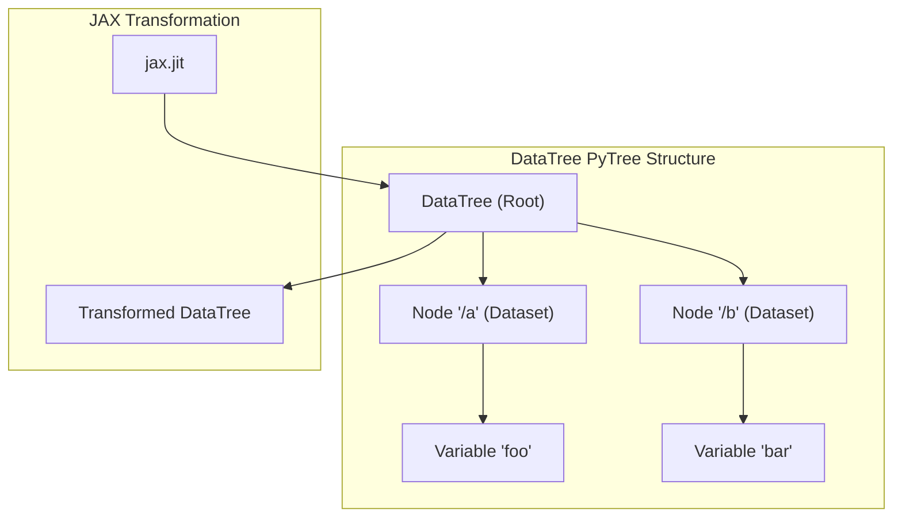
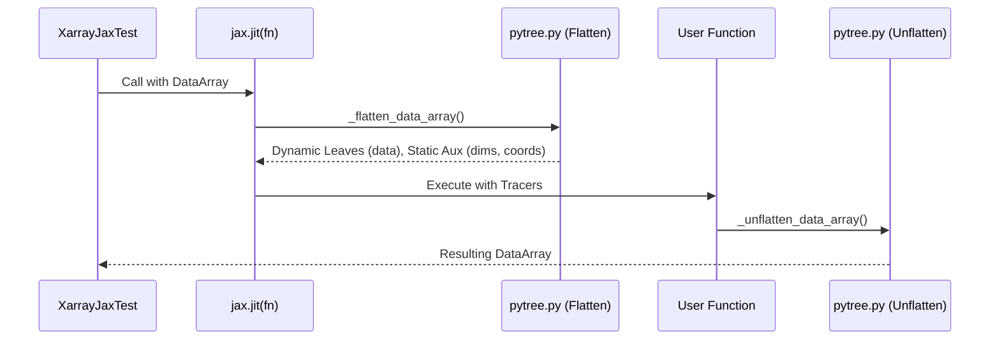

<!-- source: DeepWiki mcp.deepwiki.com · repo google-deepmind/xarray_jax · page 6.1 Integration Tests (xarray_jax_test.py) · fetched 2026-10-26 -->

# Integration Tests (xarray_jax_test.py)

Relevant source files

The following files were used as context for generating this wiki page:

- [xarray_jax/tests/xarray_jax_test.py](xarray_jax/tests/xarray_jax_test.py)

The integration test suite in `xarray_jax_test.py` validates the end-to-end compatibility of `xarray` data structures with JAX transformations. It ensures that `xarray.Variable`, `DataArray`, `Dataset`, and `DataTree` objects can flow through `jax.jit`, `jax.grad`, and JAX's Ahead-of-Time (AOT) compilation pipeline without losing metadata or triggering unexpected NumPy conversions.

## Purpose and Scope

The primary goal of these tests is to verify that `xarray_jax` correctly bridges the gap between `xarray`'s metadata-heavy objects and JAX's functional requirements. The suite covers:
*   **Transformation Integrity**: Ensuring `jit`, `grad`, and `vmap` work with tracers.
*   **Metadata Preservation**: Verifying that dimensions, coordinates, and attributes survive round-trips through JAX.
*   **Static vs. Dynamic handling**: Confirming that metadata is treated as static (triggering recompilation on change) while data remains dynamic.
*   **Feature Parity**: Testing advanced `xarray` features like `stack`/`unstack`, `sel`/`isel`, and `DataTree` hierarchies within JAX-transformed functions.

## Key Test Patterns

### JIT and Gradient Flow
The tests verify that `xarray` objects can be passed as arguments to JIT-compiled functions and that gradients can be backpropagated through `xarray` operations.

| Test Case | Description |
| :--- | :--- |
| `test_jax_xarray_variable` | Validates `xarray.Variable` with `jit` and `grad` using `xarray.ufuncs`. [xarray_jax/tests/xarray_jax_test.py:27-49]() |
| `test_jax_xarray_data_array` | Validates `DataArray` operations including `sel`, `concat`, and `stack`. [xarray_jax/tests/xarray_jax_test.py:50-75]() |
| `test_jax_xarray_dataset` | Validates `Dataset` multi-variable operations and coordinate alignment. [xarray_jax/tests/xarray_jax_test.py:76-107]() |

### AOT Compilation and Shape Evaluation
These tests ensure that `xarray_jax` supports JAX's lower-level compilation APIs, which are critical for production deployments and shape-safe programming.

*   **AOT Compilation**: Uses `jax.jit(...).lower(...).compile()` to verify that `xarray` objects can be lowered to XLA HLO. [xarray_jax/tests/xarray_jax_test.py:129-138]()
*   **Shape Evaluation**: Uses `jax.eval_shape` to verify that `xarray` objects can be processed by JAX to determine output shapes/dtypes without performing actual computation. [xarray_jax/tests/xarray_jax_test.py:236-243]()

### Integration with DataTree
The suite includes tests for `DataTree`, verifying that hierarchical data structures are correctly registered as PyTrees and can be manipulated inside JIT.

*Sources: [xarray_jax/tests/xarray_jax_test.py:245-263]()*

## Advanced Feature Validation

### JAX Coordinates (jax_coords)
Tests validate the experimental `jax_coords` feature, ensuring that coordinates marked as JAX-compatible remain dynamic tracers during JIT and do not trigger index creation.

*   **Index Suppression**: Verifies that `jax_coords` do not appear in `inputs.indexes`. [xarray_jax/tests/xarray_jax_test.py:172-172]()
*   **Tracer Preservation**: Ensures that inside a JIT-compiled function, `jax_coords` are passed as `jax.Array` (tracers) rather than NumPy arrays. [xarray_jax/tests/xarray_jax_test.py:180-181]()

### Arithmetic Compatibility
The `arithmetic_compat` setting is tested to ensure that `xarray` objects can interact with JAX Tracers using standard operators (e.g., `+`, `-`) without triggering `TracerBoolConversionError`.

*   **Override Mode**: Tests that `xarray_jax.arithmetic_compat('override')` allows `DataArray + jnp.array` operations. [xarray_jax/tests/xarray_jax_test.py:218-226]()

### Coordinate Assignment Variants
The suite distinguishes between standard `assign_coords` (which creates indices) and `assign_jax_coords` (which treats coordinates as data variables).

| Method | Behavior in JAX | File Reference |
| :--- | :--- | :--- |
| `assign_coords` | Creates static index; triggers recompilation if values change. | [xarray_jax/tests/xarray_jax_test.py:192-195]() |
| `assign_jax_coords` | Creates dynamic coordinate; no index created; no recompilation. | [xarray_jax/tests/xarray_jax_test.py:202-205]() |

## Error Handling and Constraints
The integration tests also document known limitations by asserting specific failures:
*   **NumPy Conversion**: Verifies that calling `.values` or `.item()` on an `xarray` object inside JIT raises `jax.errors.TracerArrayConversionError`. [xarray_jax/tests/xarray_jax_test.py:139-144]()
*   **Boolean Contexts**: Confirms that using `xarray` objects in Python `if` statements inside JIT fails as expected. [xarray_jax/tests/xarray_jax_test.py:211-216]()

## System Data Flow Diagram

This diagram illustrates how a `DataArray` flows through a JIT-compiled function as verified by `XarrayJaxTest`.

*Sources: [xarray_jax/tests/xarray_jax_test.py:151-162](), [xarray_jax/pytree.py:166-189]()*

## Summary of Test Classes

| Class | Purpose |
| :--- | :--- |
| `XarrayJaxTest` | Main suite for `Variable`, `DataArray`, `Dataset`, and `DataTree` integration. [xarray_jax/tests/xarray_jax_test.py:25-263]() |
| `test_jit_function_...` | Specific methods testing JIT cache hits and recompilation logic. [xarray_jax/tests/xarray_jax_test.py:108-128]() |
| `test_grad_function_...` | Specific methods testing gradient computation through xarray objects. [xarray_jax/tests/xarray_jax_test.py:146-150]() |

**Sources:**
*   [xarray_jax/tests/xarray_jax_test.py:1-263]()
*   [xarray_jax/pytree.py:166-189]() (Referenced for internal PyTree logic)

---

