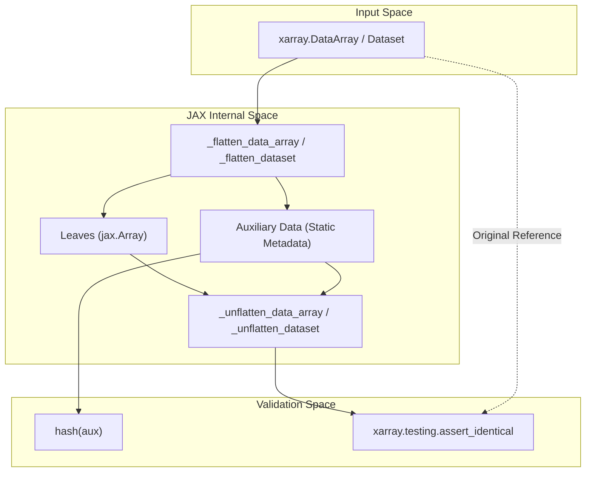
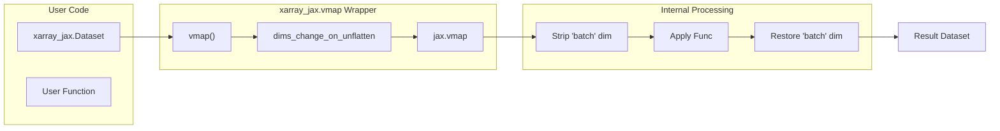

<!-- source: DeepWiki mcp.deepwiki.com · repo google-deepmind/xarray_jax · page 6.2 PyTree and Transform Tests (pytree_test.py, jax_transforms_test.py) · fetched 2026-10-26 -->

# PyTree and Transform Tests (pytree_test.py, jax_transforms_test.py)

Relevant source files

The following files were used as context for generating this wiki page:

- [xarray_jax/tests/jax_transforms_test.py](xarray_jax/tests/jax_transforms_test.py)
- [xarray_jax/tests/pytree_test.py](xarray_jax/tests/pytree_test.py)

This page documents the unit and functional tests for the PyTree registration logic and JAX transformation wrappers in `xarray_jax`. These tests ensure that xarray data structures can be seamlessly flattened and unflattened by JAX while maintaining metadata integrity across transformations like `vmap`, `pmap`, and `scan`.

## PyTree Unit Tests (`pytree_test.py`)

The PyTree tests validate the core registration of `xarray.Variable`, `DataArray`, `Dataset`, and `DataTree` as JAX PyTrees. The primary goal is to ensure that the separation of dynamic data (leaves) and static metadata (auxiliary data) is robust and JIT-compatible.

### Flatten and Unflatten Round-trips
The test suite performs round-trip validation for all major xarray types. It verifies that:
1.  **Auxiliary Data Hashability**: The `aux` metadata returned by flatten functions is hashable and comparable, which is a requirement for JAX to cache JIT-compiled functions [xarray_jax/tests/pytree_test.py:31-33]().
2.  **Equality Preservation**: Unflattened objects are identical to the original objects using `xarray.testing.assert_identical` or `.equals()` [xarray_jax/tests/pytree_test.py:35,49,67,90]().

### Dimension Change Handling
The `dims_change_on_unflatten` context manager is tested by simulating operations that change array rank (e.g., `jnp.expand_dims` or `jnp.squeeze`). 
- **Added Dimensions**: Tests verify that wrapping a `tree_map` in a dimension-changing context correctly updates the `dims` metadata of the resulting `DataArray` [xarray_jax/tests/pytree_test.py:113-116]().
- **Removed Dimensions**: Tests confirm that when a dimension is squeezed out, it is removed from both the `dims` list and the coordinates of the resulting `Dataset` [xarray_jax/tests/pytree_test.py:132-138]().

### NonArrayLeafWrapper
The `NonArrayLeafWrapper` is a shim used when a PyTree leaf is not a standard array (e.g., `jax.ShapeDtypeStruct` during `eval_shape`). Tests ensure:
- **Identity Preservation**: The wrapper preserves the original leaf object [xarray_jax/tests/pytree_test.py:165-168]().
- **Duck-Typing**: The wrapper provides `.shape` and `.dtype` attributes so that `xarray` constructors accept it as valid data [xarray_jax/tests/pytree_test.py:179-180]().

### PyTree Data Flow Diagram
The following diagram illustrates how the test suite validates the transformation of xarray objects into JAX-compatible structures.

**Title: PyTree Flatten/Unflatten Validation Flow**

Sources: [xarray_jax/tests/pytree_test.py:38-50](), [xarray_jax/tests/pytree_test.py:51-68]()

---

## JAX Transform Tests (`jax_transforms_test.py`)

These tests validate the specialized wrappers for JAX transformations. Because xarray objects contain metadata that must be synchronized with array transformations, these wrappers perform complex "flatten-transform-unflatten" lifecycles.

### vmap and pmap Tests
The tests for `xarray_jax.vmap` and `xarray_jax.pmap` focus on dimension stripping and coordinate handling.
- **Dimension Stripping**: Inside the vmapped function, the mapped dimension (e.g., `'batch'`) must be absent from the `dims` of the input object [xarray_jax/tests/jax_transforms_test.py:33-35]().
- **JAX Coordinates**: Tests verify that `jax_coords` (coordinates backed by JAX arrays) are correctly vmapped alongside data variables. Inside the function, the vmapped coordinate should lose its mapped dimension but remain a JAX array [xarray_jax/tests/jax_transforms_test.py:68-75]().
- **Leading Axis Constraint**: The suite validates that `vmap` raises a `ValueError` if the specified dimension is not at index 0 of the underlying array [xarray_jax/tests/jax_transforms_test.py:121-123]().
- **Axis Names**: Tests confirm that `axis_name` is correctly forwarded to `jax.vmap`, allowing collective operations like `jax.lax.psum` inside the mapped function [xarray_jax/tests/jax_transforms_test.py:135-140]().

### Scan Tests
The `xarray_jax.scan` tests ensure that the state (carry) and the scanned sequences are handled correctly.
- **Automatic Transposition**: Unlike standard `jax.lax.scan`, `xarray_jax.scan` allows the scan dimension to be anywhere in the input. The wrapper transposes it to axis 0 before scanning and restores it afterward [xarray_jax/tests/jax_transforms_test.py:246-248]().
- **Carry Semantics**: Tests verify that the "carry" object (e.g., a `Dataset` representing state) maintains its structure across scan iterations [xarray_jax/tests/jax_transforms_test.py:252-254]().

### Transform Lifecycle Diagram
This diagram maps the natural language concept of "mapping over a dimension" to the specific code entities involved in the transformation.

**Title: xarray_jax.vmap Execution Lifecycle**

Sources: [xarray_jax/tests/jax_transforms_test.py:25-41](), [xarray_jax/tests/jax_transforms_test.py:180-197]()

### Summary of Key Test Cases

| Test Case | Feature Validated | Key Assertion |
| :--- | :--- | :--- |
| `test_vmap_with_jax_coords` | Experimental `jax_coords` support | `assertIsInstance(d.coords['time'].data, jax.Array)` [xarray_jax/tests/jax_transforms_test.py:74]() |
| `test_vmap_complains_when_dim_not_first` | Dimension ordering constraints | `assertRaisesRegex(ValueError, ...)` [xarray_jax/tests/jax_transforms_test.py:121-122]() |
| `test_scan_with_dataset` | Sequence processing with metadata | `xarray.testing.assert_allclose(...)` [xarray_jax/tests/jax_transforms_test.py:270]() |
| `test_flatten_unflatten_datatree` | Hierarchical data support | `datatree.equals(roundtrip)` [xarray_jax/tests/pytree_test.py:90]() |
| `test_preserves_leaf_identity` | `NonArrayLeafWrapper` behavior | `assertIs(unflattened_var.data.leaf, leaf)` [xarray_jax/tests/pytree_test.py:168]() |

Sources: [xarray_jax/tests/pytree_test.py:1-180](), [xarray_jax/tests/jax_transforms_test.py:1-280]()

---

