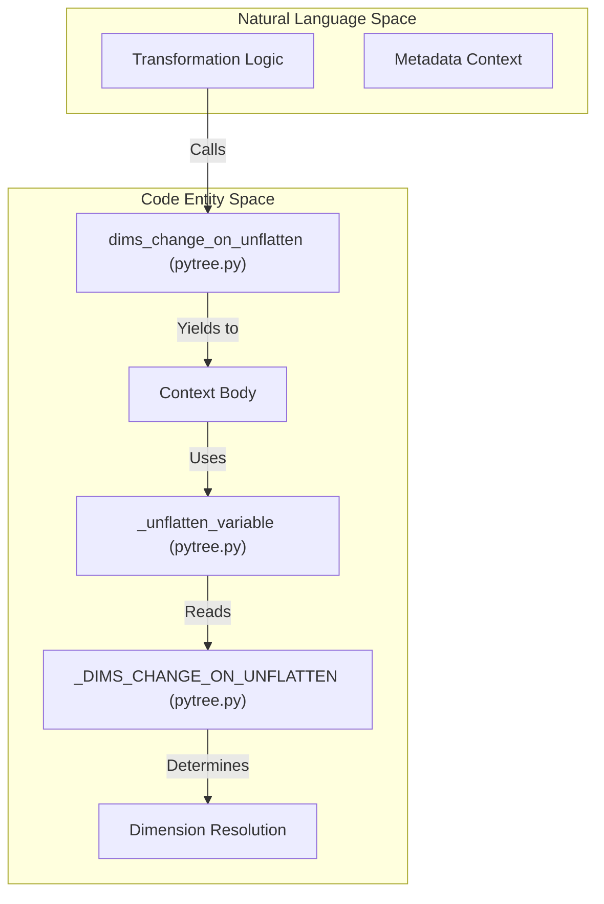
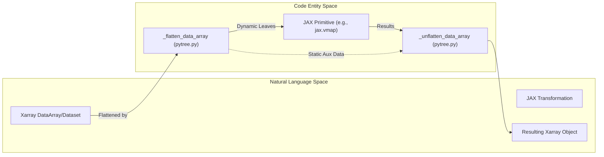

<!-- source: DeepWiki mcp.deepwiki.com · repo google-deepmind/xarray_jax · page 7.1 Contributing Guide · fetched 2026-10-26 -->

# Contributing Guide

Relevant source files

The following files were used as context for generating this wiki page:

- [CONTRIBUTING.md](CONTRIBUTING.md)

This page provides a comprehensive guide for developers looking to contribute to the `xarray_jax` project. It covers the legal requirements, the technical workflow for submitting changes, and the architectural considerations necessary for maintaining the project's integrity as a bridge between Xarray and JAX.

## 1. Contributor License Agreement (CLA)

Before any contribution can be accepted, contributors must have a signed Contributor License Agreement (CLA) on file with Google. This agreement clarifies that the contributor (or their employer) retains copyright while granting permission to use and redistribute the contribution as part of the project [CONTRIBUTING.md:7-13]().

*   **Status Check:** You can verify your current agreements or sign a new one at [https://cla.developers.google.com/](https://cla.developers.google.com/).
*   **One-time Requirement:** If you have previously submitted a CLA for another Google open-source project, you generally do not need to sign it again [CONTRIBUTING.md:15-17]().

## 2. Pull Request Workflow

All changes to the codebase, including those from core maintainers, must undergo a formal code review process via GitHub Pull Requests (PRs) [CONTRIBUTING.md:21-22]().

### 2.1. Proposal Process
For substantial architectural changes or modifications that may break backward compatibility, contributors are strongly advised to open a GitHub issue first. This allows for feedback on the design before significant effort is invested in implementation [CONTRIBUTING.md:3-5]().

### 2.2. Development Environment
When preparing a PR, ensure that the code aligns with the internal PyTree registration logic and transformation wrappers.

*   **PyTree Logic:** Any new data structure must be registered using `jax.tree_util.register_pytree_node`. Refer to `pytree.py` for existing implementations of `Variable`, `DataArray`, `Dataset`, and `DataTree` [xarray_jax/pytree.py:1-411]().
*   **Coordinate Management:** Changes affecting coordinates should respect the distinction between static metadata (handled by `_HashableCoords`) and dynamic `jax_coords` [xarray_jax/core.py:343-376]().

### 2.3. Testing Requirements
Contributors must ensure that all new features or bug fixes are accompanied by tests. The project utilizes `absl-py` and `chex` for its test suite.

| Test Category | File Path | Focus |
| :--- | :--- | :--- |
| **Integration** | `xarray_jax_test.py` | Validates `jax.jit`, `jax.grad`, and AOT compilation across Xarray structures [xarray_jax/xarray_jax_test.py:1-443](). |
| **PyTree** | `pytree_test.py` | Ensures flatten/unflatten round-trips and metadata preservation [xarray_jax/pytree_test.py:1-125](). |
| **Transforms** | `jax_transforms_test.py` | Tests `vmap`, `pmap`, and `scan` wrappers [xarray_jax/jax_transforms_test.py:1-137](). |

Sources: [CONTRIBUTING.md:1-30](), [xarray_jax/pytree.py:1-411](), [xarray_jax/core.py:1-554](), [xarray_jax/xarray_jax_test.py:1-443]()

## 3. Implementation Patterns for Contributors

When contributing new functionality, follow the established patterns for handling Xarray objects within JAX transformations.

### 3.1. Handling Dimension Changes
If a contribution involves a JAX transformation that alters array rank (e.g., `vmap` or `scan`), use the `dims_change_on_unflatten` context manager. This ensures that the metadata in the "unflattened" Xarray object correctly reflects the temporary shape of the JAX Tracers.

**Data Flow: Dimension Synchronization**
The following diagram illustrates how the `dims_change_on_unflatten` context manager in `pytree.py` interacts with the global `_DIMS_CHANGE_ON_UNFLATTEN` state to allow metadata modification during JAX transformations.

Sources: [xarray_jax/pytree.py:38-72](), [xarray_jax/pytree.py:100-112]()

### 3.2. Adding New JAX Wrappers
If adding a new wrapper (e.g., `jax.lax.while_loop`), the implementation should follow the pattern established in `jax_transforms.py`:
1.  **Flatten:** Use `jax.tree_util.tree_flatten` to extract dynamic leaves.
2.  **Transform:** Apply the underlying JAX primitive.
3.  **Unflatten:** Reconstruct the Xarray object while ensuring coordinates and attributes are preserved [xarray_jax/jax_transforms.py:48-83]().

**Component Interaction: Transformation Lifecycle**
This diagram maps the lifecycle of an Xarray object passing through an `xarray_jax` transformation wrapper.

Sources: [xarray_jax/pytree.py:171-197](), [xarray_jax/pytree.py:214-239](), [xarray_jax/jax_transforms.py:102-126]()

## 4. Community Guidelines

The `xarray_jax` project follows **Google's Open Source Community Guidelines**. Contributors are expected to maintain a professional and respectful environment [CONTRIBUTING.md:28-29]().

### 4.1. Technical Standards
*   **Type Hinting:** Use explicit type hints for all public functions.
*   **Docstrings:** Provide Google-style docstrings for new classes and functions, explaining parameters and return types.
*   **Pure Functions:** Ensure that any logic intended for use within `jax.jit` or `jax.vmap` remains functionally pure. Avoid side effects in the `flatten` and `unflatten` methods of PyTrees.

Sources: [CONTRIBUTING.md:26-30](), [xarray_jax/pytree.py:1-411]()

---

