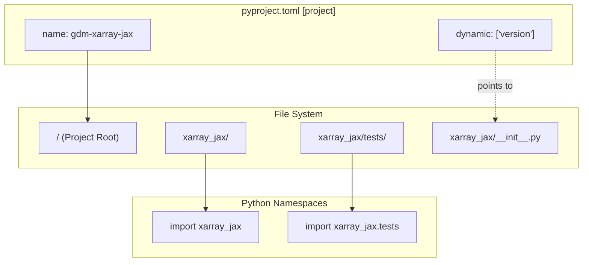
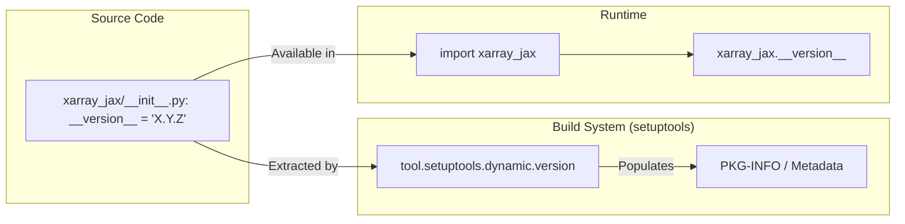

<!-- source: DeepWiki mcp.deepwiki.com · repo google-deepmind/xarray_jax · page 7.2 Package Configuration and Versioning · fetched 2026-10-26 -->

# Package Configuration and Versioning

Relevant source files

The following files were used as context for generating this wiki page:

- [pyproject.toml](pyproject.toml)

This page documents the build system, dependency management, and versioning strategy for the `xarray_jax` package. The project utilizes modern Python packaging standards centered around `pyproject.toml` and `setuptools`.

## Build System and Package Discovery

The `xarray_jax` package uses `setuptools` as its primary build backend [pyproject.toml:1-3](). The configuration ensures that both the core library and its associated test suite are included in the distribution.

### Package Discovery Configuration
The package discovery is explicitly defined to include two main namespaces:
1.  `xarray_jax`: The primary library containing core logic, PyTree registrations, and JAX transformations [pyproject.toml:44]().
2.  `xarray_jax.tests`: The internal test suite [pyproject.toml:44]().

### Metadata to Code Mapping
The following diagram illustrates how the `pyproject.toml` configuration maps to the physical file structure and Python namespaces.

**Package Structure Mapping**

Sources: [pyproject.toml:5-7](), [pyproject.toml:40-44]()

## Dependency Management

`xarray_jax` defines strict minimum version requirements for its core scientific stack to ensure compatibility with JAX's PyTree registry and `xarray`'s internal indexing APIs.

### Core Dependencies
The project requires Python 3.13 or higher [pyproject.toml:12](). The runtime dependencies are:

| Dependency | Minimum Version | Purpose |
| :--- | :--- | :--- |
| `jax` | `>=0.4.30` | Core transformation engine and PyTree registration [pyproject.toml:25](). |
| `xarray` | `>=2026.01.0` | Data structures and metadata management [pyproject.toml:27](). |
| `numpy` | `>=1.24` | Underlying array manipulation and type definitions [pyproject.toml:26](). |

### Optional Dependencies
For development and continuous integration, the package defines an `optional-dependencies` group named `test` [pyproject.toml:30-31](). This includes:
*   `absl-py`: Used for test parameterization and logging [pyproject.toml:32]().
*   `chex`: Used for JAX-specific assertions and array property verification [pyproject.toml:33]().

Sources: [pyproject.toml:12-34]()

## Versioning Strategy

The package employs **dynamic versioning**. Rather than hardcoding the version string within `pyproject.toml`, the build system extracts it directly from the source code.

### Implementation Details
The `setuptools` dynamic versioning attribute is configured to read from `xarray_jax.__version__` [pyproject.toml:40-41](). This approach ensures a single source of truth for the version number, accessible both by the build system and at runtime via the library's top-level namespace.

**Data Flow: Version Resolution**

Sources: [pyproject.toml:7](), [pyproject.toml:40-41]()

## Project Metadata

The package is licensed under the **Apache-2.0** license [pyproject.toml:10-11](). It is categorized under `Science/Research` and `Scientific/Engineering` topics, reflecting its focus on high-performance numerical computing [pyproject.toml:18-22]().

The project's home and repository are hosted at: `https://github.com/google-deepmind/xarray_jax` [pyproject.toml:36-38]().

Sources: [pyproject.toml:10-38]()

---

