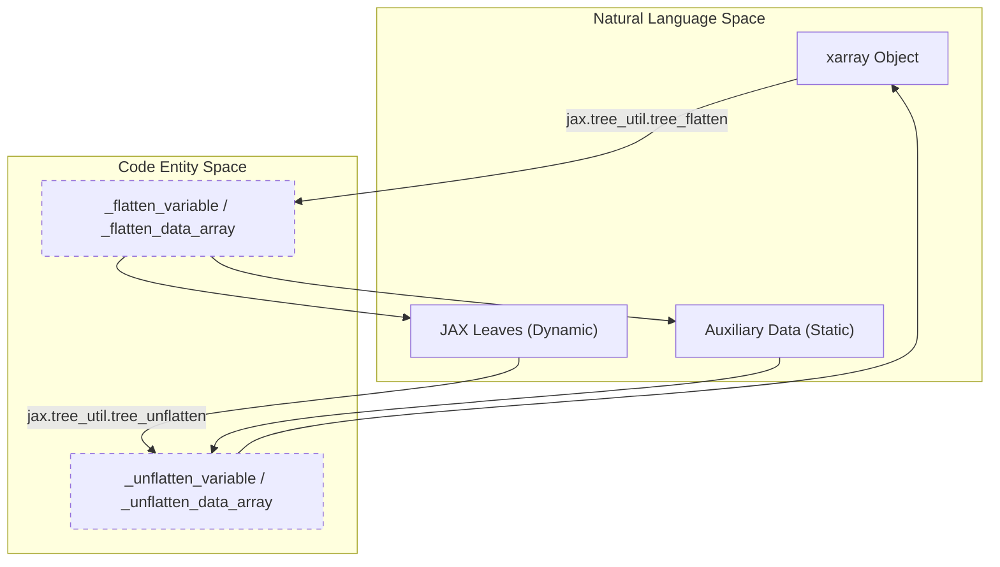
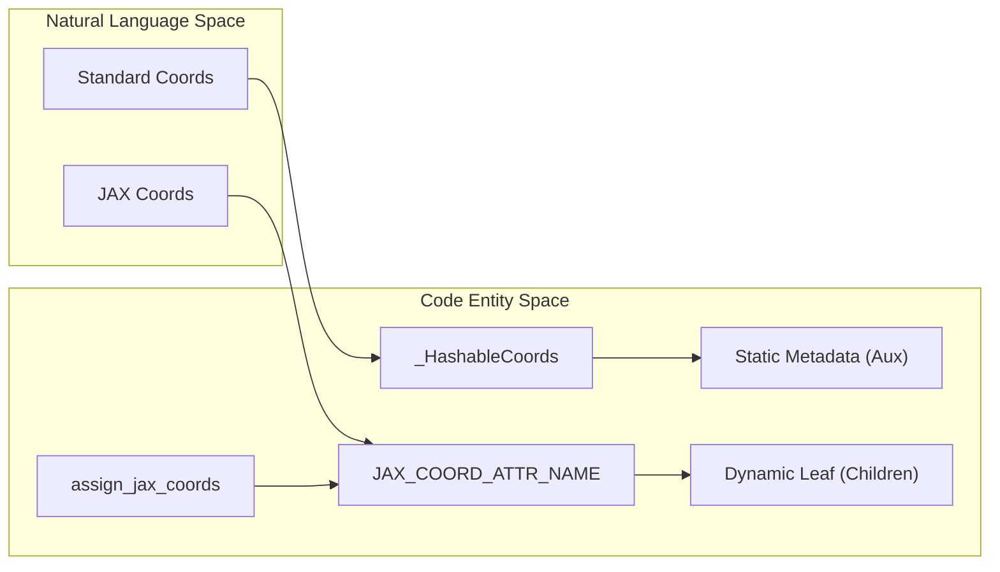

<!-- source: DeepWiki mcp.deepwiki.com · repo google-deepmind/xarray_jax · page 8 Glossary · fetched 2026-10-26 -->

# Glossary

Relevant source files

The following files were used as context for generating this wiki page:

- [README.md](README.md)
- [xarray_jax/__init__.py](xarray_jax/__init__.py)
- [xarray_jax/core.py](xarray_jax/core.py)
- [xarray_jax/jax_transforms.py](xarray_jax/jax_transforms.py)
- [xarray_jax/pytree.py](xarray_jax/pytree.py)
- [xarray_jax/tests/pytree_test.py](xarray_jax/tests/pytree_test.py)

This glossary defines codebase-specific terms, JAX/xarray integration concepts, and abbreviations used throughout the `xarray_jax` library. It serves as a technical reference for engineers to understand the underlying implementation and data flow.

## Core Concepts

### PyTree Registration
The process of making `xarray` types (`Variable`, `DataArray`, `Dataset`, `DataTree`) compatible with JAX transformations. By registering these types with `jax.tree_util`, JAX can "flatten" them into a list of arrays (leaves) and "unflatten" them back into the original structure using auxiliary metadata [xarray_jax/pytree.py:155-156]().

### Static vs. Dynamic Data
*   **Dynamic Data (Leaves):** The actual array data stored in `xarray.Variable` objects. These are treated as JAX arrays and can be transformed (e.g., via `jit`, `vmap`) [xarray_jax/pytree.py:200-205]().
*   **Static Data (Auxiliary):** Metadata such as dimension names, attributes, and standard coordinates. These are treated as compile-time constants. Changes to these values trigger JAX recompilation [xarray_jax/__init__.py:72-78]().

### jax_coords
An experimental feature allowing coordinates to be treated as dynamic JAX data (tracers) rather than static metadata. This enables coordinates to change within a JIT-compiled function without triggering recompilation [xarray_jax/core.py:49-54]().
*   **Implementation:** Marked by the `_jax_coord` attribute [xarray_jax/core.py:23]().
*   **Constraint:** Cannot be used as index coordinates because xarray's indexing logic is not JIT-compatible [xarray_jax/core.py:53-58]().

### NonArrayLeafWrapper
A duck-typed shim used to wrap non-array values (like Python scalars or `jax.ShapeDtypeStruct`) that JAX might produce during transformations like `jax.eval_shape`. It provides a minimal array-like interface (`shape`, `dtype`, `ndim`) so that `xarray` constructors do not fail when these values are re-inserted into a `DataArray` or `Dataset` [xarray_jax/pytree.py:83-92]().

## System Entity Mapping

The following diagram maps high-level concepts to the specific code entities that implement them.

### Data Flow: Flattening and Unflattening

**Sources:** [xarray_jax/pytree.py:200-215](), [xarray_jax/pytree.py:230-245](), [xarray_jax/pytree.py:265-285]()

### Coordinate Management

**Sources:** [xarray_jax/core.py:23-32](), [xarray_jax/core.py:92-95](), [xarray_jax/pytree.py:314-318]()

## Technical Terms

| Term | Definition | Code Pointer |
| :--- | :--- | :--- |
| **arithmetic_compat** | A global xarray option set to `'override'` to prevent `TracerBoolConversionError` during JIT. | [xarray_jax/__init__.py:173]() |
| **dims_change_on_unflatten** | A context manager used to adjust dimension names when JAX operations change array rank or order. | [xarray_jax/pytree.py:164-192]() |
| **_HashableCoords** | An internal wrapper for `xarray.Coordinates` to make them hashable for JAX cache keys. | [xarray_jax/pytree.py:314-318]() |
| **jax_data** | Utility to extract a JAX array from a `DataArray`, raising an error if the data is not JAX-backed. | [xarray_jax/pytree.py:70-74]() |
| **tree_map_variables** | A specialized `tree_map` that treats `xarray.Variable` as leaves, exposing dimension names to the function. | [xarray_jax/jax_transforms.py:169-173]() |
| **unwrap** | Removes `NonArrayLeafWrapper` to retrieve the underlying leaf value. | [xarray_jax/pytree.py:34-39]() |

## Transformation Lifecycle

When using `xarray_jax.vmap` or `xarray_jax.pmap`, the library manages a specific lifecycle to handle dimension names:

1.  **Flatten:** The input `DataArray`/`Dataset` is flattened into JAX arrays.
2.  **Strip Dim:** `dims_change_on_unflatten` is used to remove the mapped dimension name from the metadata [xarray_jax/jax_transforms.py:66-67]().
3.  **Transform:** The core `jax.vmap` or `jax.pmap` executes the user function.
4.  **Restore Dim:** `dims_change_on_unflatten` is used to prepend the mapped dimension name back onto the result [xarray_jax/jax_transforms.py:88-89]().
5.  **Unflatten:** The result is reconstructed into an `xarray` object.

**Sources:** [xarray_jax/jax_transforms.py:55-91](), [xarray_jax/jax_transforms.py:128-164]()