# Page: Overview

# Overview

<details>
<summary>Relevant source files</summary>

The following files were used as context for generating this wiki page:

- [README.md](README.md)
- [pyproject.toml](pyproject.toml)
- [xarray_jax/__init__.py](xarray_jax/__init__.py)

</details>


`xarray_jax` is a library developed by Google DeepMind to bridge the gap between the labeled multidimensional arrays of [xarray](https://docs.xarray.dev/) and the high-performance numerical computing capabilities of [JAX](https://docs.jax.dev/).

While standard `xarray` objects like `DataArray` and `Dataset` can contain JAX arrays, they are not natively recognized by JAX's transformation engine. `xarray_jax` solves this by registering these structures as **JAX PyTrees** [README.md:23-32](). This enables developers to use xarray objects directly within `jax.jit`, `jax.grad`, and other transformations while preserving dimension names and metadata.

### System Interoperability

The following diagram illustrates how `xarray_jax` positions itself between the user's high-level xarray code and JAX's functional execution model.

**Diagram: xarray_jax Integration Flow**
```mermaid
graph TD
    subgraph "Natural Language Space"
        UserCode["User Logic (xarray API)"]
        JitProcess["JIT Compilation"]
        Output["Labeled Result"]
    end

    subgraph "Code Entity Space"
        XR_Obj["xarray.Dataset / DataArray"]
        Flatten["pytree.py: _flatten_dataset / _flatten_data_array"]
        JAX_Kernel["JAX HLO / XLA"]
        Unflatten["pytree.py: _unflatten_dataset / _unflatten_data_array"]
        
        XR_Obj -->|"jax.tree_util.register_pytree_node"| Flatten
        UserCode --> XR_Obj
        Flatten -->|"Passes Leaves (JAX Arrays)"| JAX_Kernel
        JitProcess --> JAX_Kernel
        JAX_Kernel -->|"Returns Tracers/Arrays"| Unflatten
        Unflatten -->|"Restores Metadata"| Output
    end

    Sources: [xarray_jax/pytree.py:1-400](), [README.md:23-33]()
```

### Core Capabilities

*   **PyTree Registration**: Automatically handles the "flattening" of xarray objects into JAX-compatible leaves and "unflattening" them back into xarray objects [README.md:28-33]().
*   **Transformation Wrappers**: Provides specialized versions of JAX transformations like `vmap`, `pmap`, and `scan` that are aware of xarray dimension names [xarray_jax/__init__.py:97-103]().
*   **Coordinate Management**: Handles the tension between static metadata (coordinates) and dynamic data (JAX arrays). It defaults to treating coordinates as static metadata, causing recompilation if they change [xarray_jax/__init__.py:72-78]().
*   **Global Compatibility**: Automatically configures xarray's `arithmetic_compat` to `'override'` to prevent `TracerBoolConversionError` during JIT-compiled arithmetic operations [xarray_jax/__init__.py:173-173]().

### Package Structure

The library is organized into three primary functional areas:

| Module | Responsibility | Key Entities |
| :--- | :--- | :--- |
| `core.py` | High-level constructors and coordinate logic. | `DataArray`, `Dataset`, `Variable`, `assign_jax_coords` |
| `pytree.py` | JAX integration and data extraction. | `jax_data`, `jax_vars`, `dims_change_on_unflatten` |
| `jax_transforms.py` | Dimension-aware JAX transformations. | `vmap`, `pmap`, `scan`, `tree_map_with_dims` |

**Diagram: Module Relationship**
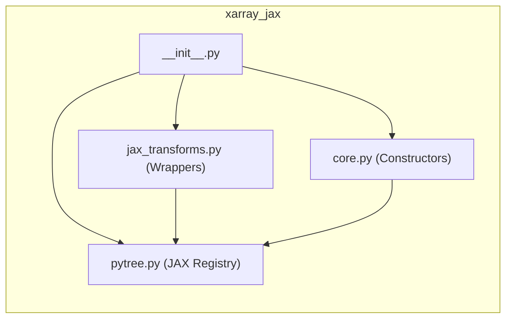
Sources: [xarray_jax/__init__.py:88-114](), [xarray_jax/jax_transforms.py:1-50]()

---

### Navigation

To dive deeper into specific areas of the library, refer to the following child pages:

*   **[Getting Started](#1.1)**: Installation via `pip`, dependency requirements (`jax>=0.4.30`, `xarray>=2026.01.0`), and a minimal working example of `jax.jit` with `DataArray`.
*   **[Key Concepts and Design Philosophy](#1.2)**: Understanding the static-vs-dynamic split, how metadata is preserved during flattening, and the rationale behind the `arithmetic_compat` global setting.

Sources: [pyproject.toml:24-28](), [xarray_jax/__init__.py:145-173](), [README.md:34-81]()

---

# Page: Getting Started

# Getting Started

<details>
<summary>Relevant source files</summary>

The following files were used as context for generating this wiki page:

- [README.md](README.md)
- [pyproject.toml](pyproject.toml)

</details>


This page provides the essential information for installing `xarray_jax` and using it to integrate `xarray` data structures into JAX-accelerated workflows. The library's primary function is to register `xarray` types as JAX PyTrees, enabling them to pass through transformations like `jax.jit`, `jax.grad`, and `jax.vmap` while preserving metadata.

## Installation and Dependencies

`xarray_jax` is distributed as a Python package requiring modern versions of JAX and xarray.

### System Requirements
*   **Python**: `3.10+` (Note: `pyproject.toml` specifies `>=3.13` for the current build environment).
*   **JAX**: `>=0.4.30`
*   **NumPy**: `>=1.24`
*   **xarray**: `>=2026.01.0`

### Installation Commands
To install a specific release directly from the repository:
```bash
pip install git+https://github.com/google-deepmind/xarray_jax.git@v0.1.0
```

For development and testing, you can install the optional test dependencies:
```bash
pip install "gdm-xarray-jax[test]"
```

**Sources:**
* [README.md:1-15]()
* [pyproject.toml:12-34]()

---

## Minimal Working Example: JIT Compilation

The core utility of `xarray_jax` is allowing `jax.jit` to accept and return `xarray.DataArray` or `xarray.Dataset` objects. When a function is JIT-compiled, `xarray_jax` flattens the xarray object into a list of JAX arrays (dynamic leaves) and a set of metadata (static auxiliary data).

### Data Flow in JIT Transformation

The following diagram illustrates how an `xarray.DataArray` moves through a JIT-compiled function.

**Diagram: JIT Data Flow for xarray.DataArray**
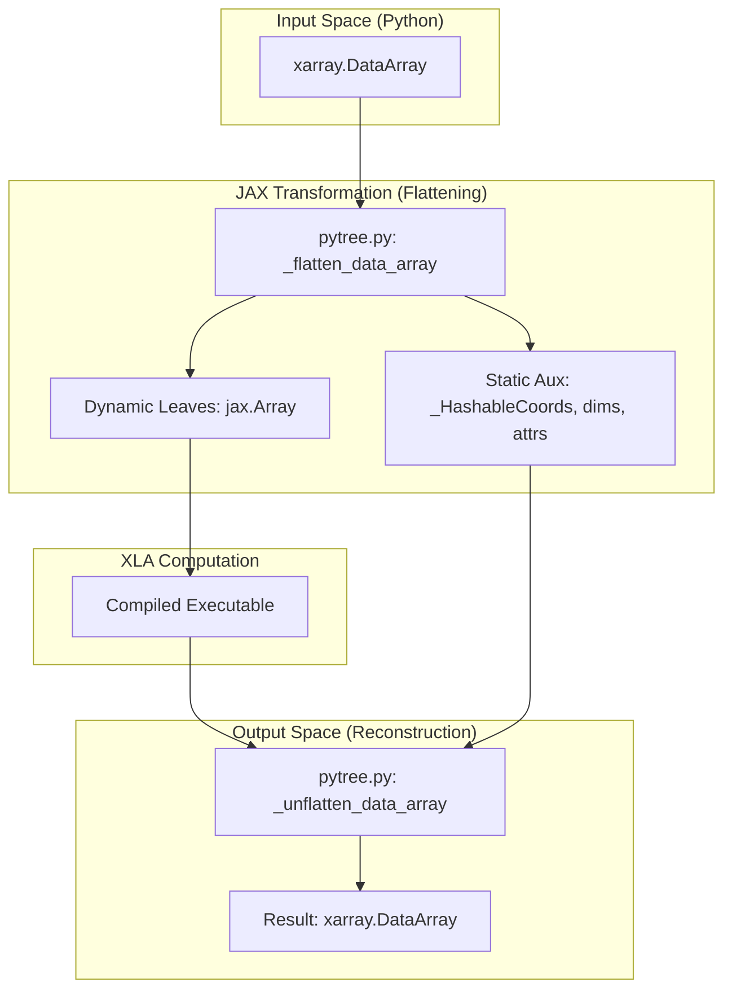

**Sources:**
* [README.md:42-81]()
* [pytree.py:1-10]() (Conceptual registration)

### Example Implementation
The following example demonstrates creating a `DataArray` with JAX data and processing it within a JIT-compiled function.

```python
import jax
import jax.numpy as jnp
import xarray as xr
import numpy as np
import xarray_jax

# 1. Initialize DataArray with JAX arrays
temperature = xr.DataArray(
    data=jnp.array([[20.5, 21.2, 22.1], [18.3, 19.7, 20.8]]),
    dims=('time', 'location'),
    coords={
        'time': np.array(['2023-01-01', '2023-01-02'], dtype='datetime64[D]'),
        'location': ['NYC', 'LA', 'Chicago']
    }
)

# 2. Define a function using standard xarray methods
@jax.jit
def process_temperature(temp_data):
    # Arithmetic and reductions are supported
    fahrenheit = temp_data * 9/5 + 32
    return fahrenheit.mean(dim='location')

# 3. Execute
result = process_temperature(temperature)
```

**Sources:**
* [README.md:42-81]()

---

## Basic Usage Patterns

### Computing Gradients
`xarray_jax` supports `jax.grad` for differentiating through xarray operations. Because `jax.grad` requires a scalar output, users must typically extract the underlying JAX scalar from the resulting `DataArray` using the `.data` attribute or `xarray_jax.jax_data`.

**Diagram: Gradient Computation Entities**
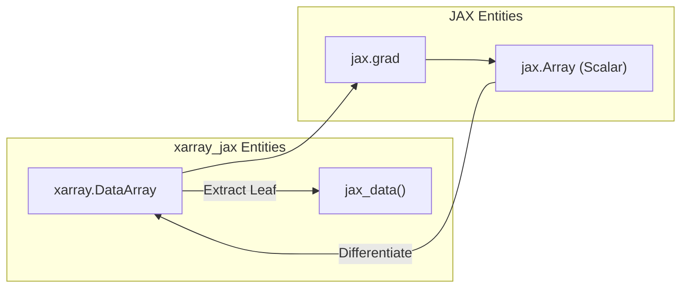

**Sources:**
* [README.md:89-119]()

### Working with Datasets
`xarray.Dataset` objects are handled similarly to `DataArray`. All variables within the dataset are treated as dynamic leaves if they contain JAX-compatible arrays.

```python
weather_data = xr.Dataset(
    {
        'temperature': (['time', 'location'], jnp.array([[20.5, 21.2], [18.3, 19.7]])),
        'humidity': (['time', 'location'], jnp.array([[0.65, 0.72], [0.58, 0.69]]))
    }
)

@jax.jit
def weather_model(data):
    # Assigning new variables within JIT is supported
    heat_index = data.temperature + (data.humidity * 10)
    return data.assign(heat_index=heat_index)

result = weather_model(weather_data)
```

**Sources:**
* [README.md:121-160]()

### Coordinate Handling
By default, `xarray` coordinates are treated as **static** metadata. This means:
1.  They are passed as auxiliary data during PyTree flattening.
2.  Changes to coordinate values will trigger a JAX recompilation.
3.  Standard NumPy-based coordinates (like `datetime64`) are recommended for stability.

**Sources:**
* [README.md:49-59]()
* [README.md:184-185]()

---

# Page: Key Concepts and Design Philosophy

# Key Concepts and Design Philosophy

<details>
<summary>Relevant source files</summary>

The following files were used as context for generating this wiki page:

- [README.md](README.md)
- [xarray_jax/__init__.py](xarray_jax/__init__.py)
- [xarray_jax/core.py](xarray_jax/core.py)

</details>


This page explains the core tension between `xarray`'s metadata-heavy model and JAX's functional/pure-function requirements. It covers the static-vs-dynamic split, the PyTree registration approach, and global configuration for arithmetic compatibility.

## The Core Tension: Metadata vs. Purity

`xarray` is designed for labeled multi-dimensional arrays where metadata (dimensions, coordinates, and attributes) is deeply integrated with the data [xarray_jax/__init__.py:14-20](). In contrast, JAX requires "pure" functions and operates on `PyTrees`—nested structures where leaves are arrays and the structure itself is static during compilation.

The primary challenge is that `xarray` objects (like `DataArray` and `Dataset`) are not natively registered as JAX PyTrees [README.md:23-26](). Without registration, JAX cannot "see" the underlying arrays to differentiate through them or JIT-compile operations on them.

### The Static-vs-Dynamic Split

To bridge these worlds, `xarray_jax` splits an `xarray` object into two parts during JAX transformations:
1.  **Dynamic Leaves (Children):** The actual array data (e.g., `data` in a `DataArray` or variables in a `Dataset`) that JAX can manipulate as tracers or buffers [README.md:28-33]().
2.  **Static Metadata (Auxiliary Data):** Dimension names, attributes, and "static" coordinates. These are treated as part of the tree structure [xarray_jax/__init__.py:72-78]().

**Implication:** If you call a JIT-compiled function with two `Dataset` objects that have different coordinate values, JAX will trigger a recompilation because the "static" structure has changed [xarray_jax/__init__.py:74-77]().

Sources: [xarray_jax/__init__.py:14-82](), [README.md:16-33](), [xarray_jax/core.py:38-45]()

## PyTree Registration

`xarray_jax` registers `xarray.Variable`, `xarray.DataArray`, `xarray.Dataset`, and `DataTree` with JAX's `tree_util` [xarray_jax/__init__.py:45-47](). This allows these types to be used directly as arguments and return values in `jax.jit`, `jax.grad`, and other transformations [README.md:49-81]().

### The Flatten/Unflatten Lifecycle

The diagram below illustrates how `xarray_jax` enables a `jax.jit` boundary to process a `DataArray`.

**Data Flow: xarray to JAX and Back**
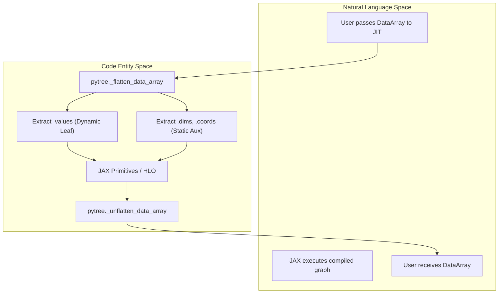
Sources: [xarray_jax/pytree.py:1-150](), [README.md:28-33](), [xarray_jax/__init__.py:45-53]()

## Coordinate Management Strategies

Coordinates in `xarray` are traditionally used for indexing (e.g., `.sel(time='2023-01-01')`). However, JAX tracers cannot be used in `xarray`'s indexing logic because it involves non-pure Python code and library-level dispatching [xarray_jax/core.py:53-58]().

`xarray_jax` provides two ways to handle coordinates:

| Feature | Static Coordinates (Default) | JAX Coordinates (`jax_coords`) |
| :--- | :--- | :--- |
| **Data Type** | NumPy arrays / Scalars | JAX arrays / Tracers |
| **JAX Treatment** | Static (triggers recompile on change) | Dynamic (treated as PyTree leaves) |
| **Indexing** | Supports `.sel` and `.isel` | No indexing support (empty indexes) |
| **Purpose** | Fixed grids, time axes, labels | Differentiable coordinates, dynamic metadata |

### JAX Coordinates (`jax_coords`)
The `jax_coords` feature is an experimental mechanism to allow coordinates to be treated as dynamic data [xarray_jax/core.py:49-52](). These are marked internally with the `_jax_coord` attribute [xarray_jax/core.py:23-23](). Because `xarray` tries to build indexes for coordinates sharing names with dimensions, `xarray_jax` explicitly suppresses index creation for these to prevent `TracerBoolConversionError` [xarray_jax/core.py:139-142]().

Sources: [xarray_jax/core.py:23-114](), [xarray_jax/__init__.py:64-82]()

## Global Arithmetic Configuration

A significant design choice in `xarray_jax` is the global override of `xarray`'s arithmetic behavior.

```python
# From xarray_jax/__init__.py
xarray.set_options(arithmetic_compat='override')
```
[xarray_jax/__init__.py:173-173]()

### Why `arithmetic_compat='override'`?
By default, `xarray` uses `minimal` compatibility, which performs checks to ensure coordinates match before performing arithmetic (e.g., `ds1 + ds2`). These checks often involve boolean comparisons of coordinate arrays. When those coordinates contain JAX Tracers, these comparisons raise a `jax.errors.TracerBoolConversionError` [xarray_jax/__init__.py:145-151]().

Setting this to `override` disables these checks for non-index coordinates during arithmetic, allowing JAX coordinates to flow through operations without crashing the JIT compiler [xarray_jax/__init__.py:158-161]().

**System Configuration Relationship**
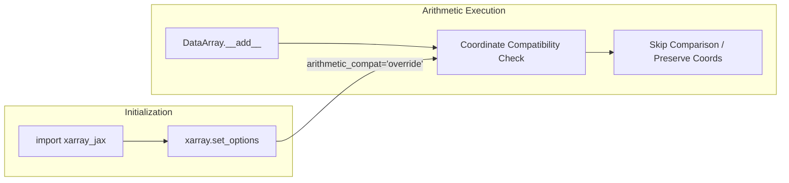
Sources: [xarray_jax/__init__.py:145-173]()

## Summary of Design Philosophy
1.  **Immutability:** Leverages JAX's functional paradigm while maintaining `xarray`'s API.
2.  **Transparency:** Uses standard `xarray` objects rather than custom subclasses where possible, relying on PyTree registration for interoperability [README.md:28-33]().
3.  **Explicit Staticity:** Forces a distinction between static metadata (which triggers recompilation) and dynamic data (which JAX transforms) to provide predictable performance [xarray_jax/__init__.py:72-78]().

---

# Page: Core Architecture

# Core Architecture

<details>
<summary>Relevant source files</summary>

The following files were used as context for generating this wiki page:

- [xarray_jax/__init__.py](xarray_jax/__init__.py)
- [xarray_jax/core.py](xarray_jax/core.py)
- [xarray_jax/pytree.py](xarray_jax/pytree.py)

</details>


The `xarray_jax` library is structured around three primary modules that enable seamless integration between `xarray` data structures and the JAX transformation ecosystem. This architecture ensures that `xarray.Dataset`, `DataArray`, and `Variable` objects can be treated as JAX PyTrees while maintaining their rich metadata (dimensions, coordinates, and attributes).

## Three-Module Architecture

The system is divided into functional layers that handle PyTree registration, core data structure construction, and specialized JAX transformation wrappers.

### 1. PyTree Registration (`pytree.py`)
This module is the foundation of the library. it registers `xarray` types with `jax.tree_util` [xarray_jax/pytree.py:155-155](). It defines the logic for "flattening" an xarray object into dynamic JAX leaves (the data) and static auxiliary data (the metadata like dimension names).

Key components include:
*   **Flatten/Unflatten Logic**: Functions like `_flatten_variable` [xarray_jax/pytree.py:200-201]() and `_unflatten_variable` [xarray_jax/pytree.py:222-223]() that separate data from metadata.
*   **NonArrayLeafWrapper**: A shim class that allows non-array values (like scalars or JAX `ShapeDtypeStruct`) to be re-inserted into xarray objects during transformations [xarray_jax/pytree.py:83-93]().
*   **Dimension Management**: The `dims_change_on_unflatten` context manager [xarray_jax/pytree.py:164-182]() allows JAX to reconstruct xarray objects even when the underlying array shapes change (e.g., after a `vmap`).

For details, see [PyTree Registration (pytree.py)](#2.1).

### 2. Core Constructors and Coordinates (`core.py`)
This module provides the user-facing entry points for creating JAX-compatible xarray objects. It handles the complexity of coordinate management, specifically distinguishing between "static" coordinates (standard xarray) and "dynamic" coordinates (`jax_coords`).

Key components include:
*   **Custom Constructors**: `xarray_jax.DataArray` [xarray_jax/core.py:26-33]() and `xarray_jax.Dataset` [xarray_jax/core.py:73-78]() which wrap standard xarray constructors but add support for JAX-backed coordinates.
*   **Coordinate Assignment**: Functions like `assign_jax_coords` [xarray_jax/core.py:93-93]() and `get_jax_coords` [xarray_jax/core.py:94-94]() manage the `JAX_COORD_ATTR_NAME` marker [xarray_jax/core.py:23-23]() used to identify dynamic coordinates.

For details, see [Core Constructors and Coordinate Management (core.py)](#2.2).

### 3. JAX Transformations (`jax_transforms.py`)
Standard JAX transformations like `jax.vmap` often fail on xarray objects because they do not know how to update the dimension metadata when adding or removing axes. This module provides specialized wrappers that use the utilities in `pytree.py` to keep metadata in sync.

Key components include:
*   **Transformation Wrappers**: `vmap`, `pmap`, and `scan` [xarray_jax/__init__.py:97-103]() that automatically handle dimension propagation.
*   **Mapping Utilities**: `tree_map_variables` and `tree_map_with_dims` [xarray_jax/jax_transforms.py:101-102]() for applying functions across xarray structures while accessing dimension information.

**Sources:** [xarray_jax/__init__.py:88-114](), [xarray_jax/core.py:14-23](), [xarray_jax/pytree.py:14-27]()

---

## System Interaction Flow

The following diagram illustrates how a user-defined function interacts with the different modules when wrapped in a JAX transformation like `jax.jit`.

### Data Flow: User Code to JAX Runtime
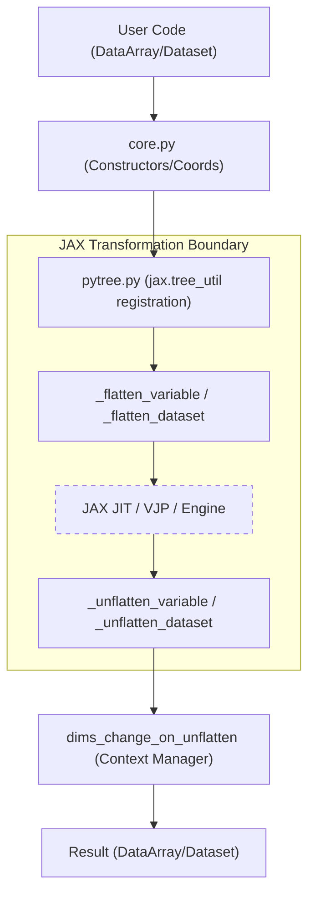
**Sources:** [xarray_jax/pytree.py:164-192](), [xarray_jax/pytree.py:200-240](), [xarray_jax/core.py:26-78]()

---

## Code Entity Mapping

This table and diagram bridge the gap between high-level architectural concepts and the specific symbols in the codebase.

| Architectural Role | Code Entity (File:Symbol) |
| :--- | :--- |
| **PyTree Flattening** | `pytree.py`: `_flatten_variable`, `_flatten_data_array`, `_flatten_dataset` |
| **PyTree Unflattening** | `pytree.py`: `_unflatten_variable`, `_unflatten_data_array`, `_unflatten_dataset` |
| **Coordinate Marker** | `core.py`: `JAX_COORD_ATTR_NAME` |
| **Dynamic Leaf Handling** | `pytree.py`: `NonArrayLeafWrapper` |
| **Metadata Sync** | `pytree.py`: `dims_change_on_unflatten` |
| **Transformation API** | `jax_transforms.py`: `vmap`, `pmap`, `scan` |

### Code Relationship Diagram
```mermaid
graph LR
    subgraph "xarray_jax.core"
        "core.DataArray" --> "core.assign_coords"
        "core.Dataset" --> "core.assign_coords"
        "core.assign_coords" -- "Marks JAX Coords" --> "core.JAX_COORD_ATTR_NAME"
    end

    subgraph "xarray_jax.pytree"
        "pytree._flatten_dataset" -- "Extracts" --> "Dynamic Leaves (jax.Array)"
        "pytree._unflatten_dataset" -- "Wraps" --> "pytree.NonArrayLeafWrapper"
        "pytree._unflatten_dataset" -- "Reads" --> "pytree._DIMS_CHANGE_ON_UNFLATTEN_FN"
    end

    subgraph "xarray_jax.jax_transforms"
        "jax_transforms.vmap" -- "Sets" --> "pytree.dims_change_on_unflatten"
        "jax_transforms.vmap" -- "Calls" --> "jax.vmap"
    end
```
**Sources:** [xarray_jax/core.py:23-114](), [xarray_jax/pytree.py:83-200](), [xarray_jax/jax_transforms.py:97-103]()

---

## Child Pages
*   [PyTree Registration (pytree.py)](#2.1) — Detailed internals of the flatten/unflatten process and leaf wrapping.
*   [Core Constructors and Coordinate Management (core.py)](#2.2) — Documentation on coordinate handling and the static vs. dynamic split.

---

# Page: PyTree Registration (pytree.py)

# PyTree Registration (pytree.py)

<details>
<summary>Relevant source files</summary>

The following files were used as context for generating this wiki page:

- [xarray_jax/pytree.py](xarray_jax/pytree.py)
- [xarray_jax/tests/pytree_test.py](xarray_jax/tests/pytree_test.py)

</details>


This page provides a high-level overview of how `xarray_jax` integrates `xarray` data structures into the JAX ecosystem by registering them as PyTrees. This registration allows `xarray.Variable`, `DataArray`, `Dataset`, and `DataTree` objects to be passed directly into JAX transformations like `jax.jit`, `jax.grad`, and `jax.vmap`.

The registration logic is primarily contained within `xarray_jax/pytree.py` [xarray_jax/pytree.py:1-300]().

## Overview of PyTree Registration

JAX operates on PyTrees, which are tree-like structures composed of "leaves" (typically JAX arrays) and "nodes" (Python containers). To make `xarray` objects compatible, `xarray_jax` defines how to "flatten" these objects into a list of JAX arrays and "unflatten" them back into their original `xarray` types.

### Key Components of the Registration

*   **Dynamic Leaves**: The actual data arrays (the `.data` attribute of Variables and DataArrays) are treated as dynamic leaves that JAX can transform [xarray_jax/pytree.py:200-205]().
*   **Static Metadata**: Metadata such as dimension names, attributes, and non-JAX coordinates are treated as "auxiliary data." This data is static and used by JAX to cache compiled functions [xarray_jax/pytree.py:206-210]().
*   **Coordinate Handling**: Coordinates are split between static metadata and dynamic leaves based on whether they are marked as `jax_coords` [xarray_jax/pytree.py:231-240]().

### Conceptual Mapping: Natural Language to Code Entities

The following diagram illustrates how abstract `xarray` concepts map to specific implementation entities in the `xarray_jax` PyTree registration system.

**Registration Mapping Diagram**
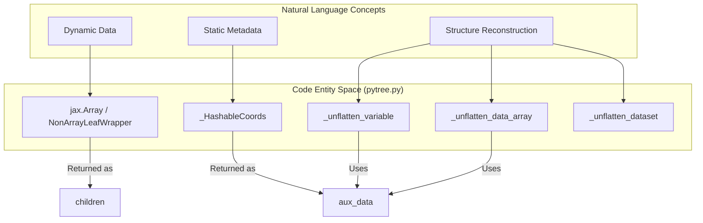
Sources: [xarray_jax/pytree.py:83-154](), [xarray_jax/pytree.py:200-215](), [xarray_jax/pytree.py:242-260]()

## Flatten and Unflatten Internals

The core of the registration lies in the `_flatten_*` and `_unflatten_*` function pairs for each `xarray` type. These functions ensure that the internal state of `xarray` objects—including nested attributes and complex coordinate mappings—is preserved across JAX transformations.

| Xarray Type | Flatten Function | Unflatten Function |
| :--- | :--- | :--- |
| `xarray.Variable` | `_flatten_variable` | `_unflatten_variable` |
| `xarray.DataArray` | `_flatten_data_array` | `_unflatten_data_array` |
| `xarray.Dataset` | `_flatten_dataset` | `_unflatten_dataset` |
| `xarray.DataTree` | `_flatten_datatree` | `_unflatten_datatree` |

For a deep dive into the logic of these functions, including how they handle `aux_data` hashing for JIT stability, see **[Flatten and Unflatten Internals](#2.1.1)**.

Sources: [xarray_jax/pytree.py:200-290](), [xarray_jax/tests/pytree_test.py:27-90]()

## Specialized Handling

### NonArrayLeafWrapper
During certain JAX operations (like `jax.eval_shape`), leaves may be replaced by `ShapeDtypeStruct` or other non-array objects. `xarray_jax` uses `NonArrayLeafWrapper` to wrap these values, providing a minimal duck-typed interface that allows `xarray` constructors to accept them without error [xarray_jax/pytree.py:83-112]().

### Dimension Change Handling
When JAX transformations change the rank or shape of an array (e.g., `vmap` adding a batch dimension), the static metadata in the PyTree definition may become stale. The `dims_change_on_unflatten` context manager allows developers to provide a function that updates dimension names dynamically during the unflattening process [xarray_jax/pytree.py:164-192]().

For more information on these utilities, see **[NonArrayLeafWrapper and Dimension Change Handling](#2.1.2)**.

**PyTree Lifecycle with Dimension Changes**
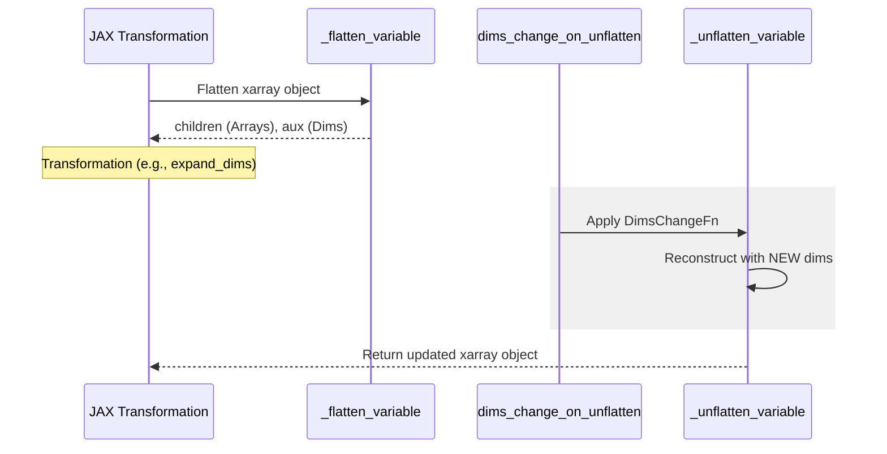
Sources: [xarray_jax/pytree.py:164-198](), [xarray_jax/tests/pytree_test.py:92-120]()

## Summary of Data Extraction Utilities

`pytree.py` also provides several public utilities for extracting raw JAX arrays from `xarray` structures, which is often necessary when interfacing with pure JAX functions.

*   `unwrap_data`: Extracts the underlying array from a `Variable` or `DataArray` [xarray_jax/pytree.py:42-47]().
*   `jax_data`: Similar to `unwrap_data`, but enforces that the result is a `jax.Array` [xarray_jax/pytree.py:70-74]().
*   `unwrap_vars`: Extracts a dictionary of arrays from a `Dataset` [xarray_jax/pytree.py:50-58]().
*   `unwrap_coords`: Extracts a dictionary of coordinate arrays [xarray_jax/pytree.py:61-67]().

Sources: [xarray_jax/pytree.py:29-81]()

---

# Page: Flatten and Unflatten Internals

# Flatten and Unflatten Internals

<details>
<summary>Relevant source files</summary>

The following files were used as context for generating this wiki page:

- [xarray_jax/pytree.py](xarray_jax/pytree.py)
- [xarray_jax/tests/pytree_test.py](xarray_jax/tests/pytree_test.py)

</details>


This page provides a detailed technical reference for the internal mechanisms used to register `xarray` objects as JAX PyTrees. It describes how `xarray_jax` separates dynamic data (leaves) from static metadata (auxiliary data) to enable compatibility with JAX transformations like `jit`, `vmap`, and `grad`.

## Core Logic: Data vs. Metadata

JAX requires PyTrees to be decomposed into two parts:
1.  **Children (Leaves):** Dynamic arrays or other PyTrees that JAX can transform.
2.  **Auxiliary Data:** Static metadata that must be hashable and is used to reconstruct the object.

In `xarray_jax`, the underlying data arrays (including those marked as `jax_coords`) are treated as leaves, while dimension names, attributes, and non-JAX coordinates are treated as static auxiliary data [xarray_jax/pytree.py:200-205]().

### Variable Flattening
The `xarray.Variable` is the fundamental building block. Its flattening logic serves as the basis for higher-level structures.

| Component | Classification | Implementation Detail |
| :--- | :--- | :--- |
| `variable.data` | **Leaf** | The actual array-like data [xarray_jax/pytree.py:203](). |
| `variable.dims` | **Auxiliary** | A tuple of dimension names [xarray_jax/pytree.py:204](). |
| `variable.attrs` | **Auxiliary** | Metadata attributes (converted to a hashable `FrozenDict`) [xarray_jax/pytree.py:204](). |

**Sources:** [xarray_jax/pytree.py:200-213]()

---

## Flattening and Unflattening Flow

The following diagram illustrates the data flow during a `jax.tree_util.tree_flatten` and `tree_unflatten` cycle for an `xarray.DataArray`.

### DataArray PyTree Transformation
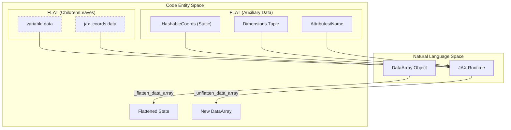
**Sources:** [xarray_jax/pytree.py:241-285](), [xarray_jax/tests/pytree_test.py:38-49]()

---

## Detailed Function Reference

### Variable Level
*   **`_flatten_variable(v)`**: Returns `(v.data,)` as the child and `(v.dims, v.attrs)` as auxiliary data [xarray_jax/pytree.py:200-205]().
*   **`_unflatten_variable(aux, children)`**: Reconstructs the `xarray.Variable`. If the unflattening happens within a `dims_change_on_unflatten` context, the dimensions are updated via the provided function before the variable is created [xarray_jax/pytree.py:215-238]().

### DataArray Level
*   **`_flatten_data_array(da)`**: 
    *   Separates coordinates into `jax_coords` (dynamic leaves) and static coordinates [xarray_jax/pytree.py:246-258]().
    *   The primary data variable is the first leaf [xarray_jax/pytree.py:259]().
    *   Static coordinates are wrapped in `_HashableCoords` to ensure they can be used as JAX auxiliary data [xarray_jax/pytree.py:261]().
*   **`_unflatten_data_array(aux, children)`**: Reconstructs the `DataArray`. It extracts the main data from `children[0]` and iterates through the remaining children to restore `jax_coords` [xarray_jax/pytree.py:270-285]().

### Dataset Level
*   **`_flatten_dataset(ds)`**:
    *   Collects all `data_vars` and `jax_coords` as leaves [xarray_jax/pytree.py:302-310]().
    *   Stores the names and order of these variables in the auxiliary data to ensure correct mapping during unflattening [xarray_jax/pytree.py:311-314]().
*   **`_unflatten_dataset(aux, children)`**: Reassembles the `Dataset` by mapping the flat list of `children` back to their respective variable names and coordinate names [xarray_jax/pytree.py:321-344]().

### DataTree Level
*   **`_flatten_datatree(dt)`**: 
    *   Treats the `DataTree` as a recursive structure.
    *   Leaves include the data from the current node's `Dataset` and all children nodes [xarray_jax/pytree.py:361-365]().
*   **`_unflatten_datatree(aux, children)`**: Recursively reconstructs the tree hierarchy [xarray_jax/pytree.py:372-385]().

**Sources:** [xarray_jax/pytree.py:200-385]()

---

## Auxiliary Data Structures

### `_HashableCoords`
Because JAX auxiliary data must be hashable, `xarray_jax` uses a internal `_HashableCoords` class. This class wraps the coordinate dictionary and provides a `__hash__` and `__eq__` implementation based on the underlying data and dimensions [xarray_jax/pytree.py:388-410](). This is critical for preventing unnecessary recompilations in `jax.jit`.

### `NonArrayLeafWrapper`
During some JAX transformations (like `jax.eval_shape`), the "data" might not be a standard array but a `ShapeDtypeStruct` or a scalar. `xarray_jax` wraps these in a `NonArrayLeafWrapper` [xarray_jax/pytree.py:83-92]().
*   **Purpose**: Provides a duck-typed shim that has `.shape` and `.dtype` properties, allowing `xarray` constructors to accept them without error [xarray_jax/pytree.py:127-133]().
*   **Implementation**: It stores the original leaf and calculates a proxy shape if the leaf is a scalar [xarray_jax/pytree.py:94-112]().

**Sources:** [xarray_jax/pytree.py:83-154](), [xarray_jax/pytree.py:388-410]()

---

## Dimension Synchronization

The `dims_change_on_unflatten` context manager is the primary tool for handling rank-changing operations.

### Transformation Logic
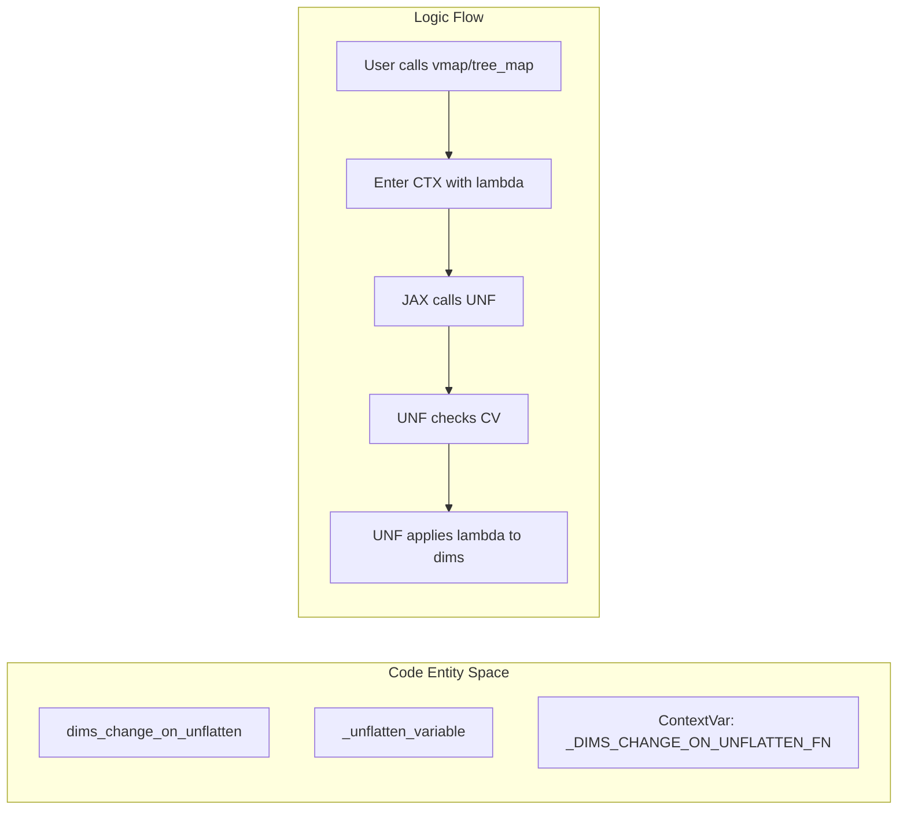

When `_unflatten_variable` is called, it checks if `_DIMS_CHANGE_ON_UNFLATTEN_FN` is set. If so, it applies the transformation to the dimension names before creating the new `xarray.Variable` [xarray_jax/pytree.py:217-224](). This ensures that if `jax.vmap` adds a batch dimension, the resulting `DataArray` correctly reflects that new dimension in its metadata [xarray_jax/tests/pytree_test.py:92-106]().

**Sources:** [xarray_jax/pytree.py:158-198](), [xarray_jax/pytree.py:217-224](), [xarray_jax/tests/pytree_test.py:113-120]()

---

# Page: NonArrayLeafWrapper and Dimension Change Handling

# NonArrayLeafWrapper and Dimension Change Handling

<details>
<summary>Relevant source files</summary>

The following files were used as context for generating this wiki page:

- [xarray_jax/pytree.py](xarray_jax/pytree.py)
- [xarray_jax/tests/pytree_test.py](xarray_jax/tests/pytree_test.py)

</details>


This page documents the internal mechanisms used by `xarray_jax` to handle edge cases in the JAX PyTree contract. Specifically, it covers how the library manages non-array leaves (such as scalars or shape metadata) and how it synchronizes xarray dimension metadata when JAX transformations change the rank or shape of the underlying arrays.

## NonArrayLeafWrapper

The `NonArrayLeafWrapper` is a duck-typed shim designed to wrap non-array JAX leaves so they can be stored within `xarray.Variable` objects without violating xarray's expectation of array-like data [xarray_jax/pytree.py:83-92]().

### Purpose and Motivation
In JAX, certain operations or transformations (like `jax.eval_shape` or specific custom gradients) may result in PyTree leaves that are not `jax.Array` instances. Examples include:
*   `jax.ShapeDtypeStruct`: Used for shape inference [xarray_jax/tests/pytree_test.py:157-157]().
*   Python scalars (`int`, `float`, `bool`) [xarray_jax/tests/pytree_test.py:148-151]().
*   `None` or other sentinel objects [xarray_jax/tests/pytree_test.py:149-149]().

Because `xarray.Variable` requires its `data` attribute to behave like a NumPy-compatible array (possessing `shape`, `dtype`, and `ndim`), these JAX leaves cannot be inserted directly. `NonArrayLeafWrapper` provides the necessary minimal interface [xarray_jax/pytree.py:127-142]().

### Implementation Details
The wrapper captures the original leaf and calculates "fake" metadata if the leaf does not already provide it:
*   **Shape**: If the leaf has no `.shape`, it defaults to a zero-sized tuple matching the expected dimension count [xarray_jax/pytree.py:100-100]().
*   **Dtype**: Maps Python types to JAX-compatible NumPy dtypes (e.g., `float` becomes `jnp.float32.dtype`) [xarray_jax/pytree.py:102-112]().
*   **Identity**: The original leaf is preserved in the `.leaf` property [xarray_jax/pytree.py:150-153]().

### Entity Mapping: Leaf Wrapping Flow
The following diagram shows how a non-array leaf is processed during the unflattening phase of a JAX transformation.

**Non-Array Leaf Integration**
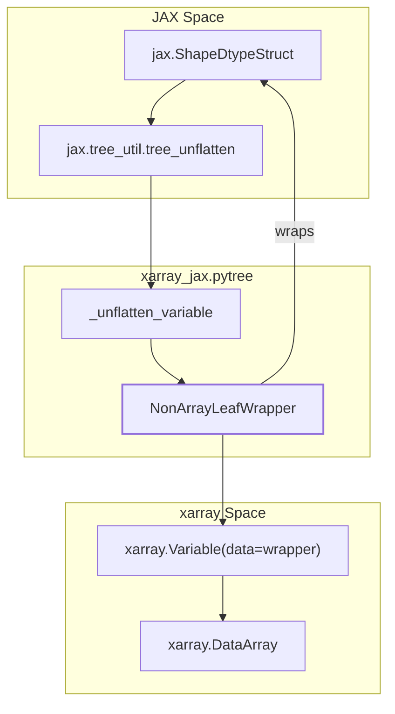
Sources: [xarray_jax/pytree.py:83-153](), [xarray_jax/pytree.py:200-210](), [xarray_jax/tests/pytree_test.py:160-168]()

## Dimension Change Handling

When JAX transformations like `jax.vmap` or `jax.lax.scan` are applied to xarray objects, the rank of the underlying arrays changes (e.g., adding a batch dimension or a scan dimension). However, the PyTree `treedef` (which contains the static metadata like dimension names) remains fixed from the moment of flattening.

### The `dims_change_on_unflatten` Context Manager
To solve this synchronization problem, `xarray_jax` provides the `dims_change_on_unflatten` context manager [xarray_jax/pytree.py:164-164](). It uses a `contextvars.ContextVar` to communicate dimension transformations to the unflattening logic [xarray_jax/pytree.py:159-160]().

#### Key Functions
| Function | Role |
| :--- | :--- |
| `dims_change_on_unflatten(dims_change_fn)` | Sets a thread-local function that maps old dimension names to new ones during reconstruction [xarray_jax/pytree.py:183-192](). |
| `_unflatten_variable` | Checks for the presence of a change function and applies it to the `dims` stored in the `treedef` [xarray_jax/pytree.py:200-210](). |

### Logic for Metadata Synchronization
1.  **Flatten**: The xarray object is flattened; dimension names (e.g., `('x', 'y')`) are stored in the static `aux_data` [xarray_jax/pytree.py:200-205]().
2.  **Transform**: JAX maps a function over the arrays, potentially changing shape (e.g., adding a leading axis).
3.  **Unflatten**: Inside the context manager, the `dims_change_fn` intercepts the original `('x', 'y')` and returns `('batch', 'x', 'y')` [xarray_jax/tests/pytree_test.py:100-102]().
4.  **Coordinate Pruning**: If a dimension is removed during unflattening (e.g., via `jnp.squeeze`), any coordinates associated with that specific dimension are automatically dropped to maintain consistency [xarray_jax/pytree.py:175-177](), [xarray_jax/tests/pytree_test.py:132-138]().

### Entity Mapping: Dimension Transformation
This diagram illustrates how metadata is updated during a `vmap`-like operation where a new dimension is introduced.

**Metadata Synchronization Flow**
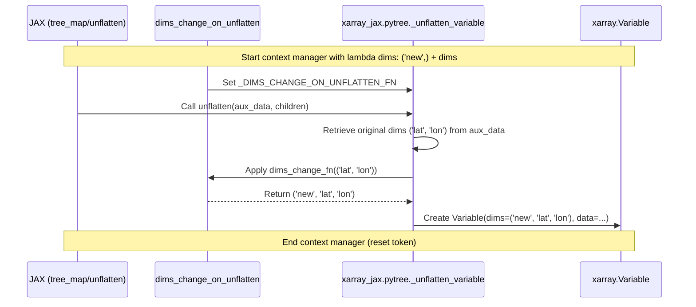
Sources: [xarray_jax/pytree.py:164-198](), [xarray_jax/tests/pytree_test.py:107-116]()

## Data Extraction Utilities

To interact with wrapped leaves and JAX arrays inside xarray containers, the library provides several utility functions in `pytree.py`.

*   **`unwrap(value)`**: Accesses the underlying JAX array or scalar from a `NonArrayLeafWrapper`. If the input is already a standard array, it is returned as-is [xarray_jax/pytree.py:34-39]().
*   **`jax_data(obj)`**: A specialized version of unwrap that enforces that the result must be a `jax.Array`, raising a `TypeError` otherwise [xarray_jax/pytree.py:70-74]().
*   **`unwrap_vars(dataset)`**: Iterates through a dataset and unwraps the data for every variable, returning a standard dictionary of arrays [xarray_jax/pytree.py:50-58]().
*   **`unwrap_coords(obj)`**: Similar to `unwrap_vars`, but specifically targets the `coords` mapping of a `Dataset` or `DataArray` [xarray_jax/pytree.py:61-68]().

Sources: [xarray_jax/pytree.py:34-81]()

---

# Page: Core Constructors and Coordinate Management (core.py)

# Core Constructors and Coordinate Management (core.py)

<details>
<summary>Relevant source files</summary>

The following files were used as context for generating this wiki page:

- [xarray_jax/core.py](xarray_jax/core.py)
- [xarray_jax/tests/xarray_jax_test.py](xarray_jax/tests/xarray_jax_test.py)

</details>


This page documents the core user-facing constructors and coordinate management system in `xarray_jax`. The library provides drop-in replacements for standard `xarray` constructors that are optimized for JAX compatibility, specifically addressing the tension between static metadata and dynamic JAX tracers.

## Overview of Constructors

`xarray_jax` provides `DataArray` and `Dataset` constructors that wrap the standard `xarray` versions. While they accept standard `xarray` arguments, they introduce the `jax_coords` parameter to handle coordinates that need to remain dynamic (tracers) during JAX transformations like `jit`, `vmap`, or `grad`.

### DataArray and Dataset
The `xarray_jax.DataArray` and `xarray_jax.Dataset` functions are the primary entry points for creating JAX-compatible xarray objects [xarray_jax/core.py:26-33](), [xarray_jax/core.py:73-78]().

| Feature | Standard `coords` | `jax_coords` |
| :--- | :--- | :--- |
| **Data Type** | NumPy / Static constants | JAX Arrays / Tracers |
| **JIT Behavior** | Treated as static (triggers recompile on change) | Treated as dynamic (passed as tracers) |
| **Indexing** | Supports `.sel()` and Indexing | No index created (empty indexes) |
| **Implementation** | Standard `xarray.Variable` | `xarray.Variable` + `_jax_coord` attribute |

**Sources:** [xarray_jax/core.py:38-64](), [xarray_jax/core.py:83-107]()

## Coordinate Management Mechanism

The core challenge in `xarray_jax` is that `xarray` typically attempts to create pandas-based indexes for coordinates that share a name with a dimension. Because JAX tracers cannot be converted to pandas indexes, `xarray_jax` uses a specific "empty index" strategy.

### The `jax_coords` Logic
When a coordinate is passed via `jax_coords`, the library:
1.  Wraps the data in an `xarray.Variable`.
2.  Tags the variable with a special marker attribute `JAX_COORD_ATTR_NAME` (defined as `_jax_coord`) [xarray_jax/core.py:23](), [xarray_jax/core.py:165-167]().
3.  Uses `xarray.Coordinates` with explicitly empty indexes to prevent `xarray` from attempting to build a pandas index [xarray_jax/core.py:171-175]().

### Data Flow: Constructor to Object
The following diagram illustrates how the `DataArray` constructor processes standard vs. JAX coordinates.

**Constructor Data Flow**
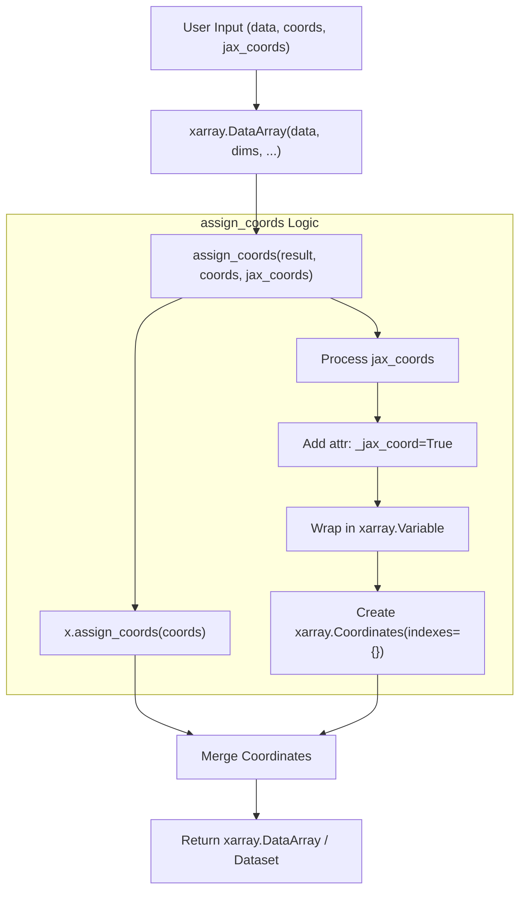
**Sources:** [xarray_jax/core.py:69-70](), [xarray_jax/core.py:157-175]()

## Key Functions

### `assign_coords`
The `xarray_jax.assign_coords` function is a replacement for the standard `DataArray.assign_coords` method. It is designed to handle the mixture of static NumPy coordinates and dynamic JAX coordinates [xarray_jax/core.py:125-130]().

*   **Static Branch**: If `coords` is provided, it calls the native `x.assign_coords(coords)` [xarray_jax/core.py:157]().
*   **JAX Branch**: For `jax_coords`, it iterates through the mapping, creates `xarray.Variable` objects, and assigns the `_jax_coord` attribute [xarray_jax/core.py:160-167]().

### `get_jax_coords`
This utility extracts only the coordinates that have been marked with the `_jax_coord` attribute [xarray_jax/core.py:214-215](). It is useful for inspecting which parts of the metadata will be treated as dynamic leaves in a PyTree.

### `assign_jax_coords`
A convenience wrapper that calls `assign_coords` with only the `jax_coords` argument [xarray_jax/core.py:202-206]().

**Sources:** [xarray_jax/core.py:154-177](), [xarray_jax/core.py:202-225]()

## Code Entity Map

The following diagram maps the relationship between the user-facing API and the internal markers used to maintain JAX compatibility.

**API and Marker Relationship**
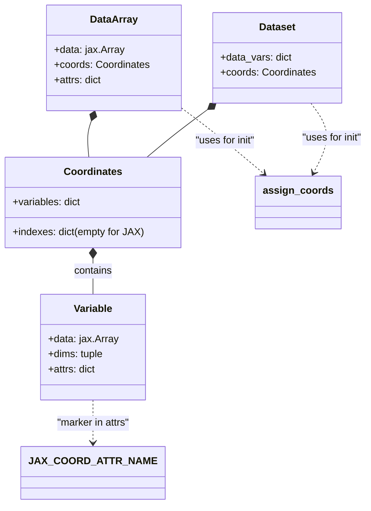
**Sources:** [xarray_jax/core.py:23](), [xarray_jax/core.py:69-70](), [xarray_jax/core.py:112-114](), [xarray_jax/core.py:165-175]()

## Implementation Details: Why Empty Indexes?

In standard `xarray`, a coordinate named `lat` for a dimension `lat` automatically creates a `pandas.Index`. JAX tracers (like those produced during `jax.vmap`) cannot be stored in a `pandas.Index` because pandas requires concrete NumPy arrays. 

By passing `indexes={}` to the `xarray.Coordinates` constructor [xarray_jax/core.py:173](), `xarray_jax` forces `xarray` to treat the coordinate as a "non-index coordinate." This allows the data to remain a JAX tracer while still being associated with the correct dimensions and metadata.

**Consequences:**
*   **No `.sel()`**: Since there is no index, coordinate-based lookups using `.sel(lat=10.0)` will fail for `jax_coords` [xarray_jax/core.py:57-58]().
*   **Functional Alignment**: This aligns with JAX's functional paradigm where metadata (dimensions) is static, but coordinate values can be transformed dynamically [xarray_jax/core.py:49-52]().

**Sources:** [xarray_jax/core.py:53-58](), [xarray_jax/core.py:96-101](), [xarray_jax/core.py:171-175]()

---

# Page: JAX Transformations

# JAX Transformations

<details>
<summary>Relevant source files</summary>

The following files were used as context for generating this wiki page:

- [README.md](README.md)
- [xarray_jax/jax_transforms.py](xarray_jax/jax_transforms.py)

</details>


This page provides an overview of the specialized JAX transformation wrappers provided by `xarray_jax`. While standard JAX transformations like `jax.jit` and `jax.grad` work out-of-the-box once `xarray` objects are registered as PyTrees, certain transformations like `vmap`, `pmap`, and `scan` require dimension-aware handling to maintain the consistency of `xarray` metadata (dimension names and coordinates) during the transformation process.

## Why Specialized Wrappers?

Standard `jax.vmap` or `jax.lax.scan` operate on raw array axes (integers). When JAX flattens an `xarray.DataArray` into a PyTree, it extracts the underlying array. However, transformations often change the rank or interpretation of these axes (e.g., stripping a mapped dimension or adding a leading batch dimension). 

If a standard `jax.vmap` is used, the "unflattening" process might fail or produce inconsistent results because the static metadata (the dimension names stored in the PyTree's auxiliary data) no longer matches the shape of the transformed JAX tracers. The wrappers in `xarray_jax.jax_transforms` solve this by:
1.  **Validating** that the named dimension exists at the expected axis (usually axis 0).
2.  **Intercepting** the unflattening process using a context manager to temporarily modify dimension metadata.
3.  **Restoring** or **Removing** dimension names to ensure the resulting `xarray` object is valid.

### Transformation Architecture

The following diagram illustrates how `xarray_jax` bridges the gap between named dimensions and JAX's axis-based transformations.

**Transformation Lifecycle**
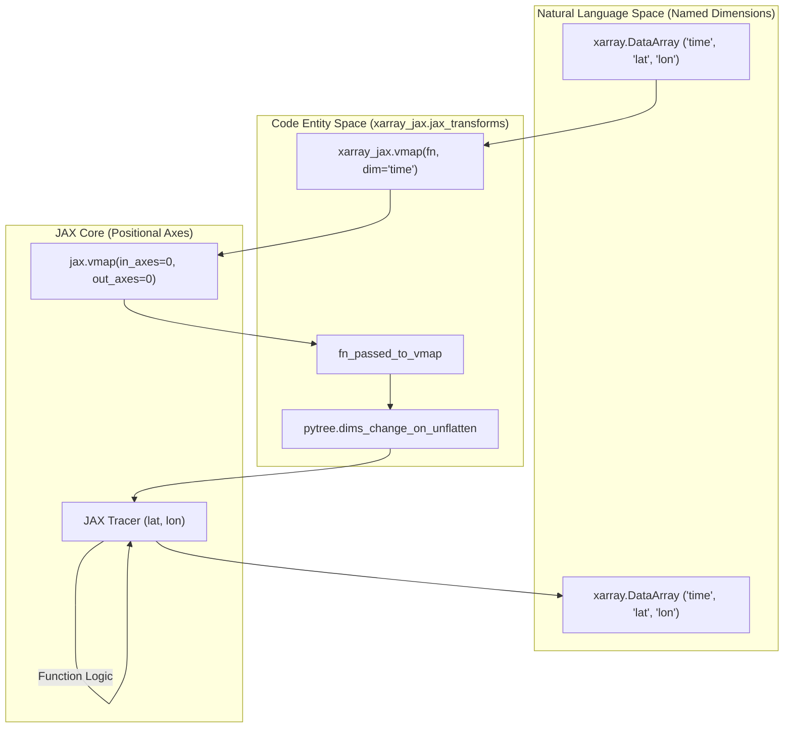
Sources: [xarray_jax/jax_transforms.py:23-91](), [xarray_jax/pytree.py:102-120]()

---

## vmap and pmap

The `xarray_jax.vmap` and `xarray_jax.pmap` functions are thin wrappers around their JAX counterparts. They are designed for cases where you need to vectorize a function over a specific named `xarray` dimension.

**Key Characteristics:**
*   **Leading Axis Constraint:** The dimension being mapped (`dim`) must be the first dimension in the input `DataArray` or `Dataset`. Users should use `.transpose(dim, ...)` if necessary before calling the wrapper [xarray_jax/jax_transforms.py:30-33]().
*   **Dimension Stripping:** Inside the transformed function, the mapped dimension is removed from the `xarray` object's metadata so that the function sees the data as if that dimension does not exist [xarray_jax/jax_transforms.py:58-66]().
*   **Dimension Restoration:** When the function returns, the wrapper restores the mapped dimension name to the leading position of the result [xarray_jax/jax_transforms.py:88-89]().

For details, see [vmap and pmap](#3.1).

Sources: [xarray_jax/jax_transforms.py:23-91](), [xarray_jax/jax_transforms.py:94-164]()

---

## scan

The `xarray_jax.scan` function wraps `jax.lax.scan`. It allows for iterative processing over a named dimension while maintaining `xarray` structures for both the "carry" and the "stacked" output.

**Key Characteristics:**
*   **Dimension Alignment:** It automatically transposes the scan dimension to axis 0 before calling the underlying JAX primitive [xarray_jax/jax_transforms.py:350-354]().
*   **Coordinate Handling:** It attempts to preserve coordinates where possible, though static coordinates along the scanned dimension are typically lost in the "carry" but preserved in the "stacked" output [xarray_jax/jax_transforms.py:317-320]().

For details, see [scan](#3.2).

Sources: [xarray_jax/jax_transforms.py:308-417]()

---

## Utility Tree Maps

Beyond standard JAX transformations, `xarray_jax` provides specialized tree-mapping utilities that treat `xarray` objects differently than standard JAX PyTree leaves.

| Function | Purpose | Leaf Type |
| :--- | :--- | :--- |
| `tree_map_variables` | Maps a function over all `xarray.Variable` objects in a tree. | `xarray.Variable` |
| `tree_map_with_dims` | Maps a function over arrays while providing the dimension names as an argument. | `jax.Array` (with dims) |

**Code Entity Mapping**
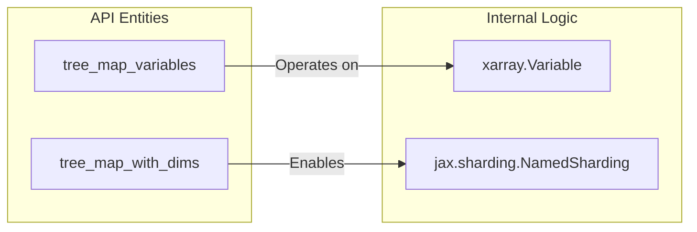
Sources: [xarray_jax/jax_transforms.py:169-204](), [xarray_jax/jax_transforms.py:207-251]()

### tree_map_variables
This utility is useful when you need to inspect or modify dimension names during a tree map operation. Unlike `jax.tree.map`, which descends into the `Variable` to find the underlying array, this treats the `Variable` itself as the leaf [xarray_jax/jax_transforms.py:169-181]().

### tree_map_with_dims
This is specifically designed for modern JAX sharding. It passes the dimension names of each array to the mapping function, allowing users to easily construct `jax.sharding.NamedSharding` based on `xarray` dimension names [xarray_jax/jax_transforms.py:207-223]().

For details, see [tree_map_variables and tree_map_with_dims](#3.3).

Sources: [xarray_jax/jax_transforms.py:169-251]()

---

# Page: vmap and pmap

# vmap and pmap

<details>
<summary>Relevant source files</summary>

The following files were used as context for generating this wiki page:

- [xarray_jax/jax_transforms.py](xarray_jax/jax_transforms.py)
- [xarray_jax/tests/jax_transforms_test.py](xarray_jax/tests/jax_transforms_test.py)

</details>


The `xarray_jax.vmap` and `xarray_jax.pmap` functions are specialized wrappers around `jax.vmap` and `jax.pmap`. They enable vectorization and parallelization across named dimensions in `xarray.DataArray` and `xarray.Dataset` objects while maintaining metadata consistency. Standard JAX transformations cannot natively handle the dimension names and coordinate mapping of xarray objects; these wrappers bridge that gap by managing the lifecycle of dimension stripping and restoration during the transformation.

Sources: [xarray_jax/jax_transforms.py:1-14]()

## Core Constraints and Lifecycle

Both `vmap` and `pmap` in `xarray_jax` operate under a specific set of constraints to ensure compatibility with JAX's positional axis model:

1.  **Leading Axis Requirement**: The dimension being mapped (specified by the `dim` argument) **must** be the first dimension (index 0) in all input `DataArray` or `Dataset` variables [xarray_jax/jax_transforms.py:30-33](). If the dimension is present elsewhere, the user must call `.transpose(dim, ...)` before passing the object to the transformation [xarray_jax/jax_transforms.py:33-33]().
2.  **Fixed Axes**: The wrappers use `in_axes=0` and `out_axes=0` internally [xarray_jax/jax_transforms.py:34-35](). Broadcasting across different axes or mapping multiple dimensions simultaneously is not currently supported via these high-level wrappers.
3.  **Dimension Stripping**: Inside the transformed function, the mapped dimension is removed from the xarray object's metadata. For example, if a `DataArray` with dims `('batch', 'x')` is vmapped over `dim='batch'`, the function body sees a `DataArray` with only dim `('x',)` [xarray_jax/jax_transforms.py:57-65]().
4.  **Dimension Restoration**: Upon returning from the function, the wrapper automatically prepends the mapped dimension name back onto the result's metadata [xarray_jax/jax_transforms.py:88-89]().

### Transformation Lifecycle Diagram

This diagram illustrates how an xarray object moves through the `xarray_jax.vmap` wrapper, interacting with JAX's internal flattening mechanism.

**Data Flow in xarray_jax.vmap**
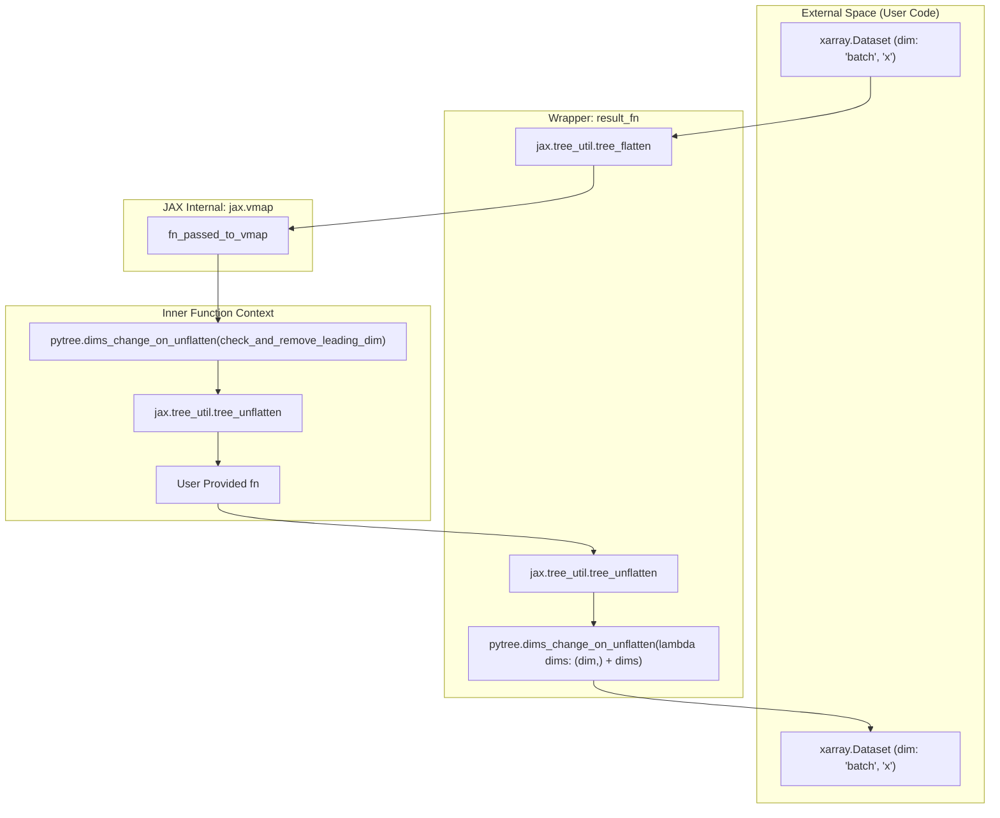
Sources: [xarray_jax/jax_transforms.py:52-91](), [xarray_jax/jax_transforms.py:125-164]()

## Implementation Details

### The dims_change_on_unflatten Context
The critical mechanism for managing dimension names is `pytree.dims_change_on_unflatten`. This context manager communicates with the PyTree unflattening logic (defined in `pytree.py`) to alter the dimension metadata as JAX reconstructs the xarray objects from flat arrays.

*   **During Input**: The wrapper uses a function `check_and_remove_leading_dim` which validates that `dim` is at index 0 and then returns `dims[1:]` [xarray_jax/jax_transforms.py:58-66]().
*   **During Output**: The wrapper uses a lambda `lambda dims: (dim,) + dims` to restore the mapped dimension to the head of the dimension list [xarray_jax/jax_transforms.py:88-89]().

### Argument and Result Handling
The wrappers maintain `input_treedef` and `output_treedef` as nonlocal variables to ensure that the structure of the PyTree is preserved across the transformation boundary [xarray_jax/jax_transforms.py:52-53](). This allows the wrappers to handle complex nested structures containing mixtures of xarray objects and standard JAX arrays [xarray_jax/tests/jax_transforms_test.py:93-112]().

### Function Signatures and Forwarding

| Feature | `vmap` implementation | `pmap` implementation |
| :--- | :--- | :--- |
| **Axis Identification** | `axis_name` defaults to `dim` [xarray_jax/jax_transforms.py:77-77]() | `axis_name` defaults to `dim` [xarray_jax/jax_transforms.py:148-148]() |
| **SPMD Support** | Forwards `spmd_axis_name` to `jax.vmap` [xarray_jax/jax_transforms.py:79-79]() | N/A |
| **Parallelism** | Sequential vectorization | Parallel execution across `devices` [xarray_jax/jax_transforms.py:151-151]() |
| **Validation** | Checks `axis_size` if provided [xarray_jax/tests/jax_transforms_test.py:152-166]() | Backend/Device forwarding [xarray_jax/jax_transforms.py:151-152]() |

Sources: [xarray_jax/jax_transforms.py:23-91](), [xarray_jax/jax_transforms.py:94-164]()

## Mapping Code Entities to JAX Operations

The following diagram maps the `xarray_jax` wrapper entities to their corresponding JAX and PyTree counterparts.

**Entity Mapping Diagram**
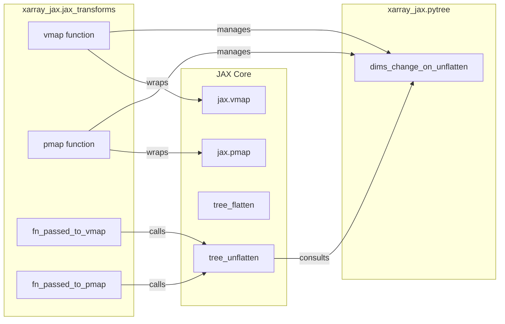
Sources: [xarray_jax/jax_transforms.py:23-164](), [xarray_jax/pytree.py:1-50]()

## Usage and Behavior

### Collective Operations
Because `axis_name` is automatically set to the `dim` name (unless overridden), users can perform collective operations like `jax.lax.psum` inside the mapped function using the dimension name as the axis identifier [xarray_jax/tests/jax_transforms_test.py:132-140]().

### Coordinate Handling
*   **Static Coordinates**: Standard xarray coordinates (which are treated as static metadata) are preserved but are not "mapped" over. They must be consistent across all elements of the mapped dimension.
*   **JAX Coordinates**: If using the experimental `jax_coords` feature, coordinates that vary along the mapped dimension are correctly handled. Inside the `vmap`/`pmap` block, these coordinates are also stripped of the mapped dimension, allowing for coordinate-aware logic inside the vectorized function [xarray_jax/tests/jax_transforms_test.py:51-77]().

### Error Handling
If a `DataArray` or `Dataset` is passed where the specified `dim` is not the leading axis, the wrapper raises a `ValueError` during the unflattening process inside the JAX transformation [xarray_jax/jax_transforms.py:63-64]().

Sources: [xarray_jax/tests/jax_transforms_test.py:114-124](), [xarray_jax/tests/jax_transforms_test.py:125-151]()

---

# Page: scan

# scan

<details>
<summary>Relevant source files</summary>

The following files were used as context for generating this wiki page:

- [README.md](README.md)
- [xarray_jax/jax_transforms.py](xarray_jax/jax_transforms.py)
- [xarray_jax/tests/jax_transforms_test.py](xarray_jax/tests/jax_transforms_test.py)

</details>


The `xarray_jax.scan` function provides a wrapper around `jax.lax.scan` that is compatible with xarray `DataArray` and `Dataset` objects. It allows for iterative computation over a named xarray dimension while preserving metadata and handling the necessary transposition and PyTree transformations required by JAX.

## Overview and Purpose

In standard JAX, `jax.lax.scan` iterates over the leading axis of an array (axis 0). When working with xarray objects, data variables may have different dimension orderings. `xarray_jax.scan` automates the process of:
1.  Identifying the scan dimension by name.
2.  Transposing all input `xs` so that the scan dimension is at axis 0.
3.  Stripping the scan dimension metadata during the loop body execution so the function `f` sees "slices" of the data.
4.  Re-applying the scan dimension to the stacked results.

### Key Constraints
*   **Leading Axis**: The dimension being scanned over must be present in the input `xs`.
*   **Coordinate Loss**: Standard xarray coordinates associated with the scan dimension are generally lost or become static during the scan unless they are explicitly passed as part of the `carry` or `xs` via `jax_coords` [xarray_jax/jax_transforms.py:214-220]().

## Data Flow and Implementation

The implementation of `xarray_jax.scan` manages the lifecycle of xarray objects through the JAX `scan` primitive using the `dims_change_on_unflatten` context manager.

### Logic Flow Diagram

The following diagram illustrates how `xarray_jax.scan` bridges the gap between labeled xarray objects and the positional requirements of `jax.lax.scan`.

**Diagram: xarray_jax.scan Execution Lifecycle**

```mermaid
graph TD
    A["Input: f, init, xs, dim"] --> B["Identify 'dim' in xs"]
    B --> C["Transpose xs: (dim, ...)"]
    C --> D["Flatten xs & init into PyTrees"]
    D --> E["jax.lax.scan(loop_body, ...)"]
    
    subgraph "loop_body(carry, x_slice)"
        E1["Unflatten carry & x_slice"]
        E2["dims_change_on_unflatten: Remove 'dim'"]
        E3["Execute user function f(carry, x_slice)"]
        E4["Flatten results"]
    end
    
    E --> F["Result: carry_final, stacked_slices"]
    F --> G["dims_change_on_unflatten: Add 'dim' to stacked_slices"]
    G --> H["Return labeled xarray objects"]

    style E1 stroke-dasharray: 5 5
    style E2 stroke-dasharray: 5 5
```
Sources: [xarray_jax/jax_transforms.py:222-268]()

### Coordinate Handling

`xarray_jax.scan` handles coordinates based on their type:
*   **Static Coordinates**: Standard xarray coordinates (e.g., `np.ndarray` or `pandas.Index`) are treated as static metadata. If they depend on the scan dimension, they will not be automatically sliced by the scan; the user must handle them manually or use `jax_coords`.
*   **JAX Coordinates**: If coordinates are registered via `jax_coords`, they are treated as dynamic JAX arrays and will be sliced/scanned like data variables [xarray_jax/jax_transforms.py:214-220]().

## Technical Reference

### Function Signature
[xarray_jax/jax_transforms.py:202-211]()
```python
def scan(f: Callable[[_Carry, _X], tuple[_Carry, _Y]],
         init: _Carry,
         xs: _X,
         length: Optional[int] = None,
         reverse: bool = False,
         unroll: int = 1,
         dim: Optional[str] = None) -> tuple[_Carry, _Y]:
```

| Parameter | Description |
| :--- | :--- |
| `f` | The loop body function. It receives `(carry, x_slice)` where `x_slice` has the `dim` dimension removed. |
| `init` | Initial state for the carry. |
| `xs` | The xarray object (or PyTree of objects) to scan over. |
| `dim` | The string name of the xarray dimension to iterate over. |
| `length` | Optional integer specifying the number of iterations (required if `xs` is empty). |

### Implementation Details
The core of the implementation uses `pytree.dims_change_on_unflatten` to dynamically modify the dimension metadata of the xarray objects as they pass through the JAX transformation boundary:

1.  **Inside the loop**: `check_and_remove_scan_dim` ensures the scanned dimension is at index 0 and removes it from the metadata so the user function `f` receives an xarray object with one less dimension [xarray_jax/jax_transforms.py:228-237]().
2.  **Outside the loop**: After `jax.lax.scan` finishes, the results are unflattened using a lambda that prepends the `dim` name back to the dimension list, restoring the original labels to the stacked output [xarray_jax/jax_transforms.py:265-267]().

Sources: [xarray_jax/jax_transforms.py:222-268]()

## Examples

### Scanning over a Dataset
In this example, we iterate over the `time` dimension of a `Dataset`.

```python
import xarray_jax
import jax.numpy as jnp

def integration_step(carry, x_slice):
    # carry is a DataArray, x_slice is a Dataset slice (no 'time' dim)
    new_carry = carry + x_slice.velocity * 0.1
    return new_carry, new_carry

# Dataset with 'time' as leading dim
ds = xarray_jax.Dataset({
    'velocity': (('time', 'x'), jnp.ones((10, 5)))
})
init_pos = xarray_jax.DataArray(jnp.zeros(5), dims=('x',))

final_state, trajectory = xarray_jax.scan(
    integration_step, init=init_pos, xs=ds, dim='time'
)
# trajectory is a DataArray with dims ('time', 'x')
```

### Usage with jax_coords
If a coordinate is marked as a JAX coordinate, it will be sliced during the scan.

```python
# Assuming 'time_coords' is a JAX array
ds = xarray_jax.Dataset(
    {'data': (('time', 'x'), jnp.zeros((10, 5)))},
    jax_coords={'time': (('time',), jnp.arange(10))}
)

def body(carry, x):
    # x.coords['time'] is now a scalar JAX array (the current time step)
    return carry, x.coords['time']

_, scanned_times = xarray_jax.scan(body, init=None, xs=ds, dim='time')
```
Sources: [xarray_jax/tests/jax_transforms_test.py:206-215]() (similar pattern in tests)

## Comparison with vmap
While `vmap` is used for parallel vectorization, `scan` is used for sequential dependencies. Both in `xarray_jax` share the requirement that the target dimension must be the leading axis (axis 0) to avoid ambiguous mapping of JAX's positional indexing to xarray's named indexing [xarray_jax/jax_transforms.py:30-35]().

Sources:
* [xarray_jax/jax_transforms.py:202-268]() (scan implementation)
* [xarray_jax/pytree.py:382-397]() (dims_change_on_unflatten logic)
* [xarray_jax/tests/jax_transforms_test.py:206-230]() (test cases)

---

# Page: tree_map_variables and tree_map_with_dims

# tree_map_variables and tree_map_with_dims

<details>
<summary>Relevant source files</summary>

The following files were used as context for generating this wiki page:

- [README.md](README.md)
- [xarray_jax/jax_transforms.py](xarray_jax/jax_transforms.py)
- [xarray_jax/tests/jax_transforms_test.py](xarray_jax/tests/jax_transforms_test.py)

</details>


The `xarray_jax` library provides specialized tree-mapping utilities designed to bridge the gap between JAX's generic PyTree structure and xarray's metadata-rich objects. While standard `jax.tree.map` operates on the raw array leaves of an xarray object, `tree_map_variables` and `tree_map_with_dims` allow developers to perform transformations while retaining access to dimension names and variable-level metadata.

## Overview of Mapping Utilities

In the `xarray_jax` implementation, `xarray.Variable`, `xarray.DataArray`, and `xarray.Dataset` are registered as PyTrees [xarray_jax/pytree.py:16-18](). By default, JAX transformations see the underlying arrays as leaves. The utility functions in `jax_transforms.py` provide a higher-level interface:

| Function | Leaf Type | Context Provided |
| :--- | :--- | :--- |
| `tree_map_variables` | `xarray.Variable` | Access to `.dims` and `.attrs` of each variable. |
| `tree_map_with_dims` | `jax.Array` | The dimension names (tuple of strings) associated with the array. |

Sources: [xarray_jax/jax_transforms.py:169-231](), [xarray_jax/pytree.py:16-18]()

## tree_map_variables

`tree_map_variables` acts similarly to `jax.tree.map`, but it treats `xarray.Variable` objects as the leaves of the tree [xarray_jax/jax_transforms.py:169-172](). 

### Behavior and Implementation
This function leverages the fact that `xarray_jax` registration exposes data via `xarray.Variable` nodes during the flatten/unflatten process [xarray_jax/jax_transforms.py:174-177](). 

*   **Scope**: It works with any JAX-registered PyTree containing xarray datatypes (DataArray, Dataset, DataTree) [xarray_jax/jax_transforms.py:174-176]().
*   **Static Data**: Note that static coordinate data (standard xarray coordinates not marked as `jax_coords`) are not mapped over [xarray_jax/jax_transforms.py:177-177]().
*   **Responsibility**: If the mapping function changes the dimensions or shapes of the Variables, the user must ensure they remain consistent with any static coordinates in the container, as these are not updated automatically [xarray_jax/jax_transforms.py:179-183]().

### Data Flow: Variable Mapping
The following diagram illustrates how `tree_map_variables` traverses an xarray structure compared to a standard JAX tree map.

**Variable-Level Mapping Logic**
```mermaid
graph TD
    subgraph "Standard JAX Map"
        A1["Dataset"] --> B1["jax.Array (foo)"]
        A1 --> B2["jax.Array (bar)"]
        B1 --> C1["Function(Array)"]
    end

    subgraph "tree_map_variables"
        A2["Dataset"] --> D1["xarray.Variable (foo)"]
        A2 --> D2["xarray.Variable (bar)"]
        D1 --> E1["Function(Variable)"]
        E1 --> F1["New Variable (dims, data)"]
    end
```
Sources: [xarray_jax/jax_transforms.py:169-183]()

## tree_map_with_dims

`tree_map_with_dims` is a specialized utility that maps over the JAX array leaves of a PyTree while passing the corresponding dimension names to the mapping function [xarray_jax/jax_transforms.py:207-210]().

### Implementation via tree_map_variables
Internally, `tree_map_with_dims` is implemented using `tree_map_variables` [xarray_jax/jax_transforms.py:228-231](). It extracts the `.data` and `.dims` from the Variable leaf and passes them to the user-provided function [xarray_jax/jax_transforms.py:229-230]().

### Use Case: Sharding with NamedSharding
A primary use case for `tree_map_with_dims` is applying `jax.sharding.NamedSharding` to xarray objects in a distributed environment [xarray_jax/jax_transforms.py:212-215](). Since `NamedSharding` requires a `PartitionSpec` that matches the array's logical axes, having the dimension names available makes it trivial to construct the correct sharding for every variable in a complex `Dataset` or `DataTree`.

**Example Logic for Sharding**
```python
# Conceptual usage for sharding
def apply_sharding(arr, dims):
    # Map xarray dimension names to JAX mesh axis names
    pspec = jax.sharding.PartitionSpec(*(dim_to_mesh_map[d] for d in dims))
    return jax.device_put(arr, jax.sharding.NamedSharding(mesh, pspec))

sharded_ds = tree_map_with_dims(apply_sharding, dataset)
```

### Entity Mapping: Code to Logic
This diagram bridges the functional requirements of sharding with the specific code entities in `jax_transforms.py`.

**Sharding Data Flow**
```mermaid
graph LR
    Input["PyTree (Dataset/DataArray)"] --> TMWD["tree_map_with_dims"]
    subgraph "jax_transforms.py"
        TMWD --> TMV["tree_map_variables"]
        TMV --> VAR["xarray.Variable"]
    end
    VAR --> FUNC["User Function(array, dims)"]
    FUNC --> NS["jax.sharding.NamedSharding"]
    NS --> Output["Sharded PyTree"]
```
Sources: [xarray_jax/jax_transforms.py:207-231]()

## Summary Table of Key Functions

| Entity | Location | Role |
| :--- | :--- | :--- |
| `tree_map_variables` | [xarray_jax/jax_transforms.py:169]() | Maps a function `(Variable) -> Variable` over an xarray PyTree. |
| `tree_map_with_dims` | [xarray_jax/jax_transforms.py:207]() | Maps a function `(Array, Dims) -> Array` over an xarray PyTree. |
| `_PyTree` | [xarray_jax/jax_transforms.py:166]() | TypeVar representing any JAX-compatible tree structure. |

Sources: [xarray_jax/jax_transforms.py:166-231]()

---

# Page: Coordinate System

# Coordinate System

<details>
<summary>Relevant source files</summary>

The following files were used as context for generating this wiki page:

- [xarray_jax/__init__.py](xarray_jax/__init__.py)
- [xarray_jax/core.py](xarray_jax/core.py)
- [xarray_jax/pytree.py](xarray_jax/pytree.py)

</details>


The `xarray_jax` coordinate system is designed to bridge the gap between `xarray`'s metadata-rich indexing and `JAX`'s requirement for functional purity and static array shapes. Because `xarray` coordinates often involve non-JAX types (like `datetime64`) or trigger non-JITable indexing logic, `xarray_jax` implements a split strategy: **Static Coordinates** (the default) and **JAX Coordinates** (experimental).

### Overview of Coordinate Handling

By default, `xarray_jax` treats coordinates as static metadata. This means they are not "leaves" in the JAX PyTree; instead, they are part of the auxiliary data that defines the tree structure. If you change a coordinate value, JAX sees it as a change in the tree definition, which triggers a recompilation of any JIT-compiled functions.

To allow for dynamic, differentiable, or transformable coordinates, `xarray_jax` provides an experimental `jax_coords` feature. These are treated as dynamic JAX leaves, but they come with significant functional limitations regarding `xarray` indexing.

#### Coordinate Type Comparison

| Feature | Static Coordinates (Default) | JAX Coordinates (`jax_coords`) |
| :--- | :--- | :--- |
| **JAX Role** | Static auxiliary metadata | Dynamic PyTree leaf |
| **JIT Behavior** | Triggers recompilation on change | Passed as Tracers; no recompilation |
| **Indexing (`.sel`)** | Fully supported | Not supported (empty indexes) |
| **Differentiable** | No | Yes |
| **Data Types** | Any (NumPy, datetime, etc.) | JAX-supported types only |

**System Entity Mapping**

The following diagram shows how coordinate data flows through the system and which code entities manage the transition between static and dynamic states.

```mermaid
graph TD
    subgraph "Natural Language Space"
        A["Static Metadata"]
        B["Dynamic JAX Data"]
    end

    subgraph "Code Entity Space"
        C["xarray_jax.DataArray/Dataset"]
        D["_HashableCoords"]
        E["jax.tree_util.register_pytree_node"]
        F["JAX_COORD_ATTR_NAME"]
        G["assign_jax_coords"]
    end

    A -->|"Stored in"| D
    D -->|"Used by"| E
    B -->|"Marked by"| F
    F -->|"Processed by"| G
    G -->|"Returns"| C
    C -->|"Contains"| D
```
**Sources:** [xarray_jax/__init__.py:64-82](), [xarray_jax/core.py:23-33](), [xarray_jax/pytree.py:155-200]()

---

### Static Coordinates

Standard `xarray` coordinates are treated as static compile-time constants. When an `xarray.Dataset` or `DataArray` is flattened into a JAX PyTree, these coordinates are bundled into the auxiliary data. This ensures that `xarray`'s advanced indexing and alignment logic remains functional, as the values are concrete NumPy arrays at the time of execution.

To ensure JAX can correctly cache JIT-compiled functions, `xarray_jax` uses internal wrappers like `_HashableCoords` to provide stable hashing for coordinate sets.

For details on recompilation behavior and the `arithmetic_compat='override'` setting, see **[Static Coordinates](#4.1)**.

**Sources:** [xarray_jax/__init__.py:72-78](), [xarray_jax/__init__.py:145-173]()

---

### JAX Coordinates (`jax_coords`)

The `jax_coords` feature allows coordinates to be treated as dynamic JAX arrays. This is useful for workflows where coordinates are the output of a JAX computation or need to be differentiated.

However, because `xarray`'s indexing logic (e.g., `.sel()`, `.loc[]`) relies on concrete values to build indexes, `jax_coords` are explicitly prevented from creating indexes. This results in "empty indexes" for these coordinates, meaning they behave like non-index coordinates in standard `xarray`.

For details on the `JAX_COORD_ATTR_NAME` marker and implementation details, see **[JAX Coordinates (jax_coords)](#4.2)**.

**Sources:** [xarray_jax/core.py:32-64](), [xarray_jax/core.py:125-153]()

---

### Global Arithmetic Compatibility

One critical limitation of mixing JAX tracers with `xarray` is that `xarray`'s default arithmetic behavior (`minimal` compatibility) attempts to compare coordinate values. This comparison triggers a `jax.errors.TracerBoolConversionError` inside JIT blocks.

To resolve this, `xarray_jax` globally sets:
```python
xarray.set_options(arithmetic_compat='override')
```
This ensures that coordinates are preserved during arithmetic operations without triggering illegal tracer-to-boolean conversions.

**Sources:** [xarray_jax/__init__.py:145-173]()

---

### Coordinate Flow and Transformations

When using JAX transformations like `vmap` or `scan`, coordinates must be handled carefully. If a transformation changes the shape of the data (e.g., removing a dimension), the coordinates must be synchronized. `xarray_jax` uses the `dims_change_on_unflatten` context manager to manage this metadata lifecycle.

```mermaid
sequenceDiagram
    participant User as User Code
    participant XJ as xarray_jax.vmap
    participant PT as pytree.py (_flatten)
    participant JAX as JAX Engine

    User->>XJ: Call vmap(func, in_dims='time')
    XJ->>PT: Flatten DataArray
    PT-->>XJ: Leaves (Data), Aux (Static Coords)
    XJ->>JAX: Apply jax.vmap
    JAX-->>XJ: Transformed Leaves
    XJ->>PT: Unflatten with dims_change_on_unflatten
    PT-->>User: New DataArray (Dimension 'time' removed)
```
**Sources:** [xarray_jax/pytree.py:163-198](), [xarray_jax/jax_transforms.py:98-103]()

---

# Page: Static Coordinates

# Static Coordinates

<details>
<summary>Relevant source files</summary>

The following files were used as context for generating this wiki page:

- [xarray_jax/__init__.py](xarray_jax/__init__.py)
- [xarray_jax/pytree.py](xarray_jax/pytree.py)
- [xarray_jax/tests/xarray_jax_test.py](xarray_jax/tests/xarray_jax_test.py)

</details>


In `xarray_jax`, standard xarray coordinates are treated as static metadata. This design choice ensures compatibility with JAX's functional requirements while maintaining xarray's powerful indexing capabilities for non-tracing data.

## Static vs. Dynamic Split

The core philosophy of `xarray_jax` is to separate dynamic data (JAX arrays) from static metadata (dimensions, attributes, and standard coordinates). For the purposes of `jax.tree_util` and `jax.jit`, coordinates are not treated as leaves of the PyTree. Instead, they are part of the auxiliary data (the "treedef") `[xarray_jax/__init__.py:72-74]()`.

### Implications for JIT Compilation
Because coordinates are static, they behave like `static_argnums` in `jax.jit`.
*   **Cache Keying**: If a JIT-compiled function is called with a `Dataset` or `DataArray` containing different coordinate values, JAX will trigger a recompilation `[xarray_jax/__init__.py:74-77]()`.
*   **Performance**: This is efficient for coordinates that do not change frequently (e.g., fixed latitude/longitude grids) but can lead to excessive recompilation if coordinates are updated in a loop.
*   **Indexing**: Standard coordinates allow xarray's advanced indexing and slicing to work correctly, which would otherwise fail if coordinates were JAX Tracers `[xarray_jax/__init__.py:65-68]()`.

### Data Flow in PyTree Registration
The following diagram illustrates how coordinates are handled during the JAX `flatten` and `unflatten` process.

**Coordinate Handling in PyTree Lifecycle**
```mermaid
graph TD
    subgraph "Flattening (JAX Space)"
        A["xarray.DataArray"] -- "pytree._flatten_data_array" --> B["Dynamic Leaves (Data)"]
        A -- "pytree._flatten_data_array" --> C["Auxiliary Data (Static)"]
        C --> D["_HashableCoords"]
    end

    subgraph "Unflattening (Code Space)"
        B --> E["pytree._unflatten_data_array"]
        D --> E
        E --> F["New xarray.DataArray"]
    end

    subgraph "Code Entities"
        C1["_flatten_data_array [xarray_jax/pytree.py:237]"]
        C2["_unflatten_data_array [xarray_jax/pytree.py:248]"]
        C3["_HashableCoords [xarray_jax/pytree.py:214]"]
    end
```
Sources: `[xarray_jax/pytree.py:214-256]()`, `[xarray_jax/__init__.py:72-77]()`

## _HashableCoords and JIT Caching

To enable JAX to correctly identify when a function needs to be recompiled, the static metadata must be hashable and comparable. `xarray_jax` implements a private class `_HashableCoords` to wrap coordinate mappings `[xarray_jax/pytree.py:214-220]()`.

| Feature | Implementation | Purpose |
| :--- | :--- | :--- |
| **Storage** | `collections.abc.Mapping` | Stores coordinate names and values. |
| **Equality** | `__eq__` | Compares coordinate values to detect changes. |
| **Hashing** | `__hash__` | Allows JAX to use coordinates as part of the JIT cache key. |

When a `DataArray` is flattened, the coordinates are extracted and wrapped in `_HashableCoords`, then stored in the `aux_data` of the PyTree `[xarray_jax/pytree.py:242-246]()`.

Sources: `[xarray_jax/pytree.py:214-220]()`, `[xarray_jax/pytree.py:237-246]()`

## Global Workaround: arithmetic_compat='override'

Xarray's default behavior (`arithmetic_compat='minimal'`) performs coordinate compatibility checks during arithmetic operations. When using JAX, these checks can trigger a `jax.errors.TracerBoolConversionError` because they attempt to evaluate the truthiness of JAX Tracers used in coordinates or metadata comparisons `[xarray_jax/__init__.py:145-148]()`.

To resolve this, `xarray_jax` automatically sets a global xarray option upon import:
```python
xarray.set_options(arithmetic_compat='override')
```
`[xarray_jax/__init__.py:173-173]()`

### Effects of 'override'
1.  **Disables Compatibility Checks**: Arithmetic operations no longer strictly validate that non-index coordinates match between operands `[xarray_jax/__init__.py:158-161]()`.
2.  **Prevents Coordinate Dropping**: In standard xarray, a failed compatibility check (swallowed by xarray) would result in coordinates being dropped during JIT. `override` ensures coordinates are preserved `[xarray_jax/__init__.py:149-152]()`.
3.  **Scope**: This primarily affects arithmetic; other xarray APIs may still require explicit `compat='override'` arguments `[xarray_jax/__init__.py:160-161]()`.

Sources: `[xarray_jax/__init__.py:145-173]()`

## Recompilation Behavior

Users should be aware that modifying static coordinates inside a JIT-compiled function is not possible, as they are "baked in" at compile time.

**Static Coordinate Recompilation Flow**
```mermaid
sequenceDiagram
    participant U as User Code
    participant J as JAX JIT Cache
    participant C as Compiler

    U->>J: Call fn(DataArray_1) [Coords: A]
    J->>C: Miss (New Coords)
    C-->>J: Compiled Kernel (Coords A)
    J-->>U: Result

    U->>J: Call fn(DataArray_2) [Coords: A]
    J-->>U: Hit (Reuse Kernel)

    U->>J: Call fn(DataArray_3) [Coords: B]
    J->>C: Miss (New Coords)
    C-->>J: Compiled Kernel (Coords B)
    J-->>U: Result
```
Sources: `[xarray_jax/__init__.py:74-77]()`, `[xarray_jax/tests/xarray_jax_test.py:110-121]()`

### When to Avoid Static Coordinates
If you need to pass dynamic data that varies every step (e.g., a time-varying bias field) and you want to avoid recompilation, do not use standard coordinates. Instead:
1.  Add the data as a **data variable** in a `Dataset` `[xarray_jax/__init__.py:79-80]()`.
2.  Use the experimental **JAX Coordinates** feature (see Section 4.2) `[xarray_jax/__init__.py:23-25]()`.

Sources: `[xarray_jax/__init__.py:79-82]()`

---

# Page: JAX Coordinates (jax_coords)

# JAX Coordinates (jax_coords)

<details>
<summary>Relevant source files</summary>

The following files were used as context for generating this wiki page:

- [xarray_jax/core.py](xarray_jax/core.py)
- [xarray_jax/tests/jax_transforms_test.py](xarray_jax/tests/jax_transforms_test.py)
- [xarray_jax/tests/xarray_jax_test.py](xarray_jax/tests/xarray_jax_test.py)

</details>


The `jax_coords` feature is an experimental mechanism in `xarray_jax` designed to handle coordinates that need to be treated as dynamic JAX data rather than static metadata. While standard xarray coordinates are treated as static compile-time constants by JAX, `jax_coords` allows coordinates to be passed as JAX tracers through `jax.jit` boundaries, enabling gradients and JIT-compiled computations to be performed on coordinate values.

## Purpose and Motivation

In standard `xarray_jax` usage, coordinates are part of the "auxiliary data" in the PyTree structure. This means any change to a coordinate value triggers a re-compilation of a JIT-compiled function [xarray_jax/core.py:40-44](). 

`jax_coords` addresses scenarios where:
1.  **Coordinate values are dynamic**: For example, time coordinates that change every step of a simulation.
2.  **Gradients are required**: When you need to compute the derivative of a result with respect to a coordinate value.
3.  **Large coordinate arrays**: Avoiding re-compilation overhead for large coordinate sets that change frequently.

## The `JAX_COORD_ATTR_NAME` Marker

To distinguish dynamic JAX coordinates from static ones, `xarray_jax` uses a specific attribute marker.

*   **Constant**: `JAX_COORD_ATTR_NAME = '_jax_coord'` [xarray_jax/core.py:23]().
*   **Mechanism**: When a coordinate is designated as a JAX coordinate, `xarray_jax` adds this attribute to the `xarray.Variable` representing that coordinate [xarray_jax/core.py:165-171]().
*   **Discovery**: The `get_jax_coords` utility identifies which coordinates in a Dataset or DataArray carry this marker [xarray_jax/core.py:199-209]().

### Data Flow: Marking and Identification

The following diagram illustrates how a coordinate is promoted to a JAX coordinate and later identified during PyTree flattening.

**Coordinate Promotion Flow**
```mermaid
graph TD
    A["User Input (jax_coords dict)"] -- "assign_coords()" --> B["xarray.Variable creation"]
    B -- "Set .attrs['_jax_coord'] = True" --> C["xarray.DataArray / Dataset"]
    C -- "jax.jit / jax.tree_util.flatten" --> D["get_jax_coords()"]
    D -- "Filter variables with _jax_coord attr" --> E["Dynamic PyTree Leaves"]
    C -- "Standard coords" --> F["Static Auxiliary Data"]
```
Sources: [xarray_jax/core.py:154-171](), [xarray_jax/core.py:199-209]()

## Implementation: Suppressing Indexes

A critical technical constraint in xarray is that it automatically attempts to create `pandas.Index` objects for coordinates that share a name with a dimension. Because JAX tracers cannot be converted into pandas indexes (which require concrete numpy values), `xarray_jax` must suppress index creation for `jax_coords`.

### Empty Indexes Pattern
When using `assign_coords` with the `jax_coords` argument, the library uses a specialized internal logic:
1.  It wraps the JAX data in an `xarray.Variable` [xarray_jax/core.py:165]().
2.  It marks the variable with the `_jax_coord` attribute [xarray_jax/core.py:171]().
3.  It updates the object's coordinates using `x.coords.update()`. Because the underlying data is often a JAX tracer, `xarray_jax` ensures that no index is created for these variables [xarray_jax/core.py:173-174]().

As a result, `jax_coords` will appear in `ds.coords` but will **not** appear in `ds.indexes` [xarray_jax/tests/xarray_jax_test.py:172-173]().

## Usage in Constructors

Both `DataArray` and `Dataset` in `xarray_jax` provide a `jax_coords` parameter.

| Feature | `coords` (Standard) | `jax_coords` (Experimental) |
| :--- | :--- | :--- |
| **Data Type** | NumPy / Static | JAX Arrays / Tracers |
| **JAX Treatment** | Static Auxiliary Data | Dynamic PyTree Leaf |
| **JIT Behavior** | Triggers Re-compilation | Passed as Tracer |
| **Indexing** | Supports `.sel()` | **No `.sel()` support** |
| **Marker** | None | `attrs['_jax_coord'] = True` |

Sources: [xarray_jax/core.py:26-68](), [xarray_jax/core.py:73-111]()

## Limitations and Trade-offs

### 1. No `.sel()` Support
Because `jax_coords` do not have associated indexes, xarray's label-based indexing (`.sel()`) will not work on them [xarray_jax/core.py:53-58](). Attempting to use `.sel` on a JAX coordinate will result in an error because xarray cannot find a corresponding index.

### 2. Explicit Specification
`xarray_jax` requires `jax_coords` to be explicitly passed to the constructor or `assign_coords`. It does **not** automatically detect JAX arrays inside the standard `coords` dictionary. This is a design choice to ensure consistent PyTree structure, as the distinction between static and dynamic data must be known at the time of PyTree registration [xarray_jax/core.py:59-64]().

### 3. When to prefer `data_vars`
If you need to perform complex JAX operations on a variable and don't strictly need it to be classified as a "coordinate" by xarray, it is often simpler to include it as a standard data variable in a `Dataset` [xarray_jax/core.py:92-95]().

## Code Entity Map: Coordinate Handling

This diagram maps the high-level coordinate concepts to the specific functions and attributes in the codebase.

**Coordinate Entity Relationship**
```mermaid
classDiagram
    class DatasetOrDataArray {
        <<Interface>>
        +coords
        +indexes
    }
    class core_py {
        +assign_coords(x, coords, jax_coords)
        +get_jax_coords(x)
        +JAX_COORD_ATTR_NAME : "_jax_coord"
    }
    class pytree_py {
        +_flatten_data_array(da)
        +_unflatten_data_array(aux, children)
    }

    core_py ..> DatasetOrDataArray : "Manages attributes"
    pytree_py ..> core_py : "Calls get_jax_coords during flatten"
    DatasetOrDataArray --> xarray_Variable : "contains"
    xarray_Variable --|> JAX_Leaf : "If _jax_coord attr present"
```
Sources: [xarray_jax/core.py:23-33](), [xarray_jax/core.py:199-209](), [xarray_jax/pytree.py:157-165]()

## Examples

### Creating a DataArray with JAX Coordinates
```python
import jax.numpy as jnp
import xarray_jax

# 'lat' is a static coord (numpy), 'lon' is a JAX coord (jnp)
da = xarray_jax.DataArray(
    data=jnp.ones((3, 4)),
    dims=('lat', 'lon'),
    coords={'lat': [10, 20, 30]},
    jax_coords={'lon': jnp.array([1, 2, 3, 4])}
)

# Verification
assert 'lon' in da.coords
assert 'lon' not in da.indexes
assert da.coords['lon'].attrs['_jax_coord'] is True
```
Sources: [xarray_jax/tests/xarray_jax_test.py:163-173]()

### Using JAX Coordinates in `vmap`
When using `xarray_jax.vmap`, `jax_coords` that contain the mapping dimension are correctly sliced and passed into the mapped function as JAX arrays.
```python
def func(d):
    # d.coords['time'] is a JAX tracer here
    return d + d.coords['time']

# 'time' is a jax_coord with a 'batch' dimension
vmapped_func = xarray_jax.vmap(func, dim='batch')
result = vmapped_func(dataset_with_jax_coords)
```
Sources: [xarray_jax/tests/jax_transforms_test.py:51-78]()

---

# Page: Public API Reference

# Public API Reference

<details>
<summary>Relevant source files</summary>

The following files were used as context for generating this wiki page:

- [xarray_jax/__init__.py](xarray_jax/__init__.py)
- [xarray_jax/core.py](xarray_jax/core.py)
- [xarray_jax/jax_transforms.py](xarray_jax/jax_transforms.py)
- [xarray_jax/pytree.py](xarray_jax/pytree.py)

</details>


This page provides a comprehensive reference for the public symbols exported by the `xarray_jax` package. The API is designed to mirror standard `xarray` as closely as possible while providing the necessary hooks for JAX compatibility, such as PyTree registration and coordinate management.

All symbols documented here are available directly from the top-level `xarray_jax` namespace [xarray_jax/__init__.py:88-114]().

### API Architecture Overview

The `xarray_jax` API bridges the gap between the metadata-rich world of `xarray` and the functional requirements of JAX.

"API Connectivity Map"
```mermaid
graph TD
    subgraph "Constructors"
        DA["DataArray"]
        DS["Dataset"]
        V["Variable"]
    end

    subgraph "Transformations"
        VM["vmap"]
        PM["pmap"]
        SC["scan"]
        TMV["tree_map_variables"]
    end

    subgraph "Utilities"
        JD["jax_data"]
        JV["jax_vars"]
        UNW["unwrap"]
        DCU["dims_change_on_unflatten"]
    end

    DA --> |Uses| AC["assign_coords"]
    DS --> |Uses| AC
    VM --> |Uses| DCU
    PM --> |Uses| DCU
    JD --> |Uses| UNW
```
Sources: [xarray_jax/__init__.py:88-114](), [xarray_jax/core.py:26-114](), [xarray_jax/jax_transforms.py:23-103]()

---

## Data Structures and Constructors

These functions are the primary entry points for creating JAX-compatible xarray objects. While standard `xarray` constructors now support JAX arrays, these wrappers provide explicit support for the `jax_coords` feature [xarray_jax/__init__.py:23-25]().

| Symbol | Role | Key Difference from xarray |
| :--- | :--- | :--- |
| `DataArray` | Constructor for labeled arrays | Supports `jax_coords` parameter for dynamic coordinates [xarray_jax/core.py:26-33](). |
| `Dataset` | Constructor for multi-variable sets | Supports `jax_coords` parameter; handles tracer-safe coord assignment [xarray_jax/core.py:73-78](). |
| `Variable` | Alias for `xarray.Variable` | Provided for completeness and backward compatibility [xarray_jax/core.py:118](). |
| `apply_ufunc` | JAX-aware ufunc wrapper | Dispatches to `xarray.apply_ufunc` with JAX-compatible defaults [xarray_jax/core.py:213-217](). |

For detailed signature information and usage of the `jax_coords` parameter, see **[Data Structures and Constructors](#5.1)**.

Sources: [xarray_jax/core.py:26-118](), [xarray_jax/__init__.py:88-96]()

---

## Data Extraction Utilities

Once a computation is finished within a JAX transformation (like `jax.jit`), you often need to extract the underlying JAX arrays from the xarray containers.

"Data Flow: Xarray to JAX"
```mermaid
graph LR
    subgraph "Xarray Domain"
        XA_DS["xarray.Dataset"]
        XA_DA["xarray.DataArray"]
    end

    subgraph "Extraction Layer"
        JV["jax_vars()"]
        JD["jax_data()"]
    end

    subgraph "JAX Domain"
        J_DICT["Dict[str, jax.Array]"]
        J_ARR["jax.Array"]
    end

    XA_DS --> JV --> J_DICT
    XA_DA --> JD --> J_ARR
```
Sources: [xarray_jax/pytree.py:70-81](), [xarray_jax/__init__.py:27-41]()

### Key Utility Functions
*   **`jax_data(obj)`**: Extracts the underlying JAX array from a `DataArray` or `Variable`. Raises a `TypeError` if the data is not a JAX array [xarray_jax/pytree.py:70-75]().
*   **`jax_vars(dataset)`**: Extracts a dictionary of JAX arrays from a `Dataset`. Validates that all variables are JAX-backed [xarray_jax/pytree.py:77-80]().
*   **`unwrap(value, require_jax=False)`**: A low-level utility to strip `NonArrayLeafWrapper` shims used during JAX transformations [xarray_jax/pytree.py:34-39]().

For details on `unwrap_vars`, `unwrap_coords`, and the `require_jax` flag, see **[Data Extraction Utilities](#5.2)**.

Sources: [xarray_jax/pytree.py:29-81](), [xarray_jax/__init__.py:104-114]()

---

## Coordinate Management

These functions handle the assignment and retrieval of coordinates, specifically managing the distinction between **Static Coordinates** (treated as JAX static metadata) and **JAX Coordinates** (treated as dynamic JAX data) [xarray_jax/core.py:125-153]().

*   **`assign_coords`**: The primary mechanism for updating coordinates. It allows simultaneous assignment of standard (static) and JAX (dynamic) coordinates [xarray_jax/core.py:125-130]().
*   **`assign_jax_coords`**: Specialized helper to assign coordinates that should be treated as dynamic JAX data [xarray_jax/core.py:186-191]().
*   **`get_jax_coords`**: Retrieves the subset of coordinates marked as JAX-dynamic [xarray_jax/core.py:202-205]().

Sources: [xarray_jax/core.py:125-211](), [xarray_jax/__init__.py:92-94]()

---

## Transformation Wrappers

Standard JAX transformations like `vmap` and `scan` are not aware of xarray dimension names. `xarray_jax` provides wrappers that handle the flattening and unflattening of xarray objects while preserving (or transforming) dimension metadata.

*   **`vmap`**: Wraps `jax.vmap`. Requires the mapped dimension to be the leading axis. It automatically manages dimension stripping inside the function and restoration in the output [xarray_jax/jax_transforms.py:23-51]().
*   **`pmap`**: Wraps `jax.pmap` for parallel execution across devices, following similar dimension constraints as `vmap` [xarray_jax/jax_transforms.py:94-124]().
*   **`scan`**: Wraps `jax.lax.scan`. Handles the "carry" and "ys" structures while ensuring the scan dimension is correctly transposed to the leading position [xarray_jax/jax_transforms.py:187-219]().
*   **`tree_map_variables`**: A utility that applies a function to every `Variable` in a PyTree, allowing users to manipulate data and dimensions simultaneously [xarray_jax/jax_transforms.py:169-184]().

Sources: [xarray_jax/jax_transforms.py:23-219](), [xarray_jax/__init__.py:97-103]()

---

# Page: Data Structures and Constructors

# Data Structures and Constructors

<details>
<summary>Relevant source files</summary>

The following files were used as context for generating this wiki page:

- [xarray_jax/__init__.py](xarray_jax/__init__.py)
- [xarray_jax/core.py](xarray_jax/core.py)

</details>


This page provides a technical reference for the core data structures and constructors provided by `xarray_jax`. While `xarray_jax` leverages standard `xarray` objects, it provides specialized constructors and utility functions to handle the integration of JAX arrays, particularly regarding how coordinates are treated during JAX transformations like `jax.jit`.

## Core Data Structures

`xarray_jax` works with the three primary `xarray` data structures. These are registered as JAX PyTrees in `xarray_jax.pytree`, allowing them to be passed directly into JAX-transformed functions.

| Class | Description | JAX Integration |
| :--- | :--- | :--- |
| `xarray.Variable` | The fundamental unit containing an array, dimensions, and attributes. | Registered as a PyTree where the underlying data is a leaf [xarray_jax/pytree.py:228-230](). |
| `xarray.DataArray` | A labeled N-dimensional array with coordinates and attributes. | Registered as a PyTree. Coordinates are typically static metadata unless marked as `jax_coords` [xarray_jax/pytree.py:330-333](). |
| `xarray.Dataset` | A dict-like container of `DataArray` objects. | Registered as a PyTree. Data variables are dynamic leaves; coordinates are static metadata [xarray_jax/pytree.py:440-444](). |

**Note:** `xarray_jax.Variable` is provided as an alias for `xarray.Variable` for API consistency [xarray_jax/core.py:118-118]().

### Data Structure Relationship
The following diagram illustrates how `xarray_jax` maps standard `xarray` entities into the JAX PyTree ecosystem.

**Entity Mapping: Xarray to JAX PyTree**
```mermaid
graph TD
    subgraph "Xarray Entity Space"
        XA_DA["xarray.DataArray"]
        XA_DS["xarray.Dataset"]
        XA_VAR["xarray.Variable"]
    end

    subgraph "JAX PyTree Space"
        PT_NODE["PyTree Node (Internal)"]
        DYNAMIC_LEAF["Dynamic Leaf (Tracer/Array)"]
        STATIC_META["Static Metadata (Auxiliary Data)"]
    end

    XA_VAR -->|Registered via| PT_NODE
    XA_VAR -.->|data| DYNAMIC_LEAF
    XA_VAR -.->|dims/attrs| STATIC_META

    XA_DA -->|Registered via| PT_NODE
    XA_DA -.->|variable| XA_VAR
    XA_DA -.->|coords (standard)| STATIC_META
    XA_DA -.->|jax_coords| DYNAMIC_LEAF

    XA_DS -->|Registered via| PT_NODE
    XA_DS -.->|data_vars| XA_VAR
    XA_DS -.->|coords (standard)| STATIC_META
```
Sources: [xarray_jax/pytree.py:228-230](), [xarray_jax/pytree.py:330-333](), [xarray_jax/pytree.py:440-444](), [xarray_jax/core.py:118-118]()

---

## Constructors

`xarray_jax` provides custom constructors for `DataArray` and `Dataset`. While standard `xarray` constructors now support JAX arrays as data, these custom versions are required to use the `jax_coords` feature.

### `xarray_jax.DataArray`
Wraps the standard `xarray.DataArray` constructor but adds the `jax_coords` parameter.

```python
def DataArray(
    data,
    coords=None,
    dims=None,
    name=None,
    attrs=None,
    jax_coords=None,
) -> xarray.DataArray:
```
*   **`data`**: Supports JAX arrays, tracers, or numpy arrays [xarray_jax/core.py:37-37]().
*   **`coords`**: Standard coordinates. These are treated as **static** by JAX. If these change, JAX will recompile the function [xarray_jax/core.py:38-44]().
*   **`jax_coords`**: Experimental feature for coordinates that should be treated as **dynamic** JAX data (tracers). These do not trigger recompilation when values change but cannot be used for indexing (`.sel`) [xarray_jax/core.py:49-58]().

### `xarray_jax.Dataset`
Wraps the standard `xarray.Dataset` constructor.

```python
def Dataset(
    data_vars=None,
    coords=None,
    attrs=None,
    jax_coords=None,
) -> xarray.Dataset:
```
*   **`data_vars`**: Dictionary mapping names to data. Supports JAX arrays [xarray_jax/core.py:82-82]().
*   **`jax_coords`**: Similar to `DataArray`, allows coordinates to be treated as dynamic PyTree leaves [xarray_jax/core.py:92-107]().

Sources: [xarray_jax/core.py:26-71](), [xarray_jax/core.py:73-114]()

---

## Coordinate Management and `jax_coords`

The `jax_coords` mechanism is a key differentiator in `xarray_jax`. Because `xarray` normally attempts to create indexes (like `pandas.Index`) for coordinates, and these indexes cannot wrap JAX tracers, `xarray_jax` uses a specific implementation strategy.

### The `JAX_COORD_ATTR_NAME` Marker
When a coordinate is assigned via the `jax_coords` argument, `xarray_jax` marks the variable with a special attribute: `_jax_coord` [xarray_jax/core.py:23-23]().

### Implementation via `assign_coords`
The `xarray_jax.assign_coords` function is the underlying engine for managing these coordinates. It performs the following steps:
1.  Assigns standard (static) coordinates using the native `xarray.assign_coords` [xarray_jax/core.py:157-157]().
2.  For `jax_coords`, it creates `xarray.Variable` objects and adds the `JAX_COORD_ATTR_NAME` to their attributes [xarray_jax/core.py:161-163]().
3.  It uses `xarray.Coordinates` with **empty indexes** to prevent `xarray` from attempting to build a non-JIT-compatible index from the JAX array [xarray_jax/core.py:141-142]().

**Data Flow: Constructor to PyTree Registration**
```mermaid
graph LR
    subgraph "Constructor Phase"
        INPUT["User Input (data, jax_coords)"]
        CONST["xarray_jax.DataArray()"]
        ASSIGN["assign_coords()"]
    end

    subgraph "Internal State"
        ATTR["_jax_coord=True"]
        EMPTY_IDX["Empty Indexes"]
    end

    subgraph "JAX Transformation"
        FLATTEN["_flatten_data_array()"]
        LEAVES["Dynamic Leaves (JAX Tracers)"]
    end

    INPUT --> CONST
    CONST --> ASSIGN
    ASSIGN --> ATTR
    ASSIGN --> EMPTY_IDX
    ATTR --> FLATTEN
    EMPTY_IDX --> FLATTEN
    FLATTEN --> LEAVES
```
Sources: [xarray_jax/core.py:23-23](), [xarray_jax/core.py:130-163](), [xarray_jax/pytree.py:346-351]()

---

## Universal Function Wrapper: `apply_ufunc`

`xarray_jax.apply_ufunc` is a specialized wrapper for `xarray.apply_ufunc`. It is designed to ensure that when JAX operations are applied to `xarray` objects, the metadata (dimensions and coordinates) is preserved correctly.

### Key Features
*   **JAX Compatibility**: It is specifically tested to work within `jax.jit` and other transformations [xarray_jax/core.py:18-19]().
*   **Coordinate Preservation**: It handles the propagation of `jax_coords` through the function application, ensuring that the `_jax_coord` markers are not lost during the underlying array operations [xarray_jax/core.py:89-89]().

Sources: [xarray_jax/core.py:89-89](), [xarray_jax/__init__.py:89-89]()

## Summary of Differences from Standard Xarray

| Feature | Standard `xarray` | `xarray_jax` |
| :--- | :--- | :--- |
| **Data Storage** | NumPy, Dask, etc. | JAX Arrays / Tracers. |
| **Coordinate Type** | Always static/indexed. | Static (default) or Dynamic (`jax_coords`). |
| **JIT Behavior** | Not natively JIT-able. | Fully JIT-able via PyTree registration. |
| **Indexing** | Supported on all coords. | Not supported on `jax_coords`. |
| **Global Config** | `arithmetic_compat='minimal'` | `arithmetic_compat='override'` (to prevent tracer errors) [xarray_jax/__init__.py:173-173](). |

Sources: [xarray_jax/__init__.py:145-173](), [xarray_jax/core.py:49-58]()

---

# Page: Data Extraction Utilities

# Data Extraction Utilities

<details>
<summary>Relevant source files</summary>

The following files were used as context for generating this wiki page:

- [xarray_jax/__init__.py](xarray_jax/__init__.py)
- [xarray_jax/pytree.py](xarray_jax/pytree.py)
- [xarray_jax/tests/xarray_jax_test.py](xarray_jax/tests/xarray_jax_test.py)

</details>


Data extraction utilities in `xarray_jax` provide a standardized way to retrieve underlying JAX arrays or raw data from `xarray` structures. These utilities are essential when transitioning from `xarray`-land (metadata-heavy) back to pure JAX-land (array-heavy), particularly for operations like computing gradients or interfacing with libraries that expect raw `jax.Array` objects.

### Overview of Extraction Functions

The library distinguishes between "unwrapping" (extracting data while allowing non-JAX types) and "JAX-only" extraction (which enforces that the data must be a JAX array).

| Function | Input Type | Requirement | Return Type |
| :--- | :--- | :--- | :--- |
| `jax_data` | `Variable`, `DataArray` | Must be JAX | `jax.Array` |
| `jax_vars` | `Dataset` / `Mapping` | Must be JAX | `Mapping[str, jax.Array]` |
| `unwrap_data` | `Variable`, `DataArray` | Optional JAX | `jax.Array` or `np.ndarray` |
| `unwrap_vars` | `Dataset` / `Mapping` | Optional JAX | `Mapping[str, jax.Array \| np.ndarray]` |
| `unwrap_coords`| `Dataset`, `DataArray` | Optional JAX | `Mapping[str, jax.Array \| np.ndarray]` |
| `unwrap` | `Any` | Optional JAX | Raw leaf value |

Sources: [xarray_jax/__init__.py:27-41](), [xarray_jax/pytree.py:34-81]()

---

### Implementation and Data Flow

The extraction utilities operate by accessing the `.data` attribute of `xarray` objects and processing them through a central `unwrap` logic. This logic is specifically designed to handle `NonArrayLeafWrapper`, a shim used during JAX transformations to represent non-array leaves (like scalars or `ShapeDtypeStruct`) within an `xarray` container.

#### Extraction Logic Flow
The following diagram illustrates how data flows from an `xarray.Dataset` through the extraction utilities to become raw JAX arrays.

**Data Extraction Path**
```mermaid
graph TD
    subgraph "Xarray Space"
        DS["xarray.Dataset"]
        DA["xarray.DataArray"]
        VAR["xarray.Variable"]
    end

    subgraph "Extraction Utilities"
        JV["jax_vars"]
        JD["jax_data"]
        UV["unwrap_vars"]
        UD["unwrap_data"]
        UN["unwrap"]
    end

    subgraph "JAX / Native Space"
        JA["jax.Array"]
        NP["np.ndarray"]
        NALW["NonArrayLeafWrapper"]
    end

    DS -->|"items()"| DA
    DA -->|".data"| VAR
    VAR -->|".data"| NALW
    VAR -->|".data"| JA

    JV -->|"calls"| UV
    JD -->|"calls"| UD
    UV -->|"iterates"| UD
    UD -->|"calls"| UN
    
    UN -->|"checks type"| NALW
    NALW -->|".leaf"| JA
    NALW -->|".leaf"| NP
    UN -->|"returns"| JA
    UN -->|"returns"| NP
```
Sources: [xarray_jax/pytree.py:34-81](), [xarray_jax/pytree.py:83-113]()

---

### Detailed Function Reference

#### `unwrap(value, require_jax=False)`
The core utility for stripping `NonArrayLeafWrapper` containers. If `require_jax` is `True`, it validates that the resulting object is a `jax.Array` [xarray_jax/pytree.py:34-39]().

#### `unwrap_data(value, require_jax=False)`
Retrieves the underlying data from a `Variable` or `DataArray`. It is the primary way to get a "clean" array that can be passed to native JAX functions [xarray_jax/pytree.py:42-47]().

#### `jax_data(value)`
A strict version of `unwrap_data`. It is used when the user must ensure the computation has remained within JAX (e.g., to avoid silent conversion to NumPy which would break `jax.jit` or `jax.grad`) [xarray_jax/__init__.py:32-34](), [xarray_jax/pytree.py:70-75]().

#### `unwrap_vars(dataset, require_jax=False)`
Iterates over a `Dataset` (or a mapping of `DataArray` objects) and returns a dictionary of unwrapped arrays. It explicitly converts coordinate/variable names to `str` to ensure a consistent return type [xarray_jax/pytree.py:50-59]().

#### `jax_vars(dataset)`
The strict version of `unwrap_vars`. This is commonly used at the end of a JIT-compiled function to return raw JAX arrays to the caller [xarray_jax/pytree.py:77-80]().

#### `unwrap_coords(dataset, require_jax=False)`
Similar to `unwrap_vars`, but specifically targets the `.coords` attribute of a `Dataset` or `DataArray`. This is particularly useful when working with `jax_coords` [xarray_jax/pytree.py:61-68]().

---

### Use Cases and Examples

#### Ensuring JIT Compatibility
When performing operations inside `jax.jit`, calling `.values` on an `xarray` object will trigger a `TracerArrayConversionError` because `.values` attempts to force the data into a concrete NumPy array [xarray_jax/tests/xarray_jax_test.py:139-144](). Instead, `jax_data` should be used to extract the `Tracer` or `Array` safely.

```python
@jax.jit
def my_func(da):
    # BAD: data = da.values 
    # GOOD:
    data = xarray_jax.jax_data(da)
    return jax.numpy.sum(data)
```
Sources: [xarray_jax/tests/xarray_jax_test.py:139-144](), [xarray_jax/tests/xarray_jax_test.py:146-149]()

#### Handling Backward Compatibility
The `wrap` function is provided as a deprecated identity function (`lambda x: x`) to maintain compatibility with older versions of the API where explicit wrapping might have been required [xarray_jax/pytree.py:29-31]().

### The `require_jax` Flag
The `require_jax` flag serves as a safety mechanism. When set to `True`:
1. It performs an `isinstance(unwrapped, jax.Array)` check [xarray_jax/pytree.py:37-38]().
2. If the data is a standard NumPy array or a raw Python scalar, it raises a `TypeError` [xarray_jax/pytree.py:38]().
3. This prevents "silent" performance degradation where a JAX transformation might accidentally fall back to CPU-based NumPy execution.

Sources: [xarray_jax/pytree.py:34-40](), [xarray_jax/pytree.py:70-81]()

---

# Page: Testing

# Testing

<details>
<summary>Relevant source files</summary>

The following files were used as context for generating this wiki page:

- [pyproject.toml](pyproject.toml)
- [xarray_jax/tests/__init__.py](xarray_jax/tests/__init__.py)
- [xarray_jax/tests/jax_transforms_test.py](xarray_jax/tests/jax_transforms_test.py)
- [xarray_jax/tests/pytree_test.py](xarray_jax/tests/pytree_test.py)
- [xarray_jax/tests/xarray_jax_test.py](xarray_jax/tests/xarray_jax_test.py)

</details>


The `xarray_jax` test suite is designed to ensure that `xarray` data structures behave correctly when subjected to JAX transformations, JIT compilation, and gradient calculations. Because `xarray_jax` relies on registering `xarray` types as JAX PyTrees, the tests focus heavily on the stability of the flatten/unflatten operations and the preservation of metadata (dimensions and coordinates) across functional boundaries.

## Test Suite Structure

The test suite is organized into three primary modules located in `xarray_jax/tests/` [pyproject.toml:44-44](). It utilizes `absl-py` for test execution and `chex` for specialized JAX assertions [pyproject.toml:31-34]().

| Test Module | Focus | Key Components Tested |
| :--- | :--- | :--- |
| `xarray_jax_test.py` | **Integration** | `jax.jit`, `jax.grad`, `DataTree` support, AOT compilation. |
| `pytree_test.py` | **PyTree Internals** | `_flatten`/`_unflatten` logic, `NonArrayLeafWrapper`, `dims_change_on_unflatten`. |
| `jax_transforms_test.py` | **Transformations** | `xarray_jax.vmap`, `xarray_jax.pmap`, `xarray_jax.scan`. |

**Sources:** [xarray_jax/tests/xarray_jax_test.py:25-25](), [xarray_jax/tests/pytree_test.py:25-25](), [xarray_jax/tests/jax_transforms_test.py:23-23]()

## Dependencies and Running Tests

The testing environment requires additional dependencies beyond the core library requirements:
*   **absl-py**: Used for the `absltest` framework [xarray_jax/tests/xarray_jax_test.py:15-15]().
*   **chex**: Used for tree comparisons and JAX-specific assertions [xarray_jax/tests/xarray_jax_test.py:16-16]().

To run the tests, ensure the `test` optional dependencies are installed:
```bash
pip install .[test]
python -m absl.testing.absltest xarray_jax/tests/xarray_jax_test.py
```

**Sources:** [pyproject.toml:30-34]()

## System Mapping: Test Entities

The following diagram maps the logical testing concepts to the specific classes and functions implemented in the test suite.

### Testing Logic to Code Entity Mapping
```mermaid
graph TD
    subgraph "Integration Testing"
        A["JIT/Grad Validation"] --> B["XarrayJaxTest"]
        B --> B1["test_jax_xarray_variable"]
        B --> B2["test_jax_xarray_data_array"]
        B --> B3["test_jax_xarray_dataset"]
    end

    subgraph "Structural Validation"
        C["PyTree Integrity"] --> D["PytreeTest"]
        D --> D1["_flatten_variable"]
        D --> D2["_unflatten_data_array"]
        D --> D3["NonArrayLeafWrapperTest"]
    end

    subgraph "Transformation Validation"
        E["Mapped Ops"] --> F["JaxTransformsTest"]
        F --> F1["test_vmap"]
        F --> F2["test_pmap"]
        F --> F3["test_scan"]
    end

    B1 & B2 & B3 --> G["jax.jit / jax.grad"]
    D1 & D2 --> H["jax.tree_util.tree_flatten"]
    F1 & F2 & F3 --> I["xarray_jax.vmap / xarray_jax.scan"]
```
**Sources:** [xarray_jax/tests/xarray_jax_test.py:25-107](), [xarray_jax/tests/pytree_test.py:25-91](), [xarray_jax/tests/jax_transforms_test.py:25-210]()

## Key Test Categories

### Integration and JIT Stability
The integration tests verify that passing `xarray` objects through `jax.jit` does not trigger unnecessary recompilations. This is achieved by ensuring that the "auxiliary data" (static metadata like dimension names) returned during PyTree flattening is hashable and comparable [xarray_jax/tests/xarray_jax_test.py:114-120]().

For details, see [Integration Tests (xarray_jax_test.py)](#6.1).

### PyTree Round-trips
These tests ensure that an `xarray` object can be decomposed into JAX-compatible leaves and reconstructed perfectly. They specifically validate `NonArrayLeafWrapper`, which handles non-array types (like `None` or `ShapeDtypeStruct`) that might appear in `xarray` metadata or during AOT lowering [xarray_jax/tests/pytree_test.py:144-168]().

### Transformation Correctness
Tests for `vmap`, `pmap`, and `scan` ensure that dimension names are correctly stripped inside the transformed function and restored in the output. They also validate that `jax_coords` (dynamic coordinates) are correctly handled during batching operations [xarray_jax/tests/jax_transforms_test.py:51-78]().

For details, see [PyTree and Transform Tests (pytree_test.py, jax_transforms_test.py)](#6.2).

## Test Data Flow

The diagram below illustrates how tests validate the lifecycle of an `xarray` object as it moves through a JAX transformation.

### Transformation Lifecycle Test Flow
```mermaid
sequenceDiagram
    participant T as Test Case
    participant XJ as xarray_jax.vmap
    participant PT as pytree.py
    participant JF as JAX Function

    T->>XJ: Call vmap(func, dim='batch')
    XJ->>PT: dims_change_on_unflatten (strip 'batch')
    PT->>JF: Pass DataArray (without 'batch' dim)
    JF->>PT: Return Result
    PT->>XJ: dims_change_on_unflatten (restore 'batch')
    XJ->>T: Return batched DataArray
    T->>T: assert_identical(expected, result)
```
**Sources:** [xarray_jax/tests/jax_transforms_test.py:25-50](), [xarray_jax/tests/pytree_test.py:132-141]()

---

# Page: Integration Tests (xarray_jax_test.py)

# Integration Tests (xarray_jax_test.py)

<details>
<summary>Relevant source files</summary>

The following files were used as context for generating this wiki page:

- [xarray_jax/tests/xarray_jax_test.py](xarray_jax/tests/xarray_jax_test.py)

</details>


The integration test suite in `xarray_jax_test.py` validates the end-to-end compatibility of `xarray` data structures with JAX transformations. It ensures that `xarray.Variable`, `DataArray`, `Dataset`, and `DataTree` objects can flow through `jax.jit`, `jax.grad`, and JAX's Ahead-of-Time (AOT) compilation pipeline without losing metadata or triggering unexpected NumPy conversions.

## Purpose and Scope

The primary goal of these tests is to verify that `xarray_jax` correctly bridges the gap between `xarray`'s metadata-heavy objects and JAX's functional requirements. The suite covers:
*   **Transformation Integrity**: Ensuring `jit`, `grad`, and `vmap` work with tracers.
*   **Metadata Preservation**: Verifying that dimensions, coordinates, and attributes survive round-trips through JAX.
*   **Static vs. Dynamic handling**: Confirming that metadata is treated as static (triggering recompilation on change) while data remains dynamic.
*   **Feature Parity**: Testing advanced `xarray` features like `stack`/`unstack`, `sel`/`isel`, and `DataTree` hierarchies within JAX-transformed functions.

## Key Test Patterns

### JIT and Gradient Flow
The tests verify that `xarray` objects can be passed as arguments to JIT-compiled functions and that gradients can be backpropagated through `xarray` operations.

| Test Case | Description |
| :--- | :--- |
| `test_jax_xarray_variable` | Validates `xarray.Variable` with `jit` and `grad` using `xarray.ufuncs`. [xarray_jax/tests/xarray_jax_test.py:27-49]() |
| `test_jax_xarray_data_array` | Validates `DataArray` operations including `sel`, `concat`, and `stack`. [xarray_jax/tests/xarray_jax_test.py:50-75]() |
| `test_jax_xarray_dataset` | Validates `Dataset` multi-variable operations and coordinate alignment. [xarray_jax/tests/xarray_jax_test.py:76-107]() |

### AOT Compilation and Shape Evaluation
These tests ensure that `xarray_jax` supports JAX's lower-level compilation APIs, which are critical for production deployments and shape-safe programming.

*   **AOT Compilation**: Uses `jax.jit(...).lower(...).compile()` to verify that `xarray` objects can be lowered to XLA HLO. [xarray_jax/tests/xarray_jax_test.py:129-138]()
*   **Shape Evaluation**: Uses `jax.eval_shape` to verify that `xarray` objects can be processed by JAX to determine output shapes/dtypes without performing actual computation. [xarray_jax/tests/xarray_jax_test.py:236-243]()

### Integration with DataTree
The suite includes tests for `DataTree`, verifying that hierarchical data structures are correctly registered as PyTrees and can be manipulated inside JIT.

```mermaid
graph TD
    subgraph "DataTree PyTree Structure"
        DT["DataTree (Root)"] --> NodeA["Node '/a' (Dataset)"]
        DT --> NodeB["Node '/b' (Dataset)"]
        NodeA --> VarA1["Variable 'foo'"]
        NodeB --> VarB1["Variable 'bar'"]
    end
    
    subgraph "JAX Transformation"
        JIT["jax.jit"]
        JIT --> DT
        DT --> Result["Transformed DataTree"]
    end
```
*Sources: [xarray_jax/tests/xarray_jax_test.py:245-263]()*

## Advanced Feature Validation

### JAX Coordinates (jax_coords)
Tests validate the experimental `jax_coords` feature, ensuring that coordinates marked as JAX-compatible remain dynamic tracers during JIT and do not trigger index creation.

*   **Index Suppression**: Verifies that `jax_coords` do not appear in `inputs.indexes`. [xarray_jax/tests/xarray_jax_test.py:172-172]()
*   **Tracer Preservation**: Ensures that inside a JIT-compiled function, `jax_coords` are passed as `jax.Array` (tracers) rather than NumPy arrays. [xarray_jax/tests/xarray_jax_test.py:180-181]()

### Arithmetic Compatibility
The `arithmetic_compat` setting is tested to ensure that `xarray` objects can interact with JAX Tracers using standard operators (e.g., `+`, `-`) without triggering `TracerBoolConversionError`.

*   **Override Mode**: Tests that `xarray_jax.arithmetic_compat('override')` allows `DataArray + jnp.array` operations. [xarray_jax/tests/xarray_jax_test.py:218-226]()

### Coordinate Assignment Variants
The suite distinguishes between standard `assign_coords` (which creates indices) and `assign_jax_coords` (which treats coordinates as data variables).

| Method | Behavior in JAX | File Reference |
| :--- | :--- | :--- |
| `assign_coords` | Creates static index; triggers recompilation if values change. | [xarray_jax/tests/xarray_jax_test.py:192-195]() |
| `assign_jax_coords` | Creates dynamic coordinate; no index created; no recompilation. | [xarray_jax/tests/xarray_jax_test.py:202-205]() |

## Error Handling and Constraints
The integration tests also document known limitations by asserting specific failures:
*   **NumPy Conversion**: Verifies that calling `.values` or `.item()` on an `xarray` object inside JIT raises `jax.errors.TracerArrayConversionError`. [xarray_jax/tests/xarray_jax_test.py:139-144]()
*   **Boolean Contexts**: Confirms that using `xarray` objects in Python `if` statements inside JIT fails as expected. [xarray_jax/tests/xarray_jax_test.py:211-216]()

## System Data Flow Diagram

This diagram illustrates how a `DataArray` flows through a JIT-compiled function as verified by `XarrayJaxTest`.

```mermaid
sequenceDiagram
    participant Test as XarrayJaxTest
    participant JIT as jax.jit(fn)
    participant PT as pytree.py (Flatten)
    participant FN as User Function
    participant UN as pytree.py (Unflatten)

    Test->>JIT: Call with DataArray
    JIT->>PT: _flatten_data_array()
    PT-->>JIT: Dynamic Leaves (data), Static Aux (dims, coords)
    JIT->>FN: Execute with Tracers
    FN->>UN: _unflatten_data_array()
    UN-->>Test: Resulting DataArray
```
*Sources: [xarray_jax/tests/xarray_jax_test.py:151-162](), [xarray_jax/pytree.py:166-189]()*

## Summary of Test Classes

| Class | Purpose |
| :--- | :--- |
| `XarrayJaxTest` | Main suite for `Variable`, `DataArray`, `Dataset`, and `DataTree` integration. [xarray_jax/tests/xarray_jax_test.py:25-263]() |
| `test_jit_function_...` | Specific methods testing JIT cache hits and recompilation logic. [xarray_jax/tests/xarray_jax_test.py:108-128]() |
| `test_grad_function_...` | Specific methods testing gradient computation through xarray objects. [xarray_jax/tests/xarray_jax_test.py:146-150]() |

**Sources:**
*   [xarray_jax/tests/xarray_jax_test.py:1-263]()
*   [xarray_jax/pytree.py:166-189]() (Referenced for internal PyTree logic)

---

# Page: PyTree and Transform Tests (pytree_test.py, jax_transforms_test.py)

# PyTree and Transform Tests (pytree_test.py, jax_transforms_test.py)

<details>
<summary>Relevant source files</summary>

The following files were used as context for generating this wiki page:

- [xarray_jax/tests/jax_transforms_test.py](xarray_jax/tests/jax_transforms_test.py)
- [xarray_jax/tests/pytree_test.py](xarray_jax/tests/pytree_test.py)

</details>


This page documents the unit and functional tests for the PyTree registration logic and JAX transformation wrappers in `xarray_jax`. These tests ensure that xarray data structures can be seamlessly flattened and unflattened by JAX while maintaining metadata integrity across transformations like `vmap`, `pmap`, and `scan`.

## PyTree Unit Tests (`pytree_test.py`)

The PyTree tests validate the core registration of `xarray.Variable`, `DataArray`, `Dataset`, and `DataTree` as JAX PyTrees. The primary goal is to ensure that the separation of dynamic data (leaves) and static metadata (auxiliary data) is robust and JIT-compatible.

### Flatten and Unflatten Round-trips
The test suite performs round-trip validation for all major xarray types. It verifies that:
1.  **Auxiliary Data Hashability**: The `aux` metadata returned by flatten functions is hashable and comparable, which is a requirement for JAX to cache JIT-compiled functions [xarray_jax/tests/pytree_test.py:31-33]().
2.  **Equality Preservation**: Unflattened objects are identical to the original objects using `xarray.testing.assert_identical` or `.equals()` [xarray_jax/tests/pytree_test.py:35,49,67,90]().

### Dimension Change Handling
The `dims_change_on_unflatten` context manager is tested by simulating operations that change array rank (e.g., `jnp.expand_dims` or `jnp.squeeze`). 
- **Added Dimensions**: Tests verify that wrapping a `tree_map` in a dimension-changing context correctly updates the `dims` metadata of the resulting `DataArray` [xarray_jax/tests/pytree_test.py:113-116]().
- **Removed Dimensions**: Tests confirm that when a dimension is squeezed out, it is removed from both the `dims` list and the coordinates of the resulting `Dataset` [xarray_jax/tests/pytree_test.py:132-138]().

### NonArrayLeafWrapper
The `NonArrayLeafWrapper` is a shim used when a PyTree leaf is not a standard array (e.g., `jax.ShapeDtypeStruct` during `eval_shape`). Tests ensure:
- **Identity Preservation**: The wrapper preserves the original leaf object [xarray_jax/tests/pytree_test.py:165-168]().
- **Duck-Typing**: The wrapper provides `.shape` and `.dtype` attributes so that `xarray` constructors accept it as valid data [xarray_jax/tests/pytree_test.py:179-180]().

### PyTree Data Flow Diagram
The following diagram illustrates how the test suite validates the transformation of xarray objects into JAX-compatible structures.

**Title: PyTree Flatten/Unflatten Validation Flow**
```mermaid
graph TD
    subgraph "Input Space"
        A["xarray.DataArray / Dataset"]
    end

    subgraph "JAX Internal Space"
        B["_flatten_data_array / _flatten_dataset"]
        C["Leaves (jax.Array)"]
        D["Auxiliary Data (Static Metadata)"]
        E["_unflatten_data_array / _unflatten_dataset"]
    end

    subgraph "Validation Space"
        F["hash(aux)"]
        G["xarray.testing.assert_identical"]
    end

    A --> B
    B --> C
    B --> D
    D --> F
    C --> E
    D --> E
    E --> G
    A -.->|"Original Reference"| G
```
Sources: [xarray_jax/tests/pytree_test.py:38-50](), [xarray_jax/tests/pytree_test.py:51-68]()

---

## JAX Transform Tests (`jax_transforms_test.py`)

These tests validate the specialized wrappers for JAX transformations. Because xarray objects contain metadata that must be synchronized with array transformations, these wrappers perform complex "flatten-transform-unflatten" lifecycles.

### vmap and pmap Tests
The tests for `xarray_jax.vmap` and `xarray_jax.pmap` focus on dimension stripping and coordinate handling.
- **Dimension Stripping**: Inside the vmapped function, the mapped dimension (e.g., `'batch'`) must be absent from the `dims` of the input object [xarray_jax/tests/jax_transforms_test.py:33-35]().
- **JAX Coordinates**: Tests verify that `jax_coords` (coordinates backed by JAX arrays) are correctly vmapped alongside data variables. Inside the function, the vmapped coordinate should lose its mapped dimension but remain a JAX array [xarray_jax/tests/jax_transforms_test.py:68-75]().
- **Leading Axis Constraint**: The suite validates that `vmap` raises a `ValueError` if the specified dimension is not at index 0 of the underlying array [xarray_jax/tests/jax_transforms_test.py:121-123]().
- **Axis Names**: Tests confirm that `axis_name` is correctly forwarded to `jax.vmap`, allowing collective operations like `jax.lax.psum` inside the mapped function [xarray_jax/tests/jax_transforms_test.py:135-140]().

### Scan Tests
The `xarray_jax.scan` tests ensure that the state (carry) and the scanned sequences are handled correctly.
- **Automatic Transposition**: Unlike standard `jax.lax.scan`, `xarray_jax.scan` allows the scan dimension to be anywhere in the input. The wrapper transposes it to axis 0 before scanning and restores it afterward [xarray_jax/tests/jax_transforms_test.py:246-248]().
- **Carry Semantics**: Tests verify that the "carry" object (e.g., a `Dataset` representing state) maintains its structure across scan iterations [xarray_jax/tests/jax_transforms_test.py:252-254]().

### Transform Lifecycle Diagram
This diagram maps the natural language concept of "mapping over a dimension" to the specific code entities involved in the transformation.

**Title: xarray_jax.vmap Execution Lifecycle**
```mermaid
graph LR
    subgraph "User Code"
        Input["xarray_jax.Dataset"]
        Func["User Function"]
    end

    subgraph "xarray_jax.vmap Wrapper"
        V["vmap()"]
        DC["dims_change_on_unflatten"]
        T["jax.vmap"]
    end

    subgraph "Internal Processing"
        Strip["Strip 'batch' dim"]
        Apply["Apply Func"]
        Restore["Restore 'batch' dim"]
    end

    Input --> V
    V --> DC
    DC --> T
    T --> Strip
    Strip --> Apply
    Apply --> Restore
    Restore --> Output["Result Dataset"]
```
Sources: [xarray_jax/tests/jax_transforms_test.py:25-41](), [xarray_jax/tests/jax_transforms_test.py:180-197]()

### Summary of Key Test Cases

| Test Case | Feature Validated | Key Assertion |
| :--- | :--- | :--- |
| `test_vmap_with_jax_coords` | Experimental `jax_coords` support | `assertIsInstance(d.coords['time'].data, jax.Array)` [xarray_jax/tests/jax_transforms_test.py:74]() |
| `test_vmap_complains_when_dim_not_first` | Dimension ordering constraints | `assertRaisesRegex(ValueError, ...)` [xarray_jax/tests/jax_transforms_test.py:121-122]() |
| `test_scan_with_dataset` | Sequence processing with metadata | `xarray.testing.assert_allclose(...)` [xarray_jax/tests/jax_transforms_test.py:270]() |
| `test_flatten_unflatten_datatree` | Hierarchical data support | `datatree.equals(roundtrip)` [xarray_jax/tests/pytree_test.py:90]() |
| `test_preserves_leaf_identity` | `NonArrayLeafWrapper` behavior | `assertIs(unflattened_var.data.leaf, leaf)` [xarray_jax/tests/pytree_test.py:168]() |

Sources: [xarray_jax/tests/pytree_test.py:1-180](), [xarray_jax/tests/jax_transforms_test.py:1-280]()

---

# Page: Contributing and Project Metadata

# Contributing and Project Metadata

<details>
<summary>Relevant source files</summary>

The following files were used as context for generating this wiki page:

- [CONTRIBUTING.md](CONTRIBUTING.md)
- [LICENSE](LICENSE)
- [pyproject.toml](pyproject.toml)

</details>


This page provides an overview of the contribution processes, community standards, and technical metadata for the `xarray_jax` project. It serves as a high-level entry point for developers looking to participate in the project or understand its packaging structure.

## Contribution Overview

`xarray_jax` is an open-source project managed by Google DeepMind. We welcome external contributions that improve the integration between xarray and JAX. 

### Proposal and Review Process
For substantial changes or modifications that may affect backward compatibility, contributors are encouraged to open a GitHub issue to discuss the proposal before implementation [CONTRIBUTING.md:3-6](). All code submissions, including those from internal project members, must undergo a formal code review via GitHub Pull Requests [CONTRIBUTING.md:19-24]().

### Legal and Community Standards
*   **Contributor License Agreement (CLA):** All contributors must sign a Google CLA to grant permission for the redistribution of their work [CONTRIBUTING.md:7-13]().
*   **Community Guidelines:** This project adheres to [Google's Open Source Community Guidelines](https://opensource.google/conduct/) [CONTRIBUTING.md:26-29]().
*   **License:** The project is distributed under the **Apache-2.0** license [pyproject.toml:10-11](), [LICENSE:2-4]().

For a step-by-step guide on submitting code, see the [Contributing Guide](#7.1).

**Sources:** [CONTRIBUTING.md:1-30](), [pyproject.toml:10-11](), [LICENSE:1-132]()

---

## Project Metadata and Configuration

The project uses a modern Python packaging stack centered around `pyproject.toml`. It utilizes `setuptools` as the build backend and supports dynamic versioning tied to the package's internal `__version__` attribute.

### Dependency Profile
The project maintains strict minimum version requirements to ensure compatibility with the evolving JAX and xarray ecosystems:
*   **Python:** `>=3.13` [pyproject.toml:12-12]()
*   **JAX:** `>=0.4.30` [pyproject.toml:25-25]()
*   **xarray:** `>=2026.01.0` [pyproject.toml:27-27]()
*   **NumPy:** `>=1.24` [pyproject.toml:26-26]()

### Package Structure
The build system is configured to discover two primary packages: the core library `xarray_jax` and its associated test suite `xarray_jax.tests` [pyproject.toml:43-44](). Optional dependencies for testing include `absl-py` and `chex` [pyproject.toml:30-34]().

For detailed information on build hooks and versioning logic, see [Package Configuration and Versioning](#7.2).

**Sources:** [pyproject.toml:1-45]()

---

## Mapping Contributions to Code Entities

The following diagrams illustrate the relationship between the contribution process and the underlying project configuration.

### Contribution Workflow and Artifacts
This diagram maps the natural language "Contribution Process" to the specific files and external systems involved.

```mermaid
graph TD
    subgraph "External Systems"
        ["GitHub PR System"]
        ["Google CLA Portal"]
    end

    subgraph "Project Metadata Entities"
        [CONTRIBUTING.md]
        [LICENSE]
        [pyproject.toml]
    end

    "Contributor" -- "Signs" --> ["Google CLA Portal"]
    "Contributor" -- "Reads Guidelines" --> [CONTRIBUTING.md]
    "Contributor" -- "Submits Code" --> ["GitHub PR System"]
    ["GitHub PR System"] -- "Validates against" --> [pyproject.toml]
    [LICENSE] -- "Governs" --> "Contributor"
```
**Sources:** [CONTRIBUTING.md:1-30](), [pyproject.toml:1-45](), [LICENSE:1-132]()

### Package Metadata Association
This diagram bridges the project's conceptual metadata to the specific keys and attributes defined in the configuration files.

```mermaid
graph LR
    subgraph "pyproject.toml"
        ["project.name"]
        ["project.dependencies"]
        ["tool.setuptools.dynamic"]
    end

    subgraph "Codebase Symbols"
        ["xarray_jax.__version__"]
    end

    ["project.name"] -- "Defines" --> ["gdm-xarray-jax"]
    ["project.dependencies"] -- "Requires" --> ["jax >= 0.4.30"]
    ["project.dependencies"] -- "Requires" --> ["xarray >= 2026.01.0"]
    ["tool.setuptools.dynamic"] -- "Reads from" --> ["xarray_jax.__version__"]
```
**Sources:** [pyproject.toml:5-41]()

---

## Child Pages
*   **[Contributing Guide](#7.1)**: Detailed instructions on the CLA, PR workflow, and proposal process.
*   **[Package Configuration and Versioning](#7.2)**: Deep dive into `pyproject.toml`, build requirements, and dependency management.

---

# Page: Contributing Guide

# Contributing Guide

<details>
<summary>Relevant source files</summary>

The following files were used as context for generating this wiki page:

- [CONTRIBUTING.md](CONTRIBUTING.md)

</details>


This page provides a comprehensive guide for developers looking to contribute to the `xarray_jax` project. It covers the legal requirements, the technical workflow for submitting changes, and the architectural considerations necessary for maintaining the project's integrity as a bridge between Xarray and JAX.

## 1. Contributor License Agreement (CLA)

Before any contribution can be accepted, contributors must have a signed Contributor License Agreement (CLA) on file with Google. This agreement clarifies that the contributor (or their employer) retains copyright while granting permission to use and redistribute the contribution as part of the project [CONTRIBUTING.md:7-13]().

*   **Status Check:** You can verify your current agreements or sign a new one at [https://cla.developers.google.com/](https://cla.developers.google.com/).
*   **One-time Requirement:** If you have previously submitted a CLA for another Google open-source project, you generally do not need to sign it again [CONTRIBUTING.md:15-17]().

## 2. Pull Request Workflow

All changes to the codebase, including those from core maintainers, must undergo a formal code review process via GitHub Pull Requests (PRs) [CONTRIBUTING.md:21-22]().

### 2.1. Proposal Process
For substantial architectural changes or modifications that may break backward compatibility, contributors are strongly advised to open a GitHub issue first. This allows for feedback on the design before significant effort is invested in implementation [CONTRIBUTING.md:3-5]().

### 2.2. Development Environment
When preparing a PR, ensure that the code aligns with the internal PyTree registration logic and transformation wrappers.

*   **PyTree Logic:** Any new data structure must be registered using `jax.tree_util.register_pytree_node`. Refer to `pytree.py` for existing implementations of `Variable`, `DataArray`, `Dataset`, and `DataTree` [xarray_jax/pytree.py:1-411]().
*   **Coordinate Management:** Changes affecting coordinates should respect the distinction between static metadata (handled by `_HashableCoords`) and dynamic `jax_coords` [xarray_jax/core.py:343-376]().

### 2.3. Testing Requirements
Contributors must ensure that all new features or bug fixes are accompanied by tests. The project utilizes `absl-py` and `chex` for its test suite.

| Test Category | File Path | Focus |
| :--- | :--- | :--- |
| **Integration** | `xarray_jax_test.py` | Validates `jax.jit`, `jax.grad`, and AOT compilation across Xarray structures [xarray_jax/xarray_jax_test.py:1-443](). |
| **PyTree** | `pytree_test.py` | Ensures flatten/unflatten round-trips and metadata preservation [xarray_jax/pytree_test.py:1-125](). |
| **Transforms** | `jax_transforms_test.py` | Tests `vmap`, `pmap`, and `scan` wrappers [xarray_jax/jax_transforms_test.py:1-137](). |

Sources: [CONTRIBUTING.md:1-30](), [xarray_jax/pytree.py:1-411](), [xarray_jax/core.py:1-554](), [xarray_jax/xarray_jax_test.py:1-443]()

## 3. Implementation Patterns for Contributors

When contributing new functionality, follow the established patterns for handling Xarray objects within JAX transformations.

### 3.1. Handling Dimension Changes
If a contribution involves a JAX transformation that alters array rank (e.g., `vmap` or `scan`), use the `dims_change_on_unflatten` context manager. This ensures that the metadata in the "unflattened" Xarray object correctly reflects the temporary shape of the JAX Tracers.

**Data Flow: Dimension Synchronization**
The following diagram illustrates how the `dims_change_on_unflatten` context manager in `pytree.py` interacts with the global `_DIMS_CHANGE_ON_UNFLATTEN` state to allow metadata modification during JAX transformations.

```mermaid
graph TD
    subgraph "Natural Language Space"
        UserCode["Transformation Logic"]
        MetaState["Metadata Context"]
    end

    subgraph "Code Entity Space"
        UserCode -->|"Calls"| DCO["dims_change_on_unflatten (pytree.py)"]
        DCO -->|"Yields to"| Body["Context Body"]
        Body -->|"Uses"| UNV["_unflatten_variable (pytree.py)"]
        UNV -->|"Reads"| GSTATE["_DIMS_CHANGE_ON_UNFLATTEN (pytree.py)"]
        GSTATE -->|"Determines"| DimRes["Dimension Resolution"]
    end
```
Sources: [xarray_jax/pytree.py:38-72](), [xarray_jax/pytree.py:100-112]()

### 3.2. Adding New JAX Wrappers
If adding a new wrapper (e.g., `jax.lax.while_loop`), the implementation should follow the pattern established in `jax_transforms.py`:
1.  **Flatten:** Use `jax.tree_util.tree_flatten` to extract dynamic leaves.
2.  **Transform:** Apply the underlying JAX primitive.
3.  **Unflatten:** Reconstruct the Xarray object while ensuring coordinates and attributes are preserved [xarray_jax/jax_transforms.py:48-83]().

**Component Interaction: Transformation Lifecycle**
This diagram maps the lifecycle of an Xarray object passing through an `xarray_jax` transformation wrapper.

```mermaid
graph LR
    subgraph "Natural Language Space"
        Input["Xarray DataArray/Dataset"]
        Trans["JAX Transformation"]
        Output["Resulting Xarray Object"]
    end

    subgraph "Code Entity Space"
        Input -->|"Flattened by"| PFlatten["_flatten_data_array (pytree.py)"]
        PFlatten -->|"Dynamic Leaves"| JAXCore["JAX Primitive (e.g., jax.vmap)"]
        JAXCore -->|"Results"| PUnflatten["_unflatten_data_array (pytree.py)"]
        PUnflatten --> Output
        
        PFlatten -.->|"Static Aux Data"| PUnflatten
    end
```
Sources: [xarray_jax/pytree.py:171-197](), [xarray_jax/pytree.py:214-239](), [xarray_jax/jax_transforms.py:102-126]()

## 4. Community Guidelines

The `xarray_jax` project follows **Google's Open Source Community Guidelines**. Contributors are expected to maintain a professional and respectful environment [CONTRIBUTING.md:28-29]().

### 4.1. Technical Standards
*   **Type Hinting:** Use explicit type hints for all public functions.
*   **Docstrings:** Provide Google-style docstrings for new classes and functions, explaining parameters and return types.
*   **Pure Functions:** Ensure that any logic intended for use within `jax.jit` or `jax.vmap` remains functionally pure. Avoid side effects in the `flatten` and `unflatten` methods of PyTrees.

Sources: [CONTRIBUTING.md:26-30](), [xarray_jax/pytree.py:1-411]()

---

# Page: Package Configuration and Versioning

# Package Configuration and Versioning

<details>
<summary>Relevant source files</summary>

The following files were used as context for generating this wiki page:

- [pyproject.toml](pyproject.toml)

</details>


This page documents the build system, dependency management, and versioning strategy for the `xarray_jax` package. The project utilizes modern Python packaging standards centered around `pyproject.toml` and `setuptools`.

## Build System and Package Discovery

The `xarray_jax` package uses `setuptools` as its primary build backend [pyproject.toml:1-3](). The configuration ensures that both the core library and its associated test suite are included in the distribution.

### Package Discovery Configuration
The package discovery is explicitly defined to include two main namespaces:
1.  `xarray_jax`: The primary library containing core logic, PyTree registrations, and JAX transformations [pyproject.toml:44]().
2.  `xarray_jax.tests`: The internal test suite [pyproject.toml:44]().

### Metadata to Code Mapping
The following diagram illustrates how the `pyproject.toml` configuration maps to the physical file structure and Python namespaces.

**Package Structure Mapping**
```mermaid
graph TD
    subgraph "pyproject.toml [project]"
        NAME["name: gdm-xarray-jax"]
        DYN["dynamic: ['version']"]
    end

    subgraph "File System"
        ROOT["/ (Project Root)"]
        MOD_CORE["xarray_jax/"]
        MOD_TEST["xarray_jax/tests/"]
        INIT["xarray_jax/__init__.py"]
    end

    subgraph "Python Namespaces"
        NS_CORE["import xarray_jax"]
        NS_TEST["import xarray_jax.tests"]
    end

    NAME --> ROOT
    MOD_CORE --> NS_CORE
    MOD_TEST --> NS_TEST
    DYN -.->|points to| INIT
```
Sources: [pyproject.toml:5-7](), [pyproject.toml:40-44]()

## Dependency Management

`xarray_jax` defines strict minimum version requirements for its core scientific stack to ensure compatibility with JAX's PyTree registry and `xarray`'s internal indexing APIs.

### Core Dependencies
The project requires Python 3.13 or higher [pyproject.toml:12](). The runtime dependencies are:

| Dependency | Minimum Version | Purpose |
| :--- | :--- | :--- |
| `jax` | `>=0.4.30` | Core transformation engine and PyTree registration [pyproject.toml:25](). |
| `xarray` | `>=2026.01.0` | Data structures and metadata management [pyproject.toml:27](). |
| `numpy` | `>=1.24` | Underlying array manipulation and type definitions [pyproject.toml:26](). |

### Optional Dependencies
For development and continuous integration, the package defines an `optional-dependencies` group named `test` [pyproject.toml:30-31](). This includes:
*   `absl-py`: Used for test parameterization and logging [pyproject.toml:32]().
*   `chex`: Used for JAX-specific assertions and array property verification [pyproject.toml:33]().

Sources: [pyproject.toml:12-34]()

## Versioning Strategy

The package employs **dynamic versioning**. Rather than hardcoding the version string within `pyproject.toml`, the build system extracts it directly from the source code.

### Implementation Details
The `setuptools` dynamic versioning attribute is configured to read from `xarray_jax.__version__` [pyproject.toml:40-41](). This approach ensures a single source of truth for the version number, accessible both by the build system and at runtime via the library's top-level namespace.

**Data Flow: Version Resolution**
```mermaid
graph LR
    subgraph "Source Code"
        VER_DEF["xarray_jax/__init__.py: __version__ = 'X.Y.Z'"]
    end

    subgraph "Build System (setuptools)"
        ATTR_LOOKUP["tool.setuptools.dynamic.version"]
        META_GEN["PKG-INFO / Metadata"]
    end

    subgraph "Runtime"
        IMPORT["import xarray_jax"]
        ACCESS["xarray_jax.__version__"]
    end

    VER_DEF -->|Extracted by| ATTR_LOOKUP
    ATTR_LOOKUP -->|Populates| META_GEN
    VER_DEF -->|Available in| IMPORT
    IMPORT --> ACCESS
```
Sources: [pyproject.toml:7](), [pyproject.toml:40-41]()

## Project Metadata

The package is licensed under the **Apache-2.0** license [pyproject.toml:10-11](). It is categorized under `Science/Research` and `Scientific/Engineering` topics, reflecting its focus on high-performance numerical computing [pyproject.toml:18-22]().

The project's home and repository are hosted at: `https://github.com/google-deepmind/xarray_jax` [pyproject.toml:36-38]().

Sources: [pyproject.toml:10-38]()

---

# Page: Glossary

# Glossary

<details>
<summary>Relevant source files</summary>

The following files were used as context for generating this wiki page:

- [README.md](README.md)
- [xarray_jax/__init__.py](xarray_jax/__init__.py)
- [xarray_jax/core.py](xarray_jax/core.py)
- [xarray_jax/jax_transforms.py](xarray_jax/jax_transforms.py)
- [xarray_jax/pytree.py](xarray_jax/pytree.py)
- [xarray_jax/tests/pytree_test.py](xarray_jax/tests/pytree_test.py)

</details>


This glossary defines codebase-specific terms, JAX/xarray integration concepts, and abbreviations used throughout the `xarray_jax` library. It serves as a technical reference for engineers to understand the underlying implementation and data flow.

## Core Concepts

### PyTree Registration
The process of making `xarray` types (`Variable`, `DataArray`, `Dataset`, `DataTree`) compatible with JAX transformations. By registering these types with `jax.tree_util`, JAX can "flatten" them into a list of arrays (leaves) and "unflatten" them back into the original structure using auxiliary metadata [xarray_jax/pytree.py:155-156]().

### Static vs. Dynamic Data
*   **Dynamic Data (Leaves):** The actual array data stored in `xarray.Variable` objects. These are treated as JAX arrays and can be transformed (e.g., via `jit`, `vmap`) [xarray_jax/pytree.py:200-205]().
*   **Static Data (Auxiliary):** Metadata such as dimension names, attributes, and standard coordinates. These are treated as compile-time constants. Changes to these values trigger JAX recompilation [xarray_jax/__init__.py:72-78]().

### jax_coords
An experimental feature allowing coordinates to be treated as dynamic JAX data (tracers) rather than static metadata. This enables coordinates to change within a JIT-compiled function without triggering recompilation [xarray_jax/core.py:49-54]().
*   **Implementation:** Marked by the `_jax_coord` attribute [xarray_jax/core.py:23]().
*   **Constraint:** Cannot be used as index coordinates because xarray's indexing logic is not JIT-compatible [xarray_jax/core.py:53-58]().

### NonArrayLeafWrapper
A duck-typed shim used to wrap non-array values (like Python scalars or `jax.ShapeDtypeStruct`) that JAX might produce during transformations like `jax.eval_shape`. It provides a minimal array-like interface (`shape`, `dtype`, `ndim`) so that `xarray` constructors do not fail when these values are re-inserted into a `DataArray` or `Dataset` [xarray_jax/pytree.py:83-92]().

## System Entity Mapping

The following diagram maps high-level concepts to the specific code entities that implement them.

### Data Flow: Flattening and Unflattening
```mermaid
graph TD
    subgraph "Natural Language Space"
        A["xarray Object"]
        B["JAX Leaves (Dynamic)"]
        C["Auxiliary Data (Static)"]
    end

    subgraph "Code Entity Space"
        A -->|jax.tree_util.tree_flatten| D["_flatten_variable / _flatten_data_array"]
        D --> B
        D --> C
        B -->|jax.tree_util.tree_unflatten| E["_unflatten_variable / _unflatten_data_array"]
        C --> E
        E --> A
    end

    style D stroke-dasharray: 5 5
    style E stroke-dasharray: 5 5
```
**Sources:** [xarray_jax/pytree.py:200-215](), [xarray_jax/pytree.py:230-245](), [xarray_jax/pytree.py:265-285]()

### Coordinate Management
```mermaid
graph LR
    subgraph "Natural Language Space"
        F["Standard Coords"]
        G["JAX Coords"]
    end

    subgraph "Code Entity Space"
        F --> H["_HashableCoords"]
        G --> I["JAX_COORD_ATTR_NAME"]
        H --> J["Static Metadata (Aux)"]
        I --> K["Dynamic Leaf (Children)"]
        L["assign_jax_coords"] --> I
    end
```
**Sources:** [xarray_jax/core.py:23-32](), [xarray_jax/core.py:92-95](), [xarray_jax/pytree.py:314-318]()

## Technical Terms

| Term | Definition | Code Pointer |
| :--- | :--- | :--- |
| **arithmetic_compat** | A global xarray option set to `'override'` to prevent `TracerBoolConversionError` during JIT. | [xarray_jax/__init__.py:173]() |
| **dims_change_on_unflatten** | A context manager used to adjust dimension names when JAX operations change array rank or order. | [xarray_jax/pytree.py:164-192]() |
| **_HashableCoords** | An internal wrapper for `xarray.Coordinates` to make them hashable for JAX cache keys. | [xarray_jax/pytree.py:314-318]() |
| **jax_data** | Utility to extract a JAX array from a `DataArray`, raising an error if the data is not JAX-backed. | [xarray_jax/pytree.py:70-74]() |
| **tree_map_variables** | A specialized `tree_map` that treats `xarray.Variable` as leaves, exposing dimension names to the function. | [xarray_jax/jax_transforms.py:169-173]() |
| **unwrap** | Removes `NonArrayLeafWrapper` to retrieve the underlying leaf value. | [xarray_jax/pytree.py:34-39]() |

## Transformation Lifecycle

When using `xarray_jax.vmap` or `xarray_jax.pmap`, the library manages a specific lifecycle to handle dimension names:

1.  **Flatten:** The input `DataArray`/`Dataset` is flattened into JAX arrays.
2.  **Strip Dim:** `dims_change_on_unflatten` is used to remove the mapped dimension name from the metadata [xarray_jax/jax_transforms.py:66-67]().
3.  **Transform:** The core `jax.vmap` or `jax.pmap` executes the user function.
4.  **Restore Dim:** `dims_change_on_unflatten` is used to prepend the mapped dimension name back onto the result [xarray_jax/jax_transforms.py:88-89]().
5.  **Unflatten:** The result is reconstructed into an `xarray` object.

**Sources:** [xarray_jax/jax_transforms.py:55-91](), [xarray_jax/jax_transforms.py:128-164]()