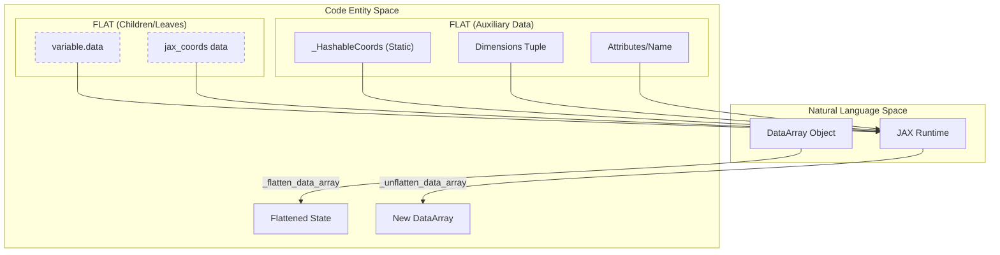
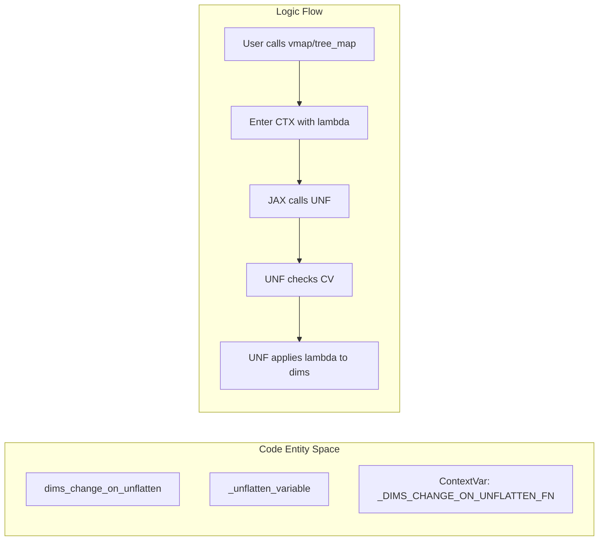

<!-- source: DeepWiki mcp.deepwiki.com · repo google-deepmind/xarray_jax · extra page Flatten and Unflatten Internals · fetched 2026-10-26 -->

# Flatten and Unflatten Internals

Relevant source files

The following files were used as context for generating this wiki page:

- [xarray_jax/pytree.py](xarray_jax/pytree.py)
- [xarray_jax/tests/pytree_test.py](xarray_jax/tests/pytree_test.py)

This page provides a detailed technical reference for the internal mechanisms used to register `xarray` objects as JAX PyTrees. It describes how `xarray_jax` separates dynamic data (leaves) from static metadata (auxiliary data) to enable compatibility with JAX transformations like `jit`, `vmap`, and `grad`.

## Core Logic: Data vs. Metadata

JAX requires PyTrees to be decomposed into two parts:
1.  **Children (Leaves):** Dynamic arrays or other PyTrees that JAX can transform.
2.  **Auxiliary Data:** Static metadata that must be hashable and is used to reconstruct the object.

In `xarray_jax`, the underlying data arrays (including those marked as `jax_coords`) are treated as leaves, while dimension names, attributes, and non-JAX coordinates are treated as static auxiliary data [xarray_jax/pytree.py:200-205]().

### Variable Flattening
The `xarray.Variable` is the fundamental building block. Its flattening logic serves as the basis for higher-level structures.

| Component | Classification | Implementation Detail |
| :--- | :--- | :--- |
| `variable.data` | **Leaf** | The actual array-like data [xarray_jax/pytree.py:203](). |
| `variable.dims` | **Auxiliary** | A tuple of dimension names [xarray_jax/pytree.py:204](). |
| `variable.attrs` | **Auxiliary** | Metadata attributes (converted to a hashable `FrozenDict`) [xarray_jax/pytree.py:204](). |

**Sources:** [xarray_jax/pytree.py:200-213]()

---

## Flattening and Unflattening Flow

The following diagram illustrates the data flow during a `jax.tree_util.tree_flatten` and `tree_unflatten` cycle for an `xarray.DataArray`.

### DataArray PyTree Transformation

**Sources:** [xarray_jax/pytree.py:241-285](), [xarray_jax/tests/pytree_test.py:38-49]()

---

## Detailed Function Reference

### Variable Level
*   **`_flatten_variable(v)`**: Returns `(v.data,)` as the child and `(v.dims, v.attrs)` as auxiliary data [xarray_jax/pytree.py:200-205]().
*   **`_unflatten_variable(aux, children)`**: Reconstructs the `xarray.Variable`. If the unflattening happens within a `dims_change_on_unflatten` context, the dimensions are updated via the provided function before the variable is created [xarray_jax/pytree.py:215-238]().

### DataArray Level
*   **`_flatten_data_array(da)`**: 
    *   Separates coordinates into `jax_coords` (dynamic leaves) and static coordinates [xarray_jax/pytree.py:246-258]().
    *   The primary data variable is the first leaf [xarray_jax/pytree.py:259]().
    *   Static coordinates are wrapped in `_HashableCoords` to ensure they can be used as JAX auxiliary data [xarray_jax/pytree.py:261]().
*   **`_unflatten_data_array(aux, children)`**: Reconstructs the `DataArray`. It extracts the main data from `children[0]` and iterates through the remaining children to restore `jax_coords` [xarray_jax/pytree.py:270-285]().

### Dataset Level
*   **`_flatten_dataset(ds)`**:
    *   Collects all `data_vars` and `jax_coords` as leaves [xarray_jax/pytree.py:302-310]().
    *   Stores the names and order of these variables in the auxiliary data to ensure correct mapping during unflattening [xarray_jax/pytree.py:311-314]().
*   **`_unflatten_dataset(aux, children)`**: Reassembles the `Dataset` by mapping the flat list of `children` back to their respective variable names and coordinate names [xarray_jax/pytree.py:321-344]().

### DataTree Level
*   **`_flatten_datatree(dt)`**: 
    *   Treats the `DataTree` as a recursive structure.
    *   Leaves include the data from the current node's `Dataset` and all children nodes [xarray_jax/pytree.py:361-365]().
*   **`_unflatten_datatree(aux, children)`**: Recursively reconstructs the tree hierarchy [xarray_jax/pytree.py:372-385]().

**Sources:** [xarray_jax/pytree.py:200-385]()

---

## Auxiliary Data Structures

### `_HashableCoords`
Because JAX auxiliary data must be hashable, `xarray_jax` uses a internal `_HashableCoords` class. This class wraps the coordinate dictionary and provides a `__hash__` and `__eq__` implementation based on the underlying data and dimensions [xarray_jax/pytree.py:388-410](). This is critical for preventing unnecessary recompilations in `jax.jit`.

### `NonArrayLeafWrapper`
During some JAX transformations (like `jax.eval_shape`), the "data" might not be a standard array but a `ShapeDtypeStruct` or a scalar. `xarray_jax` wraps these in a `NonArrayLeafWrapper` [xarray_jax/pytree.py:83-92]().
*   **Purpose**: Provides a duck-typed shim that has `.shape` and `.dtype` properties, allowing `xarray` constructors to accept them without error [xarray_jax/pytree.py:127-133]().
*   **Implementation**: It stores the original leaf and calculates a proxy shape if the leaf is a scalar [xarray_jax/pytree.py:94-112]().

**Sources:** [xarray_jax/pytree.py:83-154](), [xarray_jax/pytree.py:388-410]()

---

## Dimension Synchronization

The `dims_change_on_unflatten` context manager is the primary tool for handling rank-changing operations.

### Transformation Logic

When `_unflatten_variable` is called, it checks if `_DIMS_CHANGE_ON_UNFLATTEN_FN` is set. If so, it applies the transformation to the dimension names before creating the new `xarray.Variable` [xarray_jax/pytree.py:217-224](). This ensures that if `jax.vmap` adds a batch dimension, the resulting `DataArray` correctly reflects that new dimension in its metadata [xarray_jax/tests/pytree_test.py:92-106]().

**Sources:** [xarray_jax/pytree.py:158-198](), [xarray_jax/pytree.py:217-224](), [xarray_jax/tests/pytree_test.py:113-120]()

---

