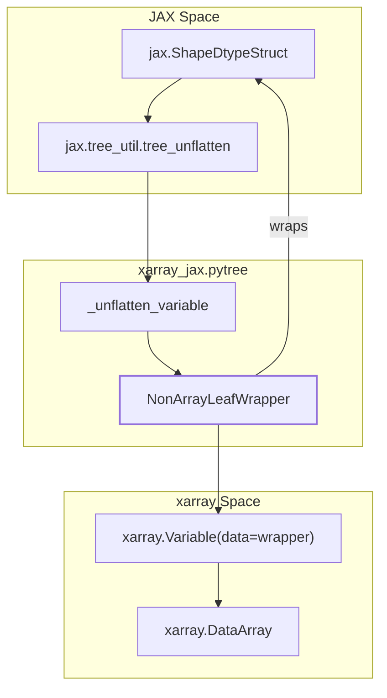
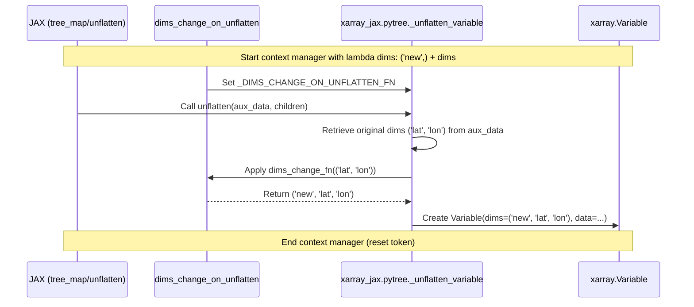

<!-- source: DeepWiki mcp.deepwiki.com · repo google-deepmind/xarray_jax · extra page NonArrayLeafWrapper and Dimension Change Handling · fetched 2026-10-26 -->

# NonArrayLeafWrapper and Dimension Change Handling

Relevant source files

The following files were used as context for generating this wiki page:

- [xarray_jax/pytree.py](xarray_jax/pytree.py)
- [xarray_jax/tests/pytree_test.py](xarray_jax/tests/pytree_test.py)

This page documents the internal mechanisms used by `xarray_jax` to handle edge cases in the JAX PyTree contract. Specifically, it covers how the library manages non-array leaves (such as scalars or shape metadata) and how it synchronizes xarray dimension metadata when JAX transformations change the rank or shape of the underlying arrays.

## NonArrayLeafWrapper

The `NonArrayLeafWrapper` is a duck-typed shim designed to wrap non-array JAX leaves so they can be stored within `xarray.Variable` objects without violating xarray's expectation of array-like data [xarray_jax/pytree.py:83-92]().

### Purpose and Motivation
In JAX, certain operations or transformations (like `jax.eval_shape` or specific custom gradients) may result in PyTree leaves that are not `jax.Array` instances. Examples include:
*   `jax.ShapeDtypeStruct`: Used for shape inference [xarray_jax/tests/pytree_test.py:157-157]().
*   Python scalars (`int`, `float`, `bool`) [xarray_jax/tests/pytree_test.py:148-151]().
*   `None` or other sentinel objects [xarray_jax/tests/pytree_test.py:149-149]().

Because `xarray.Variable` requires its `data` attribute to behave like a NumPy-compatible array (possessing `shape`, `dtype`, and `ndim`), these JAX leaves cannot be inserted directly. `NonArrayLeafWrapper` provides the necessary minimal interface [xarray_jax/pytree.py:127-142]().

### Implementation Details
The wrapper captures the original leaf and calculates "fake" metadata if the leaf does not already provide it:
*   **Shape**: If the leaf has no `.shape`, it defaults to a zero-sized tuple matching the expected dimension count [xarray_jax/pytree.py:100-100]().
*   **Dtype**: Maps Python types to JAX-compatible NumPy dtypes (e.g., `float` becomes `jnp.float32.dtype`) [xarray_jax/pytree.py:102-112]().
*   **Identity**: The original leaf is preserved in the `.leaf` property [xarray_jax/pytree.py:150-153]().

### Entity Mapping: Leaf Wrapping Flow
The following diagram shows how a non-array leaf is processed during the unflattening phase of a JAX transformation.

**Non-Array Leaf Integration**

Sources: [xarray_jax/pytree.py:83-153](), [xarray_jax/pytree.py:200-210](), [xarray_jax/tests/pytree_test.py:160-168]()

## Dimension Change Handling

When JAX transformations like `jax.vmap` or `jax.lax.scan` are applied to xarray objects, the rank of the underlying arrays changes (e.g., adding a batch dimension or a scan dimension). However, the PyTree `treedef` (which contains the static metadata like dimension names) remains fixed from the moment of flattening.

### The `dims_change_on_unflatten` Context Manager
To solve this synchronization problem, `xarray_jax` provides the `dims_change_on_unflatten` context manager [xarray_jax/pytree.py:164-164](). It uses a `contextvars.ContextVar` to communicate dimension transformations to the unflattening logic [xarray_jax/pytree.py:159-160]().

#### Key Functions
| Function | Role |
| :--- | :--- |
| `dims_change_on_unflatten(dims_change_fn)` | Sets a thread-local function that maps old dimension names to new ones during reconstruction [xarray_jax/pytree.py:183-192](). |
| `_unflatten_variable` | Checks for the presence of a change function and applies it to the `dims` stored in the `treedef` [xarray_jax/pytree.py:200-210](). |

### Logic for Metadata Synchronization
1.  **Flatten**: The xarray object is flattened; dimension names (e.g., `('x', 'y')`) are stored in the static `aux_data` [xarray_jax/pytree.py:200-205]().
2.  **Transform**: JAX maps a function over the arrays, potentially changing shape (e.g., adding a leading axis).
3.  **Unflatten**: Inside the context manager, the `dims_change_fn` intercepts the original `('x', 'y')` and returns `('batch', 'x', 'y')` [xarray_jax/tests/pytree_test.py:100-102]().
4.  **Coordinate Pruning**: If a dimension is removed during unflattening (e.g., via `jnp.squeeze`), any coordinates associated with that specific dimension are automatically dropped to maintain consistency [xarray_jax/pytree.py:175-177](), [xarray_jax/tests/pytree_test.py:132-138]().

### Entity Mapping: Dimension Transformation
This diagram illustrates how metadata is updated during a `vmap`-like operation where a new dimension is introduced.

**Metadata Synchronization Flow**

Sources: [xarray_jax/pytree.py:164-198](), [xarray_jax/tests/pytree_test.py:107-116]()

## Data Extraction Utilities

To interact with wrapped leaves and JAX arrays inside xarray containers, the library provides several utility functions in `pytree.py`.

*   **`unwrap(value)`**: Accesses the underlying JAX array or scalar from a `NonArrayLeafWrapper`. If the input is already a standard array, it is returned as-is [xarray_jax/pytree.py:34-39]().
*   **`jax_data(obj)`**: A specialized version of unwrap that enforces that the result must be a `jax.Array`, raising a `TypeError` otherwise [xarray_jax/pytree.py:70-74]().
*   **`unwrap_vars(dataset)`**: Iterates through a dataset and unwraps the data for every variable, returning a standard dictionary of arrays [xarray_jax/pytree.py:50-58]().
*   **`unwrap_coords(obj)`**: Similar to `unwrap_vars`, but specifically targets the `coords` mapping of a `Dataset` or `DataArray` [xarray_jax/pytree.py:61-68]().

Sources: [xarray_jax/pytree.py:34-81]()

---

