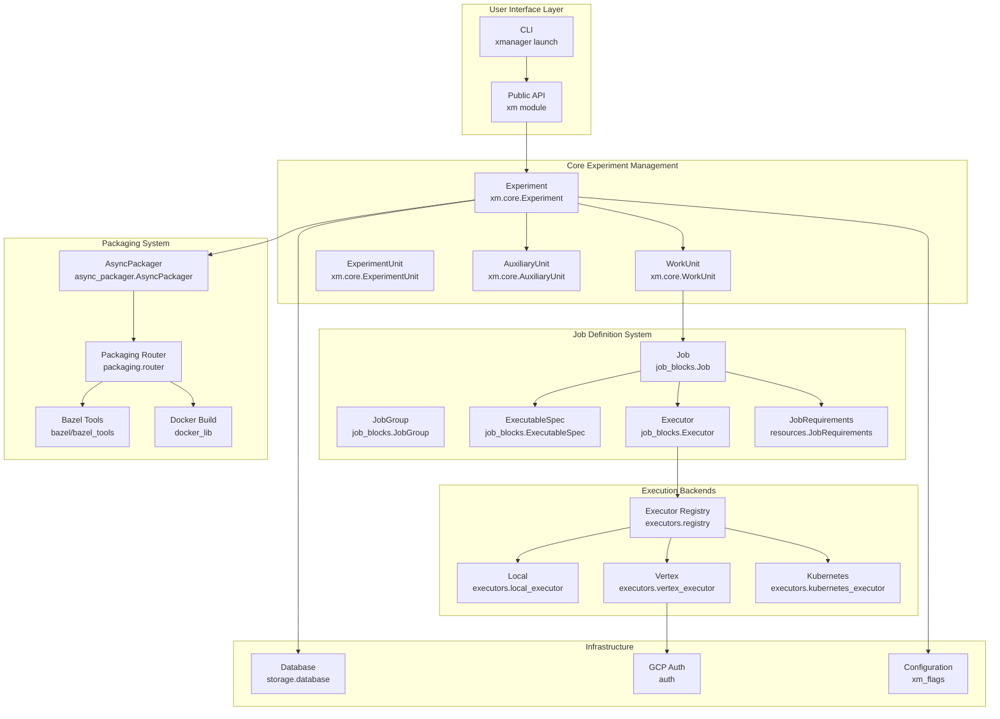
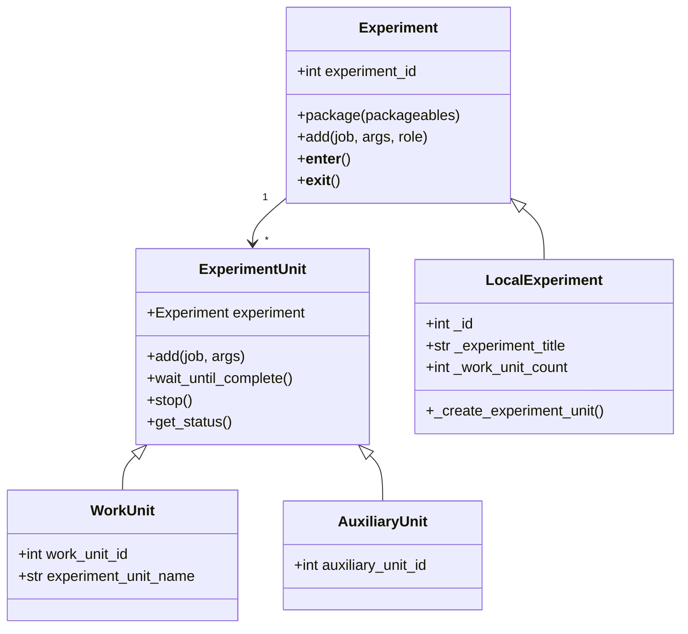
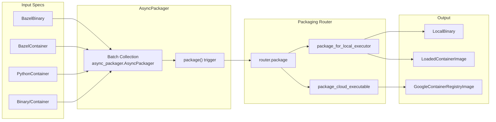
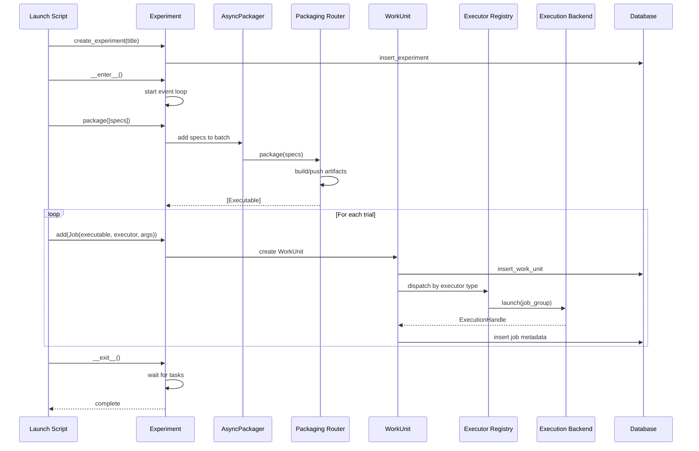

<!-- source: DeepWiki mcp.deepwiki.com · repo google-deepmind/xmanager · page 1 Overview · fetched 2026-10-26 -->

# Overview

<details>
<summary>Relevant source files</summary>

The following files were used as context for generating this wiki page:

- [README.md](README.md)
- [setup.py](setup.py)
- [xmanager/xm/__init__.py](xmanager/xm/__init__.py)
- [xmanager/xm/core.py](xmanager/xm/core.py)
- [xmanager/xm/core_test.py](xmanager/xm/core_test.py)
- [xmanager/xm/metadata_context.py](xmanager/xm/metadata_context.py)
- [xmanager/xm_local/experiment.py](xmanager/xm_local/experiment.py)
- [xmanager/xm_mock/__init__.py](xmanager/xm_mock/__init__.py)

</details>


## Purpose and Scope

This document provides a comprehensive architectural overview of XManager, a framework for managing machine learning experiments. It covers the system's design philosophy, core components, execution flow, and how these elements work together to provide a unified API for launching and tracking ML experiments across multiple backends (local, Vertex AI, Kubernetes).

For installation and setup instructions, see [Installation](#2.1). For detailed explanations of individual concepts, refer to [Core Concepts](#3). For backend-specific execution details, see [Execution Backends](#5).

**Sources:** [README.md:1-11](), [setup.py:22-26]()

---

## What is XManager?

XManager is a Python framework designed to simplify the management of machine learning experiments. It provides:

- **Unified API**: A single API (`xmanager.xm`) for defining experiments regardless of where they run
- **Multiple Backends**: Support for local execution, Google Cloud Vertex AI, and Kubernetes
- **Experiment Tracking**: Database-backed metadata storage for experiments and work units
- **Flexible Packaging**: Automatic building and packaging of executables (Bazel, Docker, Python containers)
- **Hyperparameter Sweeps**: First-class support for launching multiple trials with different configurations

The framework separates **what to run** (executable specifications) from **where to run it** (executors), enabling experiment portability across environments.

**Sources:** [README.md:5-18](), [xmanager/xm/core.py:14-23](), [setup.py:25]()

---

## System Architecture

XManager is organized into six major architectural layers, each with distinct responsibilities:

### High-Level Component Diagram



**Sources:** [xmanager/xm/core.py:1-56](), [xmanager/xm_local/experiment.py:1-34](), [xmanager/xm/__init__.py:1-84]()

---

## Core Components

### 1. User Interface Layer

The user interface provides two entry points:

| Component | Description | Code Reference |
|-----------|-------------|----------------|
| **CLI** | Command-line tool for launching experiments via `xmanager launch` | [setup.py:54-57]() |
| **Public API** | Python API exposed through the `xm` module | [xmanager/xm/__init__.py:14-84]() |

Users typically import two modules in their launch scripts:
```python
from xmanager import xm          # Core primitives
from xmanager import xm_local    # Implementation (local backend)
```

**Sources:** [README.md:128-134](), [xmanager/xm/__init__.py:1-17]()

---

### 2. Core Experiment Management

This layer manages experiment lifecycle and orchestrates asynchronous operations.

#### Key Classes



**`Experiment`** ([xmanager/xm/core.py:721-1127]())
- Central context for managing an experiment
- Implements context manager protocol (`__enter__`, `__exit__`)
- Manages background event loop for asynchronous operations
- Coordinates packaging and work unit creation

**`ExperimentUnit`** ([xmanager/xm/core.py:337-587]())
- Abstract base for collections of semantically related jobs
- Handles job launching and lifecycle management
- Provides `add()` method to add jobs to the unit

**`WorkUnit`** ([xmanager/xm/core.py:642-659]())
- Experiment units that perform actual computation (trials)
- Status affects overall experiment status
- Has a unique `work_unit_id` within the experiment

**`AuxiliaryUnit`** ([xmanager/xm/core.py:677-684]())
- Experiment units for supporting services (e.g., TensorBoard)
- Status does not affect experiment completion
- Supports delayed termination after experiment completes

**`LocalExperiment`** ([xmanager/xm_local/experiment.py:248-385]())
- Concrete implementation for local backend
- Uses timestamp-based IDs
- Coordinates with database for persistence

**Sources:** [xmanager/xm/core.py:721-867](), [xmanager/xm_local/experiment.py:248-393]()

---

### 3. Job Definition System

This layer provides abstractions for describing computations to run.

#### Core Abstractions

```mermaid
graph LR
    Job["Job<br/>executable + executor + args"]
    JobGroup["JobGroup<br/>named collection of Jobs"]
    ExecutableSpec["ExecutableSpec<br/>BazelBinary, PythonContainer, etc."]
    Executable["Executable<br/>packaged artifact"]
    Executor["Executor<br/>Local, Vertex, Kubernetes"]
    ExecutorSpec["ExecutorSpec<br/>packaging requirements"]
    
    Job --> Executable
    Job --> Executor
    JobGroup --> Job
    ExecutableSpec -->|package()| Executable
    Executor --> ExecutorSpec
```

| Component | Purpose | Code References |
|-----------|---------|-----------------|
| **Job** | Single unit of computation with executable, executor, and arguments | [xmanager/xm/job_blocks.py]() |
| **JobGroup** | Gang-scheduled collection of jobs (e.g., distributed training) | [xmanager/xm/job_blocks.py]() |
| **ExecutableSpec** | Platform-independent description of what to run | [xmanager/xm/executables.py]() |
| **Executable** | Packaged artifact ready for execution | [xmanager/xm/job_blocks.py]() |
| **Executor** | Describes where and how to run jobs | [xmanager/xm/job_blocks.py]() |
| **JobRequirements** | Resource specifications (CPUs, GPUs, TPUs) | [xmanager/xm/resources.py]() |

**Sources:** [README.md:269-365](), [xmanager/xm/__init__.py:48-62]()

---

### 4. Packaging System

The packaging system transforms executable specifications into concrete artifacts.

#### Packaging Flow



**`AsyncPackager`** ([xmanager/xm/async_packager.py]())
- Batches packaging requests for parallel builds
- Implements `add()` for async queueing and `package()` for execution
- Used by `Experiment.package()` and `Experiment.package_async()`

**Packaging Router** ([xmanager/xm_local/packaging/router.py]())
- Dispatches to local or cloud packaging based on executor type
- Handles Bazel builds, Docker image creation, and artifact uploads

**Sources:** [xmanager/xm/core.py:880-931](), [xmanager/xm_local/experiment.py:255]()

---

### 5. Execution Backends

Executors provide pluggable backends for running jobs.

#### Executor Registry Pattern

```mermaid
graph TB
    subgraph "Abstract Layer"
        ExecutorBase["Executor<br/>base class"]
        ExecutorSpec["ExecutorSpec"]
    end
    
    subgraph "Implementations"
        Local["Local<br/>xm_local.Local"]
        Vertex["Vertex<br/>xm_local.Vertex"]
        K8s["Kubernetes<br/>xm_local.Kubernetes"]
    end
    
    subgraph "Registry"
        RegMap["registry._EXECUTORS<br/>Type -> launch function"]
    end
    
    subgraph "Execution Methods"
        LocalLaunch["local_executor.launch"]
        VertexLaunch["vertex_executor.launch"]
        K8sLaunch["kubernetes_executor.launch"]
    end
    
    ExecutorBase <|-- Local
    ExecutorBase <|-- Vertex
    ExecutorBase <|-- K8s
    
    Local -.registered.-> RegMap
    Vertex -.registered.-> RegMap
    K8s -.registered.-> RegMap
    
    RegMap --> LocalLaunch
    RegMap --> VertexLaunch
    RegMap --> K8sLaunch
```

| Executor | Environment | Supported Executables | Code Reference |
|----------|-------------|----------------------|----------------|
| **Local** | Local machine (Docker/binary) | Binary, Container, BazelBinary, BazelContainer | [xmanager/xm_local/executors/local_executor.py]() |
| **Vertex** | Google Cloud Vertex AI | Container, BazelContainer, PythonContainer | [xmanager/xm_local/executors/vertex_executor.py]() |
| **Kubernetes** | Kubernetes cluster | Container, BazelContainer, PythonContainer | [xmanager/xm_local/executors/kubernetes_executor.py]() |

**Dynamic Dispatch**: The registry pattern ([xmanager/xm_local/registry.py]()) enables `experiment.add()` to automatically route to the correct executor's `launch()` method based on the job's executor type.

**Sources:** [README.md:288-304](), [xmanager/xm_local/experiment.py:36-93]()

---

### 6. Infrastructure

Cross-cutting services used throughout the system.

| Component | Purpose | Key Modules |
|-----------|---------|-------------|
| **Configuration** | Command-line flags for build, execution, database, and GCP settings | `xmanager/xm_local/xm_flags.py` |
| **Database** | SQLite/CloudSQL storage for experiment metadata | `xmanager/xm_local/storage/database.py` |
| **Authentication** | GCP service account management and API enablement | `xmanager/xm_local/auth.py` |
| **Utilities** | Shell argument handling, async wrappers, path resolution | `xmanager/xm/utils.py` |

**Schema Hierarchy**:
```
Experiment
  ├─ experiment_id (PK)
  ├─ title
  └─ WorkUnit[]
       ├─ work_unit_id (PK)
       ├─ experiment_id (FK)
       └─ Job[]
            ├─ job_name (PK)
            ├─ executor_type
            └─ execution_handle_data
```

**Sources:** [xmanager/xm_local/experiment.py:290-293](), [xmanager/xm_local/experiment.py:390-392]()

---

## Experiment Lifecycle

The typical flow from launch script to execution:



**Step-by-step**:

1. **Creation** ([xmanager/xm_local/experiment.py:387-393]()): `create_experiment()` creates a `LocalExperiment` and saves metadata to the database

2. **Context Entry** ([xmanager/xm/core.py:763-786]()): `__enter__()` starts an event loop thread for asynchronous operations

3. **Packaging** ([xmanager/xm/core.py:880-898]()): `Experiment.package()` batches and builds all executable specs in parallel

4. **Work Unit Addition** ([xmanager/xm/core.py:988-1076]()): Each `experiment.add()` call creates a work unit, launches jobs, and stores metadata

5. **Context Exit** ([xmanager/xm/core.py:822-827]()): `__exit__()` waits for all tasks and validates roles

**Sources:** [xmanager/xm/core.py:721-867](), [xmanager/xm_local/experiment.py:248-393]()

---

## Key Design Patterns

### Context Manager Pattern
Experiments use Python's context manager protocol to ensure proper resource lifecycle:
- Entry creates event loop and sets context variables ([xmanager/xm/core.py:763-786]())
- Exit waits for tasks and cleans up ([xmanager/xm/core.py:822-827]())

### Async Task Orchestration
Background operations run asynchronously using `asyncio`:
- Event loop runs in dedicated thread ([xmanager/xm/core.py:771-775]())
- Tasks created via `_create_task()` ([xmanager/xm/core.py:1117-1127]())
- Context variables propagate to worker threads ([xmanager/xm/core.py:97-125]())

### Registry Pattern
Executors register their launch functions dynamically:
- Registry maps executor types to launch functions ([xmanager/xm_local/registry.py]())
- Enables adding new backends without modifying core code ([xmanager/xm_local/experiment.py:82-90]())

### Two-Stage Packaging
Separation of specification from execution:
- **Stage 1**: Define platform-independent executable specs
- **Stage 2**: Package specs differently for local vs. cloud executors

**Sources:** [xmanager/xm/core.py:721-867](), [xmanager/xm_local/experiment.py:76-92]()

---

## Configuration and Dependencies

### System Requirements

From [setup.py:31-52]():

| Category | Dependencies |
|----------|--------------|
| **Build Tools** | Bazel (optional), Docker (optional) |
| **Cloud** | google-cloud-aiplatform, google-cloud-storage, kubernetes |
| **Database** | sqlalchemy, alembic, cloud-sql-python-connector |
| **Core** | asyncio (stdlib), attrs, absl-py |

### Python Version
Requires Python 3.10+ ([setup.py:31]())

### Entry Point
The `xmanager` CLI command is registered as a console script ([setup.py:54-57]()).

**Sources:** [setup.py:22-63](), [README.md:44-118]()

---

## API Usage Example

Basic experiment structure mapping to code entities:

```python
from xmanager import xm          # xmanager/xm/__init__.py
from xmanager import xm_local    # xmanager/xm_local/__init__.py

# Creates LocalExperiment and saves to database
# xmanager/xm_local/experiment.py:387-393
with xm_local.create_experiment(experiment_title='my_experiment') as experiment:
    
    # Packages executable specs in parallel
    # xmanager/xm/core.py:880-898
    [executable] = experiment.package([
        xm.Packageable(
            executable_spec=xm.PythonContainer(...),  # xmanager/xm/executables.py
            executor_spec=xm_local.Vertex.Spec(),      # xmanager/xm_local/executors/vertex_executor.py
        )
    ])
    
    # Creates WorkUnit, dispatches to Vertex executor
    # xmanager/xm/core.py:988-1076
    experiment.add(xm.Job(
        executable=executable,
        executor=xm_local.Vertex(requirements=xm.JobRequirements(T4=1)),
        args={'learning_rate': 0.001},
    ))
```

**Sources:** [README.md:123-181](), [xmanager/xm/core.py:988-1076]()

---

## Next Steps

- **Installation and Setup**: See [Installation](#2.1) for prerequisites and configuration
- **First Experiment**: Follow [Your First Experiment](#2.2) for a hands-on walkthrough
- **Core Concepts**: Read [Core Concepts](#3) for detailed explanations of experiments, jobs, and resources
- **Packaging**: Learn about [Packaging System](#4) for building and deploying executables
- **Execution**: Explore [Execution Backends](#5) for running jobs on different platforms

**Sources:** [README.md:120-265]()

---

