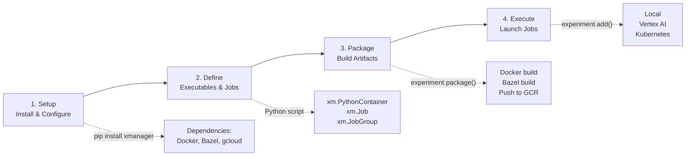
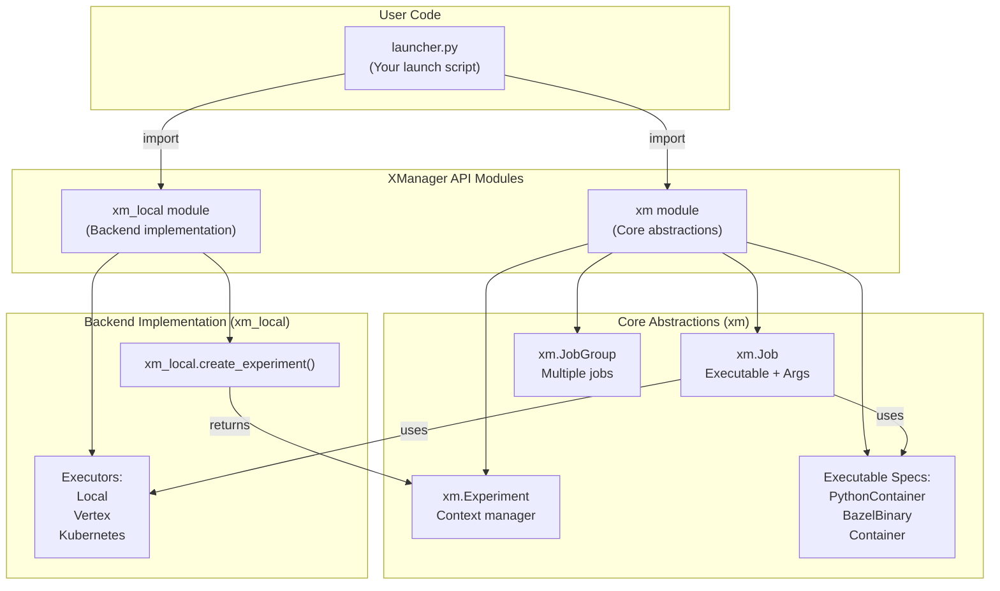
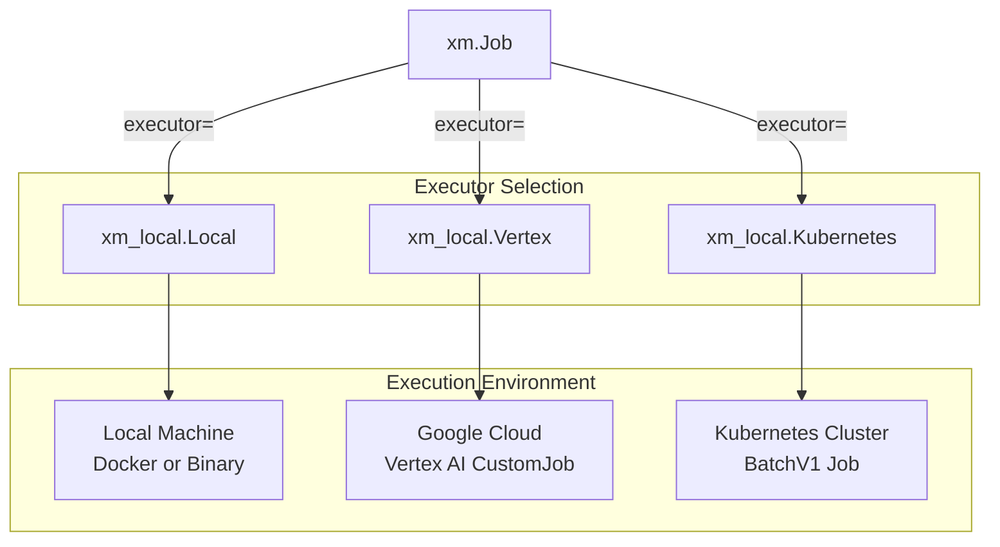
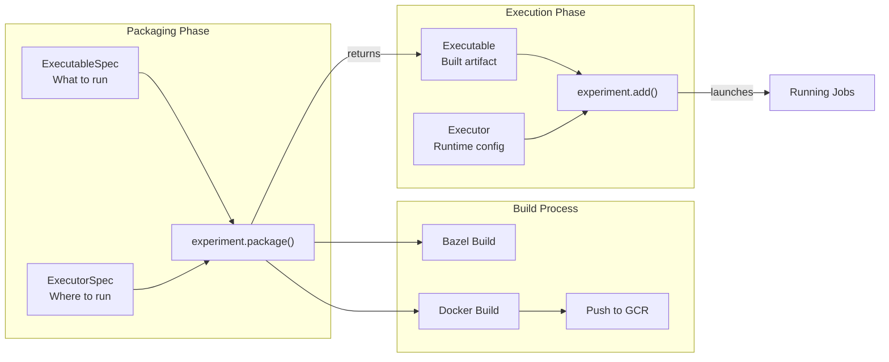
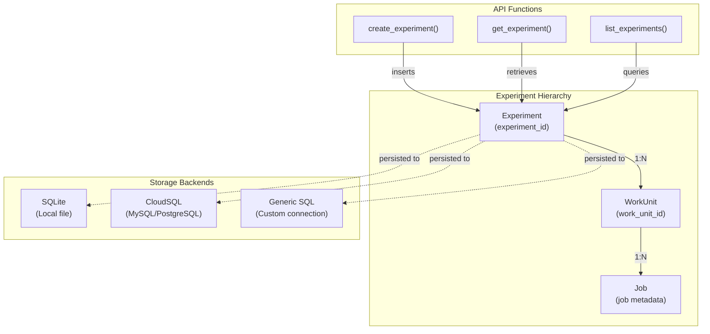
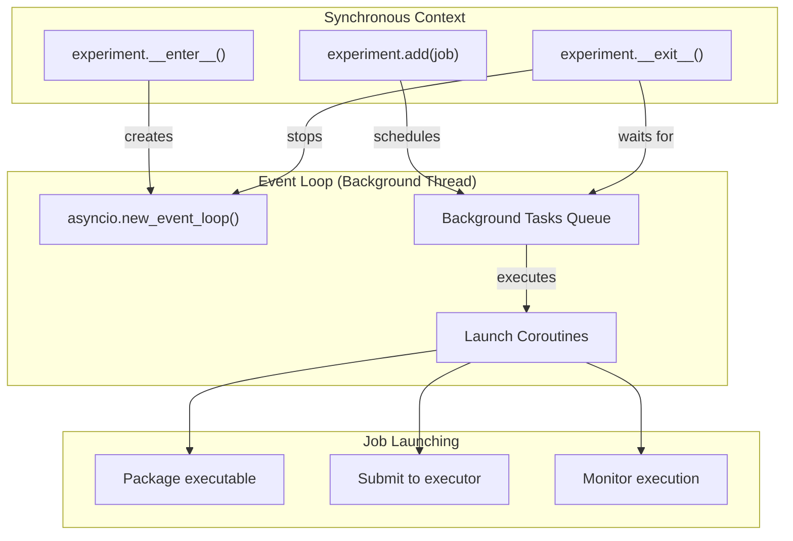
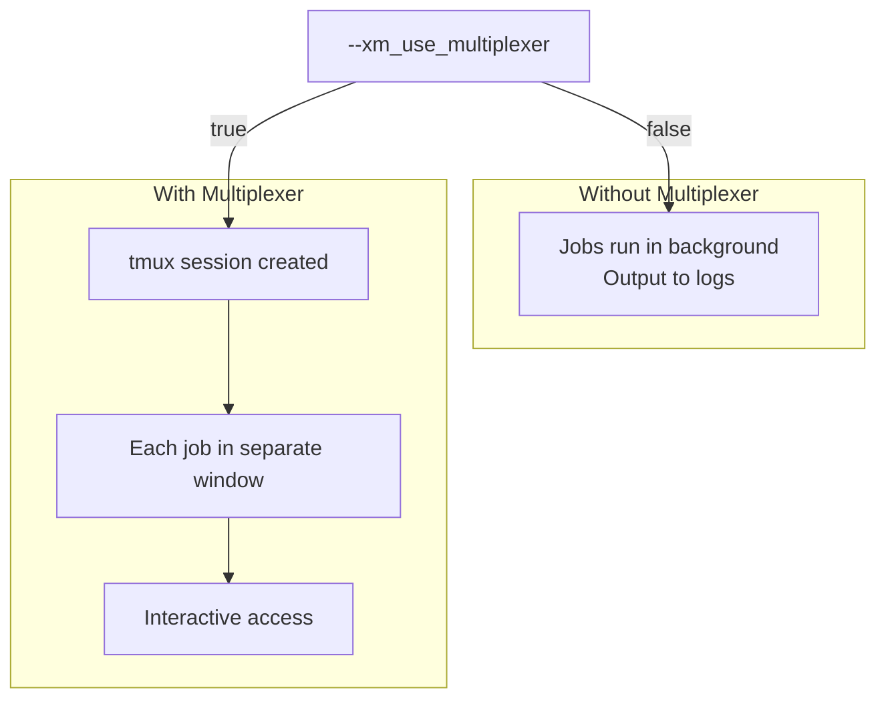

<!-- source: DeepWiki mcp.deepwiki.com · repo google-deepmind/xmanager · page 2 Getting Started · fetched 2026-10-26 -->

# Getting Started

<details>
<summary>Relevant source files</summary>

The following files were used as context for generating this wiki page:

- [README.md](README.md)
- [setup.py](setup.py)
- [xmanager/xm/core.py](xmanager/xm/core.py)
- [xmanager/xm/core_test.py](xmanager/xm/core_test.py)
- [xmanager/xm_flags.py](xmanager/xm_flags.py)
- [xmanager/xm_local/experiment.py](xmanager/xm_local/experiment.py)
- [xmanager/xm_local/multiplexer.py](xmanager/xm_local/multiplexer.py)
- [xmanager/xm_mock/__init__.py](xmanager/xm_mock/__init__.py)

</details>


This page provides an overview of how to begin using XManager for managing machine learning experiments. It covers the prerequisites, basic workflow, and key API entry points you'll need to launch your first experiments. For detailed installation instructions, see [Installation](#2.1). For a hands-on walkthrough of creating your first experiment, see [Your First Experiment](#2.2).

## Purpose and Scope

XManager is a framework for packaging, launching, and tracking machine learning experiments. This guide introduces the fundamental concepts and workflow needed to start running experiments. It assumes you have basic familiarity with Python and containerization concepts (Docker), and optionally Bazel for building executables.

## XManager Workflow Overview

The XManager workflow consists of four main phases that transform a Python launch script into running jobs:



**Diagram: High-Level XManager Workflow**

Sources: [README.md:120-181](), [xmanager/xm/core.py:721-744]()

## Prerequisites Summary

Before using XManager, you need:

| Component | Required For | Installation Reference |
|-----------|--------------|----------------------|
| Python 3.10+ | Core XManager functionality | [setup.py:31]() |
| pip packages | XManager dependencies | [setup.py:32-52]() |
| Docker | Running containerized executables | [README.md:48-57]() |
| Bazel | Building Bazel targets | [README.md:59-65]() |
| GCP Project | Running on Vertex AI/GKE | [README.md:67-118]() |

For complete setup instructions including environment configuration, see [Installation](#2.1).

Sources: [README.md:24-118](), [setup.py:31-52]()

## Key Modules and Their Roles

XManager provides two primary module entry points that work together:



**Diagram: XManager Module Structure**

| Module | Purpose | Key Classes/Functions |
|--------|---------|----------------------|
| `xmanager.xm` | Core abstractions and interfaces | `Experiment`, `Job`, `JobGroup`, `PythonContainer`, `BazelBinary` |
| `xmanager.xm_local` | Local backend implementation | `create_experiment()`, `Local`, `Vertex`, `Kubernetes` |

Sources: [xmanager/xm/core.py:14-23](), [xmanager/xm_local/experiment.py:387-393](), [README.md:128-133]()

## Experiment Context Pattern

XManager experiments use Python context managers to ensure proper lifecycle management:

```mermaid
sequenceDiagram
    participant User as "User Script"
    participant API as "xm_local.create_experiment()"
    participant Exp as "Experiment Context"
    participant DB as "Database Storage"
    participant Loop as "Event Loop"
    
    User->>API: create_experiment(title)
    API->>DB: Insert experiment metadata
    API->>Exp: Create LocalExperiment
    Exp-->>User: Return experiment
    
    User->>Exp: __enter__()
    Exp->>Loop: Start asyncio event loop
    Exp->>DB: Save experiment ID
    
    Note over User,Exp: User defines and adds jobs
    
    User->>Exp: __exit__()
    Exp->>Loop: Wait for tasks to complete
    Exp->>Loop: Stop event loop
    Exp-->>User: Exit complete
```

**Diagram: Experiment Lifecycle with Context Manager**

The context manager pattern provides:
- **Automatic resource cleanup**: Event loops and background tasks are properly terminated
- **Error handling**: Exceptions during job creation are caught and logged
- **Synchronization**: Waits for local jobs to complete before exiting

Sources: [xmanager/xm/core.py:763-827](), [xmanager/xm_local/experiment.py:331-341]()

## Basic Launch Script Structure

A minimal XManager launch script follows this pattern:

```python
from xmanager import xm
from xmanager import xm_local

# 1. Create experiment context
with xm_local.create_experiment(experiment_title='my_experiment') as experiment:
    
    # 2. Package executable
    [executable] = experiment.package([
        xm.Packageable(
            executable_spec=xm.PythonContainer(...),
            executor_spec=xm_local.Vertex.Spec(),
        )
    ])
    
    # 3. Add jobs
    experiment.add(xm.Job(
        executable=executable,
        executor=xm_local.Vertex(...),
        args={'learning_rate': 0.1},
    ))
```

This structure maps directly to the code entities:

| Script Element | Code Entity | Purpose |
|----------------|-------------|---------|
| `xm_local.create_experiment()` | [xmanager/xm_local/experiment.py:387-393]() | Creates experiment and database entry |
| `experiment.package()` | [xmanager/xm/core.py:881-898]() | Builds/prepares executables for target backend |
| `experiment.add()` | [xmanager/xm/core.py:988-1076]() | Creates work units and launches jobs |
| `xm.Job` | [xmanager/xm/job_blocks.py]() | Combines executable, executor, and arguments |
| `xm.PythonContainer` | [xmanager/xm/job_blocks.py]() | Executable spec for Python code |

Sources: [README.md:122-181](), [xmanager/xm/core.py:721-744]()

## Execution Backend Selection

XManager supports multiple execution backends, selected by the executor type:



**Diagram: Backend Selection via Executor**

| Executor | Execution Location | Requirements | Use Case |
|----------|-------------------|--------------|----------|
| `xm_local.Local` | Local machine | Docker or binary | Development, debugging |
| `xm_local.Vertex` | Google Cloud Vertex AI | GCP project, container | Production training |
| `xm_local.Kubernetes` | Kubernetes cluster | K8s access, container | Distributed workloads |

Sources: [README.md:287-305](), [xmanager/xm_local/experiment.py:36-41]()

## Configuration System

XManager behavior is controlled through command-line flags defined in `xm_flags.py`:

| Flag Category | Key Flags | Purpose |
|---------------|-----------|---------|
| **Cloud Build** | `--xm_build_image_locally`<br/>`--xm_use_docker_command` | Control Docker image building strategy |
| **Database** | `--xm_db_yaml_config_path`<br/>`--xm_upgrade_db` | Configure metadata storage backend |
| **Local Execution** | `--xm_use_multiplexer`<br/>`--xm_open_multiplexer_window` | Control local job execution environment |
| **GCP** | `--xm_gcp_service_account_name`<br/>`--xm_k8s_service_account_name` | Configure cloud authentication |

Flags are passed when launching experiments:

```bash
xmanager launch launcher.py -- --xm_build_image_locally=true
```

Sources: [xmanager/xm_flags.py:24-197](), [README.md:252-263]()

## Packaging vs Execution Separation

XManager separates packaging (building artifacts) from execution (running jobs):



**Diagram: Packaging and Execution Phases**

This separation allows:
- **Parallel building**: Multiple executables built concurrently via `experiment.package([...])`
- **Reuse**: Same packaged executable launched multiple times with different arguments
- **Backend flexibility**: Package once, execute on different backends

Sources: [xmanager/xm/core.py:881-931](), [xmanager/xm_local/packaging/router.py]()

## Database Storage

XManager stores experiment metadata in a database for tracking and retrieval:



**Diagram: Experiment Metadata Storage**

Storage is configured via `--xm_db_yaml_config_path`. Default is SQLite for local development.

Sources: [xmanager/xm_local/experiment.py:387-449](), [xmanager/xm_flags.py:117-150]()

## Event Loop and Asynchronous Execution

XManager uses asyncio for concurrent job management:



**Diagram: Asynchronous Task Management**

The event loop enables:
- **Non-blocking job submission**: `experiment.add()` returns immediately
- **Concurrent packaging**: Multiple Docker/Bazel builds run in parallel
- **Background monitoring**: Local jobs monitored without blocking

Sources: [xmanager/xm/core.py:763-827](), [xmanager/xm_local/experiment.py:100-125]()

## Job Arguments and Environment Variables

Jobs accept two types of configuration:

| Configuration Type | Format | Usage |
|-------------------|--------|-------|
| **Command-line arguments** | `dict` or `list` | Hyperparameters, flags |
| **Environment variables** | `dict` | System configuration, debugging |

```python
experiment.add(xm.Job(
    executable=executable,
    executor=executor,
    # Dictionary form: --key=value
    args={'batch_size': 64, 'learning_rate': 0.001},
    # Or list form: positional arguments
    # args=['arg1', 'arg2'],
    env_vars={'CUDA_VISIBLE_DEVICES': '0,1'},
))
```

Arguments are managed by `SequentialArgs` and merged when specified at multiple levels.

Sources: [xmanager/xm/core.py:60-95](), [README.md:313-335]()

## Multiplexer for Local Jobs

When running locally, XManager can use tmux to manage multiple jobs in terminal windows:



**Diagram: Multiplexer Execution Mode**

Enable with:
```bash
xmanager launch launcher.py -- --xm_use_multiplexer
```

The multiplexer allows interactive monitoring and debugging of local jobs.

Sources: [xmanager/xm_local/multiplexer.py:34-136](), [xmanager/xm_flags.py:158-177]()

## Next Steps

Now that you understand the basic structure of XManager:

1. **Install XManager and dependencies**: Follow [Installation](#2.1) for detailed setup instructions
2. **Create your first experiment**: Follow [Your First Experiment](#2.2) for a hands-on tutorial
3. **Learn about executable types**: See [Executable Specifications](#3.3) for details on `PythonContainer`, `BazelBinary`, etc.
4. **Explore execution backends**: See [Execution Backends](#5) for guidance on Local, Vertex AI, and Kubernetes executors

For advanced usage including distributed training and hyperparameter sweeps, see [Advanced Topics](#7).

Sources: [README.md:120-250]()

---

