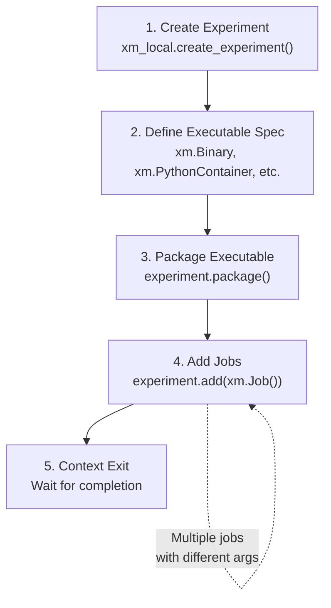
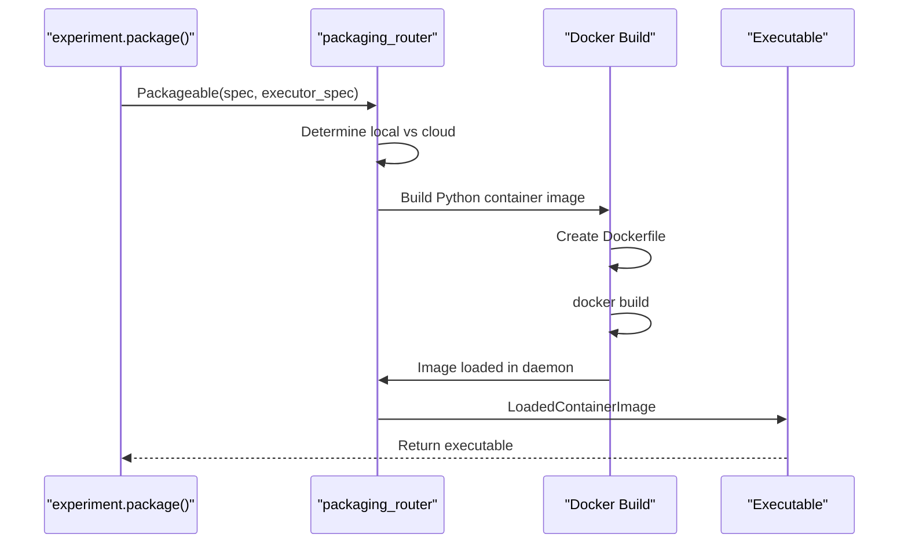
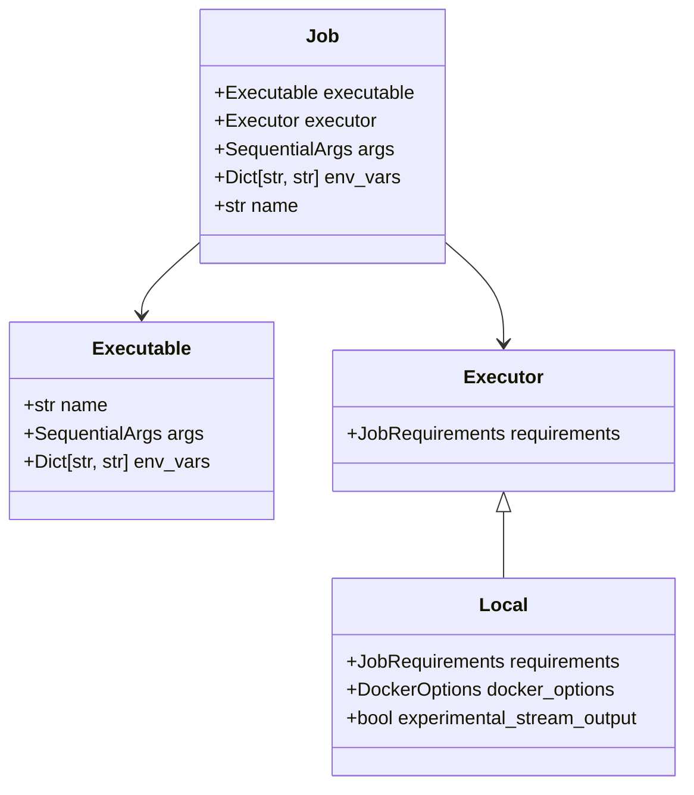
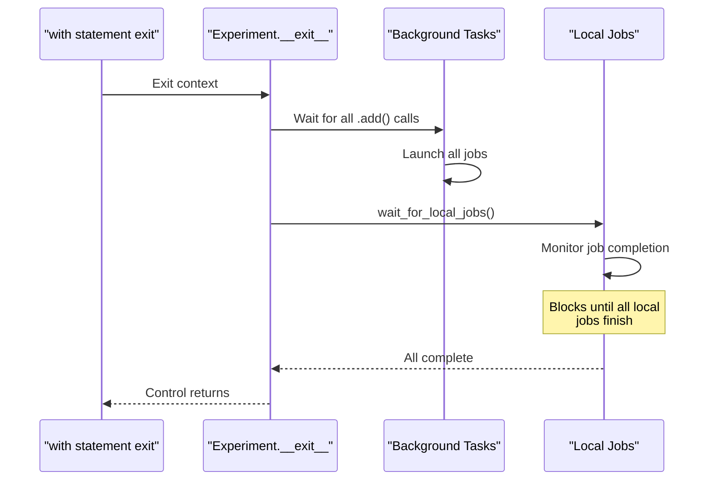
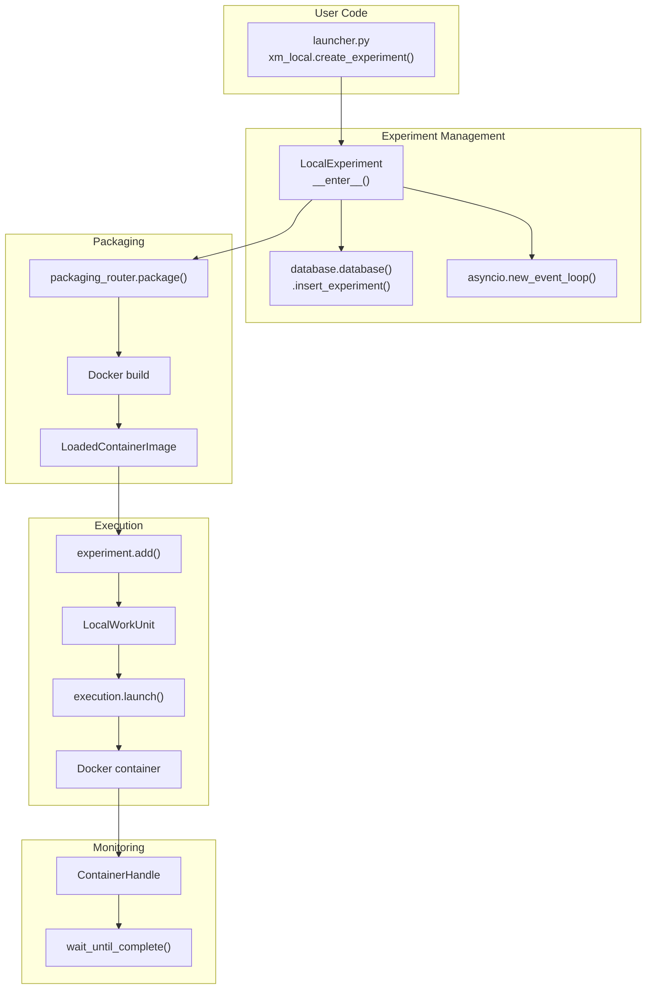
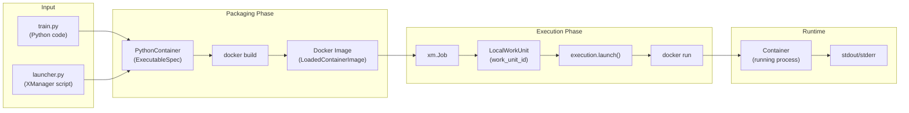

<!-- source: DeepWiki mcp.deepwiki.com · repo google-deepmind/xmanager · page 2.2 Your First Experiment · fetched 2026-10-26 -->

# Your First Experiment

<details>
<summary>Relevant source files</summary>

The following files were used as context for generating this wiki page:

- [README.md](README.md)
- [setup.py](setup.py)
- [xmanager/xm/core.py](xmanager/xm/core.py)
- [xmanager/xm/core_test.py](xmanager/xm/core_test.py)
- [xmanager/xm_local/execution.py](xmanager/xm_local/execution.py)
- [xmanager/xm_local/execution_test.py](xmanager/xm_local/execution_test.py)
- [xmanager/xm_local/executors.py](xmanager/xm_local/executors.py)
- [xmanager/xm_local/experiment.py](xmanager/xm_local/experiment.py)
- [xmanager/xm_mock/__init__.py](xmanager/xm_mock/__init__.py)

</details>


## Purpose and Scope

This guide walks you through creating and running your first XManager experiment locally. You will learn the basic workflow for defining executables, packaging them, and launching jobs on your local machine.

For installation instructions, see [Installation](#2.1). For detailed information about core concepts like experiments, work units, and jobs, see [Core Concepts](#3). For information about different executable types and execution backends, see [Executable Specifications](#3.3) and [Execution Backends](#5).

---

## Prerequisites

Before starting this tutorial, ensure you have:

- XManager installed (see [Installation](#2.1))
- Docker installed and running (for container-based executables)
- A simple program to run (we'll use a basic Python script in this example)

---

## The Basic Workflow

XManager experiments follow a consistent five-step pattern:



**Sources:** [README.md:120-246](), [xmanager/xm/core.py:721-744]()

---

## Step-by-Step Tutorial

### Step 1: Create an Experiment

The first step is to create an experiment using `xm_local.create_experiment()`. This function returns an `Experiment` context manager that tracks all jobs you launch.

```python
from xmanager import xm
from xmanager import xm_local

with xm_local.create_experiment(experiment_title='my_first_experiment') as experiment:
    # Your experiment code goes here
    pass
```

**What happens:**
- A unique experiment ID is generated (timestamp-based for local experiments)
- Experiment metadata is saved to the local database
- A background event loop is created to handle asynchronous operations

The `with` statement ensures proper cleanup when the experiment finishes.

**Sources:** [xmanager/xm_local/experiment.py:387-393](), [xmanager/xm/core.py:763-786]()

---

### Step 2: Define an Executable Specification

Next, define what you want to run. XManager supports several executable types. For this tutorial, we'll use `xm.PythonContainer`, which packages a Python directory into a Docker container.

Create a simple Python script to run:

**File: `train.py`**
```python
import argparse

parser = argparse.ArgumentParser()
parser.add_argument('--learning_rate', type=float, required=True)
parser.add_argument('--batch_size', type=int, required=True)
args = parser.parse_args()

print(f"Training with lr={args.learning_rate}, batch_size={args.batch_size}")
# Your training code would go here
```

Define the executable specification:

```python
spec = xm.PythonContainer(
    path='/path/to/your/project',  # Directory containing train.py
    entrypoint=xm.ModuleName('train'),  # The Python module to run
)
```

**Executable Specification Types:**

| Type | Description | When to Use |
|------|-------------|-------------|
| `xm.Binary` | Pre-built binary | You have a compiled executable |
| `xm.PythonContainer` | Python directory → Docker | Python projects without Docker expertise |
| `xm.Container` | Pre-built Docker image | You already have a Docker image |
| `xm.BazelBinary` | Bazel target → binary | Using Bazel build system |
| `xm.BazelContainer` | Bazel target → Docker | Using Bazel with containers |

**Sources:** [README.md:269-286](), [xmanager/xm/job_blocks.py]()

---

### Step 3: Package the Executable

Packaging transforms your executable specification into a concrete artifact that can be executed. The `experiment.package()` method handles building, Docker image creation, and artifact preparation.

```python
[executable] = experiment.package([
    xm.Packageable(
        executable_spec=spec,
        executor_spec=xm_local.Local.Spec(),
    ),
])
```

**What happens during packaging:**



The packaging process:
1. Determines the packaging strategy based on executor type (local vs cloud)
2. For `PythonContainer` + `Local.Spec()`: builds a Docker image locally
3. Loads the image into the local Docker daemon
4. Returns a `LoadedContainerImage` executable

**Sources:** [xmanager/xm/core.py:881-898](), [xmanager/xm_local/packaging/router.py]()

---

### Step 4: Add Jobs to the Experiment

Now create and add jobs to your experiment. Each job combines an executable with an executor and hyperparameters.

```python
# Single job
experiment.add(xm.Job(
    executable=executable,
    executor=xm_local.Local(),
    args={
        'learning_rate': 0.01,
        'batch_size': 64,
    },
))

# Multiple jobs for hyperparameter sweep
for learning_rate in [0.01, 0.001, 0.0001]:
    for batch_size in [32, 64, 128]:
        experiment.add(xm.Job(
            executable=executable,
            executor=xm_local.Local(),
            args={
                'learning_rate': learning_rate,
                'batch_size': batch_size,
            },
        ))
```

**Job Components:**



**Arguments:**
- **Dictionary form**: `{'key': value}` → `--key=value` command-line flags
- **List form**: `['--flag', 'value']` → passed as-is
- **Environment variables**: `env_vars={'KEY': 'value'}` → exported before execution

**Sources:** [xmanager/xm/core.py:988-1076](), [xmanager/xm/job_blocks.py](), [README.md:313-353]()

---

### Step 5: Run and Monitor

When you exit the `with` block, XManager waits for all local jobs to complete:

```python
with xm_local.create_experiment(experiment_title='my_experiment') as experiment:
    # ... package and add jobs ...
    pass  # Exiting context waits for local jobs
```

**What happens on context exit:**



For local jobs, XManager displays:
```
Waiting for local jobs to complete. Press Ctrl+C to terminate them and exit
```

Jobs run as Docker containers or processes, and you can view their output in real-time if `experimental_stream_output=True` (the default).

**Sources:** [xmanager/xm_local/experiment.py:331-341](), [xmanager/xm/core.py:822-827]()

---

## Complete Example

Here's a complete working example:

**File: `launcher.py`**
```python
"""My first XManager experiment."""

from xmanager import xm
from xmanager import xm_local


def main():
    with xm_local.create_experiment(experiment_title='my_first_experiment') as experiment:
        # Define the executable
        spec = xm.PythonContainer(
            path='/path/to/your/project',
            entrypoint=xm.ModuleName('train'),
        )
        
        # Package the executable for local execution
        [executable] = experiment.package([
            xm.Packageable(
                executable_spec=spec,
                executor_spec=xm_local.Local.Spec(),
            ),
        ])
        
        # Run a hyperparameter sweep
        for learning_rate in [0.01, 0.001]:
            for batch_size in [32, 64]:
                experiment.add(xm.Job(
                    executable=executable,
                    executor=xm_local.Local(),
                    args={
                        'learning_rate': learning_rate,
                        'batch_size': batch_size,
                    },
                ))


if __name__ == '__main__':
    main()
```

**Run the launcher:**
```bash
xmanager launch launcher.py
```

This will:
1. Build a Docker image containing your Python code
2. Launch 4 containers (2 learning rates × 2 batch sizes)
3. Wait for all containers to complete
4. Store experiment metadata in the local database

**Sources:** [README.md:122-183]()

---

## What Happens Behind the Scenes

Understanding the execution flow helps you debug issues and use advanced features:



**Key Code Entities:**

| Component | Code Entity | File | Purpose |
|-----------|-------------|------|---------|
| Experiment Creation | `create_experiment()` | [xmanager/xm_local/experiment.py:387-393]() | Creates `LocalExperiment` and saves to DB |
| Experiment Class | `LocalExperiment` | [xmanager/xm_local/experiment.py:248-385]() | Manages experiment lifecycle |
| Database | `database.database()` | [xmanager/xm_local/storage/database.py]() | SQLite storage for metadata |
| Packaging | `packaging_router.package()` | [xmanager/xm_local/packaging/router.py]() | Routes packaging by executor type |
| Work Unit | `LocalWorkUnit` | [xmanager/xm_local/experiment.py:167-218]() | Container for jobs in local execution |
| Execution | `execution.launch()` | [xmanager/xm_local/execution.py:198-212]() | Launches jobs on local executor |
| Container Handle | `ContainerHandle` | [xmanager/xm_local/handles.py]() | Monitors running Docker container |

**Sources:** [xmanager/xm_local/experiment.py:387-393](), [xmanager/xm_local/experiment.py:248-385](), [xmanager/xm_local/execution.py:198-212]()

---

## Data Flow: From Python Script to Running Container



**Sources:** [xmanager/xm_local/execution.py:38-104](), [xmanager/xm_local/experiment.py:190-210]()

---

## Common Patterns

### Using Pre-built Binaries

If you have a compiled binary instead of Python code:

```python
spec = xm.Binary(
    path='/path/to/binary',
)

[executable] = experiment.package([
    xm.Packageable(
        executable_spec=spec,
        executor_spec=xm_local.Local.Spec(),
    ),
])

experiment.add(xm.Job(
    executable=executable,
    executor=xm_local.Local(),
    args=['--flag1', '--flag2=value'],
))
```

**Sources:** [README.md:150-157]()

---

### Passing Environment Variables

```python
experiment.add(xm.Job(
    executable=executable,
    executor=xm_local.Local(),
    args={'batch_size': 64},
    env_vars={
        'CUDA_VISIBLE_DEVICES': '0',
        'PYTHONUNBUFFERED': '1',
    },
))
```

Environment variables are exported before the job runs.

**Sources:** [xmanager/xm/core.py:72-94]()

---

### Accessing Logs

By default, job output is streamed to your terminal when `experimental_stream_output=True`:

```python
executor = xm_local.Local(
    experimental_stream_output=True,  # Default
)
```

To disable streaming:

```python
executor = xm_local.Local(
    experimental_stream_output=False,
)
```

**Sources:** [xmanager/xm_local/executors.py:60-76](), [xmanager/xm_local/execution.py:103-104]()

---

## Retrieving Experiment Information

After running an experiment, you can retrieve it from the database:

```python
from xmanager import xm_local

# List all experiments
experiments = xm_local.list_experiments()
for exp in experiments:
    print(f"Experiment ID: {exp.experiment_id}")

# Get a specific experiment
experiment = xm_local.get_experiment(experiment_id=123456789)
print(f"Work unit count: {experiment.work_unit_count}")
```

**Sources:** [xmanager/xm_local/experiment.py:445-448](), [xmanager/xm_local/experiment.py:396-442]()

---

## Next Steps

Now that you've run your first experiment, explore:

- **[Experiments and Work Units](#3.1)**: Understanding the experiment lifecycle and work unit roles
- **[Executable Specifications](#3.3)**: Other types of executables (BazelBinary, Container, etc.)
- **[Vertex AI Executor](#5.2)**: Running experiments on Google Cloud Platform
- **[Job Generators and Hyperparameter Sweeps](#7.2)**: Advanced patterns for dynamic job creation

For more examples, see the `examples/` directory in the XManager repository.

---

