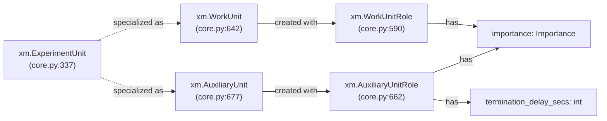
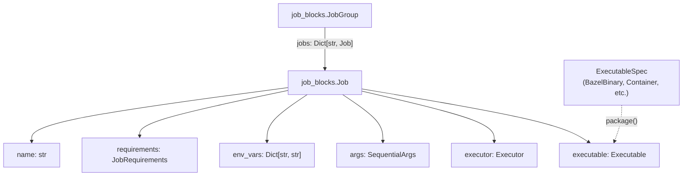
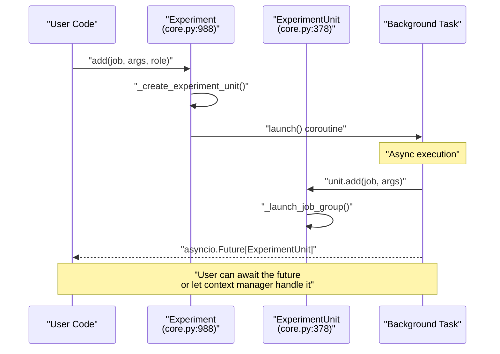
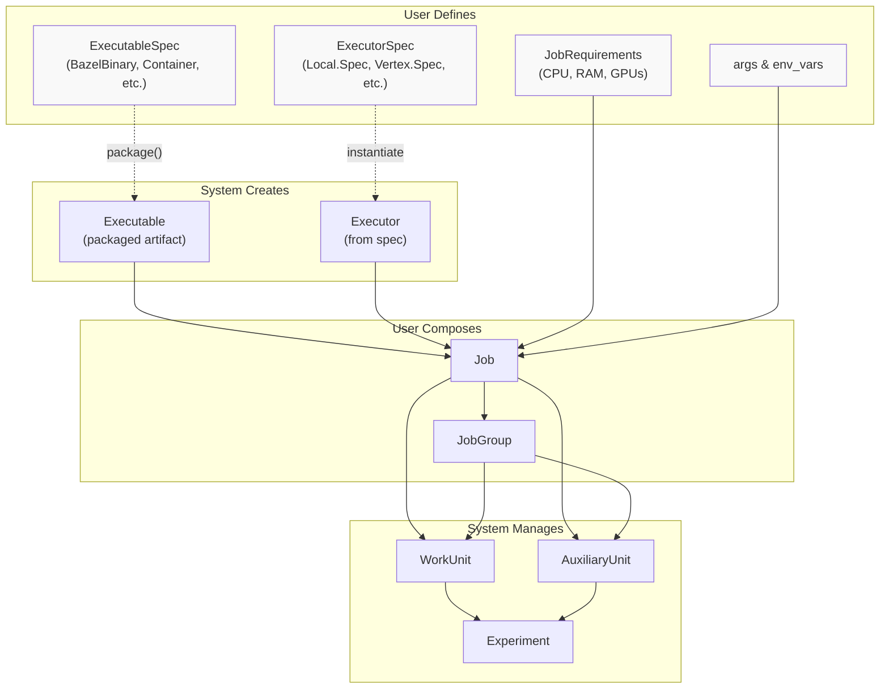

<!-- source: DeepWiki mcp.deepwiki.com · repo google-deepmind/xmanager · page 3 Core Concepts · fetched 2026-10-26 -->

# Core Concepts

<details>
<summary>Relevant source files</summary>

The following files were used as context for generating this wiki page:

- [xmanager/xm/__init__.py](xmanager/xm/__init__.py)
- [xmanager/xm/core.py](xmanager/xm/core.py)
- [xmanager/xm/core_test.py](xmanager/xm/core_test.py)
- [xmanager/xm/metadata_context.py](xmanager/xm/metadata_context.py)
- [xmanager/xm_local/experiment.py](xmanager/xm_local/experiment.py)
- [xmanager/xm_mock/__init__.py](xmanager/xm_mock/__init__.py)

</details>


This page introduces the fundamental abstractions that form the building blocks of XManager: **Experiments**, **Experiment Units** (Work Units and Auxiliary Units), **Jobs**, **Executables**, and **Resources**. These concepts define how computations are structured, configured, and executed across different backends.

For detailed information about specific topics, see:
- Experiment lifecycle and work unit management: [Experiments and Work Units](#3.1)
- Job organization and constraints: [Jobs and Job Groups](#3.2)
- Executable types and specifications: [Executable Specifications](#3.3)
- Resource allocation and requirements: [Resource Requirements](#3.4)
- Argument passing and environment configuration: [Arguments and Environment Variables](#3.5)

---

## System Overview

XManager organizes computations using a hierarchical structure where experiments contain experiment units, which in turn contain jobs that execute specific computables (executables) with defined resources.

**Diagram: Core Abstractions Hierarchy**

```mermaid
graph TB
    Experiment["xm.Experiment<br/>(core.py:721)"]
    WorkUnit["xm.WorkUnit<br/>(core.py:642)"]
    AuxiliaryUnit["xm.AuxiliaryUnit<br/>(core.py:677)"]
    Job["xm.Job<br/>(job_blocks.Job)"]
    JobGroup["xm.JobGroup<br/>(job_blocks.JobGroup)"]
    Executable["xm.Executable<br/>(job_blocks.Executable)"]
    ExecutableSpec["xm.ExecutableSpec<br/>(job_blocks.ExecutableSpec)"]
    Executor["xm.Executor<br/>(job_blocks.Executor)"]
    Requirements["xm.JobRequirements<br/>(resources.JobRequirements)"]
    
    Experiment -->|"contains (via .add())"| WorkUnit
    Experiment -->|"contains (via .add())"| AuxiliaryUnit
    WorkUnit -->|"runs (via .add())"| Job
    WorkUnit -->|"runs (via .add())"| JobGroup
    AuxiliaryUnit -->|"runs (via .add())"| Job
    AuxiliaryUnit -->|"runs (via .add())"| JobGroup
    
    Job -->|"executes"| Executable
    Job -->|"uses"| Executor
    Job -->|"requires"| Requirements
    JobGroup -->|"groups"| Job
    
    ExecutableSpec -.->|"packaged into"| Executable
    
    style Experiment fill:#f9f9f9
    style WorkUnit fill:#f9f9f9
    style AuxiliaryUnit fill:#f9f9f9
```



**Sources:** [xmanager/xm/core.py:721-744](), [xmanager/xm/core.py:337-587](), [xmanager/xm/core.py:642-659](), [xmanager/xm/core.py:677-683]()

---

## Experiments

An `Experiment` is the top-level organizational unit that represents a research experiment. Experiments contain experiment units and provide a context for managing their lifecycle.

**Key characteristics:**
- Created via implementation-specific factory functions (e.g., `xm_local.create_experiment()`)
- Used as a context manager (`with experiment:` or `async with experiment:`)
- Has a unique `experiment_id` assigned by the backend
- Manages asynchronous task execution through an internal event loop
- Provides packaging methods: `package()` and `package_async()`

**Code entities:**
| Entity | Location | Purpose |
|--------|----------|---------|
| `xm.Experiment` | [xmanager/xm/core.py:721-1128]() | Abstract base class defining the experiment interface |
| `LocalExperiment` | [xmanager/xm_local/experiment.py:248-385]() | Concrete implementation for local execution |
| `create_experiment()` | [xmanager/xm_local/experiment.py:387-393]() | Factory function for local experiments |

**Sources:** [xmanager/xm/core.py:721-744](), [xmanager/xm_local/experiment.py:248-262]()

---

## Experiment Units

Experiment units are collections of semantically related jobs. There are two types of experiment units, distinguished by their role:

### Work Units

Work units represent the primary computational work of an experiment, typically implementing trials in a hyperparameter search. Their status determines the experiment's status.

**Key characteristics:**
- Have a unique `work_unit_id` within the experiment
- Status tracked by the system (active, completed, failed)
- Added to experiments with `WorkUnitRole` (the default role)
- Retrievable via `experiment.work_units[work_unit_id]`

**Code entities:**
| Entity | Location | Purpose |
|--------|----------|---------|
| `xm.WorkUnit` | [xmanager/xm/core.py:642-659]() | Work unit abstraction |
| `xm.WorkUnitRole` | [xmanager/xm/core.py:590-597]() | Role marker for work units |
| `LocalWorkUnit` | [xmanager/xm_local/experiment.py:167-218]() | Local implementation |

### Auxiliary Units

Auxiliary units contain supporting jobs that are not part of the main experimental trials (e.g., TensorBoard servers, monitoring processes). Their status does not affect the experiment's overall status.

**Key characteristics:**
- Have an `auxiliary_unit_id` within the experiment
- Added to experiments with `AuxiliaryUnitRole`
- Include a `termination_delay_secs` parameter to keep services running after experiment completion
- Can be created using `AuxiliaryUnitJob` wrapper

**Code entities:**
| Entity | Location | Purpose |
|--------|----------|---------|
| `xm.AuxiliaryUnit` | [xmanager/xm/core.py:677-683]() | Auxiliary unit abstraction |
| `xm.AuxiliaryUnitRole` | [xmanager/xm/core.py:662-674]() | Role marker with termination delay |
| `xm.AuxiliaryUnitJob` | [xmanager/xm/core.py:686-718]() | Wrapper for auxiliary job definitions |
| `LocalAuxiliaryUnit` | [xmanager/xm_local/experiment.py:221-245]() | Local implementation |

**Diagram: Experiment Unit Types**



**Sources:** [xmanager/xm/core.py:337-587](), [xmanager/xm/core.py:590-597](), [xmanager/xm/core.py:642-659](), [xmanager/xm/core.py:662-683]()

---

## Jobs and Job Groups

Jobs are the basic unit of execution, representing a single process or container to be run.

### Job

A `Job` combines three essential components:
1. **Executable**: What to run (binary, container, etc.)
2. **Executor**: Where and how to run it (local, Vertex AI, Kubernetes)
3. **Configuration**: Arguments, environment variables, and resource requirements

**Key attributes:**
| Attribute | Type | Purpose |
|-----------|------|---------|
| `executable` | `Executable` | The packaged artifact to execute |
| `executor` | `Executor` | Backend-specific execution configuration |
| `args` | `SequentialArgs` | Command-line arguments |
| `env_vars` | `Dict[str, str]` | Environment variables |
| `name` | `str` | Job identifier within a group |

**Code reference:** `job_blocks.Job` class (imported in [xmanager/xm/__init__.py:54]())

### JobGroup

A `JobGroup` is a named collection of jobs that should be launched together, often for distributed training or multi-process workflows. Jobs within a group can reference each other by name for addressing and coordination.

**Key characteristics:**
- Created via `xm.JobGroup(name1=job1, name2=job2, ...)`
- Supports gang scheduling constraints
- Jobs can discover each other's addresses via `CLUSTER_SPEC` environment variable

**Code reference:** `job_blocks.JobGroup` class (imported in [xmanager/xm/__init__.py:57]())

**Diagram: Job Structure**



**Sources:** Referenced via imports in [xmanager/xm/__init__.py:54-57]()

For detailed information on job organization, constraints, and gang scheduling, see [Jobs and Job Groups](#3.2).

---

## Executables and Executable Specifications

XManager distinguishes between **executable specifications** (what you want to run) and **executables** (the packaged, ready-to-run artifact).

### Executable Specifications

Executable specifications describe how to build or obtain an executable. Common types include:

| Type | Purpose | Example |
|------|---------|---------|
| `BazelBinary` | Bazel-built binary | `xm.bazel_binary('//path/to:target')` |
| `BazelContainer` | Bazel-built container image | `xm.bazel_container('//path/to:image')` |
| `PythonContainer` | Python environment in container | `xm.python_container(...)` |
| `Container` | Pre-built container image | `xm.container('gcr.io/project/image')` |
| `Binary` | Pre-built binary | `xm.binary('/path/to/executable')` |
| `Dockerfile` | Build from Dockerfile | `xm.dockerfile_container(...)` |

**Code reference:** Various classes imported in [xmanager/xm/__init__.py:39-47]()

### Executables

Executables are the result of packaging executable specifications. The packaging process:
1. Collects all executable specs used in jobs
2. Builds/prepares them in parallel via `experiment.package()`
3. Returns `Executable` instances that can be used in `Job` definitions

**Key distinction:** Executable specs are *definitions*, while executables are *artifacts*.

**Code reference:** `job_blocks.Executable` class (imported in [xmanager/xm/__init__.py:49]())

**Sources:** [xmanager/xm/__init__.py:39-47](), [xmanager/xm/__init__.py:49-50]()

For comprehensive coverage of all executable types and their configuration options, see [Executable Specifications](#3.3).

---

## Resource Requirements

Jobs specify resource requirements through the `JobRequirements` class, which defines:

- **Compute resources**: CPU count, memory, disk space
- **Accelerators**: GPU type and count, TPU topology
- **Service tier**: Best-effort vs. guaranteed resource allocation
- **Architecture**: x86_64, ARM, etc.

**Key resource types:**

| Resource | Specified via | Examples |
|----------|---------------|----------|
| CPUs | `cpu` parameter | `4` (cores) |
| Memory | `ram` parameter | `16 * xm.GiB` |
| Accelerators | `T4=2`, `V100=4` | GPU types and counts |
| TPUs | `V2_8`, `V3_32` | TPU topology |

**Basic example:**
```python
requirements = xm.JobRequirements(
    cpu=8,
    ram=16 * xm.GiB,
    T4=1  # 1 T4 GPU
)
```

**Code entities:**
| Entity | Location | Purpose |
|--------|----------|---------|
| `xm.JobRequirements` | resources module | Resource specification class |
| `xm.ResourceType` | resources module | Enumeration of resource types |
| `xm.GpuType` | resources module | GPU type enumeration (T4, V100, A100, etc.) |
| `xm.TpuType` | resources module | TPU type enumeration |
| `xm.ServiceTier` | resources module | Best-effort vs. guaranteed resources |

**Sources:** Referenced via imports in [xmanager/xm/__init__.py:71-81]()

For detailed information on resource types, topologies, and service tiers, see [Resource Requirements](#3.4).

---

## Lifecycle and Context Management

XManager uses Python context managers to handle experiment lifecycle, ensuring proper setup and cleanup of resources.

### Experiment Context

Experiments must be used as context managers:

```python
# Synchronous usage
with xm_local.create_experiment(title="My Experiment") as experiment:
    experiment.add(job)

# Asynchronous usage (from coroutine context)
async with xm_local.create_experiment(title="My Experiment") as experiment:
    await experiment.add(job)
```

**Context manager responsibilities:**
- **`__enter__` / `__aenter__`**: Create event loop, initialize background task queue
- **`__exit__` / `__aexit__`**: Wait for all tasks to complete, validate experiment structure

**Sources:** [xmanager/xm/core.py:763-827](), [xmanager/xm/core.py:829-866]()

### Adding Units and Jobs

The `add()` method is the primary way to add work to an experiment:

**Diagram: Adding Jobs to Experiments**



**Key patterns:**

1. **Direct job addition**:
   ```python
   experiment.add(xm.Job(...))  # Creates WorkUnit with default role
   ```

2. **With arguments**:
   ```python
   experiment.add(job, args={'learning_rate': 0.01})
   ```

3. **With custom role**:
   ```python
   experiment.add(job, role=xm.AuxiliaryUnitRole(termination_delay_secs=300))
   ```

4. **Job generators** (for dynamic job creation):
   ```python
   async def create_jobs(work_unit: xm.WorkUnit):
       for i in range(10):
           work_unit.add(xm.Job(...))
   
   experiment.add(create_jobs)
   ```

**Sources:** [xmanager/xm/core.py:933-1076](), [xmanager/xm/core.py:378-475]()

### Context Variables

XManager maintains context variables to track the current experiment and experiment unit:

| Context Variable | Type | Set When | Purpose |
|------------------|------|----------|---------|
| `_current_experiment` | `ContextVar[Experiment]` | Inside experiment context | Access current experiment from anywhere |
| `_current_experiment_unit` | `ContextVar[ExperimentUnit]` | Inside job generator | Access current unit from job generator |

**Code reference:** [xmanager/xm/core.py:50-55]()

These context variables enable libraries and utilities to access experiment information without explicit parameter passing.

**Sources:** [xmanager/xm/core.py:50-55](), [xmanager/xm/core.py:97-109]()

---

## Relationship Summary

**Diagram: Complete Core Concepts Relationships**



**Key relationships:**
1. Users define **specifications** (executable specs, executor specs, requirements)
2. The system **packages** specs into concrete artifacts (executables, executors)
3. Users **compose** jobs from executables, executors, and configurations
4. Users **add** jobs to experiments, which creates experiment units
5. The system **manages** experiment unit lifecycle and execution

**Sources:** [xmanager/xm/core.py:721-1128](), [xmanager/xm/core.py:337-683](), references to job_blocks module in [xmanager/xm/__init__.py:48-62]()

---

## Summary

The core concepts of XManager provide a composable framework for defining and running ML experiments:

- **Experiments** organize related computation and manage lifecycle
- **Experiment Units** (work units and auxiliary units) group semantically related jobs
- **Jobs** specify what to run (executable), where to run it (executor), and what resources are needed
- **Executables** are packaged artifacts ready for execution
- **Resources** define computational requirements for jobs

This design separates concerns (what to run vs. where to run vs. what resources) and enables the same job definitions to target multiple backends (local, Vertex AI, Kubernetes).

For implementation details of each concept, see the child pages under Core Concepts.

---

