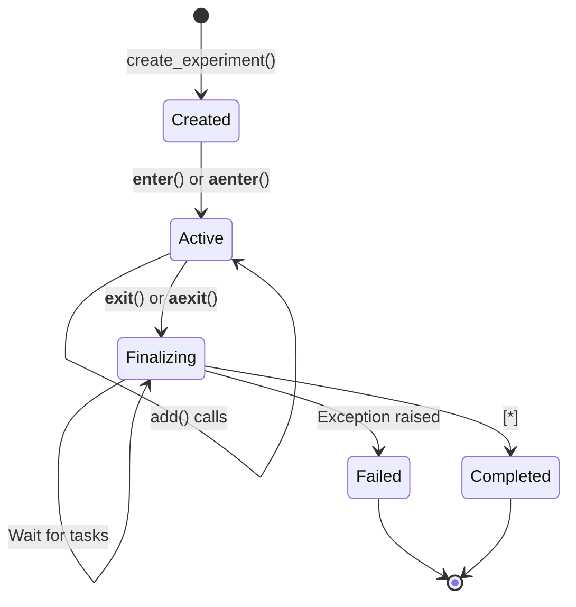
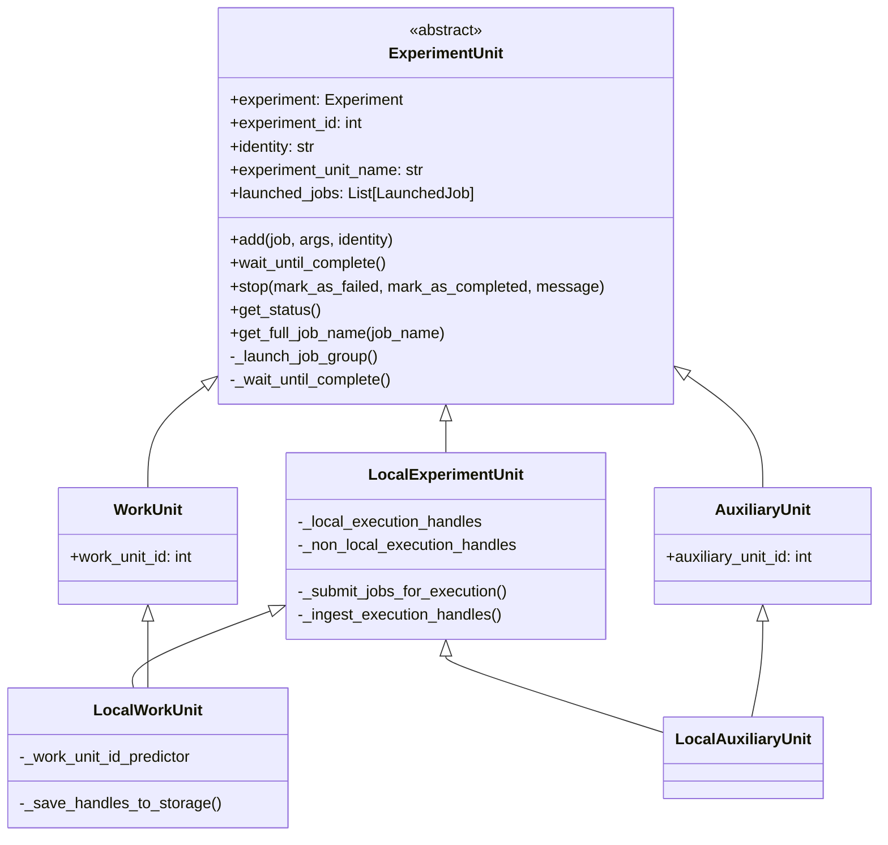
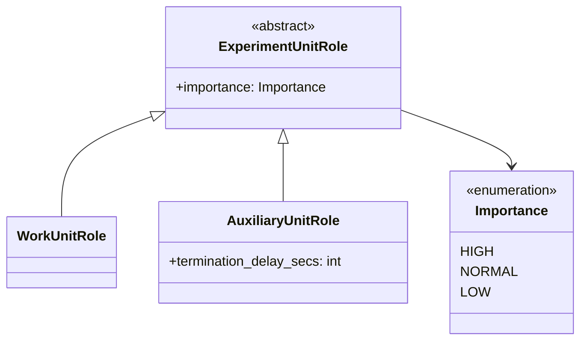
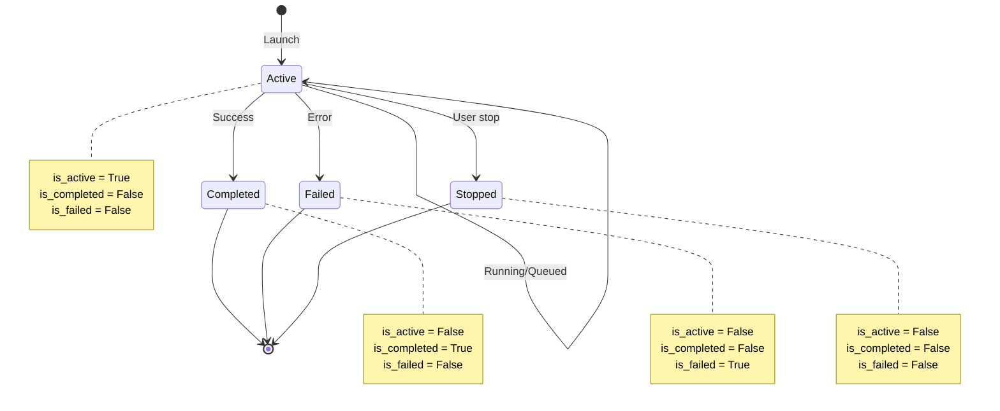
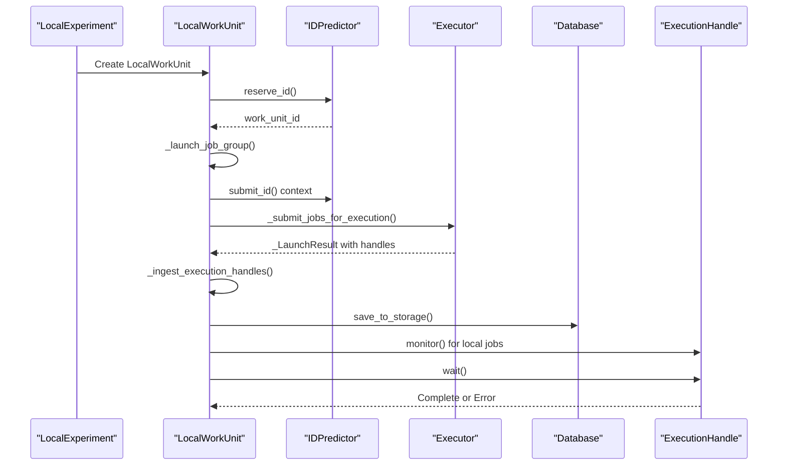

<!-- source: DeepWiki mcp.deepwiki.com · repo google-deepmind/xmanager · page 3.1 Experiments and Work Units · fetched 2026-10-26 -->

# Experiments and Work Units

<details>
<summary>Relevant source files</summary>

The following files were used as context for generating this wiki page:

- [xmanager/xm/__init__.py](xmanager/xm/__init__.py)
- [xmanager/xm/core.py](xmanager/xm/core.py)
- [xmanager/xm/core_test.py](xmanager/xm/core_test.py)
- [xmanager/xm/metadata_context.py](xmanager/xm/metadata_context.py)
- [xmanager/xm_local/experiment.py](xmanager/xm_local/experiment.py)
- [xmanager/xm_mock/__init__.py](xmanager/xm_mock/__init__.py)

</details>


**Purpose**: This page provides a comprehensive reference for XManager's experiment and work unit abstractions. It covers the `Experiment` class lifecycle, the `ExperimentUnit` hierarchy (including `WorkUnit` and `AuxiliaryUnit` subclasses), role-based unit types, context management, and status monitoring.

For information about jobs and job groups that execute within experiment units, see [Jobs and Job Groups](#3.2). For details on executor-specific implementations, see [Execution Backends](#5).

---

## Experiment Class

The `Experiment` class is the top-level abstraction for managing a collection of related computational jobs. An experiment typically represents a single research investigation, such as a hyperparameter sweep or model training run.

### Core Properties and Methods

| Property/Method | Purpose |
|----------------|---------|
| `experiment_id` | Unique identifier assigned to the experiment |
| `add(job, args, role, identity)` | Adds a job/job group to the experiment, creating a new experiment unit |
| `package(packageables)` | Packages executable specifications into executables (builds/containers) |
| `package_async(packageable)` | Queues an executable spec for batched packaging |

**Sources**: [xmanager/xm/core.py:721-744]()

### Context Manager Lifecycle

Experiments must be used as context managers to ensure proper resource management and task synchronization. The lifecycle follows this pattern:



**Diagram: Experiment Lifecycle State Machine**

The experiment context performs these key operations:

1. **Entry** (`__enter__` / `__aenter__`):
   - Creates an event loop for asynchronous operations
   - Sets the current experiment context variable
   - Initializes the task queue

2. **Active Phase**:
   - Jobs are added via `add()` calls
   - Tasks are queued asynchronously
   - Packaging operations are batched

3. **Exit** (`__exit__` / `__aexit__`):
   - Waits for all pending tasks to complete
   - Validates that at least one work unit was added
   - Stops the event loop
   - Raises any exceptions that occurred during task execution

**Sources**: [xmanager/xm/core.py:763-867]()

### Synchronous vs Asynchronous Usage

XManager supports both synchronous (`with`) and asynchronous (`async with`) context management:

**Synchronous** (creates a background event loop thread):
```python
with xm_local.create_experiment(title='my_exp') as experiment:
    experiment.add(xm.Job(...))
```

**Asynchronous** (uses the current event loop):
```python
async with xm_local.create_experiment(title='my_exp') as experiment:
    experiment.add(xm.Job(...))
```

The synchronous mode creates a dedicated event loop thread to handle asynchronous operations, while the asynchronous mode reuses the existing event loop. Attempting to use `with` inside a coroutine raises a `RuntimeError`.

**Sources**: [xmanager/xm/core.py:763-831](), [xmanager/xm/core_test.py:223-231]()

---

## ExperimentUnit Hierarchy

An `ExperimentUnit` represents a collection of semantically associated jobs. It serves as the base class for both `WorkUnit` and `AuxiliaryUnit`.



**Diagram: ExperimentUnit Class Hierarchy**

**Sources**: [xmanager/xm/core.py:337-684](), [xmanager/xm_local/experiment.py:56-246]()

### Key ExperimentUnit Methods

#### add(job, args, identity)

Adds a `Job`, `JobGroup`, or `JobGenerator` to the experiment unit. This is the primary method for populating units with computational work.

**Parameters**:
- `job`: A `Job`, `JobGroup`, or async function (job generator)
- `args`: Optional dictionary of arguments to merge with job arguments
- `identity`: Optional unique identifier for idempotent job addition

**Behavior**:
- For `Job`: Wraps it in a single-job `JobGroup` and launches
- For `JobGroup`: Launches all jobs in the group
- For job generators: Executes the async function with the work unit as context

**Sources**: [xmanager/xm/core.py:378-476]()

#### wait_until_complete()

Returns an awaitable that resolves when the unit reaches a terminal state (completed, failed, or stopped). For `WorkUnit`, returns a `WorkUnitCompletedAwaitable` that provides access to the work unit instance.

**Usage pattern**:
```python
async with experiment:
    work_unit = await experiment.add(job)
    # Do other work...
    await work_unit.wait_until_complete()
```

**Sources**: [xmanager/xm/core.py:486-658]()

#### stop(mark_as_failed, mark_as_completed, message)

Initiates termination of all jobs in the unit. This method is synchronous and returns immediately; use `wait_until_complete()` afterward to ensure termination has completed.

**Sources**: [xmanager/xm/core.py:525-546]()

---

## WorkUnit vs AuxiliaryUnit

XManager distinguishes between two types of experiment units based on their role in the experiment structure.

### WorkUnit

Work units contain the primary computational jobs of an experiment. They are typically used for:
- Hyperparameter sweep trials
- Training runs
- Evaluation jobs
- Any job whose success/failure affects the experiment's overall status

**Key characteristics**:
- Has a `work_unit_id` property
- Status contributes to experiment status
- Typically represents a single hyperparameter configuration
- Returned by `experiment.add()` when using `WorkUnitRole` (default)

**Sources**: [xmanager/xm/core.py:642-659]()

### AuxiliaryUnit

Auxiliary units contain supporting jobs that do not represent primary experimental work. Common use cases:
- TensorBoard servers
- Monitoring dashboards
- Data preprocessing pipelines (when separate from main training)

**Key characteristics**:
- Has an `auxiliary_unit_id` property
- Status does not affect experiment status
- Can have a `termination_delay_secs` to keep running after experiment completion
- Created using `AuxiliaryUnitRole` or `AuxiliaryUnitJob` wrapper

**Sources**: [xmanager/xm/core.py:677-684](), [xmanager/xm/core.py:686-719]()

### Comparison Table

| Feature | WorkUnit | AuxiliaryUnit |
|---------|----------|---------------|
| **ID Property** | `work_unit_id` | `auxiliary_unit_id` |
| **Status Impact** | Affects experiment status | Does not affect experiment status |
| **Typical Usage** | Training trials, evaluations | TensorBoard, monitoring |
| **Termination** | Stops when job completes | Can persist after experiment via `termination_delay_secs` |
| **Creation** | `experiment.add(job, role=WorkUnitRole())` | `experiment.add(job, role=AuxiliaryUnitRole(...))` |

**Sources**: [xmanager/xm/core.py:589-684]()

---

## Experiment Unit Roles

Roles define the purpose and behavior of experiment units. They are specified when adding jobs to an experiment and determine the type of unit created.



**Diagram: Experiment Unit Role Class Hierarchy**

**Sources**: [xmanager/xm/core.py:303-334](), [xmanager/xm/core.py:589-674]()

### WorkUnitRole

The default role for experiment units. Contains only the inherited `importance` attribute.

**Usage**:
```python
experiment.add(job)  # Uses WorkUnitRole() by default
experiment.add(job, role=xm.WorkUnitRole(importance=xm.Importance.HIGH))
```

**Sources**: [xmanager/xm/core.py:589-596]()

### AuxiliaryUnitRole

Role for auxiliary units that provide supporting services.

**Attributes**:
- `importance`: Scheduling priority (inherited from `ExperimentUnitRole`)
- `termination_delay_secs`: How long to keep the unit running after the experiment completes

**Usage**:
```python
experiment.add(
    tensorboard_job,
    role=xm.AuxiliaryUnitRole(
        importance=xm.Importance.LOW,
        termination_delay_secs=3600  # Keep running for 1 hour after experiment
    )
)
```

**Sources**: [xmanager/xm/core.py:661-674]()

### Importance Enum

Controls scheduling priority within a team's resource allocation (does not affect inter-team allocation).

| Value | Purpose |
|-------|---------|
| `HIGH` | High-impact experiments; scheduler prioritizes even at cost of throughput |
| `NORMAL` | Default priority |
| `LOW` | Maximize throughput; schedule after higher-importance work |

**Note**: Not all executors respect importance (e.g., `xm_local` ignores it).

**Sources**: [xmanager/xm/core.py:303-323]()

### AuxiliaryUnitJob Wrapper

A convenience class for bundling jobs with `AuxiliaryUnitRole`:

```python
tensorboard_job = xm.AuxiliaryUnitJob(
    xm.Job(...),
    importance=xm.Importance.LOW,
    termination_delay_secs=600
)
experiment.add(tensorboard_job)  # Automatically creates AuxiliaryUnit
```

This wrapper conforms to the `JobGeneratorType` interface and automatically sets the role when added to an experiment.

**Sources**: [xmanager/xm/core.py:686-719]()

---

## Lifecycle and Context Management

XManager uses context variables and asynchronous task management to coordinate experiment execution.

### Context Variables

Two context variables track the current execution context:

| Context Variable | Type | Purpose |
|-----------------|------|---------|
| `_current_experiment` | `Experiment` | Set when inside an experiment context |
| `_current_experiment_unit` | `ExperimentUnit` | Set when inside a job generator |

These are automatically managed by the experiment and experiment unit lifecycle methods. They enable functions to access the current experiment or unit without explicit parameter passing.

**Sources**: [xmanager/xm/core.py:48-55]()

### Task Management Flow

```mermaid
sequenceDiagram
    participant User as "User Code"
    participant Exp as "Experiment"
    participant Loop as "Event Loop"
    participant Queue as "Task Queue"
    participant Unit as "ExperimentUnit"
    
    User->>Exp: experiment.add(job)
    Exp->>Unit: _create_experiment_unit()
    Exp->>Loop: _create_task(launch())
    Loop->>Queue: Enqueue task
    Queue-->>Exp: Future
    Exp-->>User: Future[ExperimentUnit]
    
    loop Background execution
        Loop->>Unit: launch jobs
        Unit->>Unit: add(job)
        Unit->>Unit: _launch_job_group()
    end
    
    User->>Exp: __exit__()
    Exp->>Queue: _wait_for_tasks()
    loop Until queue empty
        Queue->>Queue: task.result()
    end
    Exp->>Loop: stop()
    Exp-->>User: Return or raise
```

**Diagram: Task Management and Asynchronous Execution Flow**

The experiment maintains a queue of background tasks that launch work units. When `add()` is called:

1. A new experiment unit is created (or retrieved if identity-based)
2. A launch coroutine is wrapped in a task and enqueued
3. The task executes asynchronously in the event loop
4. On experiment exit, all tasks are awaited before cleanup

This design allows multiple work units to be created and launched concurrently.

**Sources**: [xmanager/xm/core.py:745-757](), [xmanager/xm/core.py:798-821](), [xmanager/xm/core.py:1031-1076]()

### Thread Pool Context Propagation

When using thread pools, context variables must be explicitly propagated. XManager provides `new_thread_pool_executor()` which creates a thread pool that copies the current context to worker threads:

```python
with xm_local.create_experiment('exp') as experiment:
    executor = xm.new_thread_pool_executor()
    # Worker threads can access _current_experiment
```

**Sources**: [xmanager/xm/core.py:112-125]()

---

## Status and Monitoring

### ExperimentUnitStatus Interface

The `ExperimentUnitStatus` class provides a uniform interface for querying unit state:



**Diagram: Experiment Unit Status States**

**Properties**:
- `is_active`: Unit is running or queued (not terminal)
- `is_completed`: Unit completed successfully (terminal)
- `is_failed`: Unit failed due to error (terminal)
- `message`: Human-readable status context

**Sources**: [xmanager/xm/core.py:139-184]()

### Wait Patterns

#### Single Work Unit

```python
async with experiment:
    work_unit = await experiment.add(job)
    await work_unit.wait_until_complete()  # Blocks until terminal state
```

#### Multiple Work Units with asyncio.wait

```python
async with experiment:
    work_units = [await experiment.add(job, args={'lr': lr}) for lr in [0.1, 0.01, 0.001]]
    
    pending = {wu.wait_until_complete() for wu in work_units}
    while pending:
        done, pending = await asyncio.wait(pending, return_when=asyncio.FIRST_COMPLETED)
        for completed in done:
            work_unit = completed.result()  # Access the WorkUnit
            print(f'Work unit {work_unit.work_unit_id} completed')
```

The `WorkUnitCompletedAwaitable` provides access to the `WorkUnit` instance via its `.work_unit` property, enabling patterns that need to identify which unit completed.

**Sources**: [xmanager/xm/core.py:599-640]()

### Exception Handling

XManager defines specific exception types for unit failures:

| Exception | When Raised | Base Class |
|-----------|-------------|------------|
| `ExperimentUnitError` | Generic unit failure | `RuntimeError` |
| `ExperimentUnitFailedError` | Job within unit failed | `ExperimentUnitError` |
| `ExperimentUnitNotCompletedError` | Unit stopped but not completed or failed | `ExperimentUnitError` |
| `ReloadError` | XReload reload check failed | `ExperimentUnitError` |

All exceptions include an optional `work_unit` attribute for accessing the failing unit.

**Usage**:
```python
try:
    await work_unit.wait_until_complete()
except xm.ExperimentUnitFailedError as e:
    print(f'Work unit {e.work_unit.work_unit_id} failed: {e}')
```

**Sources**: [xmanager/xm/core.py:187-218]()

---

## Identity and Idempotency

The `identity` parameter enables idempotent experiment unit creation, allowing experiments to recover from preemptions or restarts.

### Identity-Based Creation

When an `identity` is provided to `experiment.add()`:
- If no unit with that identity exists: A new unit is created
- If a unit with that identity exists: The existing unit is returned without modification
- Job generators still execute to allow recovery logic

**Usage**:
```python
for trial_id in range(100):
    experiment.add(
        job,
        args={'learning_rate': trial_id * 0.001},
        identity=f'trial_{trial_id}'  # Idempotent
    )
```

If the experiment crashes and is restarted, only trials that haven't been created will be added.

**Sources**: [xmanager/xm/core.py:1008-1012]()

### Implementation Details

The identity mechanism is implemented via two experiment methods:

1. **`_should_reload_experiment_unit(role)`**: Returns whether to attempt reload based on role
2. **`_get_experiment_unit(experiment_id, identity, role, args)`**: Retrieves existing unit by identity

Implementations (like `xm_local`) may not support identity-based creation, in which case they log a warning and create new units regardless.

**Sources**: [xmanager/xm/core.py:1078-1098](), [xmanager/xm_local/experiment.py:377-384]()

### Job Generator Reloading

Job generators are re-executed even when reloading an existing unit. This allows them to:
- Check if previous jobs completed
- Add new jobs if needed
- Update job configurations

This behavior is critical for fault-tolerant experiment designs that can resume after preemption.

**Sources**: [xmanager/xm/core.py:1011-1012](), [xmanager/xm/core.py:1059-1069]()

---

## LocalExperiment Implementation

The `xm_local` implementation provides concrete implementations of the abstract experiment classes.

### Class Structure

```mermaid
graph TB
    subgraph "Abstract Layer"
        Experiment["xm.Experiment"]
        ExperimentUnit["xm.ExperimentUnit"]
        WorkUnit["xm.WorkUnit"]
        AuxiliaryUnit["xm.AuxiliaryUnit"]
    end
    
    subgraph "Local Implementation"
        LocalExperiment["LocalExperiment"]
        LocalExperimentUnit["LocalExperimentUnit"]
        LocalWorkUnit["LocalWorkUnit"]
        LocalAuxiliaryUnit["LocalAuxiliaryUnit"]
    end
    
    subgraph "Infrastructure"
        Database["database.database()"]
        IDPredictor["id_predictor.Predictor"]
        ExecutionHandles["execution_handles"]
    end
    
    Experiment -.implements.-> LocalExperiment
    ExperimentUnit -.implements.-> LocalExperimentUnit
    WorkUnit -.implements.-> LocalWorkUnit
    AuxiliaryUnit -.implements.-> LocalAuxiliaryUnit
    
    LocalWorkUnit --|extends| LocalExperimentUnit
    LocalAuxiliaryUnit --|extends| LocalExperimentUnit
    
    LocalExperiment --> Database
    LocalExperiment --> IDPredictor
    LocalWorkUnit --> Database
    LocalExperimentUnit --> ExecutionHandles
```

**Diagram: LocalExperiment Implementation Structure**

**Sources**: [xmanager/xm_local/experiment.py:56-393]()

### LocalExperiment Key Features

**Properties**:
- `_id`: Experiment ID (timestamp-based for local execution)
- `_experiment_title`: Human-readable title
- `_experiment_units`: List of created units
- `_work_unit_id_predictor`: Generates sequential work unit IDs

**Lifecycle differences**:
- On `__exit__`, waits for local jobs to complete (with Ctrl+C prompt)
- Does not support identity-based unit creation (logs warning)
- Stores experiment and work unit metadata to local database

**Sources**: [xmanager/xm_local/experiment.py:248-393]()

### LocalWorkUnit Execution Flow



**Diagram: LocalWorkUnit Execution Flow**

The local work unit implementation:
1. Reserves a work unit ID from the predictor
2. Submits jobs to executors (which return execution handles)
3. Separates local and non-local handles for different monitoring strategies
4. Saves non-local handles to the database
5. Monitors local handles via background tasks

**Sources**: [xmanager/xm_local/experiment.py:167-219]()

---

## Key Takeaways

1. **Experiments** are context managers that orchestrate asynchronous work unit creation and lifecycle management
2. **ExperimentUnits** come in two flavors: **WorkUnits** (contribute to experiment status) and **AuxiliaryUnits** (supporting services)
3. **Roles** (`WorkUnitRole`, `AuxiliaryUnitRole`) determine unit behavior and termination semantics
4. **Context variables** enable implicit access to current experiment and unit state
5. **Identity** parameters provide idempotency for fault-tolerant experiment designs
6. **Status monitoring** uses async/await patterns with `wait_until_complete()` for coordinating unit completion
7. **Task management** happens asynchronously in a background event loop, with synchronization on context exit

**Sources**: [xmanager/xm/core.py:14-1171](), [xmanager/xm_local/experiment.py:1-449]()

---

