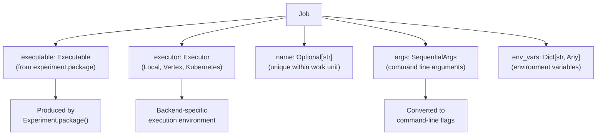
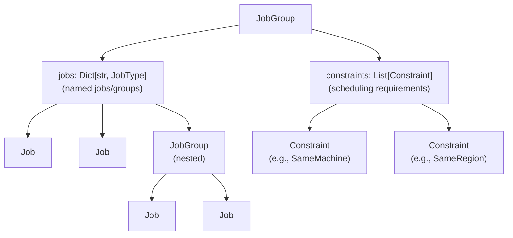
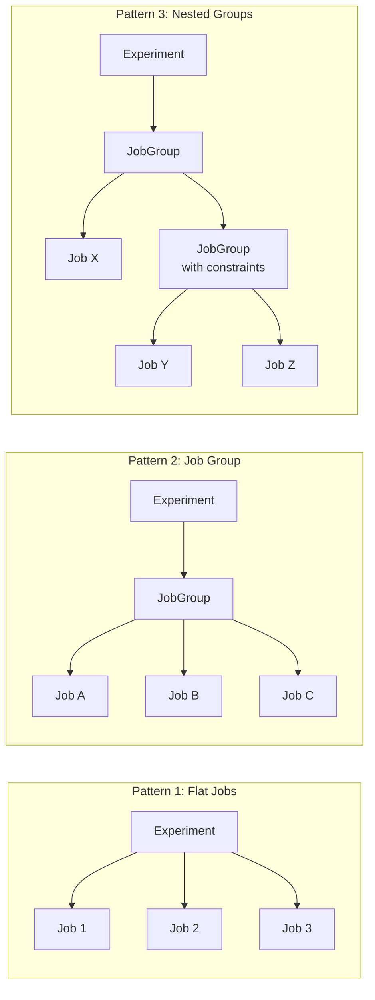
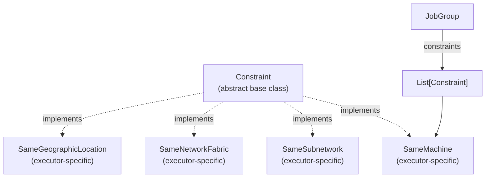
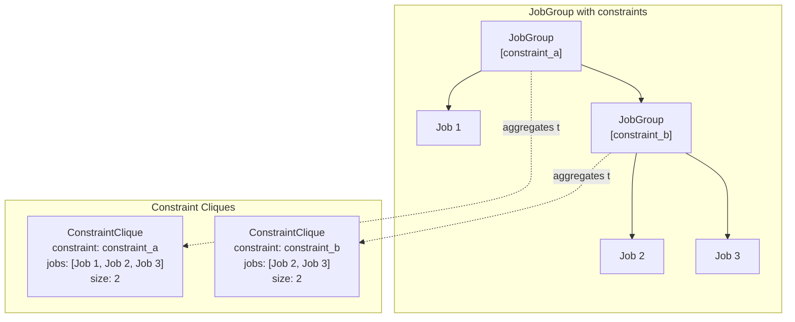
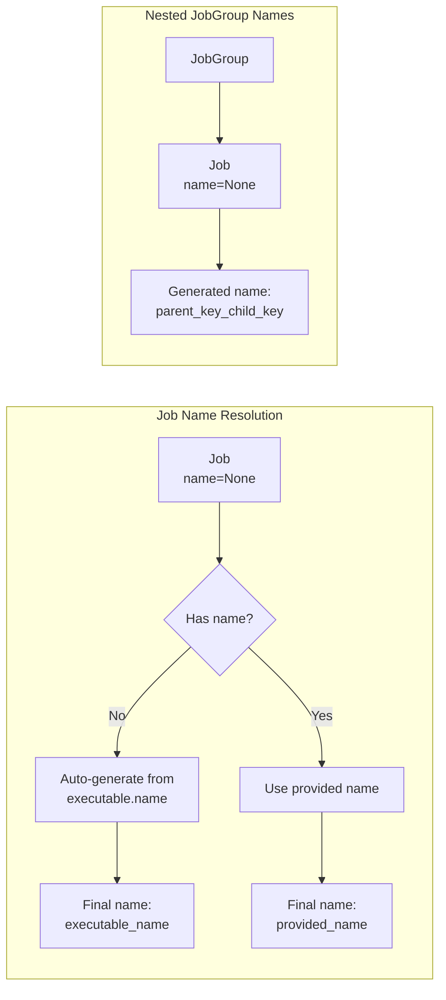
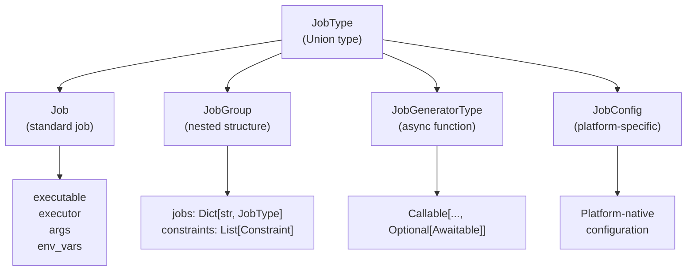
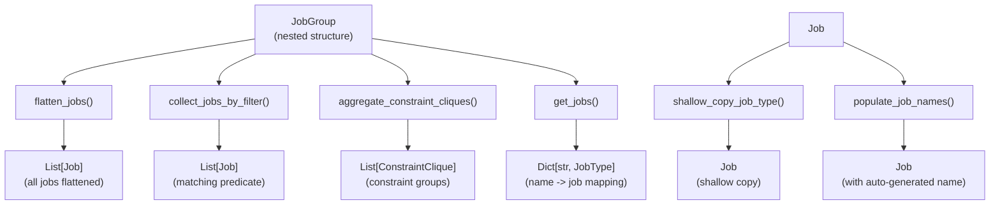
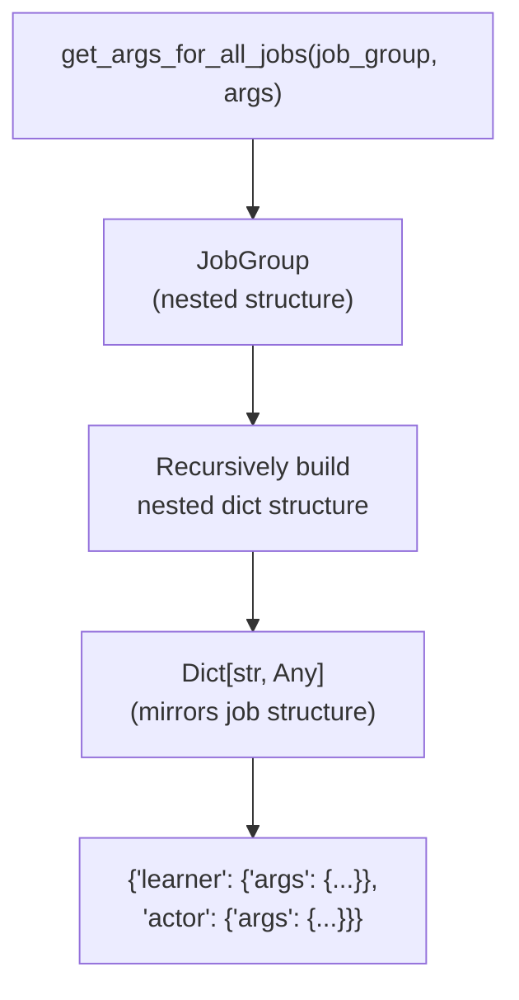

<!-- source: DeepWiki mcp.deepwiki.com · repo google-deepmind/xmanager · page 3.2 Jobs and Job Groups · fetched 2026-10-26 -->

# Jobs and Job Groups

<details>
<summary>Relevant source files</summary>

The following files were used as context for generating this wiki page:

- [xmanager/xm/job_blocks.py](xmanager/xm/job_blocks.py)
- [xmanager/xm/job_blocks_test.py](xmanager/xm/job_blocks_test.py)
- [xmanager/xm/job_operators.py](xmanager/xm/job_operators.py)
- [xmanager/xm/job_operators_test.py](xmanager/xm/job_operators_test.py)

</details>


This page explains the `Job` and `JobGroup` abstractions in XManager, which define units of computation and how they are organized for execution. For information about packaging executables before creating jobs, see [Executable Specifications](#3.3). For details on how jobs are executed on different backends, see [Execution Backends](#5).

## Purpose and Scope

`Job` represents a single unit of computation to be executed on a specific runtime environment. `JobGroup` organizes multiple jobs under shared scheduling constraints, enabling concepts like gang scheduling and collocation. This page covers:

- The structure and attributes of `Job` and `JobGroup`
- How to organize jobs hierarchically
- Constraint-based scheduling requirements
- Job naming conventions
- Advanced job types (`JobConfig` and job generators)
- Utility functions for job manipulation

---

## Job Structure

A `Job` describes a single unit of computation by specifying what to run, where to run it, and how to run it.



**Sources:** [xmanager/xm/job_blocks.py:398-423]()

### Job Attributes

| Attribute | Type | Description |
|-----------|------|-------------|
| `executable` | `Executable` | The packaged executable to run. Produced by `Experiment.package()`. See [Executable Specifications](#3.3) and [Packaging System](#4). |
| `executor` | `Executor` | The runtime environment. One of `xm_local.Local`, `xm_local.Vertex`, or `xm_local.Kubernetes`. See [Execution Backends](#5). |
| `name` | `Optional[str]` | Unique identifier within the work unit. Auto-generated from executable name if not provided. |
| `args` | `SequentialArgs` | Command-line arguments passed to the executable. Supports dict, list, or `SequentialArgs` format. See [Arguments and Environment Variables](#3.5). |
| `env_vars` | `Dict[str, Any]` | Environment variables set in the execution environment. Keys must match `[a-zA-Z_][a-zA-Z0-9_]*`. |

**Sources:** [xmanager/xm/job_blocks.py:398-423]()

### Creating Jobs

```python
# Basic job with keyword arguments
job = xm.Job(
    executable=packaged_executable,
    executor=xm_local.Local(),
    args={'batch_size': 32, 'learning_rate': 0.001}
)

# Job with mixed positional and keyword arguments
job = xm.Job(
    executable=packaged_executable,
    executor=xm_local.Vertex(),
    args=xm.merge_args(['--config', 'config.json'], {'seed': 42}),
    env_vars={'CUDA_VISIBLE_DEVICES': '0,1'}
)
```

**Sources:** [xmanager/xm/job_blocks.py:398-423]()

---

## JobGroup Structure

`JobGroup` organizes multiple jobs (or nested `JobGroup`s) that should be scheduled together under shared constraints. This enables gang scheduling: jobs within a group are scheduled or descheduled simultaneously.



**Sources:** [xmanager/xm/job_blocks.py:425-486]()

### JobGroup Attributes

| Attribute | Type | Description |
|-----------|------|-------------|
| `jobs` | `Dict[str, JobType]` | Named mapping of jobs. Values can be `Job`, `JobGroup`, `JobGeneratorType`, or `JobConfig`. Names must be unique within the group. |
| `constraints` | `List[Constraint]` | Scheduling constraints that apply to all jobs in the group. See [Constraints](#constraints) below. |

**Sources:** [xmanager/xm/job_blocks.py:425-486]()

### Creating Job Groups

```python
# Simple job group with named jobs
job_group = xm.JobGroup(
    learner=xm.Job(learner_executable, executor),
    actor=xm.Job(actor_executable, executor),
)

# Job group with constraints
job_group = xm.JobGroup(
    preprocessor=xm.Job(preprocess_executable, executor),
    trainer=xm.Job(train_executable, executor),
    constraints=[xm_impl.SameMachine()],
)

# Nested job groups
job_group = xm.JobGroup(
    evaluator=xm.Job(eval_executable, executor),
    training_pipeline=xm.JobGroup(
        learner=xm.Job(learner_executable, executor),
        actor=xm.Job(actor_executable, executor),
        constraints=[xm_impl.SameMachine()],
    ),
)
```

**Sources:** [xmanager/xm/job_blocks.py:425-486]()

---

## Job Organization Patterns

XManager supports three organization patterns for jobs:



**Sources:** [xmanager/xm/job_blocks.py:425-486]()

### Pattern 1: Independent Jobs

Use when jobs have no interdependencies and can be scheduled independently:

```python
with xm_local.create_experiment(experiment_title='independent_jobs') as experiment:
    [executable] = experiment.package([xm.Packageable(...)])
    
    for seed in [1, 2, 3]:
        experiment.add(xm.Job(
            executable=executable,
            executor=xm_local.Vertex(),
            args={'seed': seed}
        ))
```

**Sources:** [xmanager/xm/job_blocks.py:398-423]()

### Pattern 2: Gang Scheduling

Use when multiple jobs should start and stop together:

```python
job_group = xm.JobGroup(
    learner=xm.Job(learner_executable, executor),
    actor=xm.Job(actor_executable, executor, args={'num_actors': 10}),
)
experiment.add(job_group)
```

**Sources:** [xmanager/xm/job_blocks.py:425-486]()

### Pattern 3: Hierarchical Constraints

Use when different constraint levels are needed:

```python
# Outer group: all jobs in same region
# Inner group: specific jobs on same machine
job_group = xm.JobGroup(
    monitor=xm.Job(monitor_executable, executor),
    colocated_workers=xm.JobGroup(
        coordinator=xm.Job(coordinator_executable, executor),
        worker=xm.Job(worker_executable, executor),
        constraints=[xm_impl.SameMachine()],
    ),
    constraints=[xm_impl.SameRegion()],
)
```

**Sources:** [xmanager/xm/job_blocks.py:425-486]()

---

## Constraints

`Constraint` is an abstract base class that describes scheduling requirements for job groups. Constraints apply to all jobs within a `JobGroup`, including jobs in nested groups.



**Sources:** [xmanager/xm/job_blocks.py:378-388]()

### Common Constraint Types

Concrete constraint implementations are provided by executor-specific modules:

| Constraint Example | Description | Use Case |
|-------------------|-------------|----------|
| `SameMachine()` | Jobs run on the same physical or virtual machine | Shared memory access, low-latency IPC |
| `SameSubnetwork()` | Jobs run in the same VPC subnetwork | Network-intensive communication |
| `SameNetworkFabric()` | Jobs run on the same network fabric | Distributed training with high bandwidth |
| `SameGeographicLocation()` | Jobs run in the same region/zone | Data locality, latency requirements |

**Note:** Actual constraint implementations are executor-specific and may not be available for all backends.

**Sources:** [xmanager/xm/job_blocks.py:378-388]()

### Constraint Application

Constraints are aggregated into "constraint cliques" that track which jobs they apply to:



**Sources:** [xmanager/xm/job_operators.py:103-158]()

The `aggregate_constraint_cliques()` function in `job_operators` processes job groups and creates `ConstraintClique` objects:

| ConstraintClique Field | Description |
|------------------------|-------------|
| `constraint` | The constraint that applies |
| `jobs` | All jobs (including nested) that the constraint applies to |
| `group_name` | Auto-generated unique identifier for the group |
| `size` | Number of direct children (jobs + nested groups) |
| `parent_group_name` | Name of parent group, if nested |

**Sources:** [xmanager/xm/job_operators.py:82-158]()

---

## Job Naming

Jobs are identified by their `name` attribute within a work unit. Names must be unique.



**Sources:** [xmanager/xm/job_operators.py:42-57]()

### Name Generation

The `populate_job_names()` function assigns default names to jobs:

- **Top-level jobs without names**: Use `executable.name`
- **Jobs in `JobGroup` without names**: Concatenate group keys with underscores (e.g., `parent_child_jobname`)

Example:

```python
job_group = xm.JobGroup(
    preprocessing=xm.JobGroup(
        load=xm.Job(loader_executable, executor),  # name becomes "preprocessing_load"
        clean=xm.Job(cleaner_executable, executor), # name becomes "preprocessing_clean"
    ),
    training=xm.Job(trainer_executable, executor),  # name becomes "training"
)
```

**Sources:** [xmanager/xm/job_operators.py:42-57]()

---

## JobType Variants

XManager supports multiple job types beyond basic `Job` and `JobGroup`:



**Sources:** [xmanager/xm/job_blocks.py:394-496]()

### JobGeneratorType

Job generators are async functions that dynamically create jobs during experiment execution. This enables hyperparameter sweeps, conditional job creation, and other dynamic patterns.

```python
async def generate_sweep_jobs():
    for learning_rate in [0.001, 0.01, 0.1]:
        await experiment.add(xm.Job(
            executable=executable,
            executor=executor,
            args={'learning_rate': learning_rate}
        ))

# Add generator to experiment
experiment.add(generate_sweep_jobs)
```

**Sources:** [xmanager/xm/job_blocks.py:391-394](), [xmanager/xm/job_blocks.py:502-504]()

### JobConfig

`JobConfig` is an abstract base class for platform-specific job configurations. Use when the platform-agnostic `Job`/`JobGroup` interfaces cannot express required functionality.

Concrete implementations are provided by specific XManager backends for their native configuration languages (e.g., Kubernetes YAML, Vertex AI CustomJob JSON).

**Sources:** [xmanager/xm/job_blocks.py:488-496]()

---

## Job Manipulation Utilities

XManager provides utility functions in `job_operators` for working with job structures:



**Sources:** [xmanager/xm/job_operators.py:25-195]()

### Utility Function Reference

| Function | Signature | Description |
|----------|-----------|-------------|
| `flatten_jobs()` | `(JobGroup) -> List[Job]` | Returns all jobs in a group, recursively traversing nested groups |
| `collect_jobs_by_filter()` | `(JobGroup, predicate) -> List[Job]` | Returns jobs matching a predicate function |
| `aggregate_constraint_cliques()` | `(JobGroup) -> List[ConstraintClique]` | Forms constraint cliques with associated jobs |
| `get_jobs()` | `(JobGroup) -> Dict[str, JobType]` | Maps job names to job objects, validating uniqueness |
| `shallow_copy_job_type()` | `(JobType) -> JobType` | Creates a shallow copy of a job or job group |
| `populate_job_names()` | `(JobType) -> None` | Assigns default names to unnamed jobs (mutates in-place) |

**Sources:** [xmanager/xm/job_operators.py:25-195]()

### Example: Filtering Jobs by Executor

```python
# Collect all jobs using Vertex AI executor
vertex_jobs = collect_jobs_by_filter(
    job_group,
    predicate=lambda job: isinstance(job.executor, xm_local.Vertex)
)
```

**Sources:** [xmanager/xm/job_operators.py:59-78]()

---

## Argument Application Pattern

The `get_args_for_all_jobs()` function creates nested argument structures for job groups:



**Sources:** [xmanager/xm/job_blocks.py:506-527]()

This utility is useful when all jobs in a work unit accept the same arguments (e.g., log directory):

```python
job_group = xm.JobGroup(
    worker1=xm.Job(...),
    worker2=xm.Job(...),
)

# Apply same arguments to all jobs
args_structure = get_args_for_all_jobs(job_group, {'logdir': '/logs/experiment1'})
# Returns: {'worker1': {'args': {'logdir': ...}}, 'worker2': {'args': {'logdir': ...}}}
```

**Sources:** [xmanager/xm/job_blocks.py:506-527](), [xmanager/xm/job_blocks_test.py:150-173]()

---

## Summary

| Concept | Class/Function | Purpose |
|---------|----------------|---------|
| **Unit of computation** | `Job` | Specifies executable, executor, arguments, and environment |
| **Job organization** | `JobGroup` | Groups jobs with shared constraints and gang scheduling |
| **Scheduling requirements** | `Constraint` | Abstract requirements for job placement (same machine, region, etc.) |
| **Platform-specific jobs** | `JobConfig` | Jobs defined by native platform configuration |
| **Dynamic job creation** | `JobGeneratorType` | Async functions that generate jobs at runtime |
| **Job tree traversal** | `flatten_jobs()`, `collect_jobs_by_filter()` | Extract jobs from nested structures |
| **Constraint processing** | `aggregate_constraint_cliques()` | Group jobs by their constraints |
| **Name management** | `populate_job_names()`, `get_jobs()` | Assign and validate job names |

**Sources:** [xmanager/xm/job_blocks.py:1-527](), [xmanager/xm/job_operators.py:1-195]()

---

