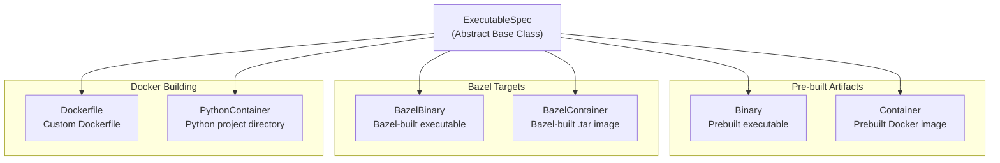
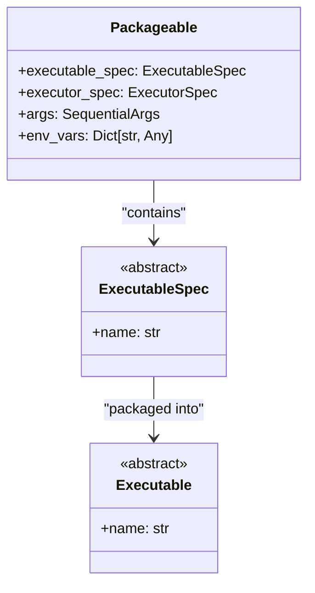
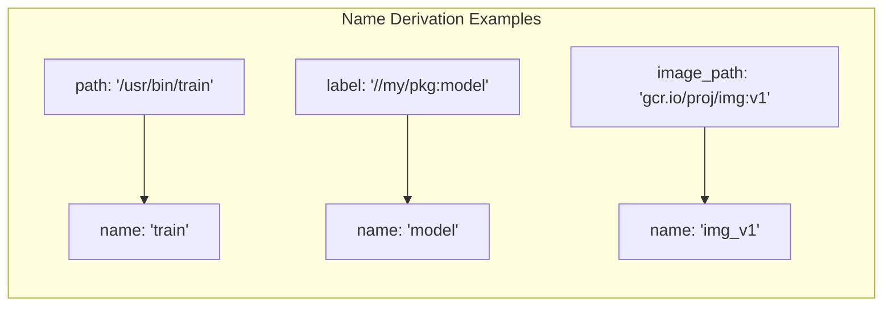
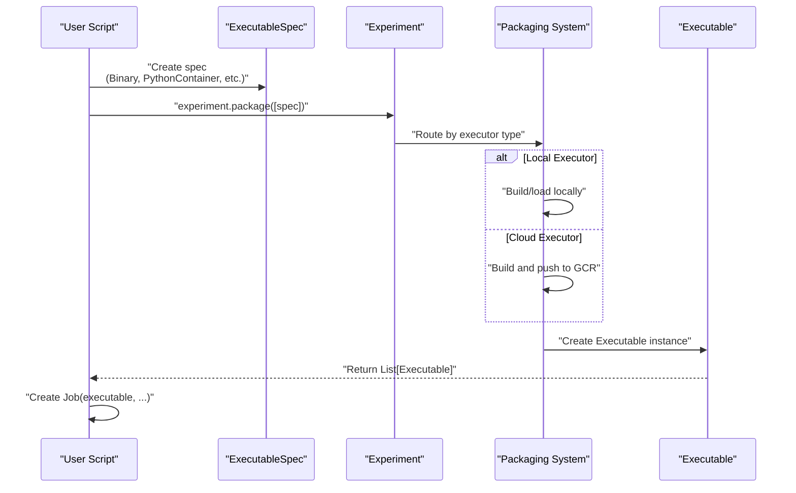

<!-- source: DeepWiki mcp.deepwiki.com · repo google-deepmind/xmanager · page 3.3 Executable Specifications · fetched 2026-10-26 -->

# Executable Specifications

<details>
<summary>Relevant source files</summary>

The following files were used as context for generating this wiki page:

- [xmanager/xm/executables.py](xmanager/xm/executables.py)
- [xmanager/xm/job_blocks.py](xmanager/xm/job_blocks.py)
- [xmanager/xm/job_blocks_test.py](xmanager/xm/job_blocks_test.py)
- [xmanager/xm/utils.py](xmanager/xm/utils.py)
- [xmanager/xm/utils_test.py](xmanager/xm/utils_test.py)

</details>


## Purpose and Scope

This document describes the `ExecutableSpec` types available in XManager, which define **what code or computation to run** in an experiment. An `ExecutableSpec` is a platform-agnostic specification that must be transformed into an `Executable` via the packaging system before it can be used in a `Job`.

For information about **where** to run executables, see [Execution Backends](#5). For the packaging process that transforms specs into executables, see [Packaging System](#4).

## Overview

The `ExecutableSpec` abstract base class provides a common interface for describing executable artifacts. All specifications must implement a `name` property that returns a string identifier derived from the specification's attributes.



**Sources:** [xmanager/xm/job_blocks.py:274-296](), [xmanager/xm/executables.py:1-228]()

## ExecutableSpec Base Class

The `ExecutableSpec` abstract class is defined in [xmanager/xm/job_blocks.py:274-296]() and requires implementations to provide a `name` property. Executable specifications are platform-agnostic and must not contain backend-specific logic.



**Sources:** [xmanager/xm/job_blocks.py:274-313](), [xmanager/xm/job_blocks.py:364-376]()

## Pre-built Executables

### Binary

The `Binary` class represents a prebuilt executable program that already exists on the filesystem. This is used when you have a compiled binary that doesn't need to be built by XManager.

| Attribute | Type | Description |
|-----------|------|-------------|
| `path` | `str` | Path to the prebuilt binary |
| `dependencies` | `List[BinaryDependency]` | Data dependencies to package with the binary |

The `name` property is derived by calling `name_from_path(self.path)`, which extracts the basename and replaces non-word characters with underscores.

```python
# Example usage
executable_spec = xm.Binary(
    path='/usr/local/bin/my_program',
    dependencies=[]
)
```

**Sources:** [xmanager/xm/executables.py:163-181](), [xmanager/xm/executables.py:26-28]()

### Container

The `Container` class represents a prebuilt Docker image that is already tagged locally or available in a remote repository.

| Attribute | Type | Description |
|-----------|------|-------------|
| `image_path` | `str` | Path to the prebuilt container image (e.g., `gcr.io/project/image:tag`) |

```python
# Example usage
executable_spec = xm.Container(
    image_path='gcr.io/my-project/my-image:latest'
)
```

**Sources:** [xmanager/xm/executables.py:146-161]()

## Bazel-based Executables

### BazelBinary

The `BazelBinary` class specifies a Bazel target that produces a self-contained executable. For Python targets using [Subpar](https://github.com/google/subpar), this builds a `.par` file.

| Attribute | Type | Description |
|-----------|------|-------------|
| `label` | `str` | The Bazel target to build (e.g., `//path/to:target`) |
| `dependencies` | `List[BinaryDependency]` | Data dependencies to package with the binary |
| `bazel_args` | `List[str]` | Additional Bazel command-line arguments |

```python
# Example usage
executable_spec = xm.BazelBinary(
    label='//my_project:train',
    bazel_args=['--config=cuda']
)
```

**Sources:** [xmanager/xm/executables.py:203-228]()

### BazelContainer

The `BazelContainer` class specifies a Bazel target that produces a Docker image in `.tar` format. When using [rules_docker](https://github.com/bazelbuild/rules_docker), append `.tar` to the label to specify a self-contained image.

| Attribute | Type | Description |
|-----------|------|-------------|
| `label` | `str` | The Bazel target to build (e.g., `//path/to:image.tar`) |
| `bazel_args` | `List[str]` | Additional Bazel command-line arguments |

```python
# Example usage
executable_spec = xm.BazelContainer(
    label='//my_project:image.tar',
    bazel_args=['--platforms=//platforms:linux_x86_64']
)
```

**Sources:** [xmanager/xm/executables.py:183-201]()

## Docker-building Executables

### Dockerfile

The `Dockerfile` class describes a Dockerfile for generating a Docker image. This is a lower-level feature that provides direct control over the Docker build process.

| Attribute | Type | Description |
|-----------|------|-------------|
| `path` | `str` | Build context directory (default: `'.'`) |
| `dockerfile` | `str` | Path to the Dockerfile (default: `{path}/Dockerfile`) |

Both paths are resolved relative to the launcher script using `utils.resolve_path_relative_to_launcher()` [xmanager/xm/utils.py:141-169](). The `dockerfile` attribute is set in `__attrs_post_init__` if not provided [xmanager/xm/executables.py:69-72]().

```python
# Example usage
executable_spec = xm.Dockerfile(
    path='./docker_context',
    dockerfile='./docker_context/custom.Dockerfile'
)
```

**Sources:** [xmanager/xm/executables.py:43-77]()

### PythonContainer

The `PythonContainer` class describes a directory containing Python code that will be packaged into a Docker container with an optimized Python runtime.

| Attribute | Type | Description |
|-----------|------|-------------|
| `entrypoint` | `Union[ModuleName, CommandList]` | Python module or shell commands to run |
| `path` | `str` | Path to the Python project (default: `'.'`) |
| `base_image` | `Optional[str]` | Base Docker image for the `FROM` instruction |
| `docker_instructions` | `Optional[List[str]]` | Custom Docker instructions |
| `use_deep_module` | `bool` | Whether code uses deep module structure |

#### Entrypoint Types

The `entrypoint` attribute accepts two types:

- **`ModuleName`**: A named tuple containing a `module_name` string [xmanager/xm/executables.py:31-34]()
- **`CommandList`**: A named tuple containing a list of shell commands [xmanager/xm/executables.py:37-40]()

```python
# Using ModuleName
executable_spec = xm.PythonContainer(
    path='./my_project',
    entrypoint=xm.ModuleName('train')
)

# Using CommandList
executable_spec = xm.PythonContainer(
    path='./my_project',
    entrypoint=xm.CommandList(['python', '-m', 'train', '--mode=distributed'])
)
```

#### Custom Docker Instructions

When using `docker_instructions`, you are responsible for copying the project directory. The instructions should include `COPY` and `WORKDIR` directives appropriate for your project structure.

For shallow module structure:
```python
docker_instructions=[
    'COPY my_project/ my_project',
    'WORKDIR my_project',
]
```

For deep module structure (`use_deep_module=True`):
```python
docker_instructions=[
    'RUN mkdir /workdir',
    'WORKDIR /workdir',
    'COPY my_project/ /workdir/my_project',
]
```

**Sources:** [xmanager/xm/executables.py:79-134]()

## Name Derivation

All `ExecutableSpec` implementations provide a `name` property that is automatically derived from their primary path or label attribute. The `name_from_path()` helper function [xmanager/xm/executables.py:26-28]() extracts the basename and sanitizes it by replacing non-word characters with underscores.



This automatic naming is used to assign default names to `Job` instances when no explicit name is provided [xmanager/xm/job_blocks.py:403-407]().

**Sources:** [xmanager/xm/executables.py:26-28](), [xmanager/xm/job_blocks.py:299-312]()

## Binary Dependencies

The `Binary` and `BazelBinary` classes support a `dependencies` attribute for including additional resources with the executable. The `BinaryDependency` abstract base class [xmanager/xm/executables.py:136-143]() allows backend-specific implementations to define custom dependency types.

Dependencies must be:
- Comparable (support equality checks)
- Hashable (can be used in sets/dicts)
- Immutable (cannot be modified after creation)

**Sources:** [xmanager/xm/executables.py:136-143](), [xmanager/xm/executables.py:169-176](), [xmanager/xm/executables.py:219-222]()

## Packaging Flow

`ExecutableSpec` instances must be transformed into `Executable` instances before they can be used in a `Job`. This transformation happens via the `Experiment.package()` method.



The packaging process is executor-dependent: local executors load images into the local Docker daemon, while cloud executors push images to Google Container Registry. For details, see [Local and Cloud Packaging](#4.3).

**Sources:** [xmanager/xm/job_blocks.py:274-313](), [xmanager/xm/job_blocks.py:364-376]()

## Usage in Packageable

`ExecutableSpec` instances are typically wrapped in a `Packageable` object [xmanager/xm/job_blocks.py:364-376]() along with:
- `executor_spec`: Where to run the executable
- `args`: Static command-line arguments
- `env_vars`: Static environment variables

```python
packageable = xm.Packageable(
    executable_spec=xm.PythonContainer(
        path='./training',
        entrypoint=xm.ModuleName('train')
    ),
    executor_spec=xm_local.Vertex.Spec(),
    args={'learning_rate': 0.001},
    env_vars={'CUDA_VISIBLE_DEVICES': '0'}
)
```

The `Packageable` is then passed to `experiment.package()` to produce an `Executable` that can be used in `Job` definitions.

**Sources:** [xmanager/xm/job_blocks.py:364-376]()

## Summary Table

| ExecutableSpec Type | Use Case | Key Attributes | Packaging Requirement |
|---------------------|----------|----------------|----------------------|
| `Binary` | Pre-built executable | `path`, `dependencies` | None (already built) |
| `Container` | Pre-built Docker image | `image_path` | May need to push to GCR for cloud |
| `BazelBinary` | Bazel executable target | `label`, `bazel_args` | Bazel build |
| `BazelContainer` | Bazel container target | `label`, `bazel_args` | Bazel build + Docker load/push |
| `Dockerfile` | Custom Dockerfile | `path`, `dockerfile` | Docker build + load/push |
| `PythonContainer` | Python project directory | `entrypoint`, `path`, `base_image` | Docker build + load/push |

**Sources:** [xmanager/xm/executables.py:1-228]()

---

