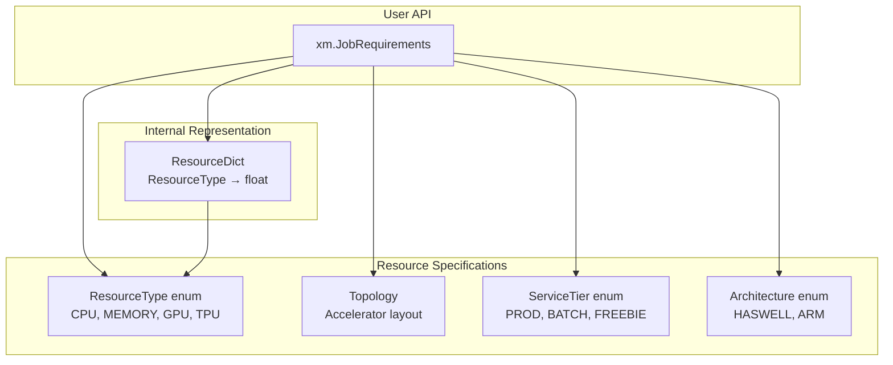
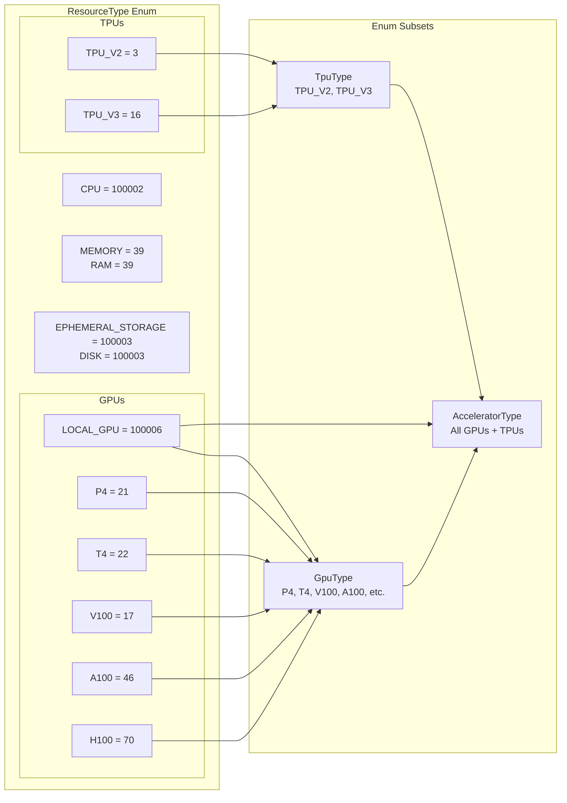
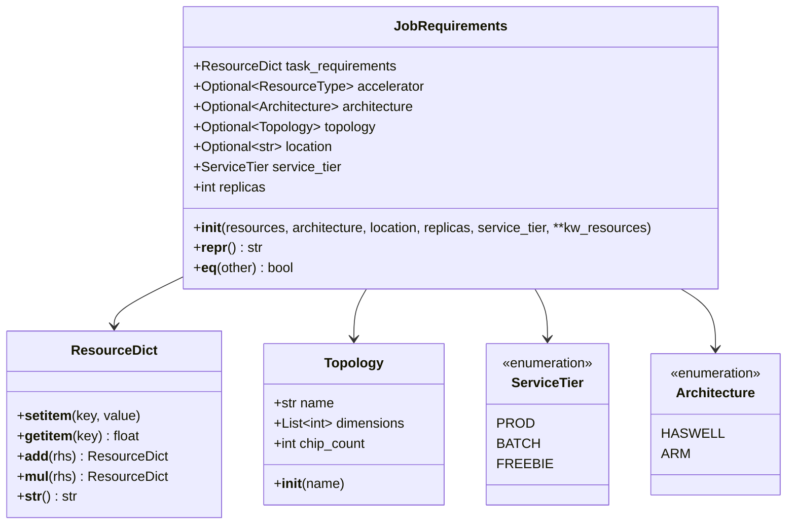
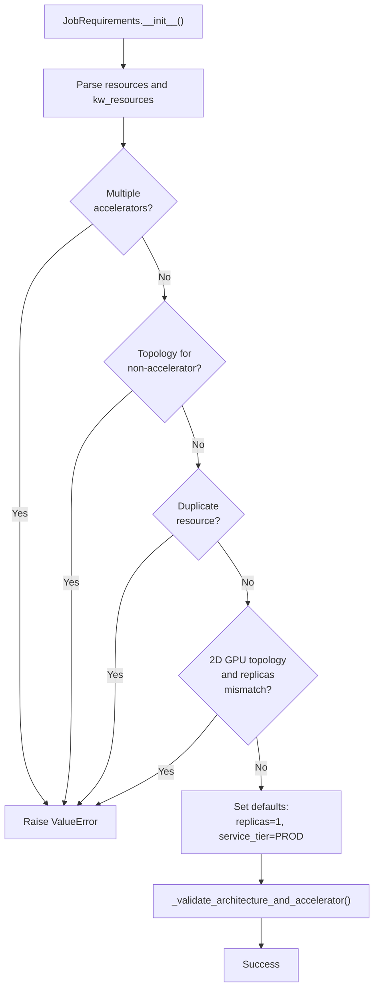
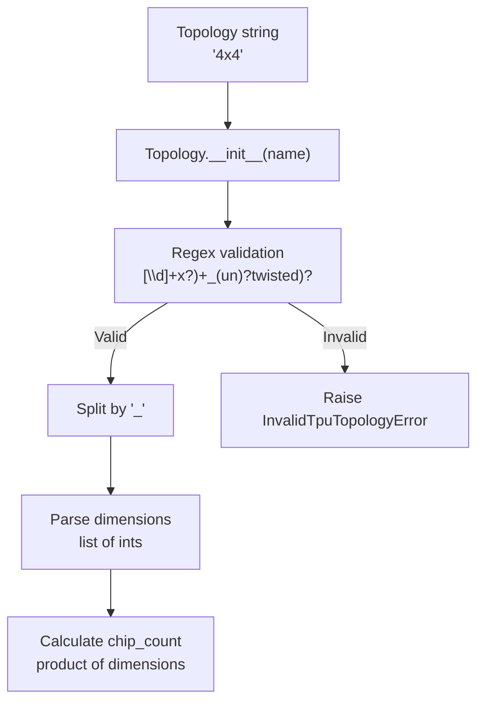
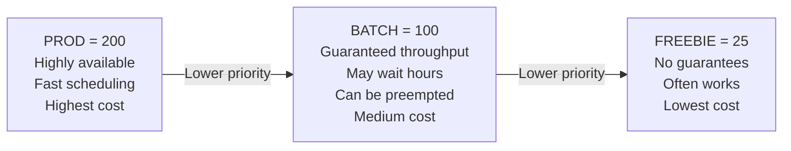
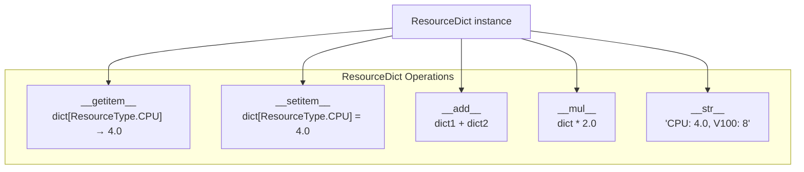
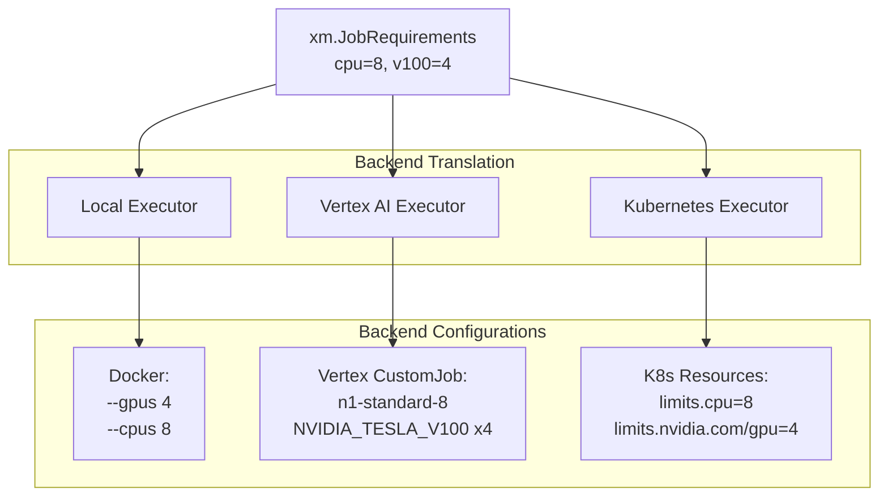

<!-- source: DeepWiki mcp.deepwiki.com · repo google-deepmind/xmanager · page 3.4 Resource Requirements · fetched 2026-10-26 -->

# Resource Requirements

<details>
<summary>Relevant source files</summary>

The following files were used as context for generating this wiki page:

- [xmanager/xm/resources.py](xmanager/xm/resources.py)
- [xmanager/xm/resources_test.py](xmanager/xm/resources_test.py)

</details>


This page documents XManager's resource specification system, which defines what computational resources are needed to execute jobs. Resource requirements determine where and how jobs are scheduled across execution backends.

For information about how resources relate to job definitions, see [Jobs and Job Groups](#3.2). For information about how executors interpret and map resource requirements to backend-specific configurations, see [Execution Backends](#5).

**Sources:** [xmanager/xm/resources.py:14-17]()

---

## Overview

XManager uses a declarative resource model where users specify requirements independently of the execution backend. The system consists of:

1. **Resource types** - Enumerated categories of countable resources (CPU, memory, accelerators)
2. **JobRequirements** - High-level API for specifying what a job needs
3. **Topologies** - Accelerator interconnection patterns
4. **Service tiers** - Availability and priority guarantees
5. **Architectures** - CPU architecture constraints

The primary user-facing class is `JobRequirements`, which aggregates all resource specifications for a job.



**Sources:** [xmanager/xm/resources.py:1-540]()

---

## ResourceType Enum

The `ResourceType` enum defines all countable resource types supported by XManager. Resources are organized into categories.

### Resource Categories

| Category | Resource Types | Description |
|----------|----------------|-------------|
| **Compute** | `CPU` | Virtual CPUs (vCPUs) |
| **Memory** | `MEMORY`, `RAM` | Memory in bytes (aliases) |
| **Storage** | `EPHEMERAL_STORAGE`, `DISK` | Disk space in bytes (aliases) |
| **GPUs** | `LOCAL_GPU`, `P4`, `T4`, `L4_24TH`, `P100`, `V100`, `A100`, `A100_80GIB`, `H100`, `H200`, `B200` | GPU accelerators |
| **TPUs** | `TPU_V2`, `TPU_V3` | TPU accelerators |



**Sources:** [xmanager/xm/resources.py:51-90](), [xmanager/xm/resources.py:182-216]()

### Case-Insensitive Lookup

`ResourceType` supports case-insensitive string lookup via the `_CaseInsensitiveResourceTypeMeta` metaclass:

```python
# All equivalent:
ResourceType['cpu']    # lowercase
ResourceType['CPU']    # uppercase
ResourceType['Cpu']    # mixed case
```

**Sources:** [xmanager/xm/resources.py:30-41](), [xmanager/xm/resources_test.py:26-31]()

### Enum Subsets

Three specialized enum subsets provide type-safe filtering:

- **`TpuType`** - Contains only TPU resources (`TPU_V2`, `TPU_V3`)
- **`GpuType`** - Contains only GPU resources (excludes `LOCAL_GPU`)
- **`AcceleratorType`** - Contains all accelerators (GPUs + TPUs + `LOCAL_GPU`)

These subsets support iteration, membership testing, and construction:

```python
# Check if a resource is a GPU
if resource in GpuType:
    # Handle GPU-specific logic
    
# Iterate over all GPU types
for gpu in GpuType:
    print(gpu)
```

**Sources:** [xmanager/xm/resources.py:126-216](), [xmanager/xm/resources_test.py:185-205]()

---

## JobRequirements Class

`JobRequirements` is the primary API for specifying resource needs. It aggregates resource amounts, topology, location, service tier, and replica count.

### Class Structure



**Sources:** [xmanager/xm/resources.py:369-540]()

### Constructor Parameters

The `JobRequirements` constructor accepts resources via dictionary or keyword arguments:

| Parameter | Type | Description |
|-----------|------|-------------|
| `resources` | `Mapping[Union[ResourceType, str], ResourceQuantity]` | Resource amounts as dictionary |
| `architecture` | `Optional[Architecture]` | CPU architecture constraint |
| `location` | `Optional[str]` | Execution location (cluster/cell name) |
| `replicas` | `Optional[int]` | Number of identical tasks (default: 1) |
| `service_tier` | `Optional[ServiceTier]` | Availability guarantee (default: PROD) |
| `**kw_resources` | `ResourceQuantity` | Resource amounts as kwargs |

**ResourceQuantity** can be:
- `int` or `float` - Numeric amount
- `str` - Topology string (for accelerators) or numeric string
- `Topology` - Topology object

**Sources:** [xmanager/xm/resources.py:413-448]()

### Usage Examples

**CPU-only job:**
```python
requirements = xm.JobRequirements(cpu=4, memory=8 * xm.GiB)
```

**GPU job:**
```python
requirements = xm.JobRequirements(v100=8, cpu=32, memory=64 * xm.GiB)
```

**TPU job with topology:**
```python
requirements = xm.JobRequirements(tpu_v3='4x4')
```

**Multi-replica job:**
```python
requirements = xm.JobRequirements(
    v100=4,
    replicas=2,
    service_tier=xm.ServiceTier.BATCH
)
```

**Using resource dictionary:**
```python
requirements = xm.JobRequirements(
    {xm.ResourceType.CPU: 8, xm.ResourceType.MEMORY: 16 * xm.GiB},
    v100=2
)
```

**Sources:** [xmanager/xm/resources_test.py:92-156]()

### Validation Rules

The constructor enforces several constraints:

1. **Single accelerator type** - Only one accelerator (GPU or TPU) can be specified per job
2. **No duplicate resources** - Each resource can only be specified once (raises `ValueError`)
3. **Topology restrictions** - Topologies can only be specified for accelerator resources
4. **Multi-host GPU replicas** - For 2D GPU topologies like `'4x2'`, replicas must match the second dimension or be `None`



**Sources:** [xmanager/xm/resources.py:456-498]()

### Attributes

After construction, `JobRequirements` provides the following attributes:

- **`task_requirements`** (`ResourceDict`) - Resources needed per task (maps `ResourceType` to amount)
- **`accelerator`** (`Optional[ResourceType]`) - The accelerator type, or `None` for CPU-only jobs
- **`topology`** (`Optional[Topology]`) - Accelerator topology, or `None`
- **`location`** (`Optional[str]`) - Execution location constraint
- **`service_tier`** (`ServiceTier`) - Availability guarantee
- **`replicas`** (`int`) - Number of identical tasks

**Sources:** [xmanager/xm/resources.py:373-385]()

---

## Topology

The `Topology` class describes accelerator interconnection patterns. Topologies are specified as strings in the format `'NxM..._suffix'` where N, M are dimensions and optional suffix specifies interconnect type.

### Topology Format

Valid topology patterns:

| Pattern | Meaning | Example |
|---------|---------|---------|
| `'N'` | Single dimension | `'4'` = 4 accelerators on one host |
| `'NxM'` | 2D grid | `'4x4'` = 16 accelerators in 4x4 layout |
| `'NxMxP'` | 3D grid | `'2x3x5'` = 30 accelerators |
| `'NxM_twisted'` | With interconnect | `'4x4_twisted'` = 16 accelerators with twisted torus |
| `'NxM_untwisted'` | With interconnect | `'4x4_untwisted'` = 16 accelerators without twist |



**Sources:** [xmanager/xm/resources.py:292-335]()

### Topology Properties

The `Topology` class provides:

- **`name`** (`str`) - Original topology string
- **`dimensions`** (`List[int]`) - List of dimension sizes
- **`chip_count`** (`int`) - Total number of chips (product of dimensions)

```python
topology = xm.Topology('4x4')
assert topology.name == '4x4'
assert topology.dimensions == [4, 4]
assert topology.chip_count == 16
```

**Sources:** [xmanager/xm/resources.py:306-323](), [xmanager/xm/resources_test.py:68-72]()

### Usage in JobRequirements

Topologies can be specified in three ways:

1. **String in resource value:**
   ```python
   xm.JobRequirements(tpu_v3='4x4')
   ```

2. **Topology object:**
   ```python
   xm.JobRequirements(tpu_v3=xm.Topology('4x4'))
   ```

3. **Parsed automatically from numeric string:**
   ```python
   xm.JobRequirements(v100='4')  # Creates Topology('4')
   ```

**Sources:** [xmanager/xm/resources.py:340-366]()

---

## ServiceTier

`ServiceTier` defines job availability and priority guarantees. Different tiers offer availability/cost tradeoffs.

### Service Tier Levels



| Tier | Value | Availability | Cost | Use Case |
|------|-------|--------------|------|----------|
| `PROD` | 200 | High - fast scheduling, stable | Highest | Production workloads, multi-job work units |
| `BATCH` | 100 | Medium - guaranteed average throughput | Medium | Training jobs that can tolerate delays |
| `FREEBIE` | 25 | Low - no guarantees | Lowest | Experimental/development work |

**Sources:** [xmanager/xm/resources.py:105-124]()

### Case-Insensitive Lookup

Like `ResourceType`, `ServiceTier` supports case-insensitive lookup:

```python
ServiceTier['prod']    # lowercase
ServiceTier['PROD']    # uppercase
ServiceTier['Prod']    # mixed case
```

**Sources:** [xmanager/xm/resources.py:91-103]()

### Default Behavior

If no service tier is specified, `JobRequirements` defaults to `ServiceTier.PROD`:

```python
requirements = xm.JobRequirements(cpu=4)
assert requirements.service_tier == xm.ServiceTier.PROD
```

**Sources:** [xmanager/xm/resources.py:450]()

---

## Architecture

The `Architecture` enum specifies CPU architecture constraints for jobs.

### Available Architectures

| Architecture | Description |
|--------------|-------------|
| `HASWELL` | x86-64 Haswell or later |
| `ARM` | ARM architecture |

```python
requirements = xm.JobRequirements(
    cpu=8,
    architecture=xm.Architecture.ARM
)
```

**Sources:** [xmanager/xm/resources.py:44-48]()

### Architecture Validation

The constructor validates that the specified architecture is compatible with any accelerators. Some accelerators have architecture requirements.

**Sources:** [xmanager/xm/resources.py:396-411]()

---

## ResourceDict (Internal)

`ResourceDict` is an internal class that maps `ResourceType` to numeric amounts. While users typically interact with `JobRequirements`, understanding `ResourceDict` helps when working with executors or advanced use cases.

### ResourceDict Operations



**Sources:** [xmanager/xm/resources.py:219-286]()

### Arithmetic Operations

`ResourceDict` supports addition and scalar multiplication:

```python
# Addition
dict1 = ResourceDict()
dict1[ResourceType.CPU] = 4
dict2 = ResourceDict()
dict2[ResourceType.CPU] = 2
dict2[ResourceType.V100] = 8

total = dict1 + dict2
# total[ResourceType.CPU] == 6
# total[ResourceType.V100] == 8

# Scalar multiplication
scaled = dict1 * 2.5
# scaled[ResourceType.CPU] == 10.0
```

These operations are useful for computing aggregate resource needs across multiple jobs:

```python
requirements = xm.JobRequirements(cpu=1, tpu_v2='2x2')
# Total resources needed for all replicas
total_resources = requirements.replicas * requirements.task_requirements
```

**Sources:** [xmanager/xm/resources.py:269-285](), [xmanager/xm/resources_test.py:54-64]()

### String Representation

`ResourceDict` formats as a comma-separated list for human readability:

```python
resource_dict = ResourceDict()
resource_dict[ResourceType.V100] = 8
resource_dict[ResourceType.CPU] = 4.2
resource_dict[ResourceType.MEMORY] = 16.5 * xm.GiB

str(resource_dict)
# "CPU: 4.2, MEMORY: 17716740096.0, V100: 8"
```

**Sources:** [xmanager/xm/resources.py:258-267](), [xmanager/xm/resources_test.py:33-41]()

---

## Integration with Execution Backends

`JobRequirements` are backend-agnostic. Each executor translates requirements to backend-specific configurations:



For details on how each executor interprets requirements:
- Local execution: [Local Executor](#5.1)
- Vertex AI: [Vertex AI Executor](#5.2)
- Kubernetes: [Kubernetes Executor](#5.3)

**Sources:** [xmanager/xm/resources.py:369-385]()

---

## Complete Example

This example demonstrates specifying comprehensive resource requirements for various job types:

```python
import xmanager as xm

# CPU-only job with specific memory
cpu_job = xm.JobRequirements(
    cpu=8 * xm.vCPU,
    memory=32 * xm.GiB,
    service_tier=xm.ServiceTier.BATCH
)

# Single-host GPU job
gpu_job = xm.JobRequirements(
    v100=8,
    cpu=96,
    memory=512 * xm.GiB,
    location='us-central1'
)

# Multi-host GPU training
distributed_gpu = xm.JobRequirements(
    a100='8x4',  # 8 GPUs per host, 4 hosts
    cpu=96,
    memory=512 * xm.GiB,
    # replicas=4 automatically set from topology
)

# TPU pod training
tpu_job = xm.JobRequirements(
    tpu_v3='4x4',
    service_tier=xm.ServiceTier.PROD
)

# Development job on preemptible resources
dev_job = xm.JobRequirements(
    cpu=4,
    memory=8 * xm.GiB,
    service_tier=xm.ServiceTier.FREEBIE
)
```

**Sources:** [xmanager/xm/resources.py:413-540](), [xmanager/xm/resources_test.py:90-183]()

---

