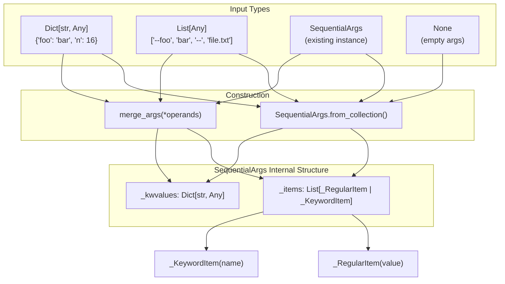
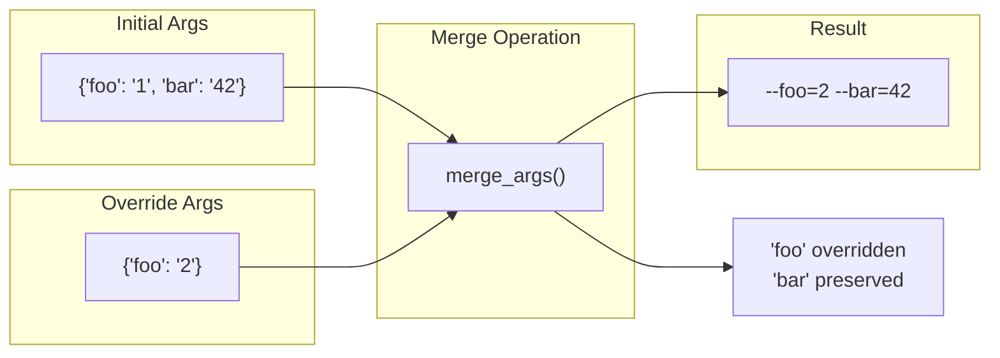
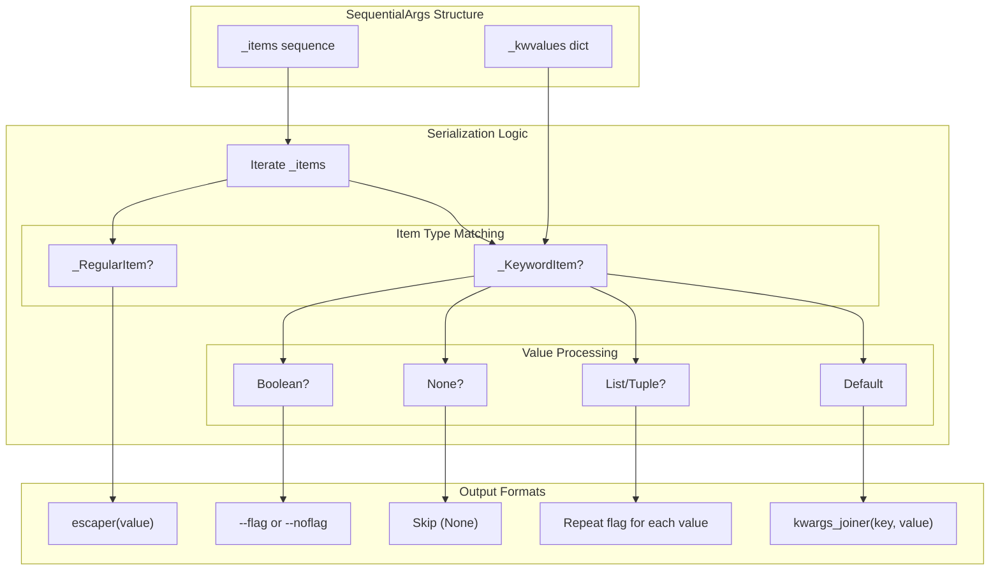
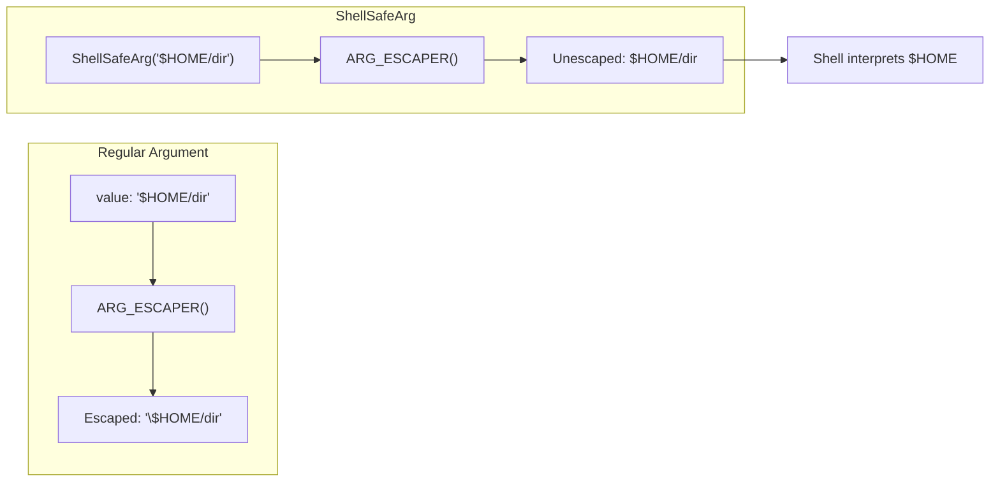
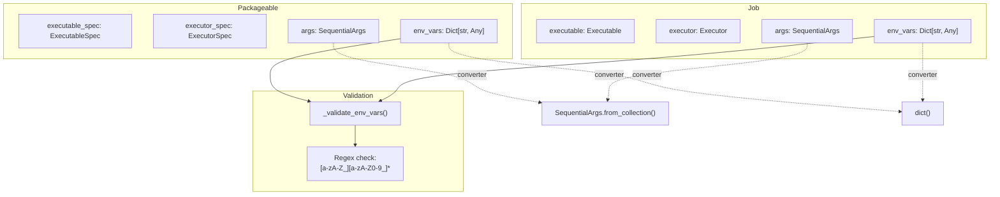
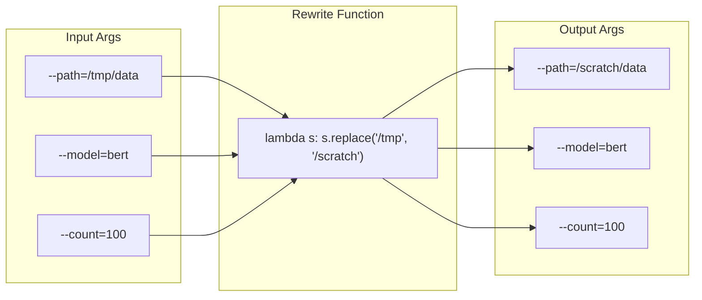
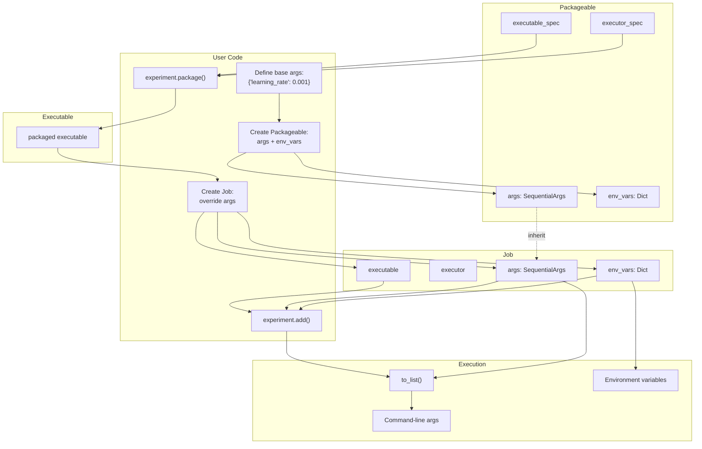

<!-- source: DeepWiki mcp.deepwiki.com · repo google-deepmind/xmanager · page 3.5 Arguments and Environment Variables · fetched 2026-10-26 -->

# Arguments and Environment Variables

<details>
<summary>Relevant source files</summary>

The following files were used as context for generating this wiki page:

- [xmanager/xm/executables.py](xmanager/xm/executables.py)
- [xmanager/xm/job_blocks.py](xmanager/xm/job_blocks.py)
- [xmanager/xm/job_blocks_test.py](xmanager/xm/job_blocks_test.py)
- [xmanager/xm/utils.py](xmanager/xm/utils.py)
- [xmanager/xm/utils_test.py](xmanager/xm/utils_test.py)

</details>


This page documents how XManager handles command-line arguments and environment variables for jobs. It covers the `SequentialArgs` class, argument merging semantics, shell-safe argument handling, and environment variable validation.

For information about how arguments are passed during job execution on different backends, see [Execution Backends](#5). For details on job configuration more broadly, see [Jobs and Job Groups](#3.2).

## Overview

XManager provides a flexible argument management system that supports:
- Multiple input formats (dictionaries, lists, and `SequentialArgs` objects)
- Keyword argument overriding semantics
- Shell-safe escaping and special argument types
- Environment variable validation
- Transformation operations on argument sets

The core abstraction is `SequentialArgs`, which represents a sequence of positional and keyword arguments that can be serialized to Unix command-line format.

Sources: [xmanager/xm/job_blocks.py:42-262]()

## SequentialArgs Class

### Construction and Input Formats

`SequentialArgs` can be constructed from multiple input formats through the `from_collection()` static method or the convenience function `merge_args()`.



**Dictionary Input**: Keys become keyword argument names, values are stored separately. Order is preserved.

```python
# {'foo': 'space bar', 'with_magic': True}
# becomes: --foo='space bar' --with_magic
```

**List Input**: Each element becomes a positional argument.

```python
# ['--foo', 'space bar']
# becomes: --foo 'space bar'
```

**Mixed Input via merge_args**: Combines multiple sources in order.

```python
# xm.merge_args({'foo': 'bar'}, ['--'], {'n': 16})
# becomes: --foo=bar -- --n=16
```

Sources: [xmanager/xm/job_blocks.py:42-134](), [xmanager/xm/job_blocks.py:264-271]()

### Merging Semantics

`SequentialArgs` provides override semantics for keyword arguments: when a keyword argument appears multiple times during merging, the latest value wins. Positional arguments are always appended.



This enables a pattern of specifying defaults and overriding them:

```python
# Default args
default_args = {'learning_rate': 0.001, 'batch_size': 32}

# Override for specific experiment
experiment_args = xm.merge_args(default_args, {'learning_rate': 0.01})
# Result: --learning_rate=0.01 --batch_size=32
```

The internal `_merge_from()` method handles the merging logic by iterating through items and updating keyword values when encountered.

Sources: [xmanager/xm/job_blocks.py:57-69](), [xmanager/xm/job_blocks.py:101-110](), [xmanager/xm/job_blocks_test.py:59-76]()

### Internal Structure

`SequentialArgs` maintains two internal data structures:

| Field | Type | Purpose |
|-------|------|---------|
| `_items` | `List[_RegularItem \| _KeywordItem]` | Preserves argument order |
| `_kwvalues` | `Dict[str, Any]` | Stores keyword argument values |

- `_RegularItem`: Wraps a positional argument value
- `_KeywordItem`: Stores only the keyword name (value looked up in `_kwvalues`)

This dual structure allows preserving insertion order while enabling efficient keyword argument updates.

Sources: [xmanager/xm/job_blocks.py:72-99]()

## Serialization

### to_list(): Command-Line Format

The `to_list()` method converts `SequentialArgs` to a list of strings suitable for subprocess execution.



**Boolean Values**: Converted to `--flag` or `--noflag` format:
```python
{'yes': True, 'no': False}
# becomes: ['--yes', '--nono']
```

**None Values**: Skipped with a warning, allowing binaries to use defaults:
```python
{'skip_me': None, 'pass_me': 'None'}
# becomes: ['--pass_me=None']
# Note: string "None" is passed, actual None is skipped
```

**List/Tuple Values**: Non-nested sequences are expanded to repeated flags (absl-style):
```python
{'c': [3, '4']}
# becomes: ['--c=3', '--c=4']

{'a': [[1, 2, 3]]}  # nested
# becomes: ['--a=[[1, 2, 3]]']  # quoted as single value
```

**Custom Escapers**: The `escaper` parameter defaults to `utils.ARG_ESCAPER` but can be customized:
```python
args.to_list(escaper=str)  # No shell quoting
args.to_list(escaper=repr)  # Python repr() quoting
```

Sources: [xmanager/xm/job_blocks.py:185-225](), [xmanager/xm/job_blocks_test.py:28-100]()

### to_dict(): Dictionary Format

The `to_dict()` method exports arguments as a dictionary:

```python
args = xm.merge_args(['--knob'], {1: False})
args.to_dict()
# Returns: {'--knob': True, '1': False}

args.to_dict(kwargs_only=True)
# Returns: {'1': False}  # Excludes positional args
```

When `kwargs_only=False` (default), positional arguments are included with their string representation as keys and `True` as values.

Sources: [xmanager/xm/job_blocks.py:227-252]()

## Shell Safety and Special Arguments

### ShellSafeArg

`ShellSafeArg` marks arguments that should not be shell-escaped, allowing shell substitutions like environment variable expansion.



**Usage Example**:
```python
from xmanager.xm import utils

args = xm.merge_args({
    'output_dir': utils.ShellSafeArg('$HOME/experiments'),
    'config_file': '/path/to/config.json'  # Will be escaped
})
```

**Important**: `ShellSafeArg` raises `RuntimeError` if used in f-strings to prevent accidental stripping of shell-safety semantics.

Sources: [xmanager/xm/utils.py:44-59](), [xmanager/xm/utils_test.py:46-49]()

### ARG_ESCAPER Function

The default argument escaper handles multiple value types:

| Input Type | Handling | Example |
|------------|----------|---------|
| `ShellSafeArg` | Return `.arg` unescaped | `$HOME/dir` → `$HOME/dir` |
| `enum.Enum` | Quote the `.name` attribute | `ResourceType.GPU` → `'GPU'` |
| Other | Quote using `shlex.quote()` | `"Jonny Droptable"` → `"'Jonny Droptable'"` |

The `shlex.quote()` function ensures shell metacharacters are properly escaped.

Sources: [xmanager/xm/utils.py:62-69](), [xmanager/xm/utils_test.py:41-44]()

## Environment Variables

### Validation Rules

Environment variable names are validated using the regex pattern `[a-zA-Z_][a-zA-Z0-9_]*`:

```python
def _validate_env_vars(
    self: Any, attribute: Any, env_vars: Dict[str, Any]
) -> None:
  for key in env_vars.keys():
    if not re.fullmatch('[a-zA-Z_][a-zA-Z0-9_]*', key):
      raise ValueError(
          'Environment variables names must conform to '
          f'[a-zA-Z_][a-zA-Z0-9_]*. Got {key!r}.'
      )
```

Valid names:
- Must start with letter or underscore
- Can contain letters, digits, underscores

Invalid examples:
- `"2fast"` (starts with digit)
- `"my-var"` (contains hyphen)
- `"hello world"` (contains space)

Sources: [xmanager/xm/job_blocks.py:351-361]()

### Usage in Job System

Environment variables are specified as dictionaries in `Packageable` and `Job` classes:



**Example**:
```python
job = xm.Job(
    executable=my_executable,
    executor=executor,
    args={'batch_size': 32},
    env_vars={
        'CUDA_VISIBLE_DEVICES': '0,1',
        'TF_CPP_MIN_LOG_LEVEL': '2',
        'MY_CUSTOM_VAR': 'value'
    }
)
```

Both `args` and `env_vars` use `attr.ib()` converters to automatically transform input:
- `args`: Converted via `SequentialArgs.from_collection()`
- `env_vars`: Converted via `dict()` and validated via `_validate_env_vars`

Sources: [xmanager/xm/job_blocks.py:364-375](), [xmanager/xm/job_blocks.py:397-422]()

## Advanced Operations

### rewrite_args()

The `rewrite_args()` method applies a transformation function to all string arguments:

```python
def rewrite_args(self, rewrite: Callable[[str], str]) -> 'SequentialArgs':
    """Applies the rewrite function to all args and returns the result."""
```



The method:
- Iterates through all `_items`
- Applies `rewrite()` only to string values
- Non-string values are preserved unchanged
- Returns a new `SequentialArgs` instance (immutable)

**Use Case**: Path substitution for different execution environments.

Sources: [xmanager/xm/job_blocks.py:136-157]()

### remove_args()

The `remove_args()` method removes specific arguments by name:

```python
args = xm.merge_args(
    {'fiddle': {'batch_size': 32}},
    [1],
    {'a': 'z', 'b': 'y'}
)
args = args.remove_args('fiddle')
# Result: ['1', '--a=z', '--b=y']
```

The method:
- Removes `_KeywordItem` matching the name
- Removes `_RegularItem` with matching string value
- Returns a new `SequentialArgs` instance

Sources: [xmanager/xm/job_blocks.py:159-183](), [xmanager/xm/job_blocks_test.py:126-138]()

## Integration with Job Definitions

### Argument Flow



**Typical Pattern**:

1. Define `Packageable` with common args/env_vars for packaging
2. Call `experiment.package()` to build executable
3. Create `Job` instances with executable and specific args
4. Merge args from `Packageable` and `Job` when needed
5. Serialize to command-line format during execution

Sources: [xmanager/xm/job_blocks.py:364-422]()

### get_args_for_all_jobs()

Utility function to apply the same arguments to all jobs in a `JobGroup`:

```python
def get_args_for_all_jobs(job: JobType, args: Dict[str, Any]) -> Dict[str, Any]:
```

This recursively generates a nested dictionary structure matching the `JobGroup` hierarchy:

```python
group = xm.JobGroup(
    learner=xm.Job(learner_exe, executor),
    actor=xm.JobGroup(
        worker1=xm.Job(actor_exe, executor),
        worker2=xm.Job(actor_exe, executor),
    )
)

args = get_args_for_all_jobs(group, {'logdir': '/tmp/logs'})
# Returns:
# {
#     'learner': {'args': {'logdir': '/tmp/logs'}},
#     'actor': {
#         'worker1': {'args': {'logdir': '/tmp/logs'}},
#         'worker2': {'args': {'logdir': '/tmp/logs'}},
#     }
# }
```

The result can be passed to `work_unit.add()` to apply args to all jobs.

Sources: [xmanager/xm/job_blocks.py:506-526](), [xmanager/xm/job_blocks_test.py:150-173]()

## Summary Table

| Feature | Class/Function | Key Capabilities |
|---------|----------------|------------------|
| Argument container | `SequentialArgs` | Order preservation, keyword overriding, immutability |
| Construction | `from_collection()` | Dict, list, None, existing SequentialArgs |
| Merging | `merge_args()` | Left-to-right with keyword override |
| Serialization | `to_list()` | Command-line format with escaping |
| Serialization | `to_dict()` | Dictionary format |
| Shell safety | `ShellSafeArg` | Bypass escaping for shell substitutions |
| Escaping | `ARG_ESCAPER` | Handles strings, enums, ShellSafeArg |
| Validation | `_validate_env_vars` | Regex `[a-zA-Z_][a-zA-Z0-9_]*` |
| Transformation | `rewrite_args()` | Apply function to string args |
| Filtering | `remove_args()` | Remove by name |
| Bulk operations | `get_args_for_all_jobs()` | Apply args to JobGroup recursively |

Sources: [xmanager/xm/job_blocks.py:1-527](), [xmanager/xm/utils.py:40-74]()

---

