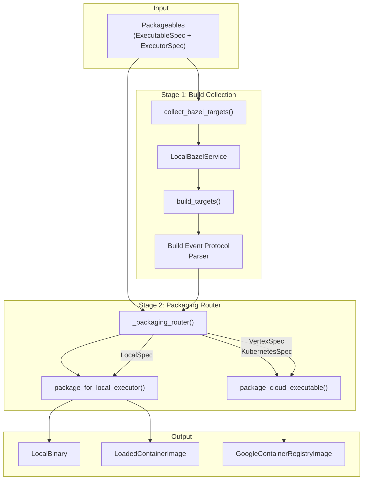
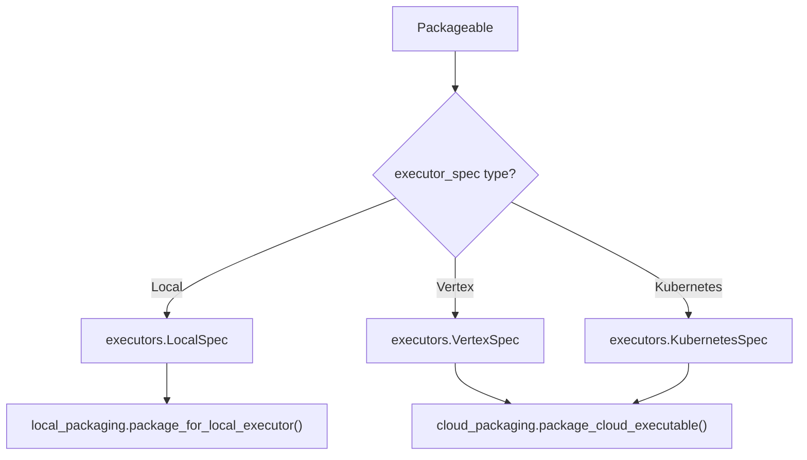
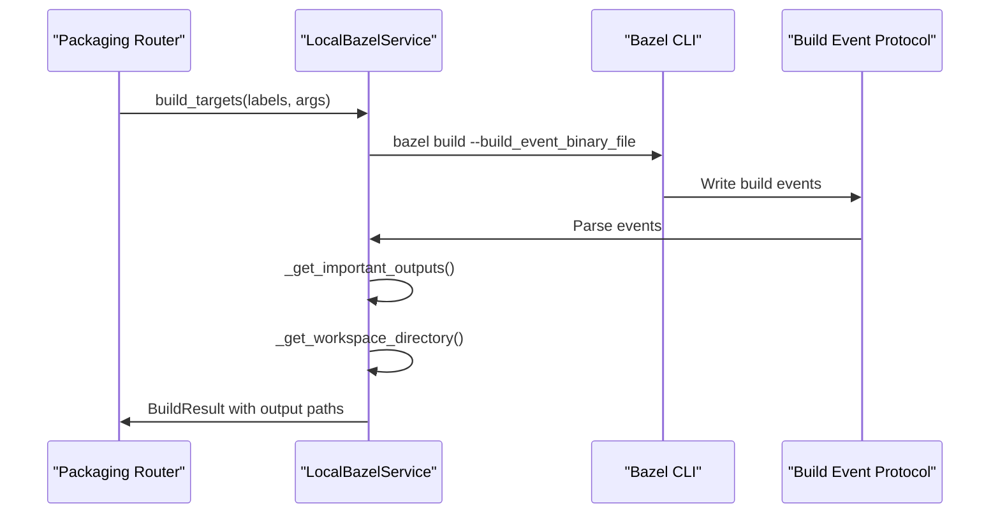
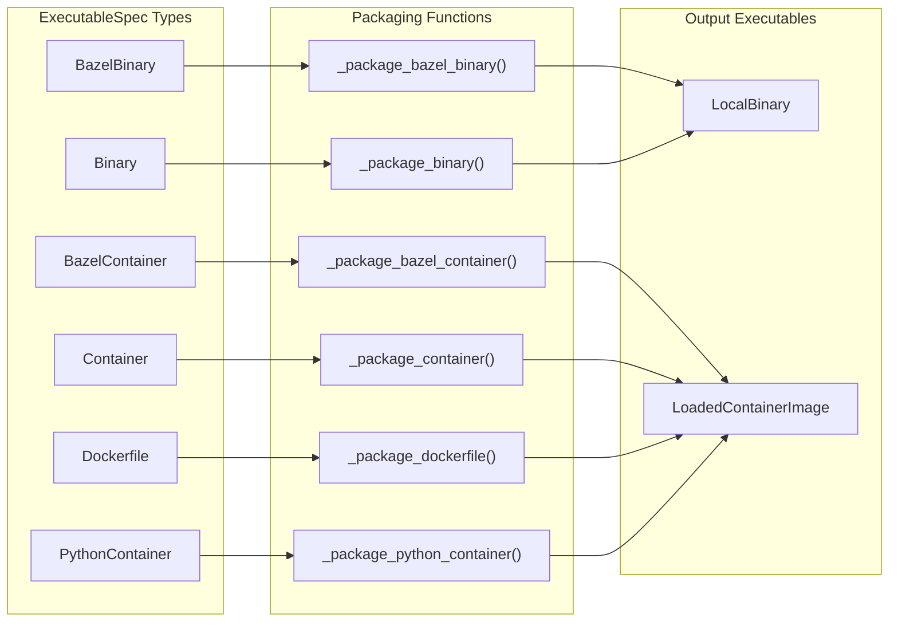
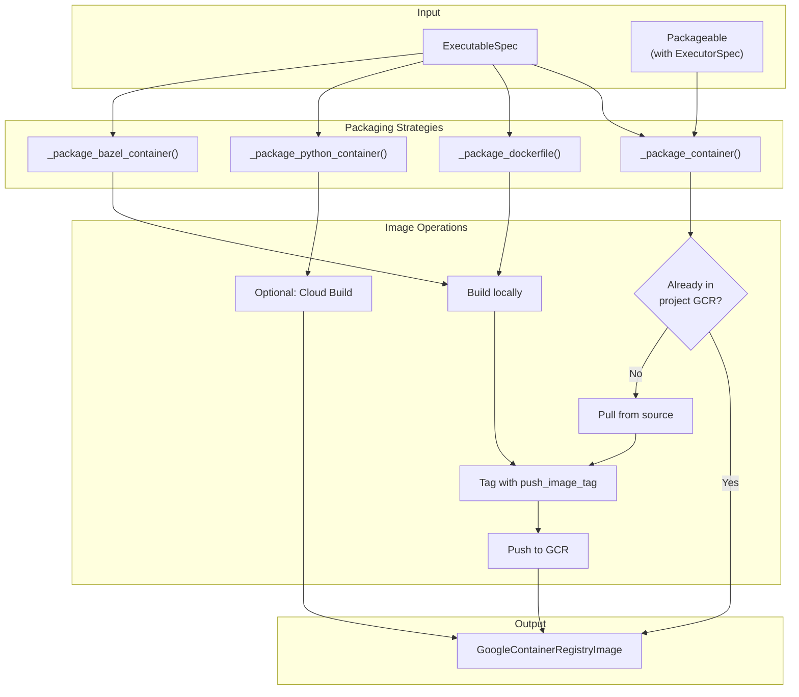
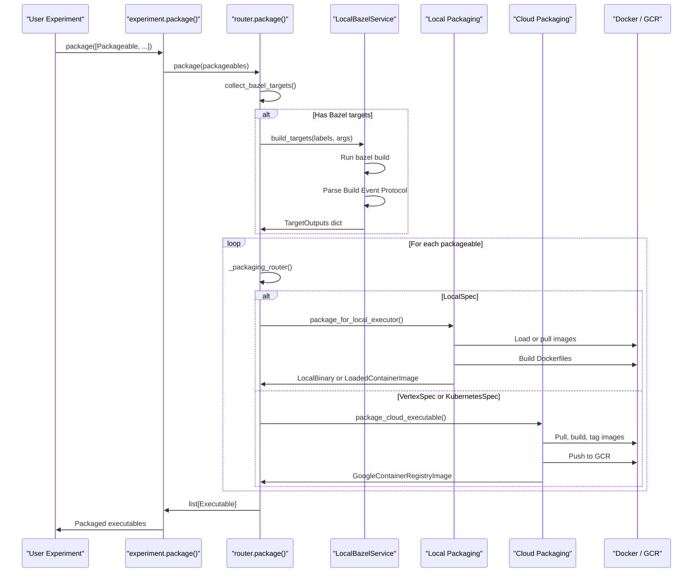

<!-- source: DeepWiki mcp.deepwiki.com · repo google-deepmind/xmanager · page 4 Packaging System · fetched 2026-10-26 -->

# Packaging System

<details>
<summary>Relevant source files</summary>

The following files were used as context for generating this wiki page:

- [xmanager/xm_local/executables.py](xmanager/xm_local/executables.py)
- [xmanager/xm_local/packaging/bazel_tools.py](xmanager/xm_local/packaging/bazel_tools.py)
- [xmanager/xm_local/packaging/bazel_tools_test.py](xmanager/xm_local/packaging/bazel_tools_test.py)
- [xmanager/xm_local/packaging/cloud.py](xmanager/xm_local/packaging/cloud.py)
- [xmanager/xm_local/packaging/local.py](xmanager/xm_local/packaging/local.py)
- [xmanager/xm_local/packaging/router.py](xmanager/xm_local/packaging/router.py)

</details>


## Purpose and Scope

The Packaging System is responsible for transforming abstract executable specifications ([`xm.ExecutableSpec`](#3.3)) into concrete, ready-to-run executables that can be launched on different execution backends. This system bridges the gap between what users define (Bazel targets, Dockerfiles, Python containers) and what executors need to actually run jobs (local binaries, loaded Docker images, or images in Google Container Registry).

The packaging system handles:
- Building Bazel targets and extracting their outputs
- Creating and managing Docker images
- Routing executables to appropriate packaging strategies based on target executor
- Producing backend-specific executable instances

For information about execution backends that consume these packaged executables, see [Execution Backends](#5). For details on defining executable specifications, see [Executable Specifications](#3.3).

---

## Architecture Overview

The packaging system follows a **two-stage translation pattern**: first, it collects and builds all Bazel targets in batches; second, it routes each packageable to an appropriate packaging strategy based on its target executor type.

### Packaging System Components



**Sources:** [xmanager/xm_local/packaging/router.py:1-84](), [xmanager/xm_local/packaging/bazel_tools.py:260-272]()

---

## Packaging Router

The packaging router is the entry point for the packaging system. It orchestrates the two-stage process and dispatches packageables to the appropriate packaging strategy.

### Router Implementation

The main entry point is the `package()` function in [xmanager/xm_local/packaging/router.py:59-83]():

| Function | Purpose | Returns |
|----------|---------|---------|
| `package(packageables)` | Main orchestration function | `list[xm.Executable]` |
| `_packaging_router(built_targets, packageable)` | Dispatches to local or cloud packaging | `xm.Executable` |
| `collect_bazel_targets(packageables)` | Extracts Bazel targets from packageables | `list[BazelTarget]` |

### Routing Logic



The router groups Bazel targets by their build arguments to enable batch building ([xmanager/xm_local/packaging/router.py:67-78]()):

```python
args_to_targets: _ArgsToTargets = collections.defaultdict(list)
for target in bazel_targets:
    args_to_targets[target.bazel_args].append(target)
```

This batching optimization reduces the number of Bazel invocations by building all targets with identical build arguments in a single command.

**Sources:** [xmanager/xm_local/packaging/router.py:27-84]()

---

## Bazel Integration

The Bazel integration system builds Bazel targets and extracts their output paths using the Build Event Protocol (BEP).

### LocalBazelService

The `LocalBazelService` class ([xmanager/xm_local/packaging/bazel_tools.py:190-224]()) implements the `BazelService` interface for local builds:

| Method | Purpose | Returns |
|--------|---------|---------|
| `fetch_kinds(labels)` | Queries Bazel for target rule types | `list[str]` |
| `build_targets(labels, bazel_args)` | Builds targets and returns outputs | `BuildResult[list[list[str]]]` |

### Build Process



### Build Event Protocol Parsing

The system writes build events to a temporary file and parses them to extract artifact paths ([xmanager/xm_local/packaging/bazel_tools.py:111-152]()):

```python
subprocess.run([
    xm_flags.BAZEL_COMMAND.value,
    'build',
    f'--build_event_binary_file={bep_path}',
    '--memory_profile=/dev/null',
    *labels,
    *bazel_args,
], check=True, cwd=_root_absolute_path())
```

The BEP parser extracts:
- **Important outputs**: Artifacts marked as important for each target ([xmanager/xm_local/packaging/bazel_tools.py:32-42]())
- **Normalized labels**: Expanded target labels after pattern resolution ([xmanager/xm_local/packaging/bazel_tools.py:45-56]())
- **Workspace directory**: Root directory for resolving relative paths ([xmanager/xm_local/packaging/bazel_tools.py:59-63]())

### Target Collection

The `collect_bazel_targets()` function ([xmanager/xm_local/packaging/bazel_tools.py:260-272]()) extracts Bazel targets from executable specs:

- `xm.BazelBinary` → Creates `BazelTarget` with label and args
- `xm.BazelContainer` → Creates `BazelTarget` with label and args
- Other specs → Returns empty list

**Sources:** [xmanager/xm_local/packaging/bazel_tools.py:1-275]()

---

## Local Packaging

Local packaging prepares executables for execution on the local machine. It loads Docker images into the local Docker daemon and validates binary paths.

### Supported ExecutableSpec Types



### Packaging Strategies by Type

| ExecutableSpec | Packaging Strategy | Output Type |
|----------------|-------------------|-------------|
| `BazelBinary` | Extract path from Bazel outputs | `LocalBinary` |
| `BazelContainer` | Load image tar from Bazel outputs | `LoadedContainerImage` |
| `Binary` | Validate path exists locally | `LocalBinary` |
| `Container` | Load from local tar or pull from registry | `LoadedContainerImage` |
| `Dockerfile` | Build with `docker build` | `LoadedContainerImage` |
| `PythonContainer` | Build optimized Python image | `LoadedContainerImage` |

### Key Implementation Details

**BazelBinary Packaging** ([xmanager/xm_local/packaging/local.py:125-143]()):
- Retrieves built artifact path from `bazel_outputs` dictionary
- Creates `LocalBinary` with command path and args

**Container Packaging** ([xmanager/xm_local/packaging/local.py:28-51]()):
- Checks if image path exists as local file: loads with `docker load`
- Otherwise checks if it's a registry label: pulls with `docker pull`
- Returns `LoadedContainerImage` with image ID

**Dockerfile Packaging** ([xmanager/xm_local/packaging/local.py:70-84]()):
- Builds image using `docker_lib.build_docker_image()`
- Returns `LoadedContainerImage` with generated image ID

**PythonContainer Packaging** ([xmanager/xm_local/packaging/local.py:87-100]()):
- Uses `build_image.build()` to create optimized Python runtime
- Image name derived from path basename
- Returns `LoadedContainerImage`

**Sources:** [xmanager/xm_local/packaging/local.py:1-173]()

---

## Cloud Packaging

Cloud packaging prepares executables for cloud execution backends (Vertex AI, Kubernetes). It pushes Docker images to Google Container Registry (GCR) to make them accessible to cloud services.

### Cloud Packaging Architecture



### Push Image Tag Resolution

Cloud packaging determines the target GCR image path using the following priority ([xmanager/xm_local/packaging/cloud.py:28-38]()):

1. **Explicit tag from ExecutorSpec**: If `push_image_tag` is set in `CaipSpec` or `KubernetesSpec`, use it
2. **Source already in project GCR**: If source image path starts with `gcr.io/{project}`, reuse it
3. **Auto-generated tag**: Create new tag in project GCR: `gcr.io/{project}/{repository}:{tag}`

### Container Packaging for Cloud

The `_package_container()` function ([xmanager/xm_local/packaging/cloud.py:41-103]()) handles pre-built container images:

**Optimization**: If the source image already points to the project's GCR and Docker isn't installed, skip pulling/pushing ([xmanager/xm_local/packaging/cloud.py:69-78]()):

```python
gcr_project_prefix = 'gcr.io/' + auth.get_project_name()
if (container.image_path.startswith(gcr_project_prefix)
    or not docker_lib.is_docker_installed()):
    return local_executables.GoogleContainerRegistryImage(...)
```

**Otherwise**, pull from source, tag, and push to GCR ([xmanager/xm_local/packaging/cloud.py:80-103]()):
- Pull image from source registry
- Tag with `push_image_tag`
- Push to project GCR
- This ensures cloud service agents have read permissions

### Dockerfile Packaging for Cloud

The `_package_dockerfile()` function ([xmanager/xm_local/packaging/cloud.py:106-132]()) builds Dockerfiles and pushes them:

- Uses `build_image.build_by_dockerfile()` with optional local Docker
- If Docker is installed: pulls base images and pushes result
- If Docker not installed: uses Cloud Build service
- Returns `GoogleContainerRegistryImage` with GCR path

### PythonContainer Packaging for Cloud

The `_package_python_container()` function ([xmanager/xm_local/packaging/cloud.py:135-155]()) creates optimized Python runtime images:

- Uses specialized `build_image.build()` for Python containers
- Supports optional local Docker (falls back to Cloud Build)
- Automatically pushes to GCR if Docker is available
- Returns `GoogleContainerRegistryImage`

### BazelContainer Packaging for Cloud

The `_package_bazel_container()` function ([xmanager/xm_local/packaging/cloud.py:158-186]()) handles Bazel-built container images:

- Retrieves tar file path from `bazel_outputs` dictionary
- Loads image into local Docker daemon
- Tags with `push_image_tag`
- Pushes to GCR
- Returns `GoogleContainerRegistryImage`

**Sources:** [xmanager/xm_local/packaging/cloud.py:1-224]()

---

## Output Executable Types

The packaging system produces three types of executables, defined in [xmanager/xm_local/executables.py:1-47]():

### LoadedContainerImage

```python
@attr.s(auto_attribs=True)
class LoadedContainerImage(xm.Executable):
    image_id: str
    args: xm.SequentialArgs
    env_vars: Dict[str, str]
```

Represents a container image loaded into the local Docker daemon. Used by the local executor to run containers.

**Usage**: Output from local packaging of any container-based executable.

### LocalBinary

```python
@attr.s(auto_attribs=True)
class LocalBinary(xm.Executable):
    command: str
    args: xm.SequentialArgs
    env_vars: Dict[str, str]
```

Represents a binary located on the local filesystem. Used by the local executor to run native processes.

**Usage**: Output from local packaging of `BazelBinary` or `Binary` specs.

### GoogleContainerRegistryImage

```python
@attr.s(auto_attribs=True)
class GoogleContainerRegistryImage(xm.Executable):
    image_path: str
    args: xm.SequentialArgs
    env_vars: Dict[str, str]
```

Represents a container image in Google Container Registry (GCR). Used by cloud executors (Vertex AI, Kubernetes) to access images.

**Usage**: Output from cloud packaging of all container-based executables.

**Sources:** [xmanager/xm_local/executables.py:1-47]()

---

## Packaging Flow: End-to-End

The complete packaging flow from experiment definition to ready-to-run executables:



### Typical Execution Patterns

| ExecutableSpec | Executor | Packaging Steps | Output |
|----------------|----------|-----------------|--------|
| `BazelBinary` | Local | Build with Bazel → Extract path | `LocalBinary` |
| `BazelContainer` | Local | Build with Bazel → Load into Docker | `LoadedContainerImage` |
| `BazelContainer` | Vertex | Build with Bazel → Load → Tag → Push to GCR | `GoogleContainerRegistryImage` |
| `PythonContainer` | Local | Build Python image → Load | `LoadedContainerImage` |
| `PythonContainer` | Vertex | Build Python image → Push to GCR | `GoogleContainerRegistryImage` |
| `Dockerfile` | Local | `docker build` → Local image | `LoadedContainerImage` |
| `Dockerfile` | Kubernetes | Build → Tag → Push to GCR | `GoogleContainerRegistryImage` |

**Sources:** [xmanager/xm_local/packaging/router.py:59-83](), [xmanager/xm_local/packaging/local.py:146-173](), [xmanager/xm_local/packaging/cloud.py:189-223]()

---

## Configuration and Optimization

### Bazel Build Optimization

The packaging system optimizes Bazel builds by:

1. **Batching by build args** ([xmanager/xm_local/packaging/router.py:67-78]()): Groups targets with identical `bazel_args` to minimize build invocations
2. **Build Event Protocol**: Uses BEP instead of parsing stdout for reliable output extraction
3. **Workspace caching**: Leverages Bazel's incremental build capabilities

### Docker Configuration

Docker operations respect the following flags (see [Configuration Flags](#6.1) for details):

- `BAZEL_COMMAND`: Bazel executable path
- Cloud build settings control whether to use local Docker or Cloud Build

### Label Validation

The Bazel integration validates labels using regex patterns ([xmanager/xm_local/packaging/bazel_tools.py:156-177]()):

- Absolute labels required: `//package:target`
- No expansions allowed: `...`, `*`, `:all`
- Supports dots in target names (e.g., `image.tar`)

**Sources:** [xmanager/xm_local/packaging/router.py:67-78](), [xmanager/xm_local/packaging/bazel_tools.py:156-177]()

---

