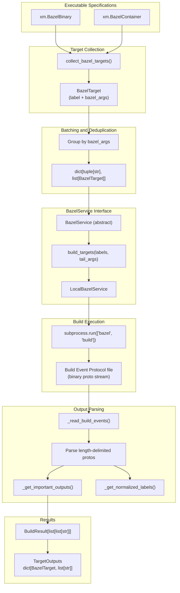
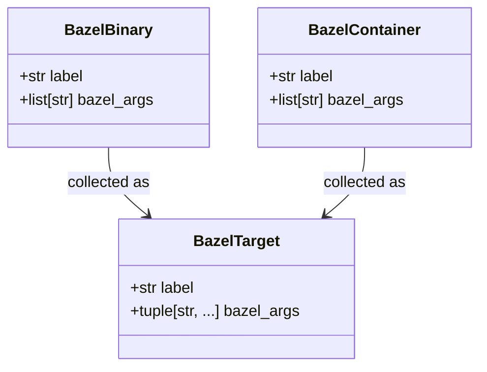
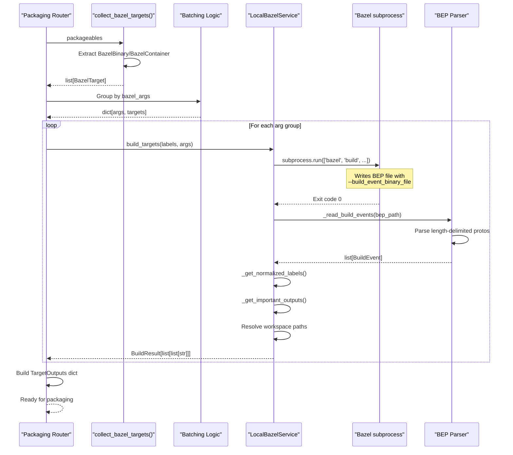
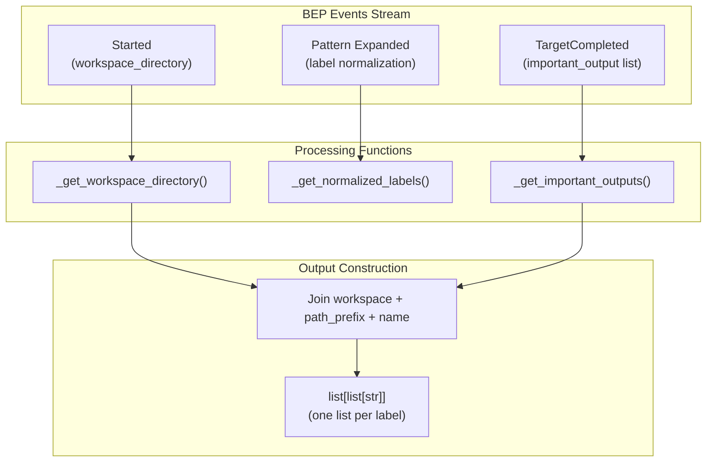

<!-- source: DeepWiki mcp.deepwiki.com · repo google-deepmind/xmanager · page 4.1 Bazel Integration · fetched 2026-10-26 -->

# Bazel Integration

<details>
<summary>Relevant source files</summary>

The following files were used as context for generating this wiki page:

- [xmanager/bazel/client.py](xmanager/bazel/client.py)
- [xmanager/xm_local/packaging/bazel_tools.py](xmanager/xm_local/packaging/bazel_tools.py)
- [xmanager/xm_local/packaging/bazel_tools_test.py](xmanager/xm_local/packaging/bazel_tools_test.py)
- [xmanager/xm_local/packaging/router.py](xmanager/xm_local/packaging/router.py)

</details>


## Purpose and Scope

This page documents XManager's Bazel integration system, which handles building Bazel targets and extracting their outputs. When users specify `xm.BazelBinary` or `xm.BazelContainer` executable specifications, the Bazel integration system builds these targets and provides their output paths to the packaging layer.

This page covers:
- The `BazelService` interface and its local implementation
- Build Event Protocol (BEP) parsing for output extraction
- Bazel label validation and normalization
- Target collection and batched building
- Integration with the packaging router

For information about how built targets are packaged for different executors, see [Local and Cloud Packaging](#4.3). For details on executable specifications themselves, see [Executable Specifications](#3.3).

---

## System Architecture

The Bazel integration system provides an abstraction layer between XManager's job definitions and the Bazel build system. It transforms `BazelBinary` and `BazelContainer` specifications into concrete filesystem paths by invoking Bazel builds and parsing their outputs.



**Sources**: [xmanager/bazel/client.py:1-69](), [xmanager/xm_local/packaging/bazel_tools.py:1-275](), [xmanager/xm_local/packaging/router.py:59-83]()

---

## Core Abstractions

### BazelService Interface

The `BazelService` abstract class defines the contract for Bazel operations. It provides a single method for building targets and returning their outputs.

| Class | Location | Purpose |
|-------|----------|---------|
| `BazelService` | [xmanager/bazel/client.py:37-55]() | Abstract interface for Bazel build operations |
| `LocalBazelService` | [xmanager/xm_local/packaging/bazel_tools.py:190-225]() | Local implementation using subprocess calls |

The `build_targets()` method signature:
```python
def build_targets(
    labels: Sequence[str],
    tail_args: Sequence[str]
) -> BuildResult[list[list[str]]]
```

This method builds the specified targets and returns a `BuildResult` where `resources[i]` contains the list of important output paths for `labels[i]`.

**Sources**: [xmanager/bazel/client.py:37-55]()

### BazelTarget

The `BazelTarget` dataclass represents a single Bazel target to be built, combining the label with its build arguments.



The `bazel_args` tuple is immutable and serves as a dictionary key for batching targets with identical build arguments. The converter function `_to_tuple()` ensures immutability at construction time.

**Sources**: [xmanager/bazel/client.py:58-69]()

### BuildResult

The `BuildResult` generic class wraps build outputs with optional build metadata:

| Field | Type | Description |
|-------|------|-------------|
| `resources` | `T` | The build outputs (typically `list[list[str]]` for paths) |
| `build_id` | `Optional[str]` | Unique identifier for the build invocation (e.g., Sponge ID) |

The generic parameter `T` allows different implementations to return different resource types. `LocalBazelService` returns `BuildResult[list[list[str]]]` where each inner list contains the important output paths for one target.

**Sources**: [xmanager/bazel/client.py:24-34]()

---

## Build Process Flow

The build process follows a multi-stage pipeline from target collection through BEP parsing to output extraction.



**Sources**: [xmanager/xm_local/packaging/router.py:59-83](), [xmanager/xm_local/packaging/bazel_tools.py:111-153]()

### Target Collection

The `collect_bazel_targets()` function extracts `BazelTarget` instances from executable specifications:

```python
def collect_bazel_targets(
    packageables: Sequence[xm.Packageable],
) -> list[client.BazelTarget]
```

It uses pattern matching to identify `BazelBinary` and `BazelContainer` specs, converting each to a `BazelTarget` with normalized bazel_args. Other executable types (e.g., `Container`, `PythonContainer`) return empty lists.

**Sources**: [xmanager/xm_local/packaging/bazel_tools.py:238-272]()

### Build Batching

The packaging router batches targets by their `bazel_args` to minimize Bazel invocations. This optimization is critical for experiments with many jobs sharing the same build configuration:

```python
args_to_targets: _ArgsToTargets = collections.defaultdict(list)
for target in bazel_targets:
    args_to_targets[target.bazel_args].append(target)

for args, targets in args_to_targets.items():
    outputs = bazel_service.build_targets(
        labels=tuple(target.label for target in targets),
        bazel_args=args,
    )
```

Each unique set of bazel_args results in one `bazel build` invocation, regardless of how many targets share those args.

**Sources**: [xmanager/xm_local/packaging/router.py:67-78]()

### Bazel Invocation

The `_build_multiple_targets()` function constructs and executes the Bazel command:

```python
subprocess.run(
    [
        xm_flags.BAZEL_COMMAND.value,
        'build',
        f'--build_event_binary_file={bep_path}',
        '--memory_profile=/dev/null',
        *labels,
        *bazel_args,
    ],
    check=True,
    cwd=_root_absolute_path(),
)
```

Key aspects:
- Uses `xm_flags.BAZEL_COMMAND.value` for configurable bazel binary path
- Writes BEP to temporary file via `--build_event_binary_file`
- Forces GC with `--memory_profile=/dev/null` to publish memory stats to BEP
- Executes in workspace root determined by `BUILD_WORKSPACE_DIRECTORY` or `bazel info workspace`

**Sources**: [xmanager/xm_local/packaging/bazel_tools.py:95-139]()

---

## Build Event Protocol Parsing

The Build Event Protocol (BEP) is Bazel's structured output format for build information. XManager uses BEP to extract output paths and normalized labels.

### BEP File Format

BEP files contain length-delimited `BuildEvent` protocol buffer messages. The format follows Java's `AbstractParser.parseDelimitedFrom` pattern:

```
[varint32 size][serialized message][varint32 size][serialized message]...
```

The `_read_build_events()` function implements this parsing logic:

```python
def _read_build_events(path: str) -> list[bes_pb2.BuildEvent]:
    with open(path, 'rb') as bep_file:
        buffer = bep_file.read()
        events = []
        position = 0
        while position < len(buffer):
            size, start = _DecodeVarint32(buffer, position)
            event = bes_pb2.BuildEvent()
            event.ParseFromString(buffer[start : start + size])
            events.append(event)
            position = start + size
        return events
```

**Sources**: [xmanager/xm_local/packaging/bazel_tools.py:66-92]()

### Important Output Extraction

The system extracts "important outputs" from `TargetCompleted` events in the BEP stream:



The `_get_important_outputs()` function builds a mapping from labels to their output files:

```python
def _get_important_outputs(
    events: Sequence[bes_pb2.BuildEvent], 
    labels: Sequence[str]
) -> list[list[bes_pb2.File]]:
    label_to_output: dict[str, list[bes_pb2.File]] = {}
    for event in events:
        if event.id.HasField('target_completed'):
            label_to_output[event.id.target_completed.label] = list(
                event.completed.important_output
            )
    return [label_to_output[label] for label in labels]
```

Output paths are constructed by joining the workspace directory with each file's `path_prefix` and `name` fields.

**Sources**: [xmanager/xm_local/packaging/bazel_tools.py:32-152]()

### Label Normalization

Bazel can transform labels during evaluation (e.g., expanding patterns or resolving defaults). The BEP stream includes `Pattern` events that map original labels to their canonical forms:

```python
def _get_normalized_labels(
    events: Sequence[bes_pb2.BuildEvent],
    labels: Sequence[str]
) -> list[str]:
    label_to_expansion: dict[str, str] = {}
    for event in events:
        if event.id.HasField('pattern'):
            for index, pattern in enumerate(event.id.pattern.pattern):
                label_to_expansion[pattern] = event.children[
                    index
                ].target_configured.label
    return [label_to_expansion[label] for label in labels]
```

This ensures the system uses canonical labels when looking up outputs, even if users provided shorthand forms.

**Sources**: [xmanager/xm_local/packaging/bazel_tools.py:45-56]()

---

## Label Validation and Parsing

XManager validates and normalizes Bazel labels before building them. This ensures consistent handling and prevents invalid labels from reaching Bazel.

### Label Syntax

Valid labels must be absolute (start with `//`) and cannot contain expansions like `...` or `*`:

| Pattern | Valid | Example |
|---------|-------|---------|
| Full label | ✓ | `//project/directory:target` |
| Short form | ✓ | `//project/package` (target = package name) |
| Root target | ✓ | `//:target` |
| With dots | ✓ | `//project:binary.tar` (extension in target name) |
| Relative | ✗ | `a/b:c` |
| Expansion | ✗ | `//project/...` |
| Wildcard | ✗ | `//project:*` |
| `:all` | ✗ | `//project:all` |

**Sources**: [xmanager/xm_local/packaging/bazel_tools.py:155-183](), [xmanager/xm_local/packaging/bazel_tools_test.py:1-78]()

### Label Lexer

The `_lex_label()` function parses labels into package path and target name components:

```python
_NAME_RE = r'(?:[^.*:/]|\.(?!\.\.))+'
_LABEL_LEXER = re.compile(
    f'^//(?P<packages>{_NAME_RE}(/{_NAME_RE})*)?(?P<target>:{_NAME_RE})?$'
)

def _lex_label(label: str) -> _LexedLabel:
    match = _LABEL_LEXER.match(label)
    if match is None:
        raise ValueError(f'{label} is not an absolute Bazel label')
    # ... validation and parsing logic
```

The regex ensures:
- Label starts with `//`
- Package path contains valid name segments (no `.`, `*`, `:`, `/` mid-segment)
- Target name (if present) starts with `:`
- Dots are allowed only when not forming `..` or `...`

**Sources**: [xmanager/xm_local/packaging/bazel_tools.py:155-177]()

### Label Assembly

After lexing, labels can be reassembled into canonical form:

```python
def _assemble_label(parts: _LexedLabel) -> str:
    init, last = parts
    return f"//{'/'.join(init)}:{last}"
```

This ensures all labels use the explicit `//package:target` syntax, even if originally specified as shorthand `//package`.

**Sources**: [xmanager/xm_local/packaging/bazel_tools.py:180-182]()

---

## Kind Querying

The `LocalBazelService.fetch_kinds()` method determines the rule type (kind) of Bazel targets without building them:

```python
def fetch_kinds(self, labels: Sequence[str]) -> list[str]:
    stdout = subprocess.run(
        [
            xm_flags.BAZEL_COMMAND.value,
            'query',
            f"'{' union '.join(labels)}'",
            '--output',
            'label_kind',
        ],
        check=True,
        stdout=subprocess.PIPE,
        cwd=_root_absolute_path(),
    ).stdout.decode('utf-8')
    # Parse output lines like "py_binary rule //package:target"
```

This is used to validate that specified targets match expected rule types (e.g., verifying a `BazelContainer` points to a container image target).

**Sources**: [xmanager/xm_local/packaging/bazel_tools.py:193-215]()

---

## Integration with Packaging Router

The Bazel integration system is invoked by the packaging router during the packaging phase:

```mermaid
graph LR
    subgraph "Input"
        Packageables["list[xm.Packageable]"]
    end
    
    subgraph "Collection Phase"
        CollectTargets["collect_bazel_targets()"]
        BazelTargets["list[BazelTarget]"]
    end
    
    subgraph "Build Phase"
        BatchByArgs["Group by bazel_args"]
        LocalBazelService["local_bazel_service()"]
        BuildTargets["build_targets()"]
    end
    
    subgraph "Output Phase"
        BuiltTargets["TargetOutputs<br/>dict[BazelTarget, list[str]]"]
        PackagingRouter["_packaging_router()"]
    end
    
    subgraph "Per-Executor Packaging"
        LocalPackaging["package_for_local_executor()"]
        CloudPackaging["package_cloud_executable()"]
    end
    
    Packageables --> CollectTargets
    CollectTargets --> BazelTargets
    BazelTargets --> BatchByArgs
    BatchByArgs --> LocalBazelService
    LocalBazelService --> BuildTargets
    BuildTargets --> BuiltTargets
    
    BuiltTargets --> PackagingRouter
    Packageables --> PackagingRouter
    
    PackagingRouter --> LocalPackaging
    PackagingRouter --> CloudPackaging
```



The `package()` function in the router orchestrates this flow:

1. **Collection**: Extract all `BazelTarget` instances from packageables
2. **Batching**: Group targets by their `bazel_args` tuples
3. **Building**: Invoke `build_targets()` for each arg group
4. **Aggregation**: Combine results into `TargetOutputs` dictionary
5. **Routing**: Pass built targets to executor-specific packaging functions

The `TargetOutputs` dictionary maps each `BazelTarget` to its list of output paths, which the packaging functions use to locate binaries or container images.

**Sources**: [xmanager/xm_local/packaging/router.py:59-83](), [xmanager/xm_local/packaging/bazel_tools.py:260-275]()

---

## Configuration

Bazel integration behavior is controlled by configuration flags:

| Flag | Purpose | Default |
|------|---------|---------|
| `xm_flags.BAZEL_COMMAND` | Path to bazel binary | `"bazel"` |

The `_root_absolute_path()` function determines the workspace root by checking:
1. `BUILD_WORKSPACE_DIRECTORY` environment variable (set by `bazel run`)
2. `bazel info workspace` command output (for CLI launches)

This ensures builds execute in the correct workspace context regardless of how the launcher script is invoked.

**Sources**: [xmanager/xm_local/packaging/bazel_tools.py:95-108]()

---

## Summary

XManager's Bazel integration provides a structured interface for building Bazel targets and extracting their outputs. The key components are:

- **`BazelService`**: Abstract interface with `LocalBazelService` implementation
- **Build batching**: Groups targets by `bazel_args` to minimize Bazel invocations  
- **BEP parsing**: Extracts output paths from Build Event Protocol stream
- **Label validation**: Ensures labels are well-formed before building
- **Packaging integration**: Provides built artifacts to executor-specific packagers

This design decouples Bazel operations from packaging logic, enabling consistent target handling across local and cloud execution environments.

---

