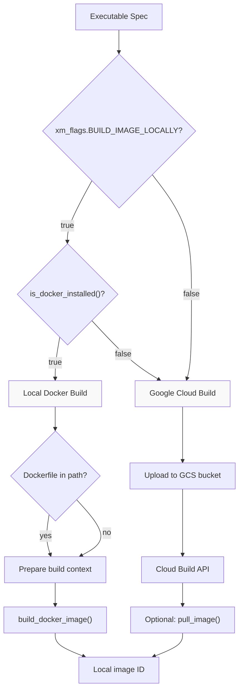
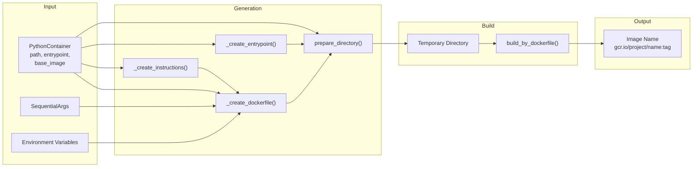
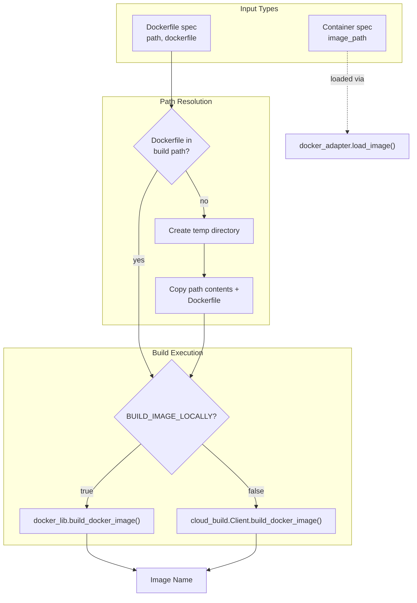
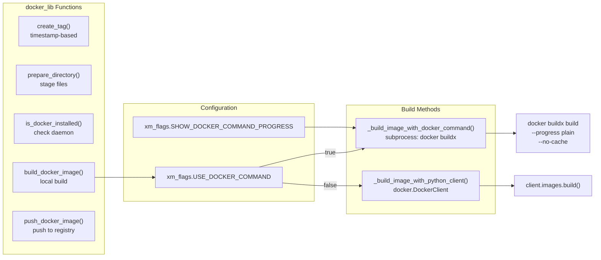
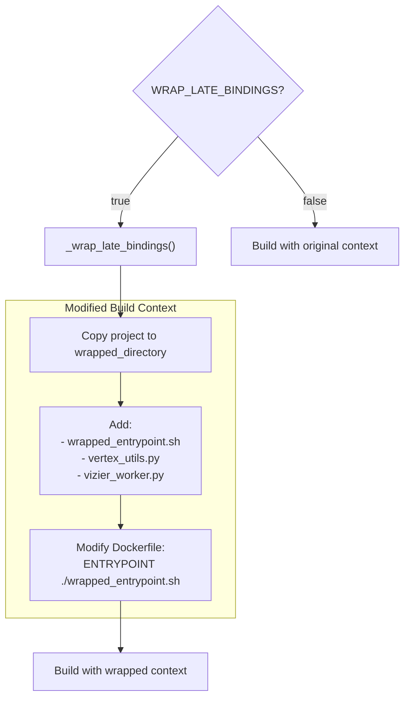
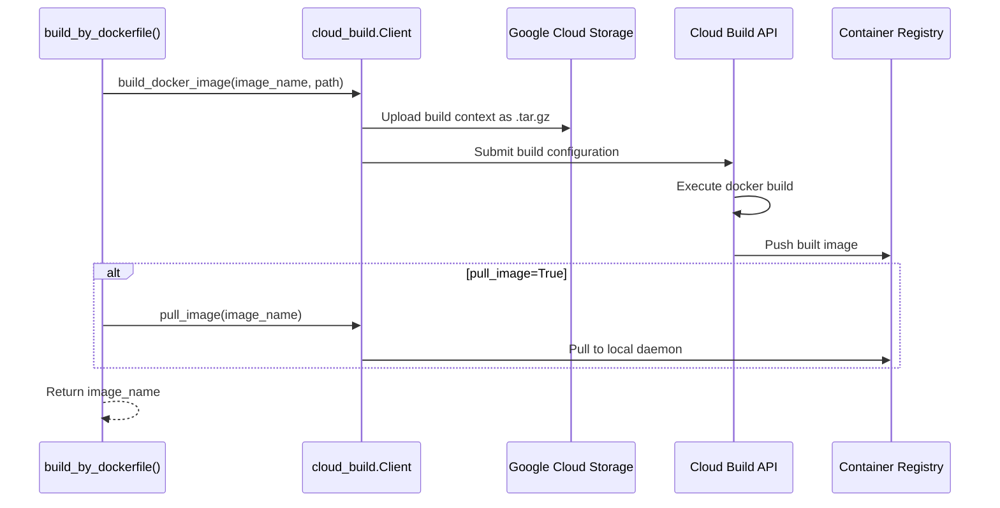

<!-- source: DeepWiki mcp.deepwiki.com · repo google-deepmind/xmanager · page 4.2 Docker Image Building · fetched 2026-10-26 -->

# Docker Image Building

<details>
<summary>Relevant source files</summary>

The following files were used as context for generating this wiki page:

- [xmanager/cloud/build_image.py](xmanager/cloud/build_image.py)
- [xmanager/cloud/docker_lib.py](xmanager/cloud/docker_lib.py)
- [xmanager/docker/docker_adapter.py](xmanager/docker/docker_adapter.py)
- [xmanager/xm/executables.py](xmanager/xm/executables.py)
- [xmanager/xm/utils.py](xmanager/xm/utils.py)
- [xmanager/xm/utils_test.py](xmanager/xm/utils_test.py)

</details>


This page documents XManager's Docker image building system, which transforms executable specifications into runnable container images. The system supports multiple build strategies including local Docker builds, Cloud Build, and pre-built image loading.

For information about how these images are used during execution, see [Local Executor](#5.1), [Vertex AI Executor](#5.2), and [Kubernetes Executor](#5.3). For details on image packaging for different backends, see [Local and Cloud Packaging](#4.3).

---

## Build Strategies

XManager provides two primary strategies for building Docker images: **local building** and **Cloud Build**. The choice between these strategies is controlled by configuration flags and runtime detection of Docker availability.



**Build Strategy Selection**: [xmanager/cloud/build_image.py:137-164]()

The system attempts local building first if `BUILD_IMAGE_LOCALLY` is enabled and Docker is installed. If Docker is unavailable, it automatically falls back to Cloud Build with a warning message.

| Strategy | Requirements | Use Case | Output Location |
|----------|--------------|----------|----------------|
| **Local Docker** | Docker Engine 20.10+ | Development, fast iteration | Local Docker daemon |
| **Cloud Build** | GCP project, GCS bucket | No local Docker, CI/CD pipelines | Google Container Registry |

**Sources**: [xmanager/cloud/build_image.py:137-164](), [xmanager/cloud/docker_lib.py:73-92]()

---

## PythonContainer Image Building

The `PythonContainer` executable specification is transformed into a Docker image through a multi-stage process that generates a Dockerfile, creates an entrypoint script, and builds the image.



**PythonContainer Build Process**: [xmanager/cloud/build_image.py:65-112]()

### Dockerfile Generation

The Dockerfile is generated from a template that includes:

1. **Base Image Selection**: Uses `PythonContainer.base_image` or defaults to `gcr.io/deeplearning-platform-release/base-cu110` [xmanager/cloud/build_image.py:33-34]()
2. **User Creation**: Creates a user with UID 1000 for non-root execution [xmanager/cloud/build_image.py:37]()
3. **Custom Instructions**: Either user-provided `docker_instructions` or generated default steps [xmanager/cloud/build_image.py:184-196]()
4. **Entrypoint Configuration**: Copies and configures the entrypoint script [xmanager/cloud/build_image.py:41-44]()

**Dockerfile Template**: [xmanager/cloud/build_image.py:34-45]()

### Default Build Steps

When custom `docker_instructions` are not provided, the system generates default steps that follow Docker best practices:

```python
# From default_steps() function
[
  'ENV LANG=C.UTF-8',
  'RUN apt-get update && apt-get install -y git netcat',
  'RUN python -m pip install --upgrade pip',
  'COPY {directory}/requirements.txt {project_dir}/requirements.txt',
  'RUN python -m pip install -r {directory}/requirements.txt',
  'COPY {directory}/ {project_dir}',
  'RUN chown -R 1000:root {project_dir} && chmod -R 775 {project_dir}',
]
```

**Key Features**:
- Late copying of project directory for optimal Docker layer caching
- Separate requirements.txt installation step
- Proper ownership and permissions for multi-user environments
- Support for `use_deep_module` flag to configure working directory structure [xmanager/cloud/build_image.py:204-215]()

**Default Steps Implementation**: [xmanager/cloud/build_image.py:199-245]()

### Entrypoint Script Generation

The entrypoint script handles runtime configuration and command execution:

```bash
#!/bin/bash

# TPU detection and configuration
if [[ ! -z "$KUBE_GOOGLE_CLOUD_TPU_ENDPOINTS" ]]; then
  TPU_IP_AND_PORT="${KUBE_GOOGLE_CLOUD_TPU_ENDPOINTS:7}"
  TPU_ADDRESS="$(cut -d':' -f1 <<< "$TPU_IP_AND_PORT")"
  export TPU_ADDRESS
  # Wait for TPU readiness
  while ! nc -z $TPU_ADDRESS 8470 ; do sleep 5 ; done
  export XRT_TPU_CONFIG="tpu_worker;0;$TPU_IP_AND_PORT"
fi

{cmds}  # User commands inserted here
```

The entrypoint supports two modes:
- **ModuleName**: Executes `python -m {module_name}` [xmanager/cloud/build_image.py:269-270]()
- **CommandList**: Executes user-specified shell commands [xmanager/cloud/build_image.py:271-273]()

Arguments are automatically appended using `"$@"` syntax [xmanager/cloud/build_image.py:279-281]().

**Entrypoint Template**: [xmanager/cloud/build_image.py:47-62](), **Command Generation**: [xmanager/cloud/build_image.py:267-283]()

**Sources**: [xmanager/cloud/build_image.py:65-112](), [xmanager/cloud/build_image.py:184-245](), [xmanager/cloud/build_image.py:248-283]()

---

## Dockerfile Executable Building

The `Dockerfile` executable specification enables building from an existing Dockerfile without generating one. This is used for both explicit `Dockerfile` specs and pre-built `Container` specs that need to be loaded or pushed.



**Dockerfile Building**: [xmanager/cloud/build_image.py:115-164]()

The `build_by_dockerfile()` function handles path normalization to ensure the Dockerfile is properly positioned relative to the build context. If the Dockerfile is not a direct child of the build path, it creates a temporary directory combining both [xmanager/cloud/build_image.py:150-156]().

**Sources**: [xmanager/cloud/build_image.py:115-164]()

---

## Docker Library Utilities

The `docker_lib` module provides low-level Docker operations used by the build system.



### Directory Preparation

The `prepare_directory()` function stages all necessary files for the Docker build:

1. Copies source directory to `{destination}/{project_name}/`
2. Places `Dockerfile` at `{destination}/Dockerfile`
3. Places `entrypoint.sh` at `{destination}/entrypoint.sh`
4. Validates total size and warns if exceeding 200MB [xmanager/cloud/docker_lib.py:52-63]()

**Size Validation**: Large images negatively impact build times, so the system provides feedback to users about excessive payload sizes.

**Directory Staging**: [xmanager/cloud/docker_lib.py:34-70]()

### Local Build Methods

XManager supports two methods for local Docker builds:

#### Docker Command Method (Default)

Invokes `docker buildx build` as a subprocess with BuildKit enabled:

```python
command = [
    'docker', 'buildx', 'build',
    '-t', f'{repository}:{tag}',
    '-t', f'{repository}:latest',
    '-f', dockerfile,
    path,
]
```

**Requirements**: Docker Engine 20.10+ for BuildKit support [xmanager/cloud/docker_lib.py:147-151]()

**Advantages**:
- Better build progress reporting
- Native BuildKit features
- Consistent with command-line usage

**Docker Command Build**: [xmanager/cloud/docker_lib.py:139-176]()

#### Python Client Method

Uses the Docker Python SDK directly via `client.images.build()`. This method is simpler but provides less control over build options [xmanager/cloud/docker_lib.py:179-199]().

**Sources**: [xmanager/cloud/docker_lib.py:34-70](), [xmanager/cloud/docker_lib.py:95-199]()

---

## Image Management Operations

### Image Naming and Tagging

Images are automatically named and tagged using the following scheme:

```python
# From _get_image_name()
image_name = os.path.basename(py_executable.path)
project_name = auth.get_project_name()
tag = docker_lib.create_tag()  # Format: YYYYMMDD-HHMMSS-microseconds
return f'gcr.io/{project_name}/{image_name}:{tag}'
```

**Timestamp Tags**: [xmanager/cloud/docker_lib.py:30-31]() - Ensures unique, chronologically sortable image versions.

**Image Naming**: [xmanager/cloud/build_image.py:171-175]()

### Pushing Images

The `push()` function pushes built images to Google Container Registry:

```python
def push(image: str) -> str:
  return docker_lib.push_docker_image(image)
```

The push operation:
1. Pushes the specific tag (e.g., `gcr.io/project/image:20231215-143022-123456`)
2. Also pushes the `:latest` tag to the same image [xmanager/cloud/docker_lib.py:134]()
3. Validates the push response for digest confirmation [xmanager/cloud/docker_lib.py:127-132]()

**Push Implementation**: [xmanager/cloud/docker_lib.py:121-136](), [xmanager/cloud/build_image.py:167-168]()

### Loading and Pulling Images

The `DockerAdapter` class provides methods for loading pre-built images:

| Method | Purpose | Input | Output |
|--------|---------|-------|--------|
| `load_image(path)` | Load `.tar` image from disk | File path | Image ID |
| `pull_image(image_tag)` | Pull from registry | Image tag | Image ID |
| `is_registry_label(label)` | Check if label exists in registry | Image label | Boolean |

**Load Image**: [xmanager/docker/docker_adapter.py:73-78]() - Loads a single image from a tar file and validates that exactly one image is present.

**Pull Image**: [xmanager/docker/docker_adapter.py:67-71]() - Automatically appends `:latest` tag if no tag is specified to avoid pulling all tags.

**Sources**: [xmanager/docker/docker_adapter.py:67-78](), [xmanager/cloud/docker_lib.py:121-136]()

---

## Late Binding Wrapper

When `xm_flags.WRAP_LATE_BINDINGS` is enabled, the build system wraps the entrypoint to support dynamic parameter resolution at runtime. This is primarily used for distributed training where job addresses are only known after job launch.



**Wrapper Mechanism**:
1. Copies the Python project to a new directory [xmanager/cloud/build_image.py:323-324]()
2. Injects wrapper utilities from `xmanager/cloud/data/wrapped_entrypoint.sh` [xmanager/cloud/build_image.py:328-339]()
3. Modifies the Dockerfile to use `wrapped_entrypoint.sh` instead of `entrypoint.sh` [xmanager/cloud/build_image.py:347-354]()

**Late Binding Wrapper**: [xmanager/cloud/build_image.py:305-354]()

**Sources**: [xmanager/cloud/build_image.py:96-112](), [xmanager/cloud/build_image.py:305-354]()

---

## Configuration Flags

Docker image building behavior is controlled by several configuration flags:

| Flag | Type | Purpose | Default |
|------|------|---------|---------|
| `BUILD_IMAGE_LOCALLY` | Boolean | Enable local Docker builds | Platform-dependent |
| `USE_DOCKER_COMMAND` | Boolean | Use `docker buildx` vs Python client | `True` |
| `SHOW_DOCKER_COMMAND_PROGRESS` | Boolean | Show build progress with `--progress plain` | `False` |
| `WRAP_LATE_BINDINGS` | Boolean | Enable runtime parameter resolution | Platform-dependent |

**Progress Display**: When enabled, the `--progress plain` and `--no-cache` flags are added to the Docker command to show detailed build output [xmanager/cloud/docker_lib.py:170-172]().

For comprehensive flag documentation, see [Configuration Flags](#6.1).

**Sources**: [xmanager/cloud/build_image.py:137-145](), [xmanager/cloud/docker_lib.py:99-114](), [xmanager/cloud/docker_lib.py:170-172]()

---

## Integration with Cloud Build

When local Docker is unavailable or explicitly disabled, XManager delegates to Google Cloud Build:



**Cloud Build Process**:
1. Upload the build context to a GCS bucket as a compressed archive
2. Submit a build configuration to Cloud Build API
3. Cloud Build executes the Dockerfile
4. Resulting image is pushed to GCR
5. Optionally pull the image back to local Docker daemon [xmanager/cloud/build_image.py:158-163]()

**Cloud Build Client**: [xmanager/cloud/build_image.py:158-164]()

For more details on cloud packaging and GCR integration, see [Local and Cloud Packaging](#4.3).

**Sources**: [xmanager/cloud/build_image.py:158-164]()

---

