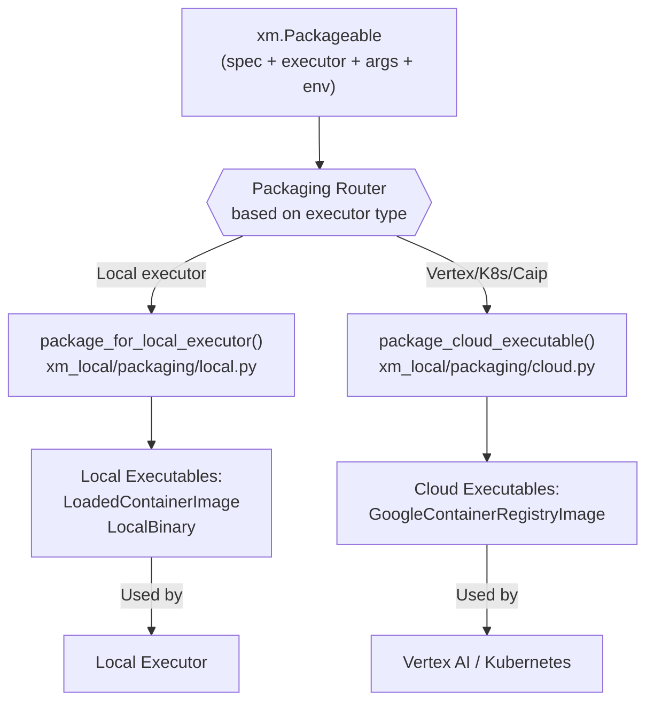
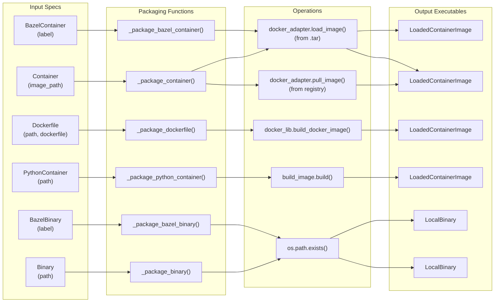
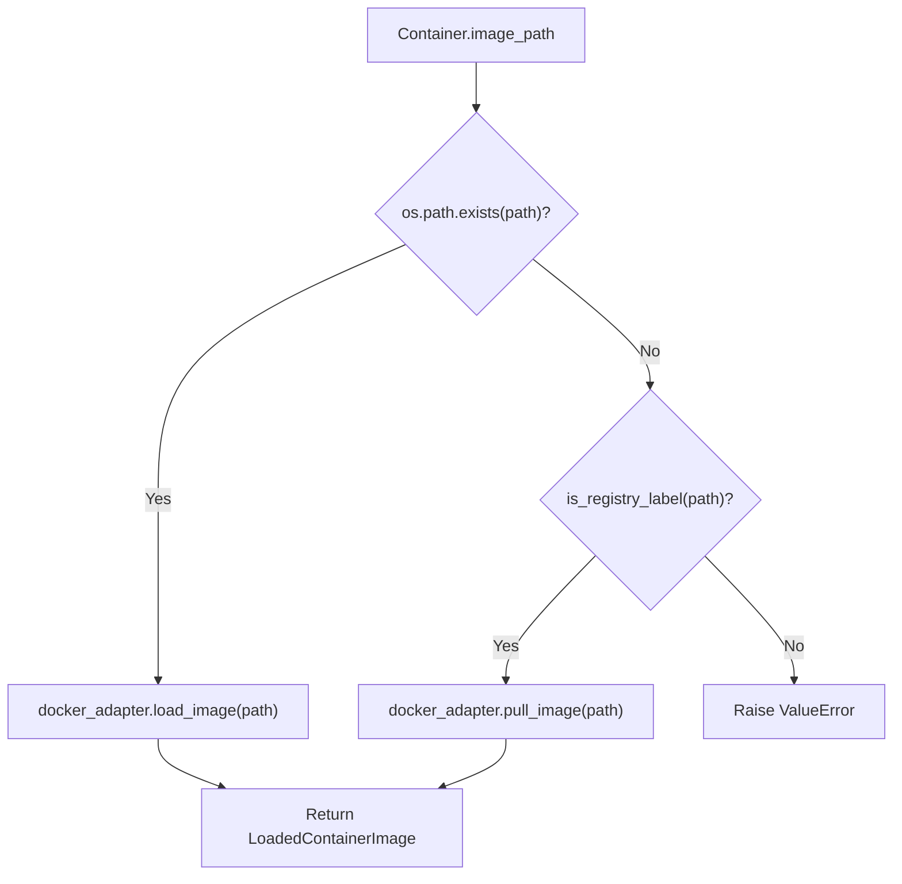
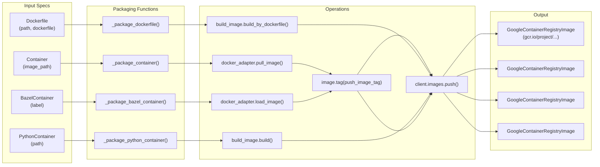
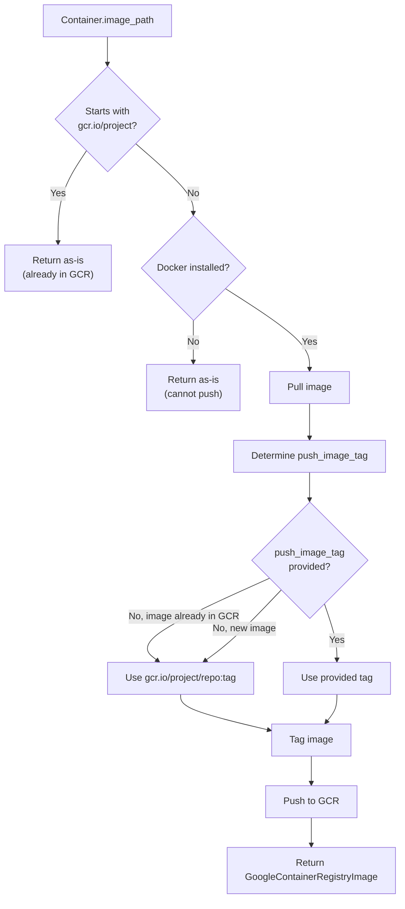
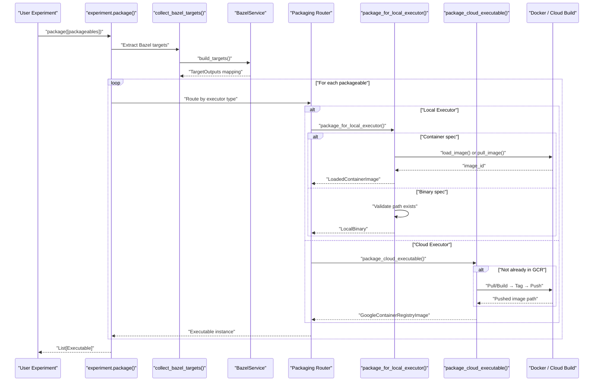
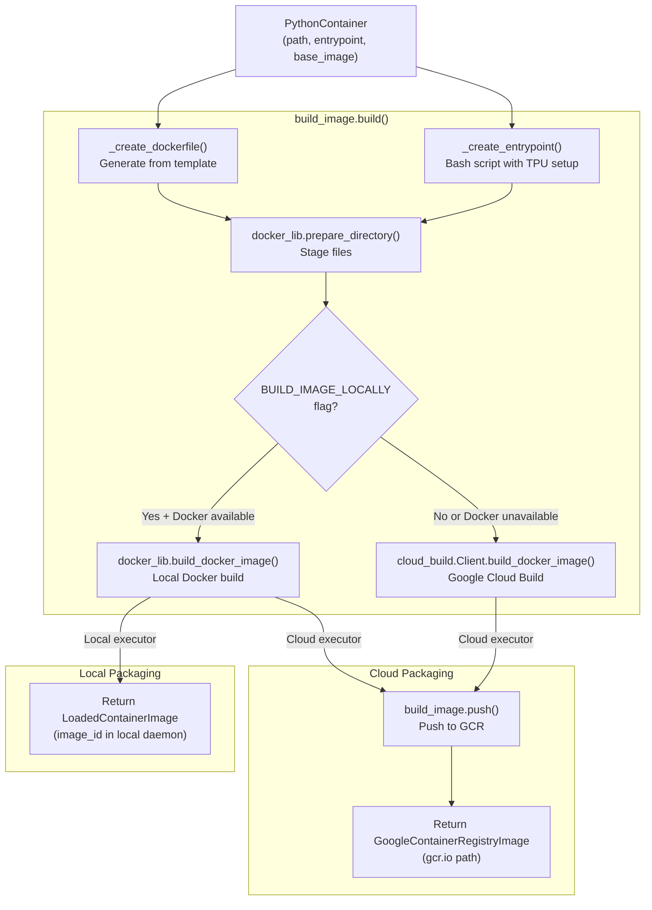
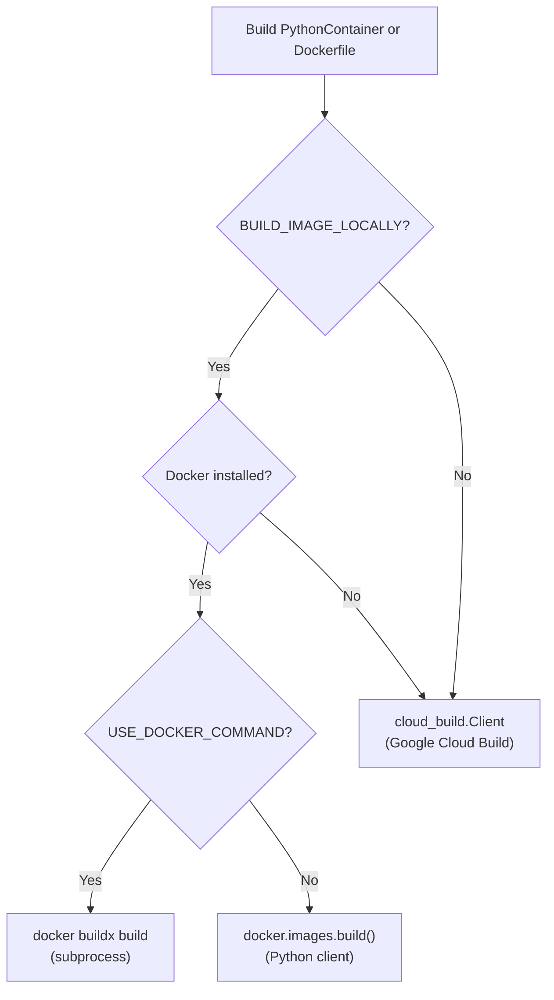
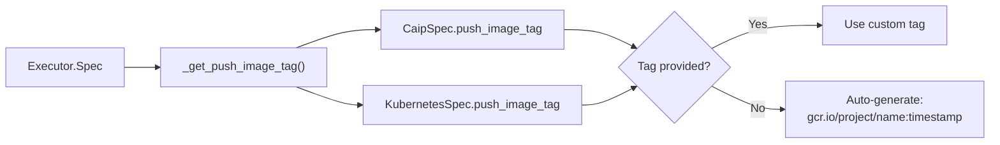

<!-- source: DeepWiki mcp.deepwiki.com · repo google-deepmind/xmanager · page 4.3 Local and Cloud Packaging · fetched 2026-10-26 -->

# Local and Cloud Packaging

<details>
<summary>Relevant source files</summary>

The following files were used as context for generating this wiki page:

- [xmanager/cloud/build_image.py](xmanager/cloud/build_image.py)
- [xmanager/cloud/docker_lib.py](xmanager/cloud/docker_lib.py)
- [xmanager/docker/docker_adapter.py](xmanager/docker/docker_adapter.py)
- [xmanager/xm_local/executables.py](xmanager/xm_local/executables.py)
- [xmanager/xm_local/packaging/cloud.py](xmanager/xm_local/packaging/cloud.py)
- [xmanager/xm_local/packaging/local.py](xmanager/xm_local/packaging/local.py)

</details>


## Purpose and Scope

This document explains how XManager transforms `ExecutableSpec` instances (platform-agnostic job definitions) into `Executable` instances (concrete artifacts ready for execution) through a two-path packaging system. Local packaging prepares artifacts for the local Docker daemon and filesystem, while cloud packaging pushes container images to Google Container Registry (GCR) for use by cloud execution backends.

For information about the Bazel build system that produces artifacts consumed by packaging, see [Bazel Integration](#4.1). For Docker image building details, see [Docker Image Building](#4.2). For how executors consume packaged executables, see [Execution Backends](#5).

## Packaging Architecture

XManager uses a **routing strategy** that selects between local and cloud packaging based on the target executor. The packaging system acts as a bridge between user-defined specifications and backend-specific executable formats.

### Packaging Router Decision Flow



**Sources:** [xmanager/xm_local/packaging/local.py:146-173](), [xmanager/xm_local/packaging/cloud.py:189-223]()

The router examines the `executor_spec` field of a `Packageable` to determine which packaging path to use. Local executors require artifacts available on the local machine, while cloud executors require artifacts in remote registries accessible by cloud services.

## Local Packaging Strategy

Local packaging transforms executable specifications into forms consumable by the local execution environment. The primary operations are:
- **Loading** container images into the local Docker daemon
- **Validating** that binaries exist on the local filesystem
- **Building** Docker images from Dockerfiles or PythonContainers

### Local Packaging Paths by Executable Type



**Sources:** [xmanager/xm_local/packaging/local.py:28-173]()

### Local Packaging Implementation Details

| Executable Spec | Function | Operation | Output Type |
|-----------------|----------|-----------|-------------|
| `BazelBinary` | `_package_bazel_binary()` | Validates path from Bazel build outputs | `LocalBinary` |
| `BazelContainer` | `_package_bazel_container()` | Loads `.tar` file into Docker daemon | `LoadedContainerImage` |
| `Binary` | `_package_binary()` | Validates path exists | `LocalBinary` |
| `Container` | `_package_container()` | Loads from path or pulls from registry | `LoadedContainerImage` |
| `Dockerfile` | `_package_dockerfile()` | Builds image using `docker build` | `LoadedContainerImage` |
| `PythonContainer` | `_package_python_container()` | Builds specialized Python runtime image | `LoadedContainerImage` |

**Sources:** [xmanager/xm_local/packaging/local.py:28-173]()

#### Container Image Loading Logic

The `_package_container()` function implements a fallback strategy:



**Sources:** [xmanager/xm_local/packaging/local.py:28-52](), [xmanager/docker/docker_adapter.py:67-79]()

## Cloud Packaging Strategy

Cloud packaging ensures all container images are available in Google Container Registry (GCR) so that cloud execution backends (Vertex AI, Kubernetes) can access them. Binary executables are **not supported** for cloud execution.

### Cloud Packaging Paths by Executable Type



**Sources:** [xmanager/xm_local/packaging/cloud.py:41-223]()

### Cloud Packaging Implementation Details

| Executable Spec | Function | Operation | Output Type |
|-----------------|----------|-----------|-------------|
| `Container` | `_package_container()` | Pull → Tag → Push to GCR | `GoogleContainerRegistryImage` |
| `Dockerfile` | `_package_dockerfile()` | Build (local or Cloud Build) → Push | `GoogleContainerRegistryImage` |
| `PythonContainer` | `_package_python_container()` | Build Python image → Push | `GoogleContainerRegistryImage` |
| `BazelContainer` | `_package_bazel_container()` | Load `.tar` → Tag → Push | `GoogleContainerRegistryImage` |

**Sources:** [xmanager/xm_local/packaging/cloud.py:41-223]()

### Container Re-tagging and Push Logic

The cloud packaging system implements intelligent image management to handle permission scenarios:



**Sources:** [xmanager/xm_local/packaging/cloud.py:41-103]()

The `_package_container()` function avoids unnecessary image transfers when the source image is already in the project's GCR. This optimization prevents permission errors where the user can read an image but the cloud service agent cannot.

## Executable Output Types

Packaging functions produce three concrete executable types defined in [xmanager/xm_local/executables.py]():

### LoadedContainerImage

```python
@attr.s(auto_attribs=True)
class LoadedContainerImage(xm.Executable):
  image_id: str  # Docker daemon image ID
  args: xm.SequentialArgs
  env_vars: Dict[str, str]
```

Used for **local execution only**. Contains a Docker image ID referencing an image in the local Docker daemon. The Local executor uses this ID to run containers via `docker_adapter.run_container()`.

**Sources:** [xmanager/xm_local/executables.py:22-29]()

### LocalBinary

```python
@attr.s(auto_attribs=True)
class LocalBinary(xm.Executable):
  command: str  # Filesystem path
  args: xm.SequentialArgs
  env_vars: Dict[str, str]
```

Used for **local execution only**. Contains a filesystem path to an executable binary. The Local executor runs this directly as a subprocess.

**Sources:** [xmanager/xm_local/executables.py:31-38]()

### GoogleContainerRegistryImage

```python
@attr.s(auto_attribs=True)
class GoogleContainerRegistryImage(xm.Executable):
  image_path: str  # gcr.io/project/image:tag
  args: xm.SequentialArgs
  env_vars: Dict[str, str]
```

Used for **cloud execution** (Vertex AI, Kubernetes). Contains a GCR image path that cloud services can pull. The image path format is `gcr.io/{project}/{repository}:{tag}`.

**Sources:** [xmanager/xm_local/executables.py:40-47]()

## Complete Packaging Workflow

The packaging workflow integrates Bazel building, image building, and executor-specific transformations:



**Sources:** [xmanager/xm_local/packaging/local.py:146-173](), [xmanager/xm_local/packaging/cloud.py:189-223]()

## PythonContainer Build Process

`PythonContainer` specs receive special handling through a dedicated build pipeline that creates optimized Python runtime images:



**Sources:** [xmanager/cloud/build_image.py:65-165](), [xmanager/xm_local/packaging/local.py:87-101](), [xmanager/xm_local/packaging/cloud.py:135-156]()

The generated Dockerfile includes:
- Base image setup (default: `gcr.io/deeplearning-platform-release/base-cu110`)
- User creation (UID 1000)
- Dependency installation (`requirements.txt`)
- Project file copying
- Entrypoint script with TPU detection logic

**Sources:** [xmanager/cloud/build_image.py:34-62](), [xmanager/cloud/build_image.py:199-245]()

## Configuration and Build Modes

Several flags control packaging behavior:

### Key Packaging Flags

| Flag | Purpose | Default | Impact |
|------|---------|---------|--------|
| `BUILD_IMAGE_LOCALLY` | Build Docker images locally vs. Cloud Build | `True` | If `False`, uses Google Cloud Build service |
| `USE_DOCKER_COMMAND` | Use `docker buildx` vs. Python client | `True` | Subprocess-based build for better compatibility |
| `SHOW_DOCKER_COMMAND_PROGRESS` | Show detailed build progress | `False` | Adds `--progress plain --no-cache` flags |
| `SUBPROCESS_DOCKER` | Run containers via subprocess vs. client | `False` | Affects `docker_adapter.run_container()` |
| `WRAP_LATE_BINDINGS` | Inject late-binding wrapper scripts | Implementation-specific | Enables runtime variable substitution |

**Sources:** [xmanager/cloud/build_image.py:96-112](), [xmanager/cloud/build_image.py:137-148](), [xmanager/cloud/docker_lib.py:95-119]()

### Build Image Decision Tree



**Sources:** [xmanager/cloud/build_image.py:137-164](), [xmanager/cloud/docker_lib.py:73-93](), [xmanager/cloud/docker_lib.py:95-200]()

## Push Image Tag Customization

Cloud executors support custom image tags via the `push_image_tag` parameter:



**Sources:** [xmanager/xm_local/packaging/cloud.py:28-38]()

When `push_image_tag` is provided, the packaging system uses that exact GCR path. Otherwise, it generates a tag using the format `gcr.io/{project}/{image_name}:{timestamp}` where the timestamp is created via `docker_lib.create_tag()`.

**Sources:** [xmanager/cloud/docker_lib.py:30-31](), [xmanager/cloud/build_image.py:171-176]()

## Error Handling and Validation

### Container Packaging Errors

The packaging system validates several conditions and provides clear error messages:

| Condition | Error | Resolution |
|-----------|-------|------------|
| Container path not found locally or remotely | `ValueError: {path} is found neither locally nor remotely` | Verify image path or build image first |
| Binary path does not exist | `ValueError: {path} does not exist on this machine` | Build binary or correct path |
| Unsupported executable spec for local | `TypeError: Unsupported executable specification for local packaging` | Use Container or Binary specs |
| Unsupported executable spec for cloud | `TypeError: Unsupported executable specification for Cloud packaging` | Use Container-based specs only |

**Sources:** [xmanager/xm_local/packaging/local.py:49-51](), [xmanager/xm_local/packaging/local.py:60-61](), [xmanager/xm_local/packaging/local.py:169-172](), [xmanager/xm_local/packaging/cloud.py:220-223]()

### Docker Push Validation

The `docker_lib.push_docker_image()` function validates successful pushes by checking the response:

```python
if not isinstance(push, str) or '"Digest":' not in push:
  raise RuntimeError(
    'Expected docker push to return a string with `status: Pushed` and a '
    'Digest. This is probably a temporary issue...'
  )
```

**Sources:** [xmanager/cloud/docker_lib.py:121-136]()

## Summary

The XManager packaging system provides a clean abstraction for preparing executables across different execution environments:

- **Local packaging** loads artifacts into the local Docker daemon and validates filesystem paths
- **Cloud packaging** pushes all container images to GCR for cloud service access
- **Three output types** (`LoadedContainerImage`, `LocalBinary`, `GoogleContainerRegistryImage`) represent backend-specific executable formats
- **Intelligent routing** selects packaging strategy based on target executor
- **Special handling** for `PythonContainer` creates optimized runtime images with dependency management
- **Configuration flags** control build location (local vs. Cloud Build) and build method (subprocess vs. client)

The packaging layer is invoked automatically by `experiment.package()` and produces executables consumed by the executor registry for job launching.

---

