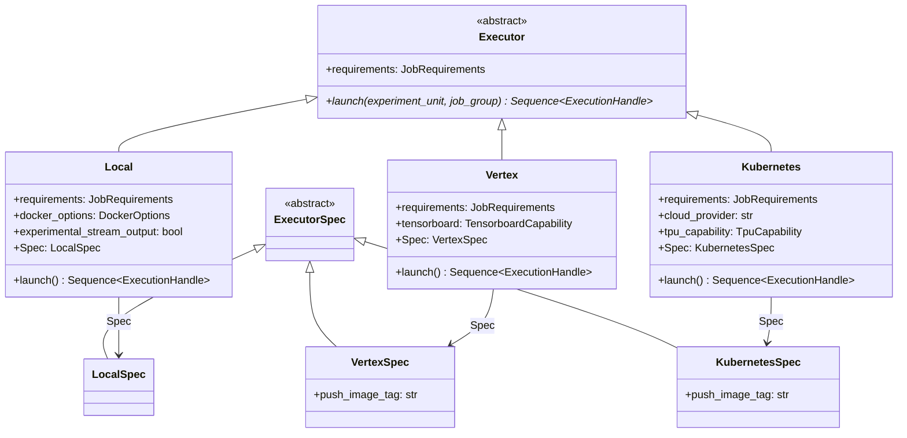
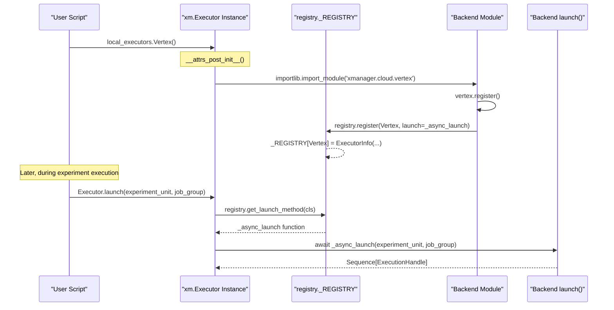
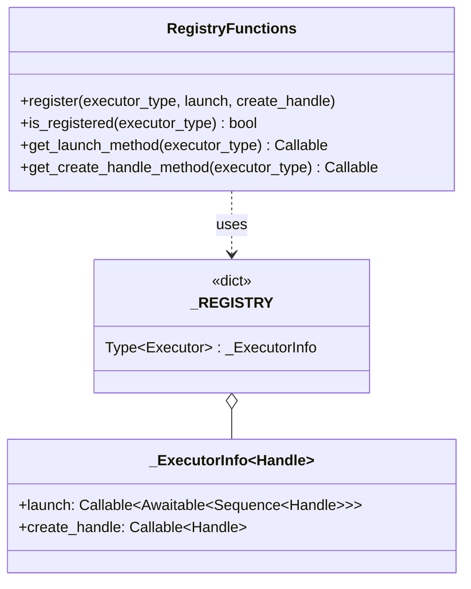
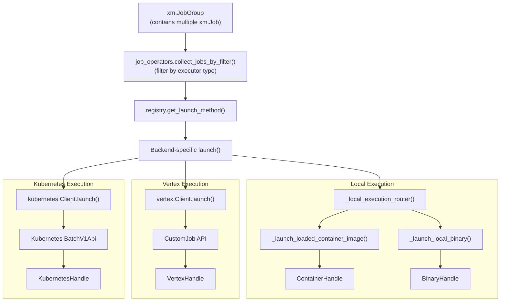
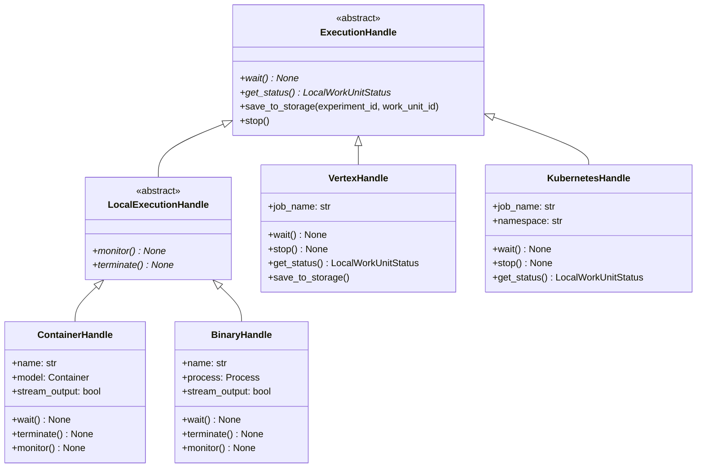
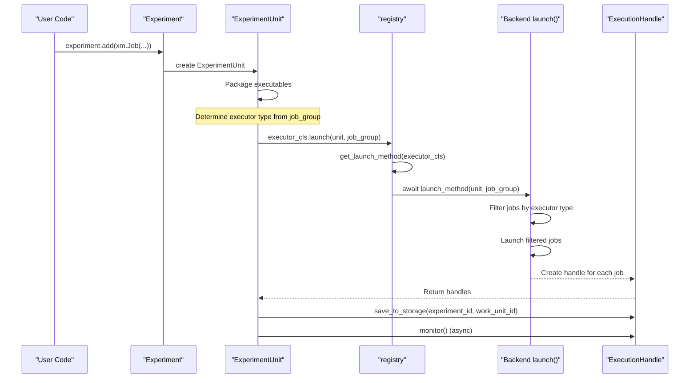

<!-- source: DeepWiki mcp.deepwiki.com · repo google-deepmind/xmanager · page 5 Execution Backends · fetched 2026-10-26 -->

# Execution Backends

<details>
<summary>Relevant source files</summary>

The following files were used as context for generating this wiki page:

- [xmanager/cloud/vertex.py](xmanager/cloud/vertex.py)
- [xmanager/cloud/vertex_test.py](xmanager/cloud/vertex_test.py)
- [xmanager/xm_local/__init__.py](xmanager/xm_local/__init__.py)
- [xmanager/xm_local/execution.py](xmanager/xm_local/execution.py)
- [xmanager/xm_local/execution_test.py](xmanager/xm_local/execution_test.py)
- [xmanager/xm_local/executors.py](xmanager/xm_local/executors.py)
- [xmanager/xm_local/executors_test.py](xmanager/xm_local/executors_test.py)
- [xmanager/xm_local/handles.py](xmanager/xm_local/handles.py)
- [xmanager/xm_local/registry.py](xmanager/xm_local/registry.py)

</details>


This document provides an overview of XManager's execution backend architecture. Execution backends are responsible for launching jobs on different platforms (local machine, Vertex AI, Kubernetes) and managing their lifecycle. This page covers the executor abstraction, the registry pattern used for dynamic dispatch, and high-level characteristics of each backend.

For detailed information about specific backends, see:
- **Local execution**: [Local Executor](#5.1)
- **Google Cloud Vertex AI execution**: [Vertex AI Executor](#5.2)
- **Kubernetes execution**: [Kubernetes Executor](#5.3)

For information about how executables are packaged differently for each backend, see [Packaging System](#4).

## Executor Architecture

XManager uses an **executor abstraction** to decouple job definitions from their execution environment. Each `xm.Job` specifies an `xm.Executor` that determines where and how the job runs. The system supports three executor implementations:

| Executor Class | Module | Target Platform | Container Support | Binary Support |
|---------------|--------|-----------------|-------------------|----------------|
| `xm_local.Local` | `xmanager.xm_local.executors` | Current machine | Yes | Yes |
| `xm_local.Vertex` | `xmanager.xm_local.executors` | Google Cloud Vertex AI | Yes | No |
| `xm_local.Kubernetes` | `xmanager.xm_local.executors` | Kubernetes cluster | Yes | No |

### Executor Class Hierarchy



**Sources:** [xmanager/xm_local/executors.py:31-91](), [xmanager/xm_local/executors.py:114-144](), [xmanager/xm_local/executors.py:152-182]()

Each executor class has an associated `Spec` class that contains backend-specific configuration (e.g., image push tags for cloud backends). The `requirements` attribute specifies resource needs via `xm.JobRequirements`.

## Registry Pattern

XManager uses a **registry pattern** to enable dynamic dispatch of execution logic without coupling the core system to specific backend implementations. When an executor is instantiated, it automatically registers its launch method with the registry.

### Registry-Based Dispatch Flow



**Sources:** [xmanager/xm_local/executors.py:79-81](), [xmanager/xm_local/executors.py:132-134](), [xmanager/xm_local/executors.py:171-173](), [xmanager/xm_local/registry.py:29-39]()

The registry stores an `_ExecutorInfo` object for each executor type, containing:
- `launch`: A callable that launches jobs and returns execution handles
- `create_handle`: An optional callable to reconstruct handles from database data

This pattern provides several benefits:
1. **Lazy loading**: Backend-specific dependencies (e.g., Kubernetes client libraries) are only imported when that executor is used
2. **Extensibility**: New backends can be added without modifying core XManager code
3. **Testability**: Mock executors can be registered for testing

### Registry Implementation

The registry is implemented in [xmanager/xm_local/registry.py:1-56]() with the following key components:



**Sources:** [xmanager/xm_local/registry.py:18-28](), [xmanager/xm_local/registry.py:29-56]()

## Execution Workflow

The execution workflow follows a consistent pattern across all backends, with backend-specific logic encapsulated in registered launch functions.

### Job Launch Flow



**Sources:** [xmanager/xm_local/execution.py:198-212](), [xmanager/xm_local/execution.py:152-169](), [xmanager/cloud/vertex.py:356-371]()

### Execution Handle Interface

All backends return `ExecutionHandle` objects that provide a uniform interface for managing launched jobs:



**Sources:** [xmanager/xm_local/handles.py:21-40](), [xmanager/xm_local/handles.py:42-52](), [xmanager/xm_local/handles.py:54-104](), [xmanager/xm_local/handles.py:106-138](), [xmanager/cloud/vertex.py:332-352]()

## Backend Characteristics

### Resource Support Matrix

Different backends support different resource types. The table below summarizes key capabilities:

| Feature | Local | Vertex AI | Kubernetes |
|---------|-------|-----------|------------|
| CPU/RAM specification | Ignored (uses host) | Yes (machine type selection) | Yes (resource requests) |
| NVIDIA GPUs | Yes (via Docker runtime) | Yes (all types) | Yes (via device plugins) |
| TPUs | No | Yes (v2, v3) | Yes (with TPU capability) |
| Distributed training | Limited | Yes (multi-worker pools) | Yes (via job replicas) |
| Interactive execution | Yes (via `docker_options.interactive`) | No | No |
| Binary (non-container) execution | Yes | No | No |
| Custom volumes | Yes (`docker_options.volumes`) | No | Yes (via PersistentVolumeClaims) |

**Sources:** [xmanager/xm_local/executors.py:59-76](), [xmanager/xm_local/executors.py:123-128](), [xmanager/xm_local/executors.py:162-167]()

### Packaging Differences

Executors require different packaging strategies:

**Local Executor:**
- Container executables: Loaded into local Docker daemon via `LoadedContainerImage`
- Binary executables: Validated as `LocalBinary` with filesystem path
- No image pushing required

**Cloud Executors (Vertex AI, Kubernetes):**
- Container executables: Pushed to Google Container Registry (GCR) as `GoogleContainerRegistryImage`
- Binary executables: Not supported
- Image tags specified via `VertexSpec.push_image_tag` or `KubernetesSpec.push_image_tag`

The packaging router in [xmanager/xm_local/packaging.py]() determines which strategy to use based on executor type. For details, see [Local and Cloud Packaging](#4.3).

**Sources:** [xmanager/xm_local/executors.py:115-121](), [xmanager/xm_local/executors.py:153-159]()

## Backend Registration

Each backend module registers itself when imported. This happens in the executor's `__attrs_post_init__` method:

### Local Backend Registration

```python
# xmanager/xm_local/executors.py:79-81
def __attrs_post_init__(self):
    local_execution = importlib.import_module('xmanager.xm_local.execution')
    local_execution.register()
```

The registration call in `xmanager.xm_local.execution`:
```python
# xmanager/xm_local/execution.py:215-222
def register():
    registry.register(
        executors.Local,
        launch=lambda local_experiment_unit, job_group: launch(
            local_experiment_unit.get_full_job_name, job_group
        ),
    )
```

**Sources:** [xmanager/xm_local/executors.py:79-81](), [xmanager/xm_local/execution.py:215-222]()

### Vertex AI Backend Registration

```python
# xmanager/xm_local/executors.py:132-134
def __attrs_post_init__(self):
    vertex_execution = importlib.import_module('xmanager.cloud.vertex')
    vertex_execution.register()
```

The registration call in `xmanager.cloud.vertex`:
```python
# xmanager/cloud/vertex.py:410-416
def register():
    registry.register(
        local_executors.Vertex,
        launch=_async_launch,
        create_handle=lambda *args, data: VertexHandle(data.caip.resource_name),
    )
```

**Sources:** [xmanager/xm_local/executors.py:132-134](), [xmanager/cloud/vertex.py:410-416]()

### Kubernetes Backend Registration

```python
# xmanager/xm_local/executors.py:171-173
def __attrs_post_init__(self):
    k8s_execution = importlib.import_module('xmanager.cloud.kubernetes')
    k8s_execution.register()
```

**Sources:** [xmanager/xm_local/executors.py:171-173]()

## Executor Selection in User Code

Users specify executors when creating jobs. The executor determines both where the job runs and which packaging strategy is used:

```python
# Local execution example
local_executor = xm_local.Local(
    requirements=xm.JobRequirements(local_gpu=2),
    docker_options=xm_local.DockerOptions(ports={8080: 8080}),
)

# Vertex AI execution example
vertex_executor = xm_local.Vertex(
    requirements=xm.JobRequirements(cpu=8, ram=32 * xm.GiB, v100=2),
    tensorboard=xm_local.TensorboardCapability(name='my-tensorboard'),
)

# Kubernetes execution example
k8s_executor = xm_local.Kubernetes(
    requirements=xm.JobRequirements(cpu=4, ram=16 * xm.GiB),
    tpu_capability=xm_local.TpuCapability(tpu_runtime_version='2.8.0'),
)

# Jobs use the specified executor
job = xm.Job(
    executable=executable,
    executor=vertex_executor,
    args={'learning_rate': 0.001},
)
```

The executor type is checked during packaging to determine whether to use local or cloud packaging strategies. The same executable specification can target different backends by changing only the executor.

**Sources:** [xmanager/xm_local/executors.py:31-91](), [xmanager/xm_local/executors.py:114-144](), [xmanager/xm_local/executors.py:152-182]()

## Integration with Experiment Context

The experiment context orchestrates executor dispatch through the registry. When jobs are added to an experiment:



**Sources:** [xmanager/xm_local/execution.py:198-212](), [xmanager/cloud/vertex.py:356-371]()

This architecture allows XManager to support multiple execution backends with minimal coupling, making it straightforward to add new backends or modify existing ones without affecting the core framework.

---

