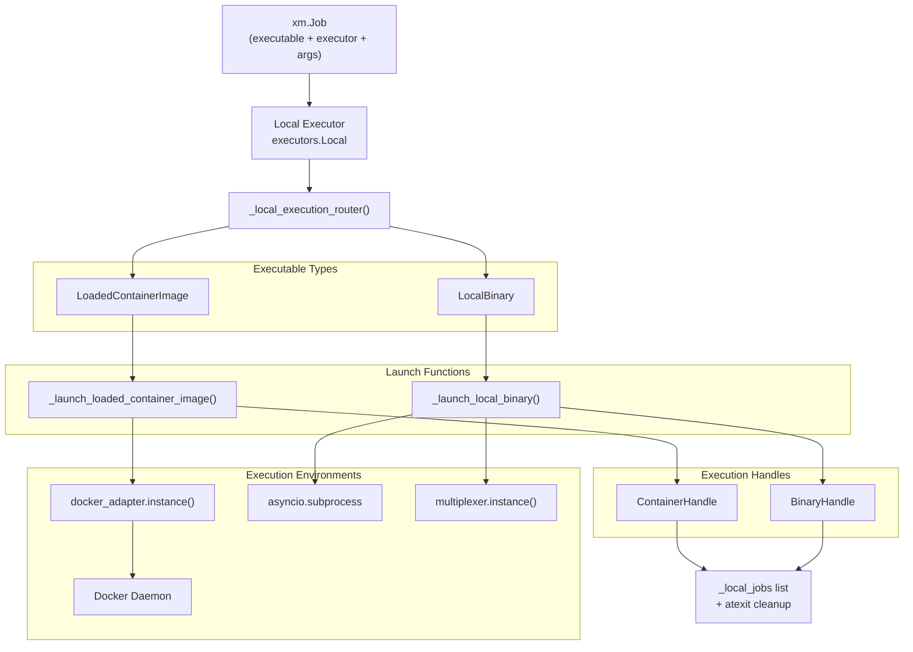
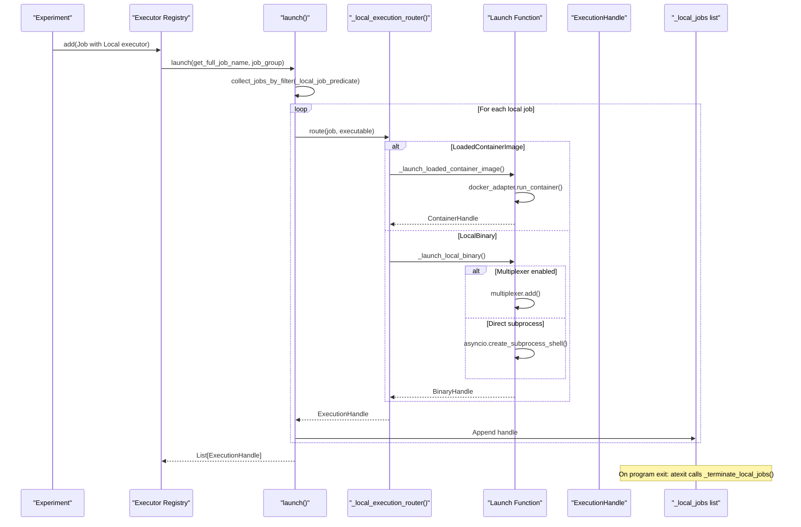
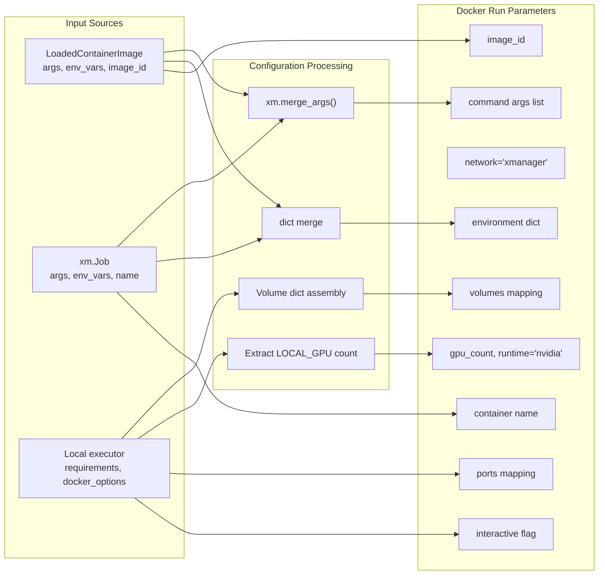
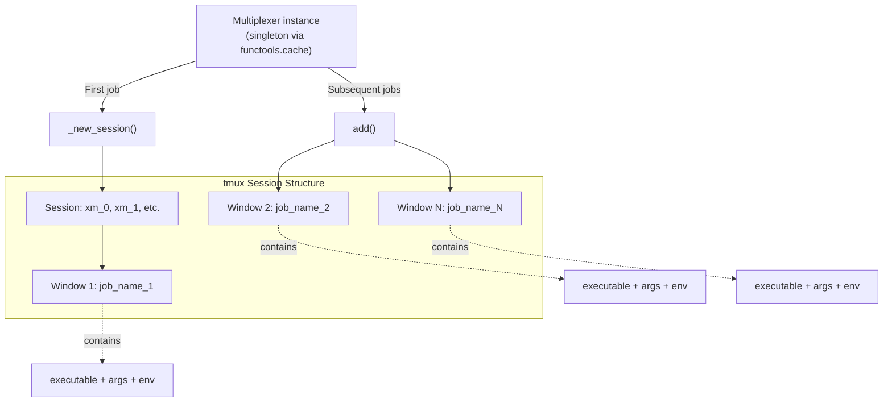

<!-- source: DeepWiki mcp.deepwiki.com · repo google-deepmind/xmanager · page 5.1 Local Executor · fetched 2026-10-26 -->

# Local Executor

<details>
<summary>Relevant source files</summary>

The following files were used as context for generating this wiki page:

- [xmanager/xm_flags.py](xmanager/xm_flags.py)
- [xmanager/xm_local/execution.py](xmanager/xm_local/execution.py)
- [xmanager/xm_local/execution_test.py](xmanager/xm_local/execution_test.py)
- [xmanager/xm_local/executors.py](xmanager/xm_local/executors.py)
- [xmanager/xm_local/multiplexer.py](xmanager/xm_local/multiplexer.py)

</details>


## Purpose and Scope

This document describes the Local Executor, which executes XManager jobs on the current machine using Docker containers or native binaries. The Local Executor is one of three execution backends available in XManager, alongside Vertex AI ([5.2](#5.2)) and Kubernetes ([5.3](#5.3)). For information about the executor architecture and registry pattern, see [Execution Backends](#5).

---

## Overview

The Local Executor runs jobs directly on the user's machine, supporting two execution modes:
- **Container-based execution**: Runs Docker containers using the local Docker daemon
- **Binary-based execution**: Runs native executables as subprocess or tmux sessions

The Local Executor is defined by the `Local` class in [xmanager/xm_local/executors.py:60-91]() and its execution logic is implemented in [xmanager/xm_local/execution.py]().

| Feature | Support |
|---------|---------|
| Executable Types | `LoadedContainerImage`, `LocalBinary` |
| GPU Support | NVIDIA GPUs only (via Docker runtime) |
| Resource Management | Local GPU allocation; other resources ignored |
| Process Management | Direct subprocess or tmux multiplexer |
| Networking | Docker bridge network (`xmanager`) |
| Credential Mounting | Automatic GCP credentials mounting |

**Sources:** [xmanager/xm_local/executors.py:60-91](), [xmanager/xm_local/execution.py:1-223]()

---

## Executor Configuration

### Local Class

The `Local` executor is configured using the `Local` class with the following attributes:

```python
@attr.s(auto_attribs=True)
class Local(xm.Executor):
  requirements: xm.JobRequirements = attr.Factory(xm.JobRequirements)
  docker_options: Optional[DockerOptions] = None
  experimental_stream_output: bool = True
```

| Attribute | Type | Description |
|-----------|------|-------------|
| `requirements` | `xm.JobRequirements` | Resource requirements; only `local_gpu` is currently supported |
| `docker_options` | `Optional[DockerOptions]` | Container-specific options (ports, volumes, interactive mode) |
| `experimental_stream_output` | `bool` | Whether to stream stdout/stderr to terminal (default: `True`) |

### DockerOptions

Docker-specific configuration is provided through the `DockerOptions` class:

```python
@attr.s(auto_attribs=True)
class DockerOptions:
  ports: Optional[docker_adapter.Ports] = None
  volumes: Optional[Dict[str, str]] = None
  mount_gcs_path: bool = True
  interactive: bool = False
```

| Attribute | Type | Description |
|-----------|------|-------------|
| `ports` | `Optional[dict[int, int]]` | Port mappings from container to host |
| `volumes` | `Optional[dict[str, str]]` | Volume mounts from host path to container path |
| `mount_gcs_path` | `bool` | Whether to mount `~/gcs` to `/gcs` if present (default: `True`) |
| `interactive` | `bool` | Whether to run with interactive shell (default: `False`) |

**Sources:** [xmanager/xm_local/executors.py:31-76]()

---

## Architecture

### Component Interaction



The Local Executor uses a router pattern that dispatches to specialized launch functions based on executable type. All launched jobs are tracked in a global list for automatic cleanup on exit.

**Sources:** [xmanager/xm_local/execution.py:152-169](), [xmanager/xm_local/execution.py:174-192]()

---

## Execution Flow

### Launch Sequence



The `launch()` function is the entry point registered with the executor registry. It filters jobs with the `Local` executor, routes them to appropriate launch functions, and tracks all handles for cleanup.

**Sources:** [xmanager/xm_local/execution.py:198-212](), [xmanager/xm_local/execution.py:215-222]()

---

## Container Execution

### Launch Process

Container execution is handled by `_launch_loaded_container_image()` at [xmanager/xm_local/execution.py:38-104](). The function performs the following steps:

1. **Network Setup**: Creates a Docker bridge network named `xmanager` if it doesn't exist [xmanager/xm_local/execution.py:49-50]()
2. **GPU Detection**: Verifies NVIDIA GPU availability using `nvidia-smi` if GPUs are requested [xmanager/xm_local/execution.py:52-62]()
3. **Argument Merging**: Combines executable args with job args [xmanager/xm_local/execution.py:64]()
4. **Environment Setup**: Merges executable and job environment variables [xmanager/xm_local/execution.py:65]()
5. **Volume Mounting**: Sets up volumes including automatic GCP credentials [xmanager/xm_local/execution.py:68-87]()
6. **Container Launch**: Starts the container with all configuration [xmanager/xm_local/execution.py:89-99]()

### Automatic Volume Mounts

The Local Executor automatically mounts certain directories:

| Host Path | Container Path | Condition |
|-----------|----------------|-----------|
| `~/.config/gcloud` | `/root/.config/gcloud` | Always mounted |
| `~/gcs` | `/gcs` | Mounted if directory exists and `mount_gcs_path=True` |

**Sources:** [xmanager/xm_local/execution.py:38-104]()

### Container Configuration Mapping



**Sources:** [xmanager/xm_local/execution.py:64-99]()

---

## Binary Execution

### Launch Process

Binary execution is handled by `_launch_local_binary()` at [xmanager/xm_local/execution.py:107-149](). This function:

1. **Argument Processing**: Merges and escapes arguments [xmanager/xm_local/execution.py:116]()
2. **Environment Setup**: Combines OS, executable, and job environment variables [xmanager/xm_local/execution.py:117-124]()
3. **Python Unbuffering**: Automatically sets `PYTHONUNBUFFERED=1` for immediate log output [xmanager/xm_local/execution.py:123]()
4. **Process Launch**: Uses either tmux multiplexer or direct subprocess [xmanager/xm_local/execution.py:126-144]()

### Execution Modes

The binary executor supports two execution modes controlled by `xm_flags.should_use_multiplexer()`:

| Mode | Implementation | Use Case |
|------|----------------|----------|
| **Multiplexer** | tmux sessions | Interactive debugging, persistent sessions |
| **Direct Subprocess** | `asyncio.create_subprocess_shell()` | Automated runs, CI/CD |

**Sources:** [xmanager/xm_local/execution.py:107-149](), [xmanager/xm_flags.py:172-176]()

---

## GPU Support

### Configuration and Detection

GPU support is limited to NVIDIA GPUs and configured through `JobRequirements`:

```python
executor = Local(
    requirements=xm.JobRequirements(local_gpu=2)
)
```

The GPU count is extracted from requirements at [xmanager/xm_local/execution.py:52-54]():
```python
gpu_count = int(
    executor.requirements.task_requirements.get(xm.ResourceType.LOCAL_GPU, 0)
)
```

### GPU Availability Check

Before launching a container with GPU requirements, the executor verifies NVIDIA GPU availability by running `nvidia-smi` [xmanager/xm_local/execution.py:56-62]():

```python
if gpu_count > 0:
  try:
    subprocess.check_output('nvidia-smi')
  except Exception as exception:
    raise RuntimeError(
        'No NVIDIA devices detected. Only NVIDIA GPUs are currently supported'
    ) from exception
```

If `nvidia-smi` is not available or fails, execution is aborted with a `RuntimeError`.

**Sources:** [xmanager/xm_local/execution.py:52-62]()

---

## Multiplexer Support

### Overview

The multiplexer feature runs local binaries in persistent tmux terminal sessions, allowing users to:
- Attach to running jobs for debugging
- View job output in separate windows
- Keep jobs running after the launcher script exits

### Configuration Flags

Multiplexer behavior is controlled by flags in [xmanager/xm_flags.py:158-176]():

| Flag | Type | Description |
|------|------|-------------|
| `--xm_use_multiplexer` | `bool` | Explicitly enable/disable multiplexer |
| `--xm_open_multiplexer_window` | `int` | Window index to switch to after session creation |

The function `should_use_multiplexer()` determines if the multiplexer should be used [xmanager/xm_flags.py:172-176]():
- Returns `True` if `--xm_use_multiplexer=True`
- Returns `True` if `--xm_open_multiplexer_window` is set
- Otherwise returns `False`

### Multiplexer Class

The `Multiplexer` class in [xmanager/xm_local/multiplexer.py:34-136]() manages tmux sessions:



### Session Creation and Management

The multiplexer creates a unique session name (`xm_0`, `xm_1`, etc.) and prints instructions for attaching [xmanager/xm_local/multiplexer.py:84-91]():

```python
print(
    f'Created new tmux session called "{self._session_name}". If you are'
    ' already in a tmux session, use `Ctrl+B W` as a convenient way to'
    ' switch to the new session. Otherwise run \n\n  tmux a -t'
    f' "{self._session_name}"\n\n...'
)
```

Each job is added to a new window with a command that:
1. Runs the executable with arguments and environment
2. Echoes the command on completion for easy copy-paste
3. Drops into a shell for debugging [xmanager/xm_local/multiplexer.py:27-31]()

**Sources:** [xmanager/xm_local/multiplexer.py:1-137](), [xmanager/xm_flags.py:158-176]()

---

## Lifecycle Management

### Job Tracking and Cleanup

All launched jobs are tracked in a global list `_local_jobs` [xmanager/xm_local/execution.py:174]():

```python
_local_jobs: List[handles.LocalExecutionHandle] = []
_local_jobs_lock = threading.Lock()
```

When jobs are launched, handles are appended to this list [xmanager/xm_local/execution.py:210-211]():

```python
with _local_jobs_lock:
  _local_jobs.extend(execution_handles)
```

### Automatic Termination on Exit

The `_terminate_local_jobs()` function is registered with `atexit` [xmanager/xm_local/execution.py:178-191]():

```python
@atexit.register
def _terminate_local_jobs():
  """Terminates local jobs that were launched during the current session."""
  with _local_jobs_lock:
    if _local_jobs:
      print(
          f'Terminating {len(_local_jobs)} local job(s)'
          ' that may still be running...'
      )
    for local_job in _local_jobs:
      try:
        local_job.terminate()
      except Exception:
        logging.warning('Unable to terminate %s', repr(local_job))
```

This ensures that:
- Jobs are automatically cleaned up when the launcher script exits
- Containers are stopped and removed
- Processes are terminated
- The user is notified of cleanup actions

### Execution Handle Types

The Local Executor returns two types of handles:

| Handle Type | Executable Type | Methods |
|-------------|-----------------|---------|
| `ContainerHandle` | `LoadedContainerImage` | `wait()`, `get_status()`, `terminate()` |
| `BinaryHandle` | `LocalBinary` | `wait()`, `get_status()`, `terminate()` |

Both handle types implement the `LocalExecutionHandle` interface and are tracked for cleanup.

**Sources:** [xmanager/xm_local/execution.py:174-192](), [xmanager/xm_local/execution.py:100-104](), [xmanager/xm_local/execution.py:145-149]()

---

## Executor Registration

The Local Executor registers itself with the executor registry at [xmanager/xm_local/execution.py:215-222]():

```python
def register():
  """Registers local execution logic."""
  registry.register(
      executors.Local,
      launch=lambda local_experiment_unit, job_group: launch(
          local_experiment_unit.get_full_job_name, job_group
      ),
  )
```

This registration is automatically triggered when a `Local` executor is instantiated via `__attrs_post_init__()` [xmanager/xm_local/executors.py:79-81]():

```python
def __attrs_post_init__(self):
  local_execution = importlib.import_module('xmanager.xm_local.execution')
  local_execution.register()
```

The registry maps the `Local` executor class to its `launch()` function, enabling dynamic dispatch when jobs are added to experiments.

**Sources:** [xmanager/xm_local/execution.py:215-222](), [xmanager/xm_local/executors.py:79-81]()

---

## Limitations

The Local Executor has the following limitations:

| Limitation | Details |
|------------|---------|
| **GPU Support** | Only NVIDIA GPUs supported; requires `nvidia-smi` |
| **Resource Requirements** | Only `LOCAL_GPU` is honored; CPU, memory, TPU ignored |
| **Binary Multiplexer** | Multiplexer only works with `LocalBinary`, not containers |
| **Network Isolation** | All containers share single bridge network (`xmanager`) |
| **Platform Support** | Docker-based execution requires Docker daemon |
| **Handle Retention** | All handles kept in memory until program exit |

**Sources:** [xmanager/xm_local/execution.py:52-62](), [xmanager/xm_local/execution.py:126-144](), [xmanager/xm_local/execution.py:174]()

---

