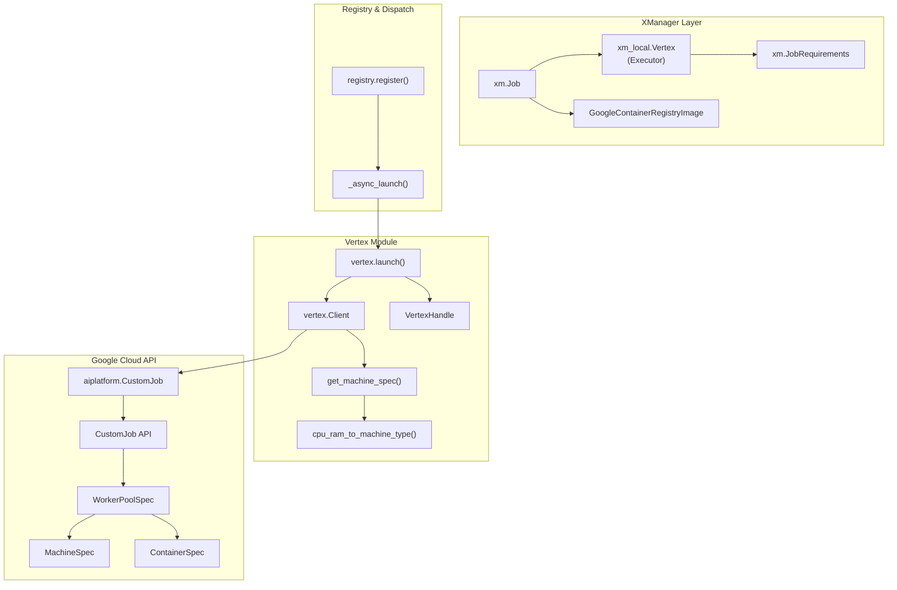
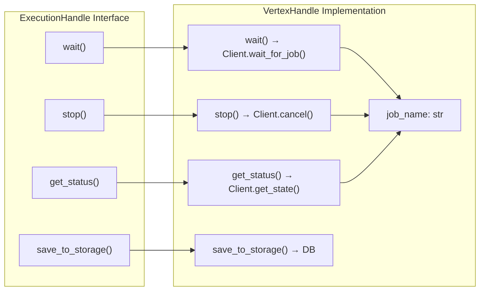
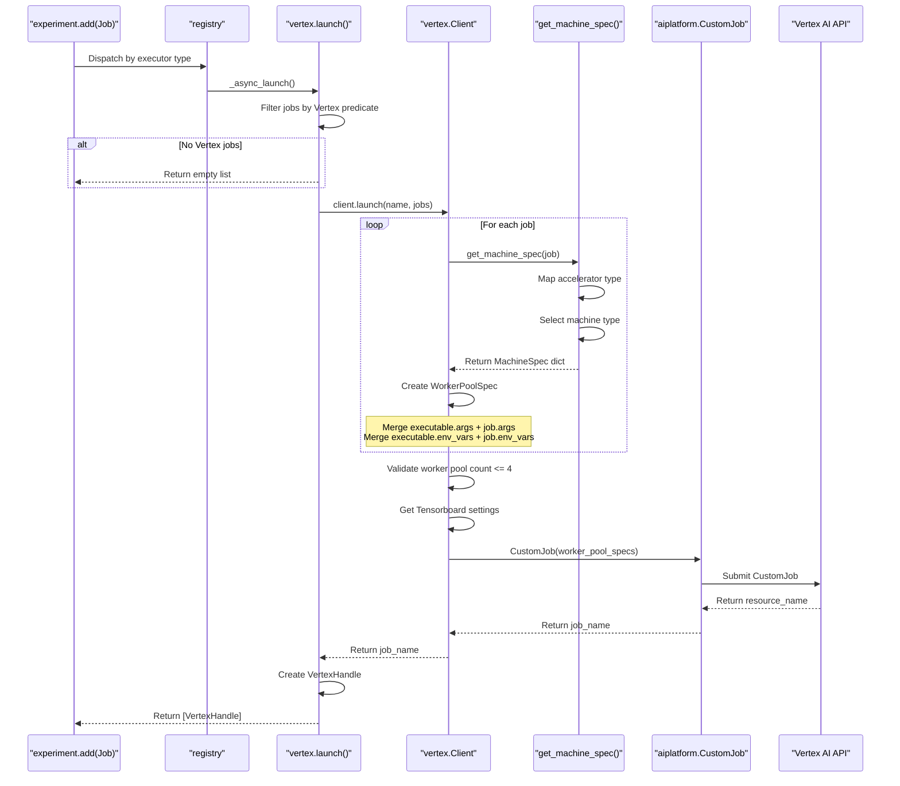
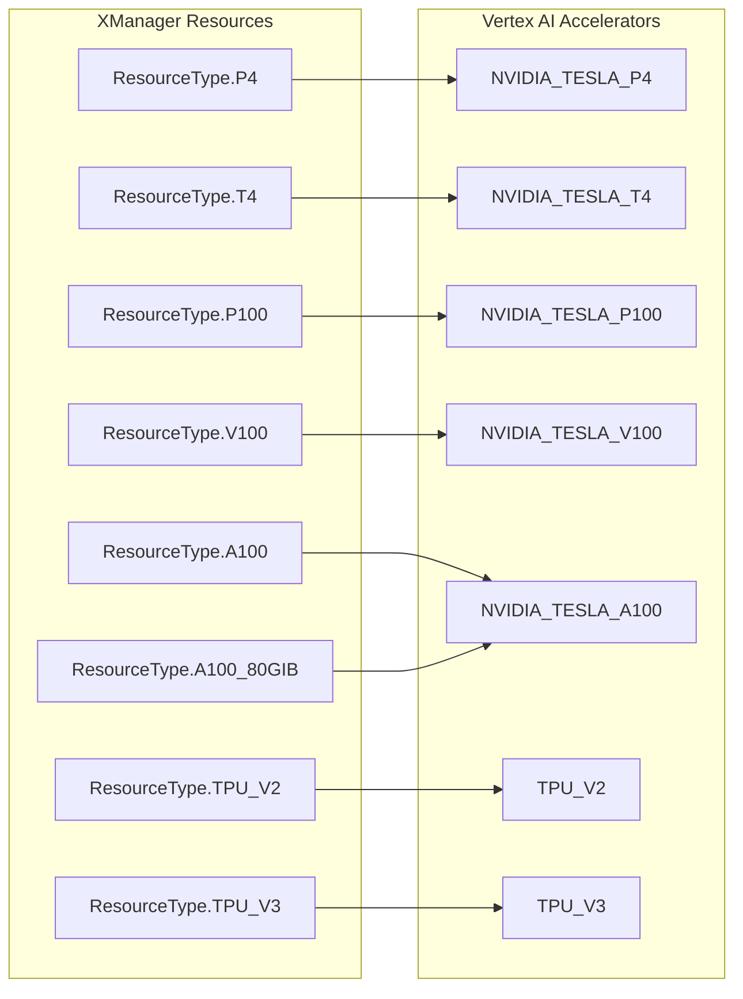
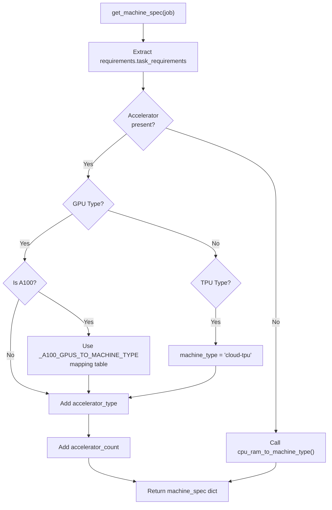
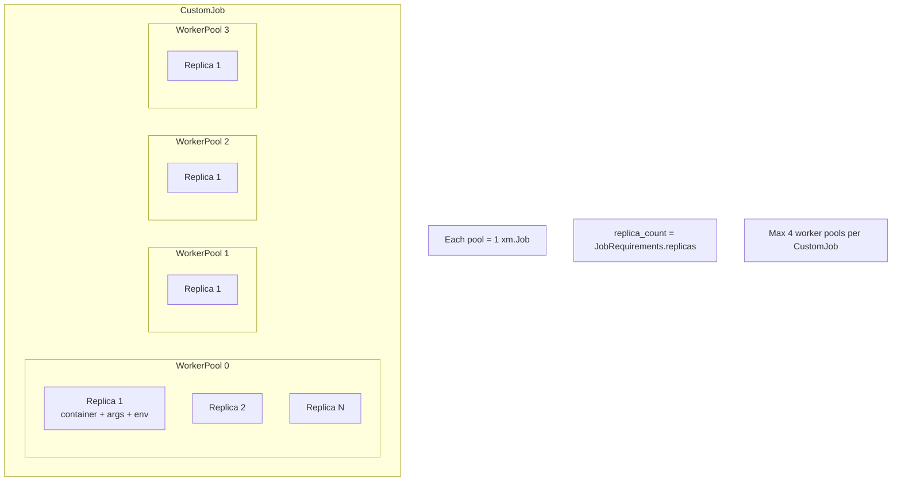
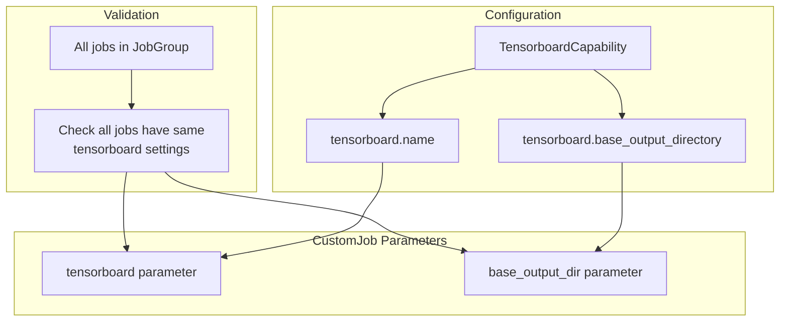
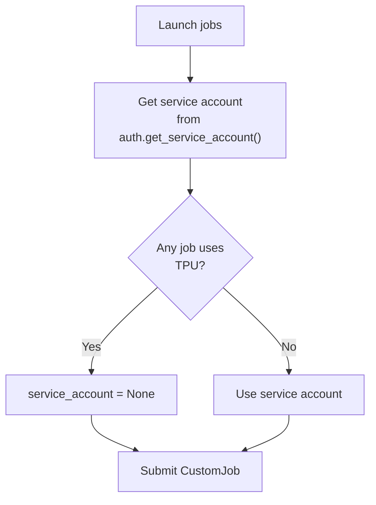
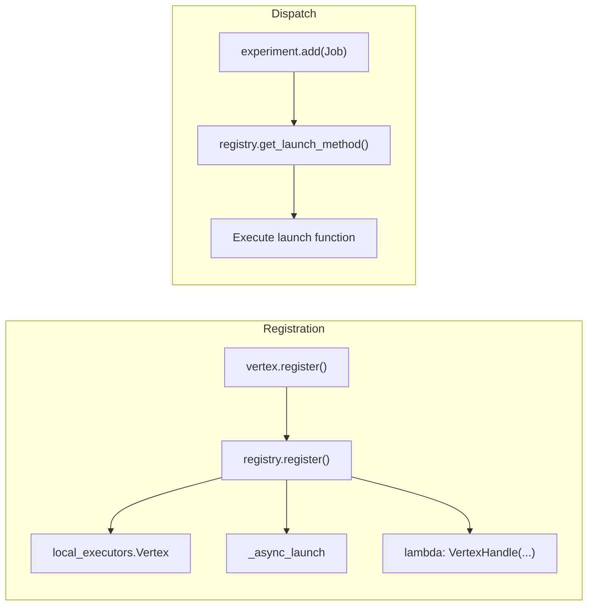

<!-- source: DeepWiki mcp.deepwiki.com · repo google-deepmind/xmanager · page 5.2 Vertex AI Executor · fetched 2026-10-26 -->

# Vertex AI Executor

<details>
<summary>Relevant source files</summary>

The following files were used as context for generating this wiki page:

- [xmanager/cloud/vertex.py](xmanager/cloud/vertex.py)
- [xmanager/cloud/vertex_test.py](xmanager/cloud/vertex_test.py)
- [xmanager/xm/resources.py](xmanager/xm/resources.py)
- [xmanager/xm/resources_test.py](xmanager/xm/resources_test.py)
- [xmanager/xm_local/__init__.py](xmanager/xm_local/__init__.py)
- [xmanager/xm_local/executors_test.py](xmanager/xm_local/executors_test.py)
- [xmanager/xm_local/handles.py](xmanager/xm_local/handles.py)
- [xmanager/xm_local/registry.py](xmanager/xm_local/registry.py)

</details>


## Purpose and Scope

The Vertex AI Executor provides integration with Google Cloud's Vertex AI platform for running containerized ML training jobs. This executor translates XManager job specifications into Vertex AI CustomJob API calls, handling resource mapping, machine type selection, and job lifecycle management.

For local execution, see [Local Executor](#5.1). For Kubernetes execution, see [Kubernetes Executor](#5.3). For general executor concepts, see [Execution Backends](#5).

---

## Architecture Overview

The Vertex AI executor follows a client-based architecture that translates XManager job specifications into Vertex AI CustomJob API requests.



**Sources:** [xmanager/cloud/vertex.py:1-417](), [xmanager/xm_local/registry.py:1-56]()

---

## Core Components

### Client Class

The `Client` class manages all interactions with the Vertex AI API. It is initialized with a GCP project and location (region).

| Method | Purpose |
|--------|---------|
| `launch()` | Creates and submits CustomJob with worker pools |
| `wait_for_job()` | Blocks until job completion |
| `cancel()` | Cancels a running job |
| `get_state()` | Retrieves current job state |
| `get_or_create_tensorboard()` | Manages Tensorboard instances |
| `get_tensorboard_settings()` | Validates Tensorboard configuration across jobs |

**Sources:** [xmanager/cloud/vertex.py:111-279]()

### VertexHandle Class

The `VertexHandle` provides an interface for operating on launched Vertex AI jobs.



**Sources:** [xmanager/cloud/vertex.py:332-353](), [xmanager/xm_local/handles.py:21-40]()

---

## Job Launch Process

The following sequence diagram illustrates how a job is launched on Vertex AI:



**Sources:** [xmanager/cloud/vertex.py:129-198](), [xmanager/cloud/vertex.py:356-372](), [xmanager/cloud/vertex.py:410-416]()

---

## Resource Mapping

The Vertex executor translates XManager resource requirements into Vertex AI machine specifications.

### Accelerator Type Mapping



**Sources:** [xmanager/cloud/vertex.py:293-329](), [xmanager/cloud/vertex.py:68-71]()

### Machine Type Selection Logic

The `get_machine_spec()` function applies the following logic:



**Sources:** [xmanager/cloud/vertex.py:293-329]()

---

## CPU and RAM to Machine Type

The `cpu_ram_to_machine_type()` function selects the optimal N1 machine type based on CPU and RAM requirements.

### Available Machine Types

The executor supports three N1 machine families:

| Family | CPU Range | RAM per CPU | Use Case |
|--------|-----------|-------------|----------|
| `n1-standard-*` | 4-96 | ~3.75 GiB | Balanced workloads |
| `n1-highmem-*` | 2-96 | ~6.5 GiB | Memory-intensive |
| `n1-highcpu-*` | 16-96 | ~0.9 GiB | CPU-intensive |

### Selection Algorithm

```python
# Pseudocode from vertex.py:374-397
def cpu_ram_to_machine_type(cpu, ram):
    if cpu + ram == 0:
        return 'n1-standard-4'  # Default
    
    optimal_machine = None
    optimal_excess = infinity
    
    for machine_type, (machine_cpu, machine_ram) in MACHINE_TYPE_TO_CPU_RAM:
        if machine_cpu >= cpu and machine_ram >= ram:
            excess = machine_cpu + machine_ram - cpu - ram
            if excess < optimal_excess:
                optimal_machine = machine_type
                optimal_excess = excess
    
    if optimal_machine:
        return optimal_machine
    raise ValueError("Requirements too high")
```

**Sources:** [xmanager/cloud/vertex.py:374-397](), [xmanager/cloud/vertex.py:41-59]()

---

## A100 Machine Type Mapping

A100 GPUs use dedicated A2 machine types with fixed GPU counts:

| GPU Count | Machine Type |
|-----------|--------------|
| 1 | `a2-highgpu-1g` |
| 2 | `a2-highgpu-2g` |
| 4 | `a2-highgpu-4g` |
| 8 | `a2-highgpu-8g` |
| 16 | `a2-megagpu-16g` |

The executor selects the smallest machine type that accommodates the requested GPU count.

**Sources:** [xmanager/cloud/vertex.py:60-66](), [xmanager/cloud/vertex.py:308-318]()

---

## Worker Pools and Replicas

Vertex AI CustomJobs support up to 4 worker pools, where each pool can have multiple replicas.

### Worker Pool Structure



### Constraints

1. **Worker Pool Limit:** Maximum 4 worker pools per CustomJob ([xmanager/cloud/vertex.py:170-174]())
2. **First Job Replicas:** The first job in a JobGroup cannot have `replicas > 1` ([xmanager/cloud/vertex.py:148-152]())
3. **Same Machine Spec:** All replicas in a pool share the same machine specification

**Sources:** [xmanager/cloud/vertex.py:129-175]()

---

## Tensorboard Integration

The Vertex executor supports integration with Vertex AI Tensorboard for experiment tracking.

### Tensorboard Configuration



### Validation Rules

The `get_tensorboard_settings()` method enforces:

1. All jobs in a JobGroup must have identical Tensorboard settings
2. If any job has Tensorboard enabled, the first job must also have it enabled
3. All jobs must share the same `tensorboard.name` and `base_output_directory`
4. Output directories are converted to GCS URIs (prefixed with `gs://`)

**Sources:** [xmanager/cloud/vertex.py:200-235]()

---

## Service Account Handling

The executor uses GCP service accounts for authentication, with special handling for TPU workloads.



**Note:** Vertex AI cannot use TPUs with service accounts due to platform limitations.

**Sources:** [xmanager/cloud/vertex.py:184-196]()

---

## Job State Mapping

The executor maps Vertex AI job states to XManager work unit statuses:

| Vertex AI State | XManager Status |
|----------------|-----------------|
| `JOB_STATE_SUCCEEDED` | `COMPLETED` |
| `JOB_STATE_CANCELLED` | `CANCELLED` |
| `JOB_STATE_FAILED` | `FAILED` |
| `JOB_STATE_QUEUED` | `RUNNING` |
| `JOB_STATE_PENDING` | `RUNNING` |
| `JOB_STATE_RUNNING` | `RUNNING` |
| `JOB_STATE_CANCELLING` | `RUNNING` |
| `JOB_STATE_PAUSED` | `RUNNING` |

The `VertexHandle.get_status()` method retrieves the current state and performs this mapping.

**Sources:** [xmanager/cloud/vertex.py:73-98](), [xmanager/cloud/vertex.py:344-347]()

---

## Registration and Dispatch

The Vertex executor registers itself with the executor registry for dynamic dispatch.



**Sources:** [xmanager/cloud/vertex.py:410-416](), [xmanager/xm_local/registry.py:32-39]()

---

## Default Client Management

The module maintains a singleton default client for convenience:

```python
# From vertex.py:104, 281-290
_default_client = None

def set_default_client(client: Client) -> None:
    global _default_client
    _default_client = client

def get_default_client():
    global _default_client
    if _default_client is None:
        _default_client = Client()
    return _default_client
```

All handle operations and launch functions use this default client unless explicitly overridden.

**Sources:** [xmanager/cloud/vertex.py:104](), [xmanager/cloud/vertex.py:281-290]()

---

## Limitations and Constraints

### Executable Requirements

- **Container-only:** Jobs must use `GoogleContainerRegistryImage` executables ([xmanager/cloud/vertex.py:135-143]())
- Binary executables are not supported

### Worker Pool Constraints

- **Maximum 4 pools:** JobGroups cannot contain more than 4 jobs ([xmanager/cloud/vertex.py:170-174]())
- **First job replicas:** The first job cannot have `replicas > 1` ([xmanager/cloud/vertex.py:148-152]())

### Resource Constraints

- **Machine type limits:** CPU/RAM requirements must fit within available N1 machine types
- **A100 limits:** A100 GPU count must be 1, 2, 4, 8, or 16
- **TPU service accounts:** TPU jobs cannot use service accounts ([xmanager/cloud/vertex.py:184-191]())

### Tensorboard Constraints

- All jobs in a JobGroup must share identical Tensorboard settings
- Output directories must be GCS paths

**Sources:** [xmanager/cloud/vertex.py:107-416]()

---

## Usage Example

```python
import xmanager as xm
import xmanager.xm_local as xm_local

# Define executable
executable_spec = xm.PythonContainer(
    path='.',
    entrypoint=xm.CommandList(['python', 'train.py']),
)

# Define Vertex executor with requirements
vertex_executor = xm_local.Vertex(
    requirements=xm.JobRequirements(
        v100=4,
        cpu=16,
        ram=64 * xm.GiB,
    )
)

# Create and launch experiment
with xm_local.create_experiment(title='my_experiment') as experiment:
    # Package for cloud execution
    [executable] = experiment.package([
        xm.Packageable(
            executable_spec=executable_spec,
            executor_spec=vertex_executor.Spec(),
        )
    ])
    
    # Add job
    experiment.add(xm.Job(
        executable=executable,
        executor=vertex_executor,
        args={'learning_rate': 0.001},
    ))
```

**Sources:** Based on patterns from [xmanager/cloud/vertex_test.py:38-100]()

---

