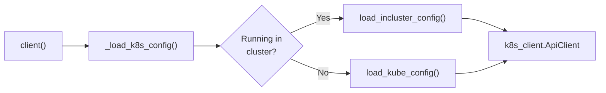
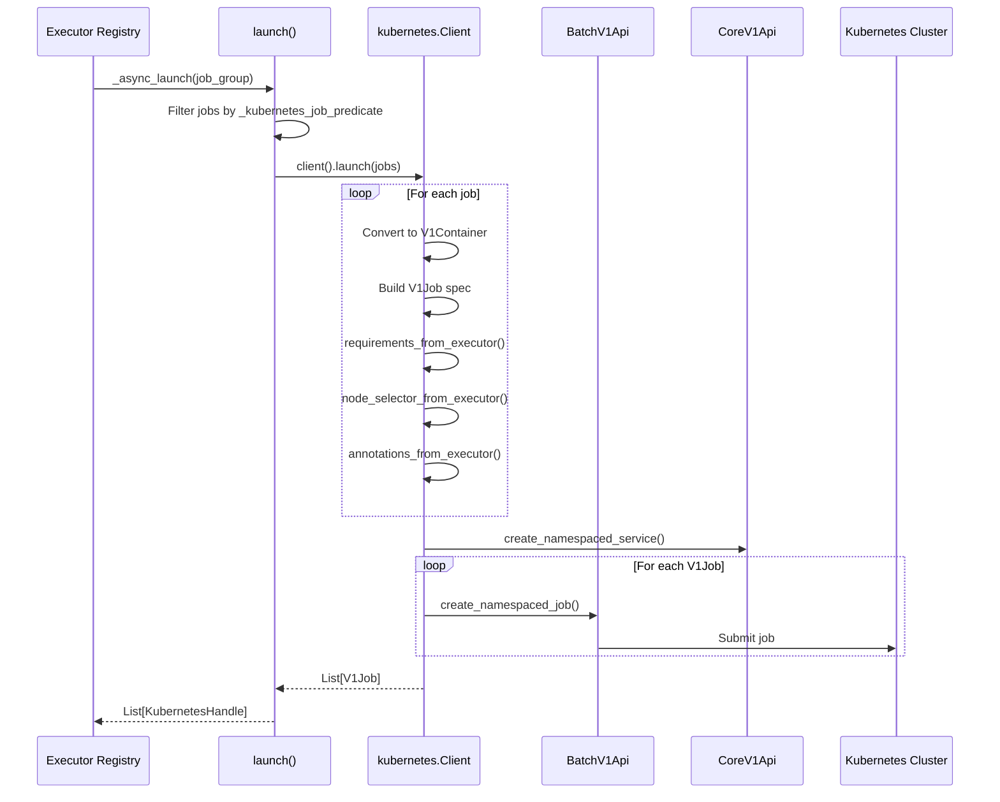
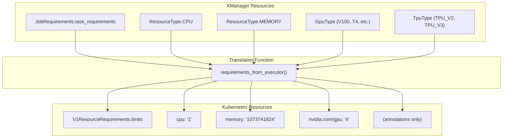
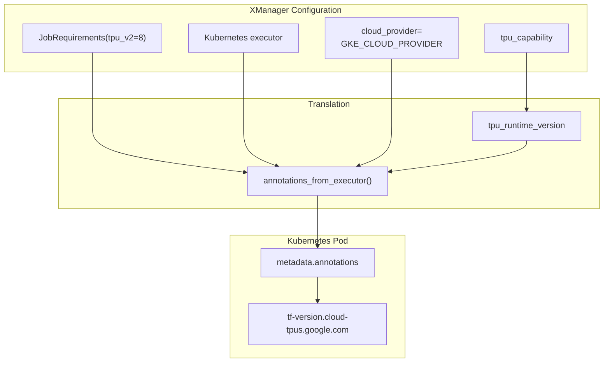
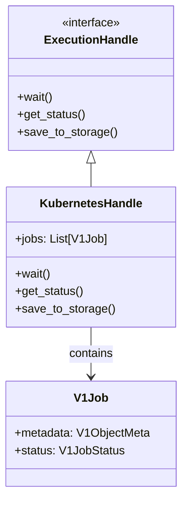
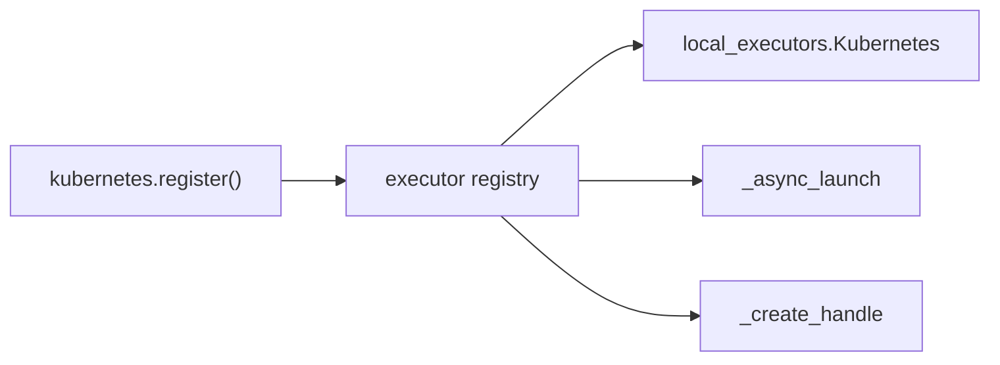

<!-- source: DeepWiki mcp.deepwiki.com · repo google-deepmind/xmanager · page 5.3 Kubernetes Executor · fetched 2026-10-26 -->

# Kubernetes Executor

<details>
<summary>Relevant source files</summary>

The following files were used as context for generating this wiki page:

- [xmanager/cloud/kubernetes.py](xmanager/cloud/kubernetes.py)
- [xmanager/cloud/kubernetes_test.py](xmanager/cloud/kubernetes_test.py)
- [xmanager/xm/resources.py](xmanager/xm/resources.py)
- [xmanager/xm/resources_test.py](xmanager/xm/resources_test.py)

</details>


## Purpose and Scope

This page documents the Kubernetes execution backend for XManager, which enables launching jobs on Kubernetes clusters. The Kubernetes Executor translates XManager job specifications into Kubernetes `V1Job` objects, manages resource requirements mapping, and provides support for both GPU and TPU workloads on Google Kubernetes Engine (GKE).

For information about other execution backends, see [Local Executor](#5.1) and [Vertex AI Executor](#5.2). For general executor architecture and the registry pattern, see [Execution Backends](#5).

**Sources:** [xmanager/cloud/kubernetes.py:1-291]()

## Architecture Overview

The Kubernetes Executor integrates into XManager's execution backend layer through the executor registry pattern. Jobs are launched by translating XManager abstractions (`xm.Job`, `xm.JobRequirements`) into Kubernetes-native API objects (`V1Job`, `V1Pod`, `V1Container`).

```mermaid
graph TB
    subgraph "XManager Layer"
        Job["xm.Job"]
        JobReq["xm.JobRequirements"]
        Executor["xm_local.Kubernetes<br/>(executor spec)"]
        Executable["GoogleContainerRegistryImage"]
    end
    
    subgraph "Kubernetes Module"
        Client["kubernetes.Client"]
        Launch["launch()"]
        ReqsTranslate["requirements_from_executor()"]
        NodeSel["node_selector_from_executor()"]
        Annotations["annotations_from_executor()"]
    end
    
    subgraph "Kubernetes API"
        BatchAPI["BatchV1Api"]
        CoreAPI["CoreV1Api"]
        V1Job["V1Job"]
        V1Pod["V1Pod"]
        V1Container["V1Container"]
    end
    
    subgraph "Registry"
        Registry["executor registry"]
        AsyncLaunch["_async_launch()"]
    end
    
    Job --> Launch
    JobReq --> ReqsTranslate
    Executor --> NodeSel
    Executor --> Annotations
    Executable --> V1Container
    
    Launch --> Client
    Client --> BatchAPI
    Client --> CoreAPI
    
    ReqsTranslate --> V1Container
    NodeSel --> V1Pod
    Annotations --> V1Pod
    
    BatchAPI --> V1Job
    V1Job --> V1Pod
    V1Pod --> V1Container
    
    Registry --> AsyncLaunch
    AsyncLaunch --> Launch
    
    HandleCreate["KubernetesHandle"]
    Client --> HandleCreate
```

**Diagram: Kubernetes Executor Architecture**

The executor operates in three phases:
1. **Registration**: The executor type registers launch and handle creation functions with the registry
2. **Translation**: Job specifications are converted to Kubernetes API objects
3. **Execution**: Jobs are submitted to the Kubernetes cluster via the Kubernetes Python client

**Sources:** [xmanager/cloud/kubernetes.py:34-43](), [xmanager/cloud/kubernetes.py:71-206](), [xmanager/cloud/kubernetes.py:284-290]()

## Client Class and Configuration

The `Client` class provides the primary interface for interacting with Kubernetes. It is implemented as a global singleton that defers initialization until an actual launch occurs.

### Client Initialization



**Diagram: Client Configuration Loading**

The client automatically detects whether it is running inside a Kubernetes cluster or externally:
- **Inside cluster**: Uses `load_incluster_config()` to read service account credentials
- **Outside cluster**: Uses `load_kube_config()` to read from `~/.kube/config`

**Sources:** [xmanager/cloud/kubernetes.py:34-39](), [xmanager/cloud/kubernetes.py:62-79]()

## Job Launch Process

The job launch process translates XManager jobs into Kubernetes batch jobs and submits them to the cluster.

### Launch Flow



**Diagram: Job Launch Sequence**

**Sources:** [xmanager/cloud/kubernetes.py:81-138](), [xmanager/cloud/kubernetes.py:191-205]()

### V1Job Construction

Each `xm.Job` is translated into a `V1Job` with the following structure:

| XManager Component | Kubernetes Equivalent | Translation Function |
|-------------------|----------------------|---------------------|
| `job.name` | `V1ObjectMeta.name` | `convert_to_valid_label()` |
| `job.executable.image_path` | `V1Container.image` | Direct mapping |
| `job.args` + `executable.args` | `V1Container.args` | `xm.merge_args()` |
| `job.env_vars` + `executable.env_vars` | `V1Container.env` | Dictionary merge |
| `executor.requirements` | `V1Container.resources` | `requirements_from_executor()` |
| TPU configuration | `V1ObjectMeta.annotations` | `annotations_from_executor()` |
| GPU accelerator type | `V1PodSpec.node_selector` | `node_selector_from_executor()` |

**Sources:** [xmanager/cloud/kubernetes.py:86-132]()

### Label Validation

Kubernetes requires RFC 1123 compliant labels. The `convert_to_valid_label()` function transforms job names by replacing underscores with hyphens:

```python
# Example: "my_job_name" -> "my-job-name"
```

**Sources:** [xmanager/cloud/kubernetes.py:45-59]()

### Service Creation

A headless Kubernetes service is created with selector `service: experiments` to enable pod-to-pod communication for distributed training workloads. The service is created once and reused across all jobs.

**Sources:** [xmanager/cloud/kubernetes.py:140-155]()

## Resource Requirements Translation

XManager resource requirements (`JobRequirements`) are translated into Kubernetes `V1ResourceRequirements`. The translation handles CPU, memory, GPU, and TPU resources.

### Requirements Mapping



**Diagram: Resource Requirements Translation**

### Translation Rules

The `requirements_from_executor()` function [xmanager/cloud/kubernetes.py:208-226]() implements the following translation rules:

| Resource Type | Kubernetes Resource | Format |
|--------------|-------------------|---------|
| `ResourceType.CPU` | `cpu` | Formatted as `f'{value:.15g}'` (supports fractional vCPUs) |
| `ResourceType.MEMORY` | `memory` | Formatted as `f'{value:.15g}'` (in bytes) |
| `ResourceType.EPHEMERAL_STORAGE` | `ephemeral-storage` | Formatted as `f'{value:.15g}'` (in bytes) |
| Any `GpuType` | `nvidia.com/gpu` | Formatted as `f'{value:g}'` (count) |
| Any `TpuType` | _(not in limits)_ | Handled via annotations and node selector |

**Example Translation:**
```python
# XManager
JobRequirements(cpu=1, memory=2*xm.GiB, v100=4)

# Kubernetes limits
{
    'cpu': '1',
    'memory': '2147483648',
    'nvidia.com/gpu': '4'
}
```

**Sources:** [xmanager/cloud/kubernetes.py:208-226](), [xmanager/cloud/kubernetes_test.py:147-170]()

## TPU Support on GKE

TPU workloads on Google Kubernetes Engine require special configuration through pod annotations and the underlying GKE TPU infrastructure.

### TPU Configuration



**Diagram: TPU Configuration Flow**

### TPU Annotations

The `annotations_from_executor()` function [xmanager/cloud/kubernetes.py:229-244]() adds TPU-specific annotations when:
1. The executor's `cloud_provider` is `GOOGLE_KUBERNETES_ENGINE_CLOUD_PROVIDER`
2. The requirements specify a TPU accelerator type

The annotation `tf-version.cloud-tpus.google.com` specifies the TensorFlow runtime version:
- Default: `"nightly"`
- Custom: Set via `executor.tpu_capability.tpu_runtime_version`

**Sources:** [xmanager/cloud/kubernetes.py:229-244](), [xmanager/cloud/kubernetes_test.py:172-177]()

### GPU Node Selection

For GPU workloads on GKE, the `node_selector_from_executor()` function [xmanager/cloud/kubernetes.py:247-264]() adds a node selector to target nodes with the appropriate GPU type:

```python
# Example: V100 GPUs
{
    'cloud.google.com/gke-accelerator': 'nvidia-tesla-v100'
}
```

The node selector is only added when:
1. The executor's `cloud_provider` is `GOOGLE_KUBERNETES_ENGINE_CLOUD_PROVIDER`
2. The requirements specify a GPU type

**Sources:** [xmanager/cloud/kubernetes.py:247-264](), [xmanager/cloud/kubernetes_test.py:183-196]()

## Configuration Flags

The Kubernetes executor supports configuration through XManager flags:

| Flag | Purpose | Default |
|------|---------|---------|
| `xm_k8s_service_account_name` | Service account name for pods | `"default"` |

The service account is specified in the pod spec [xmanager/cloud/kubernetes.py:122]() and must have appropriate RBAC permissions to access required cluster resources.

**Sources:** [xmanager/cloud/kubernetes.py:122](), [xmanager/cloud/kubernetes_test.py:28-43]()

## Execution Handle

The `KubernetesHandle` class provides an interface for monitoring and managing launched Kubernetes jobs.

### KubernetesHandle Structure



**Diagram: KubernetesHandle Class Hierarchy**

### Handle Operations

The `KubernetesHandle` [xmanager/cloud/kubernetes.py:169-188]() provides three core operations:

#### wait()
Asynchronously waits for all jobs to complete by polling the Kubernetes API:
- Polls job status every 5 seconds
- Completes when `completion_time` is set on the job status
- Uses `asyncio.gather()` to wait for multiple jobs in parallel

#### get_status()
Currently not implemented (raises `NotImplementedError`)

#### save_to_storage()
Persists job metadata to the XManager database:
- Extracts namespace (defaults to `"default"`) and job name
- Calls `database.insert_kubernetes_job()` to store metadata

**Sources:** [xmanager/cloud/kubernetes.py:169-188](), [xmanager/cloud/kubernetes.py:157-166]()

## Executor Registration

The Kubernetes executor registers itself with the XManager executor registry through the `register()` function.

### Registration Pattern



**Diagram: Executor Registration**

The registration maps the `local_executors.Kubernetes` executor type to:
- **Launch function**: `_async_launch()` [xmanager/cloud/kubernetes.py:267-270]() - Wraps synchronous `launch()` for async execution
- **Handle creation function**: `_create_handle()` [xmanager/cloud/kubernetes.py:273-281]() - Reconstructs handles from database metadata

**Sources:** [xmanager/cloud/kubernetes.py:284-290](), [xmanager/cloud/kubernetes.py:267-281]()

## Constraints and Limitations

### Executable Type Restriction

The Kubernetes executor only accepts `GoogleContainerRegistryImage` executables [xmanager/cloud/kubernetes.py:92-100](). Other executable types will raise a `ValueError`:

```python
if not isinstance(executable, local_executables.GoogleContainerRegistryImage):
    raise ValueError('Executable must be of type GoogleContainerRegistryImage')
```

This constraint ensures that container images are available in a registry accessible from the Kubernetes cluster.

### Namespace

All jobs are created in the `default` namespace [xmanager/cloud/kubernetes.py:137](). Custom namespace support is not currently implemented.

### Restart Policy

Jobs use a restart policy of `Never` [xmanager/cloud/kubernetes.py:125]() with a backoff limit of 0 [xmanager/cloud/kubernetes.py:130](), meaning failed jobs are not automatically retried.

**Sources:** [xmanager/cloud/kubernetes.py:92-100](), [xmanager/cloud/kubernetes.py:125](), [xmanager/cloud/kubernetes.py:130](), [xmanager/cloud/kubernetes.py:137]()

## Usage Example

A typical workflow for launching jobs on Kubernetes:

```python
# Define executable (must be a container image in GCR)
executable = xm.PythonContainer(
    path='.',
    base_image='python:3.9',
)

# Define Kubernetes executor with resource requirements
executor = xm_local.Kubernetes(
    requirements=xm.JobRequirements(
        cpu=2,
        memory=4*xm.GiB,
        v100=1,  # Request 1 V100 GPU
    )
)

# Create and launch job
with xm_local.create_experiment(experiment_title='k8s_example') as experiment:
    [executable] = experiment.package([
        xm.Packageable(
            executable_spec=executable,
            executor_spec=executor,
        ),
    ])
    
    experiment.add(xm.Job(
        executable=executable,
        executor=executor,
        args={'learning_rate': 0.001},
    ))
```

**Sources:** Based on patterns in [xmanager/cloud/kubernetes_test.py:53-121]()

---

