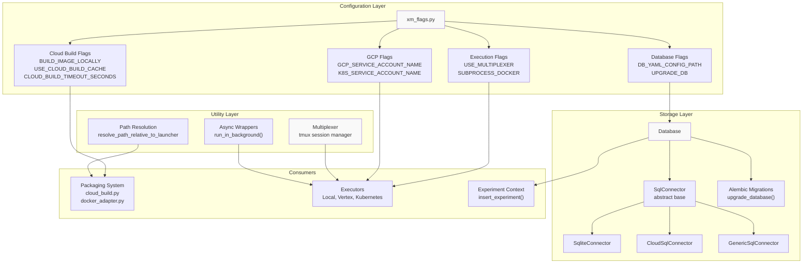
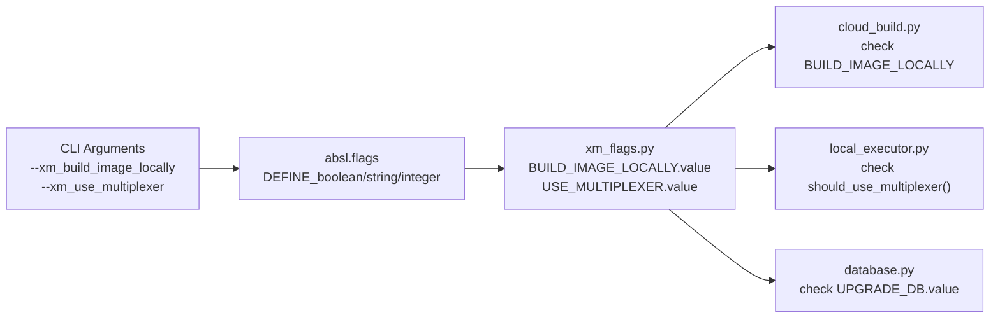
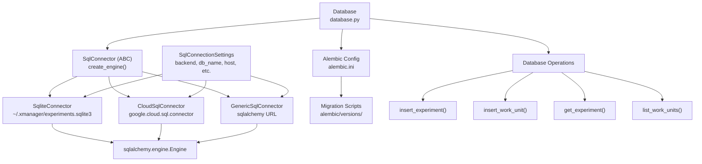
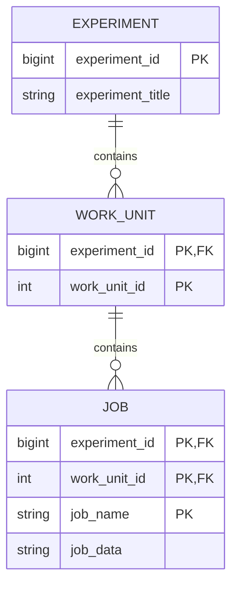
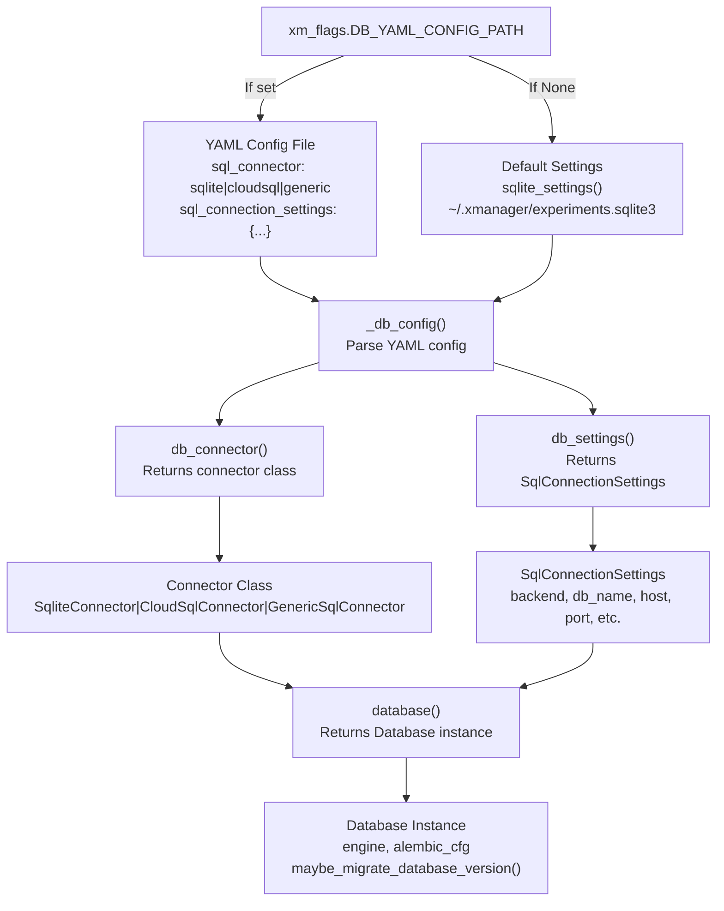
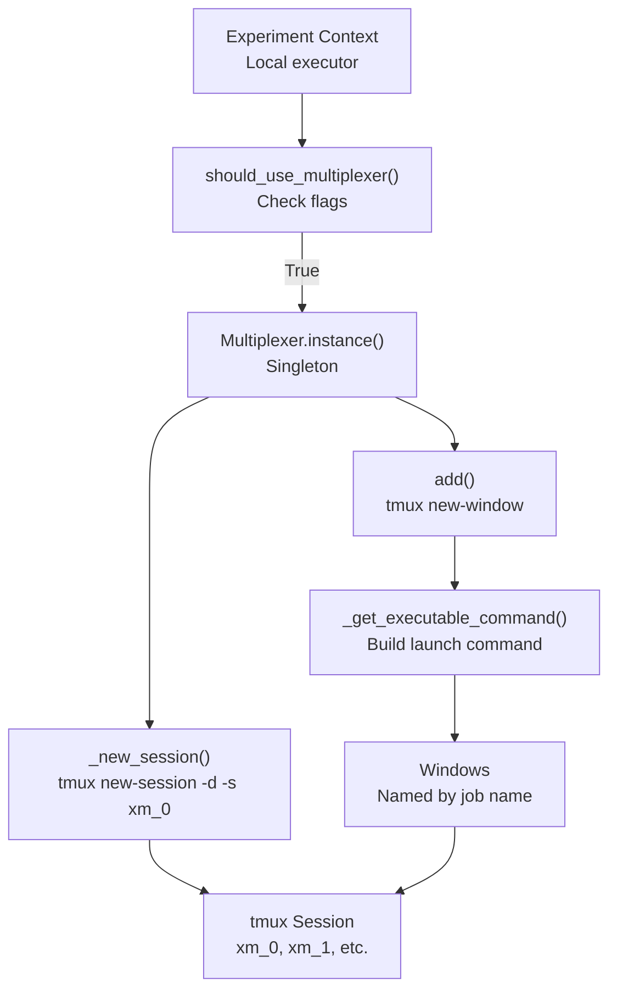
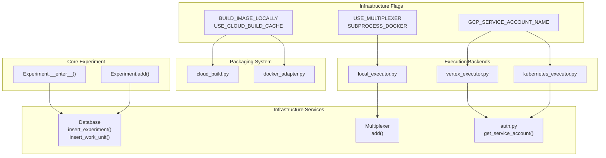

<!-- source: DeepWiki mcp.deepwiki.com · repo google-deepmind/xmanager · page 6 Infrastructure and Configuration · fetched 2026-10-26 -->

# Infrastructure and Configuration

<details>
<summary>Relevant source files</summary>

The following files were used as context for generating this wiki page:

- [xmanager/xm_flags.py](xmanager/xm_flags.py)
- [xmanager/xm_local/multiplexer.py](xmanager/xm_local/multiplexer.py)
- [xmanager/xm_local/storage/alembic.ini](xmanager/xm_local/storage/alembic.ini)
- [xmanager/xm_local/storage/alembic/README.md](xmanager/xm_local/storage/alembic/README.md)
- [xmanager/xm_local/storage/alembic/env.py](xmanager/xm_local/storage/alembic/env.py)
- [xmanager/xm_local/storage/alembic/script.py.mako](xmanager/xm_local/storage/alembic/script.py.mako)
- [xmanager/xm_local/storage/alembic/versions/f45829405692_migrate_or_create.py](xmanager/xm_local/storage/alembic/versions/f45829405692_migrate_or_create.py)
- [xmanager/xm_local/storage/database.py](xmanager/xm_local/storage/database.py)

</details>


## Purpose and Scope

This document describes XManager's infrastructure layer, which provides cross-cutting services that support experiment execution, packaging, and monitoring. The infrastructure layer consists of:

- **Configuration System**: Command-line flags that control system behavior across different backends and build strategies
- **Storage System**: Database connectors and schema for persisting experiment metadata
- **Authentication**: GCP service account management and API enablement (see [GCP Authentication](#6.3))
- **Utilities**: Helper systems for process management, path resolution, and distributed training (see [Utilities and Helpers](#6.4))

For information about how executors use these infrastructure components, see [Execution Backends](#5). For packaging integration, see [Packaging System](#4).

---

## Infrastructure Architecture Overview

The infrastructure layer is organized into four main subsystems that provide foundational services to the rest of XManager:



**Infrastructure Flow**: Configuration flags control behavior at multiple layers. The `xm_flags` module provides global settings accessed by packaging logic (cloud build timeouts, Docker preferences), executor implementations (multiplexer usage, subprocess options), and database operations (connection settings, migration control). The storage layer uses a connector pattern to abstract different SQL backends, with Alembic managing schema migrations. Utility systems provide process management and path resolution services consumed by multiple subsystems.

**Sources**: [xmanager/xm_flags.py:1-197](), [xmanager/xm_local/storage/database.py:1-413](), [xmanager/xm_local/multiplexer.py:1-137]()

---

## Configuration System

XManager uses the `xm_flags.py` module to centralize all configuration flags. Flags are defined using the `absl.flags` library and are organized by functional area:

### Flag Categories

| Category | Purpose | Key Flags |
|----------|---------|-----------|
| **Cloud Build** | Control Docker image building strategy | `BUILD_IMAGE_LOCALLY`, `USE_CLOUD_BUILD_CACHE`, `CLOUD_BUILD_TIMEOUT_SECONDS` |
| **Docker** | Docker execution preferences | `USE_DOCKER_COMMAND`, `SHOW_DOCKER_COMMAND_PROGRESS`, `SUBPROCESS_DOCKER` |
| **Database** | Storage backend configuration | `DB_YAML_CONFIG_PATH`, `UPGRADE_DB` |
| **Execution** | Local execution options | `USE_MULTIPLEXER`, `OPEN_MULTIPLEXER_WINDOW`, `BAZEL_COMMAND` |
| **GCP** | Cloud service configuration | `GCP_SERVICE_ACCOUNT_NAME`, `K8S_SERVICE_ACCOUNT_NAME` |
| **Advanced** | Specialized features | `WRAP_LATE_BINDINGS`, `USE_KANIKO`, `GCS_PATH` |

### Configuration Flow Diagram



**Flag Access Pattern**: Flags are accessed throughout the codebase using the `.value` attribute (e.g., `xm_flags.BUILD_IMAGE_LOCALLY.value`). Some flags have helper functions that implement derived logic, such as `should_use_multiplexer()` [xmanager/xm_flags.py:172-176]() which combines multiple flag values.

**Default Behavior**: Most flags have sensible defaults optimized for local development:
- `BUILD_IMAGE_LOCALLY=True`: Uses local Docker for faster iteration
- `USE_MULTIPLEXER=None`: Auto-detects based on other flags
- `DB_YAML_CONFIG_PATH=None`: Defaults to SQLite at `~/.xmanager/experiments.sqlite3`

For comprehensive flag documentation, see [Configuration Flags](#6.1).

**Sources**: [xmanager/xm_flags.py:24-197]()

---

## Storage System

The storage system persists experiment metadata using SQL databases. It implements a three-layer architecture:

### Storage Architecture



### Connector Pattern

The `SqlConnector` abstract base class [xmanager/xm_local/storage/database.py:71-77]() defines the interface for creating SQLAlchemy engines. Three implementations are provided:

1. **SqliteConnector** [xmanager/xm_local/storage/database.py:104-122](): 
   - Default connector for local development
   - Creates database file if it doesn't exist
   - Path: `~/.xmanager/experiments.sqlite3` (default)

2. **CloudSqlConnector** [xmanager/xm_local/storage/database.py:124-160]():
   - Connects to Google Cloud SQL instances
   - Uses `google.cloud.sql.connector.Connector`
   - Supports MySQL, PostgreSQL, MSSQL backends
   - Configurable for private/public IP

3. **GenericSqlConnector** [xmanager/xm_local/storage/database.py:83-101]():
   - Generic SQLAlchemy URL-based connector
   - Supports any SQLAlchemy-compatible backend

### Database Schema

The database stores a three-level hierarchy:



The `job_data` field stores serialized protobuf data (`data_pb2.Job`) containing backend-specific information like Vertex AI job IDs or Kubernetes namespaces.

### Migration System

The `Database` class integrates Alembic for schema migrations [xmanager/xm_local/storage/database.py:187-233]():

- **Automatic Version Check**: On initialization, checks if database version matches latest
- **Safe Migration**: Requires `--xm_upgrade_db` flag to prevent accidental upgrades
- **Legacy Support**: Migrates old SQLite databases with `VersionHistory` table

The initial migration [xmanager/xm_local/storage/alembic/versions/f45829405692_migrate_or_create.py:1-178]() handles two scenarios:
1. Migrating legacy SQLite databases (renames tables, updates column types)
2. Creating fresh database tables for new installations

For detailed database configuration, see [Database Storage](#6.2).

**Sources**: [xmanager/xm_local/storage/database.py:1-413](), [xmanager/xm_local/storage/alembic/versions/f45829405692_migrate_or_create.py:1-178](), [xmanager/xm_local/storage/alembic.ini:1-85]()

---

## Configuration-to-Database Flow

The following diagram shows how configuration flags control database connector selection and initialization:



All three functions (`_db_config()`, `db_connector()`, `db_settings()`) use `@functools.lru_cache()` decorators [xmanager/xm_local/storage/database.py:371-412]() to ensure singleton behavior—the database configuration is only parsed once per process.

**Sources**: [xmanager/xm_local/storage/database.py:371-413](), [xmanager/xm_flags.py:117-138]()

---

## Multiplexer System

The `Multiplexer` class [xmanager/xm_local/multiplexer.py:34-136]() manages local job execution in persistent tmux terminal sessions. This is particularly useful for:
- Interactive development and debugging
- Monitoring multiple jobs simultaneously
- Preserving job output after XManager exits

### Multiplexer Architecture



### Multiplexer Usage

When `should_use_multiplexer()` returns `True` (either via `--xm_use_multiplexer` or `--xm_open_multiplexer_window`), the local executor uses the multiplexer to launch jobs:

1. **Session Creation**: First job creates a new tmux session with unique name (`xm_0`, `xm_1`, etc.)
2. **Window Management**: Each subsequent job creates a new window in the session
3. **Auto-Attach**: If `--xm_open_multiplexer_window=N` is set, switches to window N automatically
4. **Persistent Output**: Job output remains accessible via `tmux attach -t xm_N`

The executable command [xmanager/xm_local/multiplexer.py:17-31]() is constructed to:
- Set environment variables
- Execute the binary/container
- Echo the command for easy copy-paste
- Drop into a shell after completion

**Sources**: [xmanager/xm_local/multiplexer.py:1-137](), [xmanager/xm_flags.py:158-176]()

---

## Integration with Execution and Packaging

The infrastructure layer is consumed by higher-level systems through well-defined interfaces:

### Infrastructure Integration Points



### Usage Patterns

**Packaging Layer**: 
- Checks `BUILD_IMAGE_LOCALLY.value` to decide between local Docker or Cloud Build
- Uses `CLOUD_BUILD_TIMEOUT_SECONDS.value` for build time limits
- Respects `USE_CLOUD_BUILD_CACHE.value` for caching strategy

**Local Executor**:
- Calls `should_use_multiplexer()` to determine if tmux should be used
- If true, obtains `Multiplexer.instance()` and calls `add()` for each job
- Otherwise, uses direct subprocess execution

**Cloud Executors**:
- Access `GCP_SERVICE_ACCOUNT_NAME.value` for service account configuration
- Use `K8S_SERVICE_ACCOUNT_NAME.value` for Kubernetes pod specifications

**Experiment Context**:
- Calls `database().insert_experiment()` on context entry
- Calls `database().insert_work_unit()` when jobs are added
- Backend-specific methods (`insert_vertex_job()`, `insert_kubernetes_job()`) store execution handles

**Sources**: [xmanager/xm_flags.py:1-197](), [xmanager/xm_local/storage/database.py:235-294](), [xmanager/xm_local/multiplexer.py:96-130]()

---

## YAML Configuration Format

For advanced database configurations, XManager supports YAML configuration files specified via `--xm_db_yaml_config_path`. The YAML file must contain two top-level keys:

### Configuration Structure

```yaml
sql_connector: "sqlite" | "generic" | "cloudsql"

sql_connection_settings:
  backend: "mysql" | "postgresql" | "sqlite" | "mssql"
  db_name: "database_name"
  driver: "pymysql" | "pg8000" | "pytds"  # optional
  username: "user"                         # optional
  password: "pass"                         # optional
  host: "hostname_or_instance_connection"  # optional
  port: 3306                               # optional
```

### Example Configurations

**SQLite (explicit)**:
```yaml
sql_connector: sqlite
sql_connection_settings:
  backend: sqlite
  db_name: /path/to/experiments.db
```

**Cloud SQL (MySQL)**:
```yaml
sql_connector: cloudsql
sql_connection_settings:
  backend: mysql
  db_name: xmanager_db
  username: xmanager_user
  password: secret
  host: project:region:instance-name
```

**Generic PostgreSQL**:
```yaml
sql_connector: generic
sql_connection_settings:
  backend: postgresql
  driver: pg8000
  db_name: experiments
  username: xmanager
  password: secret
  host: postgres.example.com
  port: 5432
```

The configuration is parsed by `_db_config()` [xmanager/xm_local/storage/database.py:371-383]() and validated by `_validate_db_config()` [xmanager/xm_local/storage/database.py:357-368]().

**Sources**: [xmanager/xm_local/storage/database.py:357-407](), [xmanager/xm_flags.py:117-138]()

---

## Related Documentation

For more detailed information about specific infrastructure components:

- **[Configuration Flags](#6.1)**: Comprehensive reference for all flags in `xm_flags.py`
- **[Database Storage](#6.2)**: Detailed database operations, schema, and migration procedures
- **[GCP Authentication](#6.3)**: Service account setup and GCP API configuration
- **[Utilities and Helpers](#6.4)**: Path resolution, async wrappers, and CLUSTER_SPEC management

For information about how infrastructure is used by other systems:

- **[Execution Backends](#5)**: How executors consume configuration and storage
- **[Packaging System](#4)**: How packaging uses build flags and Docker configuration
- **[Core Concepts](#3)**: How experiments interact with the database layer

---

