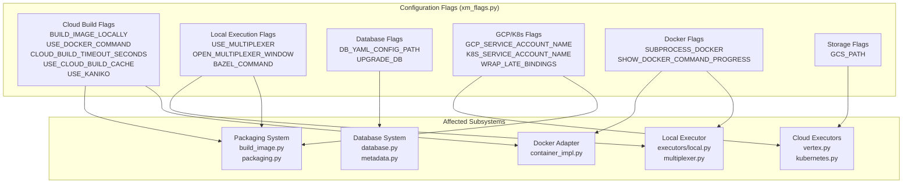
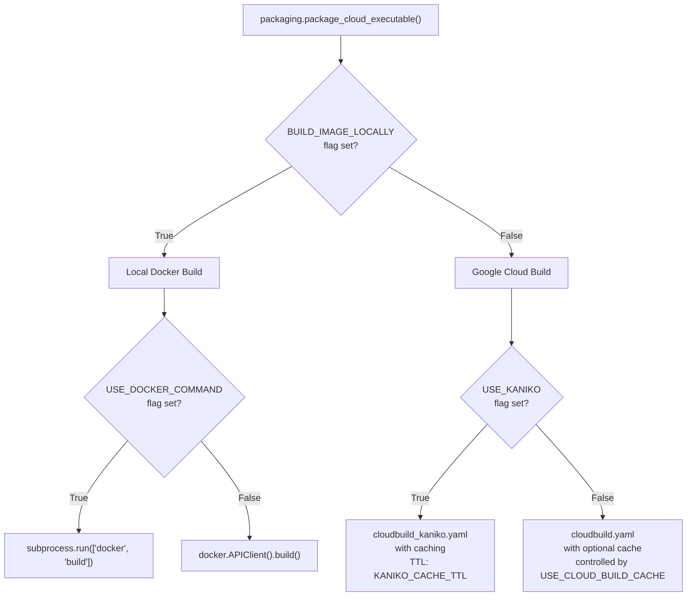
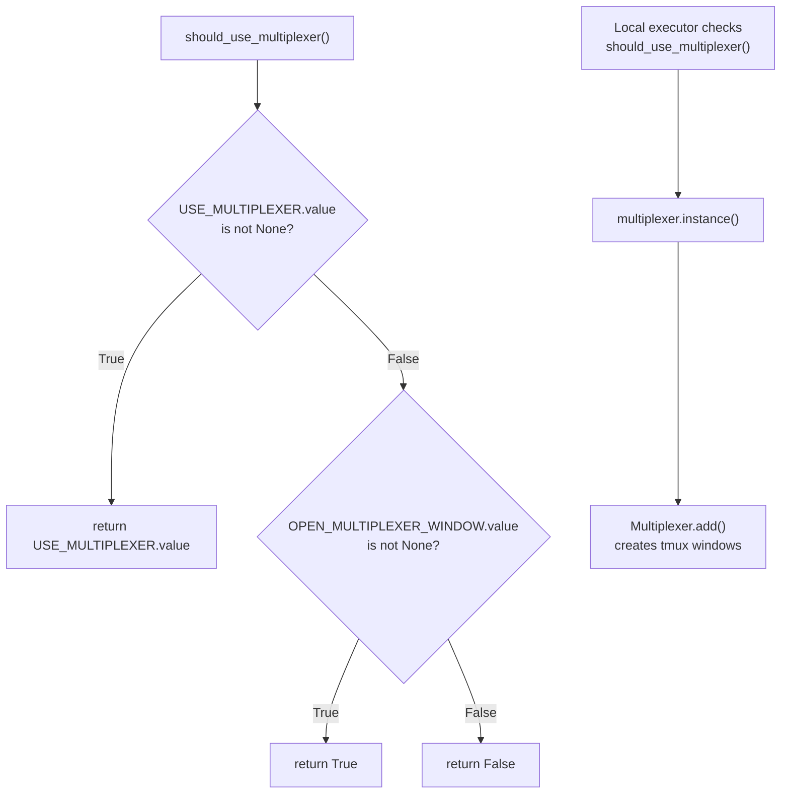
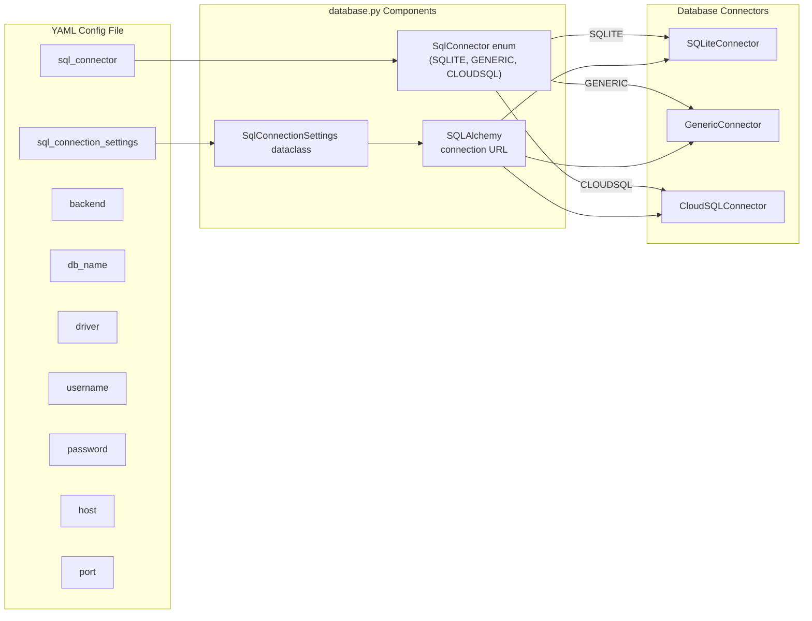
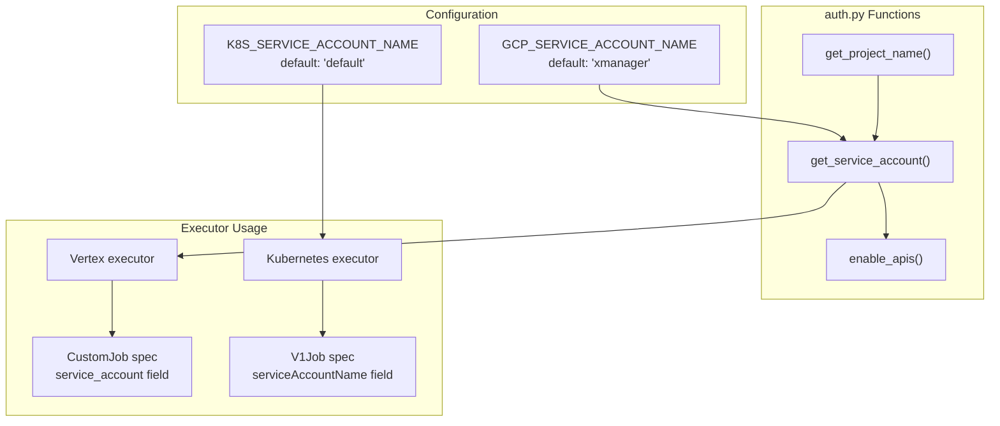
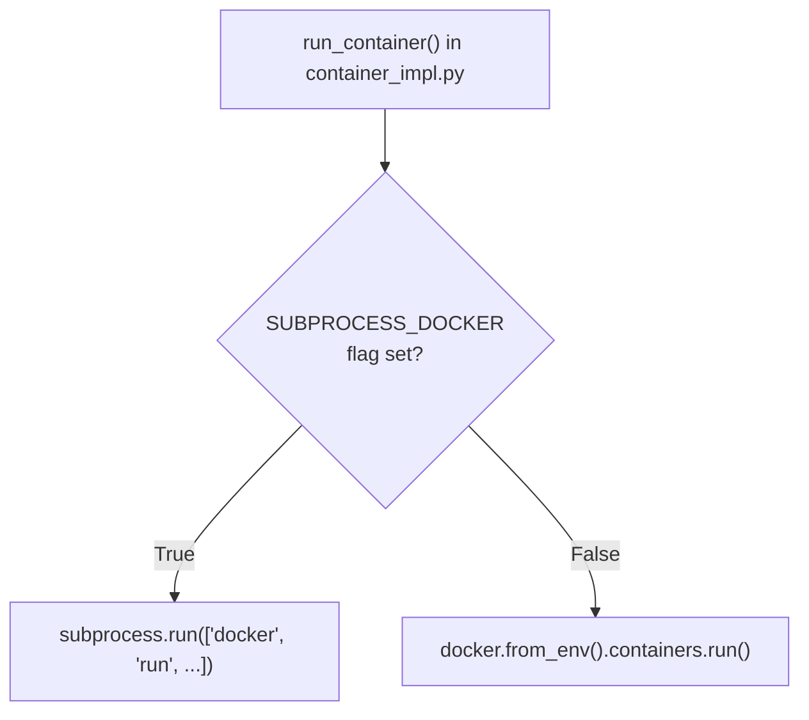
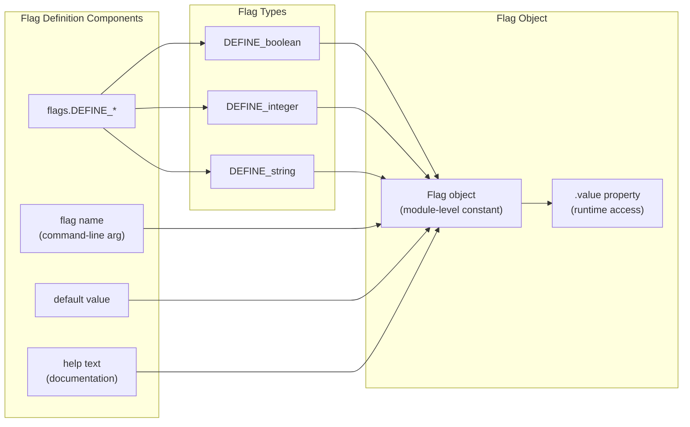

<!-- source: DeepWiki mcp.deepwiki.com · repo google-deepmind/xmanager · page 6.1 Configuration Flags · fetched 2026-10-26 -->

# Configuration Flags

<details>
<summary>Relevant source files</summary>

The following files were used as context for generating this wiki page:

- [xmanager/xm_flags.py](xmanager/xm_flags.py)
- [xmanager/xm_local/multiplexer.py](xmanager/xm_local/multiplexer.py)

</details>


This document provides a comprehensive reference for all configuration flags in XManager, defined in [xmanager/xm_flags.py](). These flags control XManager's behavior across different subsystems including cloud build strategies, local execution, database connections, GCP authentication, and Docker operations.

For information about database storage implementation, see [Database Storage](#6.2). For GCP authentication setup, see [GCP Authentication](#6.3). For executor-specific configuration, see [Local Executor](#5.1), [Vertex AI Executor](#5.2), and [Kubernetes Executor](#5.3).

## Flag Organization

XManager flags are organized into five functional categories, each controlling a distinct subsystem:

**Flag Categories and Their Subsystems**



**Sources:** [xmanager/xm_flags.py:1-197]()

## Cloud Build Configuration

These flags control Docker image building strategies, determining whether images are built locally or in Google Cloud Build, and how caching is configured.

| Flag Name | Type | Default | Description |
|-----------|------|---------|-------------|
| `xm_build_image_locally` | boolean | `True` | Use local Docker instead of remote Google Cloud Build. Usually faster but requires Docker installation. |
| `xm_use_docker_command` | boolean | `True` | Call `docker build` in subprocess rather than using Python docker client library. Provides better interactive output. |
| `xm_show_docker_command_progress` | boolean | `False` | Show container output during `docker build` operations. |
| `xm_cloud_build_timeout_seconds` | integer | `1200` | Maximum build time for Cloud Build operations, in seconds. |
| `xm_use_cloud_build_cache` | boolean | `False` | Enable Cloud Build cache. Requires an image with `:latest` tag to exist. |
| `xm_use_kaniko` | boolean | `False` | Use kaniko backend for Cloud Build with automatic caching enabled. |
| `xm_kaniko_cache_ttl` | string | `"336h"` | Cache TTL for kaniko builds (default: 14 days). |

**Build Strategy Decision Flow**



**Sources:** [xmanager/xm_flags.py:26-92]()

### Usage Examples

Build locally with subprocess (default behavior):
```bash
python launcher.py -- --xm_build_image_locally=true --xm_use_docker_command=true
```

Use Google Cloud Build with kaniko caching:
```bash
python launcher.py -- --xm_build_image_locally=false --xm_use_kaniko=true --xm_kaniko_cache_ttl="168h"
```

Show detailed Docker build output:
```bash
python launcher.py -- --xm_show_docker_command_progress=true
```

**Sources:** [xmanager/xm_flags.py:26-92]()

## Local Execution Configuration

These flags control how jobs are executed locally, including multiplexer (tmux) integration and Bazel command configuration.

| Flag Name | Type | Default | Description |
|-----------|------|---------|-------------|
| `xm_use_multiplexer` | boolean | `None` | Run local jobs in tmux terminal multiplexer. If `None`, automatically enabled when `xm_open_multiplexer_window` is set. |
| `xm_open_multiplexer_window` | integer | `None` | Window index (starting from 1) to switch to in new tmux session. Setting this implicitly enables multiplexer. |
| `xm_bazel_command` | string | `"bazel"` | Command to invoke Bazel. Useful for custom Bazel installations or wrappers. |

**Multiplexer Flag Logic**



**Sources:** [xmanager/xm_flags.py:158-177](), [xmanager/xm_local/multiplexer.py:172-176]()

### Multiplexer Behavior

The `should_use_multiplexer()` helper function [xmanager/xm_flags.py:172-176]() implements the following logic:
1. If `xm_use_multiplexer` is explicitly set, return its value
2. Otherwise, return `True` if `xm_open_multiplexer_window` is set
3. Otherwise, return `False`

When the multiplexer is enabled, the `Multiplexer` class [xmanager/xm_local/multiplexer.py:34-136]() creates a tmux session named `xm_0`, `xm_1`, etc., and each job runs in a separate tmux window named after the job.

**Usage Examples**

Enable multiplexer explicitly:
```bash
python launcher.py -- --xm_use_multiplexer=true
```

Enable multiplexer and switch to window 2:
```bash
python launcher.py -- --xm_open_multiplexer_window=2
```

Use custom Bazel command:
```bash
python launcher.py -- --xm_bazel_command="/usr/local/bin/bazelisk"
```

**Sources:** [xmanager/xm_flags.py:152-177](), [xmanager/xm_local/multiplexer.py:1-137]()

## Database Configuration

These flags control database connectivity and schema migration behavior.

| Flag Name | Type | Default | Description |
|-----------|------|---------|-------------|
| `xm_db_yaml_config_path` | string | `None` | Path to YAML configuration file containing database connection details. |
| `xm_upgrade_db` | boolean | `False` | Enable automatic database schema upgrades using Alembic migrations. |

### Database YAML Configuration Format

The `xm_db_yaml_config_path` file must contain two main sections [xmanager/xm_flags.py:117-138]():

**Required Structure:**
```yaml
sql_connector: <sqlite | generic | cloudsql>

sql_connection_settings:
  backend: <mysql | postgresql>
  db_name: <database_name>
  driver: <pymysql | pg8000>
  username: <user>
  password: <password>
  host: <hostname or CloudSQL instance connection name>
  port: <port_number>
```

**Configuration Fields Mapping**



**Sources:** [xmanager/xm_flags.py:117-150]()

### Schema Migration Control

The `xm_upgrade_db` flag controls whether Alembic migrations are automatically applied. When set to `True`, XManager invokes Alembic to upgrade the database schema to the latest version.

**Warning:** The flag documentation [xmanager/xm_flags.py:143-149]() recommends taking database backups before enabling automatic upgrades, as migrations can fail or partially complete, especially with non-transactional DDL operations.

**Usage Examples**

Configure SQLite database:
```bash
python launcher.py -- --xm_db_yaml_config_path="/path/to/sqlite_config.yaml"
```

Configure CloudSQL with automatic migration:
```bash
python launcher.py -- --xm_db_yaml_config_path="/path/to/cloudsql_config.yaml" --xm_upgrade_db=true
```

**Sources:** [xmanager/xm_flags.py:117-150]()

## GCP and Kubernetes Configuration

These flags configure authentication and service accounts for cloud execution backends.

| Flag Name | Type | Default | Description |
|-----------|------|---------|-------------|
| `xm_gcp_service_account_name` | string | `"xmanager"` | User-managed GCP service account name (part before `@` in full email). Full format: `{name}@{project-id}.iam.gserviceaccount.com` |
| `xm_k8s_service_account_name` | string | `"default"` | Kubernetes service account name used in pod specifications. |
| `xm_wrap_late_bindings` | boolean | `False` | Feature flag to wrap/unwrap late bindings for network addresses. Only works with PythonContainer. Requires `./entrypoint.sh` as ENTRYPOINT. |

**Service Account Usage Flow**



**Sources:** [xmanager/xm_flags.py:94-113]()

### Late Bindings Feature

The `xm_wrap_late_bindings` flag [xmanager/xm_flags.py:51-60]() enables special handling for late bindings in distributed training scenarios. This feature:
- Wraps network addresses for cross-worker communication
- Only supports `PythonContainer` executables with default or simple instructions
- Requires the container's ENTRYPOINT to be `./entrypoint.sh`

**Usage Examples**

Configure custom GCP service account:
```bash
python launcher.py -- --xm_gcp_service_account_name="my-custom-sa"
```

Configure Kubernetes service account:
```bash
python launcher.py -- --xm_k8s_service_account_name="xmanager-jobs"
```

Enable late bindings for distributed training:
```bash
python launcher.py -- --xm_wrap_late_bindings=true
```

**Sources:** [xmanager/xm_flags.py:51-60](), [xmanager/xm_flags.py:94-113]()

## Docker Execution Configuration

These flags control how Docker operations are executed at the subprocess level.

| Flag Name | Type | Default | Description |
|-----------|------|---------|-------------|
| `xm_subprocess_docker_impl` | boolean | `False` | Launch Docker using `subprocess` command instead of Python Docker client library. |

**Docker Implementation Choice**



This flag affects the Docker adapter layer used by the local executor. When enabled, Docker commands are invoked directly via subprocess rather than through the Python Docker SDK, which can be useful for debugging or compatibility with certain Docker configurations.

**Usage Examples**

Use subprocess Docker implementation:
```bash
python launcher.py -- --xm_subprocess_docker_impl=true
```

**Sources:** [xmanager/xm_flags.py:181-185]()

## Storage Configuration

These flags configure external storage locations for experiment outputs.

| Flag Name | Type | Default | Description |
|-----------|------|---------|-------------|
| `xm_gcs_path` | string | `None` | GCS directory to store outputs, in `gs://bucket/directory` format. |

This flag is used by contrib modules and cloud executors to specify a Google Cloud Storage location for experiment artifacts, logs, and outputs.

**Usage Examples**

Configure GCS output path:
```bash
python launcher.py -- --xm_gcs_path="gs://my-bucket/experiments/outputs"
```

**Sources:** [xmanager/xm_flags.py:189-196]()

## Flag Definition Pattern

All XManager flags follow a consistent definition pattern using the `absl.flags` library [xmanager/xm_flags.py:22]():

**Flag Definition Structure**



Each flag is defined as a module-level constant (uppercase naming convention) and accessed via its `.value` property at runtime.

**Example Pattern:**
```python
FLAG_NAME = flags.DEFINE_type(
    'xm_flag_name',  # Command-line argument
    default_value,   # Default value
    'Help text'      # Documentation
)

# Runtime access:
if FLAG_NAME.value:
    # Use the flag value
```

**Sources:** [xmanager/xm_flags.py:26-196]()

## Summary Table

| Category | Flags | Primary Use Case |
|----------|-------|------------------|
| **Cloud Build** | 8 flags | Control Docker image building strategy (local vs Cloud Build, caching) |
| **Local Execution** | 3 flags | Configure tmux multiplexer and Bazel command |
| **Database** | 2 flags | Configure database connection and schema migrations |
| **GCP/K8s** | 3 flags | Set service account names and distributed training features |
| **Docker** | 1 flag | Control Docker subprocess implementation |
| **Storage** | 1 flag | Configure GCS output location |

All flags use the `xm_` prefix to namespace them within the absl flags system and are defined in [xmanager/xm_flags.py](). They can be set via command-line arguments when launching experiments.

**Sources:** [xmanager/xm_flags.py:1-197]()

---

