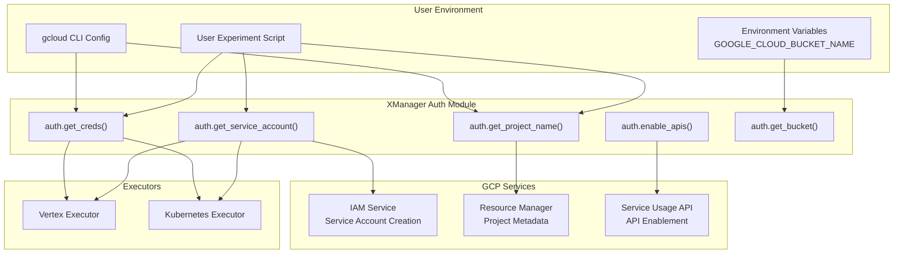
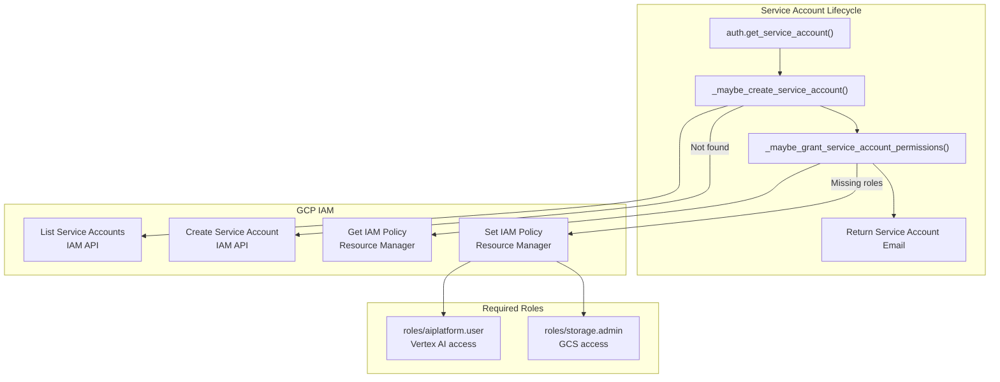
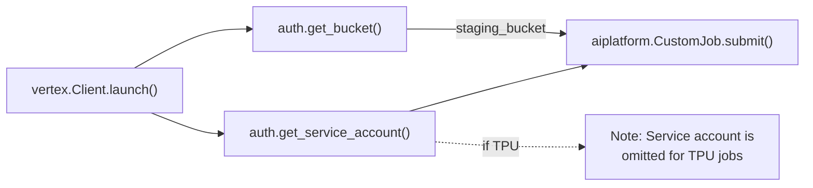

<!-- source: DeepWiki mcp.deepwiki.com · repo google-deepmind/xmanager · page 6.3 GCP Authentication · fetched 2026-10-26 -->

# GCP Authentication

<details>
<summary>Relevant source files</summary>

The following files were used as context for generating this wiki page:

- [xmanager/cloud/auth.py](xmanager/cloud/auth.py)
- [xmanager/cloud/auth_test.py](xmanager/cloud/auth_test.py)
- [xmanager/cloud/utils.py](xmanager/cloud/utils.py)
- [xmanager/cloud/utils_test.py](xmanager/cloud/utils_test.py)
- [xmanager/cloud/vertex.py](xmanager/cloud/vertex.py)
- [xmanager/cloud/vertex_test.py](xmanager/cloud/vertex_test.py)
- [xmanager/xm_local/__init__.py](xmanager/xm_local/__init__.py)
- [xmanager/xm_local/executors_test.py](xmanager/xm_local/executors_test.py)
- [xmanager/xm_local/handles.py](xmanager/xm_local/handles.py)
- [xmanager/xm_local/registry.py](xmanager/xm_local/registry.py)

</details>


## Purpose and Scope

This page documents the GCP (Google Cloud Platform) authentication system in XManager. This system manages credentials, service accounts, and API access required for cloud-based executors such as Vertex AI and Kubernetes.

For information about executor-specific configurations, see [Vertex AI Executor](#5.2) and [Kubernetes Executor](#5.3). For general configuration flags, see [Configuration Flags](#6.1).

---

## Overview

XManager's GCP authentication system handles three primary responsibilities:

1. **Project identification** - Determining which GCP project to use
2. **Credential management** - Obtaining and caching authentication credentials
3. **Service account management** - Creating and configuring service accounts with appropriate permissions

The authentication logic is centralized in [xmanager/cloud/auth.py:1-180]() and is automatically invoked when cloud executors are used.

**Authentication Flow**



Sources: [xmanager/cloud/auth.py:1-180](), [xmanager/cloud/vertex.py:1-417]()

---

## Project Identification

XManager uses two forms of project identification: **Project ID** (string name) and **Project Number** (numeric identifier).

### get_project_name()

Returns the GCP Project ID (string identifier like `my-project-123`). This function uses the Google Auth library's default credential mechanism, which searches in the following order:

1. Environment variable `GOOGLE_APPLICATION_CREDENTIALS`
2. gcloud CLI application-default credentials
3. Compute Engine/App Engine default credentials

**Implementation:**

[xmanager/cloud/auth.py:29-32]()

**Usage in code:**
```python
project_name = auth.get_project_name()
# Returns: "my-project-123"
```

### get_project_number()

Returns the GCP Project Number (numeric identifier like `123456789012`). This is required for certain API operations, particularly service enablement.

**Implementation:**

[xmanager/cloud/auth.py:35-39]()

Sources: [xmanager/cloud/auth.py:29-39]()

---

## Credential Management

### get_creds()

Retrieves authenticated credentials for use with GCP APIs. The credentials are scoped for cloud platform access and cached by the Google Auth library.

**Implementation:**

[xmanager/cloud/auth.py:42-45]()

**Default Scopes:**

The function uses cloud platform scope by default:

[xmanager/cloud/auth.py:26-26]()

This scope provides broad access to GCP resources. Custom scopes can be provided as an argument if narrower permissions are required.

**Usage Pattern:**

The credentials are used internally by the `googleapiclient.discovery.build()` calls throughout the authentication module and in executor implementations.

Sources: [xmanager/cloud/auth.py:42-45](), [xmanager/cloud/vertex.py:114-128]()

---

## Service Account Management

XManager creates and manages a dedicated service account for running jobs on cloud executors. This provides better security and permission management than using default compute service accounts.

### Service Account Architecture



Sources: [xmanager/cloud/auth.py:72-166]()

### get_service_account()

Main entry point for service account management. Returns the service account email address, creating the account and granting permissions if necessary.

**Implementation:**

[xmanager/cloud/auth.py:72-103]()

**Service Account Naming:**

The service account name is configurable via the `--xm_gcp_service_account_name` flag (defaults to `xmanager`). The full email format is:
```
{service_account_name}@{project_id}.iam.gserviceaccount.com
```

**Error Handling:**

The function tolerates `403 Forbidden` errors, which occur when:
- The user lacks IAM Admin permissions
- The Cloud Resource Manager API is not enabled

This allows usage in environments where a project administrator has pre-configured the service account.

Sources: [xmanager/cloud/auth.py:72-103](), [xmanager/xm_flags.py]()

### _maybe_create_service_account()

Creates a new service account if it doesn't already exist. The function lists all service accounts in the project and checks for a matching email address.

**Implementation:**

[xmanager/cloud/auth.py:106-132]()

**Service Account Configuration:**

When creating a service account, the following properties are set:
- **accountId**: Name portion of the email (e.g., `xmanager`)
- **displayName**: Human-readable name (same as accountId)
- **description**: Fixed string `"XManager service account"`

Sources: [xmanager/cloud/auth.py:106-132](), [xmanager/cloud/auth_test.py:88-146]()

### _maybe_grant_service_account_permissions()

Ensures the service account has the necessary IAM roles. The function retrieves the current IAM policy, adds missing role bindings, and updates the policy if changes are needed.

**Implementation:**

[xmanager/cloud/auth.py:135-151]()

**Required IAM Roles:**

| Role | Purpose | Justification |
|------|---------|---------------|
| `roles/aiplatform.user` | Create and manage Vertex AI jobs | Required for Vertex executor to submit CustomJobs |
| `roles/storage.admin` | Read/write to Google Cloud Storage | Required for accessing training data, writing checkpoints, and storing outputs |

**Permission Addition Logic:**

[xmanager/cloud/auth.py:154-166]()

The `_add_member_to_iam_policy()` helper function modifies the IAM policy dictionary in-place, either appending the service account to an existing role binding or creating a new binding.

Sources: [xmanager/cloud/auth.py:135-166](), [xmanager/cloud/auth_test.py:207-286]()

---

## API Enablement

### enable_apis()

Enables required GCP APIs for XManager functionality. This function is decorated with `@functools.lru_cache()`, so it only executes once per Python session.

**Implementation:**

[xmanager/cloud/auth.py:48-69]()

**Enabled APIs:**

| API Service ID | Purpose |
|----------------|---------|
| `aiplatform.googleapis.com` | Vertex AI training and prediction |
| `cloudbuild.googleapis.com` | Cloud Build for container image building |
| `cloudresourcemanager.googleapis.com` | Project metadata and IAM management |
| `compute.googleapis.com` | Compute Engine VM management |
| `container.googleapis.com` | Google Kubernetes Engine (GKE) |
| `containerregistry.googleapis.com` | Google Container Registry (GCR) |
| `iam.googleapis.com` | Service account management |
| `logging.googleapis.com` | Cloud Logging for job logs |
| `storage-api.googleapis.com` | Google Cloud Storage operations |
| `tpu.googleapis.com` | Cloud TPU resource management |

**Batch Enablement:**

The function uses the Service Usage API's `batchEnable` method to enable all APIs in a single operation, which is more efficient than enabling them individually.

Sources: [xmanager/cloud/auth.py:48-69]()

---

## Storage Bucket Configuration

### get_bucket()

Retrieves the Google Cloud Storage bucket name for storing experiment artifacts, logs, and intermediate outputs.

**Implementation:**

[xmanager/cloud/auth.py:169-179]()

**Configuration:**

The bucket name **must** be set via the `GOOGLE_CLOUD_BUCKET_NAME` environment variable before running experiments:

```bash
export GOOGLE_CLOUD_BUCKET_NAME=my-experiment-bucket
```

**Bucket Creation:**

If the bucket doesn't exist, create it using `gsutil`:

```bash
gsutil mb -l us-central1 gs://$GOOGLE_CLOUD_BUCKET_NAME
```

The region should match the region where your executors run to minimize data transfer costs and latency.

**Error Handling:**

If the environment variable is not set, the function raises a `ValueError` with detailed instructions for setting up the bucket.

Sources: [xmanager/cloud/auth.py:169-179](), [xmanager/cloud/vertex_test.py:39-39]()

---

## Integration with Executors

### Vertex AI Executor Integration

The Vertex AI executor uses authentication components to launch and manage CustomJobs.

**Service Account Usage:**



**Implementation Reference:**

[xmanager/cloud/vertex.py:186-196]()

**TPU Exception:**

Vertex AI has a limitation where TPU jobs cannot use custom service accounts. When TPU resources are detected, `service_account` is set to `None`:

[xmanager/cloud/vertex.py:184-191]()

**Project and Location:**

The Vertex client initializes with the project name from `auth.get_project_name()`:

[xmanager/cloud/vertex.py:114-127]()

Sources: [xmanager/cloud/vertex.py:114-198]()

### Kubernetes Executor Integration

While Kubernetes executor details are covered in [Kubernetes Executor](#5.3), it similarly relies on GCP authentication for:

- Container image pushing to Google Container Registry (GCR)
- GKE cluster authentication
- Service account credentials for workload identity

The authentication module's credentials and project identification are used throughout the Kubernetes client initialization.

Sources: [xmanager/xm_local/__init__.py:118-136]()

---

## Authentication Module Access

The authentication module is exposed through the `xm_local` package:

[xmanager/xm_local/__init__.py:26-30]()

**Import Pattern:**

```python
from xmanager import xm_local

# Access authentication functions
project = xm_local.auth.get_project_name()
bucket = xm_local.auth.get_bucket()
```

This allows users to access authentication utilities if needed for custom integrations or debugging.

Sources: [xmanager/xm_local/__init__.py:1-137]()

---

## Authentication Testing

### Test Coverage

The authentication module has comprehensive test coverage for various scenarios:

**Service Account Test Scenarios:**

| Test Case | File Reference | Description |
|-----------|----------------|-------------|
| Existing account with permissions | [xmanager/cloud/auth_test.py:38-85]() | No-op when properly configured |
| New account creation | [xmanager/cloud/auth_test.py:88-146]() | Creates account and grants roles |
| Existing account without permissions | [xmanager/cloud/auth_test.py:149-204]() | Only adds missing permissions |
| Existing account with partial permissions | [xmanager/cloud/auth_test.py:207-286]() | Adds only missing roles |

**Custom Service Account Name:**

Tests verify that the `--xm_gcp_service_account_name` flag correctly changes the service account name:

[xmanager/cloud/auth_test.py:15-27]()

Sources: [xmanager/cloud/auth_test.py:1-290]()

---

## Common Authentication Patterns

### Pattern 1: Executor Initialization

When cloud executors are created, authentication happens automatically:

```python
with xm_local.create_experiment(experiment_title='my_exp') as experiment:
    # Authentication occurs during executor usage
    executor = xm_local.Vertex()
    
    # Service account is obtained and configured here
    experiment.add(xm.Job(executable=..., executor=executor))
```

### Pattern 2: Manual Service Account Access

For advanced use cases requiring direct service account access:

```python
from xmanager import xm_local

# Get service account email
service_account = xm_local.auth.get_service_account()
print(f"Using service account: {service_account}")

# Use in custom GCP API calls
# ...
```

### Pattern 3: Multi-Project Setup

For environments with multiple GCP projects, ensure the correct project is selected via gcloud:

```bash
gcloud config set project my-experiment-project
gcloud auth application-default login
```

Then XManager will automatically use that project:

```python
# Will use project from gcloud config
project = xm_local.auth.get_project_name()
```

Sources: [xmanager/cloud/auth.py:29-45](), [xmanager/cloud/vertex.py:114-128]()

---

## Troubleshooting

### Permission Errors

**Symptom:** `403 Forbidden` errors when calling `get_service_account()`

**Solutions:**
1. Ensure you have `roles/iam.serviceAccountAdmin` role in the project
2. Enable Cloud Resource Manager API: `gcloud services enable cloudresourcemanager.googleapis.com`
3. Have a project administrator pre-create the service account with required permissions

### Missing Bucket Error

**Symptom:** `ValueError: $GOOGLE_CLOUD_BUCKET_NAME is undefined`

**Solution:**
```bash
export GOOGLE_CLOUD_BUCKET_NAME=my-bucket-name
gsutil mb -l us-central1 gs://$GOOGLE_CLOUD_BUCKET_NAME
```

### Authentication Not Found

**Symptom:** `google.auth.exceptions.DefaultCredentialsError`

**Solutions:**
1. Run `gcloud auth application-default login`
2. Or set `GOOGLE_APPLICATION_CREDENTIALS` to a service account key file
3. Ensure you're running in a GCP environment (Compute Engine, Cloud Shell, etc.)

Sources: [xmanager/cloud/auth.py:29-179]()

---

