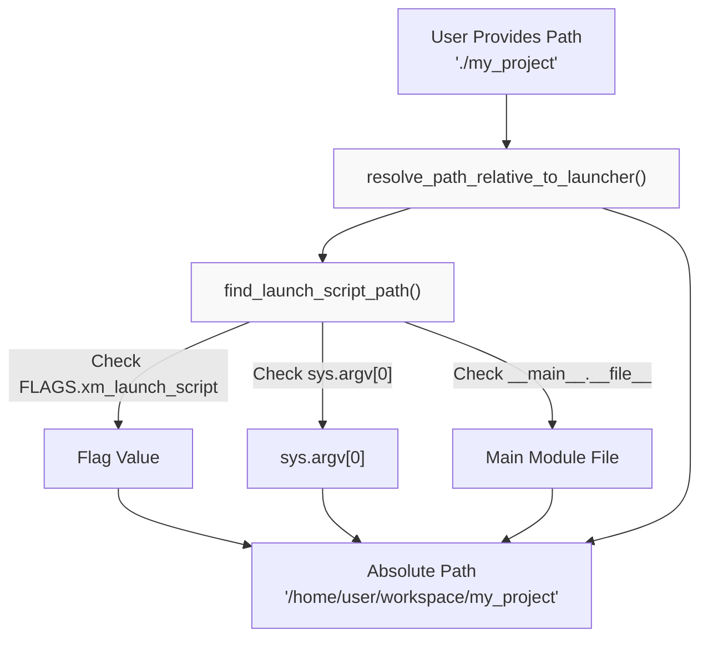
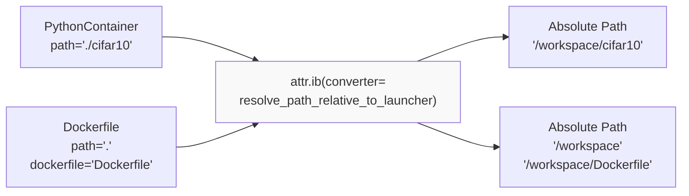
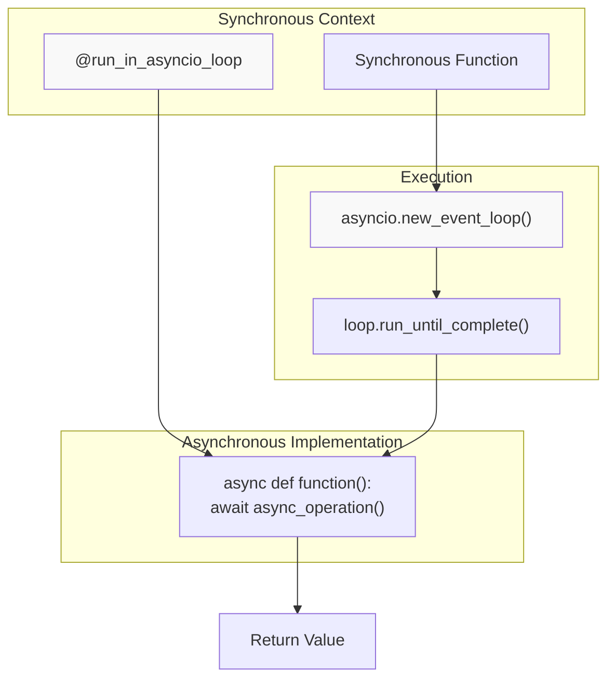
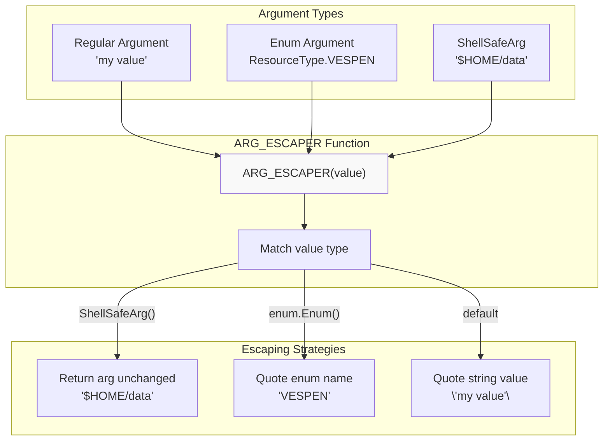
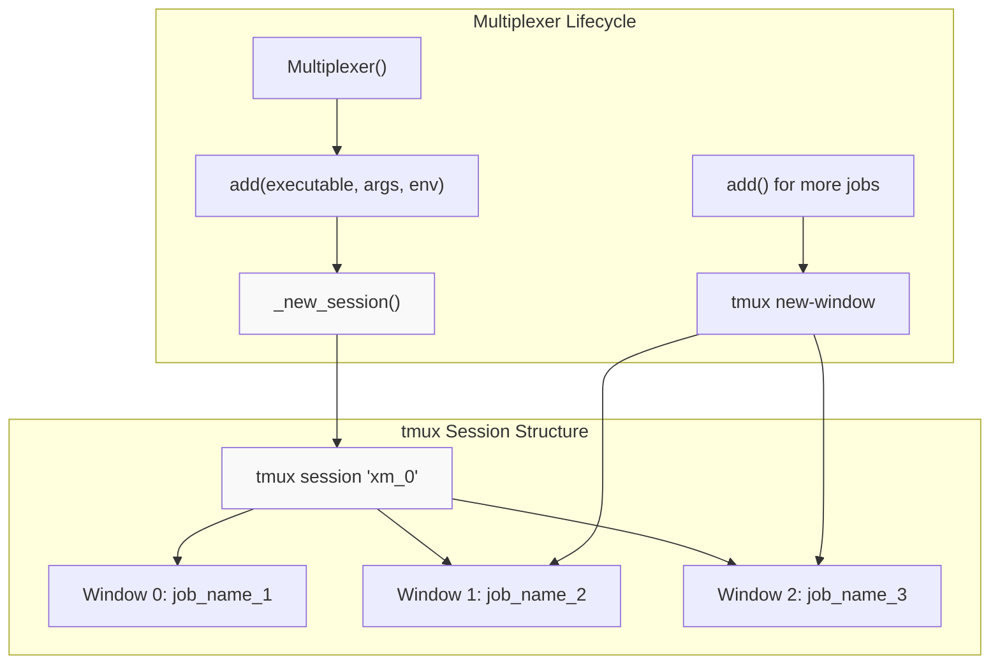
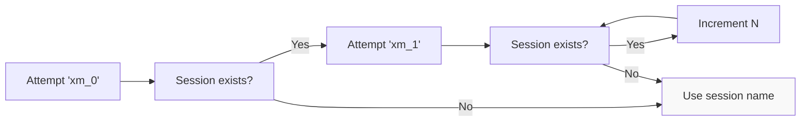
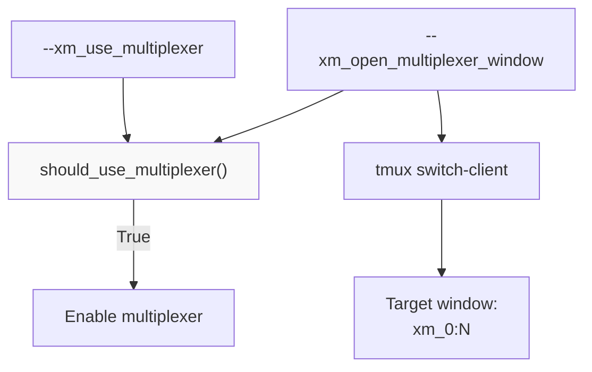
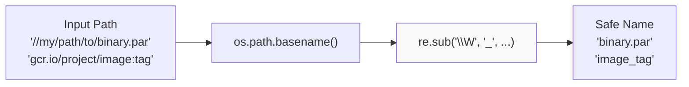
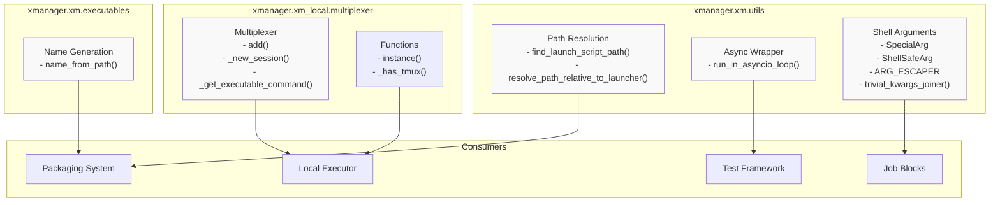

<!-- source: DeepWiki mcp.deepwiki.com · repo google-deepmind/xmanager · page 6.4 Utilities and Helpers · fetched 2026-10-26 -->

# Utilities and Helpers

<details>
<summary>Relevant source files</summary>

The following files were used as context for generating this wiki page:

- [xmanager/xm/executables.py](xmanager/xm/executables.py)
- [xmanager/xm/utils.py](xmanager/xm/utils.py)
- [xmanager/xm/utils_test.py](xmanager/xm/utils_test.py)
- [xmanager/xm_flags.py](xmanager/xm_flags.py)
- [xmanager/xm_local/multiplexer.py](xmanager/xm_local/multiplexer.py)

</details>


This page documents utility functions and helper classes that provide cross-cutting functionality throughout XManager. These utilities support path resolution, asynchronous execution, shell argument handling, and terminal multiplexing for local job management.

For comprehensive configuration flag documentation, see [Configuration Flags](#6.1). For database and storage utilities, see [Database Storage](#6.2). For GCP-specific utilities, see [GCP Authentication](#6.3).

## Overview

XManager's utility layer provides several categories of helper functionality:

| Category | Module | Primary Use Case |
|----------|--------|------------------|
| Path Resolution | `xmanager.xm.utils` | Resolve paths relative to launcher script |
| Async Wrappers | `xmanager.xm.utils` | Bridge async and sync APIs |
| Shell Arguments | `xmanager.xm.utils` | Safe shell argument escaping and handling |
| Name Generation | `xmanager.xm.executables` | Generate safe names from filesystem paths |
| Terminal Multiplexer | `xmanager.xm_local.multiplexer` | Manage local jobs in tmux sessions |

Sources: [xmanager/xm/utils.py:1-170](), [xmanager/xm/executables.py:1-228](), [xmanager/xm_local/multiplexer.py:1-137]()

## Path Resolution

### Launch Script Path Detection

XManager needs to resolve file paths relative to the launcher script, enabling users to reference project directories using relative paths like `'.'` or `'../data'`.



**Figure: Path Resolution Strategy**

The `find_launch_script_path()` function uses multiple detection strategies:

1. **Explicit flag**: `--xm_launch_script` flag takes precedence
2. **sys.argv[0]**: Command-line invocation path
3. **__main__.__file__**: For subpar-built binaries

Sources: [xmanager/xm/utils.py:119-139]()

### Usage in ExecutableSpecs

Path resolution is automatically applied in `ExecutableSpec` converters:



**Figure: Automatic Path Resolution in ExecutableSpecs**

The converter is used in:
- `PythonContainer.path` [xmanager/xm/executables.py:124-126]()
- `Dockerfile.path` [xmanager/xm/executables.py:58-60]()
- `Dockerfile.dockerfile` [xmanager/xm/executables.py:61-67]()

Sources: [xmanager/xm/executables.py:43-77](), [xmanager/xm/executables.py:79-134](), [xmanager/xm/utils.py:141-170]()

### Implementation Details

The `resolve_path_relative_to_launcher()` function:
- Returns absolute paths unchanged
- Resolves relative paths from the launcher script's directory
- Raises `RuntimeError` if the launch script cannot be located
- Uses `os.path.realpath()` to resolve symlinks

Sources: [xmanager/xm/utils.py:141-170]()

## Asynchronous Execution Wrapper

XManager's internal architecture uses asynchronous APIs for concurrent job launching and monitoring. The `run_in_asyncio_loop` decorator bridges async and sync code.



**Figure: Async to Sync Bridge Pattern**

### Primary Use Cases

The decorator is designed for two specific scenarios:

1. **Testing async functions**: Enable unittest methods to test async code
2. **Main program entry point**: Run entire programs in an event loop

Sources: [xmanager/xm/utils.py:77-117]()

### Example Usage Pattern

The decorator wraps async functions to make them callable from synchronous contexts:

```python
@run_in_asyncio_loop
async def test_my_async_function(self):
    result = await async_operation()
    self.assertEqual(result, expected)
```

The wrapper creates a new event loop and runs the coroutine to completion, returning the final value.

Sources: [xmanager/xm/utils.py:86-101](), [xmanager/xm/utils_test.py:32-39]()

## Shell Argument Handling

XManager provides utilities for safely escaping command-line arguments while supporting special cases like environment variable expansion.



**Figure: Argument Escaping Strategy**

### Special Argument Classes

**`SpecialArg` Base Class**

An abstract base class for arguments requiring special serialization handling.

Sources: [xmanager/xm/utils.py:40-42]()

**`ShellSafeArg` Class**

Wraps arguments that should not be escaped, enabling shell substitutions:

| Property | Behavior |
|----------|----------|
| Constructor | `ShellSafeArg(arg: str)` |
| Serialization | Returns `arg` unchanged via `ARG_ESCAPER` |
| String Conversion | Raises `RuntimeError` to prevent accidental use in f-strings |

The class prevents shell expansion from being stripped by preventing string conversion that would lose the semantic meaning.

Sources: [xmanager/xm/utils.py:44-60]()

### ARG_ESCAPER Function

The `ARG_ESCAPER` function implements type-based escaping:

```python
def ARG_ESCAPER(value: Any) -> str:
  match value:
    case ShellSafeArg():
      return value.arg  # No escaping
    case enum.Enum():
      return shlex.quote(str(value.name))  # Quote enum name
    case _:
      return shlex.quote(str(value))  # Quote everything else
```

This pattern-matching approach ensures type-safe argument handling with appropriate escaping for each category.

Sources: [xmanager/xm/utils.py:62-70]()

### Keyword Argument Joiner

The `trivial_kwargs_joiner` provides simple key-value concatenation:

```python
def trivial_kwargs_joiner(key: str, value: str) -> str:
    return f'{key}={value}'
```

This is used by argument formatting systems to build command-line flags like `--learning_rate=0.001`.

Sources: [xmanager/xm/utils.py:72-75]()

## Terminal Multiplexer

The `Multiplexer` class manages local job execution in persistent tmux sessions, enabling users to monitor and interact with multiple jobs in separate terminal windows.



**Figure: Multiplexer Session Management**

### Session Creation Strategy

The multiplexer delays session creation until the first job is added, automatically creating the first window. Subsequent jobs create additional windows in the same session.

Sources: [xmanager/xm_local/multiplexer.py:34-137]()

### Session Naming

Session names follow the pattern `xm_{N}` where N starts at 0 and increments if a duplicate session exists:



**Figure: Session Name Collision Resolution**

Sources: [xmanager/xm_local/multiplexer.py:43-95]()

### Command Construction

The `_get_executable_command()` function builds a shell command that:
1. Sets environment variables
2. Executes the binary with arguments
3. Echoes completion message and command
4. Drops into an interactive shell

```python
def _get_executable_command(
    executable_path: str, args: list[str], env_vars: dict[str, str]
) -> str:
    env_as_list = [f'{k}={v}' for k, v in env_vars.items()]
    launch_command = subprocess.list2cmdline(
        [*env_as_list, executable_path, *args]
    )
    command = (
        f'{launch_command}; '
        f'echo; echo Job completed.; echo {launch_command}; exec $SHELL'
    )
    return command
```

This ensures the tmux window remains open after job completion for inspection.

Sources: [xmanager/xm_local/multiplexer.py:17-32]()

### Multiplexer API

| Method | Parameters | Returns | Description |
|--------|-----------|---------|-------------|
| `__init__()` | None | None | Validates tmux installation, initializes state |
| `add()` | `executable_path`, `args`, `env_vars`, `full_job_name` | `asyncio.subprocess.Process` | Adds job in new window |
| `instance()` | None | `Multiplexer` | Returns cached singleton instance |

The `add()` method is async and returns a process handle for the tmux command (not the inner executable).

Sources: [xmanager/xm_local/multiplexer.py:34-137]()

### Integration with Configuration Flags

The multiplexer behavior is controlled by flags:



**Figure: Multiplexer Configuration**

The `should_use_multiplexer()` helper returns `True` if either flag is set:
- `--xm_use_multiplexer` explicitly enables it
- `--xm_open_multiplexer_window` implicitly signals intent to use it

When `--xm_open_multiplexer_window=N` is set, the multiplexer automatically switches to window N (1-indexed) once it's created.

Sources: [xmanager/xm_flags.py:158-177](), [xmanager/xm_local/multiplexer.py:125-129]()

### tmux Installation Check

The multiplexer validates tmux availability on initialization:

```python
def _has_tmux() -> bool:
    """Checks whether tmux is installed."""
    return shutil.which('tmux') is not None
```

If tmux is not found, the `Multiplexer` constructor raises a `ValueError`.

Sources: [xmanager/xm_local/multiplexer.py:12-14](), [xmanager/xm_local/multiplexer.py:37-39]()

## Executable Name Generation

The `name_from_path()` utility generates safe executable names from filesystem paths by sanitizing non-word characters.



**Figure: Name Generation Process**

The function:
1. Extracts the basename (rightmost path component)
2. Replaces non-word characters (`\W`) with underscores
3. Strips trailing path separators before extraction

This is used by all `ExecutableSpec` types to implement their `name` property:

| ExecutableSpec | Path Source |
|----------------|-------------|
| `Dockerfile` | `self.path` |
| `PythonContainer` | `self.path` |
| `Container` | `self.image_path` |
| `Binary` | `self.path` |
| `BazelContainer` | `self.label` |
| `BazelBinary` | `self.label` |

Sources: [xmanager/xm/executables.py:26-29](), [xmanager/xm/executables.py:75-76](), [xmanager/xm/executables.py:131-133](), [xmanager/xm/executables.py:158-160](), [xmanager/xm/executables.py:178-180](), [xmanager/xm/executables.py:198-200](), [xmanager/xm/executables.py:225-227]()

## Utility Module Structure



**Figure: Utility Module Organization and Dependencies**

Sources: [xmanager/xm/utils.py:1-170](), [xmanager/xm/executables.py:26-29](), [xmanager/xm_local/multiplexer.py:1-137]()

## Related Utilities

Some utility functionality is distributed across other infrastructure modules:

- **Configuration Flags**: The `xm_flags` module provides configuration helpers like `should_use_multiplexer()` - see [Configuration Flags](#6.1)
- **Database Utilities**: SQL connection management and schema migrations - see [Database Storage](#6.2)
- **GCP Utilities**: Service account management and API enablement - see [GCP Authentication](#6.3)
- **Build System Utilities**: Bazel query and build utilities - see [Bazel Integration](#4.1)

Sources: [xmanager/xm_flags.py:1-197]()

---

