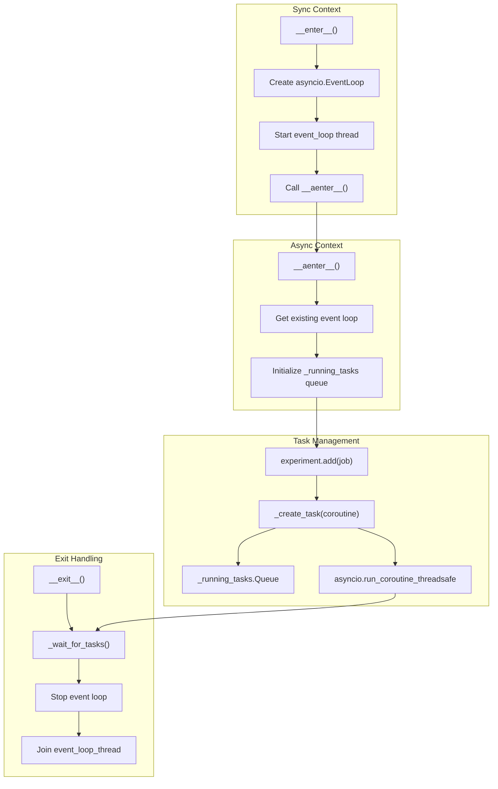
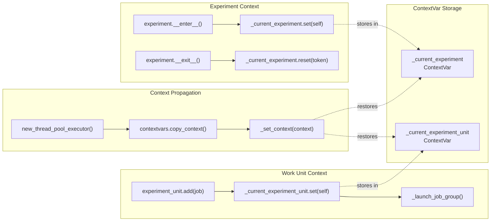
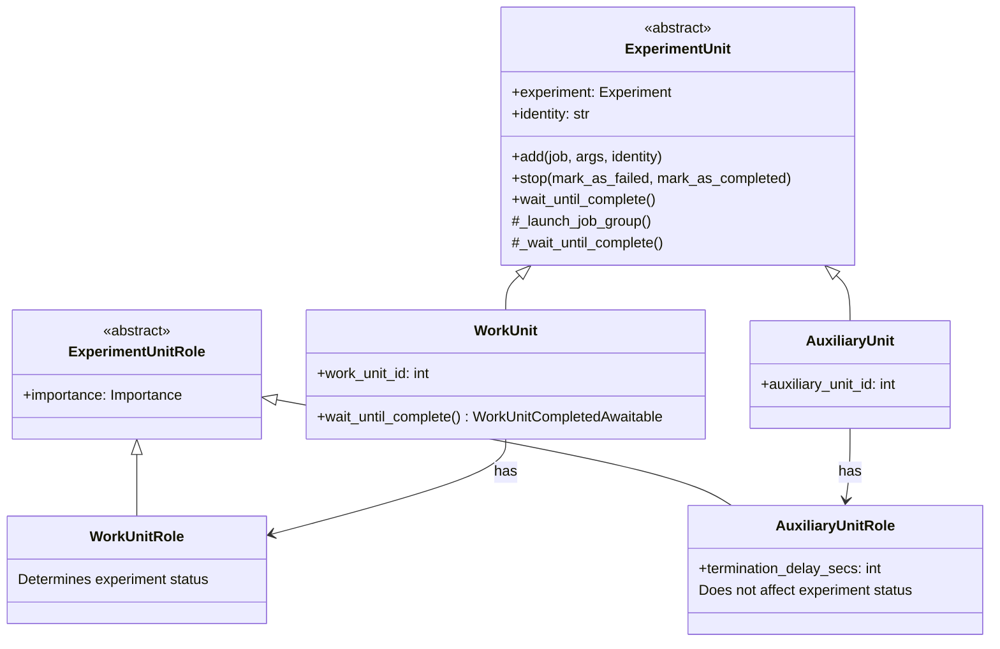
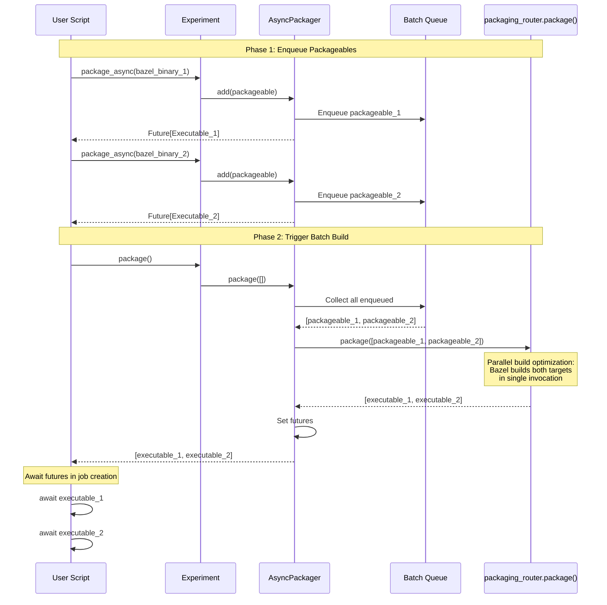
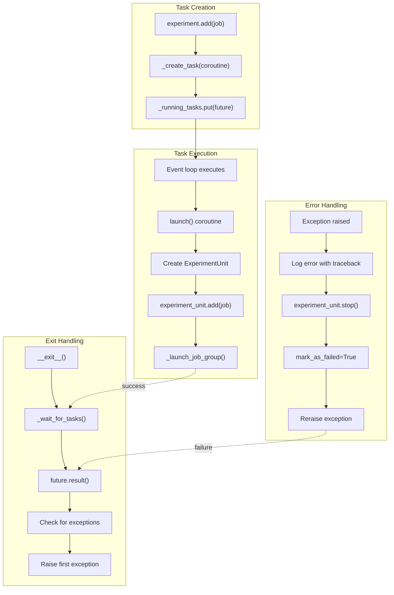
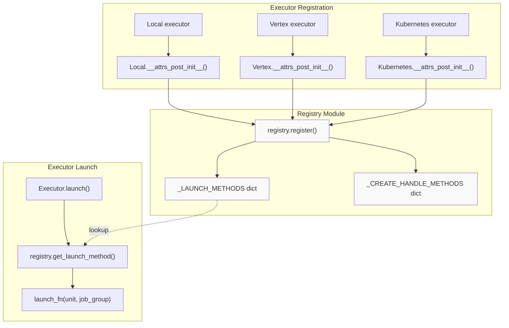
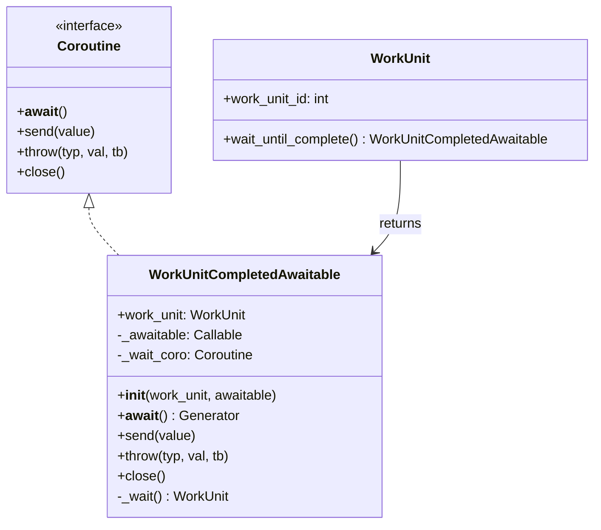
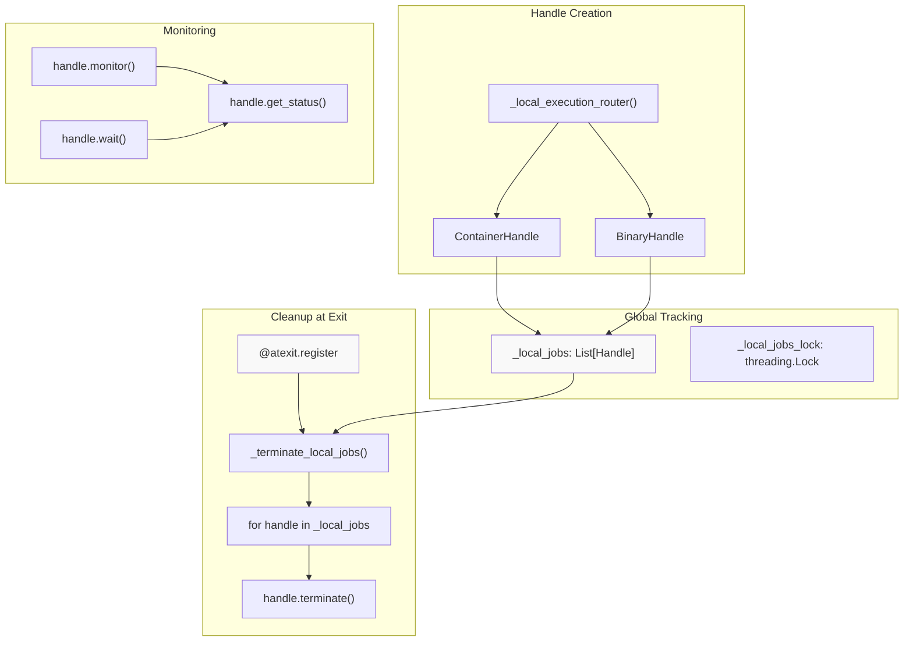

<!-- source: DeepWiki mcp.deepwiki.com · repo google-deepmind/xmanager · page 7 Advanced Topics · fetched 2026-10-26 -->

# Advanced Topics

<details>
<summary>Relevant source files</summary>

The following files were used as context for generating this wiki page:

- [xmanager/xm/core.py](xmanager/xm/core.py)
- [xmanager/xm/core_test.py](xmanager/xm/core_test.py)
- [xmanager/xm_local/execution.py](xmanager/xm_local/execution.py)
- [xmanager/xm_local/execution_test.py](xmanager/xm_local/execution_test.py)
- [xmanager/xm_local/executors.py](xmanager/xm_local/executors.py)
- [xmanager/xm_local/experiment.py](xmanager/xm_local/experiment.py)
- [xmanager/xm_mock/__init__.py](xmanager/xm_mock/__init__.py)

</details>


This page covers advanced XManager features and extension mechanisms for sophisticated experiment management scenarios. These topics go beyond basic experiment creation and job launching, including distributed training coordination, dynamic job generation, testing strategies, and framework customization.

For basic experiment setup, see [Getting Started](#2). For standard job and executable configuration, see [Core Concepts](#3).

## Overview

XManager provides several advanced capabilities:

1. **Distributed Training** ([7.1](#7.1)): Multi-worker coordination, `CLUSTER_SPEC` management, and workerpool addressing for distributed ML workloads
2. **Job Generators and Hyperparameter Sweeps** ([7.2](#7.2)): Asynchronous job creation patterns and dynamic experiment construction
3. **Testing and Mocking** ([7.3](#7.3)): Testing utilities including `MockExperiment` for unit testing XManager-based code
4. **Extending XManager** ([7.4](#7.4)): Custom executor implementation, packaging strategies, and registry integration

## Asynchronous Execution Architecture

XManager's execution model is built on asynchronous operations using Python's `asyncio` framework, allowing concurrent job creation and efficient resource utilization.

### Async Context Management



**Dual Context Manager Pattern**

XManager experiments support both synchronous (`with`) and asynchronous (`async with`) context management:

- **Synchronous context** ([xmanager/xm/core.py:763-786]()): Creates a new event loop in a dedicated thread, allowing async operations from sync code
- **Asynchronous context** ([xmanager/xm/core.py:829-833]()): Reuses the existing event loop when called from async contexts

Sources: [xmanager/xm/core.py:721-867]()

### ContextVars for Experiment Tracking



**Context Variables Pattern**

XManager uses Python's `contextvars` module to track the current experiment and experiment unit across asynchronous boundaries:

- `_current_experiment` ([xmanager/xm/core.py:50-52]()): Tracks the active experiment instance
- `_current_experiment_unit` ([xmanager/xm/core.py:53-55]()): Tracks the active work unit inside job generators

These context variables enable:
- Thread-safe experiment tracking across concurrent operations
- Automatic context propagation to worker threads ([xmanager/xm/core.py:112-126]())
- Nested experiment support in test scenarios

Sources: [xmanager/xm/core.py:48-110](), [xmanager/xm/core.py:423-458](), [xmanager/xm/core_test.py:333-420]()

## Experiment Unit Roles and Identity

XManager distinguishes between different types of experiment units and supports idempotent creation through identity tracking.

### ExperimentUnit Role Hierarchy



**Role-Based Experiment Units**

- **WorkUnitRole** ([xmanager/xm/core.py:589-597]()): Standard computational units whose status determines overall experiment success/failure
- **AuxiliaryUnitRole** ([xmanager/xm/core.py:661-675]()): Supporting units (e.g., Tensorboard) that don't affect experiment status and can have delayed termination

Sources: [xmanager/xm/core.py:325-687]()

### Identity-Based Idempotent Creation

```mermaid
sequenceDiagram
    participant User as User Code
    participant Exp as Experiment
    participant Check as _should_reload_experiment_unit()
    participant Get as _get_experiment_unit()
    participant Create as _create_experiment_unit()
    participant DB as Database
    
    User->>Exp: add(job, identity="trial_1")
    Exp->>Check: Check if reload supported
    
    alt Reload Supported (Cloud backends)
        Check-->>Exp: True
        Exp->>Get: Get existing unit by identity
        Get->>DB: Query by (experiment_id, identity)
        
        alt Unit Exists
            DB-->>Get: Return existing unit
            Get-->>Exp: Existing ExperimentUnit
            Note over Exp: Rerun job generator<br/>to recover after preemption
        else Unit Not Found
            DB-->>Get: NotFoundError
            Get->>Create: Create new unit
            Create->>DB: Insert with identity
        end
    else No Reload (Local backend)
        Check-->>Exp: False
        Exp->>Create: Always create new unit
        Note over Create: Identity logged but ignored
    end
    
    Exp->>User: Return ExperimentUnit future
```

**Identity Parameter**

The `identity` parameter in `experiment.add(job, identity="...")` ([xmanager/xm/core.py:1008-1009]()) enables idempotent experiment unit creation:

- Cloud backends use identity to fetch existing units from storage ([xmanager/xm/core.py:1079-1098]())
- Local backend ignores identity and always creates new units ([xmanager/xm_local/experiment.py:377-384]())
- Job generators still execute on reload to allow recovery after preemption ([xmanager/xm/core.py:1010-1012]())

Sources: [xmanager/xm/core.py:988-1076](), [xmanager/xm_local/experiment.py:199-203](), [xmanager/xm_local/experiment.py:377-384]()

## Advanced Packaging Patterns

### Async Packaging Batch Processing



**AsyncPackager Pattern**

The `AsyncPackager` class ([xmanager/xm/async_packager.py]()) enables efficient batch packaging:

1. **Enqueue phase**: `Experiment.package_async(packageable)` ([xmanager/xm/core.py:900-931]()) queues items without building
2. **Trigger phase**: `Experiment.package()` ([xmanager/xm/core.py:880-898]()) processes the entire batch
3. **Optimization**: Multiple Bazel targets are built in a single invocation, improving build times

Sources: [xmanager/xm/core.py:880-931](), [xmanager/xm/async_packager.py]()

## Task Lifecycle and Error Handling

### Task Management Flow



**Exception Handling Strategy**

XManager implements comprehensive error handling for asynchronous task execution:

- **Failed work unit creation** ([xmanager/xm/core.py:1031-1051]()): Automatically stops the experiment unit and marks it as failed
- **Multiple exceptions** ([xmanager/xm/core.py:799-820]()): Logs all exceptions but only re-raises the first one
- **Cancelled tasks** ([xmanager/xm/core.py:805-807]()): Logged and ignored, allowing graceful shutdown

Sources: [xmanager/xm/core.py:798-866](), [xmanager/xm/core.py:1031-1076](), [xmanager/xm/core_test.py:278-330]()

## Executor Registry Pattern

### Registry Architecture



**Dynamic Executor Registration**

Each executor type registers itself on initialization ([xmanager/xm_local/executors.py:79-81](), [xmanager/xm_local/executors.py:132-134](), [xmanager/xm_local/executors.py:171-173]()):

1. `__attrs_post_init__()` imports the execution module
2. Execution module calls `registry.register()` with launch function
3. `Executor.launch()` performs dynamic dispatch via registry lookup

This pattern enables:
- Adding new executors without modifying core code
- Lazy loading of executor-specific dependencies
- Consistent launch interface across executor types

Sources: [xmanager/xm_local/executors.py:59-183](), [xmanager/xm_local/registry.py](), [xmanager/xm_local/execution.py:215-222]()

## WorkUnit Completion Tracking

### WorkUnitCompletedAwaitable Pattern



**Custom Awaitable Design**

`WorkUnitCompletedAwaitable` ([xmanager/xm/core.py:599-640]()) implements a custom awaitable that:

1. **Stores work unit reference**: Allows accessing `work_unit` before awaiting completion
2. **Supports asyncio patterns**: Works with `asyncio.wait()`, `asyncio.as_completed()`
3. **Returns WorkUnit on completion**: Enables patterns like `completed_unit = await work_unit.wait_until_complete()`

Example usage pattern:
```python
completion_events = [wu.wait_until_complete() for wu in work_units]
while completion_events:
    completed, pending = await asyncio.wait(
        completion_events, return_when=asyncio.FIRST_COMPLETED
    )
    for event in completed:
        wid = event.work_unit.work_unit_id  # Access before await
        try:
            await event  # Get the WorkUnit back
            print(f'Work unit {wid} completed successfully.')
        except xm.ExperimentUnitError as e:
            print(f'Work unit {wid} failed: {e}.')
    completion_events = pending
```

Sources: [xmanager/xm/core.py:599-659](), [xmanager/xm/core_test.py:249-269]()

## Local Execution Handle Management

### Handle Lifecycle and Cleanup



**Automatic Cleanup Strategy**

Local execution handles are tracked globally for cleanup ([xmanager/xm_local/execution.py:174-192]()):

- **Global list**: `_local_jobs` stores all local execution handles with thread-safe access
- **atexit registration**: `_terminate_local_jobs()` ensures cleanup on process exit
- **Best-effort termination**: Handles exceptions during termination to clean up as many jobs as possible

This prevents orphaned processes when experiments are interrupted or scripts exit unexpectedly.

Sources: [xmanager/xm_local/execution.py:152-212](), [xmanager/xm_local/handles.py]()

## Summary

Advanced XManager features enable sophisticated experiment workflows:

- **Async architecture** supports concurrent job creation and efficient resource utilization
- **ContextVars** provide thread-safe experiment tracking across async boundaries
- **Role-based units** distinguish between computational (WorkUnit) and auxiliary (AuxiliaryUnit) units
- **Identity parameter** enables idempotent creation and preemption recovery on cloud backends
- **AsyncPackager** optimizes batch packaging for faster builds
- **Registry pattern** allows dynamic executor registration and extension
- **Custom awaitables** enable flexible completion tracking patterns

For detailed information on specific advanced topics, see the sub-pages:
- Distributed Training ([7.1](#7.1))
- Job Generators and Hyperparameter Sweeps ([7.2](#7.2))
- Testing and Mocking ([7.3](#7.3))
- Extending XManager ([7.4](#7.4))

---

