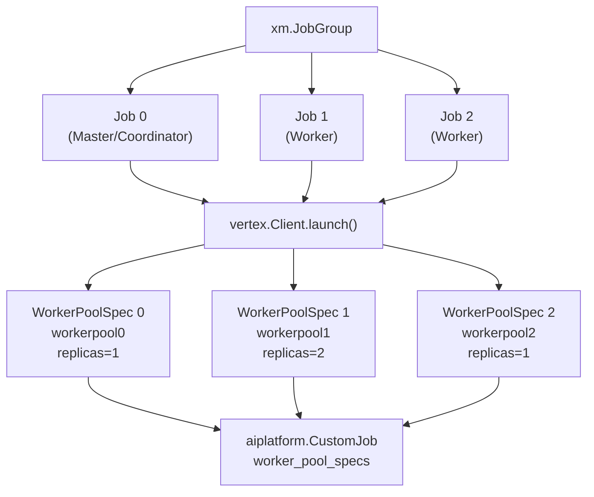
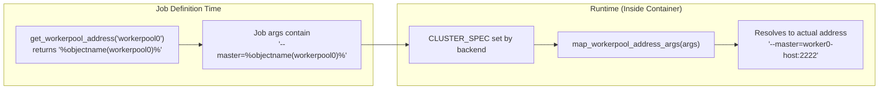
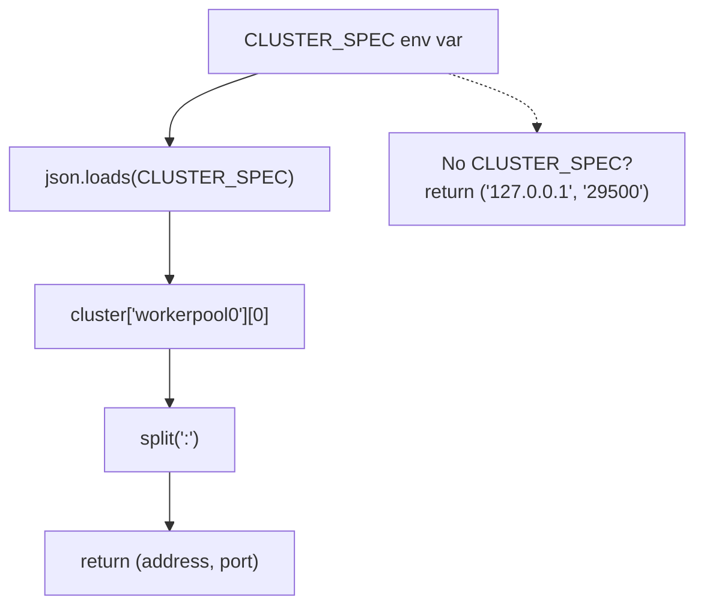
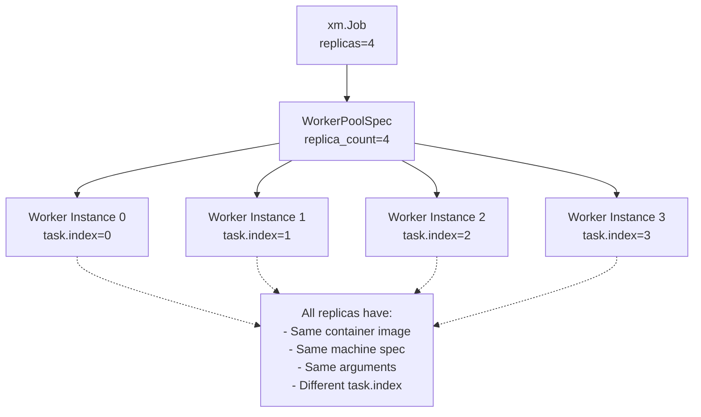
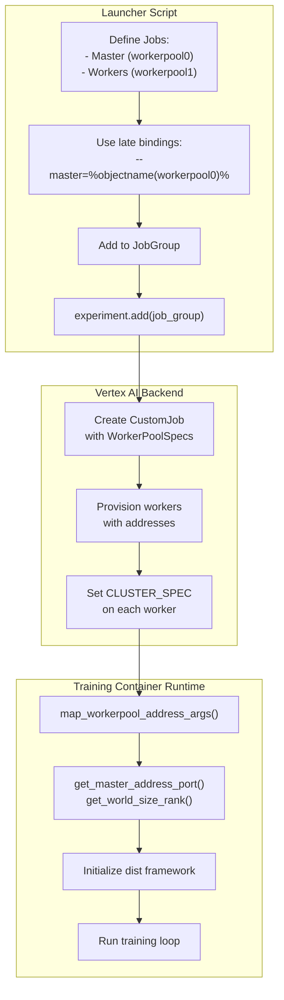

<!-- source: DeepWiki mcp.deepwiki.com · repo google-deepmind/xmanager · page 7.1 Distributed Training · fetched 2026-10-26 -->

# Distributed Training

<details>
<summary>Relevant source files</summary>

The following files were used as context for generating this wiki page:

- [xmanager/cloud/auth.py](xmanager/cloud/auth.py)
- [xmanager/cloud/auth_test.py](xmanager/cloud/auth_test.py)
- [xmanager/cloud/utils.py](xmanager/cloud/utils.py)
- [xmanager/cloud/utils_test.py](xmanager/cloud/utils_test.py)
- [xmanager/cloud/vertex.py](xmanager/cloud/vertex.py)
- [xmanager/cloud/vertex_test.py](xmanager/cloud/vertex_test.py)
- [xmanager/xm_local/__init__.py](xmanager/xm_local/__init__.py)
- [xmanager/xm_local/executors_test.py](xmanager/xm_local/executors_test.py)
- [xmanager/xm_local/handles.py](xmanager/xm_local/handles.py)
- [xmanager/xm_local/registry.py](xmanager/xm_local/registry.py)

</details>


## Purpose and Scope

This document describes XManager's support for distributed training across multiple machines or accelerators. It covers:

- The `CLUSTER_SPEC` environment variable that coordinates distributed workers
- Multi-worker job groups and worker pool architecture
- Late bindings for inter-worker communication
- Utility functions for distributed training coordination
- Replica-based scaling

For general information about executors and job execution, see [Execution Backends](#5). For details about job and resource configuration, see [Jobs and Job Groups](#3.2) and [Resource Requirements](#3.4).

---

## CLUSTER_SPEC Environment Variable

The `CLUSTER_SPEC` environment variable is the primary mechanism for coordinating distributed training jobs. It is automatically set by cloud execution backends (Vertex AI, Kubernetes) and contains a JSON structure describing the cluster topology and the current worker's position within it.

### Structure

The `CLUSTER_SPEC` contains three main sections:

| Field | Type | Description |
|-------|------|-------------|
| `cluster` | Dict[str, List[str]] | Maps worker pool names to lists of addresses (host:port) |
| `task` | Dict | Contains `type` (worker pool name) and `index` (position in that pool) |
| `environment` | str | Execution environment, typically "cloud" |

**Example CLUSTER_SPEC:**
```json
{
  "cluster": {
    "workerpool0": ["cmle-training-workerpool0-ab-0:2222"],
    "workerpool1": ["cmle-training-workerpool1-ab-0:2222", "cmle-training-workerpool1-ab-1:2222"],
    "workerpool2": ["cmle-training-workerpool2-ab-0:2222"]
  },
  "environment": "cloud",
  "task": {
    "type": "workerpool1",
    "index": 1,
    "trial": ""
  }
}
```

In this example, the current worker is the second replica (`index: 1`) in `workerpool1`.

Sources: [xmanager/cloud/utils.py:14-165](), [xmanager/cloud/utils_test.py:22-36]()

---

## Multi-Worker Job Groups

XManager maps `JobGroup` instances to distributed training clusters. Each `Job` in the `JobGroup` becomes a separate worker pool with its own machine specification and executable.

### Worker Pool Creation



**Key Constraints:**

1. **Maximum 4 Worker Pools**: Vertex AI supports at most 4 worker pools per CustomJob. If your `JobGroup` contains more than 4 jobs, the launch will fail.

2. **First Job Replica Constraint**: The first job in the `JobGroup` (index 0, which becomes `workerpool0`) cannot have `requirements.replicas > 1`. This is enforced by Vertex AI's architecture where the first worker pool is typically the master/coordinator.

3. **Homogeneous Replicas**: All replicas within a worker pool share the same machine specification and container image. They differ only in their task index.

**Implementation Details:**

[xmanager/cloud/vertex.py:129-174]()

The Vertex AI launcher iterates through jobs, creating a `WorkerPoolSpec` for each:
- Machine spec is determined by `get_machine_spec(job)` 
- Replica count comes from `job.executor.requirements.replicas`
- First job is validated to have `replicas == 1` (implicit, default is 1)

Sources: [xmanager/cloud/vertex.py:107-174](), [xmanager/cloud/vertex_test.py:38-100]()

---

## Late Bindings and Workerpool Addressing

In distributed training, workers often need to know the addresses of other workers (e.g., for all-reduce communication, parameter servers). However, these addresses are not known at job definition time—they're only assigned when the cluster is provisioned. XManager solves this with **late bindings**.

### Late Binding Mechanism



### API Functions

**Creating Late Bindings:**

`get_workerpool_address(workerpool: str) -> str` [xmanager/cloud/utils.py:77-79]()

Returns a placeholder string that will be resolved at runtime:
```python
master_arg = '--master=' + utils.get_workerpool_address('workerpool0')
# Result: '--master=%objectname(workerpool0)%'
```

**Resolving Late Bindings:**

`map_workerpool_address_args(args: List[str]) -> List[str]` [xmanager/cloud/utils.py:82-103]()

Called inside the container to resolve placeholders using `CLUSTER_SPEC`:
```python
# Inside container, CLUSTER_SPEC is set
resolved_args = utils.map_workerpool_address_args(sys.argv)
# '--master=%objectname(workerpool0)%' becomes 
# '--master=cmle-training-workerpool0-ab-0:2222'
```

The function uses regex pattern `\%objectname\((.*)\)\%` to find and replace late-bound addresses.

### Environment Variable Late Bindings

Late bindings also work for environment variables:

`create_workerpool_address_env_vars_script(path: str) -> None` [xmanager/cloud/utils.py:115-136]()

This generates a bash script that exports environment variables with resolved addresses:
```bash
#!/bin/bash

export MY_WORKER=cmle-training-workerpool0-ab-0:2222
export PARAMETER_SERVER=cmle-training-workerpool1-ab-0:2222
```

This is useful when the training framework expects configuration via environment variables rather than command-line arguments.

Sources: [xmanager/cloud/utils.py:77-136](), [xmanager/cloud/utils_test.py:67-87]()

---

## Distributed Training Coordination Utilities

XManager provides helper functions to extract coordination information from `CLUSTER_SPEC`.

### Master Address and Port



**Function:** `get_master_address_port() -> Tuple[str, str]` [xmanager/cloud/utils.py:26-42]()

Returns the address and port of the master worker (first worker in `workerpool0`):

```python
from xmanager.cloud import utils

address, port = utils.get_master_address_port()
# address = 'cmle-training-workerpool0-ab-0'
# port = '2222'
```

**Default Behavior:** Returns `('127.0.0.1', '29500')` if `CLUSTER_SPEC` is not set, allowing code to work in both distributed and single-machine environments.

### World Size and Rank

**Function:** `get_world_size_rank() -> Tuple[int, int]` [xmanager/cloud/utils.py:45-59]()

Returns the total number of workers across all pools and the current worker's global rank:

```python
world_size, rank = utils.get_world_size_rank()
# world_size = 5 (total workers across all pools)
# rank = 2 (this worker's global index)
```

**Calculation Logic:**
1. Iterate through all worker pools in `cluster`
2. Sum the lengths to get `world_size`
3. Calculate `rank` by adding pool lengths until reaching the current pool, then adding the task index

**Default Behavior:** Returns `(1, 0)` if `CLUSTER_SPEC` is not set.

### Usage in Training Code

```python
from xmanager.cloud import utils
import torch.distributed as dist

def init_distributed():
    """Initialize PyTorch distributed training."""
    master_addr, master_port = utils.get_master_address_port()
    world_size, rank = utils.get_world_size_rank()
    
    dist.init_process_group(
        backend='nccl',
        init_method=f'tcp://{master_addr}:{master_port}',
        world_size=world_size,
        rank=rank
    )
```

Sources: [xmanager/cloud/utils.py:26-59](), [xmanager/cloud/utils_test.py:45-65]()

---

## Creating CLUSTER_SPEC for Workers

While `CLUSTER_SPEC` is typically set by the execution backend, XManager provides a utility to manually construct cluster specifications for testing or custom executors.

**Function:** `create_cluster_specs(workers: Sequence[str]) -> List[str]` [xmanager/cloud/utils.py:62-74]()

Takes a list of worker addresses and generates a `CLUSTER_SPEC` JSON string for each worker:

```python
workers = [
    'worker0.example.com:8000',
    'worker1.example.com:8000',
    'worker2.example.com:8000'
]

specs = utils.create_cluster_specs(workers)
# specs[0] contains CLUSTER_SPEC for worker 0
# specs[1] contains CLUSTER_SPEC for worker 1
# etc.
```

Each generated spec places each worker in its own pool (`workerpool0`, `workerpool1`, etc.) and sets the appropriate task type and index.

Sources: [xmanager/cloud/utils.py:62-74]()

---

## Replicas and Data Parallelism

Replicas provide a way to scale a single job definition to multiple workers with identical configurations.

### Specifying Replicas

Replicas are specified via `JobRequirements`:

```python
import xmanager as xm
from xmanager import xm_local

job = xm.Job(
    executable=my_container,
    executor=xm_local.Vertex(
        requirements=xm.JobRequirements(
            cpu=4,
            ram=16 * xm.GiB,
            v100=1,
            replicas=4  # Create 4 identical workers
        )
    ),
    args={'--learning_rate': 0.001}
)
```

### Replica Behavior



All replicas within a worker pool:
- Share the same container image and machine specification
- Receive the same command-line arguments
- Differ only in their `task.index` within `CLUSTER_SPEC`

This is ideal for data-parallel training where each worker processes a different batch of data but runs the same code.

### Limitations

1. **First Job Constraint**: The first job in a `JobGroup` cannot have `replicas > 1` when using the Vertex AI executor. This is enforced at [xmanager/cloud/vertex.py:148-152]().

2. **Homogeneous Resources**: All replicas must have identical resource requirements. To create workers with different configurations (e.g., parameter servers with different specs than workers), use multiple `Job` instances in the `JobGroup`.

Sources: [xmanager/cloud/vertex.py:148-162](), [xmanager/xm_local/executors_test.py:1-21]()

---

## Complete Example: Multi-Worker Training Setup



**Launcher Code:**

```python
import xmanager as xm
from xmanager import xm_local
from xmanager.cloud import utils

with xm_local.create_experiment(experiment_title='distributed_training') as experiment:
    # Package the training code
    [train_container] = experiment.package([
        xm.PythonContainer(
            path='.',
            base_image='gcr.io/deeplearning-platform-release/pytorch-gpu',
            entrypoint=xm.CommandList(['python', 'train.py'])
        )
    ])
    
    # Master job (workerpool0)
    master = xm.Job(
        executable=train_container,
        executor=xm_local.Vertex(
            requirements=xm.JobRequirements(cpu=8, ram=32*xm.GiB, v100=1)
        ),
        args={
            '--role': 'master',
            '--master': utils.get_workerpool_address('workerpool0')
        }
    )
    
    # Worker jobs (workerpool1) with 3 replicas
    workers = xm.Job(
        executable=train_container,
        executor=xm_local.Vertex(
            requirements=xm.JobRequirements(
                cpu=8, 
                ram=32*xm.GiB, 
                v100=1,
                replicas=3  # Create 3 worker replicas
            )
        ),
        args={
            '--role': 'worker',
            '--master': utils.get_workerpool_address('workerpool0')
        }
    )
    
    # Create job group and launch
    job_group = xm.JobGroup(master=master, workers=workers)
    experiment.add(job_group)
```

**Training Code (train.py):**

```python
import sys
from xmanager.cloud import utils
import torch.distributed as dist

def main():
    # Resolve late-bound arguments
    args = utils.map_workerpool_address_args(sys.argv)
    
    # Get coordination info
    master_addr, master_port = utils.get_master_address_port()
    world_size, rank = utils.get_world_size_rank()
    
    # Initialize distributed training
    dist.init_process_group(
        backend='nccl',
        init_method=f'tcp://{master_addr}:{master_port}',
        world_size=world_size,
        rank=rank
    )
    
    # Training loop...
    print(f"Worker {rank}/{world_size} initialized")
```

Sources: [xmanager/cloud/vertex.py:129-198](), [xmanager/cloud/utils.py:26-103]()

---

## Summary

XManager's distributed training support centers on:

1. **CLUSTER_SPEC**: Automatically set environment variable containing cluster topology
2. **Multi-Worker JobGroups**: Each Job becomes a worker pool; up to 4 pools supported
3. **Late Bindings**: Placeholder addresses resolved at runtime for inter-worker communication
4. **Coordination Utilities**: Helper functions to extract master address, world size, and rank
5. **Replicas**: Scale individual jobs to multiple identical workers via `requirements.replicas`

The system is designed to work transparently across local development (single worker) and cloud production (multi-worker), with utilities defaulting to single-worker behavior when `CLUSTER_SPEC` is absent.

Sources: [xmanager/cloud/utils.py:1-165](), [xmanager/cloud/vertex.py:107-198]()

---

