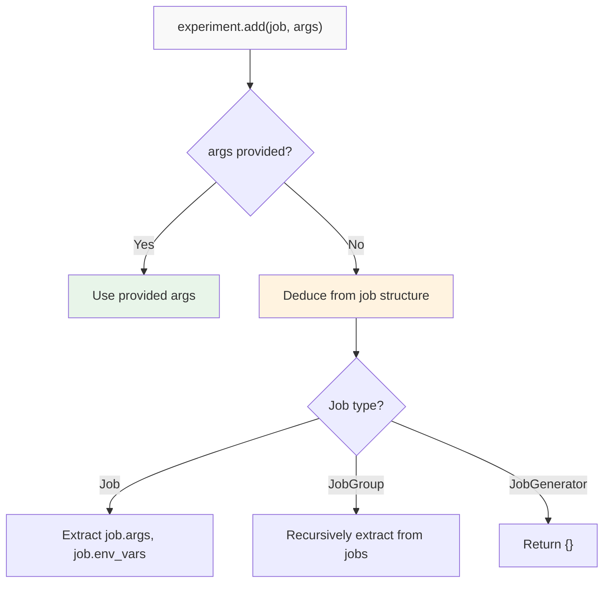
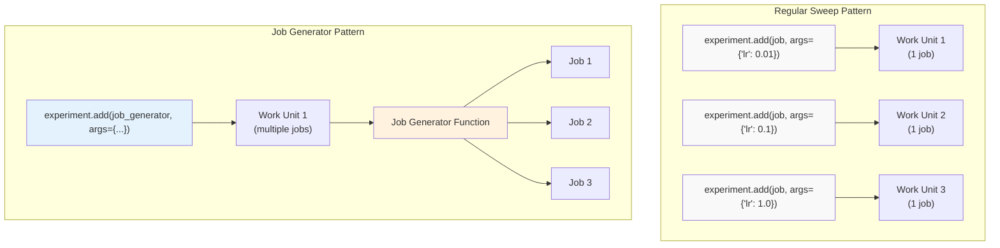
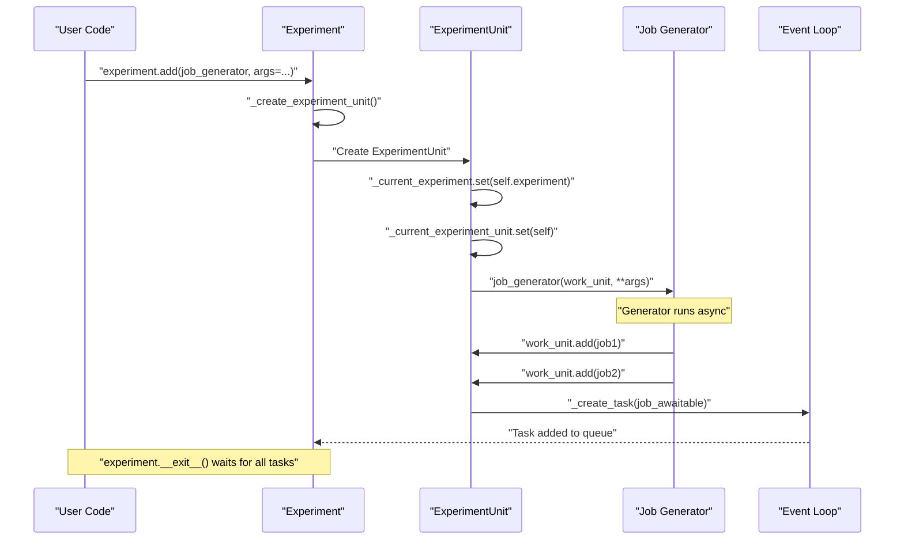
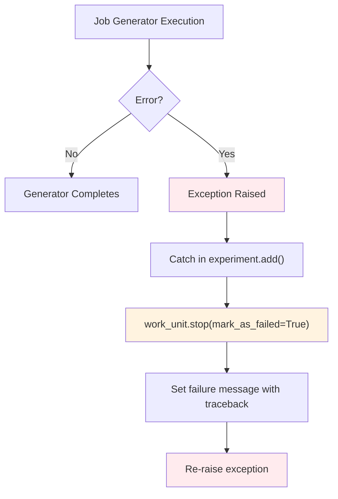

<!-- source: DeepWiki mcp.deepwiki.com · repo google-deepmind/xmanager · page 7.2 Job Generators and Hyperparameter Sweeps · fetched 2026-10-26 -->

# Job Generators and Hyperparameter Sweeps

<details>
<summary>Relevant source files</summary>

The following files were used as context for generating this wiki page:

- [xmanager/xm/core.py](xmanager/xm/core.py)
- [xmanager/xm/core_test.py](xmanager/xm/core_test.py)
- [xmanager/xm/job_operators.py](xmanager/xm/job_operators.py)
- [xmanager/xm/job_operators_test.py](xmanager/xm/job_operators_test.py)
- [xmanager/xm_local/experiment.py](xmanager/xm_local/experiment.py)
- [xmanager/xm_mock/__init__.py](xmanager/xm_mock/__init__.py)

</details>


This page documents two related mechanisms for creating multiple experiment trials: **hyperparameter sweeps** (launching multiple work units with different parameters) and **job generators** (dynamically creating jobs within a work unit using async functions). For information about the core job and work unit abstractions, see [Jobs and Job Groups](#3.2). For details on argument handling, see [Arguments and Environment Variables](#3.5).

---

## Overview

XManager supports two primary patterns for running experiments with varying configurations:

1. **Hyperparameter Sweeps**: Creating multiple work units by calling `experiment.add()` repeatedly with different `args` parameters
2. **Job Generators**: Async functions that dynamically add jobs to a work unit, enabling complex job creation logic and conditional execution

Both patterns are essential for machine learning experimentation, where you often need to evaluate multiple hyperparameter configurations or create jobs based on runtime conditions.

---

## Hyperparameter Sweeps

### Basic Sweep Pattern

The simplest way to perform a hyperparameter sweep is to call `experiment.add()` multiple times with different argument values. Each call creates a separate work unit.

**Pattern:**

```python
with xm_local.create_experiment(experiment_title='Sweep') as experiment:
    executable = experiment.package(xm.PythonContainer(...))
    
    for learning_rate in [0.001, 0.01, 0.1]:
        experiment.add(
            xm.Job(executable, executor),
            args={'args': {'learning_rate': learning_rate}}
        )
```

This creates three work units, each with a different `learning_rate` argument.

**Sources:** [xmanager/xm/core.py:988-1076](), [xmanager/xm/core_test.py:185-194]()

### Multi-Dimensional Sweeps

For sweeps over multiple parameters, use nested loops or `itertools.product`:

```python
import itertools

with xm_local.create_experiment(experiment_title='Grid Search') as experiment:
    executable = experiment.package(xm.PythonContainer(...))
    
    learning_rates = [0.001, 0.01, 0.1]
    batch_sizes = [32, 64, 128]
    
    for lr, bs in itertools.product(learning_rates, batch_sizes):
        experiment.add(
            xm.Job(executable, executor),
            args={'args': {'learning_rate': lr, 'batch_size': bs}}
        )
```

This creates 9 work units (3 × 3 combinations).

### Argument Merging

Arguments passed to `experiment.add()` are merged with the job's existing arguments. The merge behavior depends on the job structure:

| Job Type | Supported Args | Behavior |
|----------|---------------|----------|
| `xm.Job` | `args`, `env_vars` | Recursively merge `args` dict, update `env_vars` dict |
| `xm.JobGroup` | Keys matching job names | Apply args to specific jobs in the group |
| Job Generator | Any kwargs | Passed directly to the generator function |

**Sources:** [xmanager/xm/core.py:72-94](), [xmanager/xm/core_test.py:150-183]()

### Work Unit Arguments View

XManager automatically constructs a view of work unit arguments for display in UIs. If you explicitly pass `args` to `experiment.add()`, that value is used. Otherwise, arguments are deduced from the job structure:



**Sources:** [xmanager/xm/core.py:224-273]()

---

## Job Generators

### What Are Job Generators?

A **job generator** is an async function that dynamically creates jobs within a work unit. Unlike regular jobs, job generators receive the `WorkUnit` object as a parameter and can programmatically add jobs based on runtime logic.

**Key Characteristics:**

- Must be an `async def` function
- First parameter is `xm.WorkUnit` (or `xm.ExperimentUnit`)
- Can accept additional keyword arguments via the `args` parameter
- Can add multiple jobs to the same work unit
- Runs asynchronously within the experiment's event loop

**Sources:** [xmanager/xm/core.py:439-454]()

### Job Generator Signature

```python
async def job_generator(
    work_unit: xm.WorkUnit,
    **kwargs  # Additional parameters passed via args
) -> None:
    # Add jobs dynamically
    work_unit.add(job1)
    work_unit.add(job2)
```

**Validation:** XManager validates that job generators are async functions using `inspect.iscoroutinefunction()`. Non-async functions raise a `ValueError`.

**Sources:** [xmanager/xm/core.py:442-448](), [xmanager/xm/core_test.py:111-118]()

### Basic Usage Example

```python
async def train_and_eval(work_unit: xm.WorkUnit, use_eval: bool):
    """Conditionally create training and evaluation jobs."""
    
    # Always create training job
    work_unit.add(xm.Job(
        train_executable,
        executor,
        args={'dataset': 'imagenet'},
        name='trainer'
    ))
    
    # Conditionally create eval job
    if use_eval:
        work_unit.add(xm.Job(
            eval_executable,
            executor,
            args={'checkpoint': 'latest'},
            name='evaluator'
        ))

with xm_local.create_experiment(experiment_title='Training') as experiment:
    experiment.add(train_and_eval, args={'use_eval': True})
```

This creates a single work unit with two jobs (trainer and evaluator).

**Sources:** [xmanager/xm/core_test.py:89-104]()

### Job Generators vs. Regular Sweeps



**When to Use Each:**

| Pattern | Use When |
|---------|----------|
| **Regular Sweep** | Each trial is independent; want separate work units for monitoring |
| **Job Generator** | Jobs within a trial are related; need conditional job creation; want to group jobs in one work unit |

**Sources:** [xmanager/xm/core.py:439-475]()

---

## Async Execution Model

### Task Creation and Context

When you call `experiment.add(job_generator, ...)`, XManager:

1. Creates an `ExperimentUnit` instance
2. Sets context variables `_current_experiment` and `_current_experiment_unit`
3. Calls the job generator coroutine
4. Wraps the coroutine in an asyncio task
5. Adds the task to the experiment's running tasks queue



**Sources:** [xmanager/xm/core.py:439-475](), [xmanager/xm/core.py:771-786]()

### Context Variables

XManager uses `contextvars` to track the current experiment and work unit:

- `_current_experiment`: The `Experiment` instance
- `_current_experiment_unit`: The `ExperimentUnit` (work unit or auxiliary unit)

These are set when launching job generators and can be accessed within the generator:

```python
async def my_generator(work_unit: xm.WorkUnit):
    from xmanager.xm import core
    
    # Access context variables
    assert core._current_experiment.get() == work_unit.experiment
    assert core._current_experiment_unit.get() == work_unit
```

**Sources:** [xmanager/xm/core.py:48-55](), [xmanager/xm/core.py:424-426](), [xmanager/xm/core_test.py:333-400]()

### Thread Pool Execution

When using the synchronous `with` statement, job generators run in a separate thread. The `new_thread_pool_executor()` function ensures context variables are copied to worker threads:

```python
executor = xm.new_thread_pool_executor()
```

This executor uses `contextvars.copy_context()` to propagate context to background threads.

**Sources:** [xmanager/xm/core.py:112-125](), [xmanager/xm/core_test.py:401-407]()

---

## Error Handling

### Job Generator Failures

When a job generator raises an exception:

1. The exception is caught in `Experiment.add()`
2. The work unit is stopped with `mark_as_failed=True`
3. A status message is set: `"Work unit creation failed. {traceback}"`
4. The exception is re-raised



**Sources:** [xmanager/xm/core.py:1032-1051]()

### Error Propagation

Errors in job generators propagate as follows:

1. **Job Generator Exception** → `ExperimentUnitError`
2. **Work Unit Wait** → Re-raised as `ExperimentUnitFailedError` if job failed
3. **Experiment Exit** → First exception is raised; others are logged

```python
# Example error handling
with xm_local.create_experiment('Test') as experiment:
    try:
        experiment.add(failing_job_generator)
    except xm.ExperimentUnitError as e:
        print(f"Work unit failed: {e}")
        print(f"Work unit ID: {e.work_unit.work_unit_id}")
```

**Sources:** [xmanager/xm/core.py:186-209](), [xmanager/xm/core.py:798-820](), [xmanager/xm/core_test.py:105-109]()

### Exception Types

| Exception | When Raised | Attributes |
|-----------|-------------|------------|
| `ExperimentUnitError` | Generic work unit error | `work_unit` (optional) |
| `ExperimentUnitFailedError` | Job in work unit failed | Inherits `work_unit` |
| `ExperimentUnitNotCompletedError` | Work unit stopped but not completed/failed | Inherits `work_unit` |

**Sources:** [xmanager/xm/core.py:187-210]()

---

## Advanced Patterns

### Conditional Job Creation

Job generators enable conditional logic based on runtime parameters:

```python
async def adaptive_training(
    work_unit: xm.WorkUnit,
    use_distributed: bool,
    num_replicas: int
):
    if use_distributed:
        # Create distributed training job group
        jobs = {}
        for i in range(num_replicas):
            jobs[f'replica_{i}'] = xm.Job(
                executable,
                executor,
                args={'replica_id': i}
            )
        work_unit.add(xm.JobGroup(**jobs))
    else:
        # Single training job
        work_unit.add(xm.Job(executable, executor))
```

**Sources:** [xmanager/xm/core_test.py:89-104]()

### Combining Sweeps and Job Generators

You can combine both patterns for complex experiments:

```python
async def train_with_eval(work_unit: xm.WorkUnit, learning_rate: float):
    """Generator that creates train + eval jobs."""
    work_unit.add(xm.Job(
        train_exec,
        executor,
        args={'lr': learning_rate},
        name='trainer'
    ))
    work_unit.add(xm.Job(
        eval_exec,
        executor,
        name='evaluator'
    ))

with xm_local.create_experiment('Sweep') as experiment:
    # Create multiple work units, each with train+eval jobs
    for lr in [0.001, 0.01, 0.1]:
        experiment.add(train_with_eval, args={'learning_rate': lr})
```

This creates 3 work units, each containing 2 jobs.

### Using Async Packaging with Job Generators

Job generators can leverage async packaging to defer builds until needed:

```python
async def multi_stage_pipeline(work_unit: xm.WorkUnit, stage: str):
    """Conditionally build and run different pipeline stages."""
    
    if stage == 'preprocessing':
        exec_future = experiment.package_async(xm.PythonContainer(...))
        experiment.package()  # Trigger build
        executable = await exec_future
        work_unit.add(xm.Job(executable, executor))
    
    elif stage == 'training':
        # Different executable for training
        exec_future = experiment.package_async(xm.PythonContainer(...))
        experiment.package()
        executable = await exec_future
        work_unit.add(xm.Job(executable, executor))
```

This pattern is useful when different work units need different executables, and you want to avoid building all executables upfront.

**Sources:** [xmanager/xm/core.py:900-931]()

### Auxiliary Unit Job Generators

Job generators can also be used with auxiliary units:

```python
async def tensorboard_launcher(aux_unit: xm.ExperimentUnit):
    """Dynamically configure Tensorboard based on experiment setup."""
    logdir = get_experiment_logdir()
    aux_unit.add(xm.Job(
        tensorboard_exec,
        executor,
        args={'logdir': logdir}
    ))

experiment.add(
    xm.AuxiliaryUnitJob(
        tensorboard_launcher,
        termination_delay_secs=600
    )
)
```

**Sources:** [xmanager/xm/core.py:686-719](), [xmanager/xm/core_test.py:130-148]()

### Work Unit Identity and Idempotence

Job generators support the `identity` parameter for idempotent work unit creation (though not all backends support this):

```python
experiment.add(
    job_generator,
    args={'seed': 42},
    identity='unique_trial_id'
)
```

If a work unit with the given identity already exists, the job generator still runs to allow recovery after preemption, but no duplicate work unit is created.

**Sources:** [xmanager/xm/core.py:1008-1012]()

---

## Summary

| Feature | Hyperparameter Sweeps | Job Generators |
|---------|---------------------|----------------|
| **Invocation** | `experiment.add(job, args={...})` in loop | `experiment.add(job_generator, args={...})` |
| **Work Units Created** | One per `add()` call | One per `add()` call |
| **Jobs per Work Unit** | Typically one | Can be multiple |
| **Execution** | Synchronous | Asynchronous |
| **Use Case** | Independent trials | Related jobs; conditional logic |
| **Complexity** | Simple | More flexible |

**Best Practices:**

1. Use **regular sweeps** for independent hyperparameter trials
2. Use **job generators** when jobs within a trial need to be grouped or created conditionally
3. Always make job generators `async def` functions
4. Handle exceptions in job generators gracefully
5. Leverage context variables for accessing experiment/work unit state
6. Combine both patterns for complex multi-stage experiments

**Sources:** [xmanager/xm/core.py:337-659](), [xmanager/xm/core.py:721-1076](), [xmanager/xm/core_test.py:58-331]()

---

