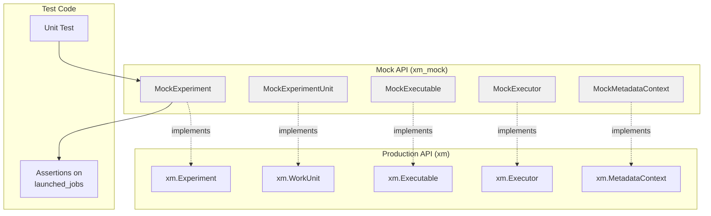
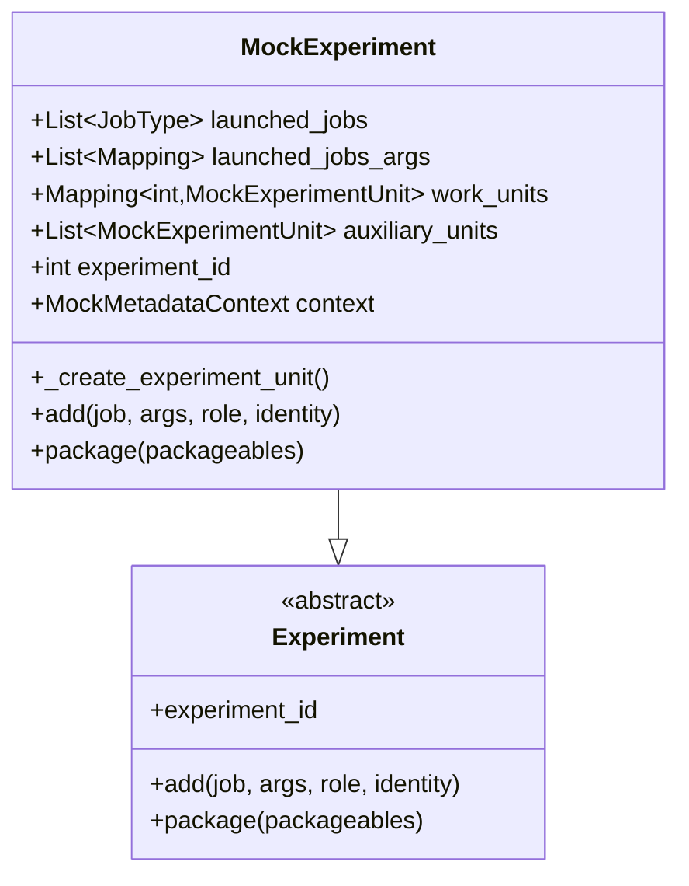
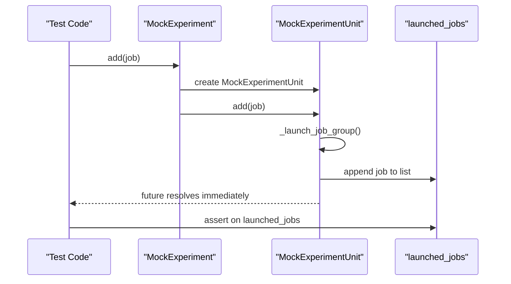
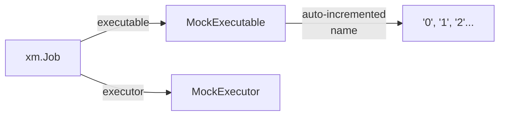
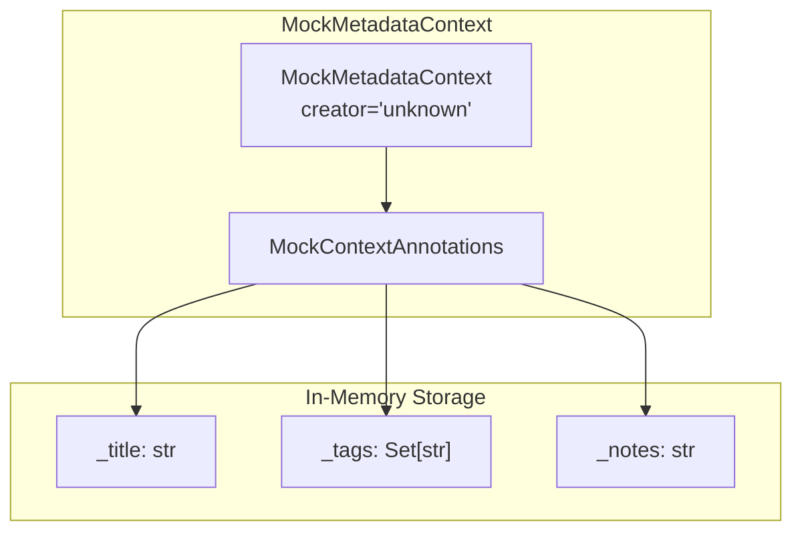
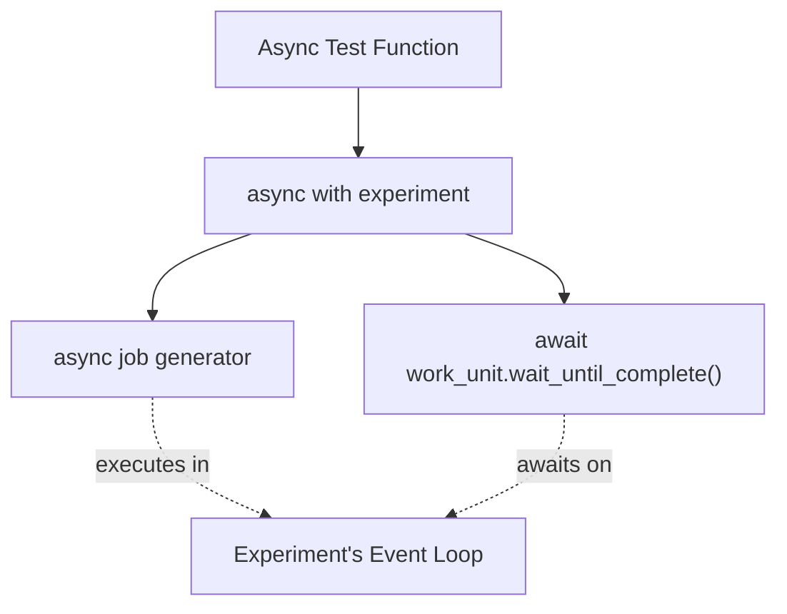
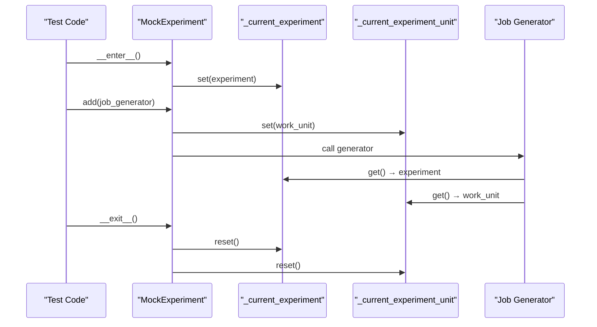

<!-- source: DeepWiki mcp.deepwiki.com · repo google-deepmind/xmanager · page 7.3 Testing and Mocking · fetched 2026-10-26 -->

# Testing and Mocking

<details>
<summary>Relevant source files</summary>

The following files were used as context for generating this wiki page:

- [xmanager/xm/core.py](xmanager/xm/core.py)
- [xmanager/xm/core_test.py](xmanager/xm/core_test.py)
- [xmanager/xm/job_blocks.py](xmanager/xm/job_blocks.py)
- [xmanager/xm/job_blocks_test.py](xmanager/xm/job_blocks_test.py)
- [xmanager/xm_local/experiment.py](xmanager/xm_local/experiment.py)
- [xmanager/xm_mock/__init__.py](xmanager/xm_mock/__init__.py)

</details>


## Purpose and Scope

This page documents XManager's testing utilities and mocking infrastructure. The `xm_mock` module provides lightweight mock implementations of core XManager abstractions that enable unit testing of experiment logic without executing actual jobs. These utilities allow developers to verify experiment structure, job configuration, and argument handling in tests.

For information about the core experiment abstractions being mocked, see [Experiments and Work Units](#3.1). For details on the production implementations, see [Execution Backends](#5).

---

## Overview of Testing Utilities

XManager provides a complete set of mock implementations in the `xm_mock` module that mirror the production API but perform no actual execution. These mocks store invocations in memory, allowing tests to inspect what jobs were added, what arguments were passed, and how the experiment was structured.



**Key Characteristics:**
- **API-Compatible**: Mock classes implement the same interfaces as production classes
- **In-Memory Storage**: All state is stored in memory, no database or external systems
- **Immediate Completion**: Jobs complete instantly without actual execution
- **Inspection-Friendly**: Exposes `launched_jobs` and other attributes for assertions

**Sources:** [xmanager/xm_mock/__init__.py:1-226]()

---

## Mock Components

### MockExperiment

`MockExperiment` is the primary mock implementation of `xm.Experiment`. It provides a lightweight experiment context that tracks all jobs added but does not execute them.



**Key Attributes:**

| Attribute | Type | Description |
|-----------|------|-------------|
| `launched_jobs` | `List[JobType]` | All jobs that were added to the experiment |
| `launched_jobs_args` | `List[Optional[Mapping]]` | Arguments passed when adding each job |
| `work_units` | `Mapping[int, MockExperimentUnit]` | Work units created via `add()` |
| `auxiliary_units` | `List[MockExperimentUnit]` | Auxiliary units created |
| `experiment_id` | `int` | Always returns `1` for mocks |

**Usage Example:**

```python
from xmanager import xm_mock
from xmanager.xm import job_blocks

def test_experiment():
    experiment = xm_mock.MockExperiment()
    with experiment:
        job = job_blocks.Job(
            xm_mock.MockExecutable(), 
            xm_mock.MockExecutor(),
            args={'learning_rate': 0.01}
        )
        experiment.add(job)
    
    # Verify job was added
    assert len(experiment.launched_jobs) == 1
    assert experiment.launched_jobs[0].args.to_dict()['learning_rate'] == 0.01
```

**Sources:** [xmanager/xm_mock/__init__.py:120-205](), [xmanager/xm/core_test.py:58-68]()

---

### MockExperimentUnit

`MockExperimentUnit` implements `xm.WorkUnit` and represents a mock work unit within an experiment. Unlike production work units, it completes immediately and stores launched jobs for inspection.

**Key Behaviors:**
- **Immediate Completion**: `_wait_until_complete()` returns immediately
- **Job Collection**: Appends jobs to the parent experiment's `launched_jobs` list
- **No Actual Execution**: Jobs are recorded but never executed



**Sources:** [xmanager/xm_mock/__init__.py:79-118](), [xmanager/xm/core_test.py:249-259]()

---

### MockExecutable and MockExecutor

These lightweight mocks represent the executable and executor abstractions without requiring actual binaries or runtime environments.



**MockExecutable:**
- Implements `job_blocks.Executable`
- Auto-increments a `counter` class variable to generate unique names
- No actual executable artifact

**MockExecutor:**
- Implements `job_blocks.Executor`
- Provides a stub `Spec` attribute
- No actual execution backend

**Usage:**

```python
# Create mock components
executable = xm_mock.MockExecutable()  # name='0'
executor = xm_mock.MockExecutor()

# Use in Job definition
job = job_blocks.Job(executable, executor, args={'batch_size': 32})
```

**Sources:** [xmanager/xm_mock/__init__.py:207-221]()

---

### MockMetadataContext

`MockMetadataContext` and `MockContextAnnotations` provide in-memory implementations of experiment metadata, allowing tests to verify metadata operations without database dependencies.



**MockContextAnnotations Methods:**

| Method | Description |
|--------|-------------|
| `set_title(title)` | Sets experiment title in memory |
| `add_tags(*tags)` | Adds tags to in-memory set |
| `remove_tags(*tags)` | Removes tags from set |
| `set_notes(notes)` | Sets notes in memory |

**Sources:** [xmanager/xm_mock/__init__.py:38-77]()

---

## Writing Tests with XManager

### Basic Test Structure

The standard pattern for testing XManager experiments uses the mock experiment as a context manager:

```python
from xmanager import xm_mock
from xmanager.xm import job_blocks

def test_my_experiment():
    # Create mock experiment
    experiment = xm_mock.MockExperiment()
    
    # Use as context manager
    with experiment:
        # Add jobs
        job = job_blocks.Job(
            xm_mock.MockExecutable(),
            xm_mock.MockExecutor(),
            args={'param': 'value'}
        )
        experiment.add(job)
    
    # Assert on results
    assert len(experiment.launched_jobs) == 1
    assert experiment.work_unit_count == 1
```

**Sources:** [xmanager/xm/core_test.py:60-68]()

---

### Testing Job Launches

#### Single Job Launch

```python
def test_single_job_launch():
    experiment = xm_mock.MockExperiment()
    with experiment:
        job = job_blocks.Job(
            xm_mock.MockExecutable(), 
            xm_mock.MockExecutor(),
            args={},
            name='my_job'
        )
        experiment.add(job)
    
    assert experiment.launched_jobs == [job]
```

**Sources:** [xmanager/xm/core_test.py:60-68]()

#### Job Group Launch

When testing `JobGroup`, all jobs within the group are flattened and added to `launched_jobs`:

```python
def test_job_group_launch():
    experiment = xm_mock.MockExperiment()
    with experiment:
        foo_job = job_blocks.Job(
            xm_mock.MockExecutable(),
            xm_mock.MockExecutor(),
            args={'foo': 1},
            name='foo'
        )
        bar_job = job_blocks.Job(
            xm_mock.MockExecutable(),
            xm_mock.MockExecutor(),
            args={'bar': 2},
            name='bar'
        )
        experiment.add(job_blocks.JobGroup(foo=foo_job, bar=bar_job))
    
    # Both jobs are in launched_jobs
    assert experiment.launched_jobs == [foo_job, bar_job]
```

**Sources:** [xmanager/xm/core_test.py:70-87]()

---

### Testing Job Generators

Job generators are async functions that dynamically create jobs. The mock experiment executes these generators and collects the resulting jobs:

```python
def test_job_generator():
    experiment = xm_mock.MockExperiment()
    with experiment:
        job = job_blocks.Job(
            xm_mock.MockExecutable(),
            xm_mock.MockExecutor(),
            args={},
            name='generated_job'
        )
        
        # Define async job generator
        async def job_generator(work_unit: xm.WorkUnit, use_magic: bool):
            assert use_magic == True
            work_unit.add(job)
        
        # Add generator with arguments
        experiment.add(job_generator, args={'use_magic': True})
    
    # Verify generator was executed
    assert experiment.launched_jobs == [job]
    assert experiment.launched_jobs_args == [{'use_magic': True}]
```

**Generator Requirements:**
- Must be an `async def` function
- First parameter must be `work_unit: xm.WorkUnit`
- Additional parameters come from `args` dict

**Sources:** [xmanager/xm/core_test.py:89-104]()

---

### Testing Arguments and Overrides

The mock experiment correctly handles argument merging, allowing tests to verify that default arguments are properly overridden:

```python
def test_argument_override():
    experiment = xm_mock.MockExperiment()
    with experiment:
        experiment.add(
            job_blocks.JobGroup(
                foo=job_blocks.Job(
                    xm_mock.MockExecutable(),
                    xm_mock.MockExecutor(),
                    args={'x': 1, 'y': 2},
                    env_vars={'EDITOR': 'vi'},
                ),
                bar=job_blocks.Job(
                    xm_mock.MockExecutable(),
                    xm_mock.MockExecutor(),
                    args=['--bar=1'],
                ),
            ),
            args={
                'foo': {'args': {'x': 3, 'z': 4}, 'env_vars': {'TURBO': 'ON'}},
                'bar': {'args': ['--spacebar']},
            },
        )
    
    # Verify argument merging
    foo_job = experiment.launched_jobs[0]
    assert foo_job.args.to_dict(kwargs_only=True) == {'x': 3, 'y': 2, 'z': 4}
    assert foo_job.env_vars == {'TURBO': 'ON', 'EDITOR': 'vi'}
    
    bar_job = experiment.launched_jobs[1]
    assert '--bar=1' in bar_job.args.to_list()
    assert '--spacebar' in bar_job.args.to_list()
```

**Sources:** [xmanager/xm/core_test.py:150-183]()

---

### Async Testing

XManager supports both synchronous and asynchronous testing patterns. For async tests, use the `async with` syntax:

```python
import asyncio
from xmanager.xm import utils

@utils.run_in_asyncio_loop
async def test_async_experiment():
    experiment = xm_mock.MockExperiment()
    async with experiment:
        experiment.add(
            job_blocks.Job(
                xm_mock.MockExecutable(),
                xm_mock.MockExecutor(),
                args={}
            )
        )
        
        # Can await work unit completion
        work_unit = experiment.work_units[1]
        await work_unit.wait_until_complete()
    
    assert len(experiment.launched_jobs) == 1
```

**Async Features Tested:**



**Sources:** [xmanager/xm/core_test.py:249-259](), [xmanager/xm/core_test.py:210-221]()

---

## Common Testing Patterns

### Testing Error Handling

Mock experiments propagate exceptions from job generators, allowing tests to verify error handling:

```python
class TestError(RuntimeError):
    pass

async def failing_job_generator(work_unit: xm.WorkUnit):
    raise TestError

def test_job_generator_raises():
    experiment = xm_mock.MockExperiment()
    with self.assertRaises(TestError):
        with experiment:
            experiment.add(failing_job_generator)
```

**Sources:** [xmanager/xm/core_test.py:27-33](), [xmanager/xm/core_test.py:105-109]()

---

### Testing Auxiliary Units

Auxiliary units (e.g., Tensorboard) can be tested using `AuxiliaryUnitJob`:

```python
def test_auxiliary_unit():
    experiment = xm_mock.MockExperiment()
    with experiment:
        job = job_blocks.Job(
            xm_mock.MockExecutable(),
            xm_mock.MockExecutor(),
            args={},
            name='tensorboard'
        )
        experiment.add(
            xm.AuxiliaryUnitJob(job, termination_delay_secs=600)
        )
    
    assert len(experiment.auxiliary_units) == 1
    assert len(experiment.work_units) == 0
```

**Sources:** [xmanager/xm/core_test.py:120-128]()

---

### Testing Context Variables

XManager uses context variables to track the current experiment and work unit. These can be tested to verify correct context propagation:

```python
from xmanager.xm import core

def test_context_variables():
    with xm_mock.MockExperiment() as experiment:
        # Experiment is set in context
        assert core._current_experiment.get() == experiment
        
        async def job_generator(work_unit: core.WorkUnit):
            # Work unit is set in context
            assert core._current_experiment_unit.get() == work_unit
            assert core._current_experiment.get() == work_unit.experiment
        
        experiment.add(job_generator)
    
    # Context is cleared after exit
    assert core._current_experiment.get(None) is None
    assert core._current_experiment_unit.get(None) is None
```

**Context Variable Lifecycle:**



**Sources:** [xmanager/xm/core_test.py:333-381]()

---

### Testing Hyperparameter Sweeps

Test multiple work units with different arguments to verify sweep logic:

```python
def test_hyperparameter_sweep():
    experiment = xm_mock.MockExperiment()
    with experiment:
        job = job_blocks.Job(
            xm_mock.MockExecutable(),
            xm_mock.MockExecutor()
        )
        
        # Launch sweep
        for learning_rate in [0.001, 0.01, 0.1]:
            experiment.add(job, args={'args': {'learning_rate': learning_rate}})
    
    # Verify each work unit has different args
    assert len(experiment.work_units) == 3
    assert experiment.launched_jobs[0].args.to_dict()['learning_rate'] == 0.001
    assert experiment.launched_jobs[1].args.to_dict()['learning_rate'] == 0.01
    assert experiment.launched_jobs[2].args.to_dict()['learning_rate'] == 0.1
```

**Sources:** [xmanager/xm/core_test.py:185-194]()

---

## Mock Component API Reference

### MockExperiment

| Method/Property | Type | Description |
|----------------|------|-------------|
| `__init__()` | | Creates new mock experiment with empty state |
| `add(job, args, role, identity)` | `Future[ExperimentUnit]` | Adds job/job group/generator to experiment |
| `package(packageables)` | `List[Executable]` | Returns mock executables |
| `launched_jobs` | `List[JobType]` | All jobs added to experiment |
| `launched_jobs_args` | `List[Optional[Mapping]]` | Arguments for each launched job |
| `work_units` | `Mapping[int, MockExperimentUnit]` | Created work units keyed by ID |
| `auxiliary_units` | `List[MockExperimentUnit]` | Created auxiliary units |
| `experiment_id` | `int` | Always `1` |
| `context` | `MockMetadataContext` | In-memory metadata context |

**Sources:** [xmanager/xm_mock/__init__.py:120-205]()

---

### MockExperimentUnit

| Method/Property | Type | Description |
|----------------|------|-------------|
| `work_unit_id` | `int` | Auto-incremented work unit ID |
| `experiment_unit_name` | `str` | Format: `"{experiment_id}_{work_unit_id}"` |
| `add(job, args, identity)` | `Awaitable[None]` | Adds job to launched_jobs list |
| `wait_until_complete()` | `Awaitable[WorkUnit]` | Returns immediately |

**Sources:** [xmanager/xm_mock/__init__.py:79-118]()

---

### MockExecutable

| Method/Property | Type | Description |
|----------------|------|-------------|
| `__init__()` | | Auto-increments counter and assigns name |
| `name` | `str` | Auto-generated name from counter |
| `counter` | `int` (class var) | Shared counter for unique names |

**Sources:** [xmanager/xm_mock/__init__.py:207-214]()

---

### MockExecutor

| Attribute | Type | Description |
|-----------|------|-------------|
| `Spec` | `Type[ExecutorSpec]` | Returns `job_blocks.ExecutorSpec` |

**Sources:** [xmanager/xm_mock/__init__.py:217-220]()

---

### MockContextAnnotations

| Method | Description |
|--------|-------------|
| `set_title(title: str)` | Sets experiment title |
| `add_tags(*tags: str)` | Adds tags to set |
| `remove_tags(*tags: str)` | Removes tags from set |
| `set_notes(notes: str)` | Sets experiment notes |
| `title` | Returns current title |
| `tags` | Returns set of tags |
| `notes` | Returns current notes |

**Sources:** [xmanager/xm_mock/__init__.py:38-70]()

---

