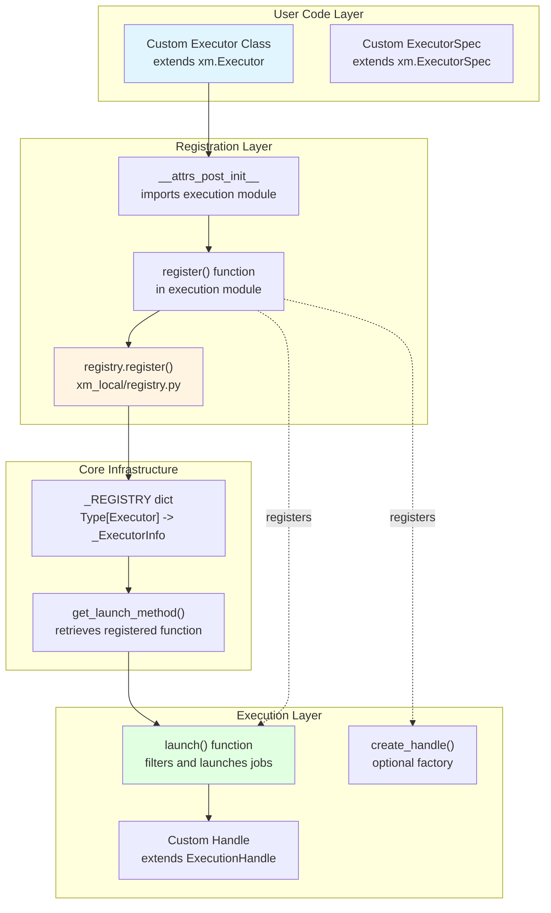
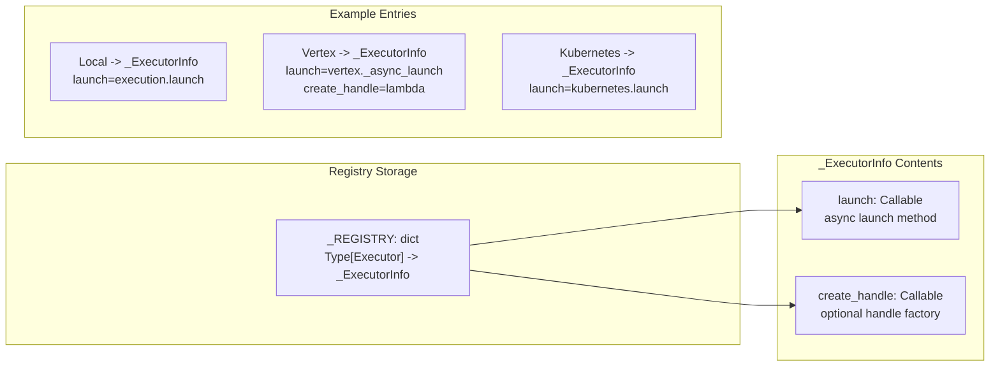
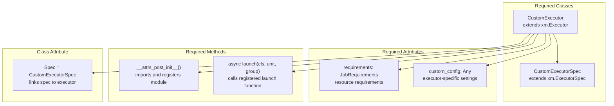
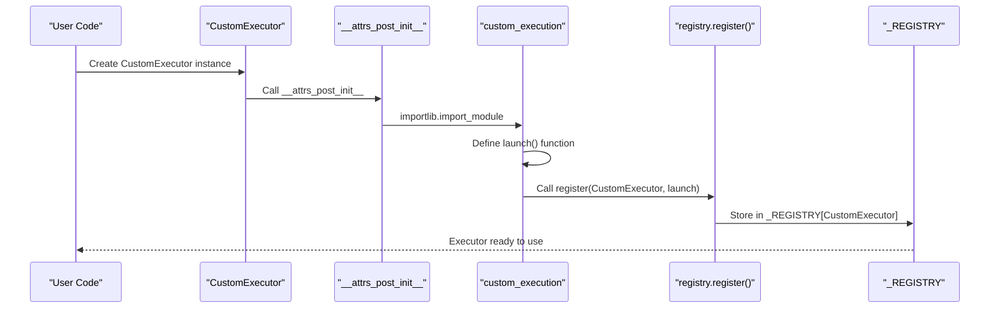
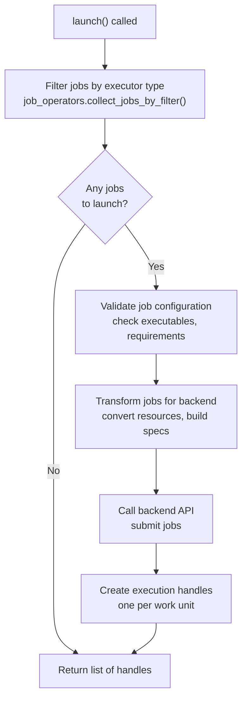
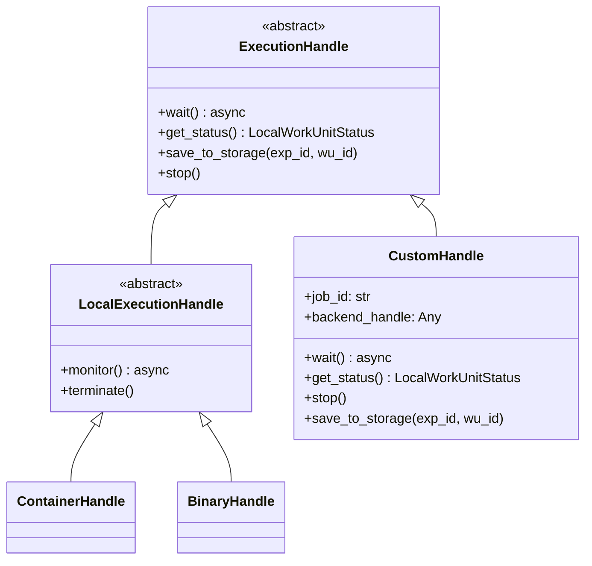
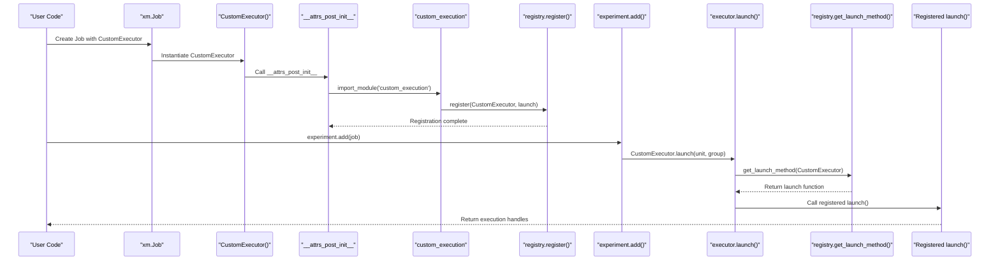

<!-- source: DeepWiki mcp.deepwiki.com · repo google-deepmind/xmanager · page 7.4 Extending XManager · fetched 2026-10-26 -->

# Extending XManager

<details>
<summary>Relevant source files</summary>

The following files were used as context for generating this wiki page:

- [xmanager/cloud/vertex.py](xmanager/cloud/vertex.py)
- [xmanager/cloud/vertex_test.py](xmanager/cloud/vertex_test.py)
- [xmanager/xm_local/__init__.py](xmanager/xm_local/__init__.py)
- [xmanager/xm_local/execution.py](xmanager/xm_local/execution.py)
- [xmanager/xm_local/execution_test.py](xmanager/xm_local/execution_test.py)
- [xmanager/xm_local/executors.py](xmanager/xm_local/executors.py)
- [xmanager/xm_local/executors_test.py](xmanager/xm_local/executors_test.py)
- [xmanager/xm_local/handles.py](xmanager/xm_local/handles.py)
- [xmanager/xm_local/registry.py](xmanager/xm_local/registry.py)

</details>


This guide explains how to extend XManager by implementing custom executors and execution backends. It covers the registry pattern, executor interfaces, execution handles, and the complete workflow for adding new execution environments to XManager.

For information about using existing executors, see [Execution Backends](#5). For details on specific executor implementations, see [Local Executor](#5.1), [Vertex AI Executor](#5.2), and [Kubernetes Executor](#5.3).

---

## Extension Architecture Overview

XManager's extension system is built around a **registry pattern** that enables dynamic dispatch of execution logic based on executor type. This design allows new execution backends to be added without modifying core XManager code.



**Key Extension Points:**

| Extension Point | Purpose | Required |
|----------------|---------|----------|
| Executor Class | Defines executor specification and triggers registration | Yes |
| ExecutorSpec Class | Defines executor-specific configuration | Yes |
| Launch Function | Implements job launching logic | Yes |
| Execution Handle | Provides interface to running jobs | Yes |
| Handle Factory | Recreates handles from stored data | No |

**Sources:** [xmanager/xm_local/executors.py:1-183](), [xmanager/xm_local/registry.py:1-56](), [xmanager/xm_local/execution.py:1-223]()

---

## The Registry Pattern

XManager uses a registry to map executor types to their execution logic. This pattern enables lazy loading of execution backends and avoids heavy dependencies for unused executors.

### Registry Data Structure

The registry maintains a dictionary mapping executor types to execution metadata:



**Sources:** [xmanager/xm_local/registry.py:18-56]()

### Registry API

The registry provides four core functions:

| Function | Purpose | Usage |
|----------|---------|-------|
| `register(executor_type, launch, create_handle)` | Registers execution logic for an executor type | Called by execution modules |
| `is_registered(executor_type)` | Checks if an executor type is registered | Used for validation |
| `get_launch_method(executor_type)` | Retrieves the launch method | Called by executor's `launch()` method |
| `get_create_handle_method(executor_type)` | Retrieves the handle factory | Used for experiment restoration |

**Sources:** [xmanager/xm_local/registry.py:32-56]()

---

## Creating Custom Executors

A custom executor consists of two classes: an `ExecutorSpec` for configuration and an `Executor` for runtime behavior.

### Executor Structure



**Sources:** [xmanager/xm_local/executors.py:59-183]()

### Implementation Pattern

Custom executors follow this pattern:

**Step 1: Define ExecutorSpec**

The spec class holds configuration that can be serialized and passed to packaging logic:

```python
@attr.s(auto_attribs=True)
class CustomExecutorSpec(xm.ExecutorSpec):
  """Configuration for the custom executor."""
  
  # Executor-specific configuration
  custom_setting: Optional[str] = None
  push_image_tag: Optional[str] = None
```

**Step 2: Define Executor**

The executor class holds runtime requirements and triggers registration:

```python
@attr.s(auto_attribs=True)
class CustomExecutor(xm.Executor):
  """Custom executor for a specific backend."""
  
  requirements: xm.JobRequirements = attr.Factory(xm.JobRequirements)
  custom_capability: Optional[CustomCapability] = None
  
  Spec = CustomExecutorSpec  # Link spec class
  
  def __attrs_post_init__(self):
    # Import and register execution module
    custom_execution = importlib.import_module('mypackage.custom_execution')
    custom_execution.register()
  
  @override
  @classmethod
  async def launch(
      cls, local_experiment_unit: Any, job_group: xm.JobGroup
  ) -> Sequence[handles.ExecutionHandle]:
    # Delegate to registered launch method
    return await registry.get_launch_method(cls)(
        local_experiment_unit, job_group
    )
```

**Sources:** [xmanager/xm_local/executors.py:31-91](), [xmanager/xm_local/executors.py:123-144](), [xmanager/xm_local/executors.py:162-183]()

### Registration Lifecycle



**Sources:** [xmanager/xm_local/executors.py:79-81](), [xmanager/xm_local/executors.py:132-134](), [xmanager/xm_local/executors.py:171-173]()

---

## Implementing Execution Logic

The execution module contains the launch function and job-specific logic for your backend.

### Launch Function Signature

The launch function must accept an experiment unit and job group, and return execution handles:

```python
async def launch(
    local_experiment_unit: Any, 
    job_group: xm.JobGroup
) -> list[CustomHandle]:
  """Launch jobs on the custom backend."""
  # Implementation
```

**Sources:** [xmanager/xm_local/execution.py:198-212](), [xmanager/cloud/vertex.py:400-407]()

### Implementation Workflow



**Sources:** [xmanager/xm_local/execution.py:198-212](), [xmanager/cloud/vertex.py:356-372]()

### Job Filtering

Use a predicate function to filter jobs belonging to your executor:

```python
def _custom_job_predicate(job: xm.Job) -> bool:
  return isinstance(job.executor, CustomExecutor)

async def launch(
    local_experiment_unit: Any, 
    job_group: xm.JobGroup
) -> list[CustomHandle]:
  # Filter jobs for this executor
  jobs = xm.job_operators.collect_jobs_by_filter(
      job_group, _custom_job_predicate
  )
  
  if not jobs:
    return []
  
  # Launch filtered jobs
  # ...
```

**Sources:** [xmanager/xm_local/execution.py:194-205](), [xmanager/cloud/vertex.py:107-109](), [xmanager/cloud/vertex.py:356-365]()

### Executable Type Handling

Different executor types support different executable types. Use pattern matching or type checking:

```python
async def _launch_router(
    get_full_job_name: Callable[[str], str],
    job: xm.Job,
    executable: xm.Executable,
) -> CustomHandle:
  match executable:
    case GoogleContainerRegistryImage() as image:
      return await _launch_container(job, image)
    case LocalBinary() as binary:
      raise TypeError(f'CustomExecutor does not support binaries')
    case _:
      raise TypeError(f'Unsupported executable: {executable!r}')
```

**Sources:** [xmanager/xm_local/execution.py:152-169]()

### Resource Translation

Translate XManager resource requirements to backend-specific formats:

```python
def get_machine_spec(job: xm.Job) -> Dict[str, Any]:
  """Translate JobRequirements to backend machine spec."""
  requirements = job.executor.requirements
  spec = {}
  
  # Handle accelerators
  for resource, value in requirements.task_requirements.items():
    if resource in xm.GpuType:
      spec['gpu_type'] = str(resource).upper()
      spec['gpu_count'] = int(value)
    elif resource in xm.TpuType:
      spec['tpu_type'] = str(resource).upper()
      spec['tpu_count'] = int(value)
  
  # Handle CPU/RAM
  spec['cpu'] = requirements.task_requirements.get(xm.ResourceType.CPU, 0)
  spec['ram'] = requirements.task_requirements.get(xm.ResourceType.RAM, 0)
  
  return spec
```

**Sources:** [xmanager/cloud/vertex.py:293-329]()

---

## Creating Execution Handles

Execution handles provide a uniform interface for monitoring and controlling running jobs.

### Handle Interface



**Sources:** [xmanager/xm_local/handles.py:21-40](), [xmanager/xm_local/handles.py:42-52]()

### Required Methods

| Method | Purpose | Return Type |
|--------|---------|-------------|
| `async wait()` | Block until job completes | `None` |
| `get_status()` | Get current job status | `LocalWorkUnitStatus` |
| `stop()` | Cancel or terminate job | `None` |
| `save_to_storage(exp_id, wu_id)` | Persist handle to database | `None` |

**Sources:** [xmanager/xm_local/handles.py:21-40]()

### Implementation Example

```python
@attr.s(auto_attribs=True)
class CustomHandle(handles.ExecutionHandle):
  """Handle for custom backend jobs."""
  
  job_id: str
  backend_client: Any  # Backend-specific client
  
  async def wait(self) -> None:
    """Wait for job completion."""
    await self.backend_client.wait_for_job(self.job_id)
  
  def stop(self) -> None:
    """Cancel the job."""
    self.backend_client.cancel_job(self.job_id)
  
  def get_status(self) -> status.LocalWorkUnitStatus:
    """Get job status."""
    backend_status = self.backend_client.get_state(self.job_id)
    xm_status = self._translate_status(backend_status)
    return status.LocalWorkUnitStatus(status=xm_status)
  
  def save_to_storage(self, experiment_id: int, work_unit_id: int) -> None:
    """Save handle to database."""
    database.database().insert_custom_job(
        experiment_id, work_unit_id, self.job_id
    )
  
  def _translate_status(self, backend_status):
    """Translate backend status to XManager status."""
    # Map backend states to LocalWorkUnitStatusEnum values
    pass
```

**Sources:** [xmanager/cloud/vertex.py:332-353](), [xmanager/xm_local/handles.py:54-104](), [xmanager/xm_local/handles.py:106-138]()

### Status Translation

Map backend-specific status values to XManager status enums:

```python
_STATE_TO_STATUS = {
    BackendState.SUCCEEDED: status.LocalWorkUnitStatusEnum.COMPLETED,
    BackendState.CANCELLED: status.LocalWorkUnitStatusEnum.CANCELLED,
    BackendState.RUNNING: status.LocalWorkUnitStatusEnum.RUNNING,
    BackendState.FAILED: status.LocalWorkUnitStatusEnum.FAILED,
}
```

**Sources:** [xmanager/cloud/vertex.py:73-98]()

---

## Registration Process

The complete registration flow connects all extension components.

### Registration Function

Create a `register()` function in your execution module:

```python
def register():
  """Register custom executor with XManager."""
  registry.register(
      CustomExecutor,
      launch=_async_launch,
      create_handle=lambda *args, data: CustomHandle(data.custom.job_id),
  )

async def _async_launch(
    local_experiment_unit: Any, 
    job_group: xm.JobGroup
) -> list[CustomHandle]:
  """Adapter for launch function."""
  return launch(
      local_experiment_unit._experiment_title,
      local_experiment_unit.experiment_unit_name,
      job_group,
  )
```

**Sources:** [xmanager/xm_local/execution.py:215-223](), [xmanager/cloud/vertex.py:410-416]()

### Registration Call Chain



**Sources:** [xmanager/xm_local/executors.py:79-90](), [xmanager/xm_local/registry.py:32-40](), [xmanager/xm_local/registry.py:46-49]()

---

## Testing Custom Executors

XManager provides testing utilities and patterns for validating custom executors.

### Test Structure

```python
import unittest
from unittest import mock
from xmanager import xm
from xmanager.xm_local import executables
from mypackage import custom_execution
from mypackage import custom_executors

class CustomExecutorTest(unittest.IsolatedAsyncioTestCase):
  """Tests for custom executor."""
  
  @mock.patch('mypackage.custom_execution.backend_client')
  async def test_launch(self, mock_client):
    """Test job launch on custom backend."""
    # Setup mocks
    mock_client.submit_job.return_value = 'job-123'
    
    # Create job with custom executor
    job = xm.Job(
        name='test-job',
        executable=executables.GoogleContainerRegistryImage(
            name='test-image',
            image_path='gcr.io/project/image',
        ),
        executor=custom_executors.CustomExecutor(
            requirements=xm.JobRequirements(cpu=4, ram=16*xm.GiB)
        ),
    )
    
    # Launch
    handles = await custom_execution.launch(
        experiment_title='test-exp',
        work_unit_name='test-wu',
        job_group=xm.JobGroup(test_job=job),
    )
    
    # Verify
    self.assertLen(handles, 1)
    self.assertEqual(handles[0].job_id, 'job-123')
    mock_client.submit_job.assert_called_once()
```

**Sources:** [xmanager/cloud/vertex_test.py:34-100](), [xmanager/xm_local/execution_test.py:58-124]()

### Testing Patterns

| Pattern | Purpose | Example |
|---------|---------|---------|
| Mock backend client | Avoid real API calls | `@mock.patch.object(backend_client)` |
| Parameterized tests | Test multiple configurations | `@parameterized.product(gpu_count=[0,1,4])` |
| IsolatedAsyncioTestCase | Test async functions | `class Test(unittest.IsolatedAsyncioTestCase)` |
| Mock job creation | Test execution logic in isolation | Create `xm.Job` with mock executables |

**Sources:** [xmanager/cloud/vertex_test.py:34-100](), [xmanager/xm_local/execution_test.py:35-56](), [xmanager/xm_local/execution_test.py:58-124]()

### Testing Resource Translation

Test that JobRequirements are correctly translated to backend specs:

```python
def test_get_machine_spec_gpu(self):
  """Test GPU resource translation."""
  job = xm.Job(
      executable=executables.GoogleContainerRegistryImage('name', 'path'),
      executor=custom_executors.CustomExecutor(
          requirements=xm.JobRequirements(v100=2)
      ),
  )
  
  spec = custom_execution.get_machine_spec(job)
  
  self.assertEqual(spec['gpu_type'], 'V100')
  self.assertEqual(spec['gpu_count'], 2)
```

**Sources:** [xmanager/cloud/vertex_test.py:122-138](), [xmanager/cloud/vertex_test.py:102-120]()

---

## Complete Example: Custom Cloud Executor

This example shows a complete custom executor implementation for a hypothetical cloud service.

### Step 1: Define Executor Classes

```python
# mypackage/executors.py
import importlib
import attr
from typing_extensions import override
from xmanager import xm
from xmanager.xm_local import handles
from xmanager.xm_local import registry

@attr.s(auto_attribs=True)
class MyCloudSpec(xm.ExecutorSpec):
  """Spec for MyCloud executor."""
  region: str = 'us-east-1'
  push_image_tag: Optional[str] = None

@attr.s(auto_attribs=True)
class MyCloud(xm.Executor):
  """Executor for MyCloud service."""
  
  requirements: xm.JobRequirements = attr.Factory(xm.JobRequirements)
  region: str = 'us-east-1'
  
  Spec = MyCloudSpec
  
  def __attrs_post_init__(self):
    mycloud_execution = importlib.import_module('mypackage.execution')
    mycloud_execution.register()
  
  @override
  @classmethod
  async def launch(
      cls, local_experiment_unit: Any, job_group: xm.JobGroup
  ) -> Sequence[handles.ExecutionHandle]:
    return await registry.get_launch_method(cls)(
        local_experiment_unit, job_group
    )
```

**Sources:** [xmanager/xm_local/executors.py:123-144]()

### Step 2: Implement Execution Logic

```python
# mypackage/execution.py
from typing import Any, Sequence
from xmanager import xm
from xmanager.xm import job_operators
from xmanager.xm import utils
from xmanager.xm_local import handles
from xmanager.xm_local import registry
from mypackage import executors
from mypackage import mycloud_client

def _mycloud_job_predicate(job: xm.Job) -> bool:
  return isinstance(job.executor, executors.MyCloud)

async def launch(
    experiment_title: str,
    work_unit_name: str,
    job_group: xm.JobGroup,
) -> list['MyCloudHandle']:
  """Launch jobs on MyCloud."""
  jobs = job_operators.collect_jobs_by_filter(
      job_group, _mycloud_job_predicate
  )
  
  if not jobs:
    return []
  
  # Get client
  client = mycloud_client.get_client()
  
  # Build job specs
  job_specs = []
  for job in jobs:
    executable = job.executable
    args = xm.merge_args(executable.args, job.args).to_list(utils.ARG_ESCAPER)
    env_vars = {**executable.env_vars, **job.env_vars}
    
    spec = {
        'image': executable.image_path,
        'command': args,
        'env': env_vars,
        'resources': _translate_requirements(job.executor.requirements),
        'region': job.executor.region,
    }
    job_specs.append(spec)
  
  # Submit to backend
  job_id = client.submit_job_group(
      name=f'{experiment_title}_{work_unit_name}',
      specs=job_specs,
  )
  
  return [MyCloudHandle(job_id=job_id, client=client)]

def _translate_requirements(requirements: xm.JobRequirements) -> dict:
  """Translate JobRequirements to MyCloud format."""
  resources = {}
  
  for resource, value in requirements.task_requirements.items():
    if resource == xm.ResourceType.CPU:
      resources['cpu_count'] = int(value)
    elif resource == xm.ResourceType.RAM:
      resources['memory_gb'] = int(value / xm.GiB)
    elif resource in xm.GpuType:
      resources['gpu_type'] = str(resource).upper()
      resources['gpu_count'] = int(value)
  
  return resources

async def _async_launch(
    local_experiment_unit: Any, job_group: xm.JobGroup
) -> list['MyCloudHandle']:
  return launch(
      local_experiment_unit._experiment_title,
      local_experiment_unit.experiment_unit_name,
      job_group,
  )

def register():
  """Register MyCloud executor."""
  registry.register(
      executors.MyCloud,
      launch=_async_launch,
  )
```

**Sources:** [xmanager/cloud/vertex.py:356-417](), [xmanager/xm_local/execution.py:194-223]()

### Step 3: Implement Execution Handle

```python
# mypackage/execution.py (continued)
import attr
from xmanager.xm_local import handles
from xmanager.xm_local import status

@attr.s(auto_attribs=True)
class MyCloudHandle(handles.ExecutionHandle):
  """Handle for MyCloud jobs."""
  
  job_id: str
  client: Any
  
  async def wait(self) -> None:
    """Wait for job completion."""
    await self.client.wait_for_job(self.job_id)
  
  def stop(self) -> None:
    """Cancel the job."""
    self.client.cancel_job(self.job_id)
  
  def get_status(self) -> status.LocalWorkUnitStatus:
    """Get job status."""
    state = self.client.get_job_state(self.job_id)
    xm_status = _STATE_MAPPING.get(
        state, 
        status.LocalWorkUnitStatusEnum.RUNNING
    )
    return status.LocalWorkUnitStatus(status=xm_status)
  
  def save_to_storage(self, experiment_id: int, work_unit_id: int) -> None:
    """Save handle to database."""
    # Optional: implement if you want persistence
    pass

_STATE_MAPPING = {
    'COMPLETED': status.LocalWorkUnitStatusEnum.COMPLETED,
    'FAILED': status.LocalWorkUnitStatusEnum.FAILED,
    'CANCELLED': status.LocalWorkUnitStatusEnum.CANCELLED,
    'RUNNING': status.LocalWorkUnitStatusEnum.RUNNING,
}
```

**Sources:** [xmanager/cloud/vertex.py:332-353](), [xmanager/xm_local/handles.py:54-104]()

### Step 4: Usage

```python
# user_script.py
from xmanager import xm
from xmanager import xm_local
from mypackage import executors

async with xm_local.create_experiment(experiment_title='my_experiment') as experiment:
  # Package executable
  [executable] = experiment.package([
      xm.PythonContainer(
          path='//my_project:training',
          base_image='python:3.9',
      )
  ])
  
  # Create job with custom executor
  job = xm.Job(
      executable=executable,
      executor=executors.MyCloud(
          requirements=xm.JobRequirements(cpu=8, ram=32*xm.GiB, v100=2),
          region='us-west-2',
      ),
      args={'learning_rate': 0.001},
  )
  
  # Launch
  experiment.add(xm.JobGroup(training=job))
```

**Sources:** [xmanager/xm_local/executors.py:123-144](), [xmanager/cloud/vertex.py:356-372]()

---

## Summary

Extending XManager requires:

1. **Executor Class**: Define `ExecutorSpec` and `Executor` classes with `__attrs_post_init__` registration
2. **Execution Module**: Implement `launch()` function with job filtering and backend API calls
3. **Execution Handle**: Create handle class implementing `wait()`, `get_status()`, and `stop()`
4. **Registration**: Call `registry.register()` to link executor type to launch function
5. **Testing**: Write unit tests with mocked backend clients

The registry pattern ensures clean separation between XManager core and backend-specific code, enabling extensibility without modifying core logic.

**Sources:** [xmanager/xm_local/registry.py:1-56](), [xmanager/xm_local/executors.py:1-183](), [xmanager/xm_local/execution.py:1-223](), [xmanager/cloud/vertex.py:1-417]()

---

