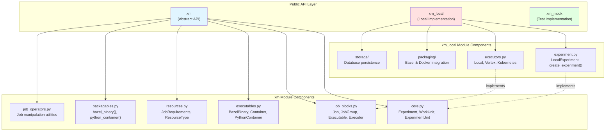
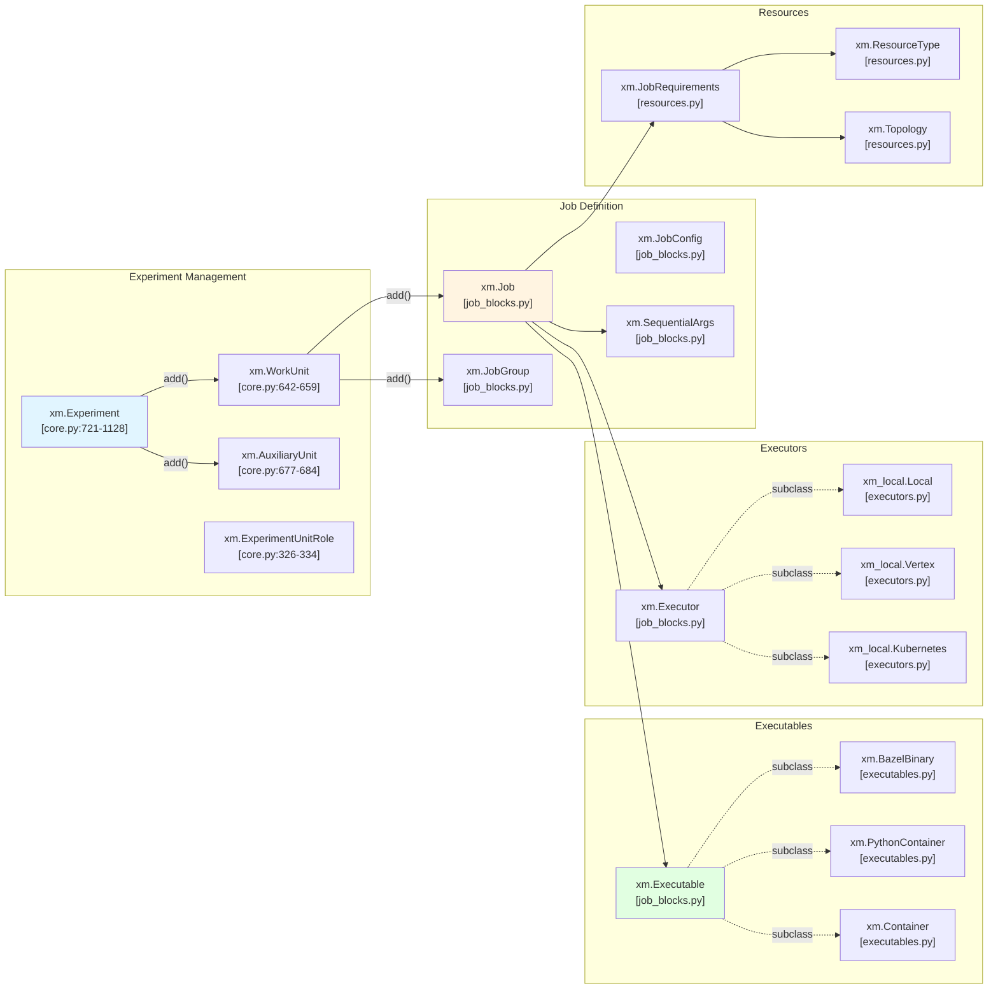
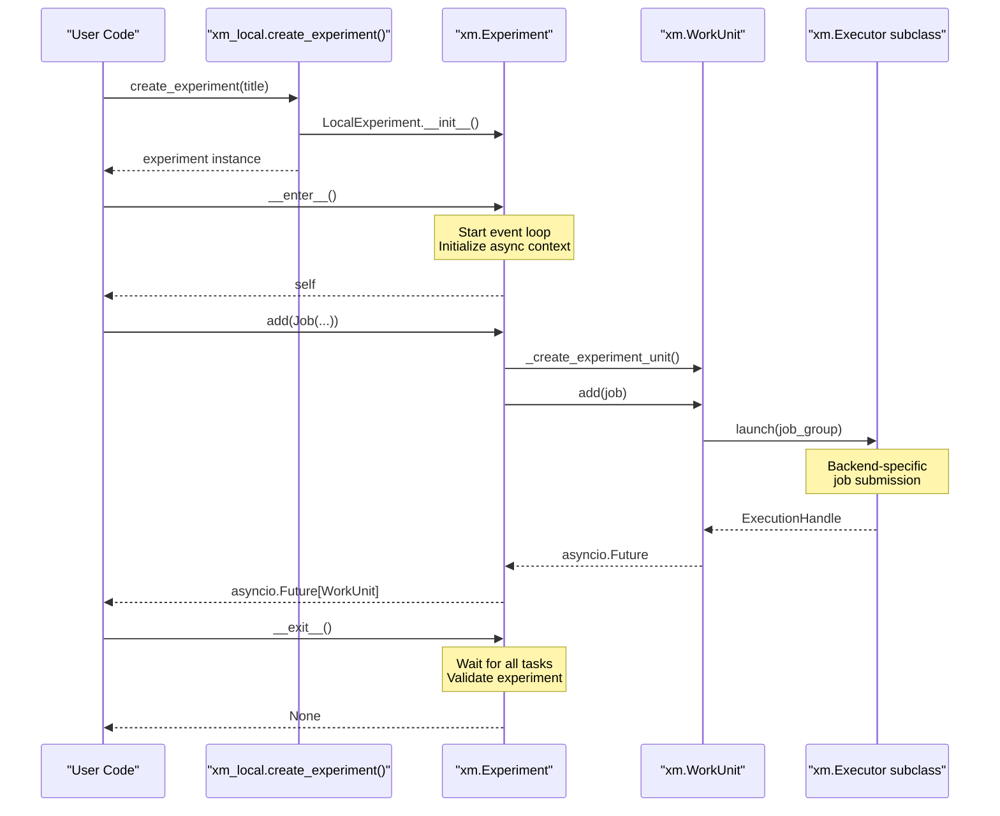
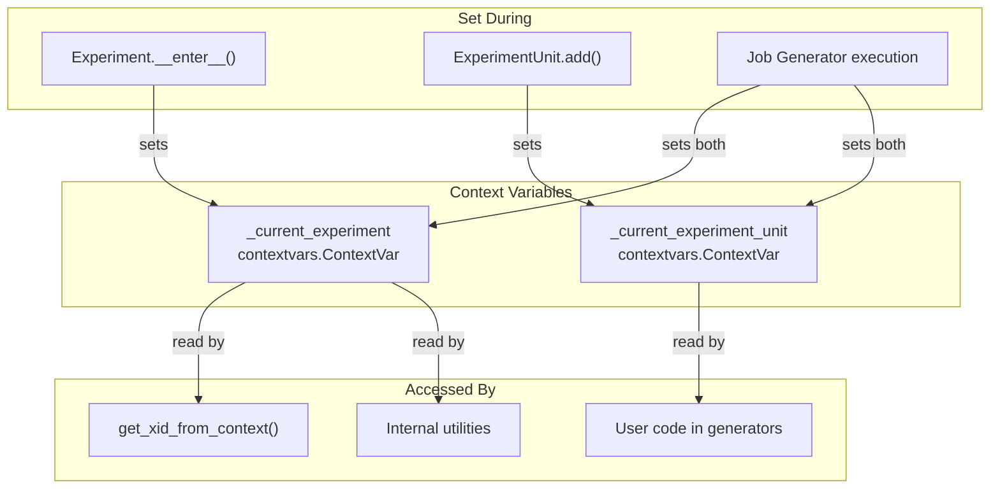

<!-- source: DeepWiki mcp.deepwiki.com · repo google-deepmind/xmanager · page 8 API Reference · fetched 2026-10-26 -->

# API Reference

<details>
<summary>Relevant source files</summary>

The following files were used as context for generating this wiki page:

- [xmanager/xm/__init__.py](xmanager/xm/__init__.py)
- [xmanager/xm/core.py](xmanager/xm/core.py)
- [xmanager/xm/core_test.py](xmanager/xm/core_test.py)
- [xmanager/xm/metadata_context.py](xmanager/xm/metadata_context.py)
- [xmanager/xm_local/experiment.py](xmanager/xm_local/experiment.py)
- [xmanager/xm_mock/__init__.py](xmanager/xm_mock/__init__.py)

</details>


This page provides a comprehensive overview of XManager's public API organization and structure. It documents the core modules, their relationships, and common usage patterns. For detailed API documentation of specific modules and their members, see the child pages listed in each section below.

**Related Pages:**
- For a conceptual introduction to experiments, jobs, and executables, see [Core Concepts](#3)
- For hands-on examples using the API, see [Your First Experiment](#2.2)
- For testing utilities, see [Testing and Mocking](#7.3)

---

## API Structure

XManager's API follows a two-layer architecture: an abstract specification layer (`xm`) and concrete implementation layers (`xm_local`, `xm_mock`). This separation allows the same experiment code to run on different backends.

### Module Organization



**Sources:** [xmanager/xm/__init__.py:1-84](), [xmanager/xm/core.py:1-47](), [xmanager/xm_local/experiment.py:1-449]()

---

## Core API Components

The following diagram maps XManager's conceptual model to concrete code entities, showing the primary classes users interact with:



**Sources:** [xmanager/xm/core.py:721-1128](), [xmanager/xm/job_blocks.py](), [xmanager/xm/executables.py](), [xmanager/xm_local/executors.py]()

---

## API Usage Pattern

XManager experiments follow a context manager pattern with asynchronous task execution. The following diagram illustrates the typical API call flow:



**Sources:** [xmanager/xm/core.py:763-827](), [xmanager/xm_local/experiment.py:387-393]()

---

## Module Overview

XManager's API is organized into several modules, each with distinct responsibilities:

| Module | Purpose | Key Exports | Reference Page |
|--------|---------|-------------|----------------|
| `xm` | Abstract API specification | `Experiment`, `Job`, `JobGroup`, `WorkUnit`, `Executable`, `Executor`, `JobRequirements` | [xm Module](#8.1) |
| `xm_local` | Local implementation | `create_experiment()`, `Local`, `Vertex`, `Kubernetes` executors | [xm_local Module](#8.2) |
| `xm.job_blocks` | Job construction primitives | `Job`, `JobGroup`, `SequentialArgs`, `merge_args()` | [Job Blocks and Operators](#8.3) |
| `xm.resources` | Resource specifications | `JobRequirements`, `ResourceType`, `Topology`, `ServiceTier` | [Resources and Requirements](#8.4) |
| `xm.executables` | Executable types | `BazelBinary`, `Container`, `PythonContainer`, `Dockerfile` | [Executable Specifications](#3.3) |
| `xm.packagables` | Executable factory functions | `bazel_binary()`, `python_container()`, `container()` | [Executable Specifications](#3.3) |
| `xm_mock` | Testing utilities | `MockExperiment`, `MockExecutor`, `MockExecutable` | [Testing and Mocking](#7.3) |

**Sources:** [xmanager/xm/__init__.py:1-84](), [xmanager/xm_local/__init__.py](), [xmanager/xm_mock/__init__.py:1-226]()

---

## Typical Import Pattern

Users typically structure their imports as follows:

```python
# Abstract API - used to define jobs and experiments
from xmanager import xm

# Implementation - provides create_experiment() and executor specs
from xmanager import xm_local
```

All abstract types (e.g., `xm.Job`, `xm.Executable`, `xm.JobRequirements`) are imported from `xm`, while implementation-specific functions and executor types come from `xm_local`.

**Sources:** [xmanager/xm/core.py:17-23]()

---

## Core API Classes

### Experiment Lifecycle

The `Experiment` class is the entry point for all XManager operations. It manages the lifecycle of work units and provides packaging capabilities:

| Method/Property | Description | Return Type |
|-----------------|-------------|-------------|
| `__enter__()` / `__exit__()` | Context manager support for synchronous usage | `Self` |
| `__aenter__()` / `__aexit__()` | Async context manager support | `Self` |
| `add(job, args=None, role=WorkUnitRole(), identity='')` | Add a job/job group to create an experiment unit | `asyncio.Future[ExperimentUnit]` |
| `package(packageables)` | Package executable specs synchronously | `Sequence[Executable]` |
| `package_async(packageable)` | Queue executable spec for async packaging | `Awaitable[Executable]` |
| `experiment_id` | Unique experiment identifier | `int` |

**Sources:** [xmanager/xm/core.py:721-1128]()

### Experiment Units

Experiment units represent collections of jobs running together. They come in two flavors:

**WorkUnit** (`xm.WorkUnit`) - Primary computation units whose status determines experiment success:
- Properties: `work_unit_id`, `experiment_id`, `experiment_unit_name`
- Methods: `add(job, args)`, `stop()`, `get_status()`, `wait_until_complete()`
- Role: `xm.WorkUnitRole(importance=Importance.NORMAL)`

**AuxiliaryUnit** (`xm.AuxiliaryUnit`) - Support units (e.g., TensorBoard) not counted toward experiment completion:
- Properties: `auxiliary_unit_id`, `experiment_id`, `experiment_unit_name`
- Methods: `add(job, args)`, `stop()`, `get_status()`, `wait_until_complete()`
- Role: `xm.AuxiliaryUnitRole(importance=Importance.NORMAL, termination_delay_secs=...)`

**Sources:** [xmanager/xm/core.py:642-684](), [xmanager/xm/core.py:589-675]()

---

## Context Variables

XManager uses Python context variables to track the current experiment and experiment unit during execution. This enables utilities and job generators to access contextual information:



**Context Variables:**
- `_current_experiment`: Set when entering an `Experiment` context, provides access to the active experiment
- `_current_experiment_unit`: Set during job generator execution, provides access to the current work/auxiliary unit

**Utility Functions:**
- `get_xid_from_context()`: Returns the current experiment ID from context or global variable
- `get_contextvar_value_by_name(name)`: Retrieve any context variable by name
- `new_thread_pool_executor()`: Create a thread pool that preserves context variables

**Sources:** [xmanager/xm/core.py:48-110](), [xmanager/xm/core.py:112-126]()

---

## Asynchronous Execution Model

XManager supports both synchronous and asynchronous usage patterns. The experiment context automatically manages an event loop for background task execution:

### Synchronous Usage
```python
with xm_local.create_experiment(title="My Experiment") as experiment:
    # Synchronous add() returns Future but doesn't block
    future = experiment.add(xm.Job(...))
    # Context exit waits for all tasks to complete
```

### Asynchronous Usage
```python
async with xm_local.create_experiment(title="My Experiment") as experiment:
    # Async add() can be awaited
    work_unit = await experiment.add(xm.Job(...))
    # Can await work unit completion
    await work_unit.wait_until_complete()
```

**Key Implementation Details:**
- Synchronous context: Spawns a dedicated event loop thread ([core.py:770-786]())
- Asynchronous context: Reuses the current event loop ([core.py:829-833]())
- Task creation: `_create_task()` method queues tasks for execution ([core.py:1118-1128]())
- Task completion: Context exit waits for all tasks via `_wait_for_tasks()` or `_await_for_tasks()` ([core.py:798-861]())

**Sources:** [xmanager/xm/core.py:763-867]()

---

## Error Handling

XManager defines several exception types for error handling:

| Exception | Base Class | Description | Attributes |
|-----------|------------|-------------|------------|
| `ExperimentUnitError` | `RuntimeError` | Generic experiment unit error | `work_unit: Optional[WorkUnit]` |
| `ExperimentUnitFailedError` | `ExperimentUnitError` | Job failed during execution | Inherits `work_unit` |
| `ExperimentUnitNotCompletedError` | `ExperimentUnitError` | Unit stopped before completion | Inherits `work_unit` |
| `NotFoundError` | `KeyError` | Experiment/unit not found | None |
| `ReloadError` | `ExperimentUnitError` | XReload check failed | Inherits `work_unit` |
| `DebugInterrupt` | `BaseException` | Debug interrupt requested | None |

**Status Checking:**

The `ExperimentUnitStatus` abstract class provides status properties:
- `is_active`: Unit is running or queued (not terminal)
- `is_completed`: Unit completed successfully (terminal)
- `is_failed`: Unit failed (terminal)
- `message`: Human-readable status message

**Sources:** [xmanager/xm/core.py:139-222]()

---

## Job Generators

Job generators are async functions that dynamically create jobs within an experiment unit. They receive the unit as their first parameter:

```python
async def my_generator(work_unit: xm.WorkUnit, **kwargs):
    # Access context
    experiment = work_unit.experiment
    
    # Add jobs dynamically
    for i in range(10):
        work_unit.add(xm.Job(...), args={'index': i})

# Use with experiment
experiment.add(my_generator, args={'some_param': 'value'})
```

**Key Features:**
- Must be async functions (`async def`)
- Receive `ExperimentUnit` as first parameter
- Keyword arguments passed via `args` parameter
- Context variables are automatically set ([core.py:424-453]())
- Exceptions in generators mark the unit as failed

**Sources:** [xmanager/xm/core.py:439-453](), [xmanager/xm/job_blocks.py:is_job_generator]()

---

## Packaging System Integration

The `Experiment` class provides methods for packaging executable specifications:

### Synchronous Packaging
```python
executables = experiment.package([
    xm.bazel_binary(...),
    xm.python_container(...),
])
```

### Asynchronous Packaging
```python
# Queue for packaging
train_exe_future = experiment.package_async(xm.bazel_binary(...))
eval_exe_future = experiment.package_async(xm.python_container(...))

# Trigger build
experiment.package()

# Use packaged executables
train_exe = await train_exe_future
eval_exe = await eval_exe_future
```

**Implementation:**
- Uses `AsyncPackager` for batching requests ([core.py:751]())
- Backend-specific packaging via `_async_packager` class variable
- Local backend: [xm_local/experiment.py:255]()
- Mock backend: [xm_mock/__init__.py:125-127]()

**Sources:** [xmanager/xm/core.py:880-931](), [xmanager/xm/async_packager.py]()

---

## Factory Functions vs Classes

XManager provides both factory functions (in `xm.packagables`) and classes (in `xm.executables`) for creating executables:

**Factory Functions** (Recommended):
```python
# From xm.packagables
executable_spec = xm.bazel_binary(
    label='//my/package:binary',
    args={'flag': 'value'},
)
```

**Direct Class Construction** (Advanced):
```python
# From xm.executables
executable_spec = xm.BazelBinary(
    label='//my/package:binary',
    args=xm.SequentialArgs.from_collection({'flag': 'value'}),
)
```

Factory functions provide convenience by handling argument conversion and sensible defaults.

**Sources:** [xmanager/xm/packagables.py](), [xmanager/xm/executables.py]()

---

## Thread Safety

XManager's API is designed for use from the main thread or from within async contexts. When using threads:

1. Use `xm.new_thread_pool_executor()` to create thread pools that preserve context variables
2. Each experiment context manages its own event loop
3. Database operations are thread-safe via connection pooling

**Sources:** [xmanager/xm/core.py:112-126]()

---

## Next Steps

For detailed API documentation of specific components:
- [xm Module](#8.1) - Complete reference for `xm` module classes and functions
- [xm_local Module](#8.2) - Local backend implementation including `create_experiment()` and executors
- [Job Blocks and Operators](#8.3) - Job construction and manipulation utilities
- [Resources and Requirements](#8.4) - Resource specification and management

For conceptual information:
- [Core Concepts](#3) - Understanding experiments, work units, and jobs
- [Execution Backends](#5) - How different executor types work
- [Packaging System](#4) - How executables are packaged for execution

---

