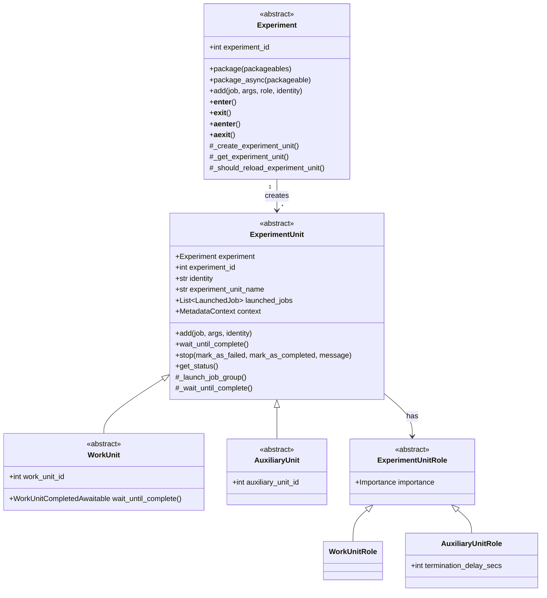
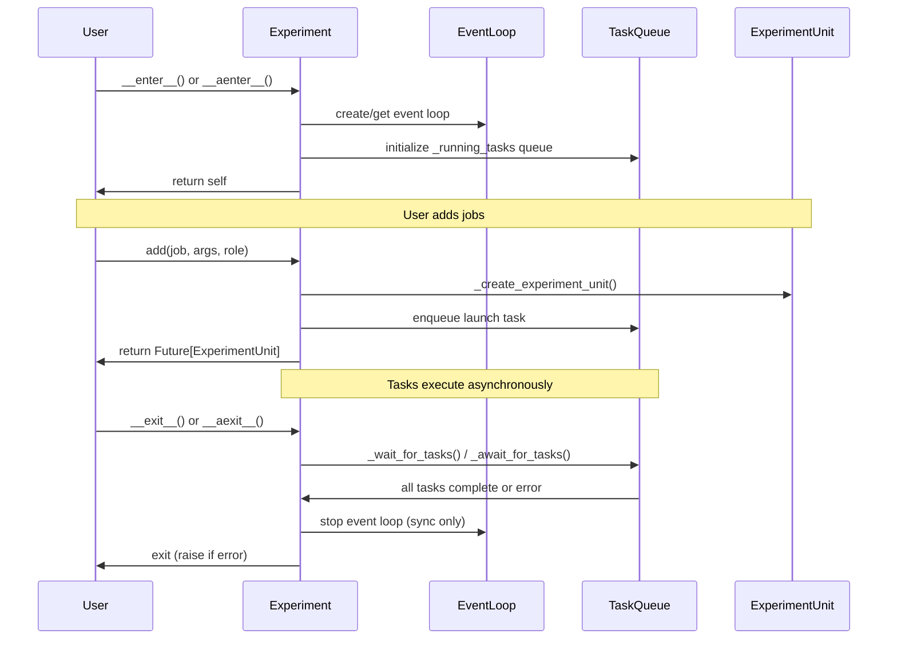
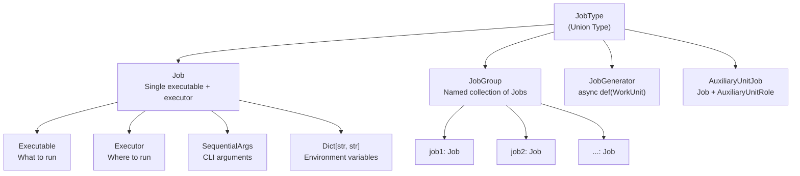
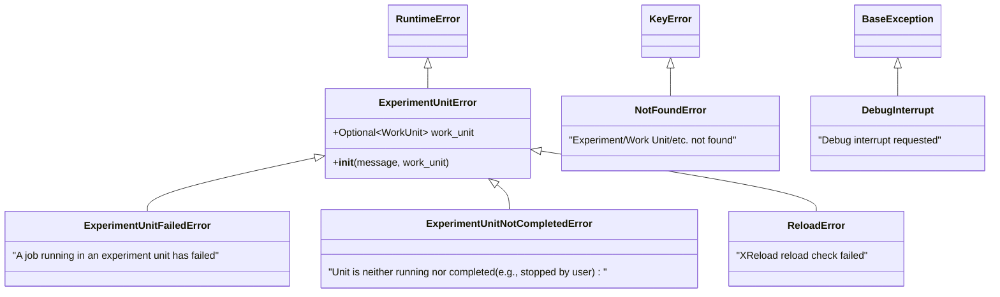
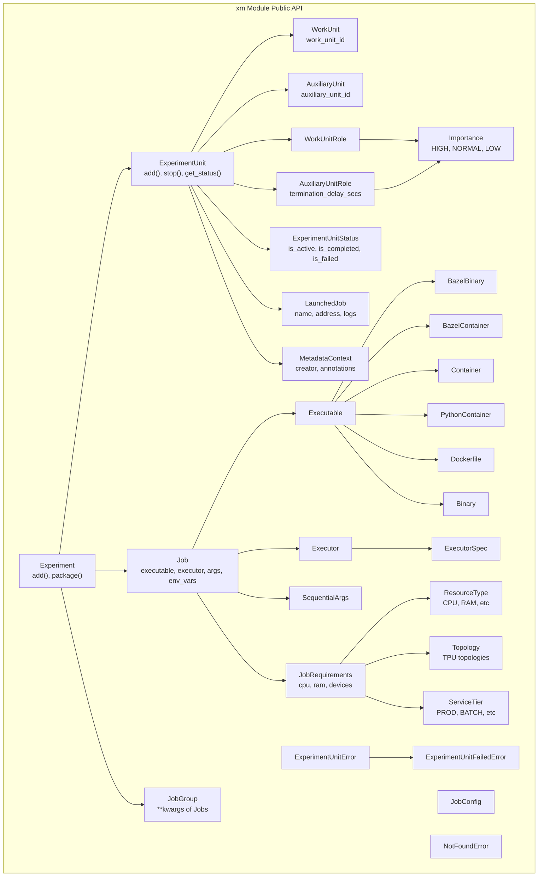

<!-- source: DeepWiki mcp.deepwiki.com · repo google-deepmind/xmanager · page 8.1 xm Module · fetched 2026-10-26 -->

# xm Module

<details>
<summary>Relevant source files</summary>

The following files were used as context for generating this wiki page:

- [xmanager/xm/__init__.py](xmanager/xm/__init__.py)
- [xmanager/xm/core.py](xmanager/xm/core.py)
- [xmanager/xm/core_test.py](xmanager/xm/core_test.py)
- [xmanager/xm/metadata_context.py](xmanager/xm/metadata_context.py)
- [xmanager/xm_local/experiment.py](xmanager/xm_local/experiment.py)
- [xmanager/xm_mock/__init__.py](xmanager/xm_mock/__init__.py)

</details>


## Purpose and Scope

The `xm` module provides the core public API for XManager. It defines the abstract interfaces and data structures that users interact with to define, package, and launch experiments across different execution backends. This page documents the fundamental classes, enums, and patterns exported by `xm`.

For implementation-specific details about creating experiments with the local backend, see [xm_local Module](#8.2). For detailed information about job construction patterns, see [Job Blocks and Operators](#8.3). For resource specifications, see [Resources and Requirements](#8.4).

**Sources:** [xmanager/xm/__init__.py:1-84](), [xmanager/xm/core.py:14-23]()

---

## Module Structure

The `xm` module aggregates functionality from multiple submodules and re-exports a unified public API:

| Submodule | Purpose | Key Exports |
|-----------|---------|-------------|
| `xm.core` | Core abstractions for experiments and units | `Experiment`, `WorkUnit`, `AuxiliaryUnit`, roles, status classes |
| `xm.job_blocks` | Job composition primitives | `Job`, `JobGroup`, `JobConfig`, `SequentialArgs`, `Executable`, `Executor` |
| `xm.executables` | Executable specification types | `BazelBinary`, `BazelContainer`, `Container`, `PythonContainer`, `Dockerfile` |
| `xm.resources` | Resource and topology specifications | `JobRequirements`, `ResourceType`, `Topology`, `ServiceTier` |
| `xm.packagables` | Factory functions for creating executables | `bazel_binary()`, `python_container()`, `dockerfile_container()` |
| `xm.metadata_context` | Metadata management | `MetadataContext`, `ContextAnnotations` |
| `xm.job_operators` | Job manipulation utilities | Helper functions for traversing and modifying job structures |

**Sources:** [xmanager/xm/__init__.py:14-84]()

---

## Core Experiment Management

### Experiment Class Hierarchy



**Sources:** [xmanager/xm/core.py:721-1220](), [xmanager/xm/core.py:337-587](), [xmanager/xm/core.py:589-684]()

---

### Experiment Context Management

The `Experiment` class is designed to be used as a context manager, which manages an event loop for asynchronous operations and ensures proper cleanup:

```python
# Synchronous context (creates internal event loop)
with xm_local.create_experiment(title="my_experiment") as experiment:
    experiment.add(xm.Job(...))

# Asynchronous context (reuses existing event loop)
async with xm_local.create_experiment(title="my_experiment") as experiment:
    await experiment.add(xm.Job(...))
```

#### Context Management Lifecycle



**Context Variables**: The experiment sets context variables `_current_experiment` and `_current_experiment_unit` that can be accessed within job generators to retrieve the current experiment or work unit context.

**Sources:** [xmanager/xm/core.py:763-827](), [xmanager/xm/core.py:829-866](), [xmanager/xm/core.py:48-55]()

---

### ExperimentUnit Types

**ExperimentUnit** is the abstract base class for all units of work within an experiment. Units come in two concrete types:

#### WorkUnit
Work units contain jobs that are the primary computational work of the experiment (e.g., training trials in a hyperparameter sweep). Work unit status contributes to the overall experiment status.

```python
# WorkUnit is created with WorkUnitRole (the default)
work_unit = experiment.add(
    xm.Job(...),
    role=xm.WorkUnitRole(importance=xm.Importance.HIGH)
)
```

**Key Properties:**
- Has a unique `work_unit_id` within the experiment
- Returns `WorkUnitCompletedAwaitable` from `wait_until_complete()` for special awaiting patterns
- Failed work units cause experiment failure

**Sources:** [xmanager/xm/core.py:642-659](), [xmanager/xm/core.py:590-597]()

#### AuxiliaryUnit
Auxiliary units contain supporting jobs (e.g., TensorBoard, monitoring services) that are not part of the core experiment logic. Their status does not affect experiment success/failure.

```python
# AuxiliaryUnit is created with AuxiliaryUnitRole
aux_unit = experiment.add(
    xm.Job(...),
    role=xm.AuxiliaryUnitRole(
        importance=xm.Importance.LOW,
        termination_delay_secs=600  # Keep running 10 min after experiment ends
    )
)
```

**Key Properties:**
- Has a unique `auxiliary_unit_id` within the experiment
- Can continue running after experiment completes (controlled by `termination_delay_secs`)
- Failure does not cause experiment failure

**Sources:** [xmanager/xm/core.py:661-684](), [xmanager/xm/core.py:686-719]()

---

### Adding Jobs to Experiments

The `Experiment.add()` method is the primary interface for adding computational work. It creates an `ExperimentUnit`, adds the specified job to it, and returns a `Future[ExperimentUnit]`:

```python
def add(
    self,
    job: JobType,
    args: Optional[Mapping[str, Any]] = None,
    *,
    role: ExperimentUnitRole = WorkUnitRole(),
    identity: str = ''
) -> asyncio.Future[ExperimentUnit]
```

#### Parameters

| Parameter | Type | Description |
|-----------|------|-------------|
| `job` | `Job \| JobGroup \| JobGenerator \| AuxiliaryUnitJob` | The work to execute |
| `args` | `Optional[Mapping[str, Any]]` | Arguments to pass/merge with job args |
| `role` | `ExperimentUnitRole` | Role determining unit type and behavior |
| `identity` | `str` | Unique identifier for idempotent creation (backend-dependent) |

#### Job Types



**Sources:** [xmanager/xm/core.py:988-1076](), [xmanager/xm/core.py:224-273]()

---

### Argument Merging

When `args` is provided to `add()`, it is recursively merged with the job's existing arguments:

```python
# For a Job
experiment.add(
    xm.Job(..., args={'x': 1, 'y': 2}, env_vars={'FOO': 'bar'}),
    args={'args': {'x': 3, 'z': 4}, 'env_vars': {'BAZ': 'qux'}}
)
# Resulting args: {'x': 3, 'y': 2, 'z': 4}
# Resulting env_vars: {'FOO': 'bar', 'BAZ': 'qux'}

# For a JobGroup
experiment.add(
    xm.JobGroup(
        trainer=xm.Job(..., args={'lr': 0.001}),
        eval=xm.Job(..., args={'batch_size': 32})
    ),
    args={
        'trainer': {'args': {'lr': 0.01}},
        'eval': {'args': {'batch_size': 64}}
    }
)
```

**Sources:** [xmanager/xm/core.py:72-94](), [xmanager/xm/core.py:224-273]()

---

## Job Generators

Job generators are async functions that dynamically create jobs within a work unit. They receive the `ExperimentUnit` as the first parameter and can add jobs incrementally:

```python
async def job_generator(work_unit: xm.WorkUnit, learning_rate: float):
    """Generate jobs dynamically based on previous results."""
    # Can add multiple jobs
    work_unit.add(xm.Job(..., args={'lr': learning_rate}))
    
    # Can use await for async operations
    result = await some_async_operation()
    
    # Can add more jobs based on results
    if result.needs_more_training:
        work_unit.add(xm.Job(...))

# Add generator to experiment
experiment.add(job_generator, args={'learning_rate': 0.001})
```

#### Job Generator Requirements

1. Must be an `async def` function or callable with async `__call__`
2. First parameter must accept an `ExperimentUnit` (typically `WorkUnit`)
3. Additional parameters come from `args` dict passed to `add()`
4. Must use `work_unit.add()` to actually launch jobs

**Context Variables**: Within job generators, `xm._current_experiment_unit` and `xm._current_experiment` context variables are automatically set.

**Sources:** [xmanager/xm/core.py:439-454](), [xmanager/xm/core.py:378-475]()

---

## Packaging System

The `Experiment` class provides two methods for packaging executable specifications into concrete executables:

### Experiment.package()

Synchronously packages executables and triggers any pending async packaging requests:

```python
@classmethod
def package(
    cls,
    packageables: Sequence[Packageable] = ()
) -> Sequence[Executable]
```

**Usage:**
```python
# Package multiple executables in parallel
executables = experiment.package([
    xm.bazel_binary(...),
    xm.python_container(...),
    xm.dockerfile_container(...)
])
```

**Sources:** [xmanager/xm/core.py:880-898]()

### Experiment.package_async()

Queues an executable spec for batched packaging. Useful when all specs aren't known upfront:

```python
@classmethod
def package_async(
    cls,
    packageable: Packageable
) -> Awaitable[Executable]
```

**Usage:**
```python
# Conditionally queue executables
if train:
    train_exec = experiment.package_async(xm.bazel_binary(...))
if eval:
    eval_exec = experiment.package_async(xm.bazel_binary(...))

# Trigger batch packaging
experiment.package()

# Use awaited results
jobs = {}
if train:
    jobs['train'] = xm.Job(await train_exec, ...)
if eval:
    jobs['eval'] = xm.Job(await eval_exec, ...)
```

**Sources:** [xmanager/xm/core.py:900-931]()

---

## Status and Error Handling

### ExperimentUnitStatus

An abstract interface for querying the status of an experiment unit:

```python
class ExperimentUnitStatus(abc.ABC):
    @property
    def is_active(self) -> bool:
        """Unit is running or queued (not in terminal state)."""
    
    @property
    def is_completed(self) -> bool:
        """Unit completed successfully (terminal state)."""
    
    @property
    def is_failed(self) -> bool:
        """Unit failed (terminal state)."""
    
    @property
    def message(self) -> str:
        """Human-readable status message."""
```

**Sources:** [xmanager/xm/core.py:139-184]()

### Error Hierarchy



**Sources:** [xmanager/xm/core.py:187-222]()

---

## Roles and Importance

### ExperimentUnitRole

The role determines the type of experiment unit and its lifecycle behavior:

```python
@attr.s(auto_attribs=True, kw_only=True)
class ExperimentUnitRole(abc.ABC):
    importance: Importance = Importance.NORMAL
```

#### WorkUnitRole

Default role for primary computational work:

```python
experiment.add(
    xm.Job(...),
    role=xm.WorkUnitRole(importance=xm.Importance.HIGH)
)
```

#### AuxiliaryUnitRole

Role for supporting services:

```python
experiment.add(
    xm.Job(...),
    role=xm.AuxiliaryUnitRole(
        importance=xm.Importance.LOW,
        termination_delay_secs=600
    )
)
```

**Sources:** [xmanager/xm/core.py:325-334](), [xmanager/xm/core.py:589-597](), [xmanager/xm/core.py:661-674]()

### Importance Enum

```python
class Importance(enum.Enum):
    HIGH = 'high'     # High-impact experiments, prefer scheduling
    NORMAL = 'normal' # Default importance
    LOW = 'low'       # Prefer other experiments, maximize throughput
```

**Importance vs ServiceTier**: 
- `Importance` controls scheduling preference within a team's resources
- `ServiceTier` (see [Resources and Requirements](#8.4)) controls resource allocation between teams

**Note**: Not all backends respect importance (e.g., `xm_local` ignores it).

**Sources:** [xmanager/xm/core.py:303-323]()

---

## LaunchedJob

A read-only view of a job that has been added to an experiment unit:

```python
@attr.s(auto_attribs=True, kw_only=True)
class LaunchedJob:
    name: str
    address: Optional[str] = None
    logs: Optional[str] = None
```

**Properties:**
- `name`: Job name (same as `Job.name`)
- `address`: Network address where the job is accessible
- `logs`: URL to view job logs

**Relationship to Jobs:**
- One `Job` may correspond to multiple `LaunchedJob` instances if added multiple times
- One `JobGroup` produces multiple `LaunchedJob` instances (one per member)
- Job generators produce as many `LaunchedJob` instances as jobs they add

**Sources:** [xmanager/xm/core.py:276-301]()

---

## Context Variables and Threading

XManager uses Python's `contextvars` to maintain context across async boundaries:

### Current Context Variables

```python
# Access current experiment (set within experiment context)
_current_experiment: contextvars.ContextVar[Experiment]

# Access current experiment unit (set within job generators)
_current_experiment_unit: contextvars.ContextVar[ExperimentUnit]
```

### Thread Pool Integration

XManager provides a utility for creating thread pools that preserve context:

```python
def new_thread_pool_executor(
    executor_class: Type[ThreadPoolExecutor] = futures.ThreadPoolExecutor,
    *args,
    **kwargs
) -> futures.ThreadPoolExecutor:
    """Returns ThreadPoolExecutor with context copied to worker threads."""
```

**Usage:**
```python
with experiment:
    executor = xm.new_thread_pool_executor(max_workers=4)
    # Worker threads can access _current_experiment context
```

**Sources:** [xmanager/xm/core.py:48-55](), [xmanager/xm/core.py:112-125](), [xmanager/xm/core.py:97-109]()

---

## AuxiliaryUnitJob

A helper class that bundles a job with an `AuxiliaryUnitRole`, allowing libraries to define self-contained auxiliary units:

```python
class AuxiliaryUnitJob(abc.ABC):
    role: AuxiliaryUnitRole
    
    def __init__(
        self,
        job: JobType,
        *,
        importance: Importance = Importance.NORMAL,
        termination_delay_secs: int
    )
```

**Usage:**
```python
# Define a reusable auxiliary unit
tensorboard = xm.AuxiliaryUnitJob(
    xm.Job(xm.Container(...), xm_local.Vertex(...)),
    importance=xm.Importance.LOW,
    termination_delay_secs=600
)

# Add to experiment (automatically creates auxiliary unit)
experiment.add(tensorboard)
```

**Supports Job Generators**: Can wrap an async job generator function:

```python
async def make_tensorboard(aux_unit: xm.ExperimentUnit):
    aux_unit.add(xm.Job(...))

tensorboard = xm.AuxiliaryUnitJob(
    make_tensorboard,
    termination_delay_secs=600
)
```

**Sources:** [xmanager/xm/core.py:686-719]()

---

## Work Unit Awaiting Patterns

### WorkUnitCompletedAwaitable

`WorkUnit.wait_until_complete()` returns a special awaitable that provides access to the work unit itself:

```python
completion_events = [wu.wait_until_complete() for wu in work_units]

while completion_events:
    completed, pending = await asyncio.wait(
        completion_events,
        return_when=asyncio.FIRST_COMPLETED
    )
    
    for event in completed:
        wid = event.work_unit.work_unit_id
        try:
            await event  # Raises if unit failed
            print(f'Work unit {wid} completed successfully.')
        except xm.ExperimentUnitError as e:
            print(f'Work unit {wid} failed: {e}.')
    
    completion_events = pending
```

**Sources:** [xmanager/xm/core.py:599-659]()

---

## Metadata Context

The `MetadataContext` provides access to experiment and unit metadata:

```python
@attr.s(auto_attribs=True)
class MetadataContext:
    creator: str                      # Username of creator
    annotations: ContextAnnotations   # User-modifiable annotations
```

### ContextAnnotations

```python
class ContextAnnotations:
    @property
    def title(self) -> str:
        """Get experiment/unit title."""
    
    def set_title(self, title: str) -> None:
        """Set experiment/unit title."""
```

**Access via:**
- `Experiment.context`: Not part of abstract API, implementation-dependent
- `ExperimentUnit.context`: Returns context for the unit

**Note**: The `ContextAnnotations` base class provides intentionally blank implementations, allowing backends to support only the metadata they choose.

**Sources:** [xmanager/xm/metadata_context.py:24-59](), [xmanager/xm/core.py:572-577]()

---

## Complete API Surface Map



**Sources:** [xmanager/xm/__init__.py:1-84]()

---

## Implementation Notes

### Backend Implementations

The `xm` module defines abstract interfaces. Concrete implementations are provided by:
- **xm_local**: Local execution using Docker, Vertex AI, or Kubernetes (see [xm_local Module](#8.2))
- **xm_mock**: Testing mock implementation (see [xmanager/xm_mock/__init__.py:1-226]())

### Abstract Methods

Key abstract methods that backends must implement:

| Class | Abstract Methods |
|-------|-----------------|
| `Experiment` | `experiment_id`, `_create_experiment_unit()`, `_get_experiment_unit()`, `_should_reload_experiment_unit()` |
| `ExperimentUnit` | `experiment_unit_name`, `_launch_job_group()`, `_wait_until_complete()`, `stop()`, `get_status()`, `launched_jobs` |
| `WorkUnit` | `work_unit_id` |
| `AuxiliaryUnit` | `auxiliary_unit_id` |
| `ExperimentUnitStatus` | `is_active`, `is_completed`, `is_failed`, `message` |

**Sources:** [xmanager/xm/core.py:721-1220](), [xmanager/xm/core.py:337-587]()

---

## Usage Examples

### Basic Experiment
```python
from xmanager import xm
from xmanager import xm_local

with xm_local.create_experiment(title="mnist") as experiment:
    executable = xm.python_container(
        path="//my_project:train",
        base_image="python:3.9"
    )
    
    experiment.add(xm.Job(
        executable=executable,
        executor=xm_local.Vertex(),
        args={'learning_rate': 0.001}
    ))
```

### Hyperparameter Sweep
```python
with xm_local.create_experiment(title="sweep") as experiment:
    executables = experiment.package([
        xm.python_container(path="//project:train"),
    ])
    
    for lr in [0.001, 0.01, 0.1]:
        experiment.add(
            xm.Job(executables[0], xm_local.Vertex()),
            args={'args': {'learning_rate': lr}}
        )
```

### Job Generator
```python
async def adaptive_training(work_unit: xm.WorkUnit, initial_lr: float):
    """Train with adaptive learning rate."""
    # First phase
    work_unit.add(xm.Job(..., args={'lr': initial_lr}))
    
    # Could check results and add more jobs
    result = await check_training_metrics()
    if result.accuracy < 0.9:
        work_unit.add(xm.Job(..., args={'lr': initial_lr / 10}))

with xm_local.create_experiment(title="adaptive") as experiment:
    experiment.add(adaptive_training, args={'initial_lr': 0.001})
```

### Auxiliary Unit (TensorBoard)
```python
with xm_local.create_experiment(title="training") as experiment:
    # Add main training work units
    for config in configs:
        experiment.add(xm.Job(...), args=config)
    
    # Add TensorBoard as auxiliary unit
    experiment.add(
        xm.AuxiliaryUnitJob(
            xm.Job(tensorboard_container, xm_local.Vertex()),
            importance=xm.Importance.LOW,
            termination_delay_secs=600  # Keep running 10 min after training
        )
    )
```

**Sources:** [xmanager/xm/core_test.py:60-314]()

---

