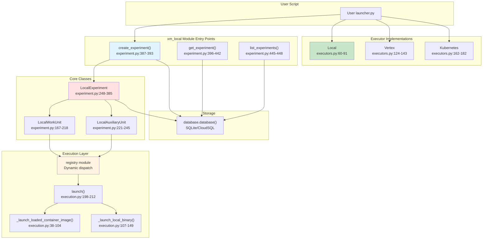
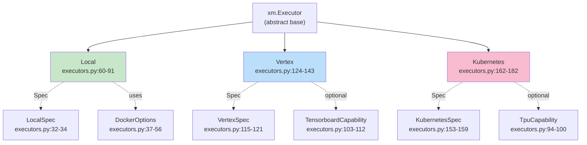
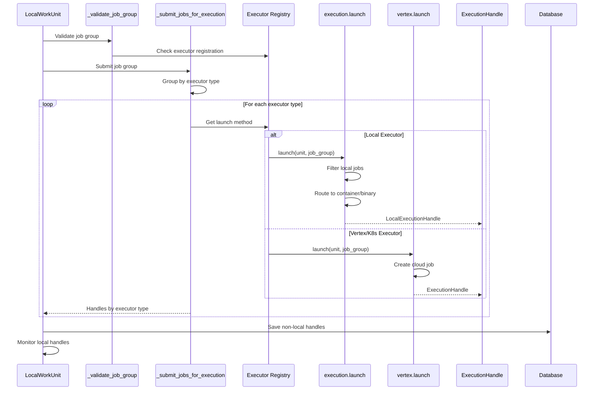

<!-- source: DeepWiki mcp.deepwiki.com · repo google-deepmind/xmanager · page 8.2 xm_local Module · fetched 2026-10-26 -->

# xm_local Module

<details>
<summary>Relevant source files</summary>

The following files were used as context for generating this wiki page:

- [xmanager/xm/core.py](xmanager/xm/core.py)
- [xmanager/xm/core_test.py](xmanager/xm/core_test.py)
- [xmanager/xm_local/execution.py](xmanager/xm_local/execution.py)
- [xmanager/xm_local/execution_test.py](xmanager/xm_local/execution_test.py)
- [xmanager/xm_local/executors.py](xmanager/xm_local/executors.py)
- [xmanager/xm_local/experiment.py](xmanager/xm_local/experiment.py)
- [xmanager/xm_mock/__init__.py](xmanager/xm_mock/__init__.py)

</details>


## Purpose and Scope

The `xm_local` module provides the concrete implementation layer for XManager experiments. It contains factory functions for creating experiments, executor implementations for different backends (local, Vertex AI, Kubernetes), and the execution logic that launches and monitors jobs. This module bridges the abstract API defined in the `xm` module ([see 8.1](#8.1)) with actual execution on various platforms.

For information about the abstract core API concepts, see [Core Concepts](#3). For details on the packaging system that prepares executables for these executors, see [Packaging System](#4). For in-depth documentation on individual executors, see [Execution Backends](#5).

---

## Module Overview

The `xm_local` module serves as the primary implementation of XManager's experiment management system. Despite its name, it supports multiple execution backends including local Docker containers, local binaries, Google Cloud Vertex AI, and Kubernetes clusters. The module provides:

- **Experiment factories**: `create_experiment()`, `get_experiment()`, `list_experiments()`
- **Executor implementations**: `Local`, `Vertex`, `Kubernetes` classes
- **Execution orchestration**: Job launching, monitoring, and status management
- **Registry system**: Dynamic dispatch to backend-specific execution logic

Sources: [xmanager/xm_local/experiment.py:1-449](), [xmanager/xm_local/executors.py:1-183](), [xmanager/xm_local/execution.py:1-223]()

---

## Architecture Diagram



Sources: [xmanager/xm_local/experiment.py:1-449](), [xmanager/xm_local/executors.py:1-183](), [xmanager/xm_local/execution.py:1-223]()

---

## Experiment Management

### Creating Experiments

The primary entry point is `create_experiment()`, which returns a `LocalExperiment` instance:

[xmanager/xm_local/experiment.py:387-393]()

```python
def create_experiment(experiment_title: str) -> xm.Experiment
```

This function:
1. Creates a `LocalExperiment` instance with a unique ID (millisecond timestamp)
2. Inserts experiment metadata into the database
3. Returns the experiment context manager

**Usage Pattern:**
```python
from xmanager import xm_local

with xm_local.create_experiment('my_experiment') as experiment:
    experiment.add(job)
```

Sources: [xmanager/xm_local/experiment.py:387-393]()

### LocalExperiment Class

`LocalExperiment` is the concrete implementation of `xm.Experiment` for local and cloud execution:

| Property | Type | Description |
|----------|------|-------------|
| `experiment_id` | `int` | Unique experiment identifier (timestamp-based) |
| `work_unit_count` | `int` | Number of work units created |
| `_async_packager` | `AsyncPackager` | Batches packaging requests |
| `_work_unit_id_predictor` | `Predictor` | Generates sequential work unit IDs |

**Key Methods:**

- `_create_experiment_unit(args, role, identity)`: Creates `LocalWorkUnit` or `LocalAuxiliaryUnit` instances
- `__exit__()`: Waits for all `.add()` calls to complete, then waits for local jobs
- `_wait_for_local_jobs(is_exit_abrupt)`: Monitors local job completion

Sources: [xmanager/xm_local/experiment.py:248-385]()

### Retrieving Experiments

```python
def get_experiment(experiment_id: int) -> xm.Experiment
def list_experiments() -> Sequence[xm.Experiment]
```

These functions reconstruct experiment objects from database storage, including work units and their execution handles (for Vertex and Kubernetes jobs).

**Limitations:** Local execution handles are not persisted and cannot be reconstructed after the experiment context exits [xmanager/xm_local/experiment.py:416-423]().

Sources: [xmanager/xm_local/experiment.py:396-442](), [xmanager/xm_local/experiment.py:445-448]()

---

## Experiment Units

### LocalWorkUnit

Represents a work unit that tracks job execution:

[xmanager/xm_local/experiment.py:167-218]()

**Key Properties:**
- `work_unit_id`: Sequential integer ID starting from 1
- `experiment_unit_name`: String format `"{experiment_id}_{work_unit_id}"`

**Lifecycle:**
1. Created via `LocalExperiment._create_experiment_unit()`
2. Job group validation via `_validate_job_group()` [xmanager/xm_local/experiment.py:36-40]()
3. Jobs submitted to executors via `_submit_jobs_for_execution()` [xmanager/xm_local/experiment.py:76-92]()
4. Execution handles stored in database [xmanager/xm_local/experiment.py:183-188]()
5. Local jobs monitored asynchronously [xmanager/xm_local/experiment.py:100-105]()

Sources: [xmanager/xm_local/experiment.py:167-218]()

### LocalAuxiliaryUnit

Represents auxiliary units (e.g., Tensorboard) that don't affect experiment status:

[xmanager/xm_local/experiment.py:221-245]()

**Differences from LocalWorkUnit:**
- No work unit ID or database persistence
- `experiment_unit_name` is `"{experiment_id}_auxiliary"`
- No identity support (raises `ValueError` if provided)

Sources: [xmanager/xm_local/experiment.py:221-245]()

---

## Executors

### Executor Class Hierarchy



Sources: [xmanager/xm_local/executors.py:1-183]()

### Local Executor

Executes jobs on the current machine using Docker containers or native binaries:

[xmanager/xm_local/executors.py:60-91]()

**Attributes:**

| Attribute | Type | Description |
|-----------|------|-------------|
| `requirements` | `xm.JobRequirements` | Resource requirements (only `local_gpu` supported) |
| `docker_options` | `DockerOptions` | Container configuration options |
| `experimental_stream_output` | `bool` | Whether to stream stdout/stderr to terminal |

**DockerOptions:**
- `ports`: Port mapping from container to host
- `volumes`: Volume mounting from host to container
- `mount_gcs_path`: Auto-mount `~/gcs` to `/gcs` if available
- `interactive`: Launch with interactive shell

**GPU Support:**
- Validates NVIDIA driver via `nvidia-smi` [xmanager/xm_local/execution.py:56-62]()
- Uses `--runtime nvidia` and `--gpus` flags
- Only NVIDIA GPUs currently supported

Sources: [xmanager/xm_local/executors.py:60-91](), [xmanager/xm_local/execution.py:38-104]()

### Vertex Executor

Executes jobs on Google Cloud Vertex AI:

[xmanager/xm_local/executors.py:124-143]()

**Attributes:**
- `requirements`: Full `JobRequirements` with CPU, memory, GPU, TPU support
- `tensorboard`: Optional `TensorboardCapability` for experiment tracking

**TensorboardCapability:**
[xmanager/xm_local/executors.py:103-112]()
- `name`: Tensorboard instance name
- `base_output_directory`: GCS path for logs (defaults to default bucket root)

Logs are written to `{base_output_directory}/logs/`.

Sources: [xmanager/xm_local/executors.py:124-143](), [xmanager/xm_local/executors.py:103-112]()

### Kubernetes Executor

Executes jobs on Kubernetes clusters:

[xmanager/xm_local/executors.py:162-182]()

**Attributes:**
- `requirements`: Full `JobRequirements` including TPU support
- `cloud_provider`: Defaults to `'GOOGLE_KUBERNETES_ENGINE'`
- `tpu_capability`: Optional `TpuCapability` for TPU version specification

**TpuCapability:**
[xmanager/xm_local/executors.py:94-100]()
- `tpu_runtime_version`: TPU software version (see [GCP TPU versions](https://cloud.google.com/tpu/docs/version-switching))

Sources: [xmanager/xm_local/executors.py:162-182](), [xmanager/xm_local/executors.py:94-100]()

---

## Execution System

### Execution Flow



Sources: [xmanager/xm_local/experiment.py:76-105](), [xmanager/xm_local/execution.py:198-212]()

### Registry Pattern

Each executor class registers its launch logic on first instantiation via `__attrs_post_init__()`:

[xmanager/xm_local/executors.py:79-81]()
```python
def __attrs_post_init__(self):
    local_execution = importlib.import_module('xmanager.xm_local.execution')
    local_execution.register()
```

The `register()` function associates the executor class with its launch implementation:

[xmanager/xm_local/execution.py:215-222]()

The registry enables dynamic dispatch without hardcoding executor types in the core experiment logic.

Sources: [xmanager/xm_local/executors.py:79-81](), [xmanager/xm_local/executors.py:132-134](), [xmanager/xm_local/executors.py:171-173](), [xmanager/xm_local/execution.py:215-222]()

### Local Job Launching

The `launch()` function in `execution.py` handles local job execution:

[xmanager/xm_local/execution.py:198-212]()

**Execution Router:**

[xmanager/xm_local/execution.py:152-169]()

Routes to either:

1. **Container Launch** [xmanager/xm_local/execution.py:38-104]():
   - Creates bridge network `"xmanager"` if needed
   - Mounts GCP credentials from `~/.config/gcloud`
   - Optionally mounts `~/gcs` directory
   - Configures GPU access if requested
   - Returns `ContainerHandle`

2. **Binary Launch** [xmanager/xm_local/execution.py:107-149]():
   - Merges executable and job arguments
   - Sets `PYTHONUNBUFFERED=1` for immediate logging
   - Optionally uses tmux multiplexer for job management
   - Returns `BinaryHandle`

**Job Termination:**

All local jobs are tracked in a global list and terminated on program exit via `atexit.register()` [xmanager/xm_local/execution.py:178-191]().

Sources: [xmanager/xm_local/execution.py:38-212]()

---

## Usage Patterns

### Basic Local Experiment

```python
from xmanager import xm
from xmanager import xm_local

# Create experiment
with xm_local.create_experiment('my_experiment') as experiment:
    # Package executable
    [executable] = experiment.package([
        xm.PythonContainer(
            path='.',
            entrypoint=xm.CommandList(['python', 'train.py'])
        )
    ])
    
    # Create job with local executor
    job = xm.Job(
        executable=executable,
        executor=xm_local.Local(
            requirements=xm.JobRequirements(local_gpu=1)
        ),
        args={'learning_rate': 0.01}
    )
    
    # Add to experiment
    experiment.add(job)
```

Sources: [xmanager/xm_local/experiment.py:387-393](), [xmanager/xm_local/executors.py:60-91]()

### Multi-Backend Execution

```python
with xm_local.create_experiment('multi_backend') as experiment:
    [executable] = experiment.package([...])
    
    # Local development job
    local_job = xm.Job(
        executable=executable,
        executor=xm_local.Local(),
        args={'mode': 'debug'}
    )
    
    # Vertex AI training job
    vertex_job = xm.Job(
        executable=executable,
        executor=xm_local.Vertex(
            requirements=xm.JobRequirements(
                service_tier=xm.ServiceTier.PROD,
                accelerator=xm.AcceleratorType.V100,
                accelerator_count=4
            )
        ),
        args={'mode': 'train'}
    )
    
    experiment.add(local_job)
    experiment.add(vertex_job)
```

Sources: [xmanager/xm_local/executors.py:124-143]()

### Accessing Previous Experiments

```python
# Get specific experiment
experiment = xm_local.get_experiment(experiment_id=12345)
print(f"Title: {experiment._experiment_title}")
print(f"Work units: {experiment.work_unit_count}")

# List all experiments
experiments = xm_local.list_experiments()
for exp in experiments:
    print(f"Experiment {exp.experiment_id}")
```

Sources: [xmanager/xm_local/experiment.py:396-448]()

---

## Key Differences from Abstract API

| Aspect | Abstract `xm` API | `xm_local` Implementation |
|--------|-------------------|---------------------------|
| Experiment creation | Abstract factory pattern | `create_experiment(title)` returns `LocalExperiment` |
| Work unit identity | Supports idempotent creation | Not supported, logs warning [xmanager/xm_local/experiment.py:199-203]() |
| Persistence | Platform-dependent | SQLite/CloudSQL database |
| Local job handles | Abstract `ExecutionHandle` | Not persisted, monitoring in-memory only |
| Executor dispatch | Abstract `launch()` method | Registry-based dynamic dispatch |

Sources: [xmanager/xm_local/experiment.py:1-449](), [xmanager/xm/core.py:1-1300]()

---

## Code Entity Reference

### Module Structure

```
xmanager/xm_local/
├── __init__.py              # Module exports
├── experiment.py            # LocalExperiment, LocalWorkUnit
├── executors.py             # Local, Vertex, Kubernetes
├── execution.py             # launch(), local execution logic
├── handles.py               # ExecutionHandle implementations
├── registry.py              # Executor registration system
├── status.py                # Status tracking
└── packaging/
    └── router.py            # Packaging dispatch logic
```

### Primary Classes and Functions

| Symbol | Location | Purpose |
|--------|----------|---------|
| `create_experiment()` | [experiment.py:387]() | Factory function for experiments |
| `get_experiment()` | [experiment.py:396]() | Retrieve experiment from database |
| `list_experiments()` | [experiment.py:445]() | List all experiments |
| `LocalExperiment` | [experiment.py:248]() | Concrete experiment implementation |
| `LocalWorkUnit` | [experiment.py:167]() | Work unit implementation |
| `LocalAuxiliaryUnit` | [experiment.py:221]() | Auxiliary unit implementation |
| `Local` | [executors.py:60]() | Local machine executor |
| `Vertex` | [executors.py:124]() | Vertex AI executor |
| `Kubernetes` | [executors.py:162]() | Kubernetes executor |
| `launch()` | [execution.py:198]() | Local job launcher |
| `_launch_loaded_container_image()` | [execution.py:38]() | Container execution |
| `_launch_local_binary()` | [execution.py:107]() | Binary execution |

Sources: [xmanager/xm_local/experiment.py:1-449](), [xmanager/xm_local/executors.py:1-183](), [xmanager/xm_local/execution.py:1-223]()

---

