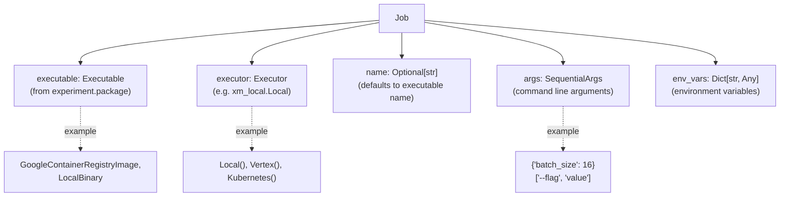
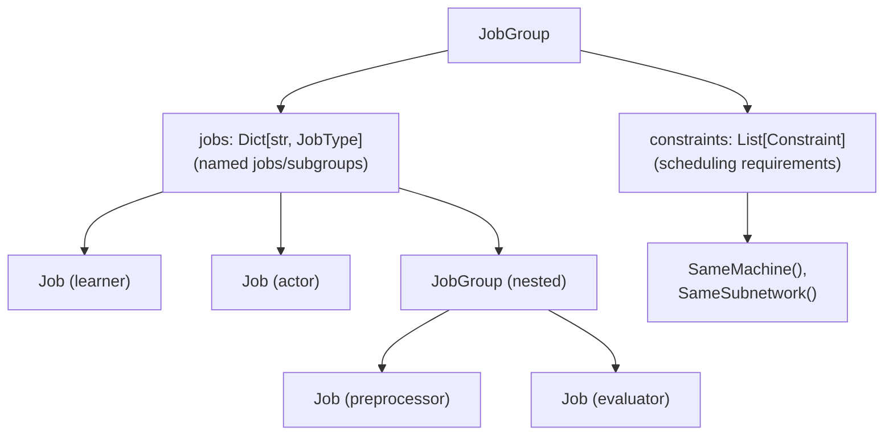
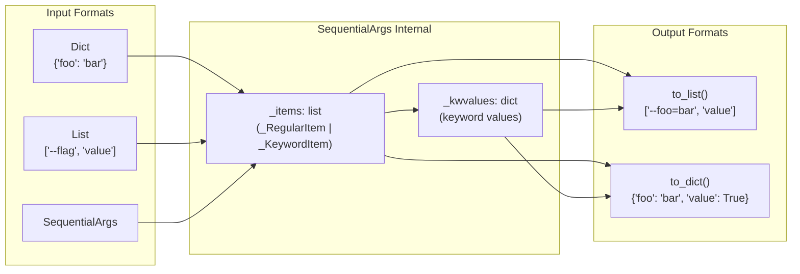
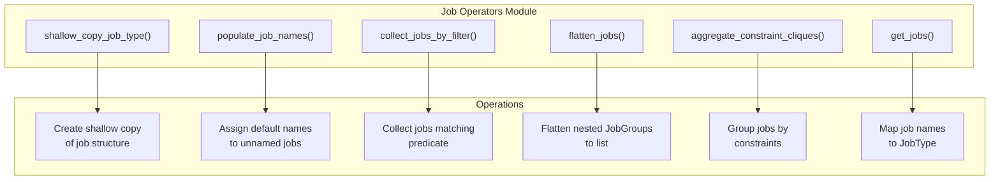
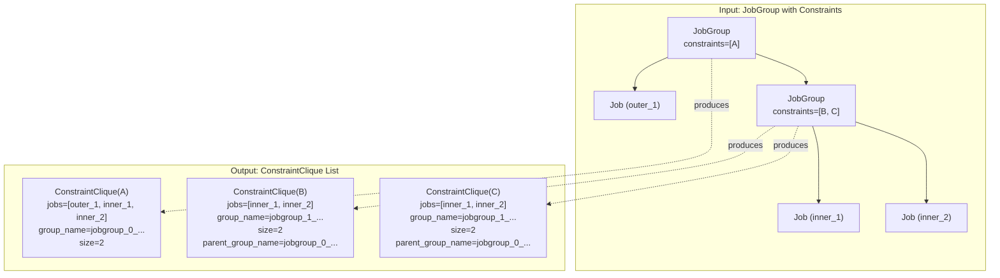

<!-- source: DeepWiki mcp.deepwiki.com · repo google-deepmind/xmanager · page 8.3 Job Blocks and Operators · fetched 2026-10-26 -->

# Job Blocks and Operators

<details>
<summary>Relevant source files</summary>

The following files were used as context for generating this wiki page:

- [xmanager/xm/job_blocks.py](xmanager/xm/job_blocks.py)
- [xmanager/xm/job_blocks_test.py](xmanager/xm/job_blocks_test.py)
- [xmanager/xm/job_operators.py](xmanager/xm/job_operators.py)
- [xmanager/xm/job_operators_test.py](xmanager/xm/job_operators_test.py)

</details>


This page provides API reference documentation for job construction and manipulation in XManager. It covers the core classes for defining computational units (`Job`, `JobGroup`, `JobConfig`), argument handling (`SequentialArgs`, `merge_args`), and utility functions for working with job structures (`job_operators` module).

For conceptual explanations of jobs and job groups, see [Jobs and Job Groups](#3.2). For executable specifications that jobs run, see [Executable Specifications](#3.3). For resource requirements that jobs consume, see [Resources and Requirements](#8.4).

---

## Core Job Types

### Job

The `Job` class represents a single unit of computation to be executed. It combines an executable (what to run), an executor (where to run it), and runtime parameters (arguments and environment variables).

**Class Definition:** [xmanager/xm/job_blocks.py:397-422]()



**Attributes:**

| Attribute | Type | Description |
|-----------|------|-------------|
| `executable` | `Executable` | What to run - result from `experiment.package()` |
| `executor` | `Executor` | Where to run - instance of executor class |
| `name` | `Optional[str]` | Job name, must be unique within context. Defaults to executable name if not provided |
| `args` | `SequentialArgs` | Command line arguments (dict, list, or SequentialArgs) |
| `env_vars` | `Dict[str, Any]` | Environment variables to set |

**Argument Conversion:**

The `args` parameter is automatically converted to `SequentialArgs` via [xmanager/xm/job_blocks.py:417-419](). You can pass:
- Dict: `{'batch_size': 16}` → `--batch_size=16`
- List: `['--flag', 'value']` → `--flag value`
- SequentialArgs: Pre-constructed argument sequence

**Environment Variable Validation:**

Environment variable names must match `[a-zA-Z_][a-zA-Z0-9_]*` pattern [xmanager/xm/job_blocks.py:351-361]().

**Sources:** [xmanager/xm/job_blocks.py:397-422]()

---

### JobGroup

The `JobGroup` class represents a set of jobs that run under shared constraints and gang scheduling semantics. Jobs within a group are scheduled/descheduled simultaneously.

**Class Definition:** [xmanager/xm/job_blocks.py:425-486]()



**Attributes:**

| Attribute | Type | Description |
|-----------|------|-------------|
| `jobs` | `Dict[str, JobType]` | Named mapping of jobs/subgroups. Set via `**kwargs` in constructor |
| `constraints` | `List[Constraint]` | Scheduling constraints (e.g., same machine) |

**Constructor:** [xmanager/xm/job_blocks.py:472-485]()

```python
JobGroup(
    *,
    constraints: Optional[Sequence[Constraint]] = None,
    **jobs: JobType
) -> None
```

**Usage Patterns:**

1. **Simple Group:**
```python
JobGroup(
    learner=Job(learner_exe, executor),
    actor=Job(actor_exe, executor)
)
```

2. **With Constraints:**
```python
JobGroup(
    learner=Job(tpu_learner_exe, executor),
    preprocessor=Job(preprocessor_exe, executor),
    constraints=[xm_impl.SameMachine()]
)
```

3. **Nested Groups:**
```python
JobGroup(
    eval=Job(eval_exe, executor),
    colocated=JobGroup(
        learner=Job(learner_exe, executor),
        actor=Job(actor_exe, executor),
        constraints=[xm_impl.SameMachine()]
    )
)
```

**Sources:** [xmanager/xm/job_blocks.py:425-486]()

---

### JobConfig

Abstract base class for platform-specific job configurations. Used when jobs cannot be defined through the platform-agnostic `Job`/`JobGroup` interfaces.

**Class Definition:** [xmanager/xm/job_blocks.py:488-496]()

Concrete implementations are provided by specific XManager backends for their native configuration languages.

**Sources:** [xmanager/xm/job_blocks.py:488-496]()

---

## SequentialArgs and Argument Handling

### SequentialArgs

`SequentialArgs` provides a flexible representation of command line arguments, supporting both positional and keyword arguments with merging semantics.

**Class Definition:** [xmanager/xm/job_blocks.py:41-262]()



**Key Features:**

1. **Multiple Input Formats** [xmanager/xm/job_blocks.py:49-56]():
   - Dicts: `{'foo': 'space bar', 'with_magic': True}` → `--foo='space bar' --with_magic`
   - Lists: `['--foo', 'space bar']` → `--foo 'space bar'`
   - Mixed via `merge_args()`

2. **Merging Semantics** [xmanager/xm/job_blocks.py:57-62]():
   - Keyword arguments are overridden (not appended)
   - Allows default values with later overrides
   - Example: `merge_args({'foo': '1', 'bar': '42'}, {'foo': '2'})` → `--foo=2 --bar=42`

3. **Immutability:**
   - Create modified copies via `merge_args()` or methods
   - No in-place modification

**Methods:**

| Method | Description |
|--------|-------------|
| `from_collection(collection)` | Static constructor from dict/list/SequentialArgs [xmanager/xm/job_blocks.py:113-134]() |
| `rewrite_args(rewrite)` | Apply function to all string arguments [xmanager/xm/job_blocks.py:136-157]() |
| `remove_args(removed_args)` | Remove arguments by name [xmanager/xm/job_blocks.py:159-183]() |
| `to_list(escaper, kwargs_joiner)` | Export as command-line list [xmanager/xm/job_blocks.py:185-225]() |
| `to_dict(kwargs_only)` | Export as dictionary [xmanager/xm/job_blocks.py:227-252]() |

**Special Value Handling:**

- **Boolean:** `{'flag': True}` → `--flag`, `{'flag': False}` → `--noflag` [xmanager/xm/job_blocks.py:201-202]()
- **None:** Excluded from output with warning [xmanager/xm/job_blocks.py:196-200]()
- **List/Tuple:** Repeated flags for flat sequences [xmanager/xm/job_blocks.py:203-211]()
- **Nested Structures:** Quoted as single value [xmanager/xm/job_blocks.py:36-38]()

**Sources:** [xmanager/xm/job_blocks.py:41-262](), [xmanager/xm/job_blocks_test.py:26-149]()

---

### merge_args

Function to merge multiple argument collections into a single `SequentialArgs` instance.

**Function Signature:** [xmanager/xm/job_blocks.py:264-271]()

```python
def merge_args(*operands: UserArgs) -> SequentialArgs
```

**Type Alias:** `UserArgs = Union[Mapping, Sequence, SequentialArgs]` [xmanager/xm/job_blocks.py:25]()

**Example Usage:**

```python
args = merge_args(
    {'foo': 'bar'},      # Keyword args
    ['--'],              # Positional separator
    {'n': 16}            # More keyword args
)
# Result: --foo=bar -- --n=16
```

**Merging Behavior:**
- Left-to-right processing
- Keyword arguments override previous values
- Positional arguments always append
- Order preserved within each operand

**Sources:** [xmanager/xm/job_blocks.py:264-271](), [xmanager/xm/job_blocks_test.py:59-76]()

---

### get_args_for_all_jobs

Helper function to generate arguments for all jobs in a `JobGroup` with the same values.

**Function Signature:** [xmanager/xm/job_blocks.py:506-526]()

```python
def get_args_for_all_jobs(job: JobType, args: Dict[str, Any]) -> Dict[str, Any]
```

**Purpose:** Useful when all jobs within a work unit accept the same arguments (e.g., shared `logdir`).

**Example:**

```python
group = JobGroup(
    learner=Job(...),
    actor=JobGroup(
        actor1=Job(...),
        actor2=Job(...)
    )
)

args = get_args_for_all_jobs(group, {'logdir': '/path/to/logs'})
# Returns:
# {
#   'learner': {'args': {'logdir': '/path/to/logs'}},
#   'actor': {
#     'actor1': {'args': {'logdir': '/path/to/logs'}},
#     'actor2': {'args': {'logdir': '/path/to/logs'}}
#   }
# }
```

**Sources:** [xmanager/xm/job_blocks.py:506-526](), [xmanager/xm/job_blocks_test.py:150-173]()

---

## Job Operators

Utility functions in `xmanager/xm/job_operators.py` for manipulating and analyzing job structures.



---

### shallow_copy_job_type

Creates a shallow copy of a job structure (Job, JobGroup, or JobGeneratorType).

**Function Signature:** [xmanager/xm/job_operators.py:25-39]()

```python
def shallow_copy_job_type(job_type: JobTypeVar) -> JobTypeVar
```

**Behavior:**
- Job generators: Returns same reference
- JobGroup: Copies group and recursively copies nested jobs dict
- Job/JobConfig: Creates shallow copy

**Sources:** [xmanager/xm/job_operators.py:25-39]()

---

### populate_job_names

Assigns default names to jobs that don't have explicit names.

**Function Signature:** [xmanager/xm/job_operators.py:42-56]()

```python
def populate_job_names(job_type: JobTypeVar) -> None
```

**Naming Strategy:**
- Top-level jobs: Use executable name
- Nested jobs: Use underscore-joined path (e.g., `parent_child_job`)
- Operates in-place (mutates job structure)

**Sources:** [xmanager/xm/job_operators.py:42-56]()

---

### collect_jobs_by_filter

Flattens a job group and filters results by predicate.

**Function Signature:** [xmanager/xm/job_operators.py:59-78]()

```python
def collect_jobs_by_filter(
    job_group: JobGroup,
    predicate: Callable[[Job], bool]
) -> List[Job]
```

**Example:**

```python
gpu_jobs = collect_jobs_by_filter(
    job_group,
    predicate=lambda job: job.requirements.gpu > 0
)
```

**Sources:** [xmanager/xm/job_operators.py:59-78](), [xmanager/xm/job_operators_test.py:37-50]()

---

### flatten_jobs

Returns all jobs in a job group as a flat list.

**Function Signature:** [xmanager/xm/job_operators.py:160-161]()

```python
def flatten_jobs(job_group: JobGroup) -> List[Job]
```

**Implementation:** Wrapper around `collect_jobs_by_filter` with always-true predicate.

**Sources:** [xmanager/xm/job_operators.py:160-161](), [xmanager/xm/job_operators_test.py:52-63]()

---

### aggregate_constraint_cliques

Forms constraint cliques by collecting all jobs each constraint applies to.

**Function Signature:** [xmanager/xm/job_operators.py:103-157]()

```python
def aggregate_constraint_cliques(job_group: JobGroup) -> List[ConstraintClique]
```



**ConstraintClique Attributes:** [xmanager/xm/job_operators.py:81-100]()

| Attribute | Type | Description |
|-----------|------|-------------|
| `constraint` | `Constraint` | The constraint being tracked |
| `jobs` | `List[Job]` | All jobs (including nested) the constraint applies to |
| `group_name` | `str \| None` | Generated unique name for the job group |
| `size` | `int \| None` | Number of direct jobs/JobGroups in the group |
| `parent_group_name` | `str \| None` | Parent group name if nested |

**Sources:** [xmanager/xm/job_operators.py:81-157](), [xmanager/xm/job_operators_test.py:66-110]()

---

### get_jobs

Maps jobs to their job names in a flat dictionary.

**Function Signature:** [xmanager/xm/job_operators.py:170-194]()

```python
def get_jobs(job_group: JobGroup) -> dict[str, JobType]
```

**Behavior:**
- Recursively processes nested JobGroups
- Uses `job.name` for Job instances
- Uses key for other JobTypes
- Raises `ValueError` if duplicate names found [xmanager/xm/job_operators.py:164-167]()

**Example:**

```python
group = JobGroup(
    learner=Job(name='my_learner', ...),
    actors=JobGroup(
        actor1=Job(name='actor_1', ...),
        actor2=Job(name='actor_2', ...)
    )
)

jobs = get_jobs(group)
# Returns: {'my_learner': Job(...), 'actor_1': Job(...), 'actor_2': Job(...)}
```

**Sources:** [xmanager/xm/job_operators.py:170-194]()

---

## Supporting Types

### Packageable

Describes what to build and its static parameters before packaging.

**Class Definition:** [xmanager/xm/job_blocks.py:364-376]()

| Attribute | Type | Description |
|-----------|------|-------------|
| `executable_spec` | `ExecutableSpec` | What to build (e.g., BazelBinary) |
| `executor_spec` | `ExecutorSpec` | Where to run (e.g., Local.Spec()) |
| `args` | `SequentialArgs` | Static arguments |
| `env_vars` | `Dict[str, Any]` | Static environment variables |

**Usage:** Input to `experiment.package()` to produce `Executable` instances.

**Sources:** [xmanager/xm/job_blocks.py:364-376]()

---

### Constraint

Abstract base class for job group scheduling constraints.

**Class Definition:** [xmanager/xm/job_blocks.py:378-387]()

**Examples of constraints:**
- Same virtual machine
- Same virtual private Cloud subnetwork
- Same network fabric
- Same geographic location

Concrete implementations are backend-specific (e.g., `xm_impl.SameMachine()`).

**Sources:** [xmanager/xm/job_blocks.py:378-387]()

---

### ExecutableSpec and Executable

Abstract base classes for executable definitions.

**ExecutableSpec:** [xmanager/xm/job_blocks.py:274-295]()
- Platform-agnostic specification of what to run
- Created via functions in `xm/packagables.py` (e.g., `xm.binary`, `xm.python_container`)
- Must be turned into `Executable` via `experiment.package()`

**Executable:** [xmanager/xm/job_blocks.py:298-312]()
- Final packaged location of executable spec
- Backend-specific (e.g., `LocalBinary`, `GoogleContainerRegistryImage`)
- Has `name` attribute used for default job naming

**Sources:** [xmanager/xm/job_blocks.py:274-312]()

---

### Executor and ExecutorSpec

Abstract base classes for execution environments.

**ExecutorSpec:** [xmanager/xm/job_blocks.py:314-318]()
- Describes runtime environment location
- Returned by `Executor.Spec()` class method

**Executor:** [xmanager/xm/job_blocks.py:321-348]()
- Describes runtime environment of a Job
- Concrete implementations: `xm_local.Local`, `xm_local.Vertex`, `xm_local.Kubernetes`
- Provides `launch()` class method for job execution

**Sources:** [xmanager/xm/job_blocks.py:314-348]()

---

## Type Definitions and Helpers

### JobType Union

Type alias for all job-like types:

```python
JobType = Union[Job, JobGroup, JobGeneratorType, JobConfig]
```

[xmanager/xm/job_blocks.py:394]()

**JobGeneratorType:** Async functions returning None, used for dynamic job creation [xmanager/xm/job_blocks.py:393]().

---

### is_job_generator

Checks if a JobType is a job generator (callable).

**Function Signature:** [xmanager/xm/job_blocks.py:502-503]()

```python
def is_job_generator(job: JobType) -> bool
```

**Sources:** [xmanager/xm/job_blocks.py:502-503]()

---

## Summary Table: Key Classes and Functions

| Symbol | Type | Module | Purpose |
|--------|------|--------|---------|
| `Job` | Class | `job_blocks` | Single computational unit |
| `JobGroup` | Class | `job_blocks` | Set of jobs with constraints |
| `JobConfig` | Class | `job_blocks` | Platform-specific job config |
| `SequentialArgs` | Class | `job_blocks` | Command line argument representation |
| `merge_args` | Function | `job_blocks` | Merge argument collections |
| `get_args_for_all_jobs` | Function | `job_blocks` | Generate args for all jobs in group |
| `shallow_copy_job_type` | Function | `job_operators` | Copy job structure |
| `populate_job_names` | Function | `job_operators` | Assign default names |
| `collect_jobs_by_filter` | Function | `job_operators` | Filter and collect jobs |
| `flatten_jobs` | Function | `job_operators` | Flatten job group to list |
| `aggregate_constraint_cliques` | Function | `job_operators` | Group jobs by constraints |
| `get_jobs` | Function | `job_operators` | Map job names to JobType |
| `Packageable` | Class | `job_blocks` | Pre-packaging specification |
| `Constraint` | Class | `job_blocks` | Scheduling constraint |
| `ExecutableSpec` | Class | `job_blocks` | Executable specification |
| `Executable` | Class | `job_blocks` | Packaged executable |
| `ExecutorSpec` | Class | `job_blocks` | Executor specification |
| `Executor` | Class | `job_blocks` | Runtime environment |

---

**Sources:** [xmanager/xm/job_blocks.py:1-527](), [xmanager/xm/job_operators.py:1-195](), [xmanager/xm/job_blocks_test.py:1-178](), [xmanager/xm/job_operators_test.py:1-115]()

---

