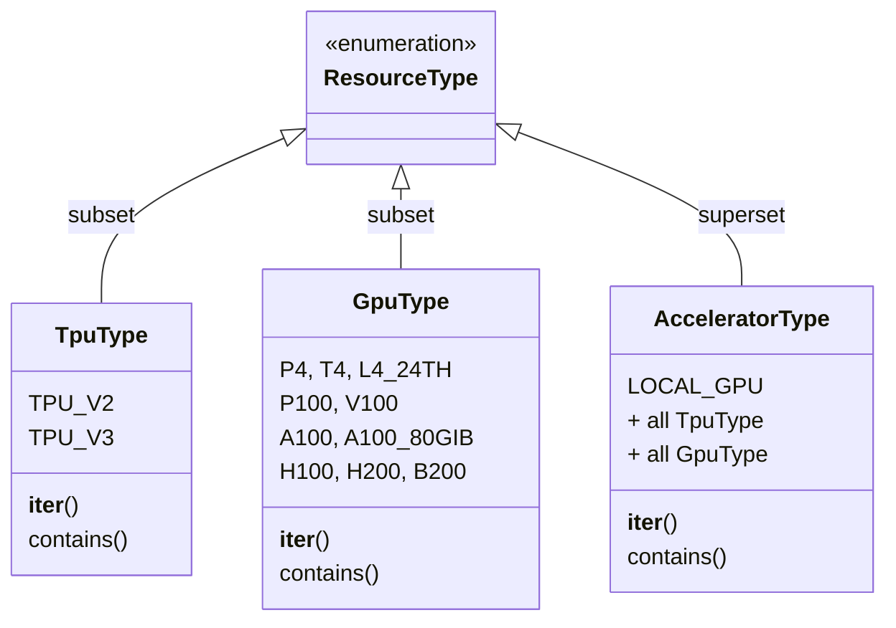
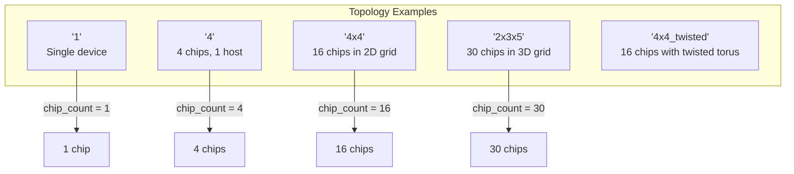
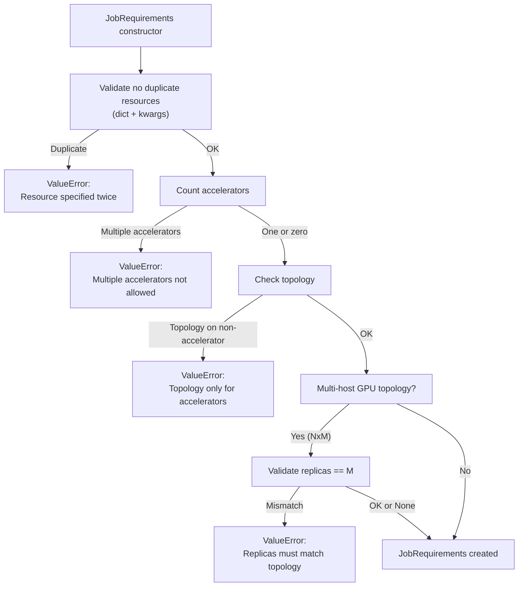
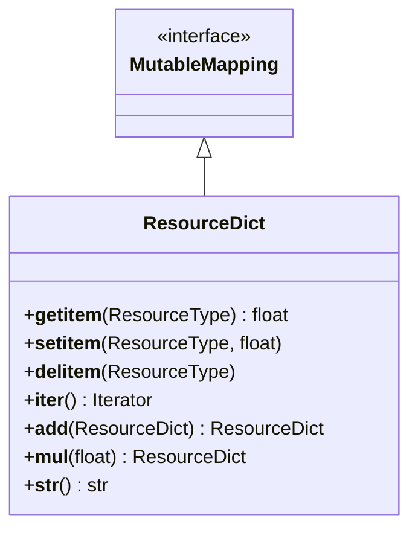
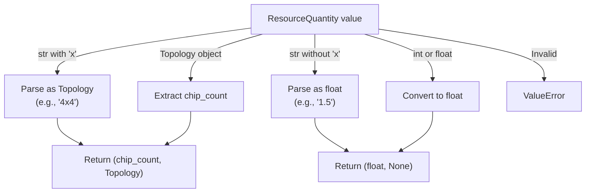
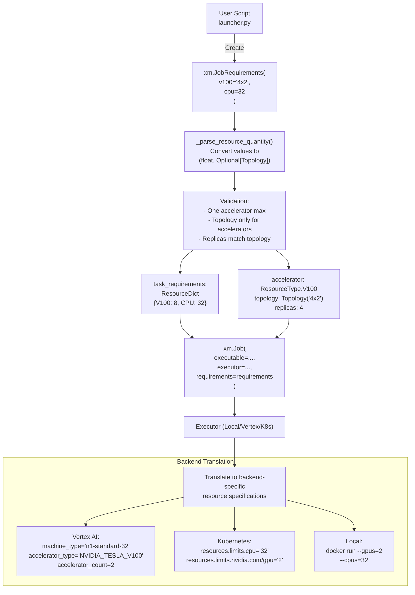

<!-- source: DeepWiki mcp.deepwiki.com · repo google-deepmind/xmanager · page 8.4 Resources and Requirements · fetched 2026-10-26 -->

# Resources and Requirements

<details>
<summary>Relevant source files</summary>

The following files were used as context for generating this wiki page:

- [xmanager/xm/resources.py](xmanager/xm/resources.py)
- [xmanager/xm/resources_test.py](xmanager/xm/resources_test.py)

</details>


This page provides comprehensive API documentation for specifying resource requirements in XManager jobs. The primary interface is the `JobRequirements` class, which allows you to specify CPU, memory, GPU, TPU, and other resource needs, along with topology constraints, service tiers, and replica counts.

For information about how executors translate resource requirements into backend-specific configurations, see [Execution Backends](#5). For job construction using these requirements, see [Jobs and Job Groups](#3.2).

---

## Overview

The resources system provides three main abstractions:

1. **`ResourceType`** - An enum representing countable resource types (CPU cores, memory bytes, specific GPU/TPU models)
2. **`JobRequirements`** - The primary API for specifying what resources a job needs
3. **`Topology`** - Describes accelerator interconnection patterns (e.g., `4x4` TPU pod slices)
4. **`ServiceTier`** - Controls availability guarantees and pricing tradeoffs

**Sources:** [xmanager/xm/resources.py:1-540]()

---

## Resource Type System

### ResourceType Enum

The `ResourceType` enum defines all supported countable resources. Each resource type has a unique integer value and supports case-insensitive lookup.

```mermaid
graph TB
    subgraph "ResourceType Enum"
        CPU["ResourceType.CPU<br/>(vCPUs)"]
        MEMORY["ResourceType.MEMORY<br/>(bytes)"]
        DISK["ResourceType.EPHEMERAL_STORAGE<br/>(bytes)"]
        
        subgraph "GPU Types"
            P4["ResourceType.P4"]
            T4["ResourceType.T4"]
            L4["ResourceType.L4_24TH"]
            P100["ResourceType.P100"]
            V100["ResourceType.V100"]
            A100["ResourceType.A100"]
            A100_80["ResourceType.A100_80GIB"]
            H100["ResourceType.H100"]
            H200["ResourceType.H200"]
            B200["ResourceType.B200"]
            LOCAL["ResourceType.LOCAL_GPU"]
        end
        
        subgraph "TPU Types"
            TPU_V2["ResourceType.TPU_V2"]
            TPU_V3["ResourceType.TPU_V3"]
        end
    end
    
    subgraph "Resource Subsets"
        GpuType["GpuType<br/>(excludes LOCAL_GPU)"]
        TpuType["TpuType<br/>(V2, V3)"]
        AcceleratorType["AcceleratorType<br/>(all GPUs + TPUs)"]
    end
    
    P4 --> GpuType
    T4 --> GpuType
    V100 --> GpuType
    A100 --> GpuType
    
    TPU_V2 --> TpuType
    TPU_V3 --> TpuType
    
    GpuType --> AcceleratorType
    TpuType --> AcceleratorType
    LOCAL --> AcceleratorType
```



**Sources:** [xmanager/xm/resources.py:51-90](), [xmanager/xm/resources.py:182-216]()

### Available Resource Types

| Category | ResourceType | Enum Value | Description |
|----------|--------------|------------|-------------|
| **Compute** | `CPU` | 100002 | Virtual CPU cores |
| **Memory** | `MEMORY` / `RAM` | 39 | Memory in bytes |
| **Storage** | `EPHEMERAL_STORAGE` / `DISK` | 100003 | Ephemeral disk in bytes |
| **NVIDIA GPUs** | `LOCAL_GPU` | 100006 | Generic local GPU |
| | `P4` | 21 | NVIDIA P4 |
| | `T4` | 22 | NVIDIA T4 |
| | `L4_24TH` | 68 | NVIDIA L4 (1/24th slice) |
| | `P100` | 14 | NVIDIA P100 |
| | `V100` | 17 | NVIDIA V100 |
| | `A100` | 46 | NVIDIA A100 (40GB) |
| | `A100_80GIB` | 66 | NVIDIA A100 (80GB) |
| | `H100` | 70 | NVIDIA H100 |
| | `H200` | 86 | NVIDIA H200 |
| | `B200` | 87 | NVIDIA B200 |
| **TPUs** | `TPU_V2` | 3 | TPU v2 |
| | `TPU_V3` | 16 | TPU v3 |

**Sources:** [xmanager/xm/resources.py:59-84]()

### Case-Insensitive Lookup

ResourceType supports case-insensitive string lookup via a custom metaclass:

```python
# All of these are equivalent:
ResourceType['cpu']    # lowercase
ResourceType['Cpu']    # mixed case
ResourceType['CPU']    # uppercase
# All return ResourceType.CPU
```

**Sources:** [xmanager/xm/resources.py:30-42](), [xmanager/xm/resources_test.py:26-31]()

### Resource Subsets

Three convenience subsets are provided for type checking and iteration:



These subsets support membership testing and iteration:

```python
# Check if a resource is a GPU
if resource in GpuType:
    print("This is a GPU")

# Iterate over all TPU types
for tpu in TpuType:
    print(tpu)
```

**Sources:** [xmanager/xm/resources.py:126-216](), [xmanager/xm/resources_test.py:185-205]()

---

## ServiceTier Enum

The `ServiceTier` enum controls job availability guarantees and pricing tradeoffs on cloud platforms.

### Service Tier Levels

| ServiceTier | Value | Description | Use Case |
|-------------|-------|-------------|----------|
| `PROD` | 200 | **High availability** - Fast scheduling, no preemption | Production workloads, multi-job work units |
| `BATCH` | 100 | **Guaranteed throughput** - May wait hours for scheduling, can be preempted | Training jobs, batch processing |
| `FREEBIE` | 25 | **Cheapest** - No guarantees | Experimental runs, non-critical workloads |


ServiceTier also supports case-insensitive lookup like ResourceType:

```python
ServiceTier['prod']   # Returns ServiceTier.PROD
ServiceTier['BATCH']  # Returns ServiceTier.BATCH
```

**Sources:** [xmanager/xm/resources.py:105-124](), [xmanager/xm/resources.py:91-103]()

---

## Topology Class

The `Topology` class describes accelerator interconnection patterns, primarily for TPU pods but also applicable to multi-host GPU configurations.

### Topology Format

Topologies follow the pattern `NxMxP..._suffix`:
- **Dimensions**: Numbers separated by `x` indicate accelerator count per dimension
- **Suffix** (optional): `_twisted` or `_untwisted` for specific interconnect types



### Topology API

| Property | Type | Description |
|----------|------|-------------|
| `name` | `str` | Full topology string (e.g., `'4x4'`) |
| `dimensions` | `List[int]` | List of dimension sizes (e.g., `[4, 4]`) |
| `chip_count` | `int` | Total number of chips (product of dimensions) |

**Constructor:**
```python
topology = Topology('4x4')
# topology.chip_count == 16
# topology.dimensions == [4, 4]
# topology.name == '4x4'
```

**Sources:** [xmanager/xm/resources.py:292-335](), [xmanager/xm/resources_test.py:66-88]()

---

## JobRequirements Class

The `JobRequirements` class is the primary API for specifying job resource needs. It combines resource quantities, accelerator topology, location preferences, and service tier settings.

### Constructor Signature

```python
JobRequirements(
    resources: Mapping[Union[ResourceType, str], ResourceQuantity] = {},
    *,
    architecture: Optional[Architecture] = None,
    location: Optional[str] = None,
    replicas: Optional[int] = None,
    service_tier: Optional[ServiceTier] = None,
    **kw_resources: ResourceQuantity
)
```

**Type aliases:**
```python
ResourceQuantity = Union[int, float, str, Topology]
```

**Sources:** [xmanager/xm/resources.py:369-499]()

### Constructor Parameters

| Parameter | Type | Description |
|-----------|------|-------------|
| `resources` | `Mapping[ResourceType \| str, ResourceQuantity]` | Dictionary of resource amounts |
| `architecture` | `Architecture` | CPU architecture (e.g., `Architecture.ARM`) |
| `location` | `str` | Target location (cluster name, cell, etc.) |
| `replicas` | `int` | Number of identical tasks (default: 1) |
| `service_tier` | `ServiceTier` | Availability tier (default: `ServiceTier.PROD`) |
| `**kw_resources` | `ResourceQuantity` | Resources as keyword arguments |

### Properties

| Property | Type | Description |
|----------|------|-------------|
| `task_requirements` | `ResourceDict` | Resources needed per task (a mapping from ResourceType to amount) |
| `accelerator` | `Optional[ResourceType]` | The accelerator type, if any |
| `topology` | `Optional[Topology]` | Accelerator topology, if applicable |
| `architecture` | `Optional[Architecture]` | CPU architecture requirement |
| `location` | `Optional[str]` | Target execution location |
| `service_tier` | `ServiceTier` | Service tier for scheduling |
| `replicas` | `int` | Number of parallel tasks |

**Sources:** [xmanager/xm/resources.py:369-540]()

### Usage Examples

#### CPU-only Job

```python
# Specify CPU and memory
requirements = xm.JobRequirements(
    cpu=4.0,                    # 4 vCPUs
    memory=16 * xm.GiB          # 16 GiB RAM
)
```

**Sources:** [xmanager/xm/resources_test.py:92-103]()

#### Single-Host GPU Job

```python
# 8x V100 GPUs on one host
requirements = xm.JobRequirements(
    v100=8,
    cpu=32,
    memory=128 * xm.GiB
)
```

**Sources:** [xmanager/xm/resources_test.py:104-111]()

#### TPU Pod Slice Job

```python
# TPU v3 pod with 4x4 topology
requirements = xm.JobRequirements(
    tpu_v3='4x4',               # Automatically sets chip_count to 16
    cpu=96,
    memory=384 * xm.GiB
)
# requirements.accelerator == ResourceType.TPU_V3
# requirements.topology.chip_count == 16
```

**Sources:** [xmanager/xm/resources_test.py:117-130]()

#### Multi-Host GPU Job

```python
# 4 hosts, 2 GPUs per host (total 8 V100s)
requirements = xm.JobRequirements(
    v100='4x2'                  # 4 hosts × 2 GPUs
)
# Automatically sets replicas=4
```

The topology format `NxM` for GPUs means N hosts with M GPUs each. XManager automatically derives `replicas=N`.

**Sources:** [xmanager/xm/resources.py:482-493](), [xmanager/xm/resources_test.py:131-134]()

#### Custom Service Tier and Location

```python
# Low-priority job in specific datacenter
requirements = xm.JobRequirements(
    cpu=8,
    memory=32 * xm.GiB,
    location='us-central1',
    service_tier=xm.ServiceTier.BATCH,
    replicas=10
)
```

**Sources:** [xmanager/xm/resources_test.py:136-151]()

#### Using Resources Dictionary

```python
# Alternative syntax using resources dict
requirements = xm.JobRequirements(
    resources={
        xm.ResourceType.CPU: 4,
        xm.ResourceType.V100: 2
    }
)
```

**Sources:** [xmanager/xm/resources_test.py:104-111]()

### Validation Rules



**Validation constraints:**
1. Each resource can only be specified once (not in both `resources` dict and keyword args)
2. At most one accelerator type can be specified per job
3. Topology can only be specified for accelerator resources
4. For multi-host GPU topologies (`NxM`), replicas must be `None` or equal to `M`

**Sources:** [xmanager/xm/resources.py:456-498]()

---

## ResourceDict Class

`ResourceDict` is an internal class that acts as a mapping from `ResourceType` to resource amounts. Users typically interact with it via `JobRequirements.task_requirements`.

### ResourceDict Operations



**Supported operations:**
- **Addition**: Sum two ResourceDicts element-wise
- **Scalar multiplication**: Scale all resources by a constant
- **Dictionary operations**: Get, set, delete, iterate

```python
# Example: Calculate total resources for a work unit
requirements = xm.JobRequirements(cpu=1, tpu_v2='2x2')
total_resources = requirements.replicas * requirements.task_requirements
# total_resources[ResourceType.CPU] == requirements.replicas
# total_resources[ResourceType.TPU_V2] == 4 * requirements.replicas
```

**Sources:** [xmanager/xm/resources.py:219-286](), [xmanager/xm/resources_test.py:54-64]()

---

## Architecture Enum

The `Architecture` enum specifies CPU architecture requirements, primarily used for ARM-based workloads.

| Architecture | Value | Description |
|--------------|-------|-------------|
| `HASWELL` | 1 | x86-64 Haswell or newer |
| `ARM` | 2 | ARM64 architecture |

```python
requirements = xm.JobRequirements(
    cpu=4,
    architecture=xm.Architecture.ARM
)
```

**Sources:** [xmanager/xm/resources.py:44-49]()

---

## Resource Quantity Parsing

The `_parse_resource_quantity` function handles flexible resource specification formats:



**Accepted formats:**
- `int` or `float`: Direct numeric value (e.g., `4`, `1.5`)
- `str` with `x`: Topology string (e.g., `'4x4'` → 16 chips + Topology object)
- `str` without `x`: Numeric string (e.g., `'8'` → 8.0)
- `Topology` object: Direct topology (chip count extracted)

**Sources:** [xmanager/xm/resources.py:340-367]()

---

## Resource Requirements Flow



**Sources:** [xmanager/xm/resources.py:413-499]()

---

## Summary

The resources API provides a declarative, platform-agnostic way to specify job requirements:

- **`ResourceType`**: Enum of all countable resources (CPU, memory, specific GPU/TPU models)
- **`JobRequirements`**: Main API combining resource amounts, topology, location, service tier
- **`Topology`**: Describes accelerator interconnect patterns (e.g., TPU pod slices)
- **`ServiceTier`**: Controls availability/cost tradeoffs (PROD, BATCH, FREEBIE)
- **`ResourceDict`**: Internal mapping from ResourceType to amounts, supports arithmetic

Executors translate these abstract requirements into backend-specific configurations (machine types, accelerator configs, Kubernetes resource limits).

**Sources:** [xmanager/xm/resources.py:1-540]()