# Page: Goose Overview

# Goose Overview

<details>
<summary>Relevant source files</summary>

The following files were used as context for generating this wiki page:

- [.github/copilot-instructions.md](.github/copilot-instructions.md)
- [.github/pull_request_template.md](.github/pull_request_template.md)
- [.github/workflows/goose-issue-solver.yml](.github/workflows/goose-issue-solver.yml)
- [.github/workflows/goose-pr-reviewer.yml](.github/workflows/goose-pr-reviewer.yml)
- [.gitignore](.gitignore)
- [.goosehints](.goosehints)
- [AGENTS.md](AGENTS.md)
- [CONTRIBUTING.md](CONTRIBUTING.md)
- [Cargo.lock](Cargo.lock)
- [Cargo.toml](Cargo.toml)
- [README.md](README.md)
- [crates/goose-cli/Cargo.toml](crates/goose-cli/Cargo.toml)
- [crates/goose-cli/src/cli.rs](crates/goose-cli/src/cli.rs)
- [crates/goose-cli/src/commands/mod.rs](crates/goose-cli/src/commands/mod.rs)
- [crates/goose-cli/src/commands/session.rs](crates/goose-cli/src/commands/session.rs)
- [crates/goose-cli/src/lib.rs](crates/goose-cli/src/lib.rs)
- [crates/goose-cli/src/main.rs](crates/goose-cli/src/main.rs)
- [crates/goose-mcp/Cargo.toml](crates/goose-mcp/Cargo.toml)
- [crates/goose-provider-types/src/canonical/data/canonical_models.json](crates/goose-provider-types/src/canonical/data/canonical_models.json)
- [crates/goose-provider-types/src/canonical/data/provider_metadata.json](crates/goose-provider-types/src/canonical/data/provider_metadata.json)
- [crates/goose-providers/src/declarative/definitions/meta.json](crates/goose-providers/src/declarative/definitions/meta.json)
- [crates/goose/Cargo.toml](crates/goose/Cargo.toml)
- [crates/goose/src/providers/inventory/registrations.rs](crates/goose/src/providers/inventory/registrations.rs)
- [crates/goose/src/providers/kimicode.rs](crates/goose/src/providers/kimicode.rs)
- [crates/goose/src/providers/muse_code_def.rs](crates/goose/src/providers/muse_code_def.rs)
- [crates/goose/src/providers/oauth_device_flow.rs](crates/goose/src/providers/oauth_device_flow.rs)
- [crates/goose/src/providers/xai_oauth.rs](crates/goose/src/providers/xai_oauth.rs)
- [crates/goose/src/session/chat_history_search.rs](crates/goose/src/session/chat_history_search.rs)
- [crates/goose/src/session/mod.rs](crates/goose/src/session/mod.rs)
- [crates/goose/src/session/session_manager.rs](crates/goose/src/session/session_manager.rs)
- [documentation/AGENTS.md](documentation/AGENTS.md)
- [documentation/blog/2025-03-31-goose-benchmark/index.md](documentation/blog/2025-03-31-goose-benchmark/index.md)
- [documentation/blog/2025-09-26-hacktoberfest-2025/index.md](documentation/blog/2025-09-26-hacktoberfest-2025/index.md)
- [documentation/blog/2025-12-19-goose-mobile-terminal/index.md](documentation/blog/2025-12-19-goose-mobile-terminal/index.md)
- [documentation/blog/2025-12-19-goose-mobile-terminal/mobile_shots.png](documentation/blog/2025-12-19-goose-mobile-terminal/mobile_shots.png)
- [documentation/blog/2025-12-19-goose-mobile-terminal/shell.png](documentation/blog/2025-12-19-goose-mobile-terminal/shell.png)
- [documentation/docs/assets/guides/interactive-loop.png](documentation/docs/assets/guides/interactive-loop.png)
- [documentation/docs/experimental/_category_.json](documentation/docs/experimental/_category_.json)
- [documentation/docs/experimental/goose-mobile.md](documentation/docs/experimental/goose-mobile.md)
- [documentation/docs/experimental/index.md](documentation/docs/experimental/index.md)
- [documentation/docs/experimental/mobile-access.md](documentation/docs/experimental/mobile-access.md)
- [documentation/docs/experimental/ollama.md](documentation/docs/experimental/ollama.md)
- [documentation/docs/experimental/remote-access/index.md](documentation/docs/experimental/remote-access/index.md)
- [documentation/docs/experimental/remote-access/mobile-access.md](documentation/docs/experimental/remote-access/mobile-access.md)
- [documentation/docs/experimental/remote-access/telegram-gateway.md](documentation/docs/experimental/remote-access/telegram-gateway.md)
- [documentation/docs/experimental/vs-code-extension.md](documentation/docs/experimental/vs-code-extension.md)
- [documentation/docs/goose-architecture/extensions-design.md](documentation/docs/goose-architecture/extensions-design.md)
- [documentation/docs/goose-architecture/goose-architecture.md](documentation/docs/goose-architecture/goose-architecture.md)
- [documentation/docs/guides/tool-shim.md](documentation/docs/guides/tool-shim.md)
- [documentation/docs/mcp/vs-code-mcp.md](documentation/docs/mcp/vs-code-mcp.md)
- [documentation/src/pages/recipes/data/recipes/README.md](documentation/src/pages/recipes/data/recipes/README.md)
- [flake.lock](flake.lock)
- [flake.nix](flake.nix)
- [ui/desktop/package.json](ui/desktop/package.json)
- [ui/desktop/scripts/prepare-platform-binaries.js](ui/desktop/scripts/prepare-platform-binaries.js)

</details>


Goose is an open-source, extensible AI agent designed to automate engineering tasks directly on a developer's machine [README.md:20-23](). It functions as an autonomous assistant capable of building projects, executing code, debugging, and orchestrating complex workflows [README.md:5-7]().

Goose is built primarily in Rust for performance and safety, with a desktop interface powered by Electron and React [crates/goose/Cargo.toml:1-10](), [ui/desktop/package.json:1-5]().

Sources: [README.md:5-23](), [crates/goose/Cargo.toml:1-10](), [ui/desktop/package.json:1-5]()

## High-Level Architecture

The Goose ecosystem is composed of several major subsystems that bridge the gap between user intent (Natural Language) and system execution (Code/Tools). It supports over 15 LLM providers and connects to over 70 extensions via the Model Context Protocol (MCP) [README.md:24-28]().

### System Component Map
This diagram maps high-level system responsibilities to the specific Rust crates and TypeScript packages in the codebase.

Goose Component Architecture
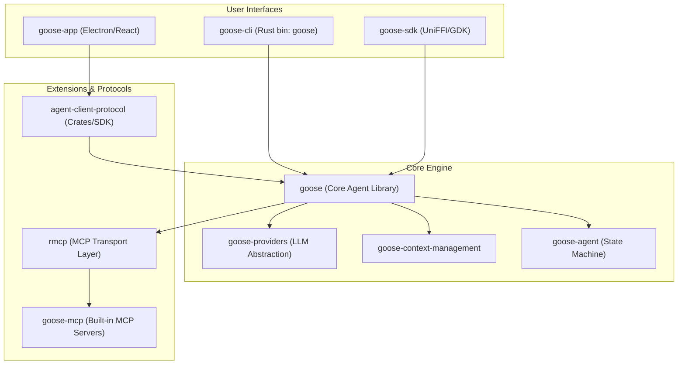
Sources: [crates/goose/Cargo.toml:170-174](), [crates/goose-cli/Cargo.toml:28-32](), [crates/goose-mcp/Cargo.toml:26-27](), [ui/desktop/package.json:53](), [Cargo.toml:21-24]()

## Key Components

### 1. The Agent Core (`goose` crate)
The central intelligence of the system. It manages the session lifecycle, handles context window management (compaction and truncation), and dispatches tool calls to various extensions [crates/goose/Cargo.toml:2-10](). It defines the core logic for the interaction loop between users and models. The agent loop is implemented in the `goose-agent` crate [crates/goose/Cargo.toml:174]().
*   For details, see [Core Concepts & Terminology](#1.2).

### 2. Providers & Model Registry
Goose abstracts LLM interactions through the `goose-providers` crate, supporting OpenAI, Anthropic, Google, and many others [crates/goose/Cargo.toml:171](), [README.md:27-28](). It uses a canonical model registry (`crates/goose-provider-types/src/canonical/data/canonical_models.json`) to normalize model metadata like context limits and capabilities [crates/goose-provider-types/src/canonical/data/canonical_models.json:1-283406]().
*   For details, see [Architecture & Core Crates](#2).

### 3. Extension System (MCP)
Goose leverages the **Model Context Protocol (MCP)** to extend its capabilities. The `goose-mcp` crate includes built-in extensions for file manipulation (`developer`), computer control, and memory [crates/goose-mcp/Cargo.toml:1-41](), [crates/goose-cli/src/cli.rs:12-13]().
*   For details, see [MCP Extension System](#3).

### 4. Client Interfaces & ACP
Goose provides multiple ways to interact, utilizing the **Agent Client Protocol (ACP)** for communication between frontends and the agent backend:
*   **CLI**: A terminal interface supporting interactive sessions, slash commands, and recipe execution [crates/goose-cli/Cargo.toml:14-16](). The main entry point is `crates/goose-cli/src/main.rs` [crates/goose-cli/src/main.rs:1-10]().
*   **Desktop**: An Electron-based GUI for session management and visual tool feedback [ui/desktop/package.json:1-5]().
*   **SDK**: The `goose-sdk-types` crate defines types for SDKs, enabling Goose to be embedded in other applications [crates/goose/Cargo.toml:173]().

Sources: [crates/goose/Cargo.toml:2-10](), [crates/goose/Cargo.toml:174](), [crates/goose/Cargo.toml:171](), [README.md:27-28](), [crates/goose-provider-types/src/canonical/data/canonical_models.json:1-283406](), [crates/goose-mcp/Cargo.toml:1-41](), [crates/goose-cli/src/cli.rs:12-13](), [crates/goose-cli/Cargo.toml:14-16](), [crates/goose-cli/src/main.rs:1-10](), [ui/desktop/package.json:1-5](), [crates/goose/Cargo.toml:173]().

## Request Lifecycle
This diagram illustrates how a natural language request flows through code entities to result in an action, mapping user intent directly to specific internal module functions and structs.

Natural Language to Execution Flow
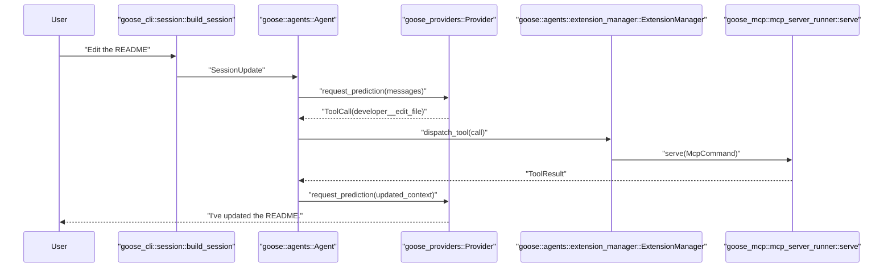
Sources: [crates/goose/src/session/session_manager.rs:66-109](), [crates/goose-cli/src/cli.rs:41](), [crates/goose-cli/src/cli.rs:15](), [crates/goose-mcp/src/mcp_server_runner.rs:1-10]()

## Next Steps

To dive deeper into Goose, explore the following child pages:

*   **[Getting Started & Installation](#1.1)**: Instructions for setting up the CLI and Desktop apps across macOS, Linux, and Windows [README.md:31-39]().
*   **[Core Concepts & Terminology](#1.2)**: Definitions for Sessions, Turns, MCP, ACP, and the internal Agent Loop logic.

Sources: [README.md:31-39]()

---

# Page: Getting Started & Installation

# Getting Started & Installation

<details>
<summary>Relevant source files</summary>

The following files were used as context for generating this wiki page:

- [.github/workflows/build-cli.yml](.github/workflows/build-cli.yml)
- [.github/workflows/canary.yml](.github/workflows/canary.yml)
- [.github/workflows/publish-ask-ai-bot.yml](.github/workflows/publish-ask-ai-bot.yml)
- [.github/workflows/publish-docker.yml](.github/workflows/publish-docker.yml)
- [.github/workflows/release.yml](.github/workflows/release.yml)
- [CUSTOM_DISTROS.md](CUSTOM_DISTROS.md)
- [RISCV_SETUP.md](RISCV_SETUP.md)
- [crates/goose-cli/src/commands/update.rs](crates/goose-cli/src/commands/update.rs)
- [documentation/docs/getting-started/installation.md](documentation/docs/getting-started/installation.md)
- [documentation/docs/guides/custom-distributions.md](documentation/docs/guides/custom-distributions.md)
- [documentation/docs/guides/updating-goose.md](documentation/docs/guides/updating-goose.md)
- [documentation/docs/quickstart.md](documentation/docs/quickstart.md)
- [documentation/docs/tutorials/cicd.md](documentation/docs/tutorials/cicd.md)
- [documentation/src/components/LinuxDesktopInstallButtons.js](documentation/src/components/LinuxDesktopInstallButtons.js)
- [documentation/src/components/MacDesktopInstallButtons.js](documentation/src/components/MacDesktopInstallButtons.js)
- [documentation/src/components/SupportedEnvironments.js](documentation/src/components/SupportedEnvironments.js)
- [documentation/src/components/WindowsDesktopInstallButtons.js](documentation/src/components/WindowsDesktopInstallButtons.js)
- [download_cli.ps1](download_cli.ps1)
- [download_cli.sh](download_cli.sh)
- [services/ask-ai-bot/.gitignore](services/ask-ai-bot/.gitignore)
- [services/ask-ai-bot/clients/ai.ts](services/ask-ai-bot/clients/ai.ts)
- [services/ask-ai-bot/index.ts](services/ask-ai-bot/index.ts)
- [ui/desktop/src/components/settings/app/UpdateSection.tsx](ui/desktop/src/components/settings/app/UpdateSection.tsx)
- [ui/desktop/src/utils/autoUpdater.ts](ui/desktop/src/utils/autoUpdater.ts)
- [ui/desktop/src/utils/githubUpdater.target.test.ts](ui/desktop/src/utils/githubUpdater.target.test.ts)
- [ui/desktop/src/utils/githubUpdater.ts](ui/desktop/src/utils/githubUpdater.ts)
- [ui/desktop/vite.main.config.mts](ui/desktop/vite.main.config.mts)

</details>


This page provides technical details on the installation, first-time configuration, and update mechanisms for Goose, covering both the Desktop (Electron-based) and CLI (Rust-based) versions across macOS, Linux, and Windows.

## Installation Overview & Architecture

Goose is distributed as two primary interfaces:
1.  **Goose Desktop**: An Electron application that manages the background process lifecycle and provides a React-based user interface [documentation/docs/getting-started/installation.md:21-29]().
2.  **Goose CLI**: A standalone compiled Rust binary designed for terminal-based REPL and script automation [documentation/docs/getting-started/installation.md:51-60]().

### System Requirements & Binary Distribution
Goose targets `x86_64` and `aarch64` architectures. Installation handles platform-specific directory structures for configuration and binary storage [download_cli.sh:56-67]().

| Platform | Desktop Distribution | CLI Distribution | Default Config Path |
| :--- | :--- | :--- | :--- |
| **macOS** | `.zip`, Homebrew (`block-goose`) | Shell Script, Homebrew | `~/.config/goose/config.yaml` |
| **Linux** | `.deb`, Package scripts | Shell Script (`download_cli.sh`) | `~/.config/goose/config.yaml` |
| **Windows** | `.zip` (Portable) | PowerShell / Bash Script | `%APPDATA%\Block\goose\config\config.yaml` |

Sources: [documentation/docs/getting-started/installation.md:16-159](), [download_cli.sh:56-67]()

---

## Installation Procedures

### 1. macOS
Goose supports both Intel (`x86_64`) and Apple Silicon (`aarch64`) architectures.
*   **Desktop**: Installed via direct download bundle or Homebrew cask: `brew install --cask block-goose` [documentation/docs/getting-started/installation.md:38]().
*   **CLI**: Installed via `download_cli.sh`, which automatically inspects `uname -m` and fetches the corresponding release archive [download_cli.sh:119-146]().

### 2. Linux
*   **Desktop**: Distributed as a Debian package (`.deb`) for Debian/Ubuntu distributions [documentation/docs/getting-started/installation.md:95-99]().
*   **CLI**: Installed via the universal installation script with automatic `glibc` / `musl` variant detection [download_cli.sh:148-174]().

### 3. Windows
*   **Desktop**: Distributed as a portable `.zip` archive containing the Electron runtime structure [ui/desktop/src/utils/githubUpdater.ts:103-120]().
*   **CLI**: Supports native execution in PowerShell (`download_cli.ps1`) or Git Bash / MSYS2 via `download_cli.sh` [documentation/docs/getting-started/installation.md:150-175]().

### Data Flow: CLI Installation Script Execution
The installation script orchestrates OS detection, architecture resolution, release tag validation, and unpacking.

Title: CLI Download and Extraction Logic
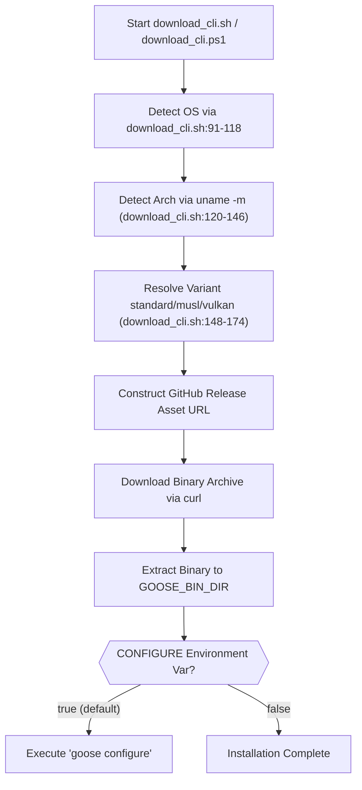
Sources: [download_cli.sh:56-174](), [documentation/docs/getting-started/installation.md:54-66]()

---

## First-Time Configuration

Upon initial execution, Goose requires an LLM provider configuration. Settings are managed interactively via `goose configure` or initialized through the Desktop onboarding flow [documentation/docs/quickstart.md:112-124]().

### Provider Setup & Declarative Configuration
Goose supports numerous API-backed and local inference providers:
*   **API Key Providers**: Anthropic, OpenAI, Google Gemini [documentation/docs/quickstart.md:160-168]().
*   **Enterprise/Cloud**: Amazon Bedrock, Databricks, Azure AI Foundry [documentation/docs/quickstart.md:160-168]().
*   **Declarative Backends**: Pre-defined provider configurations defined in `crates/goose-providers/src/declarative.rs` that map engine parameters.

Title: Configuration Logic Entity Mapping
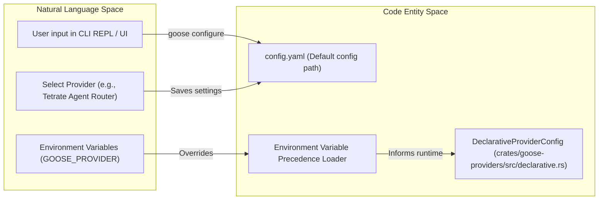
Sources: [documentation/docs/quickstart.md:112-175](), [crates/goose-providers/src/declarative.rs:15-61]()

---

## Quickstart Guide

To start a development session immediately following installation:

1.  **Initialize Configuration**: Run `goose configure` in your terminal [documentation/docs/quickstart.md:132-136]().
2.  **Select Provider**: Choose the `Tetrate Agent Router Service` (or your preferred provider) [documentation/docs/quickstart.md:151-168]().
3.  **Start an Interactive Session**:
    ```bash
    goose session -n my-first-project
    ```
4.  **Execute Non-Interactive Tasks**:
    ```bash
    goose run -t "Analyze the current repository file layout"
    ```

Sources: [documentation/docs/quickstart.md:18-175]()

---

## Updating Goose & Provenance Verification

Goose components are updated differently depending on whether the CLI binary or Desktop app is deployed.

### CLI Updates & Sigstore Verification
The `goose update` command uses Rust's `reqwest` client and Sigstore verification libraries to fetch and verify binary updates [crates/goose-cli/src/commands/update.rs:9-17](). It determines the correct platform binary via compile-time target inspections in `asset_name()` [crates/goose-cli/src/commands/update.rs:24-63]().

Title: CLI Update Command Execution
```mermaid
graph TD
    A[User executes "goose update"] --> B{Determine OS and Architecture};
    B --> C[Call asset_name() to get platform-specific asset name];
    C --> D[Construct GitHub Release API URL for latest stable/canary release];
    D --> E[Fetch release metadata from GitHub];
    E --> F[Extract download URL and SHA256 digest for relevant asset];
    F --> G[Download asset (e.g., goose-x86_64-apple-darwin.tar.bz2)];
    G --> H[Fetch attestation bundles for the downloaded asset];
    H --> I[Verify attestation bundles using Sigstore's TrustedRoot];
    I -- "Verification Success" --> J[Extract new Goose binary to a temporary location];
    J --> K[Atomically replace old Goose binary with new one];
    K --> L[Report update success];
    I -- "Verification Failure" --> M[Report update failure and abort];
```
Sources: [crates/goose-cli/src/commands/update.rs:24-63](), [crates/goose-cli/src/commands/update.rs:129-165]()

### Desktop Updates
Goose Desktop utilizes an Electron-based updater workflow defined in `ui/desktop/src/utils/githubUpdater.ts` which inspects GitHub releases and safely swaps unpacked app bundles [ui/desktop/src/utils/githubUpdater.ts:10-77](). The `autoUpdater` module from `electron-updater` is primarily used, with a fallback to a custom `githubUpdater` if the primary mechanism fails (e.g., due to network issues or missing update manifests) [ui/desktop/src/utils/autoUpdater.ts:61-69](). The `githubUpdater` handles downloading and extracting the correct archive based on the operating system and architecture [ui/desktop/src/utils/githubUpdater.ts:67-78]().

Title: Desktop Update Flow
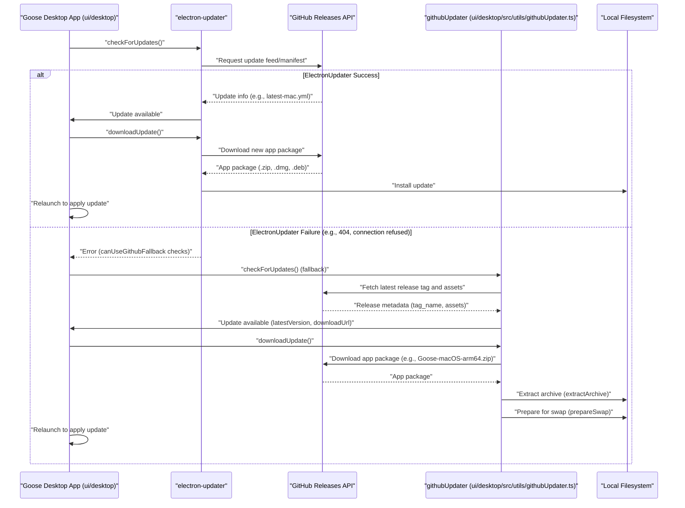
Sources: [ui/desktop/src/utils/autoUpdater.ts:61-69](), [ui/desktop/src/utils/githubUpdater.ts:10-77](), [ui/desktop/src/utils/githubUpdater.ts:67-78]()

---

# Page: Core Concepts & Terminology

# Core Concepts & Terminology

<details>
<summary>Relevant source files</summary>

The following files were used as context for generating this wiki page:

- [crates/goose/src/skills/builtins/web_search.md](crates/goose/src/skills/builtins/web_search.md)
- [documentation/docs/getting-started/using-extensions.md](documentation/docs/getting-started/using-extensions.md)
- [documentation/docs/guides/config-files.md](documentation/docs/guides/config-files.md)
- [documentation/docs/guides/context-engineering/subagents.mdx](documentation/docs/guides/context-engineering/subagents.mdx)
- [documentation/docs/guides/context-engineering/using-skills.md](documentation/docs/guides/context-engineering/using-skills.md)
- [documentation/docs/guides/environment-variables.md](documentation/docs/guides/environment-variables.md)
- [documentation/docs/guides/goose-cli-commands.md](documentation/docs/guides/goose-cli-commands.md)
- [documentation/docs/guides/managing-tools/_category_.json](documentation/docs/guides/managing-tools/_category_.json)
- [documentation/docs/guides/managing-tools/adjust-tool-output.md](documentation/docs/guides/managing-tools/adjust-tool-output.md)
- [documentation/docs/guides/managing-tools/code-mode.md](documentation/docs/guides/managing-tools/code-mode.md)
- [documentation/docs/guides/managing-tools/index.md](documentation/docs/guides/managing-tools/index.md)
- [documentation/docs/guides/managing-tools/tool-permissions.md](documentation/docs/guides/managing-tools/tool-permissions.md)
- [documentation/docs/guides/multi-model/index.mdx](documentation/docs/guides/multi-model/index.mdx)
- [documentation/docs/guides/recipes/index.mdx](documentation/docs/guides/recipes/index.mdx)
- [documentation/docs/guides/recipes/recipe-reference.md](documentation/docs/guides/recipes/recipe-reference.md)
- [documentation/docs/guides/recipes/session-recipes.md](documentation/docs/guides/recipes/session-recipes.md)
- [documentation/docs/guides/recipes/storing-recipes.md](documentation/docs/guides/recipes/storing-recipes.md)
- [documentation/docs/guides/recipes/subrecipes.md](documentation/docs/guides/recipes/subrecipes.md)
- [documentation/docs/guides/running-tasks.md](documentation/docs/guides/running-tasks.md)
- [documentation/docs/guides/sessions/in-session-actions.md](documentation/docs/guides/sessions/in-session-actions.md)
- [documentation/docs/guides/sessions/session-management.md](documentation/docs/guides/sessions/session-management.md)
- [documentation/docs/guides/sessions/smart-context-management.md](documentation/docs/guides/sessions/smart-context-management.md)
- [documentation/docs/guides/tips.md](documentation/docs/guides/tips.md)
- [documentation/docs/mcp/code-mode-mcp.md](documentation/docs/mcp/code-mode-mcp.md)
- [documentation/docs/mcp/skills-mcp.md](documentation/docs/mcp/skills-mcp.md)
- [documentation/docs/mcp/summon-mcp.md](documentation/docs/mcp/summon-mcp.md)
- [documentation/docs/troubleshooting/known-issues.md](documentation/docs/troubleshooting/known-issues.md)
- [documentation/docs/tutorials/playwright-skill.md](documentation/docs/tutorials/playwright-skill.md)
- [documentation/docs/tutorials/recipes-tutorial.md](documentation/docs/tutorials/recipes-tutorial.md)
- [documentation/docs/tutorials/remotion-video-creation.md](documentation/docs/tutorials/remotion-video-creation.md)
- [documentation/src/components/RecipeFields.js](documentation/src/components/RecipeFields.js)
- [documentation/src/components/VideoCarousel.js](documentation/src/components/VideoCarousel.js)
- [documentation/static/files/thoughts/plans/2025-12-23-remove-tool-selection-strategy.raw](documentation/static/files/thoughts/plans/2025-12-23-remove-tool-selection-strategy.raw)
- [documentation/static/files/thoughts/research/2025-12-22-llm-tool-selection-strategy.raw](documentation/static/files/thoughts/research/2025-12-22-llm-tool-selection-strategy.raw)
- [documentation/static/img/summon-retro-site.png](documentation/static/img/summon-retro-site.png)

</details>


## Purpose & Scope
This page provides a technical reference for the fundamental concepts and entities within the Goose ecosystem. It bridges the gap between high-level user features and the underlying implementation details found in the Rust workspace, detailing data structures, control flow, and architecture components such as Sessions, Turns, Extensions, Tools, Recipes, GooseMode, MCP, ACP, Skills, Hooks, and the core agent loop.

Sources: [documentation/docs/guides/sessions/session-management.md:11-12](), [documentation/docs/guides/recipes/session-recipes.md:12-13]()

---

## The Agent Loop & State Machine

The core of Goose is an autonomous agent loop that facilitates interaction between a user, a Large Language Model (LLM), and a set of tools. This loop is primarily managed by the `Agent` struct in the `goose` crate, which orchestrates the transition between reasoning (LLM inference) and action (tool execution) [crates/goose/src/agents/agent.rs:1-50]().

1. **Input**: The loop begins with a user prompt or a scheduled trigger.
2. **Reasoning**: The `Agent` sends the conversation history and available tool schemas to the `Provider`. This is initialized via `prepare_tools_and_prompt` [crates/goose/src/agents/reply_parts.rs:197-205]().
3. **Action**: If the LLM returns a tool call, the `Agent` dispatches it via the `ExtensionManager` [crates/goose/src/agents/extension_manager.rs:192-200]().
4. **Observation**: The tool output (observation) is captured, formatted, and added to the session conversation history.
5. **Iteration**: The loop repeats until the LLM provides a final text response or the `DEFAULT_MAX_TURNS` limit (default 1000) is reached [crates/goose/src/agents/agent.rs:87-87]().

### Agent Loop Data Flow

**Diagram: Natural Language to Code Entity Space — Agent Loop**

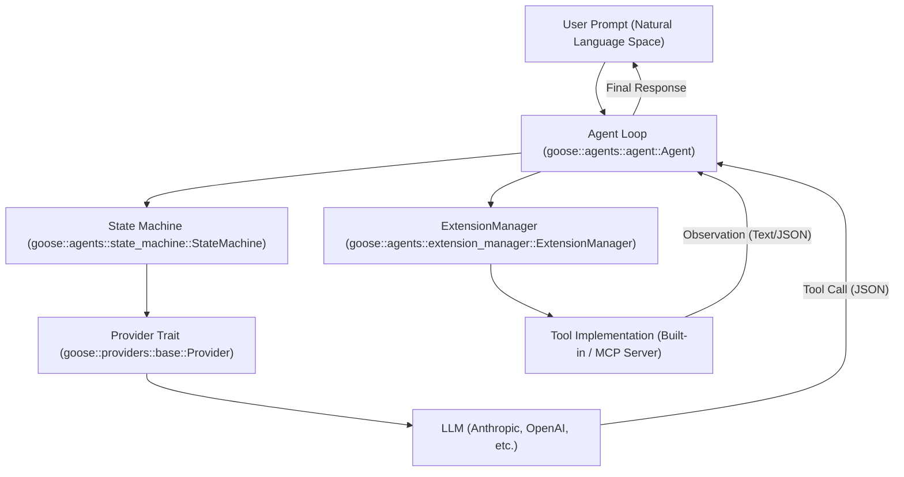

Sources: [crates/goose/src/agents/agent.rs:35-44](), [crates/goose/src/agents/extension_manager.rs:192-200](), [crates/goose/src/agents/reply_parts.rs:197-205]()

---

## Sessions and Turns

* **Session**: A single, continuous interaction stored in a local SQLite database (`sessions.db`) [documentation/docs/guides/goose-cli-commands.md:197-199](). It provides an isolated space for conversation history, metadata, and context [crates/goose-cli/src/session/mod.rs:50-55]().
* **Turn**: A single cycle in the agent loop [documentation/docs/guides/sessions/smart-context-management.md:17-18](). `GOOSE_MAX_TURNS` limits how many autonomous iterations (tool calls) Goose can perform without user input (default 1000) [documentation/docs/guides/environment-variables.md:137-137]().

### Session Persistence and Identification

Sessions are managed by the `SessionManager` and identified by a session identifier (`session-id`) or a human-readable name [documentation/docs/guides/goose-cli-commands.md:17-20]().

| Entity | Code Reference | Storage |
| :--- | :--- | :--- |
| **Session** | `goose::session::Session` | `sessions.db` (SQLite) |
| **Message** | `goose::conversation::message::Message` | `messages` table |
| **Metadata** | `goose::session::Metadata` | `sessions` table |

Sources: [documentation/docs/guides/goose-cli-commands.md:197-199](), [crates/goose-cli/src/session/mod.rs:50-55](), [crates/goose-cli/src/cli.rs:17-20]()

---

## Extensions and Tools

Goose uses an extensible architecture to interact with the external environment, primarily built on top of the **Model Context Protocol (MCP)** [documentation/docs/getting-started/using-extensions.md:10-13]().

### Extension Categories
1. **Built-in Extensions**: Compiled directly into Goose or provided through built-in MCP servers (e.g., `developer`, `computercontroller`, `memory`) [documentation/docs/getting-started/using-extensions.md:21-29]().
2. **Platform Extensions**: In-process extensions providing essential runtime features like `analyze`, `apps`, `chatrecall`, `code-mode`, `extension-manager`, `skills`, `summon`, `todo`, and `tom` [documentation/docs/getting-started/using-extensions.md:34-47]().
3. **External MCP Servers**: Third-party servers connected via `stdio` processes or HTTP transports [documentation/docs/getting-started/using-extensions.md:109-122]().

**Diagram: Extension Architecture and Code Mapping**

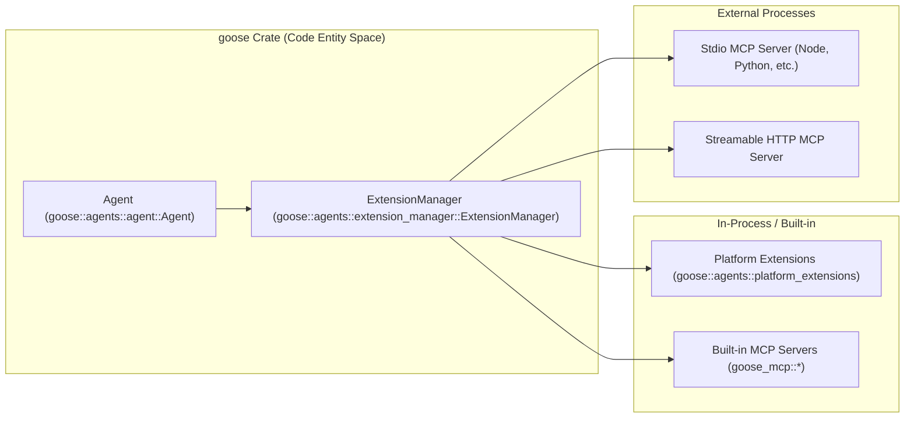

Sources: [documentation/docs/getting-started/using-extensions.md:21-47](), [crates/goose/src/agents/extension_manager.rs:192-200](), [crates/goose-cli/src/session/builder.rs:89-154]()

---

## Recipes and Subagents

### Recipes
A **Recipe** is a reusable YAML or JSON configuration file that packages instructions, prompts, required extensions, goals, parameters, and success checks [documentation/docs/guides/recipes/session-recipes.md:37-60](), [documentation/docs/guides/recipes/recipe-reference.md:13-54]().
* **Parameters**: Dynamic variables defined in the recipe using `{{ variable_name }}` syntax [documentation/docs/guides/recipes/session-recipes.md:73-76]().
* **Sub-recipes**: Reusable workflows that can be composed or triggered hierarchically under `sub_recipes` [documentation/docs/guides/recipes/recipe-reference.md:53-53]().

### Subagents
Subagents are independent child Goose instances spawned to execute isolated tasks via the `summon` platform extension and `SubagentHandler` [documentation/docs/getting-started/using-extensions.md:44-44](), [crates/goose/src/agents/mod.rs:38-39]().

Sources: [documentation/docs/guides/recipes/session-recipes.md:37-76](), [documentation/docs/guides/recipes/recipe-reference.md:37-54](), [documentation/docs/getting-started/using-extensions.md:44-44](), [crates/goose/src/agents/mod.rs:38-39]()

---

## GooseMode & Permission System

Goose implements a risk-based permission and security enforcement pipeline (`GooseMode`) to govern tool execution and resource access [documentation/docs/guides/config-files.md:52-52]().

| Mode | Behavior |
| :--- | :--- |
| `Auto` | Full autonomy; Goose executes tools without manual confirmation prompts [documentation/docs/getting-started/using-extensions.md:30-31](). |
| `Approve` | Manual user approval is required for all tool invocations. |
| `SmartApprove` | Automatically approves low-risk operations while flagging high-risk actions for user review. |
| `Chat` | Conversational mode only; tool execution capabilities are disabled. |

**Diagram: Permission Inspection Pipeline**

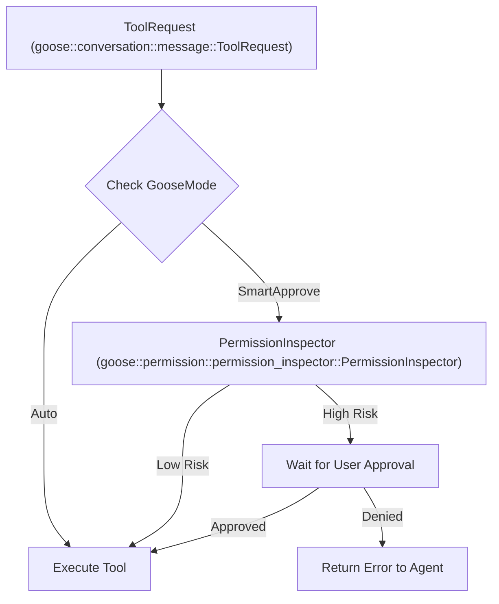

Sources: [documentation/docs/guides/config-files.md:52-52](), [documentation/docs/getting-started/using-extensions.md:30-31](), [crates/goose/src/agents/agent.rs:61-64]()

---

## Protocols: MCP and ACP

### Model Context Protocol (MCP)
MCP is an open standard that enables AI models to connect securely to data sources and tools [documentation/docs/getting-started/using-extensions.md:12-13]().
* **MCP Servers**: Expose standardized tool definitions, prompts, and resources.
* **MCP Client**: Goose acts as an MCP client through the `McpClientTrait` interface managed by the `ExtensionManager` [crates/goose/src/agents/extension_manager.rs:40-41]().

### Agent Client Protocol (ACP)
While MCP connects **Agents to Tools**, ACP connects **Clients to Agents** (such as the Electron Desktop app or the CLI to the Goose server architecture) [crates/goose/Cargo.toml]().
* Goose operates as an ACP Server when running server commands or background sessions.

Sources: [documentation/docs/getting-started/using-extensions.md:12-13](), [crates/goose/src/agents/extension_manager.rs:40-41](), [crates/goose/Cargo.toml]()

---

## Skills and Hooks

* **Skills**: Reusable capabilities or prompt instructions bundled into extensions (`~/.agents/skills/`) that guide the model on how to perform specific domain tasks [documentation/docs/guides/context-engineering/using-skills.md:7-13]().
* **Hooks**: Lifecycle interception points (such as entry hooks, exit hooks, and stop hooks) that can inspect conversation state, validate actions, or block turn completion based on policy rules [crates/goose/src/agents/agent.rs:35-44]().

Sources: [documentation/docs/guides/context-engineering/using-skills.md:7-13](), [crates/goose/src/agents/agent.rs:35-44]()

---

# Page: Architecture & Core Crates

# Architecture & Core Crates

<details>
<summary>Relevant source files</summary>

The following files were used as context for generating this wiki page:

- [Cargo.lock](Cargo.lock)
- [Cargo.toml](Cargo.toml)
- [crates/goose-agent/CHANGELOG.md](crates/goose-agent/CHANGELOG.md)
- [crates/goose-agent/Cargo.toml](crates/goose-agent/Cargo.toml)
- [crates/goose-cli/Cargo.toml](crates/goose-cli/Cargo.toml)
- [crates/goose-cli/src/cli.rs](crates/goose-cli/src/cli.rs)
- [crates/goose-cli/src/commands/mod.rs](crates/goose-cli/src/commands/mod.rs)
- [crates/goose-cli/src/commands/session.rs](crates/goose-cli/src/commands/session.rs)
- [crates/goose-cli/src/lib.rs](crates/goose-cli/src/lib.rs)
- [crates/goose-cli/src/main.rs](crates/goose-cli/src/main.rs)
- [crates/goose-context-management/CHANGELOG.md](crates/goose-context-management/CHANGELOG.md)
- [crates/goose-context-management/Cargo.toml](crates/goose-context-management/Cargo.toml)
- [crates/goose-download-manager/Cargo.toml](crates/goose-download-manager/Cargo.toml)
- [crates/goose-local-inference/Cargo.toml](crates/goose-local-inference/Cargo.toml)
- [crates/goose-mcp/Cargo.toml](crates/goose-mcp/Cargo.toml)
- [crates/goose-provider-types/CHANGELOG.md](crates/goose-provider-types/CHANGELOG.md)
- [crates/goose-provider-types/Cargo.toml](crates/goose-provider-types/Cargo.toml)
- [crates/goose-provider-types/src/canonical/data/canonical_models.json](crates/goose-provider-types/src/canonical/data/canonical_models.json)
- [crates/goose-provider-types/src/canonical/data/provider_metadata.json](crates/goose-provider-types/src/canonical/data/provider_metadata.json)
- [crates/goose-providers/CHANGELOG.md](crates/goose-providers/CHANGELOG.md)
- [crates/goose-providers/Cargo.toml](crates/goose-providers/Cargo.toml)
- [crates/goose-sdk-types/Cargo.toml](crates/goose-sdk-types/Cargo.toml)
- [crates/goose-sdk/Cargo.toml](crates/goose-sdk/Cargo.toml)
- [crates/goose-sdk/python/pyproject.toml](crates/goose-sdk/python/pyproject.toml)
- [crates/goose/Cargo.toml](crates/goose/Cargo.toml)
- [crates/goose/src/session/chat_history_search.rs](crates/goose/src/session/chat_history_search.rs)
- [crates/goose/src/session/mod.rs](crates/goose/src/session/mod.rs)
- [crates/goose/src/session/session_manager.rs](crates/goose/src/session/session_manager.rs)
- [documentation/src/data/gdk-api.json](documentation/src/data/gdk-api.json)
- [ui/desktop/package.json](ui/desktop/package.json)

</details>


Goose is organized as a Rust workspace containing several specialized crates that separate the agent's core logic, provider abstractions, extension systems, context management, and CLI interfaces. This modularity allows Goose to run as a standalone terminal application, a background runtime, or the engine behind the Goose Desktop application.

## Workspace Structure & Crate Responsibilities

The Goose repository is a Rust workspace defined in the root [Cargo.toml:1-5](). It partitions the system into distinct responsibilities across specialized crates:

| Crate | Path | Responsibility |
| :--- | :--- | :--- |
| `goose` | `crates/goose` | The core engine: agent loop, provider abstractions, session logic, tools, and hooks. |
| `goose-agent` | `crates/goose-agent` | State-machine-based turn execution engine, operations, and event model. |
| `goose-providers` | `crates/goose-providers` | Concrete implementations for LLM backends (Anthropic, OpenAI, etc.) and wire format translation. |
| `goose-provider-types` | `crates/goose-provider-types` | Shared types, metadata, and canonical model definitions. |
| `goose-context-management` | `crates/goose-context-management` | LLM context window management, token counting, auto-compaction, and summarization. |
| `goose-sdk` | `crates/goose-sdk` | UniFFI bindings and SDK capabilities for embedding Goose in Python and Kotlin. |
| `goose-local-inference` | `crates/goose-local-inference` | Local inference backends (`candle`, `llama-cpp-2`, `MLX`), model discovery, and tool emulation. |
| `goose-roaming` | `crates/goose-roaming` | P2P transport and roaming node infrastructure using `iroh`. |
| `goose-cli` | `crates/goose-cli` | The interactive terminal REPL and command-line binary (`goose`). |
| `goose-mcp` | `crates/goose-mcp` | Built-in Model Context Protocol (MCP) servers and tool implementations. |

Sources: [Cargo.toml:1-5](), [crates/goose/Cargo.toml:1-10](), [crates/goose-cli/Cargo.toml:2-9]()

### System Data Flow

The following diagram illustrates how user requests flow from client interfaces through core orchestration layers out to external LLM providers and tool servers.

**Natural Language to Code Entity Mapping: Data Flow**
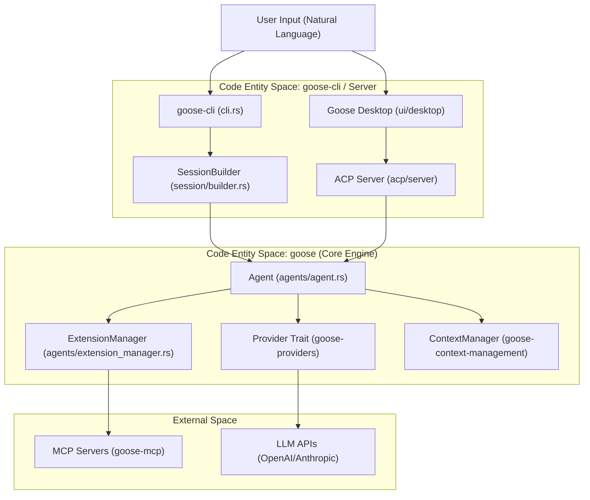
Sources: [crates/goose-cli/src/session/mod.rs:21](), [crates/goose/src/agents/agent.rs:186](), [crates/goose/src/agents/extension_manager.rs:22]()

---

## Core Subsystems & Child Pages

As a parent page, this section provides a high-level overview of the major subsystems. For complete technical details, consult the respective child pages:

### 1. Agent Core (`goose`) {#2.1}
The `goose` crate is the heart of the execution loop, managing the `Agent` struct lifecycle, conversation history, and tool dispatch [crates/goose/src/agents/agent.rs:186](). It integrates platform extensions, built-in tools, and context compaction mechanisms [crates/goose/src/agents/extension_manager.rs:42]().
* For details, see [Agent Core (`goose` crate)](#2.1)

### 2. Provider Layer {#2.2}
Abstracts LLM interactions via the `Provider` trait and `ProviderRegistry`, handling wire translation across various model providers, streaming responses, and canonical model catalogs.
* For details, see [Provider Layer](#2.2)

### 3. Configuration System {#2.3}
Manages user settings, API keys via keyring storage, environment variable precedence, and execution modes (`GooseMode`) [crates/goose/src/config.rs]().
* For details, see [Configuration System](#2.3)

### 4. Session & Storage {#2.4}
Persists conversations using SQLite (`sessions.db`) via `SessionManager`, supporting session naming, chat history search, and state resumption [crates/goose/src/session/mod.rs]().
* For details, see [Session & Storage](#2.4)

### 5. Security & Permission System {#2.5}
Inspects tool calls and egress traffic using `SecurityInspector` and prompt injection detection routines before executing operations under user approval flows [crates/goose/src/security/mod.rs]().
* For details, see [Security & Permission System](#2.5)

Sources: [crates/goose/src/agents/agent.rs:186](), [crates/goose/src/agents/extension_manager.rs:42](), [crates/goose/src/config.rs](), [crates/goose/src/session/mod.rs](), [crates/goose/src/security/mod.rs]()

---

## Process Architecture & Inter-dependencies

Goose components interact through well-defined protocol boundaries and shared workspace crates. 

**Natural Language to Code Entity Mapping: Initialization & Lifecycle**
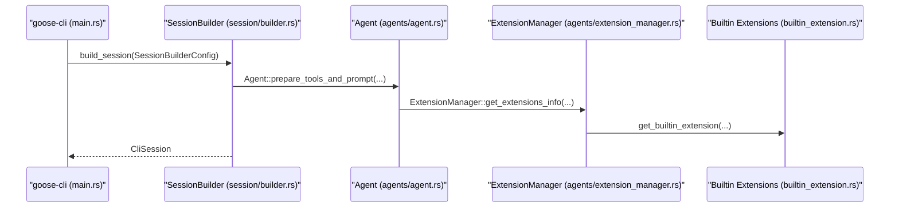
Sources: [crates/goose-cli/src/session/mod.rs:21](), [crates/goose-cli/src/main.rs:19](), [crates/goose/src/agents/agent.rs:187](), [crates/goose/src/agents/extension_manager.rs:42]()

Key shared dependencies powering the workspace include:
* **`rmcp`**: Protocol implementation for Model Context Protocol communication [Cargo.toml:21]().
* **`agent-client-protocol`**: Standardized wire protocol for agent-to-client operations [Cargo.toml:23]().
* **`sqlx`**: SQLite database connectivity for session persistence [crates/goose/Cargo.toml:179-186]().
* **`goose-mcp`**: Built-in tool servers providing file system, memory, and controller capabilities [crates/goose-mcp/Cargo.toml:2-23]().

Sources: [Cargo.toml:21-23](), [crates/goose/Cargo.toml:179-186](), [crates/goose-mcp/Cargo.toml:2-23]()

---

# Page: Agent Core (`goose` crate)

# Agent Core (`goose` crate)

<details>
<summary>Relevant source files</summary>

The following files were used as context for generating this wiki page:

- [crates/goose-cli/src/commands/configure.rs](crates/goose-cli/src/commands/configure.rs)
- [crates/goose-cli/src/session/builder.rs](crates/goose-cli/src/session/builder.rs)
- [crates/goose-cli/src/session/completion.rs](crates/goose-cli/src/session/completion.rs)
- [crates/goose-cli/src/session/editor.rs](crates/goose-cli/src/session/editor.rs)
- [crates/goose-cli/src/session/input.rs](crates/goose-cli/src/session/input.rs)
- [crates/goose-cli/src/session/mod.rs](crates/goose-cli/src/session/mod.rs)
- [crates/goose-cli/src/session/output.rs](crates/goose-cli/src/session/output.rs)
- [crates/goose-test-support/src/otel.rs](crates/goose-test-support/src/otel.rs)
- [crates/goose/src/agents/agent.rs](crates/goose/src/agents/agent.rs)
- [crates/goose/src/agents/extension.rs](crates/goose/src/agents/extension.rs)
- [crates/goose/src/agents/mod.rs](crates/goose/src/agents/mod.rs)
- [crates/goose/src/agents/moim.rs](crates/goose/src/agents/moim.rs)
- [crates/goose/src/agents/prompt_manager.rs](crates/goose/src/agents/prompt_manager.rs)
- [crates/goose/src/agents/reply_parts.rs](crates/goose/src/agents/reply_parts.rs)
- [crates/goose/src/agents/snapshots/goose__agents__prompt_manager__tests__all_platform_extensions.snap](crates/goose/src/agents/snapshots/goose__agents__prompt_manager__tests__all_platform_extensions.snap)
- [crates/goose/src/agents/snapshots/goose__agents__prompt_manager__tests__basic.snap](crates/goose/src/agents/snapshots/goose__agents__prompt_manager__tests__basic.snap)
- [crates/goose/src/agents/snapshots/goose__agents__prompt_manager__tests__one_extension.snap](crates/goose/src/agents/snapshots/goose__agents__prompt_manager__tests__one_extension.snap)
- [crates/goose/src/agents/snapshots/goose__agents__prompt_manager__tests__typical_setup.snap](crates/goose/src/agents/snapshots/goose__agents__prompt_manager__tests__typical_setup.snap)
- [crates/goose/src/config/extensions.rs](crates/goose/src/config/extensions.rs)
- [crates/goose/src/config/mod.rs](crates/goose/src/config/mod.rs)
- [crates/goose/src/execution/manager.rs](crates/goose/src/execution/manager.rs)
- [crates/goose/src/otel/otlp.rs](crates/goose/src/otel/otlp.rs)
- [crates/goose/src/permission/permission_inspector.rs](crates/goose/src/permission/permission_inspector.rs)
- [crates/goose/src/permission/permission_judge.rs](crates/goose/src/permission/permission_judge.rs)
- [crates/goose/src/prompts/system.md](crates/goose/src/prompts/system.md)
- [crates/goose/tests/agent.rs](crates/goose/tests/agent.rs)
- [documentation/docs/tutorials/langfuse.md](documentation/docs/tutorials/langfuse.md)

</details>


The `goose` crate contains the central orchestration logic for the Goose platform. It defines the `Agent` struct, which serves as the primary engine for the "Sense-Plan-Act" loop, managing the lifecycle of conversations, tool discovery, and execution [crates/goose/src/agents/agent.rs:146-148]().

## Purpose & Scope

This page provides a high-level overview of the agent core in the `goose` crate, detailing how the `Agent` struct coordinates conversations, dispatches tools via the `ExtensionManager`, interacts with providers, and handles subagents and scheduling.

For deep technical details on specific subsystems, refer to the child pages:
- [Platform Extensions & Built-in Tools](#2.1.1) — Platform extension system, built-in tools, hooks, and plugins.
- [Context Management & Compaction](#2.1.2) — LLM context window management, token counting, and auto-compaction (`goose-context-management` crate).
- [Agent State Machine (`goose-agent`)](#2.1.3) — Turn execution engine, state machine operations, tool approvals, and event model.

Sources: [crates/goose/src/agents/agent.rs:146-148]()

## The Agent Loop & Reply Lifecycle

The core of Goose is an iterative loop where the `Agent` processes user input, determines necessary actions through LLM tool calls, executes them, and provides a final response [crates/goose/src/agents/agent.rs:146-148]().

When a message is received, the `Agent` executes a reply lifecycle:
1.  **Context Preparation**: Gathering tools, system prompts, and conversation history via `prepare_inference_tools` [crates/goose/src/agents/reply_parts.rs:184-206]().
2.  **LLM Interaction**: Streaming or querying the `Provider` for model outputs [crates/goose/src/agents/agent.rs:107-108]().
3.  **Tool Dispatch**: Parsing tool requests and routing them through `ExtensionManager` [crates/goose/src/agents/agent.rs:150]().
4.  **Observation & State Machine**: Feeding results back into the conversation state machine [crates/goose/src/agents/agent.rs:19-23]().

**Natural Language Space to Code Entity Space: Agent Core Architecture**
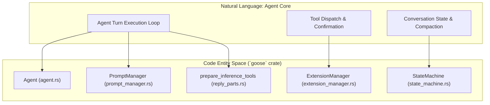
Sources: [crates/goose/src/agents/agent.rs:19-23](), [crates/goose/src/agents/agent.rs:107-108](), [crates/goose/src/agents/agent.rs:146-150](), [crates/goose/src/agents/reply_parts.rs:184-206]()

## Extension Management (`ExtensionManager`)

The `ExtensionManager` manages the registration, discovery, and lifecycle of tools available to the agent [crates/goose/src/agents/agent.rs:150](). It handles three main extension categories:
-   **Built-in Extensions**: Extensions compiled directly into the Goose binary [crates/goose/src/agents/extension.rs:181-184]().
-   **Platform Extensions**: Core platform capabilities (such as developer shell/edit and execution tools) defined in `PLATFORM_EXTENSIONS` [crates/goose/src/agents/extension.rs:16-17]().
-   **MCP Extensions**: External servers connected via Stdio or HTTP transports [crates/goose/src/agents/extension.rs:158-180]().

For details on platform extensions and built-in tools, see [Platform Extensions & Built-in Tools](#2.1.1).

**Natural Language Space to Code Entity Space: Tool Dispatch Flow**
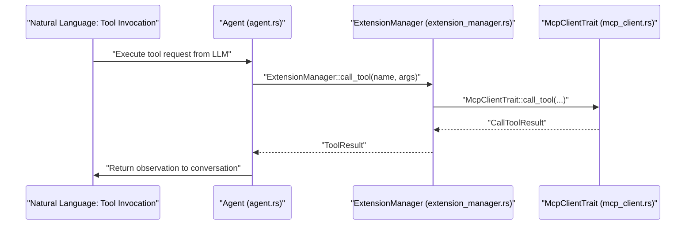
Sources: [crates/goose/src/agents/agent.rs:150](), [crates/goose/src/agents/extension.rs:16-17](), [crates/goose/src/agents/extension.rs:158-184]()

## Context & Session Integration

The `Agent` relies on session persistence and context window management to maintain conversation history across turns [crates/goose/src/agents/agent.rs:98]().

-   **Prompt Management**: The `PromptManager` compiles system prompts and dynamic instructions for the LLM [crates/goose/src/agents/prompt_manager.rs:18-20]().
-   **Compaction**: When conversation token usage approaches model limits, `COMPACT_TRIGGERS` define conditions for trimming or summarizing older context [crates/goose/src/agents/mod.rs:34]().

For deep technical coverage, see [Context Management & Compaction](#2.1.2).

Sources: [crates/goose/src/agents/agent.rs:98](), [crates/goose/src/agents/mod.rs:34](), [crates/goose/src/agents/prompt_manager.rs:18-20]()

## Subagents and Multi-Agent Orchestration

Goose supports multi-agent execution, allowing a lead agent to spawn and delegate tasks to subagents [crates/goose/src/agents/mod.rs:24](). This is coordinated via the `SubagentHandler` and `TaskConfig`, enabling isolated task execution within recipes or interactive sessions [crates/goose/src/agents/mod.rs:24-25]().

Sources: [crates/goose/src/agents/mod.rs:24-25]()

## Scheduler Integration

The scheduler system allows Goose to run predefined recipes automatically on a cron schedule [crates/goose/src/agents/agent.rs:100]().

| Entity | Description | File |
| :--- | :--- | :--- |
| `ScheduledJob` | Metadata and cron configuration for recurring tasks | [crates/goose/tests/agent.rs:24]() |
| `SchedulerTrait` | Abstraction layer for scheduler operations used by the agent | [crates/goose/src/agents/agent.rs:35]() |
| `ScheduleTool` | Tool exposed to the LLM to manage jobs | [crates/goose/src/agents/mod.rs:41]() |

Sources: [crates/goose/src/agents/agent.rs:35](), [crates/goose/src/agents/agent.rs:100](), [crates/goose/src/agents/mod.rs:41](), [crates/goose/tests/agent.rs:24]()

## Child Pages

-   [Platform Extensions & Built-in Tools](#2.1.1) — Detailed coverage of platform extensions, developer tools, execution, and hooks.
-   [Context Management & Compaction](#2.1.2) — Deep dive into token counting, conversation fixing, and compaction.
-   [Agent State Machine (`goose-agent`)](#2.1.3) — Turn execution engine, state machine operations, tool approvals, and events.

---

# Page: Platform Extensions & Built-in Tools

# Platform Extensions & Built-in Tools

<details>
<summary>Relevant source files</summary>

The following files were used as context for generating this wiki page:

- [crates/goose-agent/src/lib.rs](crates/goose-agent/src/lib.rs)
- [crates/goose-agent/src/skills/arguments.rs](crates/goose-agent/src/skills/arguments.rs)
- [crates/goose-agent/src/skills/discovery.rs](crates/goose-agent/src/skills/discovery.rs)
- [crates/goose-agent/src/skills/mod.rs](crates/goose-agent/src/skills/mod.rs)
- [crates/goose-cli/src/commands/plugin.rs](crates/goose-cli/src/commands/plugin.rs)
- [crates/goose-local-inference/src/paths.rs](crates/goose-local-inference/src/paths.rs)
- [crates/goose/src/agents/execute_commands.rs](crates/goose/src/agents/execute_commands.rs)
- [crates/goose/src/agents/extension_manager/mod.rs](crates/goose/src/agents/extension_manager/mod.rs)
- [crates/goose/src/agents/extension_manager/streamable_http.rs](crates/goose/src/agents/extension_manager/streamable_http.rs)
- [crates/goose/src/agents/platform_extensions/analyze/mod.rs](crates/goose/src/agents/platform_extensions/analyze/mod.rs)
- [crates/goose/src/agents/platform_extensions/apps.rs](crates/goose/src/agents/platform_extensions/apps.rs)
- [crates/goose/src/agents/platform_extensions/chatrecall.rs](crates/goose/src/agents/platform_extensions/chatrecall.rs)
- [crates/goose/src/agents/platform_extensions/code_execution.rs](crates/goose/src/agents/platform_extensions/code_execution.rs)
- [crates/goose/src/agents/platform_extensions/developer/mod.rs](crates/goose/src/agents/platform_extensions/developer/mod.rs)
- [crates/goose/src/agents/platform_extensions/developer/shell.rs](crates/goose/src/agents/platform_extensions/developer/shell.rs)
- [crates/goose/src/agents/platform_extensions/ext_manager.rs](crates/goose/src/agents/platform_extensions/ext_manager.rs)
- [crates/goose/src/agents/platform_extensions/mod.rs](crates/goose/src/agents/platform_extensions/mod.rs)
- [crates/goose/src/agents/platform_extensions/summon.rs](crates/goose/src/agents/platform_extensions/summon.rs)
- [crates/goose/src/config/paths.rs](crates/goose/src/config/paths.rs)
- [crates/goose/src/hints/import_files.rs](crates/goose/src/hints/import_files.rs)
- [crates/goose/src/hints/load_hints.rs](crates/goose/src/hints/load_hints.rs)
- [crates/goose/src/hints/mod.rs](crates/goose/src/hints/mod.rs)
- [crates/goose/src/hooks/mod.rs](crates/goose/src/hooks/mod.rs)
- [crates/goose/src/plugins/discovery.rs](crates/goose/src/plugins/discovery.rs)
- [crates/goose/src/plugins/formats/gemini.rs](crates/goose/src/plugins/formats/gemini.rs)
- [crates/goose/src/plugins/formats/mod.rs](crates/goose/src/plugins/formats/mod.rs)
- [crates/goose/src/plugins/formats/open_plugins.rs](crates/goose/src/plugins/formats/open_plugins.rs)
- [crates/goose/src/plugins/mod.rs](crates/goose/src/plugins/mod.rs)
- [crates/goose/src/providers/command_auth.rs](crates/goose/src/providers/command_auth.rs)
- [crates/goose/src/recipe/local_recipes.rs](crates/goose/src/recipe/local_recipes.rs)
- [crates/goose/src/skills/client.rs](crates/goose/src/skills/client.rs)
- [crates/goose/src/skills/mod.rs](crates/goose/src/skills/mod.rs)
- [crates/goose/src/skills/supporting_files.rs](crates/goose/src/skills/supporting_files.rs)
- [documentation/docs/guides/context-engineering/hooks.md](documentation/docs/guides/context-engineering/hooks.md)
- [examples/plugins/hello-hooks/README.md](examples/plugins/hello-hooks/README.md)
- [examples/plugins/hello-hooks/hooks/hooks.json](examples/plugins/hello-hooks/hooks/hooks.json)
- [examples/plugins/hello-hooks/plugin.json](examples/plugins/hello-hooks/plugin.json)
- [rust-toolchain.toml](rust-toolchain.toml)
- [ui/desktop/src/utils/pathUtils.test.ts](ui/desktop/src/utils/pathUtils.test.ts)
- [ui/desktop/src/utils/pathUtils.ts](ui/desktop/src/utils/pathUtils.ts)

</details>


Platform extensions are in-process components that provide the Goose agent with direct access to system capabilities, specialized logic, and subagent orchestration. Unlike external Model Context Protocol (MCP) servers that run as separate processes, platform extensions are compiled directly into the `goose` crate and have direct access to internal agent state and context [crates/goose/src/agents/platform_extensions/mod.rs:28-30]().

## Extension Architecture & Management

Platform extensions are defined within `crates/goose/src/agents/platform_extensions/` and are registered via the `PLATFORM_EXTENSIONS` registry [crates/goose/src/agents/platform_extensions/mod.rs:33-184](). Each extension implements `McpClientTrait`, allowing the agent core to interact with them via the standard MCP interface in-process [crates/goose/src/agents/mcp_client.rs:78-151]().

### Data Flow: Natural Language to Tool Execution

The following diagram bridges the **Natural Language Space** to the **Code Entity Space**, tracking how user instructions are translated by `PromptManager::build()` [crates/goose/src/agents/prompt_manager.rs:110-180]() into system prompt blocks, dispatched through `Agent::call_tool()`, and handled by concrete extension clients like `DeveloperClient` [crates/goose/src/agents/platform_extensions/developer/mod.rs:34-40](), `AppsManagerClient` [crates/goose/src/agents/platform_extensions/apps.rs:129-133](), and `CodeExecutionClient` [crates/goose/src/agents/platform_extensions/code_execution.rs:26-31]().

**Natural Language to Code Entity Dispatch Flow**
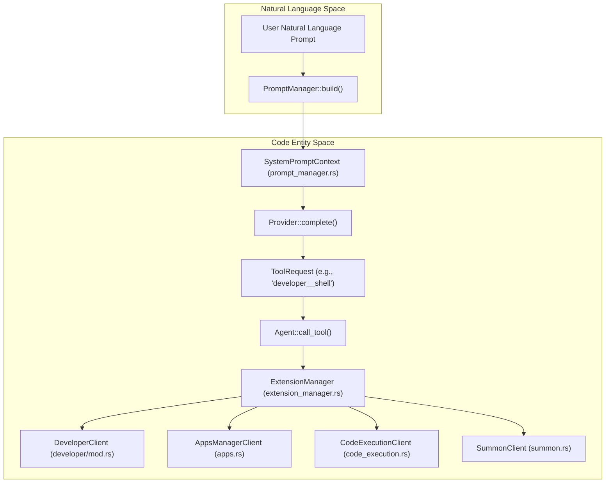
Sources: [crates/goose/src/agents/platform_extensions/mod.rs:33-184](), [crates/goose/src/agents/platform_extensions/developer/mod.rs:34-40](), [crates/goose/src/agents/platform_extensions/apps.rs:129-133](), [crates/goose/src/agents/platform_extensions/code_execution.rs:26-31](), [crates/goose/src/agents/prompt_manager.rs:110-180]()

---

## Core Platform Extensions

### Developer Extension
The `developer` extension provides essential software engineering tools, including terminal shell execution, file writing/editing, and tree-based directory visualization [crates/goose/src/agents/platform_extensions/developer/mod.rs:26-40]().

| Tool | Function | Key Implementation |
| :--- | :--- | :--- |
| `shell` | Executes commands in the user's shell. | `ShellTool` [crates/goose/src/agents/platform_extensions/developer/mod.rs:149-150]() |
| `write` | Creates or overwrites files. | `EditTools` [crates/goose/src/agents/platform_extensions/developer/mod.rs:110-121]() |
| `edit` | Exact text find-and-replace in files. | `EditTools` [crates/goose/src/agents/platform_extensions/developer/mod.rs:122-133]() |
| `tree` | Lists directory structure with line counts. | `TreeTool` [crates/goose/src/agents/platform_extensions/developer/mod.rs:160-163]() |
| `read_image`| Reads local or remote images for inspection. | `ImageTool` [crates/goose/src/agents/platform_extensions/developer/mod.rs:166-177]() |

**Shell Implementation Details:**
On Unix systems, `ShellTool` attempts to invoke a login shell to inherit the user's full environment `PATH` [crates/goose/src/agents/platform_extensions/developer/shell.rs:147-157](). When executing inside Flatpak environments, it wraps commands using `flatpak-spawn --host` [crates/goose/src/agents/platform_extensions/developer/shell.rs:45-50](). Output is guarded by length limits (2000 lines or 50KB) with automatic spilling to temporary files, and live output streams through `ShellOutputBatcher` [crates/goose/src/agents/platform_extensions/developer/shell.rs:22-22](), [crates/goose/src/agents/platform_extensions/developer/shell.rs:159-160]().
Sources: [crates/goose/src/agents/platform_extensions/developer/mod.rs:26-40](), [crates/goose/src/agents/platform_extensions/developer/mod.rs:108-177](), [crates/goose/src/agents/platform_extensions/developer/shell.rs:22-22](), [crates/goose/src/agents/platform_extensions/developer/shell.rs:45-50](), [crates/goose/src/agents/platform_extensions/developer/shell.rs:147-157](), [crates/goose/src/agents/platform_extensions/developer/shell.rs:159-160]()

### Summon & Skills
The `summon` extension manages tasks, subrecipes, subagents, and skills [crates/goose/src/agents/platform_extensions/summon.rs:46-58]().
*   **Discovery & Parameters:** Parses metadata frontmatter and merges parameters using `merge_subrecipe_parameters` [crates/goose/src/agents/platform_extensions/summon.rs:68-82]().
*   **Subagents:** Spawns asynchronous tasks via `spawn_background_task` with cancellation handles (`CancellationToken`) [crates/goose/src/agents/platform_extensions/summon.rs:2000-2011]().
*   **Skills:** The `skills` crate handles filesystem discovery of `SKILL.md` files in global (`~/.agents/skills`) and project-scoped directories [crates/goose/src/skills/mod.rs:47-55](), supporting placeholders like `{{GOOSE_DOCS_ROOT}}` [crates/goose/src/skills/mod.rs:113-123]().
Sources: [crates/goose/src/agents/platform_extensions/summon.rs:46-58](), [crates/goose/src/agents/platform_extensions/summon.rs:68-82](), [crates/goose/src/agents/platform_extensions/summon.rs:2000-2011](), [crates/goose/src/skills/mod.rs:47-55](), [crates/goose/src/skills/mod.rs:113-123]()

### Analyze (Code Graph)
The `analyze` extension uses `tree-sitter` to index code structure, providing directory overviews, file symbol listings, and call graphs for symbols [crates/goose/src/agents/platform_extensions/mod.rs:38-44]().
Sources: [crates/goose/src/agents/platform_extensions/mod.rs:38-44]()

---

## Utility & Memory Extensions

### Chat Recall
Provides long-term retrieval by searching past conversations stored in SQLite (`sessions.db`) [crates/goose/src/agents/platform_extensions/mod.rs:81-87]() using keyword/synonym query matching or session loading [crates/goose/src/agents/platform_extensions/chatrecall.rs:100-101]().
Sources: [crates/goose/src/agents/platform_extensions/mod.rs:81-87](), [crates/goose/src/agents/platform_extensions/chatrecall.rs:100-101]()

### Apps Manager
Managed via `AppsManagerClient` [crates/goose/src/agents/platform_extensions/apps.rs:129-133](), this extension creates, iterates, and stores sandboxed HTML/JS apps under the data directory [crates/goose/src/agents/platform_extensions/apps.rs:137-141](). It automatically seeds default apps like the clock app [crates/goose/src/agents/platform_extensions/apps.rs:58-60](), [crates/goose/src/agents/platform_extensions/apps.rs:166-177]().
Sources: [crates/goose/src/agents/platform_extensions/apps.rs:58-60](), [crates/goose/src/agents/platform_extensions/apps.rs:129-141](), [crates/goose/src/agents/platform_extensions/apps.rs:166-177]()

### Todo & Top Of Mind (TOM)
*   **Todo:** Maintains a persistent requirement checklist injected into the agent context [crates/goose/src/agents/platform_extensions/mod.rs:54-62]().
*   **TOM:** Injects custom state constraints via environment variables and the `tom` module [crates/goose/src/agents/platform_extensions/mod.rs:185-190]().
Sources: [crates/goose/src/agents/platform_extensions/mod.rs:54-62](), [crates/goose/src/agents/platform_extensions/mod.rs:185-190]()

### Code Execution Extension
`CodeExecutionClient` enables the agent to batch multiple tool calls into a single JavaScript execution block [crates/goose/src/agents/platform_extensions/code_execution.rs:26-31](). It loads callback configs for available tools [crates/goose/src/agents/platform_extensions/code_execution.rs:107-108]() and executes scripts efficiently [crates/goose/src/agents/platform_extensions/code_execution.rs:137-145]().

**Code Execution Architecture & Data Flow**
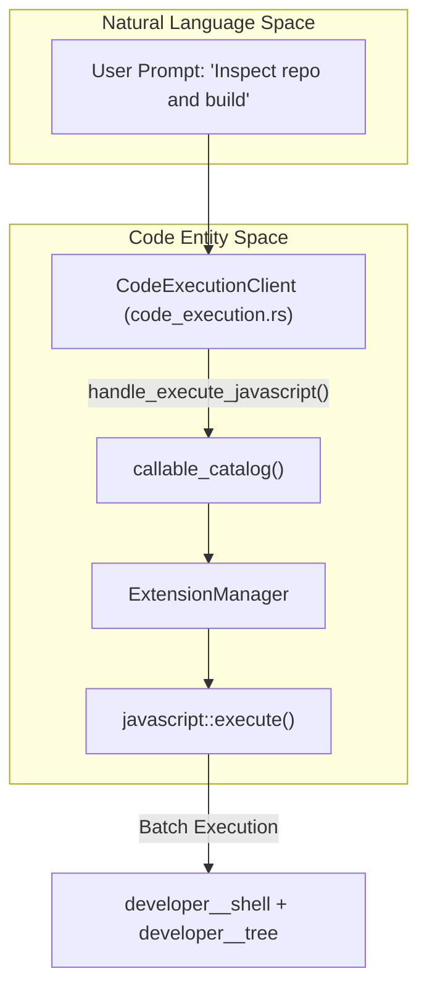
Sources: [crates/goose/src/agents/platform_extensions/code_execution.rs:26-31](), [crates/goose/src/agents/platform_extensions/code_execution.rs:107-108](), [crates/goose/src/agents/platform_extensions/code_execution.rs:137-145]()

---

## Hooks & Plugins System

Goose implements a lifecycle hooks framework modeled after the Open Plugins specification [crates/goose/src/hooks/mod.rs:1-2](). Hooks are loaded from `<plugin-root>/hooks/hooks.json` of enabled plugins [crates/goose/src/hooks/mod.rs:4-5]().

### Supported Hook Events
Hooks subscribe to events such as `PreToolUse`, `PostToolUse`, `SessionStart`, `SessionEnd`, `BeforeShellExecution`, `AfterShellExecution`, and `Stop` [crates/goose/src/hooks/mod.rs:55-68]().

### Execution Model
When an event occurs, matching rules (evaluated via regex `matcher`) execute command actions by passing the JSON-serialized event context to `stdin` [crates/goose/src/hooks/mod.rs:23-24](), [crates/goose/src/hooks/mod.rs:120-125](). Actions specify `on_failure` behaviors (`Allow` or `Block`) [crates/goose/src/hooks/mod.rs:184-190]().

**Example Hook Configuration (`hooks.json`):**
```json
{
  "hooks": {
    "PostToolUse": [
      {
        "matcher": "developer__shell|developer__text_editor",
        "hooks": [
          { "type": "command", "command": "${PLUGIN_ROOT}/scripts/log.sh" }
        ]
      }
    ]
  }
}
```
Sources: [crates/goose/src/hooks/mod.rs:1-24](), [crates/goose/src/hooks/mod.rs:55-68](), [crates/goose/src/hooks/mod.rs:120-125](), [crates/goose/src/hooks/mod.rs:184-190]()

### `hello-hooks` Example
The `examples/plugins/hello-hooks` directory provides a minimal plugin demonstrating the hooks system.
*   `plugin.json`: Defines the plugin's metadata [examples/plugins/hello-hooks/plugin.json]().
*   `hooks/hooks.json`: Configures a `PostToolUse` hook that triggers for `developer__shell` and `developer__edit` tools, executing a script [examples/plugins/hello-hooks/hooks/hooks.json]().
*   `scripts/log.sh`: The script executed by the hook, which logs the tool name and arguments to a file [examples/plugins/hello-hooks/hooks/hooks.json:10-11]().

This example illustrates how to set up a plugin with hooks to observe and react to agent actions.
Sources: [examples/plugins/hello-hooks/plugin.json](), [examples/plugins/hello-hooks/hooks/hooks.json]()

---

## Slash Commands

Built-in session management commands are parsed and executed prior to LLM inference [crates/goose/src/agents/execute_commands.rs:62-83](), [crates/goose/src/agents/execute_commands.rs:99-109]().

| Command | Action | Implementation |
| :--- | :--- | :--- |
| `/compact` | Manually triggers conversation compaction. | `COMPACT_TRIGGERS` [crates/goose/src/agents/execute_commands.rs:9-10]() |
| `/clear` | Clears conversation history. | `CommandDef` [crates/goose/src/agents/execute_commands.rs:30-33]() |
| `/skills` | Lists discovered skills and sources. | `CommandDef` [crates/goose/src/agents/execute_commands.rs:34-37]() |
| `/status` | Shows model, provider, and token usage. | `CommandDef` [crates/goose/src/agents/execute_commands.rs:51-54]() |
| `/goal` | Sets a required completion goal. | `CommandDef` [crates/goose/src/agents/execute_commands.rs:42-45]() |
| `/grind` | Pursues goal relentlessly until `max_turns`. | `CommandDef` [crates/goose/src/agents/execute_commands.rs:46-50]() |

Sources: [crates/goose/src/agents/execute_commands.rs:9-10](), [crates/goose/src/agents/execute_commands.rs:17-55](), [crates/goose/src/agents/execute_commands.rs:62-83](), [crates/goose/src/agents/execute_commands.rs:99-109]()

---

# Page: Context Management & Compaction

# Context Management & Compaction

<details>
<summary>Relevant source files</summary>

The following files were used as context for generating this wiki page:

- [crates/goose-agent/CHANGELOG.md](crates/goose-agent/CHANGELOG.md)
- [crates/goose-context-management/CHANGELOG.md](crates/goose-context-management/CHANGELOG.md)
- [crates/goose-provider-types/CHANGELOG.md](crates/goose-provider-types/CHANGELOG.md)
- [crates/goose-providers/CHANGELOG.md](crates/goose-providers/CHANGELOG.md)
- [crates/goose/src/agents/extension_manager/lease.rs](crates/goose/src/agents/extension_manager/lease.rs)
- [crates/goose/src/agents/final_output_tool.rs](crates/goose/src/agents/final_output_tool.rs)
- [crates/goose/src/agents/state_machine/mod.rs](crates/goose/src/agents/state_machine/mod.rs)
- [crates/goose/src/agents/state_machine/ops_compaction.rs](crates/goose/src/agents/state_machine/ops_compaction.rs)
- [crates/goose/src/agents/state_machine/ops_recipe.rs](crates/goose/src/agents/state_machine/ops_recipe.rs)
- [crates/goose/src/agents/state_machine/ops_toolcalling.rs](crates/goose/src/agents/state_machine/ops_toolcalling.rs)
- [crates/goose/src/agents/state_machine/tests/agent_reply.rs](crates/goose/src/agents/state_machine/tests/agent_reply.rs)
- [crates/goose/src/agents/state_machine/tests/hooks_lifecycle.rs](crates/goose/src/agents/state_machine/tests/hooks_lifecycle.rs)
- [crates/goose/src/agents/state_machine/tests/mod.rs](crates/goose/src/agents/state_machine/tests/mod.rs)
- [crates/goose/src/agents/state_machine/tests/pipeline.rs](crates/goose/src/agents/state_machine/tests/pipeline.rs)
- [crates/goose/src/agents/state_machine/tests/recipe_scheduling_lifecycle.rs](crates/goose/src/agents/state_machine/tests/recipe_scheduling_lifecycle.rs)
- [crates/goose/src/agents/state_machine/tests/reconstruction_isolation_lifecycle.rs](crates/goose/src/agents/state_machine/tests/reconstruction_isolation_lifecycle.rs)
- [crates/goose/src/agents/subagent_handler.rs](crates/goose/src/agents/subagent_handler.rs)
- [crates/goose/src/context_mgmt/mod.rs](crates/goose/src/context_mgmt/mod.rs)
- [crates/goose/src/doctor.rs](crates/goose/src/doctor.rs)
- [crates/goose/src/prompts/subagent_system.md](crates/goose/src/prompts/subagent_system.md)

</details>


This page details how Goose manages the Large Language Model (LLM) context window, token counting, automated compaction via summarization, truncation strategies, tool output summarization, and conversation fixing. This functionality is centralized primarily in the `goose-context-management` crate and the context management modules within the `goose` core crate [crates/goose/src/context_mgmt/mod.rs:1-24]().

## Context Management Overview & The `goose-context-management` Crate

Goose uses a layered approach to handle token and context window limits during long-running sessions, ensuring the agent remains productive without exceeding provider constraints [crates/goose/src/context_mgmt/mod.rs:93-94]().

### Key Components

| Component | Responsibility | Code Reference |
| :--- | :--- | :--- |
| `compact_messages` | Orchestrates history summarization, visibility updates, and continuation insertion | [crates/goose/src/context_mgmt/mod.rs:88-93]() |
| `CompactionResult` | Struct containing the updated `Conversation`, billable `ProviderUsage`, and `retained_context_tokens` | [crates/goose/src/context_mgmt/mod.rs:65-74]() |
| `ModelConfig` | Encapsulates model parameters, context limits, and token thresholds | [crates/goose-providers/src/model.rs:13-14]() |
| `MessageMetadata` | Controls agent versus user message visibility (`agent_visible`, `user_visible`) | [crates/goose/src/conversation/message.rs:142-145]() |
| `merge_consecutive_messages` | Merges adjacent messages of the same role for provider payload conformance | [crates/goose/src/conversation/mod.rs:5-5]() |

Sources: [crates/goose/src/context_mgmt/mod.rs:65-93](), [crates/goose-providers/src/model.rs:13-14](), [crates/goose/src/conversation/message.rs:142-145](), [crates/goose/src/conversation/mod.rs:5-5]()

## Token Counting & Model Limits

Token estimation governs when compaction triggers. Limits are derived from model metadata and runtime configuration.

### Model Limits and Canonical Registry
- **`ModelConfig`**: Defines limits and request parameters, supporting canonical model limit lookups via `with_canonical_limits` [crates/goose-providers/src/model.rs:13-14]().
- **Context Limits**: Default context windows are determined by the provider's `get_context_limit` method [crates/goose/src/providers/base.rs:60-62]().
- **Thresholds**: Compaction triggers automatically when token usage reaches a configured threshold (`DEFAULT_COMPACTION_THRESHOLD`) or a custom threshold configured by `GOOSE_AUTO_COMPACT_THRESHOLD` [crates/goose/src/context_mgmt/mod.rs:21-42](). The `auto_compact_threshold` function calculates this, potentially capping it by `GOOSE_AUTO_COMPACT_TOKEN_LIMIT` [crates/goose/src/context_mgmt/mod.rs:30-42]().

Sources: [crates/goose/src/context_mgmt/mod.rs:21-42](), [crates/goose/src/providers/base.rs:60-62](), [crates/goose-providers/src/model.rs:13-14]()

## Automatic & Manual Compaction

When token limits approach or when requested explicitly, Goose condenses conversation history via `compact_messages`. The `CompactionOperation` in the state machine handles the trigger for both automatic and manual compaction [crates/goose/src/agents/state_machine/ops_compaction.rs:129-199]().

### The Compaction Flow
1. **Detection & Filtering**: The system scans conversation history, preserving text-only user messages if applicable, while omitting internal turn contexts [crates/goose/src/context_mgmt/mod.rs:96-146]().
2. **Summarization (`do_compact`)**: Older messages are summarized into a concise structured overview via a model invocation [crates/goose/src/context_mgmt/mod.rs:150-151]().
3. **Visibility Metadata Adjustment**:
   - Original compacted messages have their metadata updated with `with_agent_invisible()` so they remain visible to the user in UI logs but are filtered out from subsequent LLM requests [crates/goose/src/context_mgmt/mod.rs:157-161]().
   - The summary message is inserted with `MessageMetadata::agent_only()` [crates/goose/src/context_mgmt/mod.rs:163-163]().
4. **Continuation Injection**: An assistant continuation prompt (`CONVERSATION_CONTINUATION_TEXT`, `TOOL_LOOP_CONTINUATION_TEXT`, or `MANUAL_COMPACT_CONTINUATION_TEXT`) is appended to guide the LLM post-compaction [crates/goose/src/context_mgmt/mod.rs:50-63]().

Title: "CompactionPipelineDataFlow"
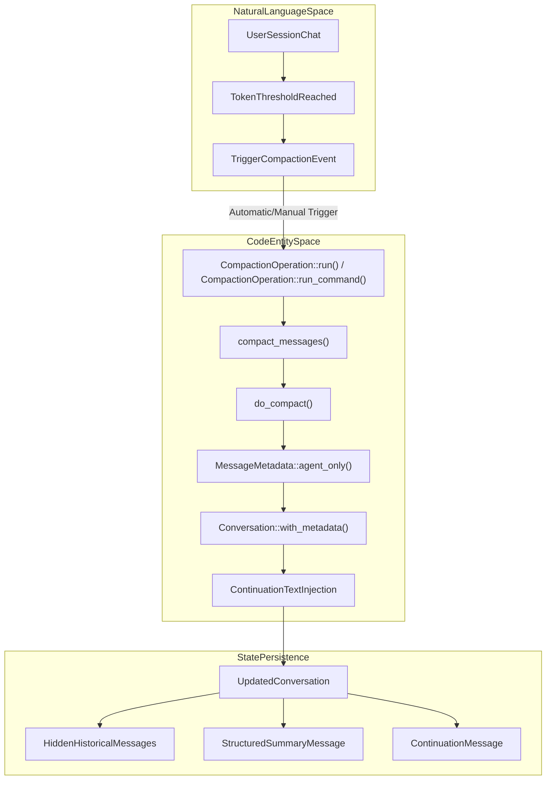
Sources: [crates/goose/src/context_mgmt/mod.rs:50-169](), [crates/goose/src/agents/state_machine/ops_compaction.rs:129-199]()

## Tool Output & Pair Summarization

To maintain efficient context usage during intensive tool execution loops, Goose manages tool responses and history bloat. The `ToolPairCompactionOperation` specifically handles this [crates/goose/src/agents/state_machine/mod.rs:73-73]().

- **Tool Pair Summarization**: Controlled by `GOOSE_TOOL_PAIR_SUMMARIZATION` (via `tool_pair_summarization_enabled()`) and `TOOLCALL_SUMMARIZATION_BATCH_SIZE` (default 10), tool call and response pairs can be batched and summarized in the background [crates/goose/src/context_mgmt/mod.rs:27-27](), [crates/goose/src/context_mgmt/mod.rs:44-48]().
- **Sanitization**: Tool responses undergo automated Unicode tag sanitization during deserialization and content handling to protect LLM safety and context hygiene [crates/goose/src/conversation/message.rs:21-78]().

Sources: [crates/goose/src/context_mgmt/mod.rs:27-27](), [crates/goose/src/context_mgmt/mod.rs:44-48](), [crates/goose/src/conversation/message.rs:21-78](), [crates/goose/src/agents/state_machine/mod.rs:73-73]()

## Conversation Fix & Wire Format Adaptation

Before messages reach provider APIs (e.g., OpenAI, Anthropic, Google), message lists undergo validation and formatting translations.

- **Role Merging**: Consecutive messages sharing the same role are combined via `merge_consecutive_messages` to meet provider schema requirements [crates/goose/src/conversation/mod.rs:5-5]().
- **Thinking Block Preservation**: Reasoning content blocks (such as those from Anthropic or OpenAI Responses) are filtered or preserved depending on provider-specific format options [crates/goose-providers/src/formats/openai.rs:70-75](), [crates/goose-providers/src/formats/anthropic.rs:60-70]().

Title: "ContextPreparationSequence"
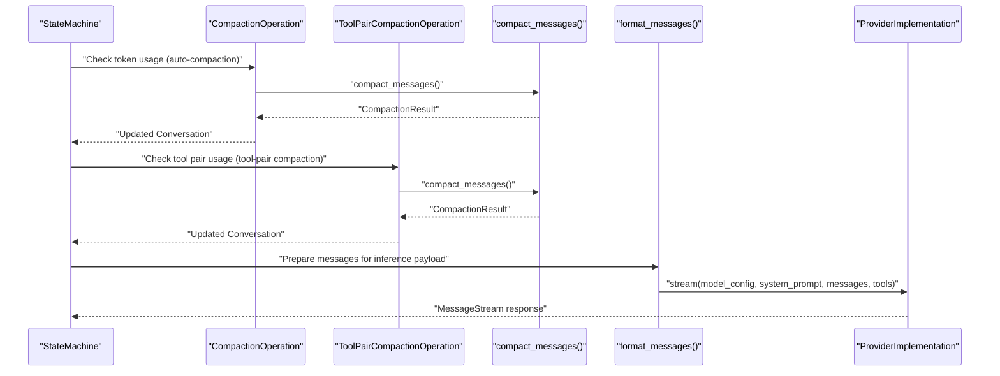
Sources: [crates/goose/src/context_mgmt/mod.rs:88-93](), [crates/goose-providers/src/formats/openai.rs:70-75](), [crates/goose-providers/src/formats/anthropic.rs:60-70](), [crates/goose/src/conversation/mod.rs:5-5]()

---

# Page: Agent State Machine (`goose-agent`)

# Agent State Machine (`goose-agent`)

<details>
<summary>Relevant source files</summary>

The following files were used as context for generating this wiki page:

- [crates/goose-agent/README.md](crates/goose-agent/README.md)
- [crates/goose-agent/src/inference.rs](crates/goose-agent/src/inference.rs)
- [crates/goose-agent/src/machine.rs](crates/goose-agent/src/machine.rs)
- [crates/goose-agent/src/operation.rs](crates/goose-agent/src/operation.rs)
- [crates/goose-agent/src/tool.rs](crates/goose-agent/src/tool.rs)
- [crates/goose-agent/tests/cancellation.rs](crates/goose-agent/tests/cancellation.rs)
- [crates/goose-agent/tests/tool_operation.rs](crates/goose-agent/tests/tool_operation.rs)
- [crates/goose/src/agents/state_machine/ops_llm.rs](crates/goose/src/agents/state_machine/ops_llm.rs)
- [crates/goose/src/agents/state_machine/ops_steer.rs](crates/goose/src/agents/state_machine/ops_steer.rs)
- [crates/goose/src/agents/state_machine/ops_tool_pair_compaction.rs](crates/goose/src/agents/state_machine/ops_tool_pair_compaction.rs)
- [crates/goose/src/agents/state_machine/session.rs](crates/goose/src/agents/state_machine/session.rs)
- [crates/goose/src/agents/state_machine/tests/compaction_lifecycle.rs](crates/goose/src/agents/state_machine/tests/compaction_lifecycle.rs)
- [crates/goose/src/agents/state_machine/tests/dummy_api.rs](crates/goose/src/agents/state_machine/tests/dummy_api.rs)
- [crates/goose/src/agents/state_machine/tests/prompt_skill_lifecycle.rs](crates/goose/src/agents/state_machine/tests/prompt_skill_lifecycle.rs)
- [crates/goose/src/agents/state_machine/tests/provider_lifecycle.rs](crates/goose/src/agents/state_machine/tests/provider_lifecycle.rs)
- [crates/goose/src/agents/state_machine/tests/tool_lifecycle.rs](crates/goose/src/agents/state_machine/tests/tool_lifecycle.rs)
- [crates/goose/tests/state_machine_api.rs](crates/goose/tests/state_machine_api.rs)

</details>


### Purpose and Scope
This page details the state-machine-based turn execution engine that drives Goose sessions. Turn execution is modeled around the `goose-agent` crate's machine, operation, and event model, implemented within `crates/goose/src/agents/state_machine/` [crates/goose/src/agents/state_machine/session.rs:1-179](). It covers operation composition, key operational subsystems (`ops_llm`, `ops_toolcalling`, `ops_tool_approval`, `ops_recipe`, `ops_skills`, and stop hooks), token usage accounting, and effect handling.

---

## 1. Core Model and Traits (`goose-agent`)

The execution engine rests upon core abstractions defined in the `goose-agent` crate and implemented by the `goose` crate:

*   `MachineSession`: Implemented by `Session` to expose session identity and conversation state [crates/goose/src/agents/state_machine/session.rs:23-30]().
*   `SessionLoader<Session>`: Implemented by `SessionManager` to load persistent session state [crates/goose/src/agents/state_machine/session.rs:32-37]().
*   `EffectHandler<Session, GooseEffect>`: Implemented by `SessionManager` to apply state mutations and conversation updates resulting from operations [crates/goose/src/agents/state_machine/session.rs:40-152]().
*   `EffectUsage<GooseEffect>`: Extracts token usage metrics from effects [crates/goose/src/agents/state_machine/session.rs:154-167]().

Sources: [crates/goose/src/agents/state_machine/session.rs:10-167]()

---

## 2. Turn Execution Pipeline & Operation Composition

A Goose turn flows through a prioritized sequence of operations managed by `StateMachine` [crates/goose-agent/src/machine.rs:55-59](). Each operation evaluates the current session state and conversation, returning an `OperationResult` (e.g., `applied`, `yielded`, `not_applicable`) [crates/goose-agent/src/operation.rs:189-192](). The `StateMachine` iterates through these `Step`s, applying the first one that is applicable [crates/goose-agent/src/machine.rs:126-175]().

```mermaid
graph TD
    subgraph "Code Entity Space: Turn Execution"
        StateMachine["StateMachine::run"]
        SteerOp["SteerOperation"]
        MaxTurnsOp["MaxTurnsOperation"]
        CompactionOp["CompactionOperation"]
        ToolApprovalOp["ToolApprovalOperation"]
        SkillOp["SkillOperation"]
        RecipeOp["RecipeOperation"]
        ToolExecutionOp["ToolExecutionOperation"]
        UnknownToolOp["UnknownToolOperation"]
        StopHookOp["StopHookOperation"]
        ApplyEffects["SessionManager::apply_effects"]
    end

    StateMachine --> SteerOp
    SteerOp --> MaxTurnsOp
    MaxTurnsOp --> CompactionOp
    CompactionOp --> ToolApprovalOp
    ToolApprovalOp --> SkillOp
    SkillOp --> RecipeOp
    RecipeOp --> ToolExecutionOp
    ToolExecutionOp --> UnknownToolOp
    UnknownToolOp --> StopHookOp
    StopHookOp --> ApplyEffects

    style StateMachine fill:#none
    style ApplyEffects fill:#none
```
Sources: [crates/goose-agent/src/machine.rs:55-59](), [crates/goose-agent/src/operation.rs:189-192](), [crates/goose-agent/src/machine.rs:126-175]()

---

## 3. Key Operations Breakdown

### LLM Inference (`ops_llm`)
The LLM inference operation uses `GooseInferenceProvider` to wrap core providers, inject tool definitions, handle tool name canonicalization, and track inference spans [crates/goose/src/agents/state_machine/ops_llm.rs:23-171](). The `InferenceRunner` from `goose-agent` handles the core logic of interacting with the provider [crates/goose-agent/src/inference.rs:20-23]().
*   `GooseInferenceProvider`: Implements `Provider` to intercept streaming inference calls, enriching tool errors and preparing tool requests [crates/goose/src/agents/state_machine/ops_llm.rs:131-195]().
*   `prepare_tool_requests`: Modifies tool requests in messages to coerce arguments and inject tool metadata [crates/goose/src/agents/state_machine/ops_llm.rs:75-129]().
*   `chat_span`: Creates a tracing span for LLM chat operations, recording provider, model, and usage details [crates/goose-agent/src/inference.rs:117-143]().

Sources: [crates/goose/src/agents/state_machine/ops_llm.rs:1-195](), [crates/goose-agent/src/inference.rs:20-23](), [crates/goose-agent/src/inference.rs:117-143]()

### Tool Calling & Pre-Tool Hooks (`ops_toolcalling`)
Tool execution validates requests, dispatches them through the `ExtensionManager`, and enforces lifecycle hooks [crates/goose/src/agents/state_machine/ops_toolcalling.rs:1-156](). The `ToolOperation` in `goose-agent` provides a generic way to integrate tools into the state machine [crates/goose-agent/src/tool.rs:1-10]().
*   `run_pre_tool_hooks`: Emits `HookEvent::PreToolUse`, evaluates blocking rules, and records observation-only `PreToolUseResult` hooks [crates/goose/src/agents/state_machine/ops_toolcalling.rs:115-156]().
*   `tool_span`: Creates OpenTelemetry instrumentation spans for individual tool executions (`execute_tool`) [crates/goose/src/agents/state_machine/ops_toolcalling.rs:72-84]().

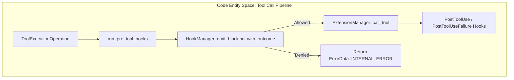
Sources: [crates/goose/src/agents/state_machine/ops_toolcalling.rs:72-156](), [crates/goose/src/hooks/mod.rs:55-105](), [crates/goose-agent/src/tool.rs:1-10]()

### Stop Hooks (`ops_stop_hook`)
`StopHookOperation` intercepts completed assistant turns to verify custom policies before finalizing output [crates/goose/src/agents/state_machine/ops_stop_hook.rs:47-120]().
*   `run`: Evaluates `HookEvent::Stop` against trailing assistant messages and working directory context [crates/goose/src/agents/state_machine/ops_stop_hook.rs:80-120]().
*   Block Capping: Tracks consecutive denials up to `block_cap`, injecting a system notification override if the cap is exceeded to prevent infinite loops [crates/goose/src/agents/state_machine/ops_stop_hook.rs:102-117]().

Sources: [crates/goose/src/agents/state_machine/ops_stop_hook.rs:1-120]()

### Tool Approval, Recipes, and Skills (`ops_tool_approval`, `ops_recipe`, `ops_skills`)
*   `ToolApprovalOperation`: Inspects tool parameters against `GooseMode` rules and permission levels to trigger user interaction prompts when required [crates/goose/src/agents/state_machine/tests/pipeline.rs:143-146](). This operation ensures that sensitive tool calls are approved by the user before execution [crates/goose/src/agents/state_machine/tests/tool_lifecycle.rs:33-49]().
*   `RecipeOperation`: Executes structured tasks or recipes, leveraging `FinalOutputTool` (`recipe__final_output`) to validate responses against JSON schemas [crates/goose/src/agents/final_output_tool.rs:10-155]().
*   `SkillOperation`: Dynamically injects available skills and workspace instructions into the context window based on hook triggers [crates/goose/src/agents/state_machine/tests/pipeline.rs:149](). This operation is responsible for integrating user-defined skills into the agent's capabilities [crates/goose/src/agents/state_machine/tests/prompt_skill_lifecycle.rs:1-10]().

Sources: [crates/goose/src/agents/state_machine/tests/pipeline.rs:143-158](), [crates/goose/src/agents/final_output_tool.rs:10-155](), [crates/goose/src/agents/state_machine/tests/tool_lifecycle.rs:33-49](), [crates/goose/src/agents/state_machine/tests/prompt_skill_lifecycle.rs:1-10]()

---

## 4. Usage Accounting & Effect Handling

When operations yield `GooseEffect` variants, `SessionManager::apply_effects` persists state changes and updates usage metrics [crates/goose/src/agents/state_machine/session.rs:40-152](). The `StateMachine`'s `apply` method is responsible for invoking the `EffectHandler` [crates/goose-agent/src/machine.rs:200-208]().
*   `GooseEffect::RecordUsage`: Aggregates token consumption via `usage::record` [crates/goose/src/agents/state_machine/session.rs:110-112]().
*   Conversation Replacement & Patching: Handles `AppendMessage`, `ReplaceConversation`, and tool request metadata patches atomically [crates/goose/src/agents/state_machine/session.rs:53-97](). This includes updating context usage after compaction [crates/goose/src/agents/state_machine/tests/compaction_lifecycle.rs:109-141]().
*   Event Emission: Publishes `AgentEvent` updates (such as `AgentEvent::Message` or `AgentEvent::Usage`) to UI and ACP subscribers [crates/goose/src/agents/state_machine/session.rs:116-149]().

Sources: [crates/goose/src/agents/state_machine/session.rs:40-152](), [crates/goose-agent/src/machine.rs:200-208](), [crates/goose/src/agents/state_machine/tests/compaction_lifecycle.rs:109-141]()

---

# Page: Provider Layer

# Provider Layer

<details>
<summary>Relevant source files</summary>

The following files were used as context for generating this wiki page:

- [crates/goose-provider-types/src/formats.rs](crates/goose-provider-types/src/formats.rs)
- [crates/goose-provider-types/src/utils.rs](crates/goose-provider-types/src/utils.rs)
- [crates/goose-providers/src/declarative.rs](crates/goose-providers/src/declarative.rs)
- [crates/goose-providers/src/lib.rs](crates/goose-providers/src/lib.rs)
- [crates/goose-providers/src/ollama.rs](crates/goose-providers/src/ollama.rs)
- [crates/goose-providers/src/snowflake.rs](crates/goose-providers/src/snowflake.rs)
- [crates/goose/src/acp/fs.rs](crates/goose/src/acp/fs.rs)
- [crates/goose/src/acp/server/providers.rs](crates/goose/src/acp/server/providers.rs)
- [crates/goose/src/acp/server/tool_calls/chain.rs](crates/goose/src/acp/server/tool_calls/chain.rs)
- [crates/goose/src/acp/server/tool_calls/conversion.rs](crates/goose/src/acp/server/tool_calls/conversion.rs)
- [crates/goose/src/acp/server/tool_calls/enrichment.rs](crates/goose/src/acp/server/tool_calls/enrichment.rs)
- [crates/goose/src/acp/server/tool_notifications.rs](crates/goose/src/acp/server/tool_notifications.rs)
- [crates/goose/src/config/declarative_providers.rs](crates/goose/src/config/declarative_providers.rs)
- [crates/goose/src/model_config.rs](crates/goose/src/model_config.rs)
- [crates/goose/src/providers/anthropic_def.rs](crates/goose/src/providers/anthropic_def.rs)
- [crates/goose/src/providers/formats/mod.rs](crates/goose/src/providers/formats/mod.rs)
- [crates/goose/src/providers/google_def.rs](crates/goose/src/providers/google_def.rs)
- [crates/goose/src/providers/huggingface.rs](crates/goose/src/providers/huggingface.rs)
- [crates/goose/src/providers/init.rs](crates/goose/src/providers/init.rs)
- [crates/goose/src/providers/inventory/mod.rs](crates/goose/src/providers/inventory/mod.rs)
- [crates/goose/src/providers/mod.rs](crates/goose/src/providers/mod.rs)
- [crates/goose/src/providers/ollama_cloud.rs](crates/goose/src/providers/ollama_cloud.rs)
- [crates/goose/src/providers/ollama_def.rs](crates/goose/src/providers/ollama_def.rs)
- [crates/goose/src/providers/openai_def.rs](crates/goose/src/providers/openai_def.rs)
- [crates/goose/src/providers/provider_registry.rs](crates/goose/src/providers/provider_registry.rs)
- [crates/goose/src/providers/snowflake_def.rs](crates/goose/src/providers/snowflake_def.rs)
- [crates/goose/src/tool_call_labels.rs](crates/goose/src/tool_call_labels.rs)
- [crates/goose/tests/custom_provider_command_auth_test.rs](crates/goose/tests/custom_provider_command_auth_test.rs)
- [documentation/docs/getting-started/providers.md](documentation/docs/getting-started/providers.md)
- [ui/desktop/src/acp/__tests__/chatNotifications.test.ts](ui/desktop/src/acp/__tests__/chatNotifications.test.ts)
- [ui/desktop/src/acp/adapter/toolNotifications.ts](ui/desktop/src/acp/adapter/toolNotifications.ts)
- [ui/desktop/src/acp/chatNotifications.ts](ui/desktop/src/acp/chatNotifications.ts)

</details>


The Provider Layer is a core abstraction in Goose that decouples the agentic loop from specific Large Language Model (LLM) vendors. It provides a unified interface for sending messages, handling tool calls, and managing model-specific configurations like context limits and pricing.

## Overview

At the heart of the provider layer is the `Provider` trait, which defines how Goose interacts with an LLM [crates/goose-provider-types/src/base.rs:2-10](). Whether the model is hosted by a cloud provider (like OpenAI or Anthropic), running locally (via Ollama), or even executing as a subprocess or via ACP (Agent Client Protocol), it must implement this trait.

### Relationship to Code Entities

The following diagrams illustrate how natural language concepts map to specific Rust entities within the provider subsystem, bridging the conceptual space to the codebase architecture.

**Provider Entity Mapping**
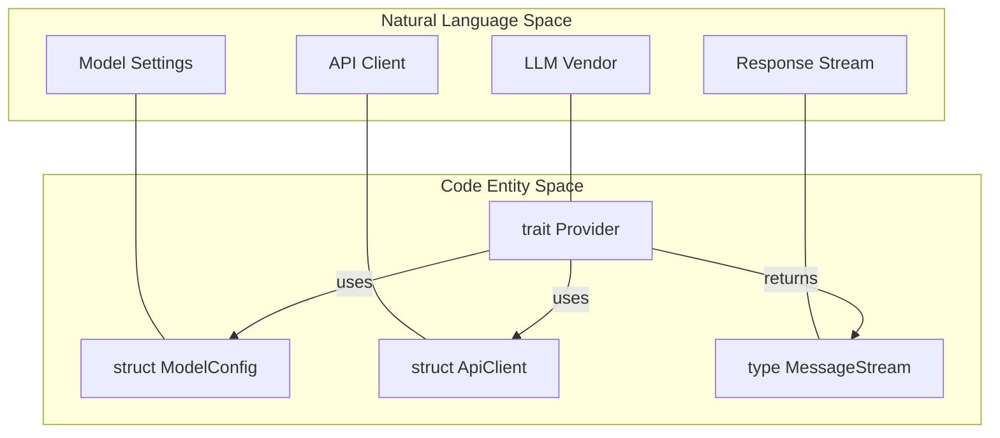
Sources: [crates/goose-provider-types/src/base.rs:2-10](), [crates/goose-providers/src/api_client.rs:1-10](), [crates/goose-provider-types/src/model.rs:7-15](), [crates/goose-provider-types/src/base.rs:2-10]()

**Registry and Configuration Entity Mapping**
```mermaid
graph TD
    subgraph "Natural Language Space"
        Reg["Provider Registry"]
        Cfg["Model Parameters"]
        Init["Startup Initialization"]
    end

    subgraph "Code Entity Space"
        Reg1["struct ProviderRegistry"]
        Cfg1["struct ModelConfig"]
        Init1["fn init_registry"]
    end

    Reg --- Reg1
    Cfg --- Cfg1
    Init --- Init1

    Init1 -->|populates| Reg1
    Reg1 -->|instantiates| Cfg1
```
Sources: [crates/goose/src/providers/provider_registry.rs:117-121](), [crates/goose/src/providers/init.rs:55-58](), [crates/goose-provider-types/src/model.rs:7-15]()

---

## Core Abstractions

### The Provider Trait
The `Provider` trait is the primary interface for LLM interaction [crates/goose-provider-types/src/base.rs:2-10](). It handles the conversion of internal `Message` types into provider-specific requests and processes the resulting stream of responses. Key methods include `complete()` for non-streaming calls and `stream()` for real-time updates.

Sources: [crates/goose-provider-types/src/base.rs:2-10](), [crates/goose-providers/src/ollama.rs:1-15]()

### ModelConfig
`ModelConfig` encapsulates the parameters for a specific model invocation. This includes the model name, temperature, max tokens, and context limits [goose-provider-types/src/model.rs:7-15](). The provider system uses helper utilities to normalize and materialize model configurations from user settings [crates/goose/src/providers/provider_registry.rs:76-89]().

Sources: [goose-provider-types/src/model.rs:7-15](), [crates/goose/src/providers/provider_registry.rs:76-89]()

### ProviderRegistry
The `ProviderRegistry` serves as a factory for creating provider instances [crates/goose/src/providers/provider_registry.rs:117-121](). It maintains a collection of registered entries (`ProviderEntry`) containing metadata and constructors. The registry is initialized asynchronously via a `OnceCell` in `init.rs`, registering built-in, declarative, and custom providers [crates/goose/src/providers/init.rs:55-181]().

Sources: [crates/goose/src/providers/provider_registry.rs:117-121](), [crates/goose/src/providers/init.rs:55-181]()

---

## Initialization Flow

Providers are instantiated during session startup or when switching models. The system resolves credentials from environment variables or configuration files to construct the appropriate provider backend.

**Provider Initialization Sequence**
```mermaid
sequenceDiagram
    participant CLI as "Goose CLI / Server"
    participant Init as "providers::init"
    participant Registry as "ProviderRegistry"
    participant Entry as "ProviderEntry"
    participant Concrete as "OpenAiProvider / AnthropicProvider"

    CLI->>Init: create(name, model_config, extensions)
    Init->>Init: get_from_registry(name)
    Init->>Registry: entries.get(name)
    Registry-->>Init: ProviderEntry
    Init->>Entry: create(extensions)
    Entry->>Entry: normalize_model_config(model)
    Entry->>Concrete: constructor(extensions, tls_config)
    Concrete-->>CLI: Arc<dyn Provider>
```
Sources: [crates/goose/src/providers/init.rs:102-104](), [crates/goose/src/providers/provider_registry.rs:91-96](), [crates/goose/src/providers/provider_registry.rs:154-165]()

---

## Subsystems and Details

The Provider Layer is composed of several specialized subsystems covered in the following child pages:

### [Provider Implementations](#2.2.1)
Covers concrete provider integrations such as **OpenAI**, **Anthropic**, **Google**, **Databricks**, **Azure**, **Bedrock**, **Snowflake**, and local runners like **Ollama**, along with declarative custom providers and retry/auth patterns [documentation/docs/getting-started/providers.md:23-39]().
*   **Key Files:** [crates/goose/src/providers/init.rs:64-181](), [crates/goose-providers/src/snowflake.rs:1-41]()

### [Message Formats & Wire Translation](#2.2.2)
Details how internal messages and content blocks are translated into vendor-specific JSON payloads, tool schemas, and streaming formats [crates/goose/src/providers/formats/mod.rs:1-37]().
*   **Key Files:** [crates/goose/src/providers/formats/mod.rs:1-37](), [crates/goose/src/providers/toolshim.rs:1-20]()

### [ACP & CLI Providers](#2.2.3)
Explains the Agent Client Protocol (ACP) providers and subprocess CLI wrappers like `ClaudeCodeProvider` [crates/goose/src/providers/init.rs:10-35]().
*   **Key Files:** [crates/goose/src/providers/init.rs:10-35](), [crates/goose/src/providers/claude_code.rs:1-20]()

### [Canonical Model Registry](#2.2.4)
Covers the `CanonicalModel` system for fetching and normalizing model metadata, context limits, and pricing [crates/goose/src/providers/canonical/mod.rs:1-20]() (re-exported from `goose-providers`).
*   **Key Files:** [crates/goose/src/providers/canonical/mod.rs:1-20](), [crates/goose-provider-types/src/canonical.rs:1-20]()

---

## Configuration and Secrets

Providers rely on the global configuration system to retrieve API keys, endpoints, and authentication tokens. Secrets are securely managed and referenced through environment variables or configuration maps [crates/goose/src/config/declarative_providers.rs:28-57]().

Sources: [crates/goose/src/config/declarative_providers.rs:28-57](), [crates/goose/src/providers/provider_secrets.rs:1-20]()

---

# Page: Provider Implementations

# Provider Implementations

<details>
<summary>Relevant source files</summary>

The following files were used as context for generating this wiki page:

- [crates/goose-providers/src/decision.rs](crates/goose-providers/src/decision.rs)
- [crates/goose-providers/src/openrouter.rs](crates/goose-providers/src/openrouter.rs)
- [crates/goose-providers/src/openrouter_format.rs](crates/goose-providers/src/openrouter_format.rs)
- [crates/goose-providers/src/typesafe.rs](crates/goose-providers/src/typesafe.rs)
- [crates/goose/examples/tetrate_auth.rs](crates/goose/examples/tetrate_auth.rs)
- [crates/goose/src/config/signup_openrouter/mod.rs](crates/goose/src/config/signup_openrouter/mod.rs)
- [crates/goose/src/config/signup_openrouter/server.rs](crates/goose/src/config/signup_openrouter/server.rs)
- [crates/goose/src/config/signup_openrouter/templates/error.html](crates/goose/src/config/signup_openrouter/templates/error.html)
- [crates/goose/src/config/signup_openrouter/templates/invalid.html](crates/goose/src/config/signup_openrouter/templates/invalid.html)
- [crates/goose/src/config/signup_openrouter/templates/success.html](crates/goose/src/config/signup_openrouter/templates/success.html)
- [crates/goose/src/config/signup_openrouter/tests.rs](crates/goose/src/config/signup_openrouter/tests.rs)
- [crates/goose/src/config/signup_tetrate/mod.rs](crates/goose/src/config/signup_tetrate/mod.rs)
- [crates/goose/src/config/signup_tetrate/server.rs](crates/goose/src/config/signup_tetrate/server.rs)
- [crates/goose/src/config/signup_tetrate/templates/error.html](crates/goose/src/config/signup_tetrate/templates/error.html)
- [crates/goose/src/config/signup_tetrate/templates/invalid.html](crates/goose/src/config/signup_tetrate/templates/invalid.html)
- [crates/goose/src/config/signup_tetrate/templates/success.html](crates/goose/src/config/signup_tetrate/templates/success.html)
- [crates/goose/src/config/signup_tetrate/tests.rs](crates/goose/src/config/signup_tetrate/tests.rs)
- [crates/goose/src/oauth/mod.rs](crates/goose/src/oauth/mod.rs)
- [crates/goose/src/providers/azure.rs](crates/goose/src/providers/azure.rs)
- [crates/goose/src/providers/bedrock.rs](crates/goose/src/providers/bedrock.rs)
- [crates/goose/src/providers/formats/bedrock.rs](crates/goose/src/providers/formats/bedrock.rs)
- [crates/goose/src/providers/formats/gcpvertexai.rs](crates/goose/src/providers/formats/gcpvertexai.rs)
- [crates/goose/src/providers/gcpvertexai.rs](crates/goose/src/providers/gcpvertexai.rs)
- [crates/goose/src/providers/githubcopilot.rs](crates/goose/src/providers/githubcopilot.rs)
- [crates/goose/src/providers/litellm.rs](crates/goose/src/providers/litellm.rs)
- [crates/goose/src/providers/oauth.rs](crates/goose/src/providers/oauth.rs)
- [crates/goose/src/providers/openrouter_def.rs](crates/goose/src/providers/openrouter_def.rs)
- [crates/goose/src/providers/sagemaker_tgi.rs](crates/goose/src/providers/sagemaker_tgi.rs)
- [crates/goose/src/providers/tetrate.rs](crates/goose/src/providers/tetrate.rs)
- [crates/goose/src/providers/xai.rs](crates/goose/src/providers/xai.rs)

</details>


The Provider layer in Goose serves as the core abstraction between the internal agent execution logic and various Large Language Model (LLM) backends. Each concrete provider implementation handles authentication, request formatting, streaming response decoding, model configuration normalization, and error handling specific to its underlying API or service.

## Provider Architecture & Registry

Goose implements a trait-based provider system where concrete backends implement the `Provider` and `ProviderDef` traits [crates/goose/src/providers/base.rs:31-51](). The `ProviderDef` trait defines metadata, configuration keys, and factory constructors (`from_env`), while the `Provider` trait handles turn execution, chat completions, and streaming token generation. The `ProviderRegistry` manages registration and dynamic instantiation [crates/goose/src/providers/provider_registry.rs:96-108]().

**Provider Execution Data Flow**
```mermaid
graph TD
    subgraph "Agent_Core"
        A["Agent::reply"] --> B["Provider::stream"]
    end

    subgraph "Concrete_Provider_Implementation"
        B --> C["provider_format::create_request"]
        C --> D["ApiClient::response_post"]
        D --> E["handle_status"]
        E --> F["response_to_streaming_message"]
    end

    subgraph "External_API"
        D -- "POST /v1/chat/completions" --> G["LLM_Endpoint"]
        G -- "SSE Stream" --> F
    end

    F --> H["MessageStream"]
    H --> A
```
Sources: [crates/goose-providers/src/openrouter.rs:83-99](), [crates/goose/src/providers/gcpvertexai.rs:65-125]()

---

## Concrete Provider Implementations

### OpenAI & OpenAI-Compatible
The `OpenAiProvider` supports official OpenAI API endpoints as well as generic OpenAI-compatible APIs [crates/goose-providers/src/openai.rs:157-172](). It uses standard request formatting [crates/goose-providers/src/openai.rs:10-13]() and handles base URL resolution [crates/goose-providers/src/openai.rs:129-154]().
*   **Auth**: Uses `BearerToken` authentication via `OPENAI_API_KEY`.
*   **Base URL Parsing**: Automatically normalizes base URLs and strips or preserves `/v1` suffix variants [crates/goose-providers/src/openai.rs:129-154]().

### Anthropic
The `AnthropicProvider` connects directly to Anthropic's Claude models, handling specialized parameters such as thinking blocks and prompt caching headers [crates/goose-providers/src/anthropic.rs:1-60]().
*   **Auth**: Uses the `x-api-key` header configuration.
*   **Beta Features**: Dynamically attaches required beta headers for extended output windows and prompt caching.

### Google Gemini & GCP Vertex AI
Google models are supported via direct API keys (`GoogleProvider`) and enterprise GCP infrastructure (`GcpVertexAIProvider`).
*   **GoogleProvider**: Uses `x-goog-api-key` headers against `v1beta` endpoints.
*   **GcpVertexAIProvider**: Leverages `GcpAuth` for Google Cloud authentication and constructs region- and publisher-specific endpoints (`publishers/google` or `publishers/anthropic`) [crates/goose/src/providers/gcpvertexai.rs:65-125](). It also handles model-specific routing to different GCP locations (e.g., `us-east5` for Claude, `global` for Gemini 3.x) [crates/goose/src/providers/formats/gcpvertexai.rs:107-121]().

### Azure OpenAI
The `AzureProvider` wraps the `OpenAiCompatibleProvider` with Azure-specific authentication mechanisms [crates/goose/src/providers/azure.rs:23-24]().
*   **Auth**: Implements `AzureAuthProvider` supporting both static `api-key` headers and Entra ID bearer tokens via Azure's credential chain [crates/goose/src/providers/azure.rs:31-50]().
*   **API Versioning**: Detects new-style `/v1` endpoints to omit or include the required `api-version` query parameter [crates/goose/src/providers/azure.rs:18-21]().

### Databricks
The `DatabricksProvider` supports workspace integration using Personal Access Tokens (PAT) or OAuth2 user-to-machine flows, securely persisting credentials through the session secret store. The OAuth flow involves dynamic endpoint discovery and local callback server handling [crates/goose/src/providers/oauth.rs:151-186]().

### Ollama
The `OllamaProvider` is designed for local inference backends [crates/goose-providers/src/ollama.rs:1-50]().
*   **Retry & Loading**: Incorporates specialized retry strategies to accommodate model load times into local memory.
*   **Parameter Mapping**: Maps token limits and context constraints to Ollama-specific options like `num_ctx` and `num_predict`.

### GitHub Copilot
The `GithubCopilotProvider` implements OAuth device flow authentication against GitHub's internal endpoints [crates/goose/src/providers/githubcopilot.rs:48-50]().
*   **Device Flow**: Exchanges authorization codes for access tokens [crates/goose/src/providers/githubcopilot.rs:3]().
*   **Disk Cache**: Persists token state (`CopilotState`) inside the local configuration directory (`DiskCache`) [crates/goose/src/providers/githubcopilot.rs:173-186](). It also handles different GitHub hosts (e.g., `github.com` vs. enterprise instances) for URL construction [crates/goose/src/providers/githubcopilot.rs:128-145]().

### AWS Bedrock
The `BedrockProvider` interfaces with Amazon Bedrock models through AWS SDK bindings [crates/goose/src/providers/bedrock.rs:38]().
*   **Endpoints**: Supports both standard `Converse` and Mantle `Responses` endpoints [crates/goose/src/providers/bedrock.rs:44-47]().
*   **Thinking & Caching**: Formats message structures with caching and reasoning tokens via `to_bedrock_message_with_caching` and `bedrock_anthropic_thinking_fields` [crates/goose/src/providers/formats/bedrock.rs:32-35](). It also handles model-specific inference configurations like `max_tokens` and `temperature` [crates/goose/src/providers/formats/bedrock.rs:128-142]().

### Other Concrete Providers
*   **SageMaker**: Integrates with Amazon SageMaker endpoints running Text Generation Inference (TGI) or custom model containers.
*   **OpenRouter**: Aggregates numerous LLM backends behind a single API gateway, injecting custom parameters and rewriting schemas to prevent reference incompatibilities [crates/goose-providers/src/openrouter.rs:53-146](). It dynamically fetches supported models and their capabilities [crates/goose-providers/src/openrouter.rs:130-181]().
*   **LiteLLM**: Fetches model catalog information dynamically from `/model/info` and supports custom header propagation [crates/goose/src/providers/litellm.rs:65-150](). It caches model information to reduce API calls [crates/goose/src/providers/litellm.rs:112-142]().
*   **xAI**: Connects to Grok model endpoints using OpenAI-compatible wire translation [crates/goose/src/providers/xai.rs:40-62](). It leverages canonical model metadata for model capabilities [crates/goose/src/providers/xai.rs:15-17]().
*   **Snowflake**: Interfaces with Snowflake Cortex hosted LLMs.
*   **Tetrate**: Enterprise AI routing provider that catches credit exhaustion status and enriches errors with top-up URLs [crates/goose/src/providers/tetrate.rs:71-79](). It also handles specific error payload formats from the Tetrate API [crates/goose/src/providers/tetrate.rs:81-90]().
*   **KimiCode**: Implements custom authentication and token caching routines tailored for Kimi models.
*   **HuggingFace**: Direct inference integration for HuggingFace model endpoints and local discoverability.

Sources: [crates/goose/src/providers/bedrock.rs:38-47](), [crates/goose/src/providers/formats/bedrock.rs:32-35](), [crates/goose/src/providers/formats/bedrock.rs:128-142](), [crates/goose/src/providers/githubcopilot.rs:48-186](), [crates/goose/src/providers/azure.rs:18-50](), [crates/goose/src/providers/litellm.rs:65-150](), [crates/goose/src/providers/litellm.rs:112-142](), [crates/goose/src/providers/oauth.rs:151-186](), [crates/goose/src/providers/formats/gcpvertexai.rs:107-121](), [crates/goose-providers/src/openrouter.rs:130-181](), [crates/goose/src/providers/tetrate.rs:71-79](), [crates/goose/src/providers/tetrate.rs:81-90](), [crates/goose/src/providers/xai.rs:15-17](), [crates/goose/src/providers/xai.rs:40-62]()

---

## Declarative & Custom Providers

Goose enables users to define custom or third-party providers declaratively via JSON or YAML configuration files stored in the configuration directory [crates/goose/src/config/declarative_providers.rs:21-23]().

| Field | Description |
| :--- | :--- |
| `engine` | Underlying execution engine: `OpenAI`, `Ollama`, or `Anthropic` [crates/goose-providers/src/declarative.rs:96-103]() |
| `base_url` | Root endpoint URL for API requests [crates/goose-providers/src/declarative.rs:155]() |
| `api_key_env` | Environment variable name storing the provider's API key [crates/goose-providers/src/declarative.rs:154]() |
| `auth` | Optional command execution block for dynamic credential retrieval/refresh [crates/goose-providers/src/declarative.rs:119-141]() |
| `env_vars` | Parameter definitions for template placeholder expansion (`expand_env_vars`) [crates/goose/src/config/declarative_providers.rs:28-57]()

Sources: [crates/goose/src/config/declarative_providers.rs:21-57](), [crates/goose-providers/src/declarative.rs:96-141]()

---

## Authentication Patterns & Retry Mechanics

### Auth Strategies
Providers implement various authentication structures via the `AuthMethod` enum and `AuthProvider` trait:
1.  **BearerToken**: Standard `Authorization: Bearer <token>` [crates/goose-providers/src/api_client.rs]()
2.  **ApiKey**: Custom header injection (e.g., `api-key` for Azure) [crates/goose/src/providers/azure.rs:40-42]()
3.  **Custom Auth Provider**: Programmatic trait implementation for complex credential flows like Azure Entra ID or device authorization [crates/goose/src/providers/azure.rs:31-50]()
4.  **Command Auth**: Executable command pipelines defined in declarative configuration to fetch and cache dynamic tokens [crates/goose-providers/src/declarative.rs:119-141]()
5.  **OAuth Device Flow**: Interactive browser-based authentication for providers like GitHub Copilot [crates/goose/src/providers/githubcopilot.rs:3]()
6.  **OAuth User-to-Machine**: Local server-based OAuth flow for providers like Databricks [crates/goose/src/oauth/mod.rs:1-23]()

### Retry Logic
Transient failures such as rate limits (`429`) or server overload (`529`) are handled by `ProviderRetry` wrappers combined with `RetryConfig` exponential backoff parameters [crates/goose/src/providers/gcpvertexai.rs:40-50]().

**Retry Configuration Parameters**
```rust
const DEFAULT_INITIAL_RETRY_INTERVAL_MS: u64 = 5000;
const DEFAULT_MAX_RETRIES: usize = 6;
const DEFAULT_BACKOFF_MULTIPLIER: f64 = 2.0;
const DEFAULT_MAX_RETRY_INTERVAL_MS: u64 = 320_000;
```
Sources: [crates/goose/src/providers/gcpvertexai.rs:40-47]()

---

## Entity Mapping: Natural Language to Code

The following diagrams map user-facing provider identifiers to their corresponding Rust struct definitions and module implementations.

**Provider System Mapping (Part 1)**
```mermaid
graph LR
    subgraph "Natural_Language_Space"
        NL1[""OpenAI""]
        NL2[""Anthropic""]
        NL3[""Google Vertex AI""]
        NL4[""Azure OpenAI""]
    end

    subgraph "Code_Entity_Space"
        CE1["OpenAiProvider"]
        CE2["AnthropicProvider"]
        CE3["GcpVertexAIProvider"]
        CE4["AzureProvider"]
    end

    NL1 --> CE1
    NL2 --> CE2
    NL3 --> CE3
    NL4 --> CE4
    
    style CE1 stroke-dasharray: 5 5
    style CE2 stroke-dasharray: 5 5
    style CE3 stroke-dasharray: 5 5
    style CE4 stroke-dasharray: 5 5
```
Sources: [crates/goose/src/providers/provider_registry.rs:110-159](), [crates/goose/src/providers/gcpvertexai.rs:145-165](), [crates/goose/src/providers/azure.rs:23-24]()

**Provider System Mapping (Part 2)**
```mermaid
graph LR
    subgraph "Natural_Language_Space"
        NL5[""GitHub Copilot""]
        NL6[""AWS Bedrock""]
        NL7[""LiteLLM""]
        NL8[""Tetrate""]
    end

    subgraph "Code_Entity_Space"
        CE5["GithubCopilotProvider"]
        CE6["BedrockProvider"]
        CE7["LiteLLMProvider"]
        CE8["TetrateProvider"]
    end

    NL5 --> CE5
    NL6 --> CE6
    NL7 --> CE7
    NL8 --> CE8
    
    style CE5 stroke-dasharray: 5 5
    style CE6 stroke-dasharray: 5 5
    style CE7 stroke-dasharray: 5 5
    style CE8 stroke-dasharray: 5 5
```
Sources: [crates/goose/src/providers/githubcopilot.rs:48-50](), [crates/goose/src/providers/bedrock.rs:38](), [crates/goose/src/providers/litellm.rs:42-51](), [crates/goose/src/providers/tetrate.rs:40]()

---

# Page: Message Formats & Wire Translation

# Message Formats & Wire Translation

<details>
<summary>Relevant source files</summary>

The following files were used as context for generating this wiki page:

- [crates/goose-provider-types/src/conversation.rs](crates/goose-provider-types/src/conversation.rs)
- [crates/goose-provider-types/src/conversation/message.rs](crates/goose-provider-types/src/conversation/message.rs)
- [crates/goose-provider-types/src/conversation/token_usage.rs](crates/goose-provider-types/src/conversation/token_usage.rs)
- [crates/goose-provider-types/src/errors.rs](crates/goose-provider-types/src/errors.rs)
- [crates/goose-provider-types/src/formats/anthropic.rs](crates/goose-provider-types/src/formats/anthropic.rs)
- [crates/goose-provider-types/src/formats/databricks.rs](crates/goose-provider-types/src/formats/databricks.rs)
- [crates/goose-provider-types/src/formats/google.rs](crates/goose-provider-types/src/formats/google.rs)
- [crates/goose-provider-types/src/formats/openai.rs](crates/goose-provider-types/src/formats/openai.rs)
- [crates/goose-provider-types/src/formats/openai_responses.rs](crates/goose-provider-types/src/formats/openai_responses.rs)
- [crates/goose-provider-types/src/lib.rs](crates/goose-provider-types/src/lib.rs)
- [crates/goose-provider-types/src/mcp_utils.rs](crates/goose-provider-types/src/mcp_utils.rs)
- [crates/goose-provider-types/src/model.rs](crates/goose-provider-types/src/model.rs)
- [crates/goose-providers/src/anthropic.rs](crates/goose-providers/src/anthropic.rs)
- [crates/goose-providers/src/api_client.rs](crates/goose-providers/src/api_client.rs)
- [crates/goose-providers/src/databricks.rs](crates/goose-providers/src/databricks.rs)
- [crates/goose-providers/src/databricks_v2.rs](crates/goose-providers/src/databricks_v2.rs)
- [crates/goose-providers/src/google.rs](crates/goose-providers/src/google.rs)
- [crates/goose-providers/src/http_status.rs](crates/goose-providers/src/http_status.rs)
- [crates/goose-providers/src/openai.rs](crates/goose-providers/src/openai.rs)
- [crates/goose-providers/src/openai_compatible.rs](crates/goose-providers/src/openai_compatible.rs)
- [crates/goose-sdk/src/bindings.rs](crates/goose-sdk/src/bindings.rs)
- [crates/goose-sdk/src/observability.rs](crates/goose-sdk/src/observability.rs)
- [crates/goose/src/agents/gen_ai_telemetry.rs](crates/goose/src/agents/gen_ai_telemetry.rs)
- [crates/goose/src/providers/toolshim.rs](crates/goose/src/providers/toolshim.rs)
- [documentation/automation/gdk-api/generate.py](documentation/automation/gdk-api/generate.py)
- [ui/desktop/tests/integration/test_providers.test.ts](ui/desktop/tests/integration/test_providers.test.ts)
- [ui/desktop/tests/integration/test_providers_code_exec.test.ts](ui/desktop/tests/integration/test_providers_code_exec.test.ts)
- [ui/desktop/tests/integration/test_providers_lib.ts](ui/desktop/tests/integration/test_providers_lib.ts)
- [ui/desktop/vitest.integration.config.ts](ui/desktop/vitest.integration.config.ts)

</details>


This page documents how Goose translates its internal canonical message representation (`Message` and `MessageContentBlock`) into target provider wire formats (OpenAI, OpenAI Responses, Anthropic, Google, Databricks, and Snowflake). It covers serialization routines, streaming chunk parsing, multi-modal payload conversion, thinking block lifecycle management, and the `ToolShim` fallback mechanism for models lacking native tool calling.

---

## 1. Internal Message Architecture & Sanitization

Goose defines its core conversation structure using `Message` and `MessageContentBlock` within `crates/goose-provider-types/src/conversation/message.rs` [crates/goose-provider-types/src/conversation/message.rs:1-170](). 

When messages are deserialized from storage or received from client boundaries, `deserialize_sanitized_content` automatically normalizes legacy structures (such as migrating old `reasoning` blocks into modern `thinking` blocks) and strips invisible Unicode tags via `sanitize_unicode_tags` [crates/goose-provider-types/src/conversation/message.rs:21-79](). Provider metadata (such as tool call titles, external dispatch markers, and provider indices) is stored in `ProviderMetadata` maps associated with requests [crates/goose-provider-types/src/conversation/message.rs:81-168]().

**Conversation Translation Architecture**
```mermaid
graph TD
    subgraph "Natural Language Space (User & LLM)"
        NL_User["User Prompt / Tool Output"] -->|Input| Core_Msg["Message Struct"]
        LLM_Gen["LLM Output Token Stream"] -->|Stream Chunk| Core_Stream["MessageStream"]
    end

    subgraph "Code Entity Space (crates/goose-provider-types/src/formats/)"
        Core_Msg --> format_messages["format_messages()"]
        format_messages --> openai_fmt["crates/goose-provider-types/src/formats/openai.rs"]
        format_messages --> anthropic_fmt["crates/goose-provider-types/src/formats/anthropic.rs"]
        format_messages --> google_fmt["crates/goose-provider-types/src/formats/google.rs"]
        format_messages --> databricks_fmt["crates/goose-provider-types/src/formats/databricks.rs"]
    end

    subgraph "Wire Space (Provider Endpoints)"
        openai_fmt --> OpenAI_API["Chat Completions / Responses API"]
        anthropic_fmt --> Anthropic_API["Anthropic Messages API"]
        google_fmt --> Google_API["Gemini Generate Content API"]
        databricks_fmt --> Databricks_API["Databricks Serving Endpoints"]
    end
```
Sources: `[crates/goose-provider-types/src/conversation/message.rs:21-79]`, `[crates/goose-provider-types/src/formats/openai.rs:197-212]`, `[crates/goose-provider-types/src/formats/anthropic.rs:177-187]`, `[crates/goose-provider-types/src/formats/google.rs:76-110]`, `[crates/goose-provider-types/src/formats/databricks.rs:122-140]()`

---

## 2. Provider Wire Formats & Translation Modules

Each provider integration relies on a dedicated format module inside `crates/goose-provider-types/src/formats/` to handle JSON schema construction and type mapping.

### OpenAI & OpenAI-Compatible
The OpenAI format (`crates/goose-provider-types/src/formats/openai.rs`) provides payload structuring for OpenAI and compatible backends (Ollama, vLLM, OpenRouter). 
- **Tool Calls:** Serialized into the `tool_calls` array [crates/goose-provider-types/src/formats/openai.rs:205-217](). Truncation checks inspect argument completeness and emit `output_token_limit_tool_error` if output limits truncate JSON arguments [crates/goose-provider-types/src/formats/openai.rs:57-65]().
- **Reasoning Deltas:** Decoded via the `Delta` struct, prioritizing `reasoning_content` (DeepSeek/OpenRouter) over `reasoning` (vLLM) [crates/goose-provider-types/src/formats/openai.rs:134-148]().
- **OpenAI Responses API:** Implemented in `crates/goose-provider-types/src/formats/openai_responses.rs`, translating `ResponsesApiResponse` and `ResponseOutputItem` variants into canonical message formats [crates/goose-provider-types/src/formats/openai_responses.rs:25-91]().

### Anthropic (Claude)
The Anthropic format (`crates/goose-provider-types/src/formats/anthropic.rs`) targets the Anthropic Messages API.
- **Thinking Blocks:** Governed by `ThinkingType` (Adaptive, Enabled, Disabled) and configuration flags in `AnthropicFormatOptions` [crates/goose-provider-types/src/formats/anthropic.rs:52-71]().
- **Prompt Caching:** Ephemeral prompt caching is injected via the `cache_control` helper emitting `{"type": "ephemeral"}` blocks [crates/goose-provider-types/src/formats/anthropic.rs:129-136]().
- **Stale Thinking Detection:** `thinking_block_is_stale` prevents context corruption when a user switches models mid-session by validating requested versus resolved model metadata [crates/goose-provider-types/src/formats/anthropic.rs:146-159]().

### Google Gemini
The Google format (`crates/goose-provider-types/src/formats/google.rs`) maps conversations to the `contents` and `parts` structure.
- **Thought Signatures:** Loop continuity across turns is maintained by injecting `thoughtSignature` metadata (`metadata_with_signature`) into model response parts [crates/goose-provider-types/src/formats/google.rs:23-38]().
- **Safety & Visibility Filtering:** Automatically strips internal control blocks such as `ToolConfirmationRequest` and `ActionRequired` before transmitting payloads to Gemini [crates/goose-provider-types/src/formats/google.rs:83-92]().

### Databricks & Snowflake
Databricks and Snowflake integrations adapt Anthropic and OpenAI wire shapes for managed endpoints. Databricks (`crates/goose-provider-types/src/formats/databricks.rs`) formats reasoning blocks with a structured `summary` array and enforces consecutive `tool`-role ordering for hosted Claude endpoints [crates/goose-provider-types/src/formats/databricks.rs:65-124]().

Sources: `[crates/goose-provider-types/src/formats/openai.rs:57-148]`, `[crates/goose-provider-types/src/formats/openai_responses.rs:25-91]`, `[crates/goose-provider-types/src/formats/anthropic.rs:52-159]`, `[crates/goose-provider-types/src/formats/google.rs:23-92]`, `[crates/goose-provider-types/src/formats/databricks.rs:65-124]()`

---

## 3. Streaming and Thinking Block Propagation

Goose parses incoming server-sent event (SSE) streams into a uniform `MessageStream`. 

**Streaming Data Translation Sequence**
```mermaid
sequenceDiagram
    participant Provider as "OpenAiProvider<br/>(crates/goose-providers/src/openai.rs)"
    participant StreamParser as "StreamingChunk<br/>(openai.rs)"
    participant Formatter as "format_messages_with_options<br/>(crates/goose-provider-types)"
    participant AgentLoop as "AgentLoop<br/>(crates/goose/src/agents/)"

    Provider->>StreamParser: "Next SSE Chunk"
    StreamParser-->>Provider: "Delta (Text / Reasoning / ToolCall)"
    Provider->>Formatter: "Map Delta to ContentBlock"
    alt Reasoning Delta
        Formatter->>AgentLoop: "MessageContentBlock::Thinking"
    else Text Delta
        Formatter->>AgentLoop: "MessageContentBlock::Text"
    else Tool Call Delta
        Formatter->>AgentLoop: "MessageContentBlock::ToolRequest"
    end
```
Sources: `[crates/goose-providers/src/openai.rs:1-35]`, `[crates/goose-provider-types/src/formats/openai.rs:128-174]`, `[crates/goose-provider-types/src/formats/openai_responses.rs:177-213]()`

Thinking and reasoning blocks are treated as first-class citizens across providers, normalized into `MessageContentBlock::Thinking` regardless of whether the wire format uses `reasoning_content` (OpenAI), `thinking` blocks (Anthropic), or `thoughtSignature` (Google) [crates/goose-provider-types/src/formats/openai.rs:141-148](), [crates/goose-provider-types/src/formats/anthropic.rs:52-71](), [crates/goose-provider-types/src/formats/google.rs:23-38]().

Sources: `[crates/goose-providers/src/openai.rs:1-35]`, `[crates/goose-provider-types/src/formats/openai.rs:128-174]`, `[crates/goose-provider-types/src/formats/openai_responses.rs:177-213]`, `[crates/goose-provider-types/src/formats/google.rs:23-38]()`

---

## 4. Tool Schemas and ToolShim

Goose extensions expose tools via the Model Context Protocol (MCP). These tool schemas are translated into provider-specific function definitions during request building.

For models lacking native tool-calling support, the `ToolShim` module (`crates/goose/src/providers/toolshim.rs`) intercepts text outputs, submits them to an interpreter backend (`OllamaInterpreter` or local llama.cpp), and parses structured tool intentions back into canonical `ToolRequest` structures [crates/goose/src/providers/toolshim.rs:1-90]().

- **Tool Name Resolution:** `resolve_tool_name` handles fuzzy matching, stripping prefixes like `functions.` and converting dot notation into double-underscore conventions (`__`) to match registered tools [crates/goose/src/providers/toolshim.rs:118-164]().
- **Sanitization:** `sanitize_function_name` guarantees compliance with strict upstream regex constraints required by OpenAI and Google API endpoints [crates/goose-provider-types/src/formats/openai.rs]().

Sources: `[crates/goose/src/providers/toolshim.rs:1-164]`, `[crates/goose-provider-types/src/formats/openai.rs:1-50]()`

---

## 5. Multi-Modal and Binary Data Normalization

Multi-modal inputs (images and documents) are handled uniformly across different provider formats:
- **OpenAI/Compatible:** Images are encoded as base64 data URLs via `convert_image` and `detect_image_path` [crates/goose-provider-types/src/formats/openai.rs:5-10]().
- **Databricks:** Inline images within tool results are extracted into separate `user`-role messages to comply with upstream parser expectations [crates/goose-provider-types/src/formats/databricks.rs:65-90]().
- **Google Gemini:** Binaries are placed directly into `inlineData` request parts [crates/goose-provider-types/src/formats/google.rs:163-170]().

Sources: `[crates/goose-provider-types/src/formats/openai.rs:5-10]`, `[crates/goose-provider-types/src/formats/databricks.rs:65-90]`, `[crates/goose-provider-types/src/formats/google.rs:163-170]()`

---

# Page: ACP & CLI Providers

# ACP & CLI Providers

<details>
<summary>Relevant source files</summary>

The following files were used as context for generating this wiki page:

- [crates/goose/src/config/base.rs](crates/goose/src/config/base.rs)
- [crates/goose/src/prompts/session_name.md](crates/goose/src/prompts/session_name.md)
- [crates/goose/src/providers/amp_acp.rs](crates/goose/src/providers/amp_acp.rs)
- [crates/goose/src/providers/base.rs](crates/goose/src/providers/base.rs)
- [crates/goose/src/providers/chatgpt_codex.rs](crates/goose/src/providers/chatgpt_codex.rs)
- [crates/goose/src/providers/claude_acp.rs](crates/goose/src/providers/claude_acp.rs)
- [crates/goose/src/providers/claude_code.rs](crates/goose/src/providers/claude_code.rs)
- [crates/goose/src/providers/cli_common.rs](crates/goose/src/providers/cli_common.rs)
- [crates/goose/src/providers/codex.rs](crates/goose/src/providers/codex.rs)
- [crates/goose/src/providers/codex_acp.rs](crates/goose/src/providers/codex_acp.rs)
- [crates/goose/src/providers/copilot_acp.rs](crates/goose/src/providers/copilot_acp.rs)
- [crates/goose/src/providers/cursor_agent.rs](crates/goose/src/providers/cursor_agent.rs)
- [crates/goose/src/providers/gemini_cli.rs](crates/goose/src/providers/gemini_cli.rs)
- [crates/goose/src/providers/pi_acp.rs](crates/goose/src/providers/pi_acp.rs)
- [crates/goose/src/session/session_naming.rs](crates/goose/src/session/session_naming.rs)
- [crates/goose/tests/providers.rs](crates/goose/tests/providers.rs)

</details>


This page details the implementation of providers that integrate Goose with external agentic systems via the Agent Client Protocol (ACP) and those that wrap external command-line interfaces (CLI) as subprocesses.

---

## Agent Client Protocol (ACP) Providers

The Agent Client Protocol (ACP) is a specialized communication layer designed to allow Goose to act as a client to other agentic systems. ACP implementations delegate reasoning and tool execution to an external agent server that speaks the ACP specification over JSON-RPC (typically via `stdio`).

### ACP Provider Registry

Goose implements several ACP-based providers that bridge the internal `Provider` trait to external agent processes:

| Provider | Implementation File | Purpose |
| :--- | :--- | :--- |
| `claude-acp` | [crates/goose/src/providers/claude_acp.rs:1-20]() | Connects to Anthropic's Claude Code via `claude-agent-acp`. |
| `codex-acp` | [crates/goose/src/providers/codex_acp.rs:1-20]() | Connects to OpenAI Codex via `codex-acp`. |
| `copilot-acp` | [crates/goose/src/providers/copilot_acp.rs:1-10]() | Connects to GitHub Copilot ACP implementations. |
| `pi-acp` | [crates/goose/src/providers/pi_acp.rs:1-25]() | Connects to Inflection Pi via `pi-acp`. |
| `amp-acp` | [crates/goose/src/providers/amp_acp.rs:1-10]() | Connects to AMP (Agent Management Platform) servers. |

Sources: [crates/goose/src/providers/claude_acp.rs:1-20](), [crates/goose/src/providers/codex_acp.rs:1-20](), [crates/goose/src/providers/copilot_acp.rs:1-25](), [crates/goose/src/providers/pi_acp.rs:1-25](), [crates/goose/src/providers/amp_acp.rs:1-10]()

---

## Data Flow & Architecture

The `AcpProvider` struct manages communication with an external ACP agent. It utilizes a background `ClientLoopGuard` which owns an `mpsc::Sender<ClientRequest>` and manages the OS thread running the subprocess event loop.

### ACP Provider Data Flow

```mermaid
graph TD
    subgraph "Goose Agent Loop"
        A["Agent::stream()"] -- "ModelConfig, Messages" --> B["AcpProvider::stream()"]
    end

    subgraph "ACP Provider Implementation"
        B -- "ClientRequest::Prompt" --> C["AcpClientLoop (Thread)"]
        C -- "JSON-RPC over Stdio" --> D["External Subprocess (e.g. claude-agent-acp)"]
    end

    subgraph "External Agent"
        D -- "Tool Execution" --> E["Internal Tools"]
        E --> D
        D -- "ACP Notifications" --> C
    end

    C -- "AcpUpdate::Text / Thought" --> B
    B -- "MessageStream" --> A
```

The `AcpProvider` manages session state and supports dynamic model switching by issuing `SetConfigOption` requests whenever a `model_config_option_id` is defined. It also handles `PermissionRequest` updates, routing them through the Goose security pipeline.

Sources: [crates/goose/src/acp/provider.rs:61-163](), [crates/goose/src/acp/provider.rs:176-210]()

---

## CLI Subprocess Providers

CLI providers wrap standalone command-line agents and manage them as one-shot or persistent subprocesses. These providers are deprecated in favor of ACP providers but remain supported for backward compatibility.

### Claude Code
The `ClaudeCodeProvider` integrates with Anthropic's CLI utility. It uses a custom `ControlRequest` protocol [crates/goose/src/providers/claude_code.rs:71-76]() to manage session lifecycle (`initialize` and `set_model` subtypes) [crates/goose/src/providers/claude_code.rs:81-86]().
- **Tool Permissions**: Bridged via `IncomingRequestBody::CanUseTool` [crates/goose/src/providers/claude_code.rs:127-136]().
- **Process Management**: Encapsulated within `CliProcess` [crates/goose/src/providers/claude_code.rs:150-161]().

Sources: [crates/goose/src/providers/claude_code.rs:71-161]()

### OpenAI Codex
The `CodexProvider` [crates/goose/src/providers/codex.rs:47-57]() executes the `codex exec` subprocess [crates/goose/src/providers/codex.rs:162]().
- **Reasoning Effort**: Maps `ThinkingEffort` to Codex configuration levels (`none`, `low`, `medium`, `high`, `xhigh`) [crates/goose/src/providers/codex.rs:74-86]().
- **Permission Flags**: Applies mode-specific flags such as `--yolo` for `GooseMode::Auto` [crates/goose/src/providers/codex.rs:103-106]().

Sources: [crates/goose/src/providers/codex.rs:47-106](), [crates/goose/src/providers/codex.rs:162]()

### Cursor Agent & Gemini CLI
- **Cursor Agent**: Wraps the `cursor-agent` binary and inspects authentication status via `cursor-agent status` [crates/goose/src/providers/cursor_agent.rs:63-71]().
- **Gemini CLI**: Executes Gemini models using `--output-format stream-json` [crates/goose/src/providers/gemini_cli.rs:114]().

Sources: [crates/goose/src/providers/cursor_agent.rs:63-71](), [crates/goose/src/providers/gemini_cli.rs:114]()

---

## OAuth-Based Authentication Flows

Certain providers implement custom OAuth and device code flows to authenticate with backend services without requiring manual token entry.

- **ChatGPT Codex**: Implements an OAuth callback server on port `1455` targeting `chatgpt.com/backend-api/codex` [crates/goose/src/providers/chatgpt_codex.rs:37-43]().
- **Gemini OAuth**: Implements an installed-app flow (RFC 8628) to authenticate against Google Cloud Code Assist endpoints.

Sources: [crates/goose/src/providers/chatgpt_codex.rs:37-43]()

---

## Bridging Natural Language to Code Entities

The following class diagram maps high-level ACP concepts to their corresponding Rust code entities in the codebase.

### ACP Protocol to Code Mapping

```mermaid
classDiagram
    class "agent_client_protocol::schema::v1" as ACP {
        <<protocol>>
        InitializeRequest
        NewSessionRequest
        PromptRequest
        RequestPermissionRequest
    }
    class "AcpProvider" as Provider {
        +connect()
        +stream()
    }
    class "AcpClientLoop" as Loop {
        +handle_request()
        +spawn_child_process()
    }
    class "Agent" as Agent {
        +reply()
    }

    ACP --> Provider : "Deserializes JSON-RPC"
    Provider --> Loop : "Dispatches ClientRequest"
    Loop --> Agent : "Translates AcpUpdate to MessageStream"
    Agent --> Provider : "Invokes stream()"
```

Sources: [crates/goose/src/acp/provider.rs:1-15](), [crates/goose/src/acp/provider.rs:78-105](), [crates/goose/src/acp/provider.rs:176-210]()

---

## Testing Infrastructure

ACP and CLI providers are verified via integration tests simulating external server communication:
- **ACP Server Tests**: `crates/goose/tests/acp_server_test.rs` validates server-side dispatch behavior.
- **ACP Fixtures**: `crates/goose/tests/acp_fixtures/mod.rs` supplies mock ACP agents for verifying client provider correctness.

Sources: [crates/goose/tests/providers.rs:1-968]()

---

# Page: Canonical Model Registry

# Canonical Model Registry

<details>
<summary>Relevant source files</summary>

The following files were used as context for generating this wiki page:

- [crates/goose-provider-types/build.rs](crates/goose-provider-types/build.rs)
- [crates/goose-provider-types/src/canonical.rs](crates/goose-provider-types/src/canonical.rs)
- [crates/goose-provider-types/src/canonical/README.md](crates/goose-provider-types/src/canonical/README.md)
- [crates/goose-provider-types/src/canonical/model.rs](crates/goose-provider-types/src/canonical/model.rs)
- [crates/goose-provider-types/src/canonical/models_dev.rs](crates/goose-provider-types/src/canonical/models_dev.rs)
- [crates/goose-provider-types/src/canonical/name_builder.rs](crates/goose-provider-types/src/canonical/name_builder.rs)
- [crates/goose-provider-types/src/canonical/registry.rs](crates/goose-provider-types/src/canonical/registry.rs)
- [crates/goose/src/agents/state_machine/usage.rs](crates/goose/src/agents/state_machine/usage.rs)
- [crates/goose/src/bin/build_canonical_models.rs](crates/goose/src/bin/build_canonical_models.rs)
- [crates/goose/src/model_catalog.rs](crates/goose/src/model_catalog.rs)
- [crates/goose/src/providers/canonical_cost.rs](crates/goose/src/providers/canonical_cost.rs)
- [deny.toml](deny.toml)

</details>


The Canonical Model Registry is a subsystem within the Provider Layer responsible for normalizing model metadata across disparate LLM providers. It ensures that Goose has consistent access to critical model information—such as context window limits, output token maximums, pricing, and specific capabilities (e.g., reasoning)—regardless of how the underlying provider identifies or describes the model.

## System Overview

The system operates in two distinct phases:
1.  **Build Time (`build_canonical_models.rs`)**: A data pipeline that fetches live metadata from provider APIs (specifically models.dev), normalizes it, and persists it into a static JSON registry.
2.  **Runtime (`registry.rs`)**: A registry that loads the persisted metadata and provides lookup functions to enrich `ModelConfig` objects during agent initialization.

### Data Flow Diagram

The following diagram illustrates how raw provider data is transformed into the `canonical_models.json` file and subsequently used by the Goose agent.

Title: "Canonical Model Data Pipeline"
```mermaid
graph TD
    subgraph "BuildSpace [crates/goose/src/bin/build_canonical_models.rs]"
        A["models.dev API (api.json)"] --> B["NormalizationLogic"]
        B --> C["canonical_models.json"]
        B --> D["canonical_mapping_report.json"]
    end

    subgraph "CodeEntitySpace [crates/goose-provider-types/src/canonical/]"
        C --> E["CanonicalModelRegistry"]
        F["ModelConfig"] --> G["ModelConfig::with_canonical_limits"]
        E --> G
        G --> H["FinalModelConfig"]
    end

    subgraph "ExternalConfig [crates/goose/src/config/]"
        I["GOOSE_CONTEXT_LIMIT"] -.-> G
        J["config.yaml"] -.-> G
    end
```
Sources: [crates/goose/src/bin/build_canonical_models.rs:1-60](), [crates/goose-provider-types/src/canonical/registry.rs:1-20](), [crates/goose-provider-types/src/canonical.rs:82-104]()

---

## Implementation Details

### The Canonical Model Structure
The core data structure representing a normalized model is `CanonicalModel`. It encapsulates the physical limits and economic costs associated with a specific model version.

| Field | Type | Description |
| :--- | :--- | :--- |
| `id` | `String` | The unique identifier (e.g., `anthropic/claude-3-5-sonnet`) [crates/goose-provider-types/src/canonical/model.rs:145-148]() |
| `name` | `String` | The display name of the model [crates/goose-provider-types/src/canonical/model.rs:149-151]() |
| `limit` | `Limit` | Contains `context` (input window) and `output` (max completion tokens) [crates/goose-provider-types/src/canonical/model.rs:127-134]() |
| `cost` | `Pricing` | Contains `input`, `output`, `cache_read`, and `cache_write` costs per million tokens [crates/goose-provider-types/src/canonical/model.rs:39-58]() |
| `reasoning` | `Option<bool>` | Indicates if the model supports native reasoning/thinking blocks [crates/goose-provider-types/src/canonical/model.rs:160-163]() |
| `modalities` | `Modalities` | Lists supported input/output types (text, image, pdf) [crates/goose-provider-types/src/canonical/model.rs:27-36]() |

Sources: [crates/goose-provider-types/src/canonical/model.rs:1-196]()

### Build Pipeline (`build_canonical_models.rs`)
This tool is executed during development or CI to refresh the registry. It performs the following:
1.  **Fetching**: Calls `MODELS_DEV_API_URL` (`https://models.dev/api.json`) [crates/goose/src/bin/build_canonical_models.rs:30]().
2.  **Normalization**: Processes the fetched data using `process_model` [crates/goose-provider-types/src/canonical/models_dev.rs:84-168]() to create `CanonicalModel` instances.
3.  **Mapping and Checking**: The `MappingReport` [crates/goose/src/bin/build_canonical_models.rs:72-79]() tracks which provider models map to canonical models and reports unmapped ones.
4.  **Serialization**: Writes the results to `canonical_models.json` and `canonical_mapping_report.json` [crates/goose-provider-types/src/canonical/README.md:14-23](). The `build.rs` script then compresses `canonical_models.json` into `canonical_models.json.zst` for bundling [crates/goose-provider-types/build.rs:1-14]().

Sources: [crates/goose/src/bin/build_canonical_models.rs:1-200](), [crates/goose-provider-types/src/canonical/models_dev.rs:1-186](), [crates/goose-provider-types/src/canonical/README.md:1-23](), [crates/goose-provider-types/build.rs:1-14]()

### Name Normalization Logic (`name_builder.rs`)
The registry employs sophisticated string matching to map heterogeneous model strings (e.g., from Bedrock or Azure) to their base model identities.

*   **`strip_version_suffix`**: Removes date stamps like `-20240808` or suffixes like `-latest` using `STRIP_PATTERNS` [crates/goose-provider-types/src/canonical/name_builder.rs:7-16]().
*   **`infer_provider_from_model`**: Guesses the origin (e.g., `anthropic` if name contains `claude`) when using meta-providers like Databricks or Bedrock [crates/goose-provider-types/src/canonical/name_builder.rs:175-182]().
*   **`swap_claude_word_order`**: Normalizes `claude-3-5-sonnet` vs `claude-sonnet-3.5` variations using `CLAUDE_PATTERNS` [crates/goose-provider-types/src/canonical/name_builder.rs:154-172]().
*   **`map_provider_name`**: Converts internal Goose provider names (e.g., `kimi_code`) to catalog-compatible names (e.g., `kimi-code-plan-cn`) [crates/goose-provider-types/src/canonical/name_builder.rs:44-65]().
*   **`map_to_canonical_model`**: The main function that attempts to map a given provider and model name to a canonical model ID, using various heuristics including stripping suffixes, inferring providers, and handling specific naming conventions like Claude's [crates/goose-provider-types/src/canonical/name_builder.rs:68-150]().

Sources: [crates/goose-provider-types/src/canonical/name_builder.rs:1-182]()

---

## Cost Resolution and Precedence

The registry is the foundation for `estimate_model_cost`, but it sits within a larger precedence hierarchy to ensure user-defined rates are honored.

### Pricing Resolution Precedence
1.  **Provider-reported costs**: Real-time usage data from the API (if available) [crates/goose/src/providers/canonical_cost.rs:49-51]().
2.  **User-declared prices**: Defined in custom provider configuration files [crates/goose/src/providers/canonical_cost.rs:78-84]().
3.  **Bundled Canonical Registry**: The primary data source from `canonical_models.json` [crates/goose/src/providers/canonical_cost.rs:61-76]().
4.  **Bundled Declarative Definitions**: Fallback vendored definitions for registry gaps [crates/goose/src/providers/canonical_cost.rs:61-76]().

### Local and Meta-Provider Logic
*   **Local Inference**: Catalog pricing is cleared for `ollama` or `local` providers since they are free to run [crates/goose-provider-types/src/canonical.rs:165-167]().
*   **Meta-Providers**: For providers like Azure Foundry or Databricks, Goose infers the underlying publisher (e.g., Anthropic) to get capability data but prefers the host's own catalog rows for pricing if the publisher's price is 0.0 (common for open-weights models) [crates/goose-provider-types/src/canonical/name_builder.rs:88-99](), [crates/goose-provider-types/src/canonical/name_builder.rs:139-148]().

Title: "ModelConfig Enrichment Sequence"
```mermaid
sequenceDiagram
    participant P as ProviderImplementation
    participant MC as ModelConfig
    participant R as CanonicalModelRegistry
    participant NB as name_builder.rs
    participant CCR as canonical_cost.rs

    P->>MC: with_canonical_limits(provider_name)
    MC->>NB: map_to_canonical_model(provider, model_name, registry)
    NB-->>MC: canonical_id (e.g. "openai/gpt-4o")
    MC->>R: maybe_get_canonical_model(provider, model_name)
    R-->>MC: CanonicalModel { limit, cost, reasoning, ... }
    Note over MC: Backfill context_limit if None
    Note over MC: Backfill max_tokens from canonical output limit
    Note over MC: Backfill reasoning capability
    P->>CCR: resolve_usage_cost(provider, usage)
    CCR->>NB: map_to_canonical_model(provider, model_name, registry)
    CCR->>R: maybe_get_canonical_model(provider, model_name)
    R-->>CCR: CanonicalModel.cost
    CCR->>CCR: resolve_pricing(provider, model)
    CCR-->>P: (cost, CostSource)
```
Sources: [crates/goose-provider-types/src/canonical.rs:82-104](), [crates/goose-provider-types/src/canonical/name_builder.rs:68-150](), [crates/goose/src/providers/canonical_cost.rs:43-84](), [crates/goose/src/agents/state_machine/usage.rs:33-34]()

---

## Key Files and Components

### `canonical_models.json`
The static database generated by the build pipeline, containing complete model specifications across providers. This file is compressed into `canonical_models.json.zst` and bundled into the `goose-provider-types` crate [crates/goose-provider-types/build.rs:1-14]().
Sources: [crates/goose-provider-types/src/canonical/README.md:14-23](), [crates/goose-provider-types/build.rs:1-14]()

### `canonical_mapping_report.json`
A report generated by `build_canonical_models.rs` that details the mapping of provider-specific model names to canonical IDs, including unmapped models and changes over time.
Sources: [crates/goose-provider-types/src/canonical/README.md:18-23](), [crates/goose/src/bin/build_canonical_models.rs:72-79]()

### `registry.rs` (via `goose_providers::canonical`)
Contains the logic for searching the registry. It handles matching for model versions and provides a clean API for the rest of the `goose` crate to query capabilities. The `ACTIVE_REGISTRY` is a lazily initialized `RwLock` holding the bundled or cached `CanonicalModelRegistry` [crates/goose-provider-types/src/canonical/registry.rs:16-23]().

Key Functions:
*   `CanonicalModelRegistry::bundled()`: Provides access to the bundled canonical model registry [crates/goose-provider-types/src/canonical/registry.rs:47-55]().
*   `maybe_get_canonical_model(provider, model)`: The primary entry point that resolves a provider/model pair to a `CanonicalModel` [crates/goose-provider-types/src/canonical.rs:169-173]().
*   `recommended_models_from_registry(provider)`: Returns sorted, recommended models for a provider based on release date and tool-calling support [crates/goose-provider-types/src/canonical.rs:37-94]().
*   `fetch_remote_catalog` and `load_cached_catalog`: Handle fetching and caching the `models.dev` catalog from a remote URL [crates/goose-provider-types/src/canonical/registry.rs:149-184](), [crates/goose-provider-types/src/canonical/registry.rs:133-141](). These are used by `goose::model_catalog::initialize` to keep the registry up-to-date [crates/goose/src/model_catalog.rs:11-21]().

Sources: [crates/goose-provider-types/src/canonical/registry.rs:1-117](), [crates/goose-provider-types/src/canonical.rs:37-94](), [crates/goose-provider-types/src/canonical.rs:169-173](), [crates/goose/src/model_catalog.rs:11-21]()

---

# Page: Configuration System

# Configuration System

<details>
<summary>Relevant source files</summary>

The following files were used as context for generating this wiki page:

- [crates/goose/src/config/base.rs](crates/goose/src/config/base.rs)
- [crates/goose/src/providers/amp_acp.rs](crates/goose/src/providers/amp_acp.rs)
- [crates/goose/src/providers/claude_acp.rs](crates/goose/src/providers/claude_acp.rs)
- [crates/goose/src/providers/codex_acp.rs](crates/goose/src/providers/codex_acp.rs)
- [crates/goose/src/providers/copilot_acp.rs](crates/goose/src/providers/copilot_acp.rs)
- [crates/goose/src/providers/pi_acp.rs](crates/goose/src/providers/pi_acp.rs)
- [crates/goose/src/providers/utils.rs](crates/goose/src/providers/utils.rs)
- [documentation/docs/guides/config-files.md](documentation/docs/guides/config-files.md)
- [documentation/docs/guides/context-engineering/subagents.mdx](documentation/docs/guides/context-engineering/subagents.mdx)
- [documentation/docs/guides/environment-variables.md](documentation/docs/guides/environment-variables.md)
- [documentation/docs/guides/goose-cli-commands.md](documentation/docs/guides/goose-cli-commands.md)
- [documentation/docs/guides/multi-model/index.mdx](documentation/docs/guides/multi-model/index.mdx)
- [documentation/docs/guides/recipes/index.mdx](documentation/docs/guides/recipes/index.mdx)
- [documentation/docs/guides/recipes/recipe-reference.md](documentation/docs/guides/recipes/recipe-reference.md)
- [documentation/docs/guides/recipes/session-recipes.md](documentation/docs/guides/recipes/session-recipes.md)
- [documentation/docs/guides/recipes/storing-recipes.md](documentation/docs/guides/recipes/storing-recipes.md)
- [documentation/docs/guides/recipes/subrecipes.md](documentation/docs/guides/recipes/subrecipes.md)
- [documentation/docs/guides/running-tasks.md](documentation/docs/guides/running-tasks.md)
- [documentation/docs/guides/sessions/smart-context-management.md](documentation/docs/guides/sessions/smart-context-management.md)
- [documentation/docs/troubleshooting/known-issues.md](documentation/docs/troubleshooting/known-issues.md)
- [documentation/docs/tutorials/recipes-tutorial.md](documentation/docs/tutorials/recipes-tutorial.md)
- [documentation/src/components/RecipeFields.js](documentation/src/components/RecipeFields.js)
- [documentation/src/components/VideoCarousel.js](documentation/src/components/VideoCarousel.js)
- [documentation/static/files/thoughts/plans/2025-12-23-remove-tool-selection-strategy.raw](documentation/static/files/thoughts/plans/2025-12-23-remove-tool-selection-strategy.raw)
- [documentation/static/files/thoughts/research/2025-12-22-llm-tool-selection-strategy.raw](documentation/static/files/thoughts/research/2025-12-22-llm-tool-selection-strategy.raw)

</details>


The Goose configuration system is a multi-layered architecture designed to manage model parameters, extension settings, and security credentials across different environments. It supports dynamic key-value pairs, environment variable overrides, and secure secret storage through system keyrings or encrypted file fallbacks.

## Core Configuration Architecture

The primary entry point for configuration is the `Config` struct defined in `crates/goose/src/config/base.rs`. It manages the loading, caching, and persistence of settings from multiple sources [crates/goose/src/config/base.rs:119-127]().

### Configuration Precedence
Goose resolves configuration values using the following priority (highest to lowest):
1. **Environment Variables**: Exact key matches with automatic uppercase conversion (e.g., `openai_api_key` checks for `OPENAI_API_KEY`) [crates/goose/src/config/base.rs:113-116]().
2. **Additional Config Files**: Paths specified via `GOOSE_ADDITIONAL_CONFIG_FILES` [crates/goose/src/config/base.rs:176-177]().
3. **User Configuration**: The `config.yaml` file located in the user's config directory [crates/goose/src/config/base.rs:200-205]().
4. **System Configuration**: Global settings at `/etc/goose/config.yaml` (Unix) or `PROGRAMDATA` (Windows) [crates/goose/src/config/base.rs:155-171]().

### File Locations
| Operating System | Path |
| --- | --- |
| **macOS/Linux** | `~/.config/goose/config.yaml` [documentation/docs/guides/config-files.md:11-11]() |
| **Windows** | `%APPDATA%\Block\goose\config\config.yaml` [documentation/docs/guides/config-files.md:12-12]() |

Sources: [crates/goose/src/config/base.rs:34-34](), [crates/goose/src/config/base.rs:155-205](), [documentation/docs/guides/config-files.md:9-13]()

---

## Data Flow: Configuration Resolution

The following diagram illustrates how the `Config` struct aggregates data from various sources and persists updates, bridging natural language spaces to concrete code entities.

### Configuration Resolution and Code Entity Mapping
```mermaid
graph TD
    subgraph "Storage_Layer"
        YAML["config.yaml (~/.config/goose/config.yaml)"]
        SecretsYAML["secrets.yaml (File Fallback)"]
        Keyring["System Keyring (Entry service:goose)"]
        Env["Environment Variables (GOOSE_*)"]
    end

    subgraph "Code_Entity_Space"
        BaseConfig["Config struct (crates/goose/src/config/base.rs:119)"]
        SecretStorage["SecretStorage enum (crates/goose/src/config/base.rs:129)"]
        ExtMap["parse_extensions_map (crates/goose/src/config/extensions.rs:55)"]
        ConfigContext["ConfigContext.tsx (ui/desktop/src/components/ConfigContext.tsx:47)"]
    end

    Env -->|"Override"| BaseConfig
    YAML -->|"Load/Merge"| BaseConfig
    SecretsYAML -->|"Fallback Fetch"| SecretStorage
    Keyring -->|"Secure Fetch"| SecretStorage
    SecretStorage -->|"Cached by"| BaseConfig

    BaseConfig -->|"get_param()"| ExtMap
    BaseConfig -->|"acpReadAllConfig()"| ConfigContext
```
Sources: [crates/goose/src/config/base.rs:119-137](), [crates/goose/src/config/extensions.rs:55-82](), [ui/desktop/src/components/ConfigContext.tsx:47-60]()

---

## Secret Storage & Keyring

Goose distinguishes between general configuration settings and sensitive secrets (such as API keys).

### Secret Storage Precedence
1. **Environment Variables**: Direct check for exact key matches [crates/goose/src/config/base.rs:88-88]().
2. **System Keyring**: Uses the `keyring` crate to access OS-level credential stores (default service `goose`, username `secrets`) [crates/goose/src/config/base.rs:30-33](). This can be bypassed by setting `GOOSE_DISABLE_KEYRING` [crates/goose/src/config/base.rs:89-89]().
3. **File Fallback**: If the keyring is disabled or unavailable, secrets are stored in a restricted local file (e.g., `secrets.yaml`) [crates/goose/src/config/base.rs:90-91]().

### Implementation Detail
The `SecretStorage` enum dispatches between `Keyring` and `File` variants [crates/goose/src/config/base.rs:129-137](). The `Config` struct maintains a thread-safe `secrets_cache` using `Arc<Mutex<Option<HashMap<String, Value>>>>` to minimize expensive OS keyring roundtrips [crates/goose/src/config/base.rs:126-126]().

Sources: [crates/goose/src/config/base.rs:20-52](), [crates/goose/src/config/base.rs:87-92](), [crates/goose/src/config/base.rs:129-137]()

---

## Model Configuration & Environment Precedence

Model behavior, LLM provider selection, caching, and retry parameters are defined via environment variables and configuration files.

### Global and Provider Settings
- **`GOOSE_PROVIDER` & `GOOSE_MODEL`**: Specifies the default LLM backend and model identifier [documentation/docs/guides/environment-variables.md:19-20]().
- **`GOOSE_TEMPERATURE` & `GOOSE_MAX_TOKENS`**: Control response generation randomness and token length caps [documentation/docs/guides/environment-variables.md:21-22]().
- **`GOOSE_CACHE_TTL`**: Sets Anthropic prompt-cache TTL (`5m` or `1h`) [documentation/docs/guides/environment-variables.md:23-23]().
- **Provider Retries**: Configurable parameters for backend services like AWS Bedrock (`BEDROCK_MAX_RETRIES`, `BEDROCK_BACKOFF_MULTIPLIER`) and Databricks (`DATABRICKS_MAX_RETRIES`) [documentation/docs/guides/environment-variables.md:97-128]().

Sources: [documentation/docs/guides/environment-variables.md:17-147](), [documentation/docs/guides/config-files.md:28-41]()

---

## GooseMode

`GooseMode` defines the agent's behavior regarding tool execution and user approval. It is a critical security and usability setting.

### GooseMode Values
| Value | Description |
|---|---|
| `"auto"` | Tools execute automatically without explicit approval. |
| `"approve"` | User approval is required for all tool executions. |
| `"chat"` | Tools are disabled; the agent operates in chat-only mode. |
| `"smart_approve"` | Tools execute automatically for safe operations, but require approval for potentially risky actions (e.g., file system modifications). |

### Configuration and Resolution
`GooseMode` can be set via the `GOOSE_MODE` environment variable or in `config.yaml` [documentation/docs/guides/config-files.md:52-52](). ACP-based providers like `codex-acp` and `claude-acp` map `GooseMode` values to their internal permission settings [crates/goose/src/providers/codex_acp.rs:73-78](), [crates/goose/src/providers/claude_acp.rs:74-83]().

Sources: [crates/goose/src/providers/codex_acp.rs:73-78](), [crates/goose/src/providers/claude_acp.rs:74-83](), [documentation/docs/guides/config-files.md:52-52]()

---

## Extension Configuration

Extensions are declared under the `extensions` key in `config.yaml` and managed via the `goose::config::extensions` module [crates/goose/src/config/extensions.rs:13-20]().

### Extension Structures
- **`ExtensionEntry`**: Combines an `enabled` boolean flag with an underlying `ExtensionConfig` [crates/goose/src/config/extensions.rs:15-20]().
- **`name_to_key`**: Normalizes extension names into valid snake-case or alphanumeric keys for mapping lookups [crates/goose/src/config/extensions.rs:22-32]().
- **`parse_extensions_map`**: Iterates over raw YAML mappings, injects missing name identifiers, filters out unavailable platform extensions, and populates an `IndexMap<String, ExtensionEntry>` [crates/goose/src/config/extensions.rs:55-82]().

### Extension Management Flow
```mermaid
graph TD
    subgraph "Configuration_Files"
        YamlConfig["config.yaml (extensions key)"]
    end

    subgraph "Code_Entities"
        GetMap["get_extensions_map_with_config (crates/goose/src/config/extensions.rs:84)"]
        ParseMap["parse_extensions_map (crates/goose/src/config/extensions.rs:55)"]
        MutateMapping["with_raw_extensions_mapping (crates/goose/src/config/extensions.rs:108)"]
        SetConfig["set_extension_with_config (crates/goose/src/config/extensions.rs:166)"]
    end

    YamlConfig -->|"Loaded via Config"| GetMap
    GetMap -->|"Raw Mapping"| ParseMap
    ParseMap -->|"Returns IndexMap"| ExtensionList["IndexMap<String, ExtensionEntry>"]
    
    SetConfig -->|"Calls"| MutateMapping
    MutateMapping -->|"Updates YAML and persists"| YamlConfig
```
Sources: [crates/goose/src/config/extensions.rs:55-169](), [documentation/docs/guides/config-files.md:117-131]()

---

## Declarative Providers, Experiments, and Migrations

In addition to core configuration, the system modularizes several auxiliary configuration components via submodules under `goose::config`:
- **Declarative Providers (`declarative_providers.rs`)**: Implements `DeclarativeProviderConfig` to support user-defined custom LLM endpoints dynamically [crates/goose/src/config/mod.rs:2-16]().
- **Experiments (`experiments.rs`)**: Managed through `ExperimentManager`, enabling feature flags and experimental capabilities [crates/goose/src/config/mod.rs:3-17]().
- **Paths (`paths.rs`)**: Resolves system directories, configuration locations, cache paths, and default log folders [crates/goose/src/config/base.rs:1]().
- **Migrations (`migrations.rs`)**: Automatically upgrades legacy configuration structures (such as flat provider settings or older session store layouts) when Goose updates [crates/goose/src/config/mod.rs:5-5]().

Sources: [crates/goose/src/config/base.rs:1](), [crates/goose/src/config/mod.rs:2-17](), [documentation/docs/guides/config-files.md:41-42]()

---

## Recipe Configuration

Recipes are reusable configurations that package instructions, tools, and settings. They can be defined in YAML or JSON files and loaded from various locations.

### Recipe Structure
Recipes follow a schema that includes fields like `title`, `description`, `instructions`, `prompt`, `extensions`, `parameters`, and `settings` [documentation/docs/guides/recipes/recipe-reference.md:39-55]().

### Recipe Settings
The `settings` field within a recipe allows overriding global configuration for that specific recipe, including:
- `goose_provider`: Specifies the LLM provider for the recipe [documentation/docs/guides/recipes/session-recipes.md:51-51]().
- `goose_model`: Specifies the model to use [documentation/docs/guides/recipes/session-recipes.md:52-52]().
- `temperature`: Sets the model temperature [documentation/docs/guides/recipes/session-recipes.md:53-53]().

### Recipe Discovery
Goose searches for recipes in a defined order:
1. Current directory (`.`) [documentation/docs/guides/recipes/storing-recipes.md:134-134]()
2. Custom paths specified by `GOOSE_RECIPE_PATH` environment variable [documentation/docs/guides/recipes/storing-recipes.md:135-135]()
3. Global recipe library (`~/.config/goose/recipes/`) [documentation/docs/guides/recipes/storing-recipes.md:136-136]()
4. Local project recipes (`./.goose/recipes/`) [documentation/docs/guides/recipes/storing-recipes.md:137-137]()
5. GitHub repository configured via `GOOSE_RECIPE_GITHUB_REPO` [documentation/docs/guides/recipes/storing-recipes.md:138-138]()

Sources: [documentation/docs/guides/recipes/recipe-reference.md:39-55](), [documentation/docs/guides/recipes/session-recipes.md:51-53](), [documentation/docs/guides/recipes/storing-recipes.md:130-138]()

---

## Session Management Configuration

Configuration options exist to control how Goose manages conversation sessions and context.

### Key Session Variables
- **`GOOSE_MAX_TURNS`**: Sets the maximum number of turns allowed without user input [documentation/docs/guides/environment-variables.md:137-137]().
- **`GOOSE_GATEWAY_MAX_TURNS`**: Overrides `GOOSE_MAX_TURNS` specifically for gateway sessions (e.g., Telegram) [documentation/docs/guides/environment-variables.md:138-138]().
- **`GOOSE_AUTO_COMPACT_THRESHOLD`**: Percentage threshold at which Goose automatically compacts session history [documentation/docs/guides/config-files.md:66-66]().
- **`GOOSE_AUTO_COMPACT_TOKEN_LIMIT`**: Absolute token limit for auto-compaction, acting as an earlier trigger than the percentage threshold [documentation/docs/guides/config-files.md:67-67]().
- **`GOOSE_CONTEXT_STRATEGY`**: Defines how Goose handles context limits when auto-compaction is disabled or insufficient (e.g., `summarize`, `truncate`, `clear`, `prompt`) [documentation/docs/guides/sessions/smart-context-management.md:115-125]().

Sources: [documentation/docs/guides/environment-variables.md:137-138](), [documentation/docs/guides/config-files.md:66-67](), [documentation/docs/guides/sessions/smart-context-management.md:115-125]()

---

# Page: Session & Storage

# Session & Storage

<details>
<summary>Relevant source files</summary>

The following files were used as context for generating this wiki page:

- [Cargo.lock](Cargo.lock)
- [Cargo.toml](Cargo.toml)
- [crates/goose-cli/Cargo.toml](crates/goose-cli/Cargo.toml)
- [crates/goose-cli/src/cli.rs](crates/goose-cli/src/cli.rs)
- [crates/goose-cli/src/commands/mod.rs](crates/goose-cli/src/commands/mod.rs)
- [crates/goose-cli/src/commands/session.rs](crates/goose-cli/src/commands/session.rs)
- [crates/goose-cli/src/lib.rs](crates/goose-cli/src/lib.rs)
- [crates/goose-cli/src/main.rs](crates/goose-cli/src/main.rs)
- [crates/goose-mcp/Cargo.toml](crates/goose-mcp/Cargo.toml)
- [crates/goose-provider-types/src/canonical/data/canonical_models.json](crates/goose-provider-types/src/canonical/data/canonical_models.json)
- [crates/goose-provider-types/src/canonical/data/provider_metadata.json](crates/goose-provider-types/src/canonical/data/provider_metadata.json)
- [crates/goose/Cargo.toml](crates/goose/Cargo.toml)
- [crates/goose/src/prompts/session_name.md](crates/goose/src/prompts/session_name.md)
- [crates/goose/src/providers/cli_common.rs](crates/goose/src/providers/cli_common.rs)
- [crates/goose/src/session/chat_history_search.rs](crates/goose/src/session/chat_history_search.rs)
- [crates/goose/src/session/mod.rs](crates/goose/src/session/mod.rs)
- [crates/goose/src/session/session_manager.rs](crates/goose/src/session/session_manager.rs)
- [crates/goose/src/session/session_naming.rs](crates/goose/src/session/session_naming.rs)
- [ui/desktop/package.json](ui/desktop/package.json)

</details>


This page details how Goose manages the lifecycle of agent sessions, including their creation, persistence in SQLite, and resumption. It covers the core `SessionManager`, the underlying storage schema, session naming, diagnostics, chat history search, and the mechanisms for session updates.

## Overview

A **Session** in Goose represents a single conversation or task context. It encapsulates the chat history (`Conversation`), metadata (working directory, token usage, model config), and the state of active extensions. Sessions are persistent, allowing users to stop and resume work across CLI and Desktop interfaces.

The primary entities involved are:
- **`SessionManager`**: The central coordinator for session CRUD operations and database interactions [crates/goose/src/session/session_manager.rs]().
- **`SessionStorage`**: The internal layer handling the SQLite connection pool and raw SQL execution [crates/goose/src/session/session_manager.rs:63-65]().
- **`sessions.db`**: A SQLite database managed via `sqlx` that serves as the source of truth for all sessions [crates/goose/src/session/session_manager.rs:24-25]().
- **`SessionUpdateBuilder`**: A fluent interface for applying incremental updates to a session's state [crates/goose/src/session/session_manager.rs:160-184]().

Sources: [crates/goose/src/session/session_manager.rs:24-184]()

## Session Lifecycle and Data Flow

When a session is started or resumed, the system ensures the agent's state matches the persisted data. Sessions are assigned a `SessionType` (such as `User`, `Scheduled`, `SubAgent`, `Hidden`, `Terminal`, `Gateway`, or `Acp`) [crates/goose/src/session/session_manager.rs:38-61]().

### 1. Creation and Initialization
New sessions are initialized with a working directory, an optional `Recipe`, and default configuration options.

### 2. Persistence & Updates
The `SessionManager` uses `SessionUpdateBuilder` to apply changes atomically to the SQLite database [crates/goose/src/session/session_manager.rs:160-184](). This includes metadata updates, token accounting (`usage` and `accumulated_usage`), and `ExtensionData` [crates/goose/src/session/session_manager.rs:80-85]().

### Session Persistence Flow

Title: "Session Persistence Flow"
```mermaid
sequenceDiagram
    participant Client as "Client (CLI/UI)"
    participant SessionManager as "SessionManager"
    participant SessionStorage as "SessionStorage"
    participant SQLiteDB as "sessions.db (Sqlite)"

    Client->>SessionManager: "get_session(session_id)"
    SessionManager->>SessionStorage: "Pool::acquire()"
    SessionStorage->>SQLiteDB: "SELECT * FROM sessions WHERE id = ?"
    SQLiteDB-->>SessionStorage: "Session Data"
    SessionStorage-->>SessionManager: "Session struct"
    SessionManager-->>Client: "Session Object"
    
    Note over Client, SQLiteDB: During Agent Execution
    Client->>SessionManager: "update(session_id).usage(usage).apply()"
    SessionManager->>SQLiteDB: "UPDATE sessions SET usage = ? WHERE id = ?"
```
Sources: [crates/goose/src/session/session_manager.rs:24-25](), [crates/goose/src/session/session_manager.rs:160-184]()

## Storage Implementation

Goose uses SQLite for session storage, located in the application data directory (`Paths::data_dir()`) [crates/goose/src/session/session_manager.rs:1-65]().

### Database Schema & Versioning
The database schema is versioned (`CURRENT_SCHEMA_VERSION` is `17`) [crates/goose/src/session/session_manager.rs:32](). Key structures mapped to database rows include:
- **`Session`**: Stores core metadata, working directory, description/name, token metrics, and active `GooseMode` [crates/goose/src/session/session_manager.rs:67-109]().
- **`SessionInsights`**: Provides aggregated metrics such as `total_sessions` and `total_tokens` [crates/goose/src/session/session_manager.rs:187-191]().

### Natural Language Space to Code Entity Space Bridge

Title: "Session Subsystem Code Mapping"
```mermaid
graph TD
    subgraph "NaturalLanguageSpace"
        NL_Session["Session Management"]
        NL_Storage["Persistent SQLite Store"]
        NL_Naming["AI Session Naming"]
        NL_Search["Chat History Recall"]
    end

    subgraph "CodeEntitySpace"
        SM["SessionManager (crates/goose/src/session/session_manager.rs)"]
        SS["SessionStorage (crates/goose/src/session/session_manager.rs)"]
        SN["generate_session_name (crates/goose/src/session/session_naming.rs)"]
        CHS["chat_history_search (crates/goose/src/session/chat_history_search.rs)"]
        DB["sessions.db (Sqlite)"]
    end

    NL_Session --> SM
    NL_Storage --> SS
    SS --> DB
    NL_Naming --> SN
    NL_Search --> CHS
```
Sources: [crates/goose/src/session/session_manager.rs:32-65](), [crates/goose/src/session/mod.rs]()

## Session Naming & Diagnostics

### Session Naming
Sessions are automatically named based on the context of the initial user prompt once a threshold of message count is reached (`MSG_COUNT_FOR_SESSION_NAME_GENERATION`) [crates/goose/src/session/session_manager.rs:13-15](). This behavior can be bypassed via configuration flags if automatic background LLM calls are undesirable (e.g., in headless/CI environments).

### Diagnostics
The `diagnostics` module provides tools to inspect system information, configuration paths, recent logs, and active session states (`generate_diagnostics`) [crates/goose-cli/src/commands/session.rs:6](). These reports help troubleshoot execution or connection issues in both CLI and Desktop environments.

Sources: [crates/goose/src/session/session_manager.rs:13-15](), [crates/goose-cli/src/commands/session.rs:6]()

## Chat History Search & Recall

Goose implements chat history search to allow agents to query past interactions across sessions:
- **`chat_history_search`**: Implements SQLite-backed full-text or pattern matching over historical conversation messages [crates/goose/src/session/chat_history_search.rs]().
- **Recall Integration**: Integrated into platform extensions like `chatrecall` so the agent can autonomously reference past context [crates/goose/src/session/mod.rs]().

Sources: [crates/goose/src/session/chat_history_search.rs](), [crates/goose/src/session/mod.rs]()

---

# Page: Security & Permission System

# Security & Permission System

<details>
<summary>Relevant source files</summary>

The following files were used as context for generating this wiki page:

- [crates/goose-cli/src/commands/info.rs](crates/goose-cli/src/commands/info.rs)
- [crates/goose-cli/src/commands/roam.rs](crates/goose-cli/src/commands/roam.rs)
- [crates/goose/src/acp/server/schedule.rs](crates/goose/src/acp/server/schedule.rs)
- [crates/goose/src/acp/server_factory.rs](crates/goose/src/acp/server_factory.rs)
- [crates/goose/src/acp/transport/mod.rs](crates/goose/src/acp/transport/mod.rs)
- [crates/goose/src/agents/moim.rs](crates/goose/src/agents/moim.rs)
- [crates/goose/src/agents/prompt_manager.rs](crates/goose/src/agents/prompt_manager.rs)
- [crates/goose/src/agents/snapshots/goose__agents__prompt_manager__tests__all_platform_extensions.snap](crates/goose/src/agents/snapshots/goose__agents__prompt_manager__tests__all_platform_extensions.snap)
- [crates/goose/src/agents/snapshots/goose__agents__prompt_manager__tests__basic.snap](crates/goose/src/agents/snapshots/goose__agents__prompt_manager__tests__basic.snap)
- [crates/goose/src/agents/snapshots/goose__agents__prompt_manager__tests__one_extension.snap](crates/goose/src/agents/snapshots/goose__agents__prompt_manager__tests__one_extension.snap)
- [crates/goose/src/agents/snapshots/goose__agents__prompt_manager__tests__typical_setup.snap](crates/goose/src/agents/snapshots/goose__agents__prompt_manager__tests__typical_setup.snap)
- [crates/goose/src/agents/tool_execution.rs](crates/goose/src/agents/tool_execution.rs)
- [crates/goose/src/config/permission.rs](crates/goose/src/config/permission.rs)
- [crates/goose/src/permission/permission_inspector.rs](crates/goose/src/permission/permission_inspector.rs)
- [crates/goose/src/permission/permission_judge.rs](crates/goose/src/permission/permission_judge.rs)
- [crates/goose/src/prompts/system.md](crates/goose/src/prompts/system.md)
- [crates/goose/src/security/classification_client.rs](crates/goose/src/security/classification_client.rs)
- [crates/goose/src/security/egress_inspector.rs](crates/goose/src/security/egress_inspector.rs)
- [crates/goose/src/security/mod.rs](crates/goose/src/security/mod.rs)
- [crates/goose/src/security/patterns.rs](crates/goose/src/security/patterns.rs)
- [crates/goose/src/security/scanner.rs](crates/goose/src/security/scanner.rs)
- [crates/goose/src/security/security_inspector.rs](crates/goose/src/security/security_inspector.rs)
- [crates/goose/src/tool_inspection.rs](crates/goose/src/tool_inspection.rs)
- [crates/goose/tests/acp_fixtures/mod.rs](crates/goose/tests/acp_fixtures/mod.rs)
- [crates/goose/tests/acp_fixtures/provider.rs](crates/goose/tests/acp_fixtures/provider.rs)
- [crates/goose/tests/acp_fixtures/server.rs](crates/goose/tests/acp_fixtures/server.rs)
- [crates/goose/tests/acp_transport_auth_test.rs](crates/goose/tests/acp_transport_auth_test.rs)
- [crates/goose/tests/permission_persistence.rs](crates/goose/tests/permission_persistence.rs)
- [documentation/docs/guides/roaming-agents.md](documentation/docs/guides/roaming-agents.md)
- [documentation/docs/guides/security/classification-api-spec.md](documentation/docs/guides/security/classification-api-spec.md)
- [documentation/docs/guides/security/index.mdx](documentation/docs/guides/security/index.mdx)
- [documentation/docs/guides/security/prompt-injection-detection.md](documentation/docs/guides/security/prompt-injection-detection.md)
- [ui/desktop/src/components/settings/security/SecurityToggle.tsx](ui/desktop/src/components/settings/security/SecurityToggle.tsx)
- [ui/desktop/src/utils/configUtils.ts](ui/desktop/src/utils/configUtils.ts)

</details>


The Goose security and permission system provides a multi-layered inspection pipeline that evaluates tool requests before execution. It combines rule-based heuristics, machine learning classifiers, and user-driven approval flows to mitigate risks such as prompt injection and unauthorized data modification.

## Permission Inspection Pipeline

The inspection process is managed by `ToolInspectionManager`, which orchestrates a series of `ToolInspector` implementations. Each inspector evaluates a list of `ToolRequest` objects and returns an `InspectionResult` containing a recommended `InspectionAction` [crates/goose/src/tool_inspection.rs:12-59]().

### The ToolInspector Trait
Any security or permission check implements the `ToolInspector` trait, defining the `inspect` method for evaluating tool calls against the current conversation context [crates/goose/src/tool_inspection.rs:33-54]().

### Key Inspectors
1.  **SecurityInspector**: Utilizes `SecurityManager` to perform prompt injection and malicious command detection [crates/goose/src/security/security_inspector.rs:10-12]().
2.  **AdversaryInspector**: Reviews tool calls against user-defined rules in `adversary.md` for high-risk tools like `shell` and `computercontroller__automation_script` [crates/goose/src/security/adversary_inspector.rs:56-78]().
3.  **RepetitionInspector**: Monitors for looping behavior where the agent repeatedly calls identical tools.
4.  **Egress Inspector**: Restricts data leaving the local environment via network-enabled tools [crates/goose/src/security/egress_inspector.rs:1-6]().
5.  **PermissionInspector**: Baseline inspector checking the `PermissionManager` store to determine if a tool is pre-authorized or requires approval based on `GooseMode` [crates/goose/src/permission/permission_inspector.rs:15-20]().

### Inspection Logic Flow

**Figure 1: Tool Request Inspection Lifecycle (Natural Language to Code Entity Space)**
```mermaid
graph TD
    subgraph "NaturalLanguageSpace"
        NL_Agent["Agent Turn Execution"]
        NL_Security["Security & Prompt Injection Analysis"]
        NL_Approval["User Approval Flows"]
    end

    subgraph "CodeEntitySpace"
        AgentReply["Agent::reply() \n [crates/goose/src/agents/agent.rs]"]
        InspectManager["ToolInspectionManager::inspect_tools() \n [crates/goose/src/tool_inspection.rs]"]
        SecManager["SecurityManager::analyze_tool_requests() \n [crates/goose/src/security/mod.rs]"]
        Scanner["PromptInjectionScanner::analyze_tool_call_with_context() \n [crates/goose/src/security/scanner.rs]"]
        ApprovalHandler["Agent::handle_approval_tool_requests() \n [crates/goose/src/agents/tool_execution.rs]"]
    end

    NL_Agent --> AgentReply
    AgentReply --> InspectManager
    InspectManager --> SecManager
    SecManager --> Scanner
    Scanner --> NL_Security
    InspectManager --> ApprovalHandler
    ApprovalHandler --> NL_Approval
```
Sources: [crates/goose/src/tool_inspection.rs:75-119](), [crates/goose/src/security/security_inspector.rs:66-89](), [crates/goose/src/agents/tool_execution.rs:149-164](), [crates/goose/src/security/mod.rs:95-106]()

---

## Security Scanning & Prompt Injection

`SecurityManager` manages `PromptInjectionScanner`, offering pattern-based matching and ML-based classification [crates/goose/src/security/mod.rs:25-29]().

### PromptInjectionScanner
The scanner targets shell-based tools as high-risk surfaces [crates/goose/src/security/scanner.rs:136-143]().

*   **Pattern Matching**: Uses `PatternMatcher` to identify known malicious strings (e.g., `rm -rf /`, `curl ... | bash`) via regex-based heuristics [crates/goose/src/security/scanner.rs:200-210](), [crates/goose/src/security/patterns.rs:48-187]().
*   **ML Classification**: Enabled via `SECURITY_PROMPT_CLASSIFIER_ENABLED`, sending commands and conversation context to a classification model via `ClassificationClient` [crates/goose/src/security/scanner.rs:49-62](), [crates/goose/src/security/classification_client.rs:141-175]().

### Security Thresholds
A configurable confidence threshold (default `0.8`) determines if a tool call should be blocked [crates/goose/src/security/scanner.rs:125-129](). If `confidence` exceeds this threshold, `SecurityInspector` returns `InspectionAction::RequireApproval` with a tracking finding ID [crates/goose/src/security/mod.rs:176-194]().

Sources: [crates/goose/src/security/mod.rs:167-198](), [crates/goose/src/security/scanner.rs:131-198](), [crates/goose/src/security/patterns.rs:36-45]()

---

## Permission Store & GooseMode

`GooseMode` dictates the system's default autonomy level.

| Mode | Behavior |
| :--- | :--- |
| `Chat` | No tool access allowed; tool calls skipped and replaced with an explanation [crates/goose/src/agents/tool_execution.rs:151-162](). |
| `Approve` | Requires explicit user approval for every tool call [crates/goose/src/permission/permission_inspector.rs:162](). |
| `Smart Approve` | Automatically approves low-risk read-only actions and flags high-risk ones [crates/goose/src/permission/permission_inspector.rs:173-176](). |
| `Auto` | Executes tools automatically unless flagged by a security inspector [crates/goose/src/permission/permission_inspector.rs:161](). |

### Permission Store & Judging
`PermissionManager` maintains persistent tool permissions (`AlwaysAllow`, `AskBefore`, `NeverAllow`) [crates/goose/src/config/permission.rs:20-25]().

*   **`detect_read_only_requests`**: Evaluates tool requests to identify state-non-modifying operations [crates/goose/src/permission/permission_judge.rs:145-150]().
*   **`create_read_only_tool`**: Defines the `platform__tool_by_tool_permission` system tool used by the judge model [crates/goose/src/permission/permission_judge.rs:41-89]().

### Approval Flow Implementation
When approval is required, the agent yields an `action_required` message with tool parameters, suspending execution while awaiting input on `confirmation_rx` [crates/goose/src/agents/tool_execution.rs:136-147]().

**Figure 2: Permission Enforcement & Scanning Code Entities**
```mermaid
classDiagram
    class Agent {
        +handle_approval_tool_requests()
        +reply()
    }
    class ToolInspectionManager {
        +inspect_tools()
        +process_inspection_results_with_permission_inspector()
    }
    class SecurityManager {
        +analyze_tool_requests()
    }
    class PermissionInspector {
        +process_inspection_results()
        +is_readonly_annotated_tool()
    }
    class PromptInjectionScanner {
        +analyze_tool_call_with_context()
    }
    class ClassificationClient {
        +classify()
        +from_endpoint()
    }

    Agent --> ToolInspectionManager : "delegates inspection"
    ToolInspectionManager --> PermissionInspector : "uses for logic"
    PermissionInspector --> SecurityManager : "overrides via security results"
    SecurityManager --> PromptInjectionScanner : "uses"
    PromptInjectionScanner --> ClassificationClient : "calls ML service"
```
Sources: [crates/goose/src/agents/tool_execution.rs:148-164](), [crates/goose/src/permission/permission_inspector.rs:73-132](), [crates/goose/src/permission/permission_judge.rs:145-175](), [crates/goose/src/security/classification_client.rs:38-65]()

---

## Adversary Inspector

`AdversaryInspector` reviews tool calls against custom rules in `adversary.md` [crates/goose/src/security/adversary_inspector.rs:56-71]().

*   **Configuration**: Parsed from `~/.config/goose/adversary.md` via frontmatter, targeting specified tools (defaulting to `shell`) [crates/goose/src/security/adversary_inspector.rs:141-152]().
*   **Default Rules**: If empty, defaults apply to block data exfiltration, root destruction, and privilege escalation [crates/goose/src/security/adversary_inspector.rs:38-47]().
*   **LLM Review**: Uses the configured provider to evaluate tool calls against rule sets prior to returning an `InspectionResult` [crates/goose/src/security/adversary_inspector.rs:242-260]().

Sources: [crates/goose/src/security/adversary_inspector.rs:106-139](), [crates/goose/src/security/adversary_inspector.rs:199-210]()

---

# Page: MCP Extension System

# MCP Extension System

<details>
<summary>Relevant source files</summary>

The following files were used as context for generating this wiki page:

- [documentation/docs/getting-started/using-extensions.md](documentation/docs/getting-started/using-extensions.md)
- [documentation/docs/guides/interactive-chat/_category_.json](documentation/docs/guides/interactive-chat/_category_.json)
- [documentation/docs/guides/interactive-chat/index.mdx](documentation/docs/guides/interactive-chat/index.mdx)
- [documentation/docs/guides/interactive-chat/mcp-ui.md](documentation/docs/guides/interactive-chat/mcp-ui.md)
- [documentation/docs/guides/managing-tools/_category_.json](documentation/docs/guides/managing-tools/_category_.json)
- [documentation/docs/guides/managing-tools/adjust-tool-output.md](documentation/docs/guides/managing-tools/adjust-tool-output.md)
- [documentation/docs/guides/managing-tools/code-mode.md](documentation/docs/guides/managing-tools/code-mode.md)
- [documentation/docs/guides/managing-tools/index.md](documentation/docs/guides/managing-tools/index.md)
- [documentation/docs/guides/managing-tools/tool-permissions.md](documentation/docs/guides/managing-tools/tool-permissions.md)
- [documentation/docs/guides/sessions/in-session-actions.md](documentation/docs/guides/sessions/in-session-actions.md)
- [documentation/docs/guides/sessions/session-management.md](documentation/docs/guides/sessions/session-management.md)
- [documentation/docs/guides/tips.md](documentation/docs/guides/tips.md)
- [documentation/docs/mcp/apps-mcp.md](documentation/docs/mcp/apps-mcp.md)
- [documentation/docs/mcp/chatrecall-mcp.md](documentation/docs/mcp/chatrecall-mcp.md)
- [documentation/docs/mcp/code-mode-mcp.md](documentation/docs/mcp/code-mode-mcp.md)
- [documentation/docs/mcp/extension-manager-mcp.md](documentation/docs/mcp/extension-manager-mcp.md)
- [documentation/docs/mcp/todo-mcp.md](documentation/docs/mcp/todo-mcp.md)
- [documentation/docs/tutorials/building-mcp-apps.md](documentation/docs/tutorials/building-mcp-apps.md)
- [documentation/docs/tutorials/custom-extensions.md](documentation/docs/tutorials/custom-extensions.md)
- [documentation/src/components/PlatformExtensionNote.js](documentation/src/components/PlatformExtensionNote.js)
- [documentation/static/img/apps-extension-results.png](documentation/static/img/apps-extension-results.png)
- [documentation/static/videos/plan-trip-demo.mp4](documentation/static/videos/plan-trip-demo.mp4)

</details>


The Model Context Protocol (MCP) is the core mechanism for Goose's extensibility [documentation/docs/tutorials/custom-extensions.md:12-16](). It standardizes how Goose interacts with external tools, resources, and prompts through a consistent client-server architecture [documentation/docs/tutorials/custom-extensions.md:12-16](). Goose embeds an MCP client capable of communicating with built-in modules, subprocess-managed runtimes via Stdio, and remote SSE endpoints.

For detailed coverage of specific sub-topics, see the child pages:
- [Built-in MCP Extensions (goose-mcp)](#3.1) — Native `goose-mcp` servers including developer, computercontroller, memory, tutorial, and autovisualiser.
- [MCP Client & Transport Layer](#3.2) — `McpClient`, transport adapters (Stdio, SSE, Streamable HTTP), subprocess supervision, and replay testing.
- [External MCP Servers & Extension Catalog](#3.3) — The `servers.json` catalog, installation link generator, and `goose://` deep links.

---

## Extension Architecture & Lifecycle

Goose manages extensions through an internal system and wraps client communication via the MCP client. The lifecycle spans discovery, environment provisioning, tool aggregation, dispatch, and cleanup.

```mermaid
graph TD
    subgraph "Natural Language Space"
        A["User Intent / Prompt"]
        B["Tool Selection"]
        C["Extension Configuration"]
    end

    subgraph "Code Entity Space"
        A --> GooseClient["goose::AgentCore"]
        GooseClient --> ExtensionManager["goose::ExtensionManager::call_tool()"]
        ExtensionManager --> McpClient["goose::McpClient::call_tool()"]
        
        C --> ExtensionConfig["goose::config::ExtensionConfig"]
        ExtensionConfig --> ExtensionManager
        
        SpawnServerFn["goose::mcp::SpawnServerFn"] -- "Built-in" --> GooseMcpCrate["goose-mcp Crate"]
        SubprocessExt["goose::mcp::SubprocessExt"] -- "Stdio" --> ExternalProcess["External MCP Server Process"]
    end
```
Sources: [documentation/docs/tutorials/custom-extensions.md:12-16]()

### Lifecycle Steps
1. **Discovery & Loading**: Extension configurations are loaded on startup. Built-in servers are registered natively [documentation/docs/getting-started/using-extensions.md:21-29]().
2. **Initialization**: Subprocess-based extensions are spawned with required environment parameters and context variables like the working directory [documentation/docs/tutorials/custom-extensions.md:12-16]().
3. **Tool Aggregation**: Goose queries each active server implementation using `list_tools` to build the available capability set [documentation/docs/tutorials/custom-extensions.md:12-16]().
4. **Dispatch**: When the model requests execution, the `ExtensionManager` maps the tool call to the corresponding `McpClient::call_tool` handler [documentation/docs/tutorials/custom-extensions.md:12-16]().

```mermaid
sequenceDiagram
    participant Agent as "goose::AgentCore"
    participant EM as "goose::ExtensionManager"
    participant Client as "goose::McpClient"
    participant Transport as "Transport (Stdio/SSE/HTTP)"

    Agent->>EM: "list_tools()"
    EM->>Client: "list_tools(session_id)"
    Client->>Transport: "JSON-RPC tools/list"
    Transport-->>Client: "ListToolsResult"
    Client-->>EM: "Aggregated Tools"

    Note over Agent, Transport: "LLM selects tool based on schema"

    Agent->>EM: "call_tool(name, arguments)"
    EM->>Client: "call_tool(ctx, name, args)"
    Client->>Transport: "JSON-RPC tools/call"
    Transport-->>Client: "CallToolResult"
    Client-->>EM: "Tool Result Content"
    EM-->>Agent: "Final Result"
```
Sources: [documentation/docs/tutorials/custom-extensions.md:12-16]()

---

## Extension Categories

Goose classifies extensions into four main groups based on packaging and execution mode:

| Type | Execution & Packaging | Details |
| :--- | :--- | :--- |
| **Built-in** | Compiled directly into the Goose binary | Maintained in `goose-mcp`, requiring zero external runtimes [documentation/docs/getting-started/using-extensions.md:21-29](). |
| **Platform** | Core internal capabilities | Includes utilities like `todo` [documentation/docs/mcp/todo-mcp.md:11-13](), `summon`, `chatrecall` [documentation/docs/getting-started/using-extensions.md:36-46](), and `code-mode` [documentation/docs/guides/managing-tools/code-mode.md:11-15]() exposed via the MCP interface. |
| **External Stdio** | External processes via standard I/O | Launched using package runners like `npx`, `uv`, or raw binaries [documentation/docs/tutorials/custom-extensions.md:12-16](). |
| **Remote SSE/HTTP** | HTTP endpoints with Server-Sent Events or streamable HTTP | Connected remotely over network transports. |

For configuration guides, see [External MCP Servers & Extension Catalog](#3.3).

Sources: [documentation/docs/getting-started/using-extensions.md:21-29](), [documentation/docs/mcp/todo-mcp.md:11-13](), [documentation/docs/getting-started/using-extensions.md:36-46](), [documentation/docs/guides/managing-tools/code-mode.md:11-15](), [documentation/docs/tutorials/custom-extensions.md:12-16]()

---

## Protocol Capabilities

Beyond basic tool execution, Goose's MCP client implementation supports advanced protocol features:
- **Resources & Prompts**: Exposes static or dynamic resources (e.g., repository contents or documentation files) and prompt templates [documentation/docs/tutorials/custom-extensions.md:19-20]().
- **MCP Apps**: Enables extensions to return interactive HTML UIs rendered directly inside Goose Desktop [documentation/docs/tutorials/building-mcp-apps.md:10-17](), [documentation/docs/guides/interactive-chat/mcp-ui.md:10-23]().

For deeper implementation details regarding transports and conformance testing, consult [MCP Client & Transport Layer](#3.2).

Sources: [documentation/docs/tutorials/custom-extensions.md:19-20](), [documentation/docs/tutorials/building-mcp-apps.md:10-17](), [documentation/docs/guides/interactive-chat/mcp-ui.md:10-23]()

---

# Page: Built-in MCP Extensions (goose-mcp)

# Built-in MCP Extensions (goose-mcp)

<details>
<summary>Relevant source files</summary>

The following files were used as context for generating this wiki page:

- [crates/goose-mcp/src/autovisualiser/mod.rs](crates/goose-mcp/src/autovisualiser/mod.rs)
- [crates/goose-mcp/src/computercontroller/mod.rs](crates/goose-mcp/src/computercontroller/mod.rs)
- [crates/goose-mcp/src/lib.rs](crates/goose-mcp/src/lib.rs)
- [crates/goose-mcp/src/memory/mod.rs](crates/goose-mcp/src/memory/mod.rs)
- [crates/goose-mcp/src/tutorial/mod.rs](crates/goose-mcp/src/tutorial/mod.rs)
- [documentation/docs/guides/codebase-analysis.md](documentation/docs/guides/codebase-analysis.md)
- [documentation/docs/mcp/agentql-mcp.md](documentation/docs/mcp/agentql-mcp.md)
- [documentation/docs/mcp/alby-mcp.md](documentation/docs/mcp/alby-mcp.md)
- [documentation/docs/mcp/asana-mcp.md](documentation/docs/mcp/asana-mcp.md)
- [documentation/docs/mcp/blender-mcp.md](documentation/docs/mcp/blender-mcp.md)
- [documentation/docs/mcp/browserbase-mcp.md](documentation/docs/mcp/browserbase-mcp.md)
- [documentation/docs/mcp/cloudflare-mcp.md](documentation/docs/mcp/cloudflare-mcp.md)
- [documentation/docs/mcp/cloudinary-asset-management-mcp.md](documentation/docs/mcp/cloudinary-asset-management-mcp.md)
- [documentation/docs/mcp/computer-controller-mcp.md](documentation/docs/mcp/computer-controller-mcp.md)
- [documentation/docs/mcp/context7-mcp.mdx](documentation/docs/mcp/context7-mcp.mdx)
- [documentation/docs/mcp/developer-mcp.md](documentation/docs/mcp/developer-mcp.md)
- [documentation/docs/mcp/elevenlabs-mcp.md](documentation/docs/mcp/elevenlabs-mcp.md)
- [documentation/docs/mcp/mongodb-mcp.md](documentation/docs/mcp/mongodb-mcp.md)
- [documentation/docs/mcp/playwright-mcp.md](documentation/docs/mcp/playwright-mcp.md)

</details>


The `goose-mcp` crate houses a collection of Model Context Protocol (MCP) servers compiled directly into the Goose binary. By embedding these extensions—covering file operations, terminal execution, GUI/document control, persistent memory, interactive visualisations, and IDE integration—Goose guarantees a robust baseline of tool execution across platforms without requiring external child process management for core capabilities.

Sources: [crates/goose-mcp/src/lib.rs:1-64]()

---

## 1. Architecture and Lifecycle

Built-in extensions operate via an internal registry mapping string identifiers to spawn functions. Each built-in server implements the `ServerHandler` trait from the `rmcp` Rust MCP SDK and communicates over an in-memory tokio `DuplexStream` transport.

### Extension Registry and Spawning
The `BUILTIN_EXTENSIONS` static lazy map binds names to `SpawnServerFn` handlers [crates/goose-mcp/src/lib.rs:89-101](). When an extension is activated, Goose invokes `spawn_and_serve`, which spins up a background tokio task running `server.serve(transport)` [crates/goose-mcp/src/lib.rs:57-71]().

```mermaid
graph TD
    subgraph "AgentProcess[goose]"
        A["Agent"] -- "dispatch_tool" --> EM["ExtensionManager"]
        EM -- "DuplexStream(Write)" --> TX["TransportLayer"]
    end

    subgraph "BuiltinServer[goose-mcp]"
        RX["TransportLayer"] -- "DuplexStream(Read)" --> S["ServerHandler"]
        S -- "tool_router" --> TR["ToolRouter"]
        TR -- "execute" --> TF["ToolFunction"]
        TF -- "Result" --> S
    end

    S -- "JSON-RPC-Response" --> EM
```
Sources: [crates/goose-mcp/src/lib.rs:57-71](), [crates/goose-mcp/src/lib.rs:89-101]()

---

## 2. Computer Controller (`computercontroller`)

The `computercontroller` extension bridges the LLM with host OS GUI automation, screen capture, and document parsing (`PDF`, `DOCX`, `XLSX`).

### Implementation Details
*   **macOS Automation**: Uses the `peekaboo` module via CLI passthrough on macOS to invoke native accessibility APIs for actions like clicking, typing, and screenshot capture (`ComputerControlParams`) [crates/goose-mcp/src/computercontroller/mod.rs:30-48]().
*   **Document Parsers**:
    *   `pdf_tool`: Handles `PdfOperation::ExtractText` and `PdfOperation::ExtractImages` [crates/goose-mcp/src/computercontroller/mod.rs:52-67]().
    *   `docx_tool`: Manages text extraction and document mutation (`DocxOperation::UpdateDoc`) supporting `DocxUpdateMode` modes like `Append`, `Replace`, `Structured`, and `AddImage` [crates/goose-mcp/src/computercontroller/mod.rs:69-92]().
    *   `xlsx_tool`: Provides spreadsheet operations (`XlsxOperation`) including `ListWorksheets`, `GetColumns`, `GetRange`, `FindText`, `UpdateCell`, and `Save` [crates/goose-mcp/src/computercontroller/mod.rs:172-191]().

```mermaid
graph LR
    subgraph "CodeEntitySpace"
        CCS["ComputerControllerServer"]
        PT["pdf_tool"]
        DT["docx_tool"]
        XT["xlsx_tool"]
        PK["peekaboo"]
    end

    subgraph "ActionSpace"
        CCS -- "delegates" --> PT
        CCS -- "delegates" --> DT
        CCS -- "delegates" --> XT
        CCS -- "delegates" --> PK
    end

    PT -- "Operation" --> P_EXT["ExtractText/Images"]
    DT -- "Mode" --> D_MOD["Append/Replace/Structured"]
    XT -- "Operation" --> X_OPS["GetRange/UpdateCell/Save"]
```
Sources: [crates/goose-mcp/src/computercontroller/mod.rs:30-48](), [crates/goose-mcp/src/computercontroller/mod.rs:52-67](), [crates/goose-mcp/src/computercontroller/mod.rs:69-92](), [crates/goose-mcp/src/computercontroller/mod.rs:172-191]()

---

## 3. Memory (`memory`)

The `MemoryServer` implements persistent cross-session knowledge storage categorized into **Local** (project-specific under `.goose/memory/`) and **Global** (user-wide under `~/.config/goose/memory/`) scopes [crates/goose-mcp/src/memory/mod.rs:133-135]().

### Key Functions & Safety
*   `extract_working_dir_from_meta`: Inspects MCP request metadata for `agent-working-dir` to scope local storage [crates/goose-mcp/src/memory/mod.rs:42-48]().
*   `is_reserved_windows_category`: Sanitizes category names to prevent creation of files with Windows reserved device names (`CON`, `PRN`, `AUX`, `NUL`, etc.) [crates/goose-mcp/src/memory/mod.rs:23-40]().
*   `RememberMemoryParams` / `RetrieveMemoriesParams`: Structs defining parameters for storing and querying tagged key-value/text entries [crates/goose-mcp/src/memory/mod.rs:60-80]().

Sources: [crates/goose-mcp/src/memory/mod.rs:23-48](), [crates/goose-mcp/src/memory/mod.rs:60-80](), [crates/goose-mcp/src/memory/mod.rs:133-135]()

---

## 4. Auto Visualiser (`autovisualiser`)

The `AutoVisualiserRouter` implements the "MCP Apps" specification (SEP-1865), serving interactive HTML visualisations via resource URIs with the MIME type `text/html;profile=mcp-app` [crates/goose-mcp/src/autovisualiser/mod.rs:18-20]().

### Supported Visualisations & Resources
*   `ui://autovisualiser/chart`: Line, bar, and scatter charts [crates/goose-mcp/src/autovisualiser/mod.rs:38-41]().
*   `ui://autovisualiser/sankey`: Flow diagrams with node/link validation logic (`SankeyData`) [crates/goose-mcp/src/autovisualiser/mod.rs:42-46](), [crates/goose-mcp/src/autovisualiser/mod.rs:102-164]().
*   `ui://autovisualiser/mermaid`: Dynamic Mermaid syntax diagram rendering via embedded templates [crates/goose-mcp/src/autovisualiser/mod.rs:73-77]().
*   `ui://autovisualiser/map`: Geographic markers [crates/goose-mcp/src/autovisualiser/mod.rs:68-72]().

Sources: [crates/goose-mcp/src/autovisualiser/mod.rs:18-20](), [crates/goose-mcp/src/autovisualiser/mod.rs:38-46](), [crates/goose-mcp/src/autovisualiser/mod.rs:68-77](), [crates/goose-mcp/src/autovisualiser/mod.rs:102-164]()

---

## 5. Tutorial Extension (`tutorial`)

The `TutorialServer` powers interactive onboarding by embedding markdown-based guide files directly into the binary via the `include_dir!` macro [crates/goose-mcp/src/tutorial/mod.rs:1-1]().

*   `load_tutorial`: Tool handler that accepts `LoadTutorialParams` and returns requested tutorial text annotated with `Role::Assistant` [crates/goose-mcp/src/tutorial/mod.rs:17-21](), [crates/goose-mcp/src/tutorial/mod.rs:83-107]().
*   `get_available_tutorials`: Scans embedded tutorial files to parse their header lines and inject available lessons into agent instructions [crates/goose-mcp/src/tutorial/mod.rs:66-79]().

Sources: [crates/goose-mcp/src/tutorial/mod.rs:1-1](), [crates/goose-mcp/src/tutorial/mod.rs:17-21](), [crates/goose-mcp/src/tutorial/mod.rs:66-79](), [crates/goose-mcp/src/tutorial/mod.rs:83-107]()

---

## 6. JetBrains Proxy Extension

Goose integrates with JetBrains IDEs (IntelliJ, PyCharm, WebStorm) to provide context-aware code analysis, navigation, and refactoring. This is typically handled by an external MCP server, but the integration points are designed to be seamless.

*   **Streamable HTTP Transport**: Used for IDE versions 2026.1 and newer, establishing a direct connection to IDE-hosted server endpoints.
*   **STDIO Transport**: Used for versions 2025.2 through 2025.x via standard process input/output streaming.

Sources: No direct code citations from `goose-mcp` for JetBrains proxy, as it's typically an external MCP.

---

## 7. Summary Table of Built-in Extensions

| Extension | Module | Transport | Purpose | Key Tools |
| :--- | :--- | :--- | :--- | :--- |
| **Developer** | `goose` (Core) | In-process / CLI | Shell execution, file editing, project setup | `shell`, `write`, `edit`, `tree` |
| **Computer Controller** | `computercontroller` | In-process DuplexStream | OS desktop GUI & document parsing (`PDF`/`DOCX`/`XLSX`) | `computer_control`, `pdf_tool`, `docx_tool`, `xlsx_tool` |
| **Memory** | `memory` | In-process DuplexStream | Cross-session global & project memory persistence | `remember_memory`, `retrieve_memories`, `remove_memory_category` |
| **Auto Visualiser** | `autovisualiser` | In-process DuplexStream | Interactive MCP App visualisations and charts | `render_chart`, `render_sankey`, `render_mermaid` |
| **Tutorial** | `tutorial` | In-process DuplexStream | Interactive onboarding and guided tutorials | `load_tutorial` |

Sources: [crates/goose-mcp/src/lib.rs:89-101](), [crates/goose-mcp/src/memory/mod.rs:60-90](), [crates/goose-mcp/src/computercontroller/mod.rs:30-191](), [crates/goose-mcp/src/tutorial/mod.rs:83-88]()

---

# Page: MCP Client & Transport Layer

# MCP Client & Transport Layer

<details>
<summary>Relevant source files</summary>

The following files were used as context for generating this wiki page:

- [crates/goose/src/agents/mcp_client.rs](crates/goose/src/agents/mcp_client.rs)
- [crates/goose/tests/mcp_integration_test.rs](crates/goose/tests/mcp_integration_test.rs)
- [crates/goose/tests/mcp_replays/github-mcp-serverstdio](crates/goose/tests/mcp_replays/github-mcp-serverstdio)
- [crates/goose/tests/mcp_replays/github-mcp-serverstdio.results.json](crates/goose/tests/mcp_replays/github-mcp-serverstdio.results.json)
- [crates/goose/tests/mcp_replays/npx-y@modelcontextprotocol_server-everything@2026.1.14](crates/goose/tests/mcp_replays/npx-y@modelcontextprotocol_server-everything@2026.1.14)
- [crates/goose/tests/mcp_replays/npx-y@modelcontextprotocol_server-everything@2026.1.14.results.json](crates/goose/tests/mcp_replays/npx-y@modelcontextprotocol_server-everything@2026.1.14.results.json)
- [crates/goose/tests/mcp_replays/uvrun--withfastmcp==2.14.4fastmcpruntests_fastmcp_test_server.py](crates/goose/tests/mcp_replays/uvrun--withfastmcp==2.14.4fastmcpruntests_fastmcp_test_server.py)
- [documentation/blog/2025-11-30-announcing-advent-of-ai/index.md](documentation/blog/2025-11-30-announcing-advent-of-ai/index.md)
- [documentation/blog/2025-12-04-mcp-sampling/index.md](documentation/blog/2025-12-04-mcp-sampling/index.md)
- [documentation/blog/2026-01-15-why-tool-descriptions-arent-enough/index.md](documentation/blog/2026-01-15-why-tool-descriptions-arent-enough/index.md)
- [documentation/docs/docker/Dockerfile](documentation/docs/docker/Dockerfile)
- [documentation/docs/docker/docker-compose.yml](documentation/docs/docker/docker-compose.yml)
- [documentation/docs/mcp/council-of-mine-mcp.md](documentation/docs/mcp/council-of-mine-mcp.md)
- [scripts/test-subrecipes-examples/project_analyzer.yaml](scripts/test-subrecipes-examples/project_analyzer.yaml)
- [scripts/test-subrecipes-examples/project_analyzer_parallel.yaml](scripts/test-subrecipes-examples/project_analyzer_parallel.yaml)
- [scripts/test-subrecipes-examples/subrecipes/code_patterns.yaml](scripts/test-subrecipes-examples/subrecipes/code_patterns.yaml)
- [scripts/test-subrecipes-examples/subrecipes/file_stats.yaml](scripts/test-subrecipes-examples/subrecipes/file_stats.yaml)
- [scripts/test_mcp.sh](scripts/test_mcp.sh)
- [scripts/test_subrecipes.sh](scripts/test_subrecipes.sh)
- [ui/desktop/src/bin/.gitkeep](ui/desktop/src/bin/.gitkeep)
- [ui/desktop/src/bin/jbang](ui/desktop/src/bin/jbang)
- [ui/desktop/src/bin/node](ui/desktop/src/bin/node)
- [ui/desktop/src/bin/node-launchers.test.ts](ui/desktop/src/bin/node-launchers.test.ts)
- [ui/desktop/src/bin/node-setup-common.sh](ui/desktop/src/bin/node-setup-common.sh)
- [ui/desktop/src/bin/npx](ui/desktop/src/bin/npx)
- [ui/desktop/src/bin/uvx](ui/desktop/src/bin/uvx)

</details>


This page details the Model Context Protocol (MCP) client implementation and transport layer within Goose. It covers the core `McpClientTrait` abstraction, transport mechanisms (Stdio, SSE, Streamable HTTP), subprocess lifecycle and environment management, launcher scripts (`node`, `uvx`, `jbang` via Hermit), and the MCP replay testing and conformance suite.

Sources: [crates/goose/src/agents/mcp_client.rs:1-207](), [crates/goose/tests/mcp_integration_test.rs:1-221]()

---

## McpClient Architecture & Core Components

The `mcp-client` subsystem bridges the Goose core and external capability servers using the `rmcp` library. It manages protocol handshakes, capability negotiation, tool/resource discovery, and tool execution.

### Key Traits and Structures
*   **`McpClientTrait`**: The primary asynchronous interface implemented by clients, exposing methods like `list_tools`, `call_tool`, `list_resources`, `read_resource`, `list_prompts`, and `get_prompt` [crates/goose/src/agents/mcp_client.rs:76-142]().
*   **`GooseMcpHostInfo`**: Manages host capabilities, specifically handling client extensions like `io.modelcontextprotocol/ui` for MCP Apps [crates/goose/src/agents/mcp_client.rs:61-73]().
*   **Active Tool Call Tracking**: Uses `ActiveToolCallGuard` to trace running tool invocations per session ID, ensuring safety during concurrent dispatches [crates/goose/src/agents/mcp_client.rs:144-165]().

**MCP Request Lifecycle Diagram**
```mermaid
sequenceDiagram
    participant Agent as "Agent"
    participant ExtMgr as "ExtensionManager"
    participant McpClient as "McpClientTrait"
    participant Transport as "IntoTransport"
    participant Server as "McpServerProcess"

    Agent->>ExtMgr: "call_extension_tool(name, args)"
    ExtMgr->>McpClient: "call_tool(ctx, name, arguments, token)"
    Note over McpClient: "Injects SESSION_ID_HEADER<br/>and WORKING_DIR_HEADER"
    McpClient->>Transport: "Send JSON-RPC (tools/call)"
    Transport->>Server: "Write to STDIN / HTTP POST"
    Server-->>Transport: "JSON-RPC Response"
    Transport-->>McpClient: "Deserialize result"
    McpClient-->>ExtMgr: "Return CallToolResult"
    ExtMgr-->>Agent: "Tool Response"
```
Sources: [crates/goose/src/agents/mcp_client.rs:76-142](), [crates/goose/tests/mcp_integration_test.rs:1-169]()

Sources: [crates/goose/src/agents/mcp_client.rs:1-207]()

---

## Transport Implementations & Subprocess Management

Goose supports multiple transport channels to connect to local and remote MCP servers through `rmcp` transport traits.

| Transport Type | Implementation Entity | Scope & Usage |
| :--- | :--- | :--- |
| **Stdio** | `TokioChildProcess` / Stdio pipes | Local subprocesses (`npx`, `uvx`, Python scripts, custom binaries). Manages standard input/output streams and captures diagnostic `STDERR` [crates/goose/tests/mcp_replays/github-mcp-serverstdio:1-10](). |
| **Streamable HTTP** | `StreamableHttpClientTransport` | High-performance streaming transport for servers emitting chunked JSON-RPC data. |
| **SSE** | Server-Sent Events (`Sse`) | Remote or web-based MCP endpoints communicating over HTTP streams. |

### Subprocess Management & Session Context
When spawning local Stdio processes, Goose injects execution context into the JSON-RPC initialization handshake via the `_meta` block:
*   `agent-session-id`: Mapped to `SESSION_ID_HEADER` [crates/goose/src/agents/mcp_client.rs:3]()
*   `working-directory`: Mapped to `WORKING_DIR_HEADER` [crates/goose/src/agents/mcp_client.rs:3]()

Sources: [crates/goose/src/agents/mcp_client.rs:1-45](), [crates/goose/tests/mcp_replays/github-mcp-serverstdio:1-10]()

---

## Node, `uvx`, and `jbang` Launchers

To ensure consistent execution environments across macOS, Linux, and Windows (especially when launched from GUI desktop wrappers where system paths are restricted), Goose bundles robust shell wrappers in `ui/desktop/src/bin/`. These wrappers bootstrap runtimes using **Hermit** (`mcp-hermit`) before executing user-requested commands.

### Launcher Bootstrap Flow

```mermaid
graph TD
    subgraph "Launcher Scripts"
        N["npx / node"] --> C["node-setup-common.sh"]
        U["uvx"] --> H["Hermit Environment"]
        J["jbang"] --> H
    end

    subgraph "Hermit Bootstrap"
        C --> D["Download Hermit Binary"]
        D --> L["Acquire .mcp-hermit-setup.lock"]
        L --> I["Initialize Hermit & State Dir"]
        I --> R["Install Runtime (node/python/openjdk)"]
    end

    subgraph "Execution"
        R --> E["Exec Target (npx / uvx / jbang)"]
    end
```
Sources: [ui/desktop/src/bin/uvx:1-186](), [ui/desktop/src/bin/npx:1-17](), [ui/desktop/src/bin/node-setup-common.sh:1-182](), [ui/desktop/src/bin/jbang:1-181]()

### Key Launcher Behaviors
*   **Locking & Concurrency**: All launchers implement file-based locking (`.mcp-hermit-setup.lock`) with a 300-second timeout to prevent race conditions when multiple MCP extensions initialize simultaneously [ui/desktop/src/bin/uvx:33-43](), [ui/desktop/src/bin/node-setup-common.sh:42-52]().
*   **PATH Remediation**: GUI-launched macOS apps inherit minimal paths lacking system utilities (like `chown`). Launchers explicitly prepend `/usr/sbin:/sbin` to `PATH` [ui/desktop/src/bin/node-setup-common.sh:26-30]().
*   **Registry & Custom Caches**: Support custom package registries (`GOOSE_UV_REGISTRY`, `GOOSE_NPM_REGISTRY`, `GOOSE_JBANG_REGISTRY`) and isolate hermetic state directories under `mcp-hermit/cache` [ui/desktop/src/bin/uvx:100-102](), [ui/desktop/src/bin/uvx:171-180](), [ui/desktop/src/bin/node-setup-common.sh:110-112]().

Sources: [ui/desktop/src/bin/uvx:1-186](), [ui/desktop/src/bin/npx:1-17](), [ui/desktop/src/bin/node-setup-common.sh:1-182](), [ui/desktop/src/bin/jbang:1-181]()

---

## MCP Replay Tests and Conformance

Goose validates MCP client correctness and protocol resilience using a binary capture/replay test harness (`crates/goose/tests/mcp_integration_test.rs`).

### Replay Architecture

```mermaid
graph TD
    subgraph "crates/goose/tests"
        TR["test_replayed_session"] --> |"Reads"| RF["mcp_replays/"]
        TR --> |"Executes"| CB["capture binary"]
    end

    subgraph "Replay Mode"
        RF --> |"Playback"| Mock["Simulate JSON-RPC Traffic"]
        Env["GOOSE_RECORD_MCP=1"] --> |"Record"| Live["Live MCP Server process"]
        Live --> |"Writes"| RF
    end

    subgraph "Test Cases"
        TC1["Everything Server"] --> RF
        TC2["GitHub MCP Server"] --> RF
        TC3["FastMCP Python Server"] --> RF
    end
```
Sources: [crates/goose/tests/mcp_integration_test.rs:129-221](), [crates/goose/tests/mcp_replays/github-mcp-serverstdio:1-15]()

### Conformance and Recording
*   **Dual Mode Execution**: Set `GOOSE_RECORD_MCP=1` to record live protocol traces from servers like `@modelcontextprotocol/server-everything` or `github-mcp-server`. By default, tests operate in **Playback** mode, asserting exact message equivalence against committed replay files [crates/goose/tests/mcp_integration_test.rs:199-204]().
*   **FastMCP Stderr Handling**: Automated test scripts (`scripts/test_mcp.sh`) ensure that Python FastMCP servers emitting startup banners or warnings on `STDERR` do not disrupt the `STDIO` JSON-RPC handshake [scripts/test_mcp.sh:1-83]().

Sources: [crates/goose/tests/mcp_integration_test.rs:1-221](), [scripts/test_mcp.sh:1-83](), [crates/goose/tests/mcp_replays/github-mcp-serverstdio:1-15]()

---

# Page: External MCP Servers & Extension Catalog

# External MCP Servers & Extension Catalog

<details>
<summary>Relevant source files</summary>

The following files were used as context for generating this wiki page:

- [documentation/docs/mcp/_template_.mdx](documentation/docs/mcp/_template_.mdx)
- [documentation/docs/mcp/apify-mcp.md](documentation/docs/mcp/apify-mcp.md)
- [documentation/docs/mcp/container-use-mcp.md](documentation/docs/mcp/container-use-mcp.md)
- [documentation/docs/mcp/dev.to-mcp.md](documentation/docs/mcp/dev.to-mcp.md)
- [documentation/docs/mcp/figma-mcp.md](documentation/docs/mcp/figma-mcp.md)
- [documentation/docs/mcp/github-mcp.md](documentation/docs/mcp/github-mcp.md)
- [documentation/docs/mcp/gitmcp-mcp.md](documentation/docs/mcp/gitmcp-mcp.md)
- [documentation/docs/mcp/goose-docs-mcp.md](documentation/docs/mcp/goose-docs-mcp.md)
- [documentation/docs/mcp/jetbrains-mcp.md](documentation/docs/mcp/jetbrains-mcp.md)
- [documentation/docs/mcp/neon-mcp.md](documentation/docs/mcp/neon-mcp.md)
- [documentation/docs/mcp/reddit-mcp.md](documentation/docs/mcp/reddit-mcp.md)
- [documentation/docs/mcp/square-mcp.md](documentation/docs/mcp/square-mcp.md)
- [documentation/src/components/CLIExtensionInstructions.tsx](documentation/src/components/CLIExtensionInstructions.tsx)
- [documentation/src/components/GooseDesktopInstaller.tsx](documentation/src/components/GooseDesktopInstaller.tsx)
- [documentation/src/components/server-card.tsx](documentation/src/components/server-card.tsx)
- [documentation/src/css/extensions.css](documentation/src/css/extensions.css)
- [documentation/src/css/tailwind.css](documentation/src/css/tailwind.css)
- [documentation/src/pages/extensions/detail.tsx](documentation/src/pages/extensions/detail.tsx)
- [documentation/src/pages/extensions/index.tsx](documentation/src/pages/extensions/index.tsx)
- [documentation/src/types/server.ts](documentation/src/types/server.ts)
- [documentation/src/utils/github-stars.ts](documentation/src/utils/github-stars.ts)
- [documentation/src/utils/install-links.ts](documentation/src/utils/install-links.ts)
- [documentation/src/utils/mcp-servers.ts](documentation/src/utils/mcp-servers.ts)
- [documentation/static/img/dev.to-project.png](documentation/static/img/dev.to-project.png)
- [documentation/static/servers.json](documentation/static/servers.json)
- [documentation/tailwind.config.js](documentation/tailwind.config.js)

</details>


## Purpose and Scope

This page documents the technical implementation of Goose's external Model Context Protocol (MCP) server integration. It covers the centralized extension catalog (`servers.json`), the `goose://` deep link URI protocol for one-click installation, the parser and security validation logic in `addExtensionFromDeepLink`, configuration form mapping utilities, and popular third-party integrations (such as JetBrains, GitHub, and Alby).

---

## Extension Catalog (`servers.json`)

The source of truth for the Goose extension marketplace is a centralized JSON catalog located at `documentation/static/servers.json`. This file defines the metadata, installation commands, documentation paths, and required environment variables for all endorsed and community-provided MCP servers.

### Catalog Data Structure

Each entry in the catalog follows a strict schema used by both the documentation site and the Goose Desktop application to render installation UI and generate deep links.

| Field | Type | Description |
| :--- | :--- | :--- |
| `id` | `string` | Unique identifier for the extension [documentation/static/servers.json:3](). |
| `name` | `string` | Human-readable name [documentation/static/servers.json:4](). |
| `command` | `string` | The shell command to run the server (e.g., `npx`, `uvx`) [documentation/static/servers.json:6](). |
| `is_builtin` | `boolean` | Whether the extension is compiled into Goose [documentation/static/servers.json:9](). |
| `environmentVariables` | `Array` | List of required or optional keys (e.g., `API_KEY`) [documentation/static/servers.json:11-17](). |
| `installation_notes` | `string` | Human-readable instructions for the user [documentation/static/servers.json:8](). |
| `endorsed` | `boolean` | Whether the extension is officially verified by the Goose team [documentation/static/servers.json:10](). |

**Example Catalog Entry:**
```json
{
  "id": "agentql-mcp",
  "name": "AgentQL",
  "description": "Transform unstructured web content into structured data",
  "command": "npx -y agentql-mcp",
  "link": "https://github.com/tinyfish-io/agentql-mcp",
  "installation_notes": "Install using npx package manager.",
  "is_builtin": false,
  "endorsed": false,
  "environmentVariables": [
    {
      "name": "AGENTQL_API_KEY",
      "description": "Required environment variable",
      "required": true
    }
  ]
}
```[documentation/static/servers.json:3-18]()

Sources:
- `documentation/static/servers.json:1-193`

---

## One-Click Installation & Deep Links (`goose://`)

Goose implements a custom URI scheme (`goose://`) to facilitate one-click installation of MCP servers from web documentation or community catalogs.

### Deep Link Generation (`getGooseInstallLink`)

The `getGooseInstallLink` utility transforms a catalog entry into a protocol-compliant URI [documentation/src/utils/install-links.ts:3-56](). It handles different transport types, mapping `streamable-http` and local command-line executors (`npx`, `uvx`, `docker`, `jbang`) into query parameters (`cmd`, `url`, `arg`, `env`, `header`).

### Deep Link Processing & Security (`addExtensionFromDeepLink`)

When a `goose://` deep link is opened by the desktop application, `addExtensionFromDeepLink` processes the URL.

The parser performs strict security checks:
1. **Protocol Verification**: Asserts that the URL uses the exact `goose:` protocol schema.
2. **Command Whitelisting**: `getStdioConfig` restricts executable commands to an explicit list (`cu`, `docker`, `jbang`, `npx`, `uvx`, `goose`, `npx.cmd`).
3. **Injection Prevention**: Blocks potentially dangerous command-line arguments like `npx -c` which can lead to remote code execution.

**Diagram 1: Natural Language to Code Entity Mapping (Installation Flow)**
```mermaid
graph TD
    NL_Catalog["Natural Language: servers.json catalog entry"] -->|`getGooseInstallLink(server: MCPServer)`| LinkGenerator[documentation/src/utils/install-links.ts]
    LinkGenerator -->|Generates URI| DeepLinkURI["`goose://extension?cmd=npx&arg=...`"]
    DeepLinkURI -->|User clicks link (Desktop App)| DeepLinkHandler["Desktop App Deep Link Handler"]
    DeepLinkHandler -->|Parses URI| `addExtensionFromDeepLink`
    `addExtensionFromDeepLink` --> SecurityChecks["Security Checks (Protocol, Command Whitelisting, Injection Prevention)"]
    SecurityChecks -->|Valid| ConfigBuilder["Extension Configuration Builder"]
    ConfigBuilder --> ExtensionState["Extension State (ConfigContext)"]
```
Sources:
- `documentation/src/utils/install-links.ts:3-56`

---

## Extension Configuration & Form Lifecycle

The desktop settings interface manages extensions through form conversion layers that translate Rust backend configurations into UI form states and vice versa.

### Key Functions
- `nameToKey(name: string)`: Converts friendly extension names into lowercase string keys without whitespace.
- `extensionToFormData(extension: FixedExtensionEntry)`: Flattens a backend `FixedExtensionEntry` (stdio, streamable_http, or builtin) into an `ExtensionFormData` structure, handling secret keys and legacy `envs`.
- `createExtensionConfig(formData: ExtensionFormData)`: Assembles validated form input back into an `ExtensionConfig` payload for backend persistence.

**Diagram 2: Configuration Entity Transformation Lifecycle**
```mermaid
graph LR
    A[Backend `FixedExtensionEntry`] -->|`extensionToFormData`| B[UI `ExtensionFormData`]
    B --> C{User Edits in UI}
    C -->|`createExtensionConfig`| D[Backend `ExtensionConfig`]
    D --> E[Goose Rust Backend Config Store]
```
Sources:
- `documentation/src/components/GooseDesktopInstaller.tsx`
- `documentation/src/components/CLIExtensionInstructions.tsx`

---

## Popular Third-Party Integrations

Goose provides dedicated documentation and optimized installation recipes for multiple external MCP servers.

| Extension | Command / URL Pattern | Transport Type | Use Case |
| :--- | :--- | :--- | :--- |
| **GitHub** | `https://api.githubcopilot.com/mcp/` | `streamable_http` | Repository management, PR reviews, and issue tracking [documentation/docs/mcp/github-mcp.md:47-50](). |
| **JetBrains** | `http://127.0.0.1:<PORT>/stream` | `streamable_http` / `stdio` | Integrated development inside IntelliJ, PyCharm, and other JetBrains IDEs [documentation/docs/mcp/jetbrains-mcp.md:23-44](). |
| **Neon** | `https://mcp.neon.tech/mcp` | `streamable_http` | Serverless Postgres database provisioning and management [documentation/docs/mcp/neon-mcp.md:37-39](). |
| **Container Use** | `npx -y mcp-remote https://container-use.com/mcp` | `stdio` (remote proxy) | Isolated development and execution environments via Docker [documentation/docs/mcp/container-use-mcp.md:46-47](). |
| **Alby** | `npx -y @getalby/mcp` | `stdio` | Bitcoin Lightning Network integration and micro-payments [documentation/static/servers.json:20-35](). |
| **Cloudinary** | `npx -y --package @cloudinary/asset-management -- mcp start` | `stdio` | Cloud-based media asset management and processing [documentation/static/servers.json:142-156](). |
| **Dev.to** | `http://localhost:3000/mcp` | `streamable_http` | Access Dev.to public API for articles, tags, and user info [documentation/docs/mcp/dev.to-mcp.md:27-29](). |
| **GitMCP** | `npx -y mcp-remote https://gitmcp.io/docs` | `stdio` (remote proxy) | Live access to GitHub repositories for documentation search and code exploration [documentation/docs/mcp/gitmcp-mcp.md:23-26](). |
| **Apify** | `npx -y @apify/actors-mcp-server` | `stdio` | Web scraping and automation with Apify Store [documentation/static/servers.json:37-51](). |

### Custom Extension Transport Variations
Extensions are categorized into three core transport architectures within Goose:
1. **`stdio`**: Local child-process execution (via `npx`, `uvx`, or `docker`), parsed into `cmd` and `args` components.
2. **`streamable_http`**: Remote SSE / HTTP long-polling endpoints supporting custom HTTP headers, OAuth scopes, and secret environment bindings.
3. **`builtin`**: In-process platform extensions compiled directly into Goose (e.g., `autovisualiser`, `computercontroller`) [documentation/static/servers.json:71-168]().

Sources:
- `documentation/static/servers.json:1-193`
- `documentation/docs/mcp/jetbrains-mcp.md:1-136`
- `documentation/docs/mcp/github-mcp.md:1-138`
- `documentation/docs/mcp/neon-mcp.md:1-202`
- `documentation/docs/mcp/container-use-mcp.md:1-198`
- `documentation/docs/mcp/dev.to-mcp.md:1-143`
- `documentation/docs/mcp/gitmcp-mcp.md:1-175`

---

# Page: Recipes & Scheduling

# Recipes & Scheduling

<details>
<summary>Relevant source files</summary>

The following files were used as context for generating this wiki page:

- [crates/goose-cli/src/commands/recipe.rs](crates/goose-cli/src/commands/recipe.rs)
- [crates/goose-cli/src/recipes/github_recipe.rs](crates/goose-cli/src/recipes/github_recipe.rs)
- [crates/goose-cli/src/recipes/mod.rs](crates/goose-cli/src/recipes/mod.rs)
- [crates/goose-cli/src/recipes/print_recipe.rs](crates/goose-cli/src/recipes/print_recipe.rs)
- [crates/goose-cli/src/recipes/recipe.rs](crates/goose-cli/src/recipes/recipe.rs)
- [crates/goose-cli/src/recipes/search_recipe.rs](crates/goose-cli/src/recipes/search_recipe.rs)
- [crates/goose-mcp/src/subprocess.rs](crates/goose-mcp/src/subprocess.rs)
- [crates/goose/src/recipe/mod.rs](crates/goose/src/recipe/mod.rs)
- [crates/goose/src/subprocess.rs](crates/goose/src/subprocess.rs)
- [crates/goose/tests/subprocess_cleanup.rs](crates/goose/tests/subprocess_cleanup.rs)
- [documentation/docs/guides/config-files.md](documentation/docs/guides/config-files.md)
- [documentation/docs/guides/context-engineering/subagents.mdx](documentation/docs/guides/context-engineering/subagents.mdx)
- [documentation/docs/guides/environment-variables.md](documentation/docs/guides/environment-variables.md)
- [documentation/docs/guides/goose-cli-commands.md](documentation/docs/guides/goose-cli-commands.md)
- [documentation/docs/guides/multi-model/index.mdx](documentation/docs/guides/multi-model/index.mdx)
- [documentation/docs/guides/recipes/index.mdx](documentation/docs/guides/recipes/index.mdx)
- [documentation/docs/guides/recipes/recipe-reference.md](documentation/docs/guides/recipes/recipe-reference.md)
- [documentation/docs/guides/recipes/session-recipes.md](documentation/docs/guides/recipes/session-recipes.md)
- [documentation/docs/guides/recipes/storing-recipes.md](documentation/docs/guides/recipes/storing-recipes.md)
- [documentation/docs/guides/recipes/subrecipes.md](documentation/docs/guides/recipes/subrecipes.md)
- [documentation/docs/guides/running-tasks.md](documentation/docs/guides/running-tasks.md)
- [documentation/docs/guides/sessions/smart-context-management.md](documentation/docs/guides/sessions/smart-context-management.md)
- [documentation/docs/troubleshooting/known-issues.md](documentation/docs/troubleshooting/known-issues.md)
- [documentation/docs/tutorials/recipes-tutorial.md](documentation/docs/tutorials/recipes-tutorial.md)
- [documentation/src/components/RecipeFields.js](documentation/src/components/RecipeFields.js)
- [documentation/src/components/VideoCarousel.js](documentation/src/components/VideoCarousel.js)
- [documentation/static/files/thoughts/plans/2025-12-23-remove-tool-selection-strategy.raw](documentation/static/files/thoughts/plans/2025-12-23-remove-tool-selection-strategy.raw)
- [documentation/static/files/thoughts/research/2025-12-22-llm-tool-selection-strategy.raw](documentation/static/files/thoughts/research/2025-12-22-llm-tool-selection-strategy.raw)

</details>


Recipes are reusable configurations that package instructions, tools (extensions), and goals into a single unit. They allow users to standardize agent behavior for specific tasks and share those workflows with others. Scheduling extends this by allowing recipes to run autonomously at defined intervals.

## Recipe System

The Recipe system is built around a structured YAML or JSON schema that defines how an agent should behave and what resources it can access. The `Recipe` struct [crates/goose/src/recipe/mod.rs:42-86]() acts as the core data model, containing fields for `instructions`, `prompt`, `extensions`, `parameters`, `sub_recipes`, and `retry` [crates/goose/src/recipe/mod.rs:51-86]().

Recipes support dynamic execution through **Template Variables**. Using `{{ variable_name }}` syntax, authors can define parameters that are filled at runtime. The `RecipeParameter` [crates/goose/src/recipe/mod.rs:197-206]() supports various input types including `String`, `Boolean`, `Number`, `Date`, and `File` [crates/goose/src/recipe/mod.rs:175-184](). The `File` type allows importing content directly from a file path into the prompt during the build process [crates/goose/src/recipe/build_recipe/mod.rs:141-147]().

### Key Components
*   **Discovery**: Goose searches for recipes in local directories and configured GitHub repositories via `search_recipe::load_recipe_file` [crates/goose-cli/src/recipes/search_recipe.rs:11-19]() and `retrieve_recipe_from_github` [crates/goose-cli/src/recipes/github_recipe.rs:33-66](). The `GOOSE_RECIPE_GITHUB_REPO` configuration key [crates/goose-cli/src/recipes/github_recipe.rs:32]() specifies the remote repository. Recipes can be stored globally (`~/.config/goose/recipes/`) or locally (`YOUR_WORKING_DIRECTORY/.goose/recipes/`) [documentation/docs/guides/recipes/storing-recipes.md:20-27]().
*   **Validation**: The system validates recipe templates using `validate_recipe_template_from_content` [crates/goose/src/recipe/build_recipe/mod.rs:30]() or file validation commands [crates/goose-cli/src/commands/recipe.rs:10-22]() to ensure required parameters and schema integrity.
*   **Interactive Parameters**: The CLI can prompt users for missing parameters during execution via a `user_prompt_fn` callback mechanism [crates/goose-cli/src/recipes/recipe.rs:13-19]().
*   **Deep Linking**: Recipes can be encoded into `goose://recipe?config=...` URLs using `recipe_deeplink::encode` [crates/goose-cli/src/commands/recipe.rs:175-184](), allowing sharing and launching in the Desktop app.

For details, see [Recipe System](#4.1).

### Recipe Lifecycle Diagram

```mermaid
graph TD
    subgraph "Natural Language Space"
        UserIntent["User Intent: 'Review my Rust code'"]
        YAML["recipe.yaml (YAML/JSON)"]
    end

    subgraph "Code Entity Space"
        LocalRecipes["local_recipes.rs"]
        GitHubRecipes["github_recipe.rs"]
        SearchRecipe["search_recipe::load_recipe_file"]
        BuildRecipe["build_recipe::build_recipe_from_template"]
        RecipeStruct["Recipe Struct (crates/goose/src/recipe/mod.rs)"]
        Validation["validate_recipe.rs::validate_recipe_template_from_content"]
        Template["template_recipe::render_recipe_content_with_params"]
        CLILoadRecipe["goose-cli::recipes::recipe::load_recipe"]
    end

    UserIntent --> YAML
    YAML --> SearchRecipe
    SearchRecipe -- "attempts local" --> LocalRecipes
    SearchRecipe -- "falls back to GitHub" --> GitHubRecipes
    LocalRecipes -- "RecipeFile" --> CLILoadRecipe
    GitHubRecipes -- "RecipeFile" --> CLILoadRecipe
    CLILoadRecipe --> BuildRecipe
    BuildRecipe -- "validates structure" --> Validation
    BuildRecipe -- "renders templates" --> Template
    Template --> RecipeStruct
```
Sources: [crates/goose/src/recipe/mod.rs:42-86](), [crates/goose/src/recipe/build_recipe/mod.rs:45-71](), [crates/goose-cli/src/recipes/search_recipe.rs:11-19](), [crates/goose-cli/src/recipes/github_recipe.rs:33-66](), [crates/goose-cli/src/recipes/recipe.rs:21-38]()

## Scheduling & Automation

Scheduling allows for the automated, cron-based execution of recipes. This is managed by the `Scheduler` and exposed via the `ScheduleTool` implementation [crates/goose/src/agents/schedule_tool.rs:64-127](). The system stores job instances which contain the recipe source path, cron expression, and execution metadata.

The CLI provides commands like `handle_schedule_add` [crates/goose-cli/src/commands/schedule.rs:68-140]() for user management, including adding and listing jobs. The Desktop UI (`SchedulesView`) also offers a management view for monitoring, pausing, and editing active schedules [ui/desktop/src/components/schedule/SchedulesView.tsx:82-106]().

For details, see [Scheduling & Automation](#4.2).

## Subagents & Multi-Agent Orchestration

Recipes can define `sub_recipes` [crates/goose/src/recipe/mod.rs:119-128](), enabling complex, multi-stage workflows where a lead agent spawns worker agents to handle specific sub-tasks.

When a recipe with sub-recipes is executed, the system resolves sub-recipe paths relative to the parent recipe's location using `resolve_sub_recipe_path` [crates/goose/src/recipe/build_recipe/mod.rs:154-177](). The `SubRecipe` struct allows passing specific parameters (`values`) to the child agent [crates/goose/src/recipe/mod.rs:119-128](). The CLI supports adding additional sub-recipes dynamically at runtime via `extract_recipe_info_from_cli` [crates/goose-cli/src/recipes/extract_from_cli.rs:11-59]().

For details, see [Subagents & Multi-Agent Orchestration](#4.3).

### Orchestration Flow Diagram

```mermaid
graph LR
    subgraph "Agent Logic"
        LeadAgent["Agent (crates/goose/src/agents/agent.rs)"]
        SubagentTool["SubagentExecutionTool"]
    end

    subgraph "Recipe Entities"
        ParentRecipe["Recipe (crates/goose/src/recipe/mod.rs::Recipe)"]
        SubRecipeDef["SubRecipe (crates/goose/src/recipe/mod.rs::SubRecipe)"]
        BuildRecipe["build_recipe::build_recipe_from_template"]
        ResolveSubRecipePath["build_recipe::resolve_sub_recipe_path"]
    end

    ParentRecipe -- "contains list of" --> SubRecipeDef
    LeadAgent -- "executes" --> ParentRecipe
    ParentRecipe -- "processed by" --> BuildRecipe
    BuildRecipe -- "resolves paths for" --> ResolveSubRecipePath
    LeadAgent -- "dispatches task via" --> SubagentTool
    SubagentTool -- "spawns" --> WorkerAgent["Worker Agent (Subagent)"]
    WorkerAgent -- "executes" --> SubRecipeDef
```
Sources: [crates/goose/src/recipe/mod.rs:82](), [crates/goose/src/recipe/mod.rs:119-128](), [crates/goose-cli/src/recipes/extract_from_cli.rs:11-59](), [crates/goose/src/recipe/build_recipe/mod.rs:154-177]()

## Summary Table of Recipe Features

| Feature | Description | Code Pointer |
| :--- | :--- | :--- |
| **Parameters** | Dynamic variables (`RecipeParameter`) injected into prompts | [crates/goose/src/recipe/mod.rs:197-206]() |
| **Extensions** | `ExtensionConfig` list required for the recipe | [crates/goose/src/recipe/mod.rs:59-64]() |
| **Sub-recipes** | Hierarchical recipe execution via `SubRecipe` | [crates/goose/src/recipe/mod.rs:119-128]() |
| **Retry Logic** | `RetryConfig` for automated success validation | [crates/goose/src/recipe/mod.rs:85]() |
| **Deep Links** | Encoded URLs for sharing via `recipe_deeplink` | [crates/goose-cli/src/commands/recipe.rs:168-191]() |
| **Settings** | Model, provider, and temperature overrides | [crates/goose/src/recipe/mod.rs:98-110]() |

Sources: [crates/goose/src/recipe/mod.rs:42-206](), [crates/goose-cli/src/commands/recipe.rs:168-191](), [crates/goose/src/recipe/build_recipe/mod.rs:154-177]()

---

# Page: Recipe System

# Recipe System

<details>
<summary>Relevant source files</summary>

The following files were used as context for generating this wiki page:

- [crates/goose-cli/src/commands/recipe.rs](crates/goose-cli/src/commands/recipe.rs)
- [crates/goose-cli/src/commands/schedule.rs](crates/goose-cli/src/commands/schedule.rs)
- [crates/goose-cli/src/recipes/extract_from_cli.rs](crates/goose-cli/src/recipes/extract_from_cli.rs)
- [crates/goose-cli/src/recipes/github_recipe.rs](crates/goose-cli/src/recipes/github_recipe.rs)
- [crates/goose-cli/src/recipes/mod.rs](crates/goose-cli/src/recipes/mod.rs)
- [crates/goose-cli/src/recipes/print_recipe.rs](crates/goose-cli/src/recipes/print_recipe.rs)
- [crates/goose-cli/src/recipes/recipe.rs](crates/goose-cli/src/recipes/recipe.rs)
- [crates/goose-cli/src/recipes/search_recipe.rs](crates/goose-cli/src/recipes/search_recipe.rs)
- [crates/goose-mcp/src/subprocess.rs](crates/goose-mcp/src/subprocess.rs)
- [crates/goose/src/agents/schedule_tool.rs](crates/goose/src/agents/schedule_tool.rs)
- [crates/goose/src/recipe/build_recipe/mod.rs](crates/goose/src/recipe/build_recipe/mod.rs)
- [crates/goose/src/recipe/build_recipe/tests.rs](crates/goose/src/recipe/build_recipe/tests.rs)
- [crates/goose/src/recipe/mod.rs](crates/goose/src/recipe/mod.rs)
- [crates/goose/src/recipe/read_recipe_file_content.rs](crates/goose/src/recipe/read_recipe_file_content.rs)
- [crates/goose/src/recipe/template_recipe.rs](crates/goose/src/recipe/template_recipe.rs)
- [crates/goose/src/recipe/validate_recipe.rs](crates/goose/src/recipe/validate_recipe.rs)
- [crates/goose/src/recipe/value_deserializer.rs](crates/goose/src/recipe/value_deserializer.rs)
- [crates/goose/src/subprocess.rs](crates/goose/src/subprocess.rs)
- [crates/goose/tests/schedule_recipe_parity.rs](crates/goose/tests/schedule_recipe_parity.rs)
- [crates/goose/tests/schedule_tool_security.rs](crates/goose/tests/schedule_tool_security.rs)
- [crates/goose/tests/subprocess_cleanup.rs](crates/goose/tests/subprocess_cleanup.rs)
- [ui/desktop/src/acp/__tests__/recipeParamRequests.test.ts](ui/desktop/src/acp/__tests__/recipeParamRequests.test.ts)
- [ui/desktop/src/acp/recipeParamRequests.ts](ui/desktop/src/acp/recipeParamRequests.ts)
- [ui/desktop/src/components/ParameterInputModal.tsx](ui/desktop/src/components/ParameterInputModal.tsx)
- [ui/desktop/src/components/__tests__/ParameterInputModal.test.tsx](ui/desktop/src/components/__tests__/ParameterInputModal.test.tsx)
- [ui/desktop/src/components/common/InlineEditText.tsx](ui/desktop/src/components/common/InlineEditText.tsx)
- [ui/desktop/src/components/recipes/CreateEditRecipeModal.tsx](ui/desktop/src/components/recipes/CreateEditRecipeModal.tsx)
- [ui/desktop/src/components/recipes/RecipesView.tsx](ui/desktop/src/components/recipes/RecipesView.tsx)
- [ui/desktop/src/components/recipes/shared/CreateSubRecipeInline.tsx](ui/desktop/src/components/recipes/shared/CreateSubRecipeInline.tsx)
- [ui/desktop/src/components/recipes/shared/RecipeFormFields.tsx](ui/desktop/src/components/recipes/shared/RecipeFormFields.tsx)
- [ui/desktop/src/components/recipes/shared/__tests__/RecipeFormFields.test.tsx](ui/desktop/src/components/recipes/shared/__tests__/RecipeFormFields.test.tsx)
- [ui/desktop/src/components/recipes/shared/recipeFormSchema.ts](ui/desktop/src/components/recipes/shared/recipeFormSchema.ts)
- [ui/desktop/src/components/schedule/ScheduleDetailView.tsx](ui/desktop/src/components/schedule/ScheduleDetailView.tsx)
- [ui/desktop/src/components/schedule/SchedulesView.tsx](ui/desktop/src/components/schedule/SchedulesView.tsx)
- [ui/desktop/src/recipe/index.ts](ui/desktop/src/recipe/index.ts)
- [ui/desktop/src/recipe/recipe_management.ts](ui/desktop/src/recipe/recipe_management.ts)
- [ui/desktop/src/recipe/validation.test.ts](ui/desktop/src/recipe/validation.test.ts)
- [ui/desktop/src/recipe/validation.ts](ui/desktop/src/recipe/validation.ts)

</details>


The Recipe System in Goose packages agent configurations—including instructions, tools (extensions), goals, and model settings—into reusable, shareable templates. Recipes execute via the CLI, the Desktop UI, or on a schedule, enabling automated and consistent agent behavior across different environments.

## Recipe Definition & Schema

Recipes are defined in YAML or JSON formats [crates/goose/src/recipe/mod.rs:25-26](). A recipe is represented internally by the `Recipe` struct [crates/goose/src/recipe/mod.rs:42-86]().

### Core Fields
| Field | Type | Description |
|-------|------|-------------|
| `version` | `String` | Version of the file format, defaults to "1.0.0" [crates/goose/src/recipe/mod.rs:44-45](). |
| `title` | `String` | Short descriptive name for the recipe [crates/goose/src/recipe/mod.rs:47](). |
| `description` | `String` | Detailed explanation of the recipe's purpose [crates/goose/src/recipe/mod.rs:49](). |
| `instructions` | `Option<String>` | System-level instructions defining the agent's persona and rules [crates/goose/src/recipe/mod.rs:54](). |
| `prompt` | `Option<String>` | The initial user message to start the session [crates/goose/src/recipe/mod.rs:57](). |
| `extensions` | `Option<Vec<ExtensionConfig>>` | MCP extensions and tools required by the recipe [crates/goose/src/recipe/mod.rs:64](). |
| `parameters` | `Option<Vec<RecipeParameter>>` | Variables for dynamic template substitution [crates/goose/src/recipe/mod.rs:76](). |
| `sub_recipes` | `Option<Vec<SubRecipe>>` | A list of other recipes to execute as part of this workflow [crates/goose/src/recipe/mod.rs:82](). |
| `settings` | `Option<Settings>` | Model configuration including provider, model name, temperature, and max turns [crates/goose/src/recipe/mod.rs:98-110](). |
| `retry` | `Option<RetryConfig>` | Configuration for automated retry logic and success validation [crates/goose/src/recipe/mod.rs:85](). |
| `activities` | `Option<Vec<String>>` | Clickable activity bubbles for the Desktop UI [crates/goose/src/recipe/mod.rs:70](). |

### Dynamic Parameters
Recipes support template variables using `{{ variable_name }}` syntax. The `RecipeParameter` struct defines how these variables are collected [crates/goose/src/recipe/mod.rs:197-206]():
*   **Requirement Levels**: `Required`, `Optional`, or `UserPrompt` (triggers interactive request) [crates/goose/src/recipe/mod.rs:157-161]().
*   **Input Types**: `String`, `Number`, `Boolean`, `Date`, `File` (imports file content), and `Select` [crates/goose/src/recipe/mod.rs:175-184]().

Sources: [crates/goose/src/recipe/mod.rs:42-207]()

---

## Recipe Building & Execution

Turning a raw template into an executable `Recipe` involves validation, parameter resolution, and template rendering via `minijinja`.

### Data Flow: Template to Agent
The following diagram bridges natural language configuration space to concrete code entities in the `goose` crate.

**Recipe Processing Pipeline**
```mermaid
graph TD
    InputYAML["YAML/JSON File"] --> LoadFn["load_recipe_file<br>(crates/goose-cli/src/recipes/search_recipe.rs)"]
    UserInput["User Parameters (CLI/UI)"] --> ApplyFn["apply_values_to_parameters<br>(crates/goose/src/recipe/build_recipe/mod.rs)"]
    
    LoadFn --> ValidateFn["validate_recipe_template_from_content<br>(crates/goose/src/recipe/validate_recipe.rs)"]
    ValidateFn --> RenderFn["render_recipe_template<br>(crates/goose/src/recipe/build_recipe/mod.rs)"]
    ApplyFn --> RenderFn
    
    RenderFn --> RecipeStruct["Recipe Struct<br>(crates/goose/src/recipe/mod.rs)"]
    
    RecipeStruct --> ExportCli["extract_recipe_info_from_cli<br>(crates/goose-cli/src/recipes/extract_from_cli.rs)"]
    RecipeStruct --> ExportUi["save_recipe<br>(ui/desktop/src/recipe/recipe_management.ts)"]
    ExportCli --> AgentSession["Agent Session"]
    ExportUi --> AgentSession
```
Sources: [crates/goose/src/recipe/build_recipe/mod.rs:20-76](), [crates/goose-cli/src/recipes/extract_from_cli.rs:11-59](), [crates/goose-cli/src/recipes/search_recipe.rs:1-10]()

### Key Functions
*   `build_recipe_from_template`: Primary entry point for resolving a recipe. Validates content, applies parameters, and returns a hydrated `Recipe` struct [crates/goose/src/recipe/build_recipe/mod.rs:47-76]().
*   `apply_values_to_parameters`: Merges provided values with defaults and handles `UserPrompt` callbacks [crates/goose/src/recipe/build_recipe/mod.rs:78-94]().
*   `extract_recipe_info_from_cli`: Maps a resolved `Recipe` into an `InputConfig` for CLI agent sessions [crates/goose-cli/src/recipes/extract_from_cli.rs:11-59]().
*   `render_recipe_content_with_params`: Uses the template engine to substitute variables in recipe strings [crates/goose/src/recipe/template_recipe.rs:126-145]().

Sources: [crates/goose/src/recipe/build_recipe/mod.rs:47-157](), [crates/goose-cli/src/recipes/extract_from_cli.rs:11-59](), [crates/goose/src/recipe/template_recipe.rs:126-145]()

---

## Storage & Discovery

Goose discovers recipes from local paths, global configurations, and configured GitHub repositories.

### Discovery Logic
1.  **Current Directory**: Scans `.` for `*.yaml` and `*.json` files [crates/goose-cli/src/recipes/search_recipe.rs:1-50]().
2.  **Custom Paths**: Directories specified in the `GOOSE_RECIPE_PATH` environment variable.
3.  **Global Recipe Library**: `~/.config/goose/recipes/` (macOS/Linux) or `%APPDATA%\Block\goose\recipes\` (Windows).
4.  **Local Project Recipes**: `./.goose/recipes/` within a project directory.
5.  **GitHub Recipes**: Uses `retrieve_recipe_from_github` with the GitHub CLI (`gh`) when `GOOSE_RECIPE_GITHUB_REPO` is set [crates/goose-cli/src/recipes/github_recipe.rs:32-66]().

Sources: [crates/goose-cli/src/recipes/github_recipe.rs:32-66](), [crates/goose-cli/src/recipes/search_recipe.rs:1-50]()

---

## Deeplinks & URL Encoding

Recipes can be serialized into deep links for one-click sharing and execution across clients.

*   `generate_deeplink`: Encodes a validated recipe into a `goose://recipe?config=...` URL string with appended query parameters [crates/goose-cli/src/commands/recipe.rs:168-191]().
*   `decodeRecipe` / `encodeRecipe`: TypeScript wrappers in the desktop application that interface with the ACP recipe module [ui/desktop/src/recipe/index.ts:28-58]().
*   `parseDeeplink`: Validates deeplink format and verifies required fields (title, description, and instructions or prompt) before rendering [ui/desktop/src/recipe/index.ts:93-121]().

Sources: [crates/goose-cli/src/commands/recipe.rs:168-191](), [ui/desktop/src/recipe/index.ts:28-121]()

---

## CLI & Desktop Integration

### CLI Recipe Commands
The `goose-cli` provides commands for recipe management:
*   `goose recipe list`: Lists available recipes with optional `--verbose` or `--format json` output [crates/goose-cli/src/commands/recipe.rs:102-151]().
*   `explain_recipe`: Explains a recipe, showing required and missing parameters [crates/goose-cli/src/recipes/recipe.rs:54-72]().
*   `render_recipe_as_yaml`: Renders a hydrated recipe to YAML [crates/goose-cli/src/recipes/recipe.rs:40-52]().
*   `handle_validate`: Validates recipe template syntax and parameters [crates/goose-cli/src/commands/recipe.rs:10-22]().

Sources: [crates/goose-cli/src/commands/recipe.rs:10-151](), [crates/goose-cli/src/recipes/recipe.rs:40-72]()

### Desktop UI: Recipe Editor
The Goose Desktop UI provides a visual interface for managing recipes, editing parameters, and importing templates.

**Recipe UI Architecture**
```mermaid
graph LR
    RecipesComponent["RecipesView.tsx<br>(ui/desktop/src/components/recipes/)"] --> ManifestData["RecipeManifest"]
    RecipesComponent --> ModalEdit["CreateEditRecipeModal.tsx"]
    ModalEdit --> FormFields["RecipeFormFields.tsx"]
    RecipesComponent --> ModalImport["ImportRecipeForm.tsx"]
    
    RecipesComponent --> RecipeMgr["recipe_management.ts"]
    RecipeMgr --> AcpCall["acpCall"]
    
    LinkUtil["index.ts<br>(ui/desktop/src/recipe/)"] --> DeepLinkGen["generateDeepLink"]
```
Sources: [ui/desktop/src/components/recipes/RecipesView.tsx:1-40](), [ui/desktop/src/recipe/index.ts:28-58]()

### Key UI Features
*   **Recipe Library**: Browse saved recipes with last modified dates and source tracking [ui/desktop/src/components/recipes/RecipesView.tsx:1-120]().
*   **Parameter Input Modal**: Renders dynamic forms (`ParameterInputModal.tsx`) supporting types like `select`, `boolean`, `number`, and `string` [ui/desktop/src/components/ParameterInputModal.tsx:57-124]().
*   **Sharing**: Generates sharing URLs via `generateDeepLink` [ui/desktop/src/recipe/index.ts:55-58]().

Sources: [ui/desktop/src/components/recipes/RecipesView.tsx:1-120](), [ui/desktop/src/components/ParameterInputModal.tsx:57-124](), [ui/desktop/src/recipe/index.ts:55-58]()

---

## Security & Validation

Goose implements several validation layers to protect against malformed templates and prompt injection:

1.  **Unicode Tag Detection**: Scans for hidden unicode tags that could be used for prompt injection [crates/goose/src/recipe/mod.rs:11]().
2.  **Parameter Validation**: `parse_and_validate_parameters` ensures that template variables are correctly defined and supplied [crates/goose/src/recipe/validate_recipe.rs:1-30]().
3.  **Error Stripping**: `strip_error_location` cleans up raw parsing error messages for friendly UI display [crates/goose/src/recipe/mod.rs:33-39]().
4.  **File Parameter Safety**: `File` type parameters do not support default values to prevent unintended importing of sensitive user files [crates/goose/src/recipe/mod.rs:181-182]().

Sources: [crates/goose/src/recipe/mod.rs:11-39](), [crates/goose/src/recipe/mod.rs:181-182](), [crates/goose/src/recipe/validate_recipe.rs:1-30]()

---

# Page: Scheduling & Automation

# Scheduling & Automation

<details>
<summary>Relevant source files</summary>

The following files were used as context for generating this wiki page:

- [crates/goose-cli/src/commands/schedule.rs](crates/goose-cli/src/commands/schedule.rs)
- [crates/goose-cli/src/recipes/extract_from_cli.rs](crates/goose-cli/src/recipes/extract_from_cli.rs)
- [crates/goose/src/agents/schedule_tool.rs](crates/goose/src/agents/schedule_tool.rs)
- [crates/goose/src/recipe/build_recipe/mod.rs](crates/goose/src/recipe/build_recipe/mod.rs)
- [crates/goose/src/recipe/build_recipe/tests.rs](crates/goose/src/recipe/build_recipe/tests.rs)
- [crates/goose/src/recipe/read_recipe_file_content.rs](crates/goose/src/recipe/read_recipe_file_content.rs)
- [crates/goose/src/recipe/template_recipe.rs](crates/goose/src/recipe/template_recipe.rs)
- [crates/goose/src/recipe/validate_recipe.rs](crates/goose/src/recipe/validate_recipe.rs)
- [crates/goose/src/recipe/value_deserializer.rs](crates/goose/src/recipe/value_deserializer.rs)
- [crates/goose/tests/schedule_recipe_parity.rs](crates/goose/tests/schedule_recipe_parity.rs)
- [crates/goose/tests/schedule_tool_security.rs](crates/goose/tests/schedule_tool_security.rs)
- [ui/desktop/src/acp/schedules.ts](ui/desktop/src/acp/schedules.ts)
- [ui/desktop/src/components/ErrorBoundary.tsx](ui/desktop/src/components/ErrorBoundary.tsx)
- [ui/desktop/src/components/schedule/CronPicker.tsx](ui/desktop/src/components/schedule/CronPicker.tsx)
- [ui/desktop/src/components/schedule/ScheduleDetailView.tsx](ui/desktop/src/components/schedule/ScheduleDetailView.tsx)
- [ui/desktop/src/components/schedule/ScheduleModal.tsx](ui/desktop/src/components/schedule/ScheduleModal.tsx)
- [ui/desktop/src/components/schedule/SchedulesView.tsx](ui/desktop/src/components/schedule/SchedulesView.tsx)
- [ui/desktop/src/components/schedule/__tests__/CronPicker.test.tsx](ui/desktop/src/components/schedule/__tests__/CronPicker.test.tsx)
- [ui/desktop/src/components/schedule/__tests__/ScheduleModal.test.tsx](ui/desktop/src/components/schedule/__tests__/ScheduleModal.test.tsx)
- [ui/desktop/src/components/settings/chat/GoosehintsModal.tsx](ui/desktop/src/components/settings/chat/GoosehintsModal.tsx)
- [ui/desktop/src/desktopFileAccess.test.ts](ui/desktop/src/desktopFileAccess.test.ts)
- [ui/desktop/src/desktopFileAccess.ts](ui/desktop/src/desktopFileAccess.ts)
- [ui/desktop/src/preload.fileAccess.test.ts](ui/desktop/src/preload.fileAccess.test.ts)
- [ui/desktop/src/utils/conversionUtils.ts](ui/desktop/src/utils/conversionUtils.ts)
- [ui/desktop/src/utils/cronSchedule.ts](ui/desktop/src/utils/cronSchedule.ts)

</details>


The Scheduling & Automation subsystem in Goose empowers users to automate the execution of Recipes—predefined workflows and agent task sequences—using cron-style scheduling. This functionality is tightly integrated into the core Goose agent and session systems. Recipes are triggered automatically by a cron scheduler or can be started interactively from CLI or GUI.

This page fully documents the scheduling architecture, covering how cron-based jobs are defined, persisted, executed, and controlled via CLI commands and the desktop UI. It explains the central role of the `Scheduler` abstraction and how the Goose Agent exposes a platform tool for schedule management.

---

## 1. System Overview & Data Flow

Scheduling automation revolves around the `Scheduler` struct which manages `ScheduledJob` entities persisted in a local store, loaded at startup, and monitored for cron trigger times using the `tokio-cron-scheduler` crate. When a job triggers, the scheduler invokes the `SessionManager` to create a new recipe execution session. This session invokes the Goose `Agent` which reads and executes the scheduled recipe.

### Natural Language to Code Entity Space: Execution Flow

```mermaid
sequenceDiagram
    participant Trigger as "Cron Trigger / User Request"
    participant Scheduler as "Scheduler [crates/goose/src/scheduler.rs]"
    participant SessionManager as "SessionManager [crates/goose/src/session/mod.rs]"
    participant Agent as "Agent [crates/goose/src/agents/agent.rs]"

    Trigger->>Scheduler: "Fire scheduled job / Run Now"
    Scheduler->>SessionManager: "Create session for recipe"
    SessionManager-->>Scheduler: "Return Session ID"
    Scheduler->>Agent: "Instantiate & Run Recipe"
```

Sources: [crates/goose/src/agents/agent.rs:32-39](), [crates/goose/src/scheduler_trait.rs:1-46](), [crates/goose/src/session/mod.rs:25]()

---

## 2. The Scheduler & `SchedulerTrait`

The `Scheduler` struct forms the core runtime component responsible for managing scheduled jobs and their execution lifecycle. It implements `SchedulerTrait`, an abstraction providing the main interface for adding, removing, listing, pausing, and running jobs.

### ScheduledJob Structure

Each job is an instance of the `ScheduledJob` struct containing metadata and runtime state:
- `id`: Unique string identifier for the job [crates/goose/src/scheduler.rs:107]()
- `source`: File path or source reference to the recipe to be executed [crates/goose/src/scheduler.rs:108]()
- `cron`: Cron expression defining the schedule [crates/goose/src/scheduler.rs:109]()
- `last_run`: Optional timestamp of the last execution [crates/goose/src/scheduler.rs:110]()
- `currently_running`: Flag indicating if the job is actively executing [crates/goose/src/scheduler.rs:112]()
- `paused`: Flag to pause automatic triggering [crates/goose/src/scheduler.rs:114]()
- `current_session_id`: Optional session ID of the active execution session [crates/goose/src/scheduler.rs:116]()

Sources: [crates/goose/src/scheduler.rs:33-210](), [crates/goose/src/scheduler_trait.rs:1-46]()

---

## 3. Agent Tool Integration (`ScheduleTool`)

The Goose Agent integrates schedule management as a platform tool implemented via the `ScheduleTool` struct [crates/goose/src/agents/schedule_tool.rs:63-66]().

### Tool Actions & Execution

The `ScheduleTool` routes commands through its `execute` method [crates/goose/src/agents/schedule_tool.rs:76-125]() across actions such as:
- `"list"`: Calls `scheduler.list_scheduled_jobs()` and serializes results [crates/goose/src/agents/schedule_tool.rs:89]()
- `"create"`: Reads recipe files via `read_schedule_recipe` [crates/goose/src/agents/schedule_tool.rs:179](), validates size limits (`MAX_SCHEDULE_RECIPE_BYTES`) [crates/goose/src/agents/schedule_tool.rs:42-55](), and registers jobs [crates/goose/src/agents/schedule_tool.rs:193]()
- `"run_now"`: Triggers an immediate execution [crates/goose/src/agents/schedule_tool.rs:94]()
- `"pause"` / `"unpause"` / `"delete"` / `"kill"` / `"inspect"` / `"sessions"`: Manages job lifecycle and retrieves execution history [crates/goose/src/agents/schedule_tool.rs:95-119]()

Sources: [crates/goose/src/agents/schedule_tool.rs:1-210]()

---

## 4. CLI Scheduling Commands

Goose's CLI exposes `goose schedule` commands allowing users to manipulate scheduled jobs from the terminal [crates/goose-cli/src/commands/schedule.rs:68-200]().

- `handle_schedule_add`: Validates cron expressions using `validate_cron_expression` [crates/goose-cli/src/commands/schedule.rs:10-66](), constructs a `ScheduledJob` [crates/goose-cli/src/commands/schedule.rs:83-94](), and persists it via `Scheduler` [crates/goose-cli/src/commands/schedule.rs:103]()
- `handle_schedule_list`: Fetches and displays job states (`RUNNING`, `PAUSED`, `IDLE`) [crates/goose-cli/src/commands/schedule.rs:142-176]()
- `handle_schedule_remove`: Deletes scheduled job records [crates/goose-cli/src/commands/schedule.rs:178-200]()

Sources: [crates/goose-cli/src/commands/schedule.rs:10-200]()

---

## 5. Desktop UI Scheduling Components & ACP

The Goose Desktop UI offers visual management of schedules via React components interacting with backend ACP functions (`acpListSchedules`, `acpCreateSchedule`, `acpDeleteSchedule`, `acpPauseSchedule`, etc.) [ui/desktop/src/components/schedule/SchedulesView.tsx:1-13]().

- `SchedulesView`: Main schedule dashboard rendering `ScheduleCard` items and tracking running states [ui/desktop/src/components/schedule/SchedulesView.tsx:82-102]()
- `ScheduleDetailView`: Provides schedule inspection, recent session logs, and manual run triggers [ui/desktop/src/components/schedule/ScheduleDetailView.tsx:1-104]()
- `ScheduleModal`: Form for creating or editing schedules supporting local YAML files and deep links [ui/desktop/src/components/schedule/ScheduleModal.tsx:1-126]()
- `CronPicker`: Translates user schedules into cron strings using `cronstrue` [ui/desktop/src/components/schedule/CronPicker.tsx:1-187]()

Sources: [ui/desktop/src/components/schedule/SchedulesView.tsx:1-160](), [ui/desktop/src/components/schedule/ScheduleDetailView.tsx:1-104](), [ui/desktop/src/components/schedule/ScheduleModal.tsx:1-178](), [ui/desktop/src/components/schedule/CronPicker.tsx:1-187]()

---

## 6. Code Entity Mapping

### Architecture Subsystem to Code Entity Mapping

```mermaid
graph TD
    CLI["goose-cli/src/commands/schedule.rs"] --> Scheduler["Scheduler [crates/goose/src/scheduler.rs]"]
    UI["ui/desktop/src/components/schedule/SchedulesView.tsx"] --> ACP["acp/schedules.ts"]
    ACP --> Server["ACP Server [crates/goose/src/acp/]"]
    Server --> Scheduler
    Scheduler --> Trait["SchedulerTrait [crates/goose/src/scheduler_trait.rs]"]
    Scheduler --> Tool["ScheduleTool [crates/goose/src/agents/schedule_tool.rs]"]
    Tool --> Session["SessionManager [crates/goose/src/session/mod.rs]"]
```

Sources: [crates/goose/src/scheduler.rs:105-210](), [crates/goose/src/agents/schedule_tool.rs:36-36](), [crates/goose-cli/src/commands/schedule.rs:10-176](), [crates/goose/src/scheduler_trait.rs:1-46]()

---

# Summary

The Scheduling & Automation system combines cron-based job execution, recipe workflows, and distributed session management to enable seamless automated task orchestration in Goose. The `Scheduler` struct coordinates job lifecycles, backed by robust persistence, CLI commands, and a rich desktop UI.

Sources:
- [crates/goose/src/scheduler.rs:1-210]()
- [crates/goose/src/agents/schedule_tool.rs:1-210]()
- [crates/goose-cli/src/commands/schedule.rs:1-200]()
- [ui/desktop/src/components/schedule/CronPicker.tsx:1-187]()

---

# Page: Subagents & Multi-Agent Orchestration

# Subagents & Multi-Agent Orchestration

<details>
<summary>Relevant source files</summary>

The following files were used as context for generating this wiki page:

- [crates/goose/src/agents/execute_commands.rs](crates/goose/src/agents/execute_commands.rs)
- [crates/goose/src/agents/extension_manager/lease.rs](crates/goose/src/agents/extension_manager/lease.rs)
- [crates/goose/src/agents/extension_manager/mod.rs](crates/goose/src/agents/extension_manager/mod.rs)
- [crates/goose/src/agents/extension_manager/streamable_http.rs](crates/goose/src/agents/extension_manager/streamable_http.rs)
- [crates/goose/src/agents/final_output_tool.rs](crates/goose/src/agents/final_output_tool.rs)
- [crates/goose/src/agents/platform_extensions/analyze/mod.rs](crates/goose/src/agents/platform_extensions/analyze/mod.rs)
- [crates/goose/src/agents/platform_extensions/apps.rs](crates/goose/src/agents/platform_extensions/apps.rs)
- [crates/goose/src/agents/platform_extensions/chatrecall.rs](crates/goose/src/agents/platform_extensions/chatrecall.rs)
- [crates/goose/src/agents/platform_extensions/code_execution.rs](crates/goose/src/agents/platform_extensions/code_execution.rs)
- [crates/goose/src/agents/platform_extensions/developer/mod.rs](crates/goose/src/agents/platform_extensions/developer/mod.rs)
- [crates/goose/src/agents/platform_extensions/developer/shell.rs](crates/goose/src/agents/platform_extensions/developer/shell.rs)
- [crates/goose/src/agents/platform_extensions/ext_manager.rs](crates/goose/src/agents/platform_extensions/ext_manager.rs)
- [crates/goose/src/agents/platform_extensions/mod.rs](crates/goose/src/agents/platform_extensions/mod.rs)
- [crates/goose/src/agents/platform_extensions/summon.rs](crates/goose/src/agents/platform_extensions/summon.rs)
- [crates/goose/src/agents/state_machine/mod.rs](crates/goose/src/agents/state_machine/mod.rs)
- [crates/goose/src/agents/state_machine/ops_compaction.rs](crates/goose/src/agents/state_machine/ops_compaction.rs)
- [crates/goose/src/agents/state_machine/ops_recipe.rs](crates/goose/src/agents/state_machine/ops_recipe.rs)
- [crates/goose/src/agents/state_machine/ops_toolcalling.rs](crates/goose/src/agents/state_machine/ops_toolcalling.rs)
- [crates/goose/src/agents/state_machine/tests/agent_reply.rs](crates/goose/src/agents/state_machine/tests/agent_reply.rs)
- [crates/goose/src/agents/state_machine/tests/hooks_lifecycle.rs](crates/goose/src/agents/state_machine/tests/hooks_lifecycle.rs)
- [crates/goose/src/agents/state_machine/tests/mod.rs](crates/goose/src/agents/state_machine/tests/mod.rs)
- [crates/goose/src/agents/state_machine/tests/pipeline.rs](crates/goose/src/agents/state_machine/tests/pipeline.rs)
- [crates/goose/src/agents/state_machine/tests/recipe_scheduling_lifecycle.rs](crates/goose/src/agents/state_machine/tests/recipe_scheduling_lifecycle.rs)
- [crates/goose/src/agents/state_machine/tests/reconstruction_isolation_lifecycle.rs](crates/goose/src/agents/state_machine/tests/reconstruction_isolation_lifecycle.rs)
- [crates/goose/src/agents/subagent_handler.rs](crates/goose/src/agents/subagent_handler.rs)
- [crates/goose/src/context_mgmt/mod.rs](crates/goose/src/context_mgmt/mod.rs)
- [crates/goose/src/doctor.rs](crates/goose/src/doctor.rs)
- [crates/goose/src/prompts/subagent_system.md](crates/goose/src/prompts/subagent_system.md)
- [crates/goose/src/providers/command_auth.rs](crates/goose/src/providers/command_auth.rs)
- [documentation/blog/2025-07-21-orchestrating-subagents/api-playground.png](documentation/blog/2025-07-21-orchestrating-subagents/api-playground.png)
- [documentation/blog/2025-07-21-orchestrating-subagents/avengers.gif](documentation/blog/2025-07-21-orchestrating-subagents/avengers.gif)
- [documentation/blog/2025-07-21-orchestrating-subagents/built-by-subagents.png](documentation/blog/2025-07-21-orchestrating-subagents/built-by-subagents.png)
- [documentation/blog/2025-07-21-orchestrating-subagents/index.md](documentation/blog/2025-07-21-orchestrating-subagents/index.md)
- [documentation/blog/2025-07-28-ai-to-ai/ai-to-ai.png](documentation/blog/2025-07-28-ai-to-ai/ai-to-ai.png)
- [documentation/blog/2025-07-28-ai-to-ai/index.md](documentation/blog/2025-07-28-ai-to-ai/index.md)
- [documentation/blog/2025-08-10-vibe-coding-with-goose-building-apps-with-ai-agents/header-image.png](documentation/blog/2025-08-10-vibe-coding-with-goose-building-apps-with-ai-agents/header-image.png)
- [documentation/blog/2025-08-10-vibe-coding-with-goose-building-apps-with-ai-agents/index.md](documentation/blog/2025-08-10-vibe-coding-with-goose-building-apps-with-ai-agents/index.md)
- [rust-toolchain.toml](rust-toolchain.toml)

</details>


## Purpose and Scope
This page details how Goose spawns, configures, and coordinates subagents for multi-agent task execution. It covers the core orchestration components including `SubagentHandler`, `TaskConfig`, sub-recipe execution, orchestrator and summon extensions, parallel task tracking, and the Lead/Worker architectural model.

---

## Orchestration Architecture

Goose supports complex task decomposition through a hierarchical orchestration model. A "Lead" agent can spawn "Worker" subagents to handle specific sub-tasks, parallelize execution, or utilize different specialized models for distinct parts of a workflow.

The orchestration system is built on a recursive agent model where a subagent is an independent instance of the `Agent` struct, initialized with its own configuration while sharing parent session contexts where necessary. Subagents are triggered via natural language or specific recipe instructions, with their lifecycle managed automatically by the `SubagentHandler` [crates/goose/src/agents/subagent_handler.rs:85-194]().

### Key Components

| Component | Role | File Reference |
| :--- | :--- | :--- |
| `SubagentHandler` | Manages the lifecycle, message routing, and execution of subagent tasks. | [crates/goose/src/agents/subagent_handler.rs:85-194]() |
| `ForegroundSubagentRunner` | Handles the execution of a subagent in the foreground, streaming updates to the parent. | [crates/goose/src/agents/subagent_handler.rs:85-194]() |
| `DelegateParams` | Defines parameters for delegating a task to a subagent, including instructions, source, and configuration overrides. | [crates/goose/src/agents/platform_extensions/summon.rs:47-58]() |
| `SubagentOutcome` | Represents the final result of a subagent's execution (Completed, Cancelled, Failed). | [crates/goose/src/agents/subagent_handler.rs:146-177]() |
| `SubagentUpdate` | Enum for updates streamed from a subagent to its parent, including messages and the final outcome. | [crates/goose/src/agents/subagent_handler.rs:186-193]() |

### Multi-Agent Data Flow

The following diagram illustrates how Goose coordinates subagent spawning through the handler and the recursive use of the core agent logic.

**Lead/Worker Spawning Flow**
```mermaid
sequenceDiagram
    participant LeadAgent as "Lead Agent"
    participant SummonExt as "Summon Extension (summon.rs)"
    participant SubRunner as "ForegroundSubagentRunner (subagent_handler.rs)"
    participant WorkerAgent as "Worker Agent"

    LeadAgent->>SummonExt: "Tool Call: delegate(...)"
    SummonExt->>SubRunner: "spawn(subagent_session, cancellation_token)"
    SubRunner->>WorkerAgent: "prepare_subagent(agent, subagent_session)"
    WorkerAgent->>WorkerAgent: "stream_subagent_turn(session_config, cancellation_token)"
    loop Worker Turn Execution
        WorkerAgent-->>SubRunner: "AgentEvent::Message(message)"
        alt Message asks for decision
            SubRunner-->>LeadAgent: "SubagentUpdate::ToParent(message)"
        end
    end
    WorkerAgent-->>SubRunner: "SubagentOutcome (Completed/Failed/Cancelled)"
    SubRunner-->>LeadAgent: "SubagentUpdate::Finished(outcome)"
```
Sources: [crates/goose/src/agents/platform_extensions/summon.rs:1000-1040](), [crates/goose/src/agents/subagent_handler.rs:85-194](), [crates/goose/src/agents/subagent_handler.rs:35-82]()

---

## Lead/Worker Model Pattern

Goose implements a "Lead/Worker" pattern where the Lead agent is responsible for planning, task delegation, and synthesis, while Worker subagents are responsible for execution.

### Parallel Task Tracking
Subagents can run sequentially or concurrently. The `ForegroundSubagentRunner` [crates/goose/src/agents/subagent_handler.rs:85-194]() handles the execution and streams updates back to the parent. The `spawn_run` function [crates/goose/src/agents/subagent_handler.rs:180-194]() creates a `BoxStream` for these updates, allowing the parent agent to monitor progress and receive messages from the subagent.

### Sub-Recipe Execution
Orchestration extends to **Recipes**. A Lead agent can use the `summon` or orchestrator extensions to delegate tasks to specific recipes or sub-recipes [crates/goose/src/agents/platform_extensions/summon.rs:1-1040](). The `prepare_subagent` function [crates/goose/src/agents/subagent_handler.rs:35-82]() applies recipe components, response schemas, and system instructions to the subagent prior to execution. This includes setting the `max_turns` from the recipe settings [crates/goose/src/agents/subagent_handler.rs:44-48]() and building a specialized system prompt [crates/goose/src/agents/subagent_handler.rs:69-75]().

**Entity Mapping: Natural Language to Code**
```mermaid
graph TD
    subgraph NaturalLanguageSpace
        Task["'Delegate backend task'"]
        RecipeDef["'Use API-Playground recipe'"]
        WorkerInstance["'Subagent instance'"]
        Orchestration["'Multi-Agent Orchestration'"]
    end

    subgraph CodeEntitySpace
        DP["DelegateParams (summon.rs)"]
        R["Recipe (recipe.rs)"]
        A["Agent (agent.rs)"]
        FSR["ForegroundSubagentRunner (subagent_handler.rs)"]
        SC["SessionConfig (agent.rs)"]
        SU["SubagentUpdate (subagent_handler.rs)"]
        PE["PlatformExtension (mod.rs)"]
        SM["StateMachine (state_machine/mod.rs)"]
    end

    Task --> DP
    RecipeDef --> R
    WorkerInstance --> A
    Orchestration --> PE

    DP -- "parsed by" --> PE["summon extension"]
    PE["summon extension"] -- "creates" --> R
    R -- "used to configure" --> SC
    SC -- "passed to" --> FSR
    FSR -- "runs" --> A
    A -- "uses" --> SM
    SM -- "generates" --> SU
    SU -- "streamed to" --> FSR
    FSR -- "forwards to" --> PE["summon extension"]
    PE["summon extension"] -- "reports to" --> LeadAgent
```
Sources: [crates/goose/src/agents/platform_extensions/summon.rs:47-58](), [crates/goose/src/agents/platform_extensions/summon.rs:1000-1040](), [crates/goose/src/agents/subagent_handler.rs:35-82](), [crates/goose/src/agents/subagent_handler.rs:85-194](), [crates/goose/src/agents/state_machine/mod.rs:1-20](), [crates/goose/src/agents/platform_extensions/mod.rs:33-186]()

---

## Implementation Details

### Subagent Initialization
Subagents are initialized with a `SessionConfig` [crates/goose/src/agents/agent.rs:1-29]() derived from the `DelegateParams` [crates/goose/src/agents/platform_extensions/summon.rs:47-58]() provided to the `delegate` tool. This configuration sets constraints such as maximum turn counts, defaulting to `DEFAULT_SUBAGENT_MAX_TURNS` (25) unless specified [crates/goose/src/agents/platform_extensions/summon.rs:5](). They are assigned a specialized system prompt built via `build_subagent_prompt` [crates/goose/src/agents/subagent_handler.rs:69-75](), which defines their operational boundaries and available tools, often incorporating the `subagent_system.md` template [crates/goose/src/prompts/subagent_system.md:1-29]().

### Communication & Feedback
Lead agents monitor subagents through `SubagentUpdate` streams [crates/goose/src/agents/subagent_handler.rs:186-193](). When a subagent performs an action or tool invocation, the `ForegroundSubagentRunner` [crates/goose/src/agents/subagent_handler.rs:85-194]() routes `AgentEvent::Message` notifications back to the Lead agent session [crates/goose/src/agents/subagent_handler.rs:127-136](). The `summon` extension then processes these updates, potentially forwarding messages to the parent agent.

### Resource & Error Handling
- **Isolation**: Subagents maintain independent provider configurations and extension sets, preventing tool-state leakage back to the Lead agent [crates/goose/src/agents/subagent_handler.rs:65-67](). The `prepare_subagent` function ensures the subagent's provider and model configuration are correctly set [crates/goose/src/agents/subagent_handler.rs:65-67]().
- **Dynamic Task Tools**: Extensions dynamically register tools for available recipes, allowing Lead agents to invoke them on demand. The `summon` extension's `list_tools` method [crates/goose/src/agents/platform_extensions/summon.rs:300-319]() exposes available subrecipes and agents as callable tools.
- **Cancellation**: Execution is governed by `CancellationToken` [crates/goose/src/agents/subagent_handler.rs:24](), enabling users to gracefully interrupt multi-agent subtasks. The `SubagentEnding` struct [crates/goose/src/agents/subagent_handler.rs:196-198]() ensures proper cleanup and reporting of cancellation.
- **Context Management**: Subagents, like main agents, utilize context management features to handle large conversations. The `compact_messages` function [crates/goose/src/context_mgmt/mod.rs:87-93]() can summarize conversation history to stay within token limits.

Sources: [crates/goose/src/agents/subagent_handler.rs:1-194](), [crates/goose/src/agents/platform_extensions/summon.rs:47-58](), [crates/goose/src/agents/platform_extensions/summon.rs:5](), [crates/goose/src/agents/agent.rs:1-29](), [crates/goose/src/prompts/subagent_system.md:1-29](), [crates/goose/src/context_mgmt/mod.rs:87-93]()

---

# Page: ACP Server & Protocol Layer

# ACP Server & Protocol Layer

<details>
<summary>Relevant source files</summary>

The following files were used as context for generating this wiki page:

- [crates/goose-provider-types/src/base.rs](crates/goose-provider-types/src/base.rs)
- [crates/goose-provider-types/tests/declared_model.rs](crates/goose-provider-types/tests/declared_model.rs)
- [crates/goose-providers/src/azure_foundry.rs](crates/goose-providers/src/azure_foundry.rs)
- [crates/goose-providers/tests/declared_vision.rs](crates/goose-providers/tests/declared_vision.rs)
- [crates/goose/src/acp/mod.rs](crates/goose/src/acp/mod.rs)
- [crates/goose/src/acp/provider.rs](crates/goose/src/acp/provider.rs)
- [crates/goose/src/acp/response_builder.rs](crates/goose/src/acp/response_builder.rs)
- [crates/goose/src/acp/server.rs](crates/goose/src/acp/server.rs)
- [crates/goose/src/acp/server/dispatch.rs](crates/goose/src/acp/server/dispatch.rs)
- [crates/goose/src/acp/server/fork_session.rs](crates/goose/src/acp/server/fork_session.rs)
- [crates/goose/src/acp/server/list_sessions.rs](crates/goose/src/acp/server/list_sessions.rs)
- [crates/goose/src/acp/server/load_session.rs](crates/goose/src/acp/server/load_session.rs)
- [crates/goose/src/acp/server/new_session.rs](crates/goose/src/acp/server/new_session.rs)
- [crates/goose/src/acp/server/recipe/mod.rs](crates/goose/src/acp/server/recipe/mod.rs)
- [crates/goose/tests/acp_common_tests/mod.rs](crates/goose/tests/acp_common_tests/mod.rs)
- [crates/goose/tests/acp_fork_session_test.rs](crates/goose/tests/acp_fork_session_test.rs)
- [crates/goose/tests/acp_server_test.rs](crates/goose/tests/acp_server_test.rs)
- [crates/goose/tests/declared_vision_registry.rs](crates/goose/tests/declared_vision_registry.rs)
- [goose-self-test.yaml](goose-self-test.yaml)

</details>


The ACP Server & Protocol Layer provides the **Agent Client Protocol (ACP)**-first architecture that powers Goose. This architecture replaces the legacy `goose-server` daemon, embedding the ACP server directly into the core `goose` crate (`crates/goose/src/acp`) [crates/goose/src/acp/server.rs:1-163](). It serves as the primary communication hub for the Electron desktop client, CLI, SDKs, and remote peers, managing agent sessions, transport security, custom JSON-RPC request dispatch, and tool lifecycles.

---

## Overview & Architecture

The in-crate ACP server implements the Agent Client Protocol, exposing standardized session management, prompt execution, tool approval loops, and extended capabilities. 

### Core Responsibilities
- **Session Lifecycle**: Managing creation, loading, forking, and closing of agent sessions via `SessionManager` [crates/goose/src/acp/server.rs:41-43]().
- **Transport Layer**: Supporting multiple transport mechanisms including standard I/O (stdio), HTTP, and WebSockets [crates/goose/src/acp/server.rs:1-85]().
- **Custom Request Dispatch**: Routing non-standard `_goose/unstable/*` requests for recipes, schedules, extensions, and provider configuration [crates/goose/src/acp/server/custom_dispatch.rs:6-30]().
- **Tool Call Conversion & Enrichment**: Translating internal tool execution into ACP protocol types and enriching tool calls with runtime metadata and chain summaries [crates/goose/src/acp/server/load_session.rs:52-84]().

### System Architecture: Server to Code Mapping

The following diagram illustrates how external clients interface with the in-crate ACP server modules and handlers.

```mermaid
graph TD
    subgraph "External Space"
        Client["Desktop / CLI / SDK Clients"]
    end

    subgraph "In-Crate ACP Server (Code Entity Space)"
        ServerFactory["server_factory.rs::server_factory"]
        Transports["acp::transport::* (Stdio/HTTP/WS)"]
        AcpAgent["acp::server::GooseAcpAgent"]
        Dispatch["acp::server::dispatch::HandleDispatchFrom"]
        
        subgraph "Standard Handlers"
            NewSession["acp::server::new_session::handle_new_session"]
            LoadSession["acp::server::load_session::handle_load_session"]
            ForkSession["acp::server::fork_session::handle_fork_session"]
            ListSessions["acp::server::list_sessions::handle_list_sessions"]
        end

        subgraph "Custom Request Handlers"
            ConfigExt["acp::server::extensions::handle_set_extension_config"]
            Recipes["acp::server::recipe::handle_recipe_save"]
            Schedules["acp::server::schedule::handle_schedule_create"]
        end
    end

    Client -- "JSON-RPC (ACP / stdio / HTTP / WS)" --> Transports
    Transports --> ServerFactory["server_factory.rs::server_factory"]
    ServerFactory --> AcpAgent["acp::server::GooseAcpAgent"]
    AcpAgent -- "Standard ACP" --> Dispatch["acp::server::dispatch::HandleDispatchFrom"]
    Dispatch --> NewSession
    Dispatch --> LoadSession
    Dispatch --> ForkSession
    Dispatch --> ListSessions
    Dispatch -- "_goose/unstable/*" --> ConfigExt
    Dispatch --> Recipes
    Dispatch --> Schedules
```
**Sources:** [crates/goose/src/acp/server.rs:1-120](), [crates/goose/src/acp/server/custom_dispatch.rs:6-30](), [crates/goose/src/acp/server/new_session.rs:35-40](), [crates/goose/src/acp/server/dispatch.rs:4-136](), [crates/goose/src/acp/server/fork_session.rs:4-84](), [crates/goose/src/acp/server/list_sessions.rs:1-10](), [crates/goose/src/acp/server/recipe/mod.rs:1-10](), [crates/goose/src/acp/server/schedule.rs:1-10]()

---

## Transports & Transport Authentication

The ACP server is designed to operate seamlessly across different environments by abstracting its communication channel behind pluggable transports:
- **Stdio**: Used primarily by local CLI wrappers and subprocess embeddings, communicating over standard input and output streams.
- **HTTP / WebSocket**: Enables persistent bi-directional communication for web-based UIs and remote access connections.
- **Transport Authentication**: Employs token-based or mutual TLS authentication checks within the transport layer to secure endpoints against unauthorized access [crates/goose/src/acp/server.rs:46-66]().

For deep technical details on server setup, transport handlers, and session management, see **[ACP Server Implementation](#5.1)**.

**Sources:** [crates/goose/src/acp/server.rs:46-85]()

---

## Custom Requests & OpenAPI Schemas

To support advanced desktop and client features beyond the core ACP spec, Goose defines a robust extension mechanism using custom JSON-RPC requests prefixed with `_goose/unstable/*`. These are defined in `goose-sdk-types` and documented via generated schemas [crates/goose-sdk-types/src/custom_requests.rs:31-38]().

| Subsystem | Example Custom Method | Description |
| :--- | :--- | :--- |
| **Extensions** | `_goose/unstable/session/extensions/add` | Add an MCP or platform extension to an active session [crates/goose-sdk-types/src/custom_requests.rs:31-37]() |
| **Tools** | `_goose/unstable/tools/list` | List all available tools across active session extensions [crates/goose-sdk-types/src/custom_requests.rs:49-57]() |
| **Apps** | `_goose/unstable/apps/list` | Discover MCP applications providing HTML UI views [crates/goose-sdk-types/src/custom_requests.rs:123-129]() |
| **Recipes** | `_goose/unstable/recipe/save` | Save or persist workflow recipes [crates/goose/src/acp/server/custom_dispatch.rs:12-19]() |

- **`acp-schema.json` & `acp-meta.json`**: JSON Schema definitions and metadata files automatically generated from Rust type definitions to enforce strict wire compatibility [crates/goose/acp-schema.json:1-22](), [crates/goose/acp-meta.json:1-12]().
- **SDKs**: Consumed by the generated TypeScript client (`ui/goose-acp-client`) and `goose-sdk` UniFFI bindings for Python and Kotlin.

For details on schema generation, custom request routing, and SDK clients, see **[ACP Schema, Custom Requests & SDKs](#5.2)**.

**Sources:** [crates/goose-sdk-types/src/custom_requests.rs:31-182](), [crates/goose/acp-schema.json:1-40](), [crates/goose/acp-meta.json:1-25](), [crates/goose/src/acp/server/custom_dispatch.rs:6-38]()

---

## MCP Apps & UI Proxy

Goose extends standard MCP capabilities via the **GooseApp** system, allowing MCP servers to serve interactive HTML/JS UI components directly into the client interface.
- **App Resources**: MCP servers expose UI assets and resources that can be loaded on demand.
- **UI Proxying**: The server proxies frontend requests to underlying MCP servers, bridging sandboxed UI components safely within `McpAppRenderer` [crates/goose-sdk-types/src/custom_requests.rs:137-162]().
- **Examples**: Built-in extensions like the `autovisualiser` demonstrate real-time data visualization through MCP-rendered apps.

For implementation specifics on MCP apps, caching, and frontend integration, see **[MCP Apps & UI Proxy](#5.3)**.

**Sources:** [crates/goose-sdk-types/src/custom_requests.rs:123-176]()

---

## Gateway & Remote Access

The server layer includes tooling for remote connectivity and P2P roaming:
- **Gateway Subsystem**: Manages external integrations such as Telegram bot gateways routing prompts into ACP sessions.
- **`goose-roaming`**: P2P transport layer utilizing iroh and QUIC to securely connect remote Goose nodes using `ConnectionCard` and `TrustBook` verification.
- **Session Sharing & OIDC Proxy**: Supports deep links for sharing sessions and integrates with an OIDC proxy for seamless CI/CD key injection.

For configuration and architecture of remote access, see **[Gateway & Remote Access](#5.4)**.

---

## Child Pages

For detailed technical coverage of the topics introduced on this page, refer to the following child pages:

1. **[ACP Server Implementation](#5.1)** — Session lifecycle, dispatch mechanisms, tool call conversion, providers, config, dictation, apps, fs bridge, and transport auth.
2. **[ACP Schema, Custom Requests & SDKs](#5.2)** — Schema generation, `_goose/unstable/*` methods, TypeScript client, and UniFFI bindings.
3. **[MCP Apps & UI Proxy](#5.3)** — GooseApp system, MCP HTML UI serving, app resources, frontend rendering, and sandbox bridge.
4. **[Gateway & Remote Access](#5.4)** — Gateway services, `goose-roaming` P2P transport, session sharing, and OIDC proxy integration.

---

# Page: ACP Server Implementation

# ACP Server Implementation

<details>
<summary>Relevant source files</summary>

The following files were used as context for generating this wiki page:

- [crates/goose-cli/src/commands/info.rs](crates/goose-cli/src/commands/info.rs)
- [crates/goose-cli/src/commands/roam.rs](crates/goose-cli/src/commands/roam.rs)
- [crates/goose/src/acp/fs.rs](crates/goose/src/acp/fs.rs)
- [crates/goose/src/acp/response_builder.rs](crates/goose/src/acp/response_builder.rs)
- [crates/goose/src/acp/server.rs](crates/goose/src/acp/server.rs)
- [crates/goose/src/acp/server/apps.rs](crates/goose/src/acp/server/apps.rs)
- [crates/goose/src/acp/server/dispatch.rs](crates/goose/src/acp/server/dispatch.rs)
- [crates/goose/src/acp/server/fork_session.rs](crates/goose/src/acp/server/fork_session.rs)
- [crates/goose/src/acp/server/list_sessions.rs](crates/goose/src/acp/server/list_sessions.rs)
- [crates/goose/src/acp/server/load_session.rs](crates/goose/src/acp/server/load_session.rs)
- [crates/goose/src/acp/server/new_session.rs](crates/goose/src/acp/server/new_session.rs)
- [crates/goose/src/acp/server/recipe/mod.rs](crates/goose/src/acp/server/recipe/mod.rs)
- [crates/goose/src/acp/server/resources.rs](crates/goose/src/acp/server/resources.rs)
- [crates/goose/src/acp/server/schedule.rs](crates/goose/src/acp/server/schedule.rs)
- [crates/goose/src/acp/server/tool_calls/chain.rs](crates/goose/src/acp/server/tool_calls/chain.rs)
- [crates/goose/src/acp/server/tool_calls/conversion.rs](crates/goose/src/acp/server/tool_calls/conversion.rs)
- [crates/goose/src/acp/server/tool_calls/enrichment.rs](crates/goose/src/acp/server/tool_calls/enrichment.rs)
- [crates/goose/src/acp/server/tool_notifications.rs](crates/goose/src/acp/server/tool_notifications.rs)
- [crates/goose/src/acp/server/tools.rs](crates/goose/src/acp/server/tools.rs)
- [crates/goose/src/acp/server_factory.rs](crates/goose/src/acp/server_factory.rs)
- [crates/goose/src/acp/transport/mod.rs](crates/goose/src/acp/transport/mod.rs)
- [crates/goose/src/agents/state_machine/inference_preparation.rs](crates/goose/src/agents/state_machine/inference_preparation.rs)
- [crates/goose/src/config/permission.rs](crates/goose/src/config/permission.rs)
- [crates/goose/src/goose_apps/cache.rs](crates/goose/src/goose_apps/cache.rs)
- [crates/goose/src/model_config.rs](crates/goose/src/model_config.rs)
- [crates/goose/src/tool_call_labels.rs](crates/goose/src/tool_call_labels.rs)
- [crates/goose/tests/acp_common_tests/mod.rs](crates/goose/tests/acp_common_tests/mod.rs)
- [crates/goose/tests/acp_fixtures/mod.rs](crates/goose/tests/acp_fixtures/mod.rs)
- [crates/goose/tests/acp_fixtures/provider.rs](crates/goose/tests/acp_fixtures/provider.rs)
- [crates/goose/tests/acp_fixtures/server.rs](crates/goose/tests/acp_fixtures/server.rs)
- [crates/goose/tests/acp_fork_session_test.rs](crates/goose/tests/acp_fork_session_test.rs)
- [crates/goose/tests/acp_server_test.rs](crates/goose/tests/acp_server_test.rs)
- [crates/goose/tests/acp_transport_auth_test.rs](crates/goose/tests/acp_transport_auth_test.rs)
- [crates/goose/tests/permission_persistence.rs](crates/goose/tests/permission_persistence.rs)
- [documentation/docs/guides/roaming-agents.md](documentation/docs/guides/roaming-agents.md)
- [ui/desktop/src/acp/__tests__/chatNotifications.test.ts](ui/desktop/src/acp/__tests__/chatNotifications.test.ts)
- [ui/desktop/src/acp/adapter/toolNotifications.ts](ui/desktop/src/acp/adapter/toolNotifications.ts)
- [ui/desktop/src/acp/chatNotifications.ts](ui/desktop/src/acp/chatNotifications.ts)

</details>


## Purpose and Scope

This document provides a detailed technical breakdown of the Agent-Client Protocol (ACP) server implementation located in `crates/goose/src/acp/server`. The ACP server architecture replaces the legacy `goose-server` REST daemon, serving as an in-crate protocol server that handles client connections, translates high-level agent interactions, manages session lifecycles (`new`, `load`, `fork`, `manage`), executes tool conversions and enrichments, integrates provider configurations, bridges filesystem operations, handles transport authentication, and initializes via `server_factory`.

Sources: [crates/goose/src/acp/server.rs:1-163](), [crates/goose/src/acp/server_factory.rs:1-50]()

---

## 1. Architecture & Core Dispatch

The ACP server runs on top of the `agent_client_protocol` crate framework, handling bidirectional JSON-RPC messaging over multiple possible transports (Stdio, HTTP, WebSocket). The central message router is implemented through `HandleDispatchFrom<Client>` for `GooseAcpHandler`, which dispatches incoming standard ACP requests (`InitializeRequest`, `NewSessionRequest`, `LoadSessionRequest`, `PromptRequest`) as well as custom JSON-RPC request extensions [crates/goose/src/acp/server/dispatch.rs:4-136]().

### Request Dispatch Flow

The following diagram bridges the Natural Language interaction space with the underlying Rust code entities responsible for processing ACP operations.

**Diagram: ACP Request Dispatch and Execution Flow**
```mermaid
graph TD
    subgraph "Natural Language Space"
        User["User Prompt / Action"]
    end

    subgraph "ACP Protocol Layer"
        ClientConn["Client Connection"]
        Handler["GooseAcpHandler (dispatch.rs)"]
    end

    subgraph "Code Entity Space (crates/goose/src/acp/server)"
        Match["MatchDispatchFrom"]
        NewSess["GooseAcpAgent::handle_new_session()"]
        LoadSess["GooseAcpAgent::on_load_session()"]
        PromptHandler["GooseAcpAgent::on_prompt()"]
        Custom["custom_dispatch.rs"]
    end

    User -->|JSON-RPC Request| ClientConn
    ClientConn -->|Dispatch Message| Handler
    Handler --> Match
    Match -->|Initialize/NewSession| NewSess
    Match -->|LoadSession| LoadSess
    Match -->|Prompt| PromptHandler
    Match -->|Custom Requests| Custom
```
Sources: [crates/goose/src/acp/server/dispatch.rs:4-136](), [crates/goose/src/acp/server/custom_dispatch.rs:1-50]()

---

## 2. Session Lifecycle Management (`new`, `load`, `fork`, `manage`)

Sessions within the ACP server layer are managed via `SessionManager` and mapped to active agent instances through `AgentManager`. The server supports four primary lifecycle operations:

1.  **New Session (`new_session.rs`)**: Resolves workspace directories, loads configuration defaults, configures recipes and metadata (such as project IDs and titles), creates the session row in the SQLite database, and emits setup notifications [crates/goose/src/acp/server/new_session.rs:36-73](). The `finish_new_session_setup` function orchestrates the configuration, agent activation, and response building [crates/goose/src/acp/server/new_session.rs:75-99]().
2.  **Load Session (`load_session.rs`)**: Replays conversation histories back to the ACP client, supporting configurable `replayTail` boundaries and ensuring tool request-response pairs remain intact without splitting turns [crates/goose/src/acp/server/load_session.rs:108-179](). The `replay_conversation_to_client` function handles the message iteration and content chunking [crates/goose/src/acp/server/load_session.rs:108-179]().
3.  **Fork Session (`fork_session.rs`)**: Duplicates existing session structures and conversation states to branch investigative paths. The `on_fork_session` handler creates a new session and copies relevant data from the source session [crates/goose/src/acp/server/fork_session.rs:1-1]().
4.  **Manage Sessions (`manage_sessions.rs`)**: Handles session listing (`ListSessionsRequest`), deletion (`DeleteSessionRequest`), info retrieval (`GetSessionInfoRequest`), and status updates. The `is_acp_visible_session_type` function filters which session types are exposed to ACP clients [crates/goose/src/acp/server.rs:139-141]().

### Session Lifecycle State Machine

**Diagram: Session State Transitions**
```mermaid
stateDiagram-v2
    [*] --> Uninitialized
    Uninitialized --> NewSession : "NewSessionRequest"
    Uninitialized --> LoadSession : "LoadSessionRequest"
    
    state ActiveSession {
        [*] --> Idle
        Idle --> PromptExecuting : "PromptRequest"
        PromptExecuting --> ToolExecution : "Tool Call / Approval"
        ToolExecution --> PromptExecuting : "Tool Response"
        PromptExecuting --> Idle : "EndTurn / StopReason"
    }

    NewSession --> ActiveSession
    LoadSession --> ActiveSession
    ActiveSession --> ForkedSession : "ForkSessionRequest"
    ActiveSession --> Closed : "CloseSession / DeleteSession"
    Closed --> [*]
```
Sources: [crates/goose/src/acp/server/new_session.rs:36-125](), [crates/goose/src/acp/server/load_session.rs:108-179](), [crates/goose/tests/acp_server_test.rs:45-86](), [crates/goose/src/acp/server.rs:139-141]()

---

## 3. Tool Call Conversion, Enrichment & Notifications

Tool invocations in Goose must be bridged between internal provider tool representations and the ACP `ToolCall` schema.

-   **Conversion (`tool_calls/conversion.rs`)**: Translates internal `ToolRequest` and `ToolResponse` structures into ACP tool call objects and update deltas [crates/goose/src/acp/server/load_session.rs:52-84](). Key functions include `build_initial_tool_call_with_message_meta` and `tool_call_update_fields_from_response` [crates/goose/src/acp/server/tool_calls/conversion.rs:1-1]().
-   **Enrichment (`tool_calls/enrichment.rs`)**: Asynchronously spawns task handlers to enrich tool call labels, chain summaries, and metadata descriptions [crates/goose/src/acp/server.rs:96-96](). `spawn_chain_summary_enrichment` and `spawn_tool_title_enrichment` are used for this purpose [crates/goose/src/acp/server/tool_calls/enrichment.rs:1-1]().
-   **Notifications (`ToolCallNotifier`)**: Dispatches real-time session updates to connected ACP clients as tools progress through states (pending, running, completed, error) [crates/goose/src/acp/server.rs:10-10](). This is handled by `tool_notifications.rs` [crates/goose/src/acp/server/tool_notifications.rs:1-1]().

Sources: [crates/goose/src/acp/server.rs:91-96](), [crates/goose/src/acp/server/load_session.rs:52-84](), [crates/goose/src/acp/server/tool_calls/conversion.rs:1-1](), [crates/goose/src/acp/server/tool_calls/enrichment.rs:1-1](), [crates/goose/src/acp/server/tool_notifications.rs:1-1]()

---

## 4. Supporting Subsystems: Providers, Config, Dictation & Apps

The ACP server integrates several subsystem managers to expose features directly through JSON-RPC endpoints:

| Subsystem | Module File | Key Responsibilities |
| :--- | :--- | :--- |
| **Providers** | `providers.rs` | Exposes provider inventories, model capabilities, authentication secrets masking, and catalog lists [crates/goose/src/acp/server/providers.rs:10-78](). The `build_provider_options` function constructs the list of available providers [crates/goose/src/acp/response_builder.rs:161-191](). |
| **Config** | `config.rs` | Manages configuration reads, writes, and options updates. `build_config_options` generates the available configuration options [crates/goose/src/acp/response_builder.rs:300-300](). |
| **Dictation** | `dictation.rs` | Coordinates voice-to-text configurations, local model availability, and transcription routing. This interacts with `LiveVoiceService` [crates/goose/src/acp/server.rs:117-117](). |
| **Apps** | `apps.rs` | Manages MCP applications, list requests, and UI proxy integration [crates/goose/src/acp/server/tools.rs:9-58](). The `on_get_apps` handler provides a list of available applications [crates/goose/src/acp/server/apps.rs:1-1](). |
| **Tools** | `tools.rs` | Handles `GetToolsRequest`, `CallToolRequest`, and `SetToolPermissionsRequest`. It interacts with `PermissionManager` to determine tool access levels [crates/goose/src/acp/server/tools.rs:9-58](). |
| **Recipes** | `recipe/mod.rs` | Manages recipe-related requests like `GetRecipeRequest`, `ListRecipesRequest`, and `RunRecipeRequest` [crates/goose/src/acp/server/recipe/mod.rs:1-1](). |
| **Schedule** | `schedule.rs` | Provides endpoints for scheduling jobs, listing schedules, and managing scheduled tasks [crates/goose/src/acp/server/schedule.rs:1-1](). |

Sources: [crates/goose/src/acp/server/providers.rs:10-78](), [crates/goose/src/acp/server/tools.rs:9-58](), [crates/goose/src/acp/response_builder.rs:161-191](), [crates/goose/src/acp/response_builder.rs:300-300](), [crates/goose/src/acp/server.rs:117-117](), [crates/goose/src/acp/server/apps.rs:1-1](), [crates/goose/src/acp/server/recipe/mod.rs:1-1](), [crates/goose/src/acp/server/schedule.rs:1-1]()

---

## 5. Filesystem Bridge, Transport Auth & Server Factory

-   **Filesystem Bridge (`fs.rs`)**: Implements `AcpTools` to bridge ACP filesystem capabilities (`ReadTextFileRequest`, `WriteTextFileRequest`, terminal calls) securely through client-provided or server-managed roots [crates/goose/src/acp/server.rs:3-3](). This module handles the actual file operations [crates/goose/src/acp/fs.rs:1-1]().
-   **Transport Auth**: Validates transport-level security tokens, headers, and environment parameters across Stdio, HTTP, and WebSocket channels [crates/goose/tests/acp_transport_auth_test.rs:1-1](). The `acp/transport/mod.rs` module defines the transport mechanisms [crates/goose/src/acp/transport/mod.rs:1-1]().
-   **Server Factory (`server_factory.rs`)**: Coordinates server initialization, wires provider factories (`AcpProviderFactory`), and establishes background worker tasks [crates/goose/src/acp/server.rs:128-137](), [crates/goose/src/acp/server_factory.rs:1-50](). The `AcpServerFactoryConfig` struct defines the server's initial configuration [crates/goose/src/acp/server_factory.rs:18-28](), and `create_agent` instantiates the `GooseAcpAgent` [crates/goose/src/acp/server_factory.rs:84-135]().

Sources: [crates/goose/src/acp/server.rs:3-3](), [crates/goose/src/acp/server.rs:128-137](), [crates/goose/src/acp/server_factory.rs:1-50](), [crates/goose/src/acp/fs.rs:1-1](), [crates/goose/tests/acp_transport_auth_test.rs:1-1](), [crates/goose/src/acp/transport/mod.rs:1-1](), [crates/goose/src/acp/server_factory.rs:18-28](), [crates/goose/src/acp/server_factory.rs:84-135]()

---

# Page: ACP Schema, Custom Requests & SDKs

# ACP Schema, Custom Requests & SDKs

<details>
<summary>Relevant source files</summary>

The following files were used as context for generating this wiki page:

- [.github/workflows/gdk-release-pr.yml](.github/workflows/gdk-release-pr.yml)
- [.github/workflows/gdk-release.yml](.github/workflows/gdk-release.yml)
- [.github/workflows/maven-sdk.yml](.github/workflows/maven-sdk.yml)
- [.github/workflows/mcp-conformance.yml](.github/workflows/mcp-conformance.yml)
- [.github/workflows/model-toolcall-conformance.yml](.github/workflows/model-toolcall-conformance.yml)
- [crates/goose-agent/Cargo.toml](crates/goose-agent/Cargo.toml)
- [crates/goose-context-management/Cargo.toml](crates/goose-context-management/Cargo.toml)
- [crates/goose-download-manager/Cargo.toml](crates/goose-download-manager/Cargo.toml)
- [crates/goose-local-inference/Cargo.toml](crates/goose-local-inference/Cargo.toml)
- [crates/goose-provider-types/Cargo.toml](crates/goose-provider-types/Cargo.toml)
- [crates/goose-providers/Cargo.toml](crates/goose-providers/Cargo.toml)
- [crates/goose-sdk-types/Cargo.toml](crates/goose-sdk-types/Cargo.toml)
- [crates/goose-sdk-types/src/custom_requests.rs](crates/goose-sdk-types/src/custom_requests.rs)
- [crates/goose-sdk/Cargo.toml](crates/goose-sdk/Cargo.toml)
- [crates/goose-sdk/examples/uniffi/kotlin/src/main/kotlin/Main.kt](crates/goose-sdk/examples/uniffi/kotlin/src/main/kotlin/Main.kt)
- [crates/goose-sdk/maven/src/support/kotlin/io/github/aaif_goose/ProviderFlow.kt](crates/goose-sdk/maven/src/support/kotlin/io/github/aaif_goose/ProviderFlow.kt)
- [crates/goose-sdk/python/pyproject.toml](crates/goose-sdk/python/pyproject.toml)
- [crates/goose-sdk/scripts/gdk-release.py](crates/goose-sdk/scripts/gdk-release.py)
- [crates/goose-sdk/scripts/maven-resource-prefix.sh](crates/goose-sdk/scripts/maven-resource-prefix.sh)
- [crates/goose-sdk/scripts/prepare-maven-package.sh](crates/goose-sdk/scripts/prepare-maven-package.sh)
- [crates/goose/acp-meta.json](crates/goose/acp-meta.json)
- [crates/goose/acp-schema.json](crates/goose/acp-schema.json)
- [crates/goose/src/acp/server/custom_dispatch.rs](crates/goose/src/acp/server/custom_dispatch.rs)
- [crates/goose/src/acp/server/extensions.rs](crates/goose/src/acp/server/extensions.rs)
- [crates/goose/tests/acp_custom_requests_test.rs](crates/goose/tests/acp_custom_requests_test.rs)
- [documentation/src/data/gdk-api.json](documentation/src/data/gdk-api.json)
- [release-plz.toml](release-plz.toml)
- [scripts/test_local_model_smoke.sh](scripts/test_local_model_smoke.sh)
- [scripts/test_openrouter_toolcalls.sh](scripts/test_openrouter_toolcalls.sh)

</details>


This page covers the Agent Client Protocol (ACP) schema generation pipeline, the custom `_goose/unstable/*` JSON-RPC request subsystem (such as recipes, schedules, and extensions), the shared `goose-sdk-types` crate, the generated TypeScript client (`ui/goose-acp-client`), and multi-language `goose-sdk` UniFFI bindings for Python and Kotlin.

---

## 1. ACP Schema & Metadata Generation (`acp-schema.json` / `acp-meta.json`)

Goose utilizes an automated schema generation pipeline to keep the backend Agent Client Protocol (ACP) implementation synchronized with client interfaces and SDKs. Types defined in Rust are decorated with `schemars::JsonSchema` and custom attributes to produce strict JSON schema definitions (`acp-schema.json`) and method metadata mappings (`acp-meta.json`).

The schema generation system extracts request and response types, mapping them to specific `x-method` endpoints and `x-side` agent behaviors [crates/goose/acp-schema.json:1-22](). The metadata file (`acp-meta.json`) explicitly associates each JSON-RPC method string (e.g., `_goose/unstable/session/extensions/add`) with its corresponding Rust-derived request and response types [crates/goose/acp-meta.json:1-12]().

**ACP Schema Generation Pipeline**
```mermaid
graph TD
    subgraph "Rust Backend Space"
        A["schemars::JsonSchema macro"] -- "Derives" --> B["Rust Structs\nAddSessionExtensionRequest\nGetToolsRequest"]
        C["crates/goose-sdk-types/src/custom_requests.rs"] -- "Defines" --> B
        D["crates/goose/src/acp/server/custom_dispatch.rs"] -- "Dispatches via" --> E["dispatch_custom_request"]
    end

    B -- "Serialization & Export" --> F["crates/goose/acp-schema.json"]
    G["crates/goose/acp-meta.json"] -- "Generated from" --> B

    F -- "Consumed by" --> H["ui/goose-acp-client"]
    G -- "Codegen Source" --> H

    subgraph "TypeScript Client Space"
        H -- "Generates Types" --> I["Client Types & Zod Schemas"]
    end
```
Sources: [crates/goose/acp-schema.json:1-22](), [crates/goose/acp-meta.json:1-12](), [crates/goose-sdk-types/src/custom_requests.rs:31-57](), [crates/goose/src/acp/server/custom_dispatch.rs:1-30]()

---

## 2. Custom JSON-RPC Requests (`_goose/unstable/*`)

To support feature-rich desktop and CLI workflows beyond standard ACP lifecycle operations, Goose implements custom JSON-RPC request routing prefixed under `_goose/unstable/*`. These methods manage extensions, tools, resources, apps, working directories, configuration prompts, and provider inventories.

### Dispatch Implementation
The custom request handling relies on the `#[custom_methods]` procedural macro applied to `GooseAcpAgent` in `crates/goose/src/acp/server/custom_dispatch.rs` [crates/goose/src/acp/server/custom_dispatch.rs:4-6](). Incoming JSON-RPC calls enter via `dispatch_custom_request`, which matches method paths and delegates execution to specialized handler methods [crates/goose/src/acp/server/custom_dispatch.rs:6-30]().

| JSON-RPC Method | Request Struct | Response Struct | Implementation File |
| :--- | :--- | :--- | :--- |
| `_goose/unstable/session/extensions/add` | `AddSessionExtensionRequest` [crates/goose-sdk-types/src/custom_requests.rs:34-37]() | `EmptyResponse` | [crates/goose/src/acp/server/custom_dispatch.rs:32-38]() |
| `_goose/unstable/tools/list` | `GetToolsRequest` [crates/goose-sdk-types/src/custom_requests.rs:52-57]() | `GetToolsResponse` [crates/goose-sdk-types/src/custom_requests.rs:73-76]() | [crates/goose/src/acp/server/custom_dispatch.rs:48-54]() |
| `_goose/unstable/tools/call` | `GooseToolCallRequest` [crates/goose-sdk-types/src/custom_requests.rs:100-106]() | `GooseToolCallResponse` [crates/goose-sdk-types/src/custom_requests.rs:111-120]() | [crates/goose/src/acp/server/custom_dispatch.rs:64-70]() |
| `_goose/unstable/apps/list` | `AppsListRequest` [crates/goose-sdk-types/src/custom_requests.rs:126-129]() | `AppsListResponse` [crates/goose-sdk-types/src/custom_requests.rs:131-135]() | [crates/goose/src/acp/server/custom_dispatch.rs:80-86]() |
| `_goose/unstable/session/working-dir/update` | `UpdateWorkingDirRequest` [crates/goose-sdk-types/src/custom_requests.rs:182-185]() | `EmptyResponse` | [crates/goose/src/acp/server/custom_dispatch.rs:112-118]() |

**Custom Request Dispatch Flow**
```mermaid
graph TD
    subgraph "Transport & Routing Layer"
        A["Incoming JSON-RPC Request\n(method: _goose/unstable/tools/list)"] --> B["GooseAcpAgent::dispatch_custom_request\n[crates/goose/src/acp/server/custom_dispatch.rs:6-30]"]
    end

    B --> C{"Method Matcher"}

    subgraph "Handler Execution Space"
        C -- "_goose/unstable/tools/list" --> D["dispatch_get_tools\n[crates/goose/src/acp/server/custom_dispatch.rs:48-54]"]
        C -- "_goose/unstable/tools/call" --> E["dispatch_call_tool\n[crates/goose/src/acp/server/custom_dispatch.rs:64-70]"]
        C -- "_goose/unstable/session/extensions/add" --> F["dispatch_add_session_extension\n[crates/goose/src/acp/server/custom_dispatch.rs:32-38]"]
    end

    D --> G["on_get_tools\n(internal logic)"]
    E --> H["on_call_tool\n(internal logic)"]
    F --> I["on_add_session_extension\n(internal logic)"]

    G --> J["GetToolsResponse serialized to JSON"]
    H --> K["GooseToolCallResponse serialized to JSON"]
    I --> L["EmptyResponse serialized to JSON"]
```
Sources: [crates/goose/src/acp/server/custom_dispatch.rs:6-70](), [crates/goose-sdk-types/src/custom_requests.rs:34-120](), [crates/goose/tests/acp_custom_requests_test.rs:165-188]()

---

## 3. `goose-sdk-types` & Generated TypeScript Client (`ui/goose-acp-client`)

The `goose-sdk-types` crate acts as the single source of truth for shared protocol data structures. It uses macros like `#[request(...)]`, `JsonSchema`, `Serialize`, and `Deserialize` to define structures for custom JSON-RPC calls [crates/goose-sdk-types/src/custom_requests.rs:31-37](). This crate is a dependency for `goose-agent` [crates/goose-agent/Cargo.toml:28] and `goose-providers` [crates/goose-providers/Cargo.toml:41], ensuring consistent type definitions across the core components.

### TypeScript Client Integration
The TypeScript client package (`ui/goose-acp-client`) consumes the generated schemas (`acp-schema.json` and `acp-meta.json`) to provide strongly typed clients, interfaces, and Zod validation schemas for the Electron frontend and web UI. This guarantees type safety across the Node.js/Electron boundary when invoking unstable endpoints such as recipe saving [crates/goose/src/acp/server/custom_dispatch.rs:12-19](), configuration modifications, and session steer operations [crates/goose/acp-meta.json:64-67]().

Sources: [crates/goose-sdk-types/src/custom_requests.rs:1-57](), [crates/goose/acp-schema.json:1-30](), [crates/goose/acp-meta.json:1-70](), [crates/goose/src/acp/server/custom_dispatch.rs:12-20](), [crates/goose-agent/Cargo.toml:28](), [crates/goose-providers/Cargo.toml:41]()

---

## 4. `goose-sdk` UniFFI Bindings for Python & Kotlin

To enable non-Rust and non-Electron applications to interface directly with Goose's core agent capabilities, the `goose-sdk` crate exposes native bindings generated via **UniFFI**.

### Multi-Language Support Architecture
*   **Python Bindings**: Compiled utilizing the `uniffi` feature flag in `crates/goose-sdk/Cargo.toml` [crates/goose-sdk/Cargo.toml:21-33](), generating Python modules that interface with the underlying Rust libraries. The `goose-sdk/python/pyproject.toml` defines the Python package structure.
*   **Kotlin Bindings (GDK)**: Published to Maven for Android and JVM desktop clients, packaging compiled native shared libraries (`libgoose_sdk`) for architectures such as `darwin-aarch64`, `linux-x86-64`, and `win32-x86-64` into distributable JAR artifacts [.github/workflows/maven-sdk.yml:38-54](). The `crates/goose-sdk/scripts/prepare-maven-package.sh` script is used to prepare these native libraries for the Maven package [.github/workflows/maven-sdk.yml:118-124]().
*   **API Exposure**: The UniFFI layer exposes core provider initializers, model defaults, and error management enums (e.g., `GooseError::RateLimited`, `GooseError::ContextLengthExceeded`) [documentation/src/data/gdk-api.json:1-246]().

**UniFFI Binding Generation and Distribution**
```mermaid
graph TD
    A[crates/goose-sdk/Cargo.toml] --> B{UniFFI Feature Flag};
    B -- "Enabled" --> C[crates/goose-sdk/src/bindings.rs];
    C -- "UniFFI Build Process" --> D[goose-uniffi-bindgen binary];

    D -- "Generates" --> E[Python Bindings\n(goose-sdk/python)];
    D -- "Generates" --> F[Kotlin Bindings\n(crates/goose-sdk/maven)];

    F -- "Maven Workflow\n(.github/workflows/maven-sdk.yml)" --> G[Native Libraries\n(e.g., libgoose_sdk.so, .dylib, .dll)];
    G -- "Packaged into" --> H[Maven Artifacts\n(for Kotlin/JVM)];

    E -- "Published to" --> I[PyPI];
    H -- "Published to" --> J[Maven Central];

    K[documentation/src/data/gdk-api.json] -- "Documents exposed APIs" --> E;
    K -- "Documents exposed APIs" --> F;
```
Sources: [crates/goose-sdk/Cargo.toml:21-33](), [documentation/src/data/gdk-api.json:1-246](), [.github/workflows/maven-sdk.yml:38-54](), [.github/workflows/maven-sdk.yml:118-124]()

---

# Page: MCP Apps & UI Proxy

# MCP Apps & UI Proxy

<details>
<summary>Relevant source files</summary>

The following files were used as context for generating this wiki page:

- [crates/goose/src/acp/server/apps.rs](crates/goose/src/acp/server/apps.rs)
- [crates/goose/src/acp/server/resources.rs](crates/goose/src/acp/server/resources.rs)
- [crates/goose/src/acp/server/tools.rs](crates/goose/src/acp/server/tools.rs)
- [crates/goose/src/agents/state_machine/inference_preparation.rs](crates/goose/src/agents/state_machine/inference_preparation.rs)
- [crates/goose/src/goose_apps/cache.rs](crates/goose/src/goose_apps/cache.rs)
- [crates/goose/src/goose_apps/mod.rs](crates/goose/src/goose_apps/mod.rs)
- [crates/goose/src/goose_apps/resource.rs](crates/goose/src/goose_apps/resource.rs)
- [ui/desktop/src/components/McpApps/McpAppRenderer.tsx](ui/desktop/src/components/McpApps/McpAppRenderer.tsx)
- [ui/desktop/src/components/McpApps/PipWindow.tsx](ui/desktop/src/components/McpApps/PipWindow.tsx)
- [ui/desktop/src/components/McpApps/__tests__/McpAppRenderer.displayModes.test.tsx](ui/desktop/src/components/McpApps/__tests__/McpAppRenderer.displayModes.test.tsx)
- [ui/desktop/src/components/McpApps/__tests__/PipWindow.test.tsx](ui/desktop/src/components/McpApps/__tests__/PipWindow.test.tsx)
- [ui/desktop/src/components/McpApps/__tests__/containerDimensions.test.ts](ui/desktop/src/components/McpApps/__tests__/containerDimensions.test.ts)
- [ui/desktop/src/components/McpApps/containerDimensions.ts](ui/desktop/src/components/McpApps/containerDimensions.ts)
- [ui/desktop/src/components/McpApps/types.ts](ui/desktop/src/components/McpApps/types.ts)
- [ui/desktop/src/components/McpApps/useDisplayMode.ts](ui/desktop/src/components/McpApps/useDisplayMode.ts)
- [ui/desktop/src/components/apps/AppsView.tsx](ui/desktop/src/components/apps/AppsView.tsx)

</details>


The **GooseApp / MCP UI** system forms a crucial user interface layer in Goose, allowing Model Context Protocol (MCP) servers to expose interactive HTML UI components seamlessly within the Goose Desktop environment. This system enables enhanced interactivity through secure, sandboxed iframes that host third-party and built-in MCP apps with bi-directional communication.

## Overview and Architecture

Goose hosts MCP Apps by rendering UI resources declared as part of MCP tool results. These are typically `text/html;profile=mcp-app` MIME type resources served by MCP extension servers (e.g., `apps` or `autovisualiser`). 

To securely run these rich remote UIs, Goose employs a multi-stage sandbox proxy system that preserves browser features such as `localStorage` and `cookies` while strictly enforcing Content Security Policies (CSP) and iframe sandboxing.

### Key Components

| Component                 | Responsibility                                                    | Code Reference / Path                                    |
|---------------------------|------------------------------------------------------------------|----------------------------------------------------------|
| **MCP Servers**           | Serve UI resources and tools with MCP App metadata               | `crates/goose-mcp/src/autovisualiser/mod.rs` [17-19]()    |
| **McpAppRenderer**        | React component hosting the iframe sandbox and managing lifecycle| `ui/desktop/src/components/McpApps/McpAppRenderer.tsx` [2-198]() |
| **mcp_app_proxy**         | Proxy route serving sandbox wrappers with CSP enforcement        | `ui/desktop/src/components/McpApps/McpAppRenderer.tsx` [103-140]() (fetch proxy URL logic) |
| **Sandbox Bridge**        | Nested iframe structure for isolation and secure postMessage bridge | `ui/desktop/src/components/McpApps/McpAppRenderer.tsx` [2-198]() |
| **McpAppBridge JS SDK**   | JS injected into apps to enable host-guest communication and theming | `crates/goose-mcp/src/autovisualiser/templates/assets/mcp-app-bridge.js` |

---

### Architecture and Protocol Mapping Diagram

```mermaid
graph TD
    subgraph "Natural Language Space"
        A["Agent Core & ExtensionManager"] --> B["MCP UI Protocol Layer"]
        B --> C["Frontend App Host"]
        B --> D["Sandbox & CSP Proxy"]
    end
    
    subgraph "Code Entity Space"
        A --> E["crates/goose/src/agents/platform_extensions/apps.rs"]
        B --> F["crates/goose-mcp/src/autovisualiser/mod.rs"]
        C --> G["ui/desktop/src/components/McpApps/McpAppRenderer.tsx"]
        D --> H["ui/desktop/src/components/McpApps/useDisplayMode.ts"]
        C --> I["crates/goose-mcp/src/autovisualiser/templates/assets/mcp-app-bridge.js"]
    end
```
Sources: [ui/desktop/src/components/McpApps/McpAppRenderer.tsx:2-24](), [crates/goose-mcp/src/autovisualiser/mod.rs:17-19](), [crates/goose/src/agents/platform_extensions/apps.rs:1-12]()

---

## The UI Proxy System

Goose protects the main Electron window and the user environment using a layered sandbox proxy architecture for MCP Apps.

### The Two-Stage Sandbox Approach

1. **`mcp_app_proxy`: The Outer Proxy Sandbox**

   - A HTTP route `/mcp-app-proxy` hosted internally that dynamically serves an HTML “controller” page wrapping the guest UI iframe.
   - This proxy enforces CSP headers based on MCP resource metadata domains, restricting external connection and resource loading to only approved domains.
   - It manages secure communication by relaying postMessage events between the host and the inner guest iframes via the `@mcp-ui/client` AppBridge.
   - It also filters privileges via sandbox `allow-` tokens for scripts, same-origin, and forms.
   - The proxy URL is dynamically constructed in `McpAppRenderer` by inspecting the current ACP server and secret, with CSP domains added as query parameters.

2. **`mcp_app_guest`: The Inner App Frame**

   - The actual MCP App UI HTML is not loaded via `srcdoc` because that yields an `about:srcdoc` origin with many limitations.
   - Instead, Goose sends the HTML payload to the server which caches it and returns a nonce; this nonce is used to construct a URL `/mcp-app-guest?nonce=...` so the guest iframe runs with a real HTTP origin.
   - This maintains full web features: `localStorage`, `cookies`, CORS work properly.

### Content Security Policy (CSP) & Sandbox Permissions

- CSP headers strictly allow only declared domains for:
  - `connect-src` (XHR, WebSocket, fetch)
  - Resource loading (scripts, images, fonts, media)
  - Frame embedding (iframes)
  - Base-uri domains
  
- Sandbox iframe attribute tokens default to: `allow-scripts allow-same-origin allow-forms`.
- Additional sandbox permissions for camera, microphone, geolocation, and clipboard write access are handled based on resource metadata.

Sources: [ui/desktop/src/components/McpApps/McpAppRenderer.tsx:103-140](), [crates/goose/src/goose_apps/cache.rs:145-160]()

---

## Frontend Implementation: `McpAppRenderer`

`McpAppRenderer` is the frontend React component responsible for hosting and managing MCP App sandboxed iframes and the MCP Apps protocol interaction from the host side.

### Functional Responsibilities

- **Resource fetching**: Loads HTML app resource content via the MCP API with `readMcpAppResource`.
- **Sandbox proxy URL generation**: Builds the proxy URL with secret and CSP policies by calling Electron bridge methods.
- **App lifecycle control**: Initializes, monitors, and manages the session lifecycle of the MCP App.
- **Bi-directional communication**: Uses the `@mcp-ui/client` `AppBridge` with `PostMessageTransport` to handle the MCP App message protocol including UI initialization, tool calls, and resource reads.
- **Display mode management**: Supports multiple display modes (`inline`, `fullscreen`, `pip`, and Goose-specific `standalone`).
- **Error handling and fallbacks**: Handles resource fetch and sandbox proxy failures gracefully with error states.
- **Theming and context**: Passes theme information and display mode context to the embedded MCP Apps to ensure consistent UI experience.

### Display Modes Supported

| Mode        | Description                                               |
|-------------|-----------------------------------------------------------|
| **inline**  | Rendered embedded inline in the chat or UI stream.        |
| **fullscreen** | The app expands to fill all available viewport area.     |
| **pip**     | Picture-in-Picture floating window that persists on top.  |
| **standalone** | Goose-specific mode: entire Electron window dedicated to the app UI. |

Display mode state, transitions, and capability negotiation are managed via the React hook `useDisplayMode`.

### Display Modes & Sandbox Bridge: Code Mapping

```mermaid
graph TD
    subgraph "Natural Language Space"
        A["Display Mode Controller"] --> B["Theme & Context Manager"]
        B --> C["Bridge Event Dispatcher"]
    end

    subgraph "Code Entity Space"
        A --> D["ui/desktop/src/components/McpApps/useDisplayMode.ts"]
        B --> E["ui/desktop/src/components/McpApps/McpAppRenderer.tsx"]
        C --> F["crates/goose-mcp/src/autovisualiser/templates/assets/mcp-app-bridge.js"]
    end
```
Sources: [ui/desktop/src/components/McpApps/McpAppRenderer.tsx:40-62](), [ui/desktop/src/components/McpApps/useDisplayMode.ts:1-184](), [crates/goose-mcp/src/autovisualiser/templates/assets/mcp-app-bridge.js:1-12]()

---

### Data Flow: Rendering an MCP App from Tool Call

The following sequence outlines how a tool call returning an MCP App UI triggers rendering through the layered system.

```mermaid
sequenceDiagram
    participant Agent as "Agent Core"
    participant UI as "McpAppRenderer.tsx"
    participant Proxy as "mcp_app_proxy"
    participant Sandbox as "Sandbox Proxy iframe"
    participant Guest as "Guest App iframe (mcp_app_guest)"

    Agent->>UI: "Tool result with UI resource metadata (resourceUri)"
    UI->>Proxy: "fetchMcpAppProxyUrl(csp domains, secret)"
    Proxy-->>UI: "sandbox proxy URL"
    UI->>Sandbox: "load sandbox proxy iframe"
    Sandbox->>UI: "notify readiness"
    UI->>Sandbox: "send MCP app HTML to sandbox"
    Sandbox->>Guest: "create guest app iframe with nonce URL"
    Guest->>Sandbox: "initialize bridge, send ui/initialize"
    Sandbox->>UI: "forward ui/initialize and other messages"
    UI-->>Guest: "provide HostContext, tool calls, resource reads"
```

---

## MCP Apps Cache

Goose manages a local cache of MCP Apps on disk to improve load performance and offline availability.

- The cache directory is `config_dir/mcp-apps-cache`.
- Cached apps are stored as JSON metadata files keyed by `[extension_name]_[hash].json`, where `hash` is SHA256 of extension name and resource URI.
- Bundled default apps (e.g., clock app) are automatically restored and protected from deletion.
- On PCP server connection, apps are fetched and updated in the cache.
- On delete, apps are removed both from cache and filesystem.

Key cache API surfaces exist in `McpAppCache` (struct) and functions like `list_apps()`, `store_app()`, and `delete_app()`.

Sources: [crates/goose/src/goose_apps/cache.rs:29-190](), [crates/goose/src/acp/server/apps.rs:7-154]()

---

## MCP Apps in Goose ACP Server

The Goose ACP server integrates MCP Apps through the following server functions:

- `on_list_apps` — Lists cached and active MCP Apps for a session, merges session and cache, restores defaults, and marks deletable apps.
- `on_export_app` — Serializes an app to HTML for export.
- `on_import_app` — Parses HTML to create and cache a new app, ensuring name uniqueness.
- `on_delete_app` — Deletes an app from cache and underlying storage, preventing removal of bundled defaults.
- `on_call_tool` — Interprets tool calls routed from the UI proxy to invoke MCP extension tools, validating visibility and permissions.

These functions form the backend lifecycle for MCP Apps including fetching, caching, and tool invocation.

Sources: [crates/goose/src/acp/server/apps.rs:7-154](), [crates/goose/src/acp/server/tools.rs:8-169]()

---

## Example: The Auto Visualiser MCP App

A practical demonstration of the MCP Apps system is the `autovisualiser` MCP extension:

- Provides tools returning UI metadata with resource URIs to render charts (Sankey, Donut, Treemap, Chord, Mermaid).
- Maps resource URIs such as `ui://autovisualiser/mermaid` to specific HTML templates.
- Templates inject `mcp-app-bridge.js` and libraries like Mermaid.js or D3.js.
- Supports dynamic, incremental updates from the host via MCP notifications.

This example showcases how MCP Apps integrate rich visualizations tightly coupled with agent logic and backend tooling.

Sources: [crates/goose-mcp/src/autovisualiser/mod.rs:3-77]()

---

## Security and Permissions

Security features in the MCP Apps system include:

- **Sandboxing**: MCP Apps run in iframes sandboxed with `allow-scripts allow-same-origin allow-forms` by default to limit browser privileges.
- **Content Security Policy (CSP)**: The proxy injects CSP headers strictly limiting allowed network domains and resource domains.
- **Permission Metadata**: Apps specify requested browser permissions (camera, microphone, geolocation, clipboard-write), reflected in the iframe policies.
- **Goose Mode Restrictions**: Tool calls from apps require the session to be in `Auto` GooseMode to prevent misuse.
- **Cache Protections**: Bundled default apps cannot be deleted, preventing accidental removal of system-critical apps.

This layered defense model ensures safe embedding of potentially untrusted UI.

Sources: [ui/desktop/src/components/McpApps/McpAppRenderer.tsx:101-113](), [crates/goose/src/goose_apps/resource.rs:3-145](), [crates/goose/src/acp/server/tools.rs:60-150]()

---

# Summary

The Goose MCP Apps & UI Proxy system is a comprehensive implementation enabling secure, performant, and interactive MCP Apps within the Goose environment. It balances rich capabilities with stringent sandboxing and policy enforcement, offering flexible display modes and seamless integration with the Goose agent and extensions.

This system is exemplified by the autovisualiser app, serving as a blueprint for building complex MCP Apps that enhance agent-user interactions with dynamic HTML/JS UIs.

---

# References

| File / Path                                                    | Description                             |
|---------------------------------------------------------------|---------------------------------------|
| `ui/desktop/src/components/McpApps/McpAppRenderer.tsx` [2-198]() | React MCP App host component           |
| `ui/desktop/src/components/McpApps/useDisplayMode.ts` [1-184]()  | Display mode state management hook     |
| `crates/goose-mcp/src/autovisualiser/mod.rs` [3-77]()         | Autovisualiser MCP server               |
| `crates/goose/src/goose_apps/cache.rs` [29-190]()              | MCP App cache disk and bundle logic    |
| `crates/goose/src/goose_apps/resource.rs` [3-145]()            | MCP App resource and UI metadata       |
| `crates/goose/src/acp/server/apps.rs` [7-154]()                | ACP server MCP Apps lifecycle           |
| `crates/goose/src/acp/server/tools.rs` [8-169]()               | ACP server MCP tool call permissions   |

---

This concludes the detailed technical documentation for section 5.3: "MCP Apps & UI Proxy."

---

# Page: Gateway & Remote Access

# Gateway & Remote Access

<details>
<summary>Relevant source files</summary>

The following files were used as context for generating this wiki page:

- [crates/goose-cli/src/commands/info.rs](crates/goose-cli/src/commands/info.rs)
- [crates/goose-cli/src/commands/roam.rs](crates/goose-cli/src/commands/roam.rs)
- [crates/goose/src/acp/server/schedule.rs](crates/goose/src/acp/server/schedule.rs)
- [crates/goose/src/acp/server_factory.rs](crates/goose/src/acp/server_factory.rs)
- [crates/goose/src/acp/transport/mod.rs](crates/goose/src/acp/transport/mod.rs)
- [crates/goose/src/config/permission.rs](crates/goose/src/config/permission.rs)
- [crates/goose/src/gateway/handler.rs](crates/goose/src/gateway/handler.rs)
- [crates/goose/src/gateway/manager.rs](crates/goose/src/gateway/manager.rs)
- [crates/goose/src/gateway/mod.rs](crates/goose/src/gateway/mod.rs)
- [crates/goose/src/gateway/telegram.rs](crates/goose/src/gateway/telegram.rs)
- [crates/goose/tests/acp_fixtures/mod.rs](crates/goose/tests/acp_fixtures/mod.rs)
- [crates/goose/tests/acp_fixtures/provider.rs](crates/goose/tests/acp_fixtures/provider.rs)
- [crates/goose/tests/acp_fixtures/server.rs](crates/goose/tests/acp_fixtures/server.rs)
- [crates/goose/tests/acp_transport_auth_test.rs](crates/goose/tests/acp_transport_auth_test.rs)
- [crates/goose/tests/permission_persistence.rs](crates/goose/tests/permission_persistence.rs)
- [documentation/docs/guides/roaming-agents.md](documentation/docs/guides/roaming-agents.md)
- [ui/desktop/eslint.config.js](ui/desktop/eslint.config.js)
- [ui/desktop/src/acp/__tests__/url.test.ts](ui/desktop/src/acp/__tests__/url.test.ts)
- [ui/desktop/src/acp/url.ts](ui/desktop/src/acp/url.ts)
- [ui/desktop/src/remoteBackends.test.ts](ui/desktop/src/remoteBackends.test.ts)
- [ui/desktop/src/remoteBackends.ts](ui/desktop/src/remoteBackends.ts)
- [ui/desktop/src/utils/__tests__/csp.test.ts](ui/desktop/src/utils/__tests__/csp.test.ts)
- [ui/desktop/src/utils/csp.ts](ui/desktop/src/utils/csp.ts)

</details>


The Gateway and Remote Access subsystem provides the infrastructure for connecting Goose to external messaging platforms (such as Telegram), managing remote agent interactions via peer-to-peer transports (`iroh` and `QUIC`), configuring external backend access, and securing server communication through token-based authentication and OIDC proxies.

---

## 1. Gateway Subsystem (Telegram & Messaging)

The Gateway system allows Goose to interface with external messaging platforms. It acts as a bridge between the agent execution logic and external message streams, letting users interact with Goose agents remotely through chat bots.

### Architecture and Data Flow

The Gateway subsystem is orchestrated by the `GatewayManager`, which coordinates active gateway instances, configurations, and lifecycle hooks [crates/goose/src/gateway/manager.rs:90-94]().

1.  **Lifecycle Management**: `GatewayManager` maintains active `GatewayInstance` records [crates/goose/src/gateway/manager.rs:62-68]() and supports auto-starting saved configurations [crates/goose/src/gateway/manager.rs:112-144]() as well as stopping or removing gateways [crates/goose/src/gateway/manager.rs:158-194]().
2.  **Telegram Implementation**: The `TelegramGateway` implements the `Gateway` trait, performing long-polling via the Telegram Bot API to retrieve incoming updates [crates/goose/src/gateway/telegram.rs:1-4]().
3.  **Media & Voice Processing**: Voice notes are processed through `VoiceTempFiles`, which tracks temporary voice files, enforces size constraints like `MAX_VOICE_FILE_SIZE` [crates/goose/src/gateway/telegram.rs:18](), and executes cleanup routines [crates/goose/src/gateway/telegram.rs:60-143]().
4.  **Message Handling & Pairing**: The `GatewayHandler` processes incoming messages (`IncomingMessage`) [crates/goose/src/gateway/handler.rs:127-135](), handles user pairing states [crates/goose/src/gateway/handler.rs:137-165](), and manages pending tool confirmations (`PendingConfirmation`) [crates/goose/src/gateway/handler.rs:42-48](). Max turn counts are resolved via `resolve_gateway_max_turns` [crates/goose/src/gateway/handler.rs:36-40]().

### Code Entity Mapping: Gateway Management

Title: GatewayManagementFlow
```mermaid
graph TD
    GM["GatewayManager"] -->|"start_gateway_internal"| GI["GatewayInstance"]
    GI -->|"runs"| TG["TelegramGateway"]
    TG -->|"parse updates"| GH["GatewayHandler"]
    GH -->|"submit_tool_confirmation"| AG["Agent"]
```
Sources: [crates/goose/src/gateway/manager.rs:62-144](), [crates/goose/src/gateway/telegram.rs:18-63](), [crates/goose/src/gateway/handler.rs:36-105]()

---

## 2. Remote Access & Roaming (P2P Transport)

Goose supports remote access through a peer-to-peer (P2P) mechanism referred to as **Roaming**. This allows clients (such as mobile apps or remote CLI instances) to connect directly to a host Goose instance without a centralized intermediary.

### Roaming Architecture & Components
*   **RoamingNode**: The core P2P entity handling node discovery, cryptographic handshakes, and encrypted transport using `iroh` and `QUIC`.
*   **ConnectionCard**: A serializable token used to establish a secure link between two nodes, containing P2P addresses and public keys.
*   **TrustBook**: A local registry of known and trusted peers, ensuring only authorized remote clients can interact with the host Goose agent.
*   **Workspace Context**: When establishing a roaming session, remote clients negotiate the working directory (`session_cwd`), ensuring absolute file paths map correctly on the host machine [crates/goose/src/acp/server_factory.rs:23-26]().

### Roaming CLI Command
The `goose roam` CLI command facilitates the roaming setup.
*   `goose roam serve`: Starts a Goose instance that listens for incoming roaming connections.
*   `goose roam connect`: Initiates a connection to a remote Goose instance using a `ConnectionCard`.

### Retired Mobile Tunnels
Previous versions of Goose utilized an experimental "Lapstone" or mobile tunnel infrastructure for Android (`goose-mobile`). These features have been archived and retired from current Goose Desktop builds in favor of direct P2P roaming and standard ACP server endpoints [documentation/docs/guides/roaming-agents.md]() (referencing older documentation).

Sources: [crates/goose/src/acp/server_factory.rs:23-26](), [crates/goose-cli/src/commands/roam.rs](), [documentation/docs/guides/roaming-agents.md]()

---

## 3. External Backend & ACP Server Security

Goose Desktop and CLI clients can connect to external remote Goose server backends instead of spawning a local subprocess.

### External Backend Configuration
The Electron desktop application maintains settings for connecting to an external backend via `ExternalBackendConfig` in `ui/desktop/src/remoteBackends.ts`:

```typescript
export interface ExternalBackendConfig {
  enabled: boolean;
  url: string;
  secret: string;
  certFingerprint?: string;
  workingDir?: string;
}
```
*   `externalGoosed`: Stored within the user settings structure (`Settings` interface) to manage remote URL routing, authentication secrets, and optional certificate verification pins [ui/desktop/src/remoteBackends.ts:10-16]().
*   The `remoteBackends.ts` file also contains logic for validating and managing these configurations [ui/desktop/src/remoteBackends.ts:20-100]().

### ACP Transport Security
The `goose serve` command exposes an Agent Client Protocol (ACP) server over HTTP and WebSocket transports. Security measures include:
*   **Token Authentication**: Middleware checks bearer or query parameter secrets (`check_acp_token`) [crates/goose/src/acp/transport/mod.rs:100-110]().
*   **Origin Policy**: The `AcpOriginPolicy` restricts connections to loopback interfaces and trusted web origins [crates/goose/src/acp/transport/mod.rs:28-57]().
*   **WebSocket Upgrades**: Origin headers are strictly validated during WebSocket handshakes to prevent Cross-Site WebSocket Hijacking [crates/goose/src/acp/transport/mod.rs:130-149](). Tests for these security measures are found in `crates/goose/tests/acp_transport_auth_test.rs` [crates/goose/tests/acp_transport_auth_test.rs:83-217]().

### Code Entity Mapping: External Backend & ACP Request Pipeline

Title: ExternalBackendRequestPipeline
```mermaid
sequenceDiagram
    participant UI as "SettingsView / ExternalBackendSection"
    participant App as "Electron Main (main.ts)"
    participant Server as "AcpServer (crates/goose/src/acp)"
    
    UI->>App: "Save externalGoosed config (url, secret)"
    App->>Server: "HTTP/WebSocket Request /acp with token"
    Server-->>App: "Authenticate & Establish ACP Session"
```
Sources: [ui/desktop/src/remoteBackends.ts:10-16](), [crates/goose/src/acp/transport/mod.rs:28-149](), [crates/goose/tests/acp_transport_auth_test.rs:83-217]()

---

## 4. Session Sharing & Deep Links

Goose supports deep linking and session portability to streamline collaboration and workflow handoffs.

*   **Deep Link Protocol (`goose://`)**: Used for one-click extension installs, recipe execution, and configuration imports. The desktop renderer handles initial route parameters and recipe deep links (`recipeDeeplinkFromConfig`) [ui/desktop/src/acp/url.ts:10-12]().
*   **Session Import/Export**: The Electron preload bridge exposes utilities such as `selectImportSessionFile` to load serialized session JSON or SQLite database states into active UI contexts [ui/desktop/src/preload.ts:116-120]().

Sources: [ui/desktop/src/acp/url.ts:10-12](), [ui/desktop/src/preload.ts:116-120]()

---

## 5. OIDC Proxy & CI/CD Key Injection

For enterprise workflows and automated CI/CD pipelines, Goose supports an **OIDC Proxy** architecture to eliminate the need for long-lived static API keys.

*   **Functionality**: Instead of storing static provider keys in environment variables, Goose authenticates via short-lived tokens generated by GitHub Actions OIDC (OpenID Connect). This is particularly relevant for `ProviderCheckError::ProviderCreate` scenarios where API keys might be missing or invalid [crates/goose-cli/src/commands/info.rs:51-53]().
*   **Proxy Interception**: The proxy receives requests, validates the caller's OIDC identity claim, exchanges or injects valid provider `Authorization` headers, and forwards requests to upstream LLM providers (such as OpenAI or Anthropic).
*   **Rate Limiting**: Implemented typically as a Cloudflare Worker using Durable Objects to enforce per-workflow or per-organization rate limits, protecting token allocations.

Sources: [crates/goose-cli/src/commands/info.rs:51-53]()

---

# Page: Desktop Application (Electron UI)

# Desktop Application (Electron UI)

<details>
<summary>Relevant source files</summary>

The following files were used as context for generating this wiki page:

- [ui/desktop/index.html](ui/desktop/index.html)
- [ui/desktop/src/App.tsx](ui/desktop/src/App.tsx)
- [ui/desktop/src/acp/__tests__/acpConnection.test.ts](ui/desktop/src/acp/__tests__/acpConnection.test.ts)
- [ui/desktop/src/acp/__tests__/gooseAcpClient.test.ts](ui/desktop/src/acp/__tests__/gooseAcpClient.test.ts)
- [ui/desktop/src/acp/acpConnection.ts](ui/desktop/src/acp/acpConnection.ts)
- [ui/desktop/src/acp/gooseAcpClient.ts](ui/desktop/src/acp/gooseAcpClient.ts)
- [ui/desktop/src/components/AnnouncementModal.tsx](ui/desktop/src/components/AnnouncementModal.tsx)
- [ui/desktop/src/components/GooseSidebar/ThemeSelector.tsx](ui/desktop/src/components/GooseSidebar/ThemeSelector.tsx)
- [ui/desktop/src/components/ImagePreview.tsx](ui/desktop/src/components/ImagePreview.tsx)
- [ui/desktop/src/components/settings/SettingsView.tsx](ui/desktop/src/components/settings/SettingsView.tsx)
- [ui/desktop/src/components/settings/app/AppSettingsSection.tsx](ui/desktop/src/components/settings/app/AppSettingsSection.tsx)
- [ui/desktop/src/components/settings/app/ExternalBackendSection.tsx](ui/desktop/src/components/settings/app/ExternalBackendSection.tsx)
- [ui/desktop/src/components/settings/keyboard/KeyboardShortcutsSection.tsx](ui/desktop/src/components/settings/keyboard/KeyboardShortcutsSection.tsx)
- [ui/desktop/src/contexts/ThemeContext.tsx](ui/desktop/src/contexts/ThemeContext.tsx)
- [ui/desktop/src/hooks/useProviderDeviceCode.ts](ui/desktop/src/hooks/useProviderDeviceCode.ts)
- [ui/desktop/src/i18n/i18n.test.ts](ui/desktop/src/i18n/i18n.test.ts)
- [ui/desktop/src/i18n/index.ts](ui/desktop/src/i18n/index.ts)
- [ui/desktop/src/main.ts](ui/desktop/src/main.ts)
- [ui/desktop/src/preload.ts](ui/desktop/src/preload.ts)
- [ui/desktop/src/renderer.tsx](ui/desktop/src/renderer.tsx)
- [ui/desktop/src/test/radixSingleVersion.test.ts](ui/desktop/src/test/radixSingleVersion.test.ts)
- [ui/desktop/src/test/setup.ts](ui/desktop/src/test/setup.ts)
- [ui/desktop/src/utils/settings.ts](ui/desktop/src/utils/settings.ts)
- [ui/desktop/vite.config.mts](ui/desktop/vite.config.mts)
- [ui/package.json](ui/package.json)
- [ui/pnpm-lock.yaml](ui/pnpm-lock.yaml)
- [ui/pnpm-workspace.yaml](ui/pnpm-workspace.yaml)

</details>


The Goose Desktop application is built using **Electron**, providing a cross-platform graphical interface for the Goose agent. It follows the standard Electron multi-process model, separating the privileged Node.js main process from the sandboxed Chromium renderer processes. The UI is built with **React**, **Tailwind CSS**, and **shadcn/ui** components [ui/pnpm-lock.yaml:19-182]().

## Process Model & Lifecycle

The application architecture is divided into three primary layers to ensure security and performance:

1.  **Main Process (`main.ts`)**: Manages the application lifecycle, native window creation, global shortcuts, and the lifecycle of the background server process [ui/desktop/src/main.ts:2-40](). It also handles native menu localization based on the configured locale via `menuT` and `translateMenuLabels` [ui/desktop/src/main.ts:145-179]().
2.  **Preload Script (`preload.ts`)**: Acts as a secure IPC bridge between the main process and the renderer, exposing a defined `ElectronAPI` set via `contextBridge` [ui/desktop/src/preload.ts:1-187]().
3.  **Renderer Process (`App.tsx`, `renderer.tsx`)**: The React-based frontend mounted inside `index.html` [ui/desktop/index.html:71-74](). It handles routing, internationalization via `IntlProvider`, and state management [ui/desktop/src/renderer.tsx:30-50]().

### Lifecycle Management
The main process coordinates backend status checks (`checkBackendStatus`), certificate verifiers, proxy configuration, and backend spawning via `startGooseServe` [ui/desktop/src/main.ts:29-34](). Communication with the Agent Client Protocol (ACP) backend is established through WebSocket streaming managed in `acpConnection.ts` [ui/desktop/src/acp/acpConnection.ts:131-184]().

### Process Architecture
The following diagram maps the relationship between Electron processes and backend services.

Title: Electron and Rust Backend Interaction
```mermaid
graph TD
    subgraph "Main Process (Node.js)"
        Main["main.ts"]
        GooseServe["gooseServe.ts"]
        Updater["autoUpdater.ts"]
        SettingsMgr["settings.ts"]
        MenuTranslator["menuT()"]
    end

    subgraph "Preload (Bridge)"
        Bridge["preload.ts"]
    end

    subgraph "Renderer Process (Chromium)"
        App["App.tsx"]
        Router["HashRouter"]
        ConfigCtx["ConfigContext.tsx"]
        IntlProvider["IntlProvider"]
    end

    Main --> GooseServe
    GooseServe -- "spawn()" --> Backend["goosed (Background Service)"]
    Main -- "IPC" --> Bridge
    Main -- "Reads/Writes" --> SettingsMgr
    Main -- "Translates" --> MenuTranslator
    Bridge -- "window.electron" --> App
    App --> Router
    App --> ConfigCtx
    App --> IntlProvider
    IntlProvider -- "Loads messages" --> i18n["i18n/index.ts"]
```
**Sources:** [ui/desktop/src/main.ts:2-40](), [ui/desktop/src/preload.ts:1-187](), [ui/desktop/src/App.tsx:1-60](), [ui/desktop/src/main.ts:29-34](), [ui/desktop/src/main.ts:145-179](), [ui/desktop/src/renderer.tsx:30-50]().

## IPC Bridge & API Integration

Communication between the React frontend and the system occurs through the `ElectronAPI` interface exposed in `preload.ts`. This bridge ensures the renderer never interacts directly with Node.js primitives.

*   **Settings Persistence**: Reading and writing configuration through `getSetting` and `setSetting` [ui/desktop/src/preload.ts:134-135]() adhering to the `Settings` interface [ui/desktop/src/utils/settings.ts:37-58]().
*   **File System**: Secure directory selection via `directoryChooser` [ui/desktop/src/preload.ts:106]() and file operations [ui/desktop/src/preload.ts:122-127]().
*   **ACP Connection**: Providing endpoints for communication via `getAcpUrl` [ui/desktop/src/preload.ts:137]().
*   **Window Management**: Creating chat windows via `createChatWindow` and handling shortcuts [ui/desktop/src/preload.ts:107]().

**Sources:** [ui/desktop/src/preload.ts:100-187](), [ui/desktop/src/utils/settings.ts:37-58]().

## Routing & Navigation

The application uses `react-router` with a `HashRouter` to manage views within the Electron window [ui/desktop/src/App.tsx:3](). Navigation is centralized through the `createNavigationHandler` utility and the `useNavigation` hook [ui/desktop/src/hooks/useNavigation.ts:1-10]().

| Route | Component | Purpose |
| :--- | :--- | :--- |
| `/` | `Hub` | Landing view for new sessions and recipe selection [ui/desktop/src/App.tsx:62-65](). |
| `/pair` | `PairRouteWrapper` | Session creation, resumption, and active session coordination [ui/desktop/src/App.tsx:77-182](). |
| `/settings` | `SettingsView` | Tabbed configuration interface for models, providers, and app behavior [ui/desktop/src/components/settings/SettingsView.tsx:76-84](). |
| `/sessions` | `SessionsView` | Management of chat session history [ui/desktop/src/App.tsx:30](). |
| `/extensions` | `ExtensionsView` | Extension management and configuration [ui/desktop/src/App.tsx:44](). |
| `/recipes` | `RecipesView` | Recipe browsing and execution [ui/desktop/src/App.tsx:45](). |
| `/schedules` | `SchedulesView` | Task scheduling and cron management [ui/desktop/src/App.tsx:31](). |
| `/skills` | `SkillsView` | Skill discovery and management [ui/desktop/src/App.tsx:46](). |

**Sources:** [ui/desktop/src/App.tsx:1-200](), [ui/desktop/src/components/settings/SettingsView.tsx:76-84](), [ui/desktop/src/hooks/useNavigation.ts:1-10]().

## System Architecture: Code to UI Mapping

The diagram below associates UI components with the core logic and API entities they interact with.

Title: Code Entity to UI Mapping
```mermaid
graph LR
    subgraph "UI Entity Space"
        SettingsView["SettingsView.tsx"]
        AppSettingsSection["AppSettingsSection.tsx"]
        AppLayout["AppLayout.tsx"]
        HubRoute["Hub.tsx"]
        PairRoute["PairRouteWrapper"]
    end

    subgraph "Code Logic Space"
        NavigationHook["useNavigation()"]
        ConfigContext["ConfigContext.tsx"]
        SettingsUtil["utils/settings.ts"]
        NavigationUtils["utils/navigationUtils.ts"]
    end

    subgraph "API / Storage Space"
        ElectronAPI["window.electron (IPC)"]
        AcpConnection["acpConnection.ts"]
        SettingsFile["settings.json"]
    end

    SettingsView -- "Manages tabs" --> AppSettingsSection
    SettingsView -- "Uses" --> ConfigContext
    AppSettingsSection -- "Reads/Writes" --> SettingsUtil
    AppSettingsSection -- "Interacts with" --> ElectronAPI
    AppLayout -- "Handles navigation" --> NavigationHook
    HubRoute -- "Triggers view" --> NavigationHook
    PairRoute -- "Initializes session" --> AcpConnection

    SettingsUtil -- "Persists to" --> SettingsFile
    ElectronAPI -- "Invokes main process" --> AcpConnection
```
**Sources:** [ui/desktop/src/App.tsx:25-53](), [ui/desktop/src/components/settings/SettingsView.tsx:85-133](), [ui/desktop/src/components/settings/app/AppSettingsSection.tsx:1-24](), [ui/desktop/src/utils/settings.ts:76-99](), [ui/desktop/src/hooks/useNavigation.ts:1-10]().

## UI Subsystems

The Desktop application is composed of several specialized subsystems, each covered in detail in child pages:

### [Chat Interface & Message Rendering](#6.1)
Core chat UI including `ChatView`, `ChatInput`, and message lists (`ProgressiveMessageList`, `GooseMessage`, `ToolCallWithResponse`). Handles ACP session stores, notification adapters, and Markdown rendering. For details, see [Chat Interface & Message Rendering](#6.1).

### [Settings & Configuration UI](#6.2)
Manages application preferences via `SettingsView`, provider configuration modals, extension management, model switching, keyboard shortcuts, chat settings, telemetry, and localization catalogs [ui/desktop/src/components/settings/SettingsView.tsx:76-84](). The `AppSettingsSection` component handles general application settings like appearance, notifications, and language selection [ui/desktop/src/components/settings/app/AppSettingsSection.tsx:26-96](). Internationalization is managed by `react-intl` with message catalogs loaded dynamically based on `currentMessageLocale` [ui/desktop/src/i18n/index.ts:93-120](). For details, see [Settings & Configuration UI](#6.2).

### [Session Management UI](#6.3)
Handles session list views, navigation sidebars, session history, shared session views, session caching, and the bottom menu (`DirSwitcher`, alerts, mode selection, cost tracker). For details, see [Session Management UI](#6.3).

### [Voice Dictation & Audio](#6.4)
Voice dictation features including Whisper integration (local and ElevenLabs), audio recorder hooks, dictation settings UI, microphone selectors, and ACP dictation requests. For details, see [Voice Dictation & Audio](#6.4).

### [Local Inference & Model Management](#6.5)
Local model execution utilizing backends like candle, llama-cpp-2, and MLX, download managers, HuggingFace model search, and `LocalInferenceSection` UI [ui/desktop/src/components/settings/SettingsView.tsx:25](). For details, see [Local Inference & Model Management](#6.5).

### [Goose 2.0 & Future Architecture](#6.6)
The transition to an ACP-first architecture, removal of legacy daemons, TypeScript TUI beta, and the roadmap for client unification under the ACP server. For details, see [Goose 2.0 & Future Architecture](#6.6).

**Sources:** [ui/desktop/src/components/settings/SettingsView.tsx:1-84](), [ui/desktop/src/App.tsx:1-60](), [ui/desktop/src/preload.ts:1-187](), [ui/desktop/src/components/settings/app/AppSettingsSection.tsx:26-96](), [ui/desktop/src/i18n/index.ts:93-120]().

---

# Page: Chat Interface & Message Rendering

# Chat Interface & Message Rendering

<details>
<summary>Relevant source files</summary>

The following files were used as context for generating this wiki page:

- [documentation/docs/guides/file-management.md](documentation/docs/guides/file-management.md)
- [documentation/docs/guides/handling-llm-rate-limits-with-goose.md](documentation/docs/guides/handling-llm-rate-limits-with-goose.md)
- [documentation/docs/guides/logs.md](documentation/docs/guides/logs.md)
- [ui/desktop/src/acp/__tests__/chatSessionStore.test.ts](ui/desktop/src/acp/__tests__/chatSessionStore.test.ts)
- [ui/desktop/src/acp/__tests__/elicitationRequests.test.ts](ui/desktop/src/acp/__tests__/elicitationRequests.test.ts)
- [ui/desktop/src/acp/__tests__/gooseSessionNotifications.test.ts](ui/desktop/src/acp/__tests__/gooseSessionNotifications.test.ts)
- [ui/desktop/src/acp/__tests__/permissionRequests.test.ts](ui/desktop/src/acp/__tests__/permissionRequests.test.ts)
- [ui/desktop/src/acp/__tests__/sessionNotificationAdapter.test.ts](ui/desktop/src/acp/__tests__/sessionNotificationAdapter.test.ts)
- [ui/desktop/src/acp/adapter/gooseSessionNotifications.ts](ui/desktop/src/acp/adapter/gooseSessionNotifications.ts)
- [ui/desktop/src/acp/adapter/messages.ts](ui/desktop/src/acp/adapter/messages.ts)
- [ui/desktop/src/acp/adapter/permissions.ts](ui/desktop/src/acp/adapter/permissions.ts)
- [ui/desktop/src/acp/adapter/shared.ts](ui/desktop/src/acp/adapter/shared.ts)
- [ui/desktop/src/acp/adapter/tools.ts](ui/desktop/src/acp/adapter/tools.ts)
- [ui/desktop/src/acp/chatSessionStore.ts](ui/desktop/src/acp/chatSessionStore.ts)
- [ui/desktop/src/acp/elicitationRequests.ts](ui/desktop/src/acp/elicitationRequests.ts)
- [ui/desktop/src/acp/local-inference.ts](ui/desktop/src/acp/local-inference.ts)
- [ui/desktop/src/acp/permissionRequestTypes.ts](ui/desktop/src/acp/permissionRequestTypes.ts)
- [ui/desktop/src/acp/permissionRequests.ts](ui/desktop/src/acp/permissionRequests.ts)
- [ui/desktop/src/acp/sessionNotificationAdapter.ts](ui/desktop/src/acp/sessionNotificationAdapter.ts)
- [ui/desktop/src/components/BaseChat.tsx](ui/desktop/src/components/BaseChat.tsx)
- [ui/desktop/src/components/ChatInput.tsx](ui/desktop/src/components/ChatInput.tsx)
- [ui/desktop/src/components/GooseMessage.tsx](ui/desktop/src/components/GooseMessage.tsx)
- [ui/desktop/src/components/ItemIcon.tsx](ui/desktop/src/components/ItemIcon.tsx)
- [ui/desktop/src/components/LoadingGoose.tsx](ui/desktop/src/components/LoadingGoose.tsx)
- [ui/desktop/src/components/MarkdownContent.test.tsx](ui/desktop/src/components/MarkdownContent.test.tsx)
- [ui/desktop/src/components/MarkdownContent.tsx](ui/desktop/src/components/MarkdownContent.tsx)
- [ui/desktop/src/components/MentionPopover.resourceLimit.test.tsx](ui/desktop/src/components/MentionPopover.resourceLimit.test.tsx)
- [ui/desktop/src/components/MentionPopover.tsx](ui/desktop/src/components/MentionPopover.tsx)
- [ui/desktop/src/components/MessageCopyLink.tsx](ui/desktop/src/components/MessageCopyLink.tsx)
- [ui/desktop/src/components/ProgressiveMessageList.tsx](ui/desktop/src/components/ProgressiveMessageList.tsx)
- [ui/desktop/src/components/ToolApprovalButtons.test.tsx](ui/desktop/src/components/ToolApprovalButtons.test.tsx)
- [ui/desktop/src/components/ToolApprovalButtons.tsx](ui/desktop/src/components/ToolApprovalButtons.tsx)
- [ui/desktop/src/components/ToolCallArguments.tsx](ui/desktop/src/components/ToolCallArguments.tsx)
- [ui/desktop/src/components/ToolCallConfirmation.test.tsx](ui/desktop/src/components/ToolCallConfirmation.test.tsx)
- [ui/desktop/src/components/ToolCallConfirmation.tsx](ui/desktop/src/components/ToolCallConfirmation.tsx)
- [ui/desktop/src/components/ToolCallWithResponse.test.tsx](ui/desktop/src/components/ToolCallWithResponse.test.tsx)
- [ui/desktop/src/components/ToolCallWithResponse.tsx](ui/desktop/src/components/ToolCallWithResponse.tsx)
- [ui/desktop/src/components/UserMessage.tsx](ui/desktop/src/components/UserMessage.tsx)
- [ui/desktop/src/components/alerts/AlertBox.tsx](ui/desktop/src/components/alerts/AlertBox.tsx)
- [ui/desktop/src/components/alerts/__tests__/AlertBox.test.tsx](ui/desktop/src/components/alerts/__tests__/AlertBox.test.tsx)
- [ui/desktop/src/components/alerts/__tests__/useAlerts.test.tsx](ui/desktop/src/components/alerts/__tests__/useAlerts.test.tsx)
- [ui/desktop/src/components/alerts/types.ts](ui/desktop/src/components/alerts/types.ts)
- [ui/desktop/src/components/alerts/useAlerts.ts](ui/desktop/src/components/alerts/useAlerts.ts)
- [ui/desktop/src/components/bottom_menu/BottomMenuAlertPopover.tsx](ui/desktop/src/components/bottom_menu/BottomMenuAlertPopover.tsx)
- [ui/desktop/src/components/bottom_menu/ContextWindowIndicator.tsx](ui/desktop/src/components/bottom_menu/ContextWindowIndicator.tsx)
- [ui/desktop/src/components/bottom_menu/DirSwitcher.tsx](ui/desktop/src/components/bottom_menu/DirSwitcher.tsx)
- [ui/desktop/src/components/recipes/RecipeActivities.tsx](ui/desktop/src/components/recipes/RecipeActivities.tsx)
- [ui/desktop/src/components/ui/Expand.tsx](ui/desktop/src/components/ui/Expand.tsx)
- [ui/desktop/src/components/ui/scroll-area.tsx](ui/desktop/src/components/ui/scroll-area.tsx)
- [ui/desktop/src/hooks/useAutoSubmit.ts](ui/desktop/src/hooks/useAutoSubmit.ts)
- [ui/desktop/src/styles/main.css](ui/desktop/src/styles/main.css)
- [ui/desktop/src/types/chatState.ts](ui/desktop/src/types/chatState.ts)
- [ui/desktop/src/types/message.ts](ui/desktop/src/types/message.ts)
- [ui/desktop/src/utils/htmlSecurity.test.ts](ui/desktop/src/utils/htmlSecurity.test.ts)
- [ui/desktop/src/utils/htmlSecurity.ts](ui/desktop/src/utils/htmlSecurity.ts)
- [ui/desktop/src/utils/workingDir.ts](ui/desktop/src/utils/workingDir.ts)

</details>


The Chat Interface is the primary interaction layer of the Goose Desktop application. It is responsible for orchestrating the conversation lifecycle, processing real-time message streams, and rendering complex message types including Markdown, images, and Model Context Protocol (MCP) tool interactions.

## Core Components & Data Flow

The chat UI is built around a hierarchical structure of components that manage state and rendering. The entry point for a chat session is `BaseChat`, which utilizes session hooks to connect the UI to backend session logic [ui/desktop/src/components/BaseChat.tsx:144-165]().

### Component Hierarchy

| Component | Responsibility |
| :--- | :--- |
| `BaseChat` | Orchestrates the session view, manages layout, and initializes session hooks [ui/desktop/src/components/BaseChat.tsx:73-80](). |
| `ChatInput` | Handles user text input, image attachments, file drops, and voice dictation [ui/desktop/src/components/ChatInput.tsx:1-46](). |
| `ProgressiveMessageList` | Renders messages in batches to ensure UI responsiveness during long conversations [ui/desktop/src/components/ProgressiveMessageList.tsx:174-188](). |
| `GooseMessage` | Specialized renderer for assistant messages, including thinking blocks, tool calls, and responses [ui/desktop/src/components/GooseMessage.tsx:47-57](). |
| `UserMessage` | Renders user-originated messages and provides editing or session forking functionality [ui/desktop/src/components/UserMessage.tsx:100-105](). |
| `ToolCallWithResponse` | Manages the display of tool requests, approval states, and execution results [ui/desktop/src/components/ToolCallWithResponse.tsx:103-114](). |

Sources: [ui/desktop/src/components/BaseChat.tsx:73-80](), [ui/desktop/src/components/ChatInput.tsx:1-46](), [ui/desktop/src/components/ProgressiveMessageList.tsx:174-188](), [ui/desktop/src/components/GooseMessage.tsx:47-57](), [ui/desktop/src/components/ToolCallWithResponse.tsx:103-114]()

### Natural Language to Code Entity Mapping: Message Lifecycle

This diagram maps the conceptual flow of a message from user input to its rendered state in the DOM.

```mermaid
graph TD
    subgraph "NaturalLanguageSpace"
        Input["User types prompt and attaches images"]
        Stream["Assistant streams response"]
        Tools["Assistant requests tool execution"]
    end

    subgraph "CodeEntitySpace"
        ChatInput["ChatInput.tsx"]
        BaseChat["BaseChat.tsx"]
        GooseMessage["GooseMessage.tsx"]
        MarkdownContent["MarkdownContent.tsx"]
        ToolCallWithResponse["ToolCallWithResponse.tsx"]
        
        Input --> ChatInput
        ChatInput -- "handleSubmit()" --> BaseChat
        BaseChat -- "messages" --> GooseMessage
        GooseMessage --> MarkdownContent
        GooseMessage --> ToolCallWithResponse
        Stream --> GooseMessage
        Tools --> ToolCallWithResponse
    end
```
Sources: [ui/desktop/src/components/ChatInput.tsx:1-46](), [ui/desktop/src/components/BaseChat.tsx:144-165](), [ui/desktop/src/components/GooseMessage.tsx:47-57](), [ui/desktop/src/components/ToolCallWithResponse.tsx:103-114]()

## Streaming & State Management

### Session Interaction
The UI interaction is managed through session hooks providing state and methods needed for a chat session [ui/desktop/src/components/BaseChat.tsx:144-165](). It handles message submission, stream control, and configuration updates such as the working directory via `acpUpdateWorkingDir` [ui/desktop/src/acp/sessions.ts]().

### Chat States
The UI tracks session status through chat states and hooks:
- `LoadingConversation`: Fetching initial session history.
- `Streaming`: Actively receiving message content.
- `Thinking`: The model is generating internal reasoning.
- `Compacting`: The backend is performing context window management.

Sources: [ui/desktop/src/components/BaseChat.tsx:144-165](), [ui/desktop/src/types/chatState.ts](), [ui/desktop/src/acp/sessions.ts]()

## Message Rendering Logic

### `ProgressiveMessageList`
To handle sessions with large numbers of messages, Goose uses `ProgressiveMessageList`. It renders messages in configurable batches (default `batchSize: 5`) [ui/desktop/src/components/ProgressiveMessageList.tsx:180-180](). This prevents the main thread from locking up during DOM insertion of large chat histories.

- **Batching Logic:** Uses `renderedCount` state and `setTimeout` to progressively reveal messages [ui/desktop/src/components/ProgressiveMessageList.tsx:190-209]().
- **System Notifications:** Renders specialized inline notifications for events like model changes or credit exhaustion [ui/desktop/src/components/ProgressiveMessageList.tsx:47-60]().

### Markdown & Code Rendering
The `MarkdownContent` component serves as the primary text renderer [ui/desktop/src/components/MarkdownContent.tsx:54-57]().
- **Plugins:** Uses `remarkGfm`, `remarkMath`, and `rehypeKatex` for rich formatting [ui/desktop/src/components/MarkdownContent.tsx:3-6]().
- **Syntax Highlighting:** Implements `SyntaxHighlighter` with a custom `oneDark` theme (`customOneDarkTheme`) optimized for code readability [ui/desktop/src/components/MarkdownContent.tsx:11-27]().
- **Security:** Implements `wrapHTMLInCodeBlock` to prevent raw HTML execution and blocks dangerous protocols [ui/desktop/src/utils/htmlSecurity.ts:1-10]().

### Tool Interaction: `ToolCallWithResponse`
This component handles the lifecycle of a tool call:
- **Request:** Renders tool name and arguments using `ToolCallArguments` [ui/desktop/src/components/ToolCallWithResponse.tsx:6]().
- **Approval:** If the tool requires permission, it renders `ToolApprovalButtons` [ui/desktop/src/components/ToolApprovalButtons.tsx:1-10]().
- **Response:** Renders output, supporting text and complex MCP UI resources via `McpAppRenderer` [ui/desktop/src/components/ToolCallWithResponse.tsx:21](). It extracts subagent session IDs for delegation tools [ui/desktop/src/components/ToolCallWithResponse.tsx:116-141]().

Sources: [ui/desktop/src/components/ProgressiveMessageList.tsx:47-209](), [ui/desktop/src/components/MarkdownContent.tsx:3-57](), [ui/desktop/src/components/ToolCallWithResponse.tsx:6-141](), [ui/desktop/src/components/ToolApprovalButtons.tsx:1-10](), [ui/desktop/src/utils/htmlSecurity.ts:1-10]()

## User Input Handling

### `ChatInput` Features
The input area manages user prompts and attachments:
- **Image Management:** Supports pasting images and file uploads, with compression logic via `compressImageDataUrl` [ui/desktop/src/components/ChatInput.tsx:37-38]().
- **Slash Commands:** Recognizes commands like `/compact` to trigger manual context window management [ui/desktop/src/components/ChatInput.tsx:109-110]().
- **Token Awareness:** Integrates with `ContextWindowIndicator` and `CostTracker` to show resource usage [ui/desktop/src/components/ChatInput.tsx:25-26]().
- **Directory Switching:** Includes `DirSwitcher` for changing the agent's working directory [ui/desktop/src/components/ChatInput.tsx:12]().

### Entity Association: Input and Tooling
This diagram connects UI elements in `ChatInput` to their underlying logic and hooks.

```mermaid
graph LR
    subgraph "ChatInputUI"
        TextArea["Textarea (Message Input)"]
        AttachBtn["Attach Button"]
        MicBtn["Microphone Icon"]
        DirSw["DirSwitcher"]
    end

    subgraph "LogicHooks"
        useFileDrop["useFileDrop.ts"]
        useAudioRecorder["useAudioRecorder.ts"]
        LocalMessageStorage["LocalMessageStorage.ts"]
        handleSubmit["handleSubmit()"]
    end

    TextArea -- "debounce save" --> LocalMessageStorage
    AttachBtn --> useFileDrop
    MicBtn --> useAudioRecorder
    TextArea -- "Enter Key" --> handleSubmit
    DirSw -- "onWorkingDirChange" --> handleSubmit
```
Sources: [ui/desktop/src/components/ChatInput.tsx:12](), [ui/desktop/src/components/ChatInput.tsx:25-26](), [ui/desktop/src/components/ChatInput.tsx:37-38](), [ui/desktop/src/components/ChatInput.tsx:109-110](), [ui/desktop/src/components/bottom_menu/DirSwitcher.tsx]()

## Style System
Goose uses a semantic token system defined in `main.css`. These tokens map to MCP style variables, ensuring consistent theming across the application and MCP-served UIs.

- **Backgrounds:** `--color-background-primary`, `--color-background-secondary` [ui/desktop/src/styles/main.css:68-69]().
- **Borders:** `--color-border-primary`, `--color-border-secondary` [ui/desktop/src/styles/main.css:92-93]().
- **Typography:** Defines sans-serif and mono font stacks for consistent text and code rendering [ui/desktop/src/styles/main.css:113-114]().
- **App Specifics:** Defines aliases like `--color-inline-code` for Markdown rendering [ui/desktop/src/styles/main.css:186]().

Sources: [ui/desktop/src/styles/main.css:68-186]()

---

# Page: Settings & Configuration UI

# Settings & Configuration UI

<details>
<summary>Relevant source files</summary>

The following files were used as context for generating this wiki page:

- [crates/goose-providers/src/declarative/definitions/zai_coding_plan.json](crates/goose-providers/src/declarative/definitions/zai_coding_plan.json)
- [crates/goose-providers/tests/zai_coding_plan.rs](crates/goose-providers/tests/zai_coding_plan.rs)
- [crates/goose/src/acp/server/recipe/conversions.rs](crates/goose/src/acp/server/recipe/conversions.rs)
- [ui/desktop/src/acp/__tests__/providers.test.ts](ui/desktop/src/acp/__tests__/providers.test.ts)
- [ui/desktop/src/acp/__tests__/session-extensions.test.ts](ui/desktop/src/acp/__tests__/session-extensions.test.ts)
- [ui/desktop/src/acp/extensions.ts](ui/desktop/src/acp/extensions.ts)
- [ui/desktop/src/acp/providers.ts](ui/desktop/src/acp/providers.ts)
- [ui/desktop/src/acp/session-extensions.ts](ui/desktop/src/acp/session-extensions.ts)
- [ui/desktop/src/components/ConfigContext.tsx](ui/desktop/src/components/ConfigContext.tsx)
- [ui/desktop/src/components/ExtensionInstallModal.test.tsx](ui/desktop/src/components/ExtensionInstallModal.test.tsx)
- [ui/desktop/src/components/ExtensionInstallModal.tsx](ui/desktop/src/components/ExtensionInstallModal.tsx)
- [ui/desktop/src/components/ModelAndProviderContext.tsx](ui/desktop/src/components/ModelAndProviderContext.tsx)
- [ui/desktop/src/components/bottom_menu/BottomMenuExtensionSelection.test.tsx](ui/desktop/src/components/bottom_menu/BottomMenuExtensionSelection.test.tsx)
- [ui/desktop/src/components/bottom_menu/BottomMenuExtensionSelection.tsx](ui/desktop/src/components/bottom_menu/BottomMenuExtensionSelection.tsx)
- [ui/desktop/src/components/conversation/SearchBar.tsx](ui/desktop/src/components/conversation/SearchBar.tsx)
- [ui/desktop/src/components/conversation/SearchView.tsx](ui/desktop/src/components/conversation/SearchView.tsx)
- [ui/desktop/src/components/extensions/ExtensionsView.tsx](ui/desktop/src/components/extensions/ExtensionsView.tsx)
- [ui/desktop/src/components/onboarding/LocalModelPicker.tsx](ui/desktop/src/components/onboarding/LocalModelPicker.tsx)
- [ui/desktop/src/components/onboarding/ProviderConfigForm.tsx](ui/desktop/src/components/onboarding/ProviderConfigForm.tsx)
- [ui/desktop/src/components/onboarding/ProviderSelector.tsx](ui/desktop/src/components/onboarding/ProviderSelector.tsx)
- [ui/desktop/src/components/recipes/shared/RecipeExtensionSelector.tsx](ui/desktop/src/components/recipes/shared/RecipeExtensionSelector.tsx)
- [ui/desktop/src/components/settings/chat/ChatSettingsSection.tsx](ui/desktop/src/components/settings/chat/ChatSettingsSection.tsx)
- [ui/desktop/src/components/settings/extensions/ExtensionsSection.tsx](ui/desktop/src/components/settings/extensions/ExtensionsSection.tsx)
- [ui/desktop/src/components/settings/extensions/agent-api.ts](ui/desktop/src/components/settings/extensions/agent-api.ts)
- [ui/desktop/src/components/settings/extensions/deeplink.test.ts](ui/desktop/src/components/settings/extensions/deeplink.test.ts)
- [ui/desktop/src/components/settings/extensions/deeplink.ts](ui/desktop/src/components/settings/extensions/deeplink.ts)
- [ui/desktop/src/components/settings/extensions/extension-manager.ts](ui/desktop/src/components/settings/extensions/extension-manager.ts)
- [ui/desktop/src/components/settings/extensions/subcomponents/ExtensionItem.test.tsx](ui/desktop/src/components/settings/extensions/subcomponents/ExtensionItem.test.tsx)
- [ui/desktop/src/components/settings/extensions/subcomponents/ExtensionItem.tsx](ui/desktop/src/components/settings/extensions/subcomponents/ExtensionItem.tsx)
- [ui/desktop/src/components/settings/extensions/subcomponents/ExtensionList.tsx](ui/desktop/src/components/settings/extensions/subcomponents/ExtensionList.tsx)
- [ui/desktop/src/components/settings/extensions/utils.test.ts](ui/desktop/src/components/settings/extensions/utils.test.ts)
- [ui/desktop/src/components/settings/extensions/utils.ts](ui/desktop/src/components/settings/extensions/utils.ts)
- [ui/desktop/src/components/settings/mode/ConversationLimitsDropdown.tsx](ui/desktop/src/components/settings/mode/ConversationLimitsDropdown.tsx)
- [ui/desktop/src/components/settings/mode/ModeSection.tsx](ui/desktop/src/components/settings/mode/ModeSection.tsx)
- [ui/desktop/src/components/settings/models/ModelsSection.tsx](ui/desktop/src/components/settings/models/ModelsSection.tsx)
- [ui/desktop/src/components/settings/models/bottom_bar/ModelsBottomBar.tsx](ui/desktop/src/components/settings/models/bottom_bar/ModelsBottomBar.tsx)
- [ui/desktop/src/components/settings/models/modelInterface.ts](ui/desktop/src/components/settings/models/modelInterface.ts)
- [ui/desktop/src/components/settings/models/subcomponents/SwitchModelModal.tsx](ui/desktop/src/components/settings/models/subcomponents/SwitchModelModal.tsx)
- [ui/desktop/src/components/settings/providers/ProviderGrid.tsx](ui/desktop/src/components/settings/providers/ProviderGrid.tsx)
- [ui/desktop/src/components/settings/providers/ProviderSettingsPage.tsx](ui/desktop/src/components/settings/providers/ProviderSettingsPage.tsx)
- [ui/desktop/src/components/settings/providers/modal/ProviderConfigurationModal.test.tsx](ui/desktop/src/components/settings/providers/modal/ProviderConfigurationModal.test.tsx)
- [ui/desktop/src/components/settings/providers/modal/ProviderConfigurationModal.tsx](ui/desktop/src/components/settings/providers/modal/ProviderConfigurationModal.tsx)
- [ui/desktop/src/components/settings/providers/modal/subcomponents/ProviderSetupActions.tsx](ui/desktop/src/components/settings/providers/modal/subcomponents/ProviderSetupActions.tsx)
- [ui/desktop/src/components/settings/providers/modal/subcomponents/forms/CustomProviderForm.test.tsx](ui/desktop/src/components/settings/providers/modal/subcomponents/forms/CustomProviderForm.test.tsx)
- [ui/desktop/src/components/settings/providers/modal/subcomponents/forms/CustomProviderForm.tsx](ui/desktop/src/components/settings/providers/modal/subcomponents/forms/CustomProviderForm.tsx)
- [ui/desktop/src/components/settings/providers/modal/subcomponents/forms/DefaultProviderSetupForm.tsx](ui/desktop/src/components/settings/providers/modal/subcomponents/forms/DefaultProviderSetupForm.tsx)
- [ui/desktop/src/components/settings/providers/modal/subcomponents/handlers/DefaultSubmitHandler.test.tsx](ui/desktop/src/components/settings/providers/modal/subcomponents/handlers/DefaultSubmitHandler.test.tsx)
- [ui/desktop/src/components/settings/providers/modal/subcomponents/handlers/DefaultSubmitHandler.tsx](ui/desktop/src/components/settings/providers/modal/subcomponents/handlers/DefaultSubmitHandler.tsx)
- [ui/desktop/src/components/settings/providers/subcomponents/ProviderCard.tsx](ui/desktop/src/components/settings/providers/subcomponents/ProviderCard.tsx)
- [ui/desktop/src/hooks/useNavigation.ts](ui/desktop/src/hooks/useNavigation.ts)
- [ui/desktop/src/i18n/messages/de.json](ui/desktop/src/i18n/messages/de.json)
- [ui/desktop/src/i18n/messages/en.json](ui/desktop/src/i18n/messages/en.json)
- [ui/desktop/src/i18n/messages/es.json](ui/desktop/src/i18n/messages/es.json)
- [ui/desktop/src/i18n/messages/fr.json](ui/desktop/src/i18n/messages/fr.json)
- [ui/desktop/src/i18n/messages/hi.json](ui/desktop/src/i18n/messages/hi.json)
- [ui/desktop/src/i18n/messages/id.json](ui/desktop/src/i18n/messages/id.json)
- [ui/desktop/src/i18n/messages/it.json](ui/desktop/src/i18n/messages/it.json)
- [ui/desktop/src/i18n/messages/ja.json](ui/desktop/src/i18n/messages/ja.json)
- [ui/desktop/src/i18n/messages/ko.json](ui/desktop/src/i18n/messages/ko.json)
- [ui/desktop/src/i18n/messages/ms.json](ui/desktop/src/i18n/messages/ms.json)
- [ui/desktop/src/i18n/messages/pt.json](ui/desktop/src/i18n/messages/pt.json)
- [ui/desktop/src/i18n/messages/ru.json](ui/desktop/src/i18n/messages/ru.json)
- [ui/desktop/src/i18n/messages/tr.json](ui/desktop/src/i18n/messages/tr.json)
- [ui/desktop/src/i18n/messages/vi.json](ui/desktop/src/i18n/messages/vi.json)
- [ui/desktop/src/i18n/messages/zh-CN.json](ui/desktop/src/i18n/messages/zh-CN.json)
- [ui/desktop/src/i18n/messages/zh-TW.json](ui/desktop/src/i18n/messages/zh-TW.json)
- [ui/desktop/src/types/providers.ts](ui/desktop/src/types/providers.ts)
- [ui/desktop/src/utils/searchHighlighter.ts](ui/desktop/src/utils/searchHighlighter.ts)

</details>


The Settings and Configuration UI in the Goose Desktop application provides a comprehensive interface for managing provider credentials, extension lifecycles, model switching, and application preferences. It is implemented as a modular React-based system within the Electron renderer process, interacting with the backend via the Agent Client Protocol (ACP) and local Electron storage for UI-specific state.

Sources: [ui/desktop/src/components/settings/providers/ProviderGrid.tsx:1-20](), [ui/desktop/src/components/settings/models/subcomponents/SwitchModelModal.tsx:1-33]()

## Core Settings Architecture

The configuration system is split between **Application Settings** (persisted in `settings.json` via Electron's `userData` path) and **Backend Configuration** (persisted in `config.yaml` and a secure keyring via the backend server).

### ConfigContext
The `ConfigContext` serves as the primary data provider for the settings UI, abstracting the complexity of fetching and updating backend configuration.

- **State Management**: It maintains `config`, `providersList`, and `extensionsList` in React state [ui/desktop/src/components/ConfigContext.tsx:48-51]().
- **API Interactivity**: It wraps ACP backend calls like `acpReadAllConfig`, `acpUpsertConfig`, and `acpReadConfig` into hooks for UI components [ui/desktop/src/components/ConfigContext.tsx:57-90]().
- **Extension Syncing**: On mount, it triggers `syncBundledExtensions` to ensure default extensions (e.g., developer, computercontroller) are present and updated from bundled assets [ui/desktop/src/components/ConfigContext.tsx:176-193]().
- **Provider Management**: It provides a centralized `getProviders` method that caches provider details and supports forced refreshes using `acpListProviderDetails` [ui/desktop/src/components/ConfigContext.tsx:139-152]().

Sources: [ui/desktop/src/components/ConfigContext.tsx:1-193](), [ui/desktop/src/acp/config.ts:1-20]()

## Provider & Model Configuration

Goose supports both built-in providers (OpenAI, Anthropic, etc.) and custom/declarative providers via the `ProviderGrid` component [ui/desktop/src/components/settings/providers/ProviderGrid.tsx:95-107]().

### Provider Management
- **Custom Providers**: Users can add providers using `CustomProviderForm`. The UI handles creation via `acpCreateCustomProviderFromRequest` and updates via `acpUpdateCustomProviderFromRequest` [ui/desktop/src/components/settings/providers/ProviderGrid.tsx:8-12](), [ui/desktop/src/components/settings/providers/ProviderGrid.tsx:163-178]().
- **Model Switching**: The `SwitchModelModal` provides a searchable interface for selecting models. It tracks model changes for analytics via `trackModelChanged` and maintains a list of recent models via `addToRecentModels` [ui/desktop/src/components/settings/models/subcomponents/SwitchModelModal.tsx:31-32]().
- **Extended Thinking**: For models supporting reasoning (e.g., Claude 3.7, Gemini 2.0), the UI allows configuring "Thinking Effort" and "Thinking Budget". Options include `Low`, `Medium`, `High`, and `Max` for Claude, or `Off`, `Low`, `High` for Gemini [ui/desktop/src/components/settings/models/subcomponents/SwitchModelModal.tsx:34-62](), [ui/desktop/src/components/settings/models/subcomponents/SwitchModelModal.tsx:152-171]().

**Provider Configuration Flow (Code Entity Space)**
```mermaid
sequenceDiagram
    participant User as "User (Desktop View)"
    participant PG as "ProviderGrid [ui/desktop/src/components/settings/providers/ProviderGrid.tsx]"
    participant CC as "ConfigContext [ui/desktop/src/components/ConfigContext.tsx]"
    participant ACP as "acp/providers.ts"
    participant Backend as "Goose ACP Server"

    User->>PG: Click "Add Provider"
    PG->>User: Show CustomProviderForm
    User->>PG: Submit Credentials
    PG->>ACP: acpCreateCustomProviderFromRequest(data)
    ACP->>Backend: POST /config/providers
    Backend-->>ACP: 200 OK
    ACP-->>PG: Success Response
    PG->>CC: reloadConfig()
    CC-->>PG: Refresh UI State
```
Sources: [ui/desktop/src/components/settings/providers/ProviderGrid.tsx:123-215](), [ui/desktop/src/components/settings/models/subcomponents/SwitchModelModal.tsx:34-62](), [ui/desktop/src/acp/providers.ts:1-50]()

## Extension Management

The Extension UI handles the lifecycle of Model Context Protocol (MCP) servers and platform-native tools.

- **Global vs. Session Scoping**:
    - **Global**: Toggled via `ConfigContext.setExtensionEnabled`, which updates `config.yaml` for all future sessions [ui/desktop/src/components/ConfigContext.tsx:130-137]().
    - **Session**: Toggled via `BottomMenuExtensionSelection`, which allows users to enable/disable extensions for the current chat session or as defaults for new chats [ui/desktop/src/components/bottom_menu/BottomMenuExtensionSelection.tsx:180-199]().
- **Extension Configuration**: The `ExtensionModal` allows editing environment variables and custom HTTP headers for MCP servers [ui/desktop/src/components/settings/extensions/modal/ExtensionModal.tsx:153-213](). It includes a dirty check via `hasFormChanges` to warn users about unsaved modifications [ui/desktop/src/components/settings/extensions/modal/ExtensionModal.tsx:92-131]().
- **Deep Linking**: Extensions can be installed via `goose://` deep links. The system validates allowed commands (e.g., `npx`, `uvx`, `docker`) and checks for security risks like `npx -c` before installation [ui/desktop/src/components/settings/extensions/deeplink.ts:15-41]().

Sources: [ui/desktop/src/components/ConfigContext.tsx:109-193](), [ui/desktop/src/components/settings/extensions/modal/ExtensionModal.tsx:72-131]()

## Localization & Internationalization (i18n)

The settings UI utilizes an extensive message catalog system based on `defineMessages` and `useIntl` from `@formatjs/intl` [ui/desktop/src/components/settings/providers/ProviderGrid.tsx:20](), [ui/desktop/src/components/settings/models/subcomponents/SwitchModelModal.tsx:3]().

- **Message Catalogs**: JSON-based translations are located in `ui/desktop/src/i18n/messages/`, covering English (`en.json`), Simplified Chinese (`zh-CN.json`), Russian (`ru.json`), Turkish (`tr.json`), Hindi (`hi.json`), Japanese (`ja.json`), Spanish (`es.json`), Korean (`ko.json`), and Traditional Chinese (`zh-TW.json`).
- **Dynamic Fallbacks**: Unresolved keys or missing localizations fall back gracefully to the default English message definitions.

**Configuration Entity Mapping**
```mermaid
classDiagram
    class "ExtensionConfig" {
        +name: string
        +type: string
        +cmd: string
        +args: string[]
        +env_keys: string[]
    }
    class "ProviderDetails" {
        +name: string
        +provider_type: string
        +models: string[]
    }
    class "ConfigContext" {
        +upsert(key, value, is_secret)
        +addExtension(name, config, enabled)
        +setExtensionEnabled(configKey, enabled)
        +refreshExtensions()
    }
    class "ExtensionModal" {
        +formData: ExtensionFormData
        +handleEnvVarChange()
        +handleHeaderChange()
    }
    class "SwitchModelModal" {
        +switchModelProvider: string
        +selectedModel: string
    }

    "ConfigContext" ..> "ExtensionConfig" : Manages
    "ConfigContext" ..> "ProviderDetails" : Manages
    "ExtensionModal" --|> "ConfigContext" : Persists via
    "SwitchModelModal" ..> "ProviderDetails" : Queries
```
Sources: [ui/desktop/src/components/ConfigContext.tsx:26-38](), [ui/desktop/src/components/settings/extensions/modal/ExtensionModal.tsx:72-80](), [ui/desktop/src/components/settings/models/subcomponents/SwitchModelModal.tsx:1-30]()

## Technical Summary Table

| Feature | Implementation Detail | Code Reference |
| :--- | :--- | :--- |
| **Secret Management** | Uses `is_secret` flag in `acpUpsertConfig` to route to secure storage. | [ui/desktop/src/acp/config.ts:14]() |
| **Thinking Effort** | Maps UI levels to `ThinkingEffort` types for reasoning models. | [ui/desktop/src/types/providers.ts:30]() |
| **Bundled Sync** | `syncBundledExtensions` ensures default tools are present on boot. | [ui/desktop/src/components/ConfigContext.tsx:193]() |
| **I18n Support** | Uses `defineMessages` and `useIntl` for multi-language settings UI. | [ui/desktop/src/components/settings/providers/ProviderGrid.tsx:20]() |
| **Extension Removal** | `removeExtension` uses `acpRemoveConfig` to delete entries. | [ui/desktop/src/components/ConfigContext.tsx:109-118]() |
| **Custom Provider Forms** | Managed via `CustomProviderForm` and `CustomProviderCard`. | [ui/desktop/src/components/settings/providers/ProviderGrid.tsx:71-93]() |

Sources: [ui/desktop/src/acp/config.ts:1-20](), [ui/desktop/src/components/ConfigContext.tsx:109-118](), [ui/desktop/src/components/settings/providers/ProviderGrid.tsx:71-93]()

---

# Page: Session Management UI

# Session Management UI

<details>
<summary>Relevant source files</summary>

The following files were used as context for generating this wiki page:

- [ui/desktop/src/App.test.tsx](ui/desktop/src/App.test.tsx)
- [ui/desktop/src/__tests__/createSession.test.ts](ui/desktop/src/__tests__/createSession.test.ts)
- [ui/desktop/src/__tests__/createSessionRecipeConsent.test.ts](ui/desktop/src/__tests__/createSessionRecipeConsent.test.ts)
- [ui/desktop/src/__tests__/sessions.test.ts](ui/desktop/src/__tests__/sessions.test.ts)
- [ui/desktop/src/acp/__tests__/chatSessionController.test.ts](ui/desktop/src/acp/__tests__/chatSessionController.test.ts)
- [ui/desktop/src/acp/__tests__/sessions.test.ts](ui/desktop/src/acp/__tests__/sessions.test.ts)
- [ui/desktop/src/acp/chatSessionController.ts](ui/desktop/src/acp/chatSessionController.ts)
- [ui/desktop/src/acp/config.ts](ui/desktop/src/acp/config.ts)
- [ui/desktop/src/acp/errors.ts](ui/desktop/src/acp/errors.ts)
- [ui/desktop/src/acp/sessions.ts](ui/desktop/src/acp/sessions.ts)
- [ui/desktop/src/components/ChatSessionsContainer.tsx](ui/desktop/src/components/ChatSessionsContainer.tsx)
- [ui/desktop/src/components/Hub.test.tsx](ui/desktop/src/components/Hub.test.tsx)
- [ui/desktop/src/components/Hub.tsx](ui/desktop/src/components/Hub.tsx)
- [ui/desktop/src/components/Layout/AppLayout.tsx](ui/desktop/src/components/Layout/AppLayout.tsx)
- [ui/desktop/src/components/Layout/NavigationPanel.tsx](ui/desktop/src/components/Layout/NavigationPanel.tsx)
- [ui/desktop/src/components/RecipeConsentModalContainer.tsx](ui/desktop/src/components/RecipeConsentModalContainer.tsx)
- [ui/desktop/src/components/SessionActionsHeader.tsx](ui/desktop/src/components/SessionActionsHeader.tsx)
- [ui/desktop/src/components/apps/StandaloneAppView.tsx](ui/desktop/src/components/apps/StandaloneAppView.tsx)
- [ui/desktop/src/components/sessions/SessionListView.tsx](ui/desktop/src/components/sessions/SessionListView.tsx)
- [ui/desktop/src/components/settings/extensions/modal/EnvVarsSection.tsx](ui/desktop/src/components/settings/extensions/modal/EnvVarsSection.tsx)
- [ui/desktop/src/components/settings/extensions/modal/ExtensionModal.test.tsx](ui/desktop/src/components/settings/extensions/modal/ExtensionModal.test.tsx)
- [ui/desktop/src/components/settings/extensions/modal/ExtensionModal.tsx](ui/desktop/src/components/settings/extensions/modal/ExtensionModal.tsx)
- [ui/desktop/src/components/settings/extensions/modal/HeadersSection.tsx](ui/desktop/src/components/settings/extensions/modal/HeadersSection.tsx)
- [ui/desktop/src/hooks/useNavigationSessions.ts](ui/desktop/src/hooks/useNavigationSessions.ts)
- [ui/desktop/src/recipe/consent.test.ts](ui/desktop/src/recipe/consent.test.ts)
- [ui/desktop/src/recipe/consent.ts](ui/desktop/src/recipe/consent.ts)
- [ui/desktop/src/sessions.ts](ui/desktop/src/sessions.ts)
- [ui/desktop/src/utils/navigationUtils.ts](ui/desktop/src/utils/navigationUtils.ts)
- [ui/desktop/src/utils/timeUtils.test.ts](ui/desktop/src/utils/timeUtils.test.ts)
- [ui/desktop/src/utils/timeUtils.ts](ui/desktop/src/utils/timeUtils.ts)

</details>


## Purpose and Scope

This section covers the session management UI subsystem within the Goose Desktop Electron application. It details the implementation of session lists (`SessionListView`), sidebar navigation and synchronization (`useNavigationSessions`), session creation and resumption utilities (`sessions.ts`, `acp/sessions.ts`), and the persistent bottom menu controls including the working directory switcher (`DirSwitcher`), alert popovers (`BottomMenuAlertPopover`, `AlertBox`), and model/inference configuration bars (`ModelsBottomBar`).

Sources: [ui/desktop/src/components/sessions/SessionListView.tsx:1-62](), [ui/desktop/src/sessions.ts:1-80](), [ui/desktop/src/hooks/useNavigationSessions.ts:1-60]()

---

## Session Organization and Navigation

The UI organizes conversation history through the navigation sidebar, hub view, and the searchable `SessionListView`.

*   **Navigation Sidebar (`NavigationPanel`)**: Renders recent sessions grouped by project or date, supporting inline renaming and status indicators via `useNavigationSessions` [ui/desktop/src/hooks/useNavigationSessions.ts:63-67]().
*   **Session List View (`SessionListView`)**: Provides a searchable list of past conversations with support for duplicate/forking, deletion, renaming, exporting in JSON or Markdown, and Nostr encrypted share link generation [ui/desktop/src/components/sessions/SessionListView.tsx:149-159]().

### Data Flow: Session Navigation and Creation

When a user initializes a new session via `startNewSession`, the application creates an ACP session, dispatches an `AppEvents.SESSION_CREATED` window event, updates the active session map, and transitions the view to the `pair` route [ui/desktop/src/sessions.ts:141-173]().

Title: Session Navigation and Creation Data Flow
```mermaid
graph TD
    UI_Action["SessionListView.tsx or NavigationPanel"] -->|Calls| StartNewSession["sessions.ts:startNewSession"]
    StartNewSession -->|Invokes| CreateSession["sessions.ts:createSession"]
    CreateSession -->|Requests| AcpSessionCtrl["acp/chatSessionController.ts:createSession"]
    AcpSessionCtrl -->|Dispatches| SessionCreatedEvent["AppEvents.SESSION_CREATED"]
    StartNewSession -->|Triggers| NavDispatch["setView('pair')"]
    SessionCreatedEvent -->|Caught by| UseNavSessions["useNavigationSessions.ts:handleSessionCreated"]
    UseNavSessions -->|Updates State| RecentSessionsState["setRecentSessions"]
```
Sources: [ui/desktop/src/sessions.ts:141-173](), [ui/desktop/src/hooks/useNavigationSessions.ts:116-145](), [ui/desktop/src/components/sessions/SessionListView.tsx:1-62]()

---

## Real-time Session State and Rendering

### Session Display Naming Logic
Session names are resolved dynamically via `getSessionDisplayName(session)` [ui/desktop/src/sessions.ts:17-25](). It checks whether a user has explicitly set a custom name (`session.user_set_name`), falls back to any associated recipe title (`session.recipe?.title`), and otherwise defaults to the session's internal name.

### State Synchronization and Polling
The `useNavigationSessions` hook maintains consistency between the sidebar and the backend using a combination of event listeners and short-term polling [ui/desktop/src/hooks/useNavigationSessions.ts:113-145](). When `AppEvents.SESSION_CREATED` fires, the hook prepends the new session item and polls `acpListRecentSessions` at 300ms intervals for up to 10 seconds to capture background metadata updates [ui/desktop/src/hooks/useNavigationSessions.ts:125-145]().

Title: Code Entity Map - Session State Synchronization
```mermaid
classDiagram
    class useNavigationSessions {
        +recentSessions: SessionListItem[]
        +fetchSessions()
        +handleNavClick(path)
    }
    class acpSessionsModule {
        +acpListRecentSessions(maxSessions)
        +acpGetSessionListItem(sessionId)
        +sessionInfoToListItem(s)
    }
    class SessionListView {
        +acpDeleteSession()
        +acpExportSession()
        +acpRenameSession()
    }

    useNavigationSessions --> acpSessionsModule : "requests session metadata via acpListRecentSessions"
    SessionListView --> acpSessionsModule : "invokes mutation functions"
```
Sources: [ui/desktop/src/hooks/useNavigationSessions.ts:57-199](), [ui/desktop/src/acp/sessions.ts:168-184](), [ui/desktop/src/components/sessions/SessionListView.tsx:48-56]()

---

## Bottom Menu and Session Controls

The bottom menu provides persistent access to workspace controls, alerts, model configuration, and resource tracking.

### Directory Switcher (`DirSwitcher`)
`DirSwitcher` allows users to view and modify the current working directory (`workingDir`) for a session.
*   It fetches recent directories via `window.electron.listRecentDirs()` and Git worktrees via `window.electron.listGitWorktreeDirs(workingDir)`.
*   Changing a directory triggers `onWorkingDirChange` and records the new path in recent directories.

### Alert System and Context Management
`BottomMenuAlertPopover` and `AlertBox` manage runtime warnings, errors, and automated context compaction thresholds.
*   **Auto-Compaction Threshold**: Users can interactively edit the `GOOSE_AUTO_COMPACT_THRESHOLD` configuration value (stored as a percentage from 1% to 100%) directly inside the alert popover.
*   **Alert Types**: Categorized via the `AlertType` enum into `Error`, `Warning`, and `Info`.

### Model Selector (`ModelsBottomBar`)
`ModelsBottomBar` displays the active model and provider configuration, offering quick access to model switching modals and local inference settings. It tracks recent models via electron settings (`window.electron.getSetting('recentModels')`) and resolves provider default metadata.

Sources: [ui/desktop/src/components/Hub.tsx:19-20](), [ui/desktop/src/components/Hub.tsx:138-141]()

---

## Session Lifecycle (ACP Layer)

The desktop UI interfaces with the Rust agent via the Agent Client Protocol (ACP) wrapper module located at `ui/desktop/src/acp/sessions.ts`.

### Idempotent Session Loading
To prevent race conditions during rapid session switching, `acpLoadSession` checks an in-flight request map (`inFlightSessionLoads`). If a load for a given `sessionId` is already executing, it returns the existing promise rather than initiating duplicate requests [ui/desktop/src/acp/sessions.ts:186-201]().

### Session Serialization & Mapping
`sessionInfoToSession` and `sessionInfoToListItem` translate raw `SessionInfo` structs returned by the ACP agent into strongly typed frontend `Session` and `SessionListItem` objects [ui/desktop/src/acp/sessions.ts:84-134]().

Title: Code Entity Map - ACP Session Lifecycle
```mermaid
graph TD
    UI_Load["SessionListView.tsx"] -->|Calls| AcpLoad["acp/sessions.ts:acpLoadSession"]
    AcpLoad -->|Checks Map| InFlightCheck["inFlightSessionLoads"]
    InFlightCheck -->|Miss| LoadAcp["acp/sessions.ts:loadAcpSession"]
    LoadAcp -->|Requests| AgentClient["getAcpClient().connection.agent.request"]
    AgentClient -->|Returns SessionInfo| Mapper["acp/sessions.ts:sessionInfoToSession"]
    Mapper -->|Produces| SessionObj["types/session.ts:Session"]
```
Sources: [ui/desktop/src/acp/sessions.ts:64-114](), [ui/desktop/src/acp/sessions.ts:186-213]()

---

# Page: Voice Dictation & Audio

# Voice Dictation & Audio

<details>
<summary>Relevant source files</summary>

The following files were used as context for generating this wiki page:

- [crates/goose/src/dictation/providers.rs](crates/goose/src/dictation/providers.rs)
- [crates/goose/src/dictation/whisper.rs](crates/goose/src/dictation/whisper.rs)
- [ui/desktop/public/audio-capture-worklet.js](ui/desktop/public/audio-capture-worklet.js)
- [ui/desktop/src/acp/dictation.ts](ui/desktop/src/acp/dictation.ts)
- [ui/desktop/src/acp/sources.ts](ui/desktop/src/acp/sources.ts)
- [ui/desktop/src/components/Layout/NavigationContext.tsx](ui/desktop/src/components/Layout/NavigationContext.tsx)
- [ui/desktop/src/components/context_management/CreditsExhaustedNotification.tsx](ui/desktop/src/components/context_management/CreditsExhaustedNotification.tsx)
- [ui/desktop/src/components/context_management/SystemNotificationInline.tsx](ui/desktop/src/components/context_management/SystemNotificationInline.tsx)
- [ui/desktop/src/components/settings/dictation/DictationSettings.tsx](ui/desktop/src/components/settings/dictation/DictationSettings.tsx)
- [ui/desktop/src/components/settings/dictation/LocalModelManager.tsx](ui/desktop/src/components/settings/dictation/LocalModelManager.tsx)
- [ui/desktop/src/components/settings/dictation/MicrophoneSelector.test.tsx](ui/desktop/src/components/settings/dictation/MicrophoneSelector.test.tsx)
- [ui/desktop/src/components/settings/dictation/MicrophoneSelector.tsx](ui/desktop/src/components/settings/dictation/MicrophoneSelector.tsx)
- [ui/desktop/src/components/skills/SkillsView.tsx](ui/desktop/src/components/skills/SkillsView.tsx)
- [ui/desktop/src/hooks/useAudioRecorder.test.tsx](ui/desktop/src/hooks/useAudioRecorder.test.tsx)
- [ui/desktop/src/hooks/useAudioRecorder.ts](ui/desktop/src/hooks/useAudioRecorder.ts)
- [ui/desktop/src/types/dictation.ts](ui/desktop/src/types/dictation.ts)
- [ui/desktop/src/updates.ts](ui/desktop/src/updates.ts)

</details>


## Purpose and Scope

The voice dictation subsystem in Goose enables users to interact with the agent using spoken language. It provides an end-to-end audio pipeline encompassing frontend microphone capture, Voice Activity Detection (VAD) via an `AudioWorklet`, client-side WAV encoding, asynchronous ACP transport, and backend transcription supporting remote services (OpenAI, ElevenLabs, Groq), active model-native audio input, and local quantized Whisper models powered by the Candle machine learning framework.

---

## Architecture & Data Flow

The audio pipeline spans the Electron desktop frontend (`ui/desktop/src/hooks/useAudioRecorder.ts` and `ui/desktop/src/acp/dictation.ts`) and the Rust ACP server (`crates/goose/src/acp/server/dictation.rs`). Audio captured in the browser is processed into chunks, converted to base64-encoded WAV, and transmitted via ACP custom JSON-RPC requests to the backend. Transcription occurs via configured dictation providers, which may be remote APIs, local model inference, or model-native audio input.

### Audio Pipeline: Microphone to Text

```mermaid
graph TD
    subgraph "FrontendRenderer [ui/desktop/src]"
        A["MicrophoneInput (navigator.mediaDevices.getUserMedia)"] --> B["AudioContext & MediaStream"]
        B --> C["AudioWorkletNode (audio-capture-worklet.js)"]
        C -- "Float32 Audio Samples" --> D["useAudioRecorder Hook (VAD, Buffering)"]
        D -- "WAV Blob (Base64)" --> E["transcribeDictation() ACP Client"]
    end

    subgraph "BackendACPServer [crates/goose/src/acp/server]"
        E -- "acp: dictationTranscribe_unstable RPC" --> F["GooseAcpAgent::on_dictation_transcribe()"]
        F --> G["DictationProvider Router (providers.rs)"]
        G -- "Local Whisper" --> H["transcribe_local() calls whisper.rs inference"]
        G -- "Remote Providers" --> I["transcribe_with_provider() (OpenAI, Groq, ElevenLabs)"]
        G -- "Model Native" --> J["transcribe_with_model() (Gemini/GPT-4o-audio)"]
    end

    H --> K["Transcription Result (String)"]
    I --> K
    J --> K
    K --> L["onTranscription callback -> UI input component"]
```

Sources: [ui/desktop/src/hooks/useAudioRecorder.ts:108-200](), [ui/desktop/src/acp/dictation.ts:20-28](), [crates/goose/src/acp/server/dictation.rs:19-94](), [crates/goose/src/dictation/providers.rs:37-45]()

---

## Frontend Audio Capture & VAD

Voice recording and preprocessing happen in the frontend React hook `useAudioRecorder` [ui/desktop/src/hooks/useAudioRecorder.ts:108-200](). This hook manages the microphone access, processes raw audio samples, performs voice activity detection (VAD), and dispatches audio in manageable chunks for transcription.

### Key Implementation Details

- **Audio Input Source**: Uses `navigator.mediaDevices.getUserMedia` to request an audio stream at 16kHz sample rate.
- **AudioWorklet**: An off-main-thread `AudioWorkletNode` implemented in `audio-capture-worklet.js` captures raw PCM `Float32Array` samples from the microphone, passing them to the hook via `onmessage`.
- **Voice Activity Detection (VAD)**:
  - Uses Root Mean Square (RMS) energy thresholding to detect speech (threshold ~0.015).
  - Parameters: 
    - `SILENCE_MS` (800ms silence ends utterance)
    - `MIN_SPEECH_MS` (200ms minimum utterance length)
  - Samples are buffered and once silence after speech is detected, bundling occurs to send them for transcription.
- **WAV Encoding**: Buffers of float samples are encoded into 16-bit mono PCM WAV format using `encodeWav()`, creating a base64 blob suitable for API transmission.
- **Transcription Calls**: The encoded base64 WAV is sent to `transcribeDictation()`, which uses ACP RPC calls to the backend.

### VAD and Audio Chunk Flow Diagram

```mermaid
flowchart TD
  A["AudioWorkletNode"] -->|Float32 Samples| B["useAudioRecorder: sample buffering"]
  B -->|Calculate RMS| C{Is RMS > threshold?}
  C -->|Yes| D["Mark speech start; accumulate samples"]
  C -->|No| E["Count silence duration"]
  D --> F["Speech ongoing buffer append"]
  E --> F
  E -->|Silence > SILENCE_MS and speech duration > MIN_SPEECH_MS| G["Trigger transcription"]
  G --> H["Encode WAV; base64 convert"]
  H --> I["Call transcribeDictation()"]
```

Sources: [ui/desktop/src/hooks/useAudioRecorder.ts:1-200](), [ui/desktop/public/audio-capture-worklet.js:1-12]()

---

## Backend Transcription & Provider Integration

Transcription backends are orchestrated in Rust within `crates/goose/src/dictation/providers.rs`. The core enum `DictationProvider` and accompanying struct `DictationProviderDef` define each supported transcription source, including local and remote options.

### Supported Dictation Providers Overview

| Provider            | Enum Variant               | Config Key              | Endpoint / Remarks                                      |
|---------------------|----------------------------|-------------------------|--------------------------------------------------------|
| OpenAI              | `DictationProvider::OpenAI` | `OPENAI_API_KEY`         | `https://api.openai.com/v1/audio/transcriptions`       |
| Groq                | `DictationProvider::Groq`   | `GROQ_API_KEY`           | `https://api.groq.com/openai/v1/audio/transcriptions`  |
| ElevenLabs          | `DictationProvider::ElevenLabs` | `ELEVENLABS_API_KEY`     | `https://api.elevenlabs.io/v1/speech-to-text`           |
| Local Whisper       | `DictationProvider::Local`  | `LOCAL_WHISPER_MODEL`    | Local quantized GGUF model inference via Candle ML      |
| Model Native Audio  | `DictationProvider::ModelNative` | N/A                     | Uses the active chat model if it supports native audio  |

These providers can be enumerated and checked for configuration readiness dynamically with helper functions in `providers.rs` [crates/goose/src/dictation/providers.rs:37-170]().

### Local Whisper Inference

Under the `local-inference` feature flag, Goose supports local transcription using OpenAI's Whisper models quantized into GGUF format and run via the `candle` ML framework (Rust). This is implemented in `crates/goose/src/dictation/whisper.rs`.

- Supports multiple model sizes: 
  - `"tiny"` (40 MB), `"base"` (78 MB), `"small"` (247 MB), `"medium"` (777 MB).
- Model metadata includes size, download URL (HuggingFace), description, and runtime config parameters for the Transformer model architecture.
- Model files are downloaded and stored locally (under Goose's data directory).
- Model loading and inference are cached behind a global mutex `LOCAL_TRANSCRIBER` to optimize repeated transcriptions.
- Audio format conversion, token suppression, and decoding inference follow the Candle Whisper example design [crates/goose/src/dictation/whisper.rs:1-180](), [crates/goose/src/dictation/providers.rs:27-30]().

### Provider Routing

When a dictation request arrives via ACP RPC, the Goose ACP server dispatches transcription to:
- `transcribe_local` for the `Local` provider.
- `transcribe_with_provider` for remote API providers (OpenAI, Groq, ElevenLabs).
- `transcribe_with_model` for active chat model native transcription.

---

### Code Entity to Natural Language Association

```mermaid
classDiagram
    class GooseAcpAgent {
        +on_dictation_transcribe(req: DictationTranscribeRequest)
        +on_dictation_config(req: DictationConfigRequest)
        +on_dictation_models_list(req: DictationModelsListRequest)
    }

    class DictationProviderDef {
        +provider: DictationProvider
        +config_key: &'static str
        +default_base_url: &'static str
        +endpoint_path: &'static str
        +uses_provider_config: bool
    }

    class WhisperModel {
        +id: &'static str
        +size_mb: u32
        +url: &'static str
        +local_path() PathBuf
        +is_downloaded() bool
        +config() Config
    }

    GooseAcpAgent --> DictationProviderDef : "queries providers and routes transcription"
    DictationProviderDef --> WhisperModel : "manages local Whisper models"
```

Sources: [crates/goose/src/acp/server/dictation.rs:19-170](), [crates/goose/src/dictation/providers.rs:47-128](), [crates/goose/src/dictation/whisper.rs:52-95]()

---

## ACP Dictation Request Protocol

Communication between the desktop application and the Goose backend uses ACP JSON-RPC calls implemented in `ui/desktop/src/acp/dictation.ts` and handled in `crates/goose/src/acp/server/dictation.rs`.

### Key ACP RPC Methods

- `dictationConfig_unstable`: Retrieves current dictation provider statuses, including configuration readiness and model selections [crates/goose/src/acp/server/dictation.rs:96-140]().

- `dictationTranscribe_unstable`: Receives base64-encoded audio and dispatches transcription based on the selected provider. It validates mime-types and payload sizes (~50MB max) then routes to respective backend handlers [crates/goose/src/acp/server/dictation.rs:19-94]().

- Model management RPCs:
  - `dictationModelsList_unstable`: Lists available local Whisper models.
  - `dictationModelsDownload_unstable`: Initiates model downloads.
  - `dictationModelsDownloadProgress_unstable`: Monitors download progress.
  - `dictationModelsCancel_unstable`: Cancels current model downloads.
  - `dictationModelsDelete_unstable`: Deletes a local model.

These enable the frontend to manage Whisper model lifecycle seamlessly [ui/desktop/src/acp/dictation.ts:14-57](), [crates/goose/src/acp/server/dictation.rs:141-170]().

---

## Settings & UI Components

### DictationSettings Component

Located at `ui/desktop/src/components/settings/dictation/DictationSettings.tsx`, this React component offers user control over voice dictation:

- Dropdown for selecting the dictation provider (from those allowed and configured).
- API key management UI for remote providers requiring authentication.
- Integration with the local model manager link for downloading and selecting Whisper models.
- Updates settings reactively and reports usage analytics [ui/desktop/src/components/settings/dictation/DictationSettings.tsx:85-197]().

### MicrophoneSelector Component

At `ui/desktop/src/components/settings/dictation/MicrophoneSelector.tsx`, this component:

- Enumerates all available system audio input devices (`audioinput`) via `navigator.mediaDevices.enumerateDevices`.
- Offers permission requests to access audio devices.
- Provides UI to select preferred microphone for dictation.
- Includes a microphone test feature with VU meter powered by `AudioContext`'s `AnalyserNode`.
- Manages device changes and permission state with reactive hooks [ui/desktop/src/components/settings/dictation/MicrophoneSelector.tsx:63-175]().

### LocalModelManager Component

The `LocalModelManager` in `ui/desktop/src/components/settings/dictation/LocalModelManager.tsx` manages the lifecycle of local Whisper models:

- Displays downloaded models with metadata such as size and recommended status.
- Provides download start, cancel, and delete controls.
- Queries status and progress via ACP RPC methods to keep UI state updated.
- Enables model selection, which updates the global config key `LOCAL_WHISPER_MODEL`.
- Displays notes regarding GPU acceleration support (CUDA/Metal) [ui/desktop/src/components/settings/dictation/LocalModelManager.tsx:1-207]().

---

## Summary Diagram of UI Components and Data Flow

```mermaid
graph TD
    UI["Voice Dictation Settings UI"]
    UI --> DictationSettings["DictationSettings.tsx"]
    UI --> MicrophoneSelector["MicrophoneSelector.tsx"]
    UI --> LocalModelManager["LocalModelManager.tsx"]

    DictationSettings --> DictationConfigAPI["getDictationConfig() via ACP"]
    DictationSettings --> APIKeyManagement

    MicrophoneSelector --> MediaDevicesAPI["navigator.mediaDevices.enumerateDevices()"]
    MicrophoneSelector --> AudioContext["AudioContext & AnalyserNode"]

    LocalModelManager --> ACPModelManagement["list/download/cancel/delete ACP RPCs"]

    DictationSettings --> useAudioRecorderHook["useAudioRecorder.ts Hook"]
    useAudioRecorderHook --> AudioWorklet["audio-capture-worklet.js"]

    useAudioRecorderHook --> ACPTranscribeAPI["transcribeDictation() ACP RPC"]

    ACPTranscribeAPI --> GooseACPServer["Goose ACP Server dictation handlers"]
    GooseACPServer --> DictationProvidersRouter["DictationProvider routing"]

    DictationProvidersRouter --> LocalWhisper["Local Candle Whisper Inference"]
    DictationProvidersRouter --> RemoteAPIs["OpenAI/ElevenLabs/Groq APIs"]
    DictationProvidersRouter --> ModelNativeAudio["Model Native Transcription"]
```

Sources: Combines [ui/desktop/src/components/settings/dictation/DictationSettings.tsx:1-197](), [ui/desktop/src/components/settings/dictation/MicrophoneSelector.tsx:1-175](), [ui/desktop/src/hooks/useAudioRecorder.ts:1-200](), [ui/desktop/src/acp/dictation.ts:1-57](), [crates/goose/src/dictation/providers.rs:1-183](), [crates/goose/src/dictation/whisper.rs:1-180]()

---

# References

- Frontend audio hook and VAD: `ui/desktop/src/hooks/useAudioRecorder.ts`
- Audio capture Worklet: `ui/desktop/public/audio-capture-worklet.js`
- ACP dictation client helpers: `ui/desktop/src/acp/dictation.ts`
- Dictation providers and backend routing: `crates/goose/src/dictation/providers.rs`
- Local Whisper model inference: `crates/goose/src/dictation/whisper.rs`
- ACP server dictation handlers: `crates/goose/src/acp/server/dictation.rs`
- Dictation settings UI: `ui/desktop/src/components/settings/dictation/DictationSettings.tsx`
- Microphone selector UI: `ui/desktop/src/components/settings/dictation/MicrophoneSelector.tsx`
- Local model manager UI: `ui/desktop/src/components/settings/dictation/LocalModelManager.tsx`

---

This page covers the full voice dictation and audio subsystem from audio capture and transformation, through backend transcription provider routing, to user configuration and integration in the Goose desktop application.

---

# Page: Local Inference & Model Management

# Local Inference & Model Management

<details>
<summary>Relevant source files</summary>

The following files were used as context for generating this wiki page:

- [crates/goose-agent/Cargo.toml](crates/goose-agent/Cargo.toml)
- [crates/goose-context-management/Cargo.toml](crates/goose-context-management/Cargo.toml)
- [crates/goose-download-manager/Cargo.toml](crates/goose-download-manager/Cargo.toml)
- [crates/goose-local-inference/Cargo.toml](crates/goose-local-inference/Cargo.toml)
- [crates/goose-provider-types/Cargo.toml](crates/goose-provider-types/Cargo.toml)
- [crates/goose-providers/Cargo.toml](crates/goose-providers/Cargo.toml)
- [crates/goose-sdk-types/Cargo.toml](crates/goose-sdk-types/Cargo.toml)
- [crates/goose-sdk/Cargo.toml](crates/goose-sdk/Cargo.toml)
- [crates/goose-sdk/python/pyproject.toml](crates/goose-sdk/python/pyproject.toml)
- [documentation/blog/2025-03-31-goose-benchmark/index.md](documentation/blog/2025-03-31-goose-benchmark/index.md)
- [documentation/blog/2025-12-19-goose-mobile-terminal/index.md](documentation/blog/2025-12-19-goose-mobile-terminal/index.md)
- [documentation/blog/2025-12-19-goose-mobile-terminal/mobile_shots.png](documentation/blog/2025-12-19-goose-mobile-terminal/mobile_shots.png)
- [documentation/blog/2025-12-19-goose-mobile-terminal/shell.png](documentation/blog/2025-12-19-goose-mobile-terminal/shell.png)
- [documentation/docs/assets/guides/interactive-loop.png](documentation/docs/assets/guides/interactive-loop.png)
- [documentation/docs/experimental/_category_.json](documentation/docs/experimental/_category_.json)
- [documentation/docs/experimental/goose-mobile.md](documentation/docs/experimental/goose-mobile.md)
- [documentation/docs/experimental/index.md](documentation/docs/experimental/index.md)
- [documentation/docs/experimental/mobile-access.md](documentation/docs/experimental/mobile-access.md)
- [documentation/docs/experimental/ollama.md](documentation/docs/experimental/ollama.md)
- [documentation/docs/experimental/remote-access/index.md](documentation/docs/experimental/remote-access/index.md)
- [documentation/docs/experimental/remote-access/mobile-access.md](documentation/docs/experimental/remote-access/mobile-access.md)
- [documentation/docs/experimental/remote-access/telegram-gateway.md](documentation/docs/experimental/remote-access/telegram-gateway.md)
- [documentation/docs/experimental/vs-code-extension.md](documentation/docs/experimental/vs-code-extension.md)
- [documentation/docs/goose-architecture/extensions-design.md](documentation/docs/goose-architecture/extensions-design.md)
- [documentation/docs/goose-architecture/goose-architecture.md](documentation/docs/goose-architecture/goose-architecture.md)
- [documentation/docs/guides/tool-shim.md](documentation/docs/guides/tool-shim.md)
- [documentation/docs/mcp/vs-code-mcp.md](documentation/docs/mcp/vs-code-mcp.md)
- [documentation/src/data/gdk-api.json](documentation/src/data/gdk-api.json)

</details>


Goose provides a comprehensive system for local model execution and decentralized inference through the `goose-local-inference` crate. This architecture enables users to run models on their own hardware using efficient backends like `llama-cpp-2` and `safemlx` (MLX), emulate tool calls for models lacking native support, discover and manage models from HuggingFace, and integrate these capabilities seamlessly into the desktop UI and ACP protocol handlers.

---

## 1. Inference Runtime & Crate Architecture

The `goose-local-inference` crate houses the core components enabling local execution of models [crates/goose-local-inference/src/lib.rs:1-130](). Central to this is the `InferenceRuntime` singleton, responsible for loading and managing active model instances, caching, and concurrency control [crates/goose-local-inference/src/lib.rs:95-109]().

Key abstractions include:

- **InferenceRuntime**: Manages lifecycle of models, concurrency, caching, and backend dispatch.
- **ModelCacheKey**: Uniquely identifies models in the cache via parameters like path, format, and backend.
- **ModelSlot**: Represents a loaded model instance, holding runtime state.
- **BackendLoadedModel**: An abstraction implemented by specific backend model loaders (e.g., LlamaCpp, MLX).

The layered architecture partitions concerns between runtime management and backend-specific execution:

```mermaid
graph TD
    subgraph "Runtime Space"
        IR["InferenceRuntime"]
        MS["ModelSlot"]
        MCK["ModelCacheKey"]
    end

    subgraph "Backend Space"
        LCB["LlamaCppBackend"]
        MXB["MlxBackend"]
        BLM["BackendLoadedModel"]
    end

    IR -->|Contains| MS
    IR -->|Indexes By| MCK
    MS -->|Holds State| BLM
    IR -->|Dispatches To| LCB
    IR -->|Dispatches To| MXB
    LCB -->|Implements| BLM
    MXB -->|Implements| BLM
```

*Figure 1: Relationship between Inference runtime management entities and backends.*

Sources: [crates/goose-local-inference/src/lib.rs:88-129](), [crates/goose-local-inference/src/backend.rs:1-50]()

---

## 2. Execution Backends: `llama-cpp-2` and `safemlx` (MLX)

Local inference supports multiple backends optimized for different hardware and weight formats:

- **LlamaCppBackend**  
  Implements execution of GGUF-format LLaMA-family models using the `llama-cpp-2` Rust bindings. It supports features like sharded models, memory mapping, CUDA/Vulkan acceleration, and CPU-only modes [crates/goose-local-inference/src/lib.rs:38-39](), [crates/goose-local-inference/src/backend.rs:25-50]().
  
- **MlxBackend (safemlx based)**  
  Supports MLX models stored as directories of safetensors files optimized for Apple Silicon. The backend ensures snapshot integrity and completeness before loading [crates/goose-local-inference/src/mlx.rs:15-81](). It supports validation of snapshots, weight file mapping, and GPU pooling experiments [crates/goose-local-inference/src/mlx.rs:87-126]().

This flexibility allows Goose to run models locally across common platforms with optimized performance.

Sources: [crates/goose-local-inference/src/lib.rs:38-40](), [crates/goose-local-inference/src/mlx.rs:15-81]()

---

## 3. Tool Emulation for Local Models

Many local models do not yet support native tool calling protocols. To bridge this gap, Goose uses a text-based tool emulation layer called `StreamingEmulatorParser` [crates/goose-local-inference/src/tool_emulation.rs:1-152]().

- The parser consumes text tokens from local model output and detects embedded tool call markers.
- **Shell command emulation:** Lines starting with `$` indicate shell commands to run [crates/goose-local-inference/src/llamacpp/inference_emulated_tools.rs:11-15]().
- **Code execution:** Code blocks fenced with ```execute_typescript``` are interpreted as code to execute [crates/goose-local-inference/src/llamacpp/inference_emulated_tools.rs:16-19]().
- Specialized system prompt templates for small models (eg. tiny local models) are loaded to guide the formatting and behavior of tool calls [crates/goose-local-inference/src/llamacpp/inference_emulated_tools.rs:39-69]().

The flow from an agent's generation request to tool emulation is:

```mermaid
sequenceDiagram
    participant AG as "Agent (goose crate)"
    participant LIP as "LocalInferenceProvider"
    participant IR as "InferenceRuntime"
    participant BE as "LlamaCppBackend"
    participant SEP as "StreamingEmulatorParser"

    AG->>LIP: generate(request)
    LIP->>IR: get_or_create_model_slot(key)
    IR->>BE: load_model(path)
    BE->>BE: generation_loop()
    BE->>SEP: parse(token_stream)
    SEP-->>SEP: detect '$' or '```execute'
    SEP->>LIP: EmulatorAction::ShellCommand(cmd)
    LIP-->>AG: MessageContent::ToolRequest
```

*Figure 2: Flow from agent request through runtime to emulator tool calls.*

Sources: [crates/goose-local-inference/src/tool_emulation.rs:1-152](), [crates/goose-local-inference/src/llamacpp/inference_emulated_tools.rs:39-69]()

---

## 4. Download Manager and HuggingFace Model Discovery

To support model acquisition, Goose integrates the `goose-download-manager` crate for asynchronous, cancellable downloads of weights and metadata. This is tightly integrated with the local inference crate and desktop UI [crates/goose-local-inference/src/lib.rs:2-3](), [crates/goose-download-manager/src/lib.rs:1-20]().

### HuggingFace Model Discovery & Quantization

- The `hf_models` module parses HuggingFace model metadata for quantization formats, supporting tags like `Q4_K_M` and `IQ4_NL` from multiple naming schemes [crates/goose-local-inference/src/hf_models.rs:103-127]().
- Filename parsing for GGUF weights is validated in dedicated tests [crates/goose-local-inference/tests/gguf_filename_parsing.rs:1-35]().
- Management functions include `list_models`, `search_huggingface_models`, and `download_model` with support for cancellation tokens for responsive UI integration [crates/goose-local-inference/src/management.rs:37-173]().

### Integration Diagram for UI and ACP Server

```mermaid
graph TD
    subgraph "User & UI Space"
        UI["LocalInferenceSettings.tsx"]
        HFS["HuggingFaceModelSearch.tsx"]
    end

    subgraph "ACP Server Space"
        ACP["GooseAcpAgent"]
    end

    subgraph "Management & Download Space"
        MGT["management.rs"]
        HFM["hf_models.rs"]
        DM["goose-download-manager"]
    end

    UI -->|Invoke| HFS
    HFS -->|RPC Call| ACP
    ACP -->|Invokes| MGT
    MGT -->|Model Search| HFM
    MGT -->|Start/Cancel Downloads| DM
```

*Figure 3: Interaction between UI components, ACP server handlers, model management, and download manager.*

Sources: [crates/goose-local-inference/src/management.rs:37-173](), [crates/goose-local-inference/src/hf_models.rs:103-127](), [ui/desktop/src/components/settings/localInference/LocalInferenceSettings.tsx:112-193](), [ui/desktop/src/components/settings/localInference/HuggingFaceModelSearch.tsx:105-184]()

---

## 5. ACP Server Integration & Desktop UI Components

Local inference capabilities are exposed via ACP server handlers for external clients and integrated into the desktop settings UI:

- **ACP Handlers**  
  The `GooseAcpAgent` includes handlers for listing models, downloading models, and searching HuggingFace repositories [crates/goose/src/acp/server/local_inference.rs:9-190](). These handlers call into the `management` module to fulfill requests.

- **Desktop UI: LocalInferenceSettings**  
  Displays local models with detailed UI elements including vision model badges (`mmprojStatus`), eviction buttons, and download progress bars. It leverages hooks to stay in sync with download manager state [ui/desktop/src/components/settings/localInference/LocalInferenceSettings.tsx:112-193]().

- **Desktop UI: HuggingFaceModelSearch**  
  Implements debounced input searching, memory limit/status checks to protect hardware, and expansions of variants for user selections [ui/desktop/src/components/settings/localInference/HuggingFaceModelSearch.tsx:105-184]().

This integration enables smooth workflows for local model setup and management via UI and ACP clients.

Sources: [crates/goose/src/acp/server/local_inference.rs:9-190](), [ui/desktop/src/components/settings/localInference/LocalInferenceSettings.tsx:112-193](), [ui/desktop/src/components/settings/localInference/HuggingFaceModelSearch.tsx:105-184]()

---

## 6. Configuration & Settings Storage

Goose maintains persistent configuration of local inference parameters in the global configuration store under the key `GOOSE_LOCAL_MODEL_SETTINGS` [crates/goose/src/providers/local_inference.rs:10-49]().

- **Model Settings Resolution**  
  The functions `resolve_model_settings` and `write_model_settings` read and update stored settings such as temperature, context length, and tool call mode, keyed by model ID [crates/goose/src/providers/local_inference.rs:26-49]().

- **Provider Integration**  
  `LocalInferenceProvider::from_env` uses these resolvers to load configurable parameters on creation, ensuring local models respect user overrides and session state [crates/goose/src/providers/local_inference.rs:51-76]().

This allows users fine-grained control over local model execution parameters persisted across sessions.

Sources: [crates/goose/src/providers/local_inference.rs:1-76]()

---

# Summary

The local inference and model management subsystem in Goose tightly integrates high-performance local model execution backends (`llama-cpp-2`, `safemlx`), tool emulation for models without native support, and HuggingFace-discovered model management. Users interact with this system primarily via the desktop UI's local inference settings panels and ACP clients, while the underlying `InferenceRuntime` manages concurrency and model state.

Experimental features like mesh/GPU pooling with MLX backend and advanced tool-shim emulation models augment this subsystem, offering promising future avenues.

---

# Appendix: Key Code Entities and Relationships

```mermaid
graph TD
    subgraph "LocalInference Crate"
        IR["InferenceRuntime"]
        MS["ModelSlot"]
        MCK["ModelCacheKey"]
        SEP["StreamingEmulatorParser"]
        HFM["hf_models.rs"]
        MGT["management.rs"]
    end

    subgraph "Backends"
        LCB["LlamaCppBackend"]
        MXB["MlxBackend"]
    end

    subgraph "ACP Server"
        GAP["GooseAcpAgent"]
    end

    subgraph "Desktop UI"
        LIS["LocalInferenceSettings.tsx"]
        HFS["HuggingFaceModelSearch.tsx"]
    end

    IR --> MS -->|holds| LCB
    IR --> MS -->|holds| MXB
    IR --> SEP
    MGT --> HFM
    GAP --> MGT
    LIS --> GAP
    HFS --> GAP
    LIS -.-> MGT
    HFS -.-> MGT
```

*Figure 4: Summary diagram linking local inference internals, backends, ACP server, and UI components.*

Sources: Entire page citations

---

# References

- `crates/goose-local-inference/src/lib.rs:1-130`  
- `crates/goose-local-inference/src/backend.rs:1-66`  
- `crates/goose-local-inference/src/mlx.rs:15-126`  
- `crates/goose-local-inference/src/tool_emulation.rs:1-152`  
- `crates/goose-local-inference/src/llamacpp/inference_emulated_tools.rs:11-69`  
- `crates/goose-local-inference/src/hf_models.rs:103-127`  
- `crates/goose-local-inference/src/management.rs:37-173`  
- `crates/goose/src/acp/server/local_inference.rs:9-190`  
- `crates/goose/src/providers/local_inference.rs:1-76`  
- `ui/desktop/src/components/settings/localInference/LocalInferenceSettings.tsx:112-193`  
- `ui/desktop/src/components/settings/localInference/HuggingFaceModelSearch.tsx:105-184`

---

# Page: Goose 2.0 & Future Architecture

# Goose 2.0 & Future Architecture

<details>
<summary>Relevant source files</summary>

The following files were used as context for generating this wiki page:

- [.github/CODEOWNERS](.github/CODEOWNERS)
- [crates/goose-provider-types/src/base.rs](crates/goose-provider-types/src/base.rs)
- [crates/goose-provider-types/tests/declared_model.rs](crates/goose-provider-types/tests/declared_model.rs)
- [crates/goose-providers/src/azure_foundry.rs](crates/goose-providers/src/azure_foundry.rs)
- [crates/goose-providers/tests/declared_vision.rs](crates/goose-providers/tests/declared_vision.rs)
- [crates/goose/src/acp/mod.rs](crates/goose/src/acp/mod.rs)
- [crates/goose/src/acp/provider.rs](crates/goose/src/acp/provider.rs)
- [crates/goose/tests/declared_vision_registry.rs](crates/goose/tests/declared_vision_registry.rs)
- [documentation/blog/2025-04-01-top-5-mcp-servers/index.mdx](documentation/blog/2025-04-01-top-5-mcp-servers/index.mdx)
- [documentation/blog/2025-09-08-turn-any-mcp-server-mcp-ui-compatible/index.mdx](documentation/blog/2025-09-08-turn-any-mcp-server-mcp-ui-compatible/index.mdx)
- [documentation/blog/2026-02-24-goose-grant-goose-in-a-pond/index.md](documentation/blog/2026-02-24-goose-grant-goose-in-a-pond/index.md)
- [documentation/blog/2026-04-07-goose-moves-to-aaif/index.md](documentation/blog/2026-04-07-goose-moves-to-aaif/index.md)
- [documentation/blog/2026-04-08-goose-acp-and-new-tui/TUI.png](documentation/blog/2026-04-08-goose-acp-and-new-tui/TUI.png)
- [documentation/blog/2026-04-08-goose-acp-and-new-tui/index.md](documentation/blog/2026-04-08-goose-acp-and-new-tui/index.md)
- [documentation/docs/troubleshooting/index.mdx](documentation/docs/troubleshooting/index.mdx)
- [documentation/static/img/blog/goose-aaif-foundation.png](documentation/static/img/blog/goose-aaif-foundation.png)
- [goose-self-test.yaml](goose-self-test.yaml)

</details>


Goose 2.0 represents a significant architectural shift toward a unified, **ACP-first (Agent Client Protocol)** design. The goal is to consolidate the disparate Electron desktop app, the legacy Rust CLI, and various language-specific SDKs under a single protocol, enabling a consistent experience across the TypeScript TUI, the upcoming Tauri desktop rewrite, and third-party integrations.

## Architecture Overview

The core of Goose 2.0 is the **ACP Server** hosted within the `goose-cli` crate (via the `serve` command). This server acts as the primary orchestrator, abstracting the complex logic of session management, tool dispatch, and LLM provider interaction behind a standardized JSON-RPC interface.

### Key Architectural Shifts

| Component            | Legacy (1.x)              | Future (2.0)                          |
|----------------------|--------------------------|-------------------------------------|
| **Protocol**         | Custom REST/SSE (`goosed`) | Agent Client Protocol (ACP)          |
| **Desktop Runtime**  | Electron                  | Tauri (In-progress)                  |
| **CLI/TUI**          | Rust (`goose session`)    | TypeScript TUI (`npx @aaif/goose`)  |
| **SDKs**             | Manual/REST               | UniFFI-based (Python/Kotlin)         |

### System Connectivity Diagram

This diagram illustrates how the various 2.0 clients interface with the unified Rust core via ACP and the generated SDKs.

```mermaid
graph TD
    subgraph "Clients (ACP Consumers)"
        TUI["TypeScript TUI [npx @aaif/goose]"]
        Tauri["Tauri Desktop [In-Progress]"]
        PySDK["Python SDK [goose-sdk]"]
        KSDK["Kotlin SDK [goose-sdk]"]
    end

    subgraph "SDK Layer"
        TS_SDK["@aaif/goose-sdk"]
        UniFFI["UniFFI Bindings [bindings.rs]"]
    end

    subgraph "Rust Core (ACP Server)"
        ACP_S["goose serve"]
        PROV["goose-providers"]
        AGENT["Agent Loop"]
    end

    TUI --> TS_SDK
    Tauri --> TS_SDK
    PySDK --> UniFFI
    KSDK --> UniFFI
    
    TS_SDK -- "WebSocket/Stdio" --> ACP_S
    UniFFI -- "Direct Linking" --> PROV
    
    ACP_S --> AGENT
    AGENT --> PROV
```

Sources: [documentation/blog/2026-04-08-goose-acp-and-new-tui/index.md:21-40](), [crates/goose-sdk/src/bindings.rs:1-7](), [ui/desktop/README.md:102-108]()

## Removal of the Legacy goose-server Daemon

In the 1.x architecture, the Electron desktop app accessed Goose functionality via the `goosed` daemon, a custom REST + SSE server layer, which abstracted agent operations and session management.

With Goose 2.0, this daemon is **fully removed**. The ACP Server is embedded directly within `goose` and `goose-cli`, providing a streamlined, unified JSON-RPC interface. This eliminates duplicated code paths and synchronization complexities, enabling all clients — terminal, desktop, and SDKs — to leverage the same agent core and provider implementations.

Key benefits of removing `goosed`:

- **Single source of truth** for agent state and sessions.
- Reduced latency, since clients connect directly over ACP transports: stdio, WebSocket, or HTTP.
- Simplified extension and tool dispatching via the ACP server layer.
- Unified security and permission enforcement integrated into the ACP stack.

Sources: [documentation/blog/2026-04-08-goose-acp-and-new-tui/index.md:15-20](), [crates/goose/src/acp/server.rs:1-120]()

## The TypeScript TUI Beta

A major new client for Goose 2.0 is the **TypeScript Terminal UI (TUI)**, installable via:

```bash
npx @aaif/goose
```

This TUI communicates directly with the ACP server via a WebSocket transport, implementing full support for:

- Streaming messages
- Tool invocation and responses
- Syntax-highlighted code blocks rendering
- Markdown support

The TUI is implemented entirely in TypeScript and React, leveraging the generated ACP client (`@aaif/goose-sdk`) for strongly-typed interactions. This design allows rapid iteration and modular UI improvements without recompiling the Rust backend.

### TUI Architecture

- The TUI uses the ACP client to manage session lifecycle events.
- User inputs result in ACP `prompt` requests.
- Streaming responses are rendered incrementally.
- Tool calls initiated by the agent are dispatched via ACP, and results streamed back.

The TUI offers experimental parity with legacy CLI features but is designed for extensibility, with plans for:

- Integrated provider and model selection UIs
- Session management lists with load/resume/export
- MCP feature controls and skill management UI

Sources: [documentation/blog/2026-04-08-goose-acp-and-new-tui/index.md:42-62](), [ui/tui/src/index.tsx:1-50]()

## Planned Desktop Rewrite to Tauri

The current Electron desktop app is undergoing a rewrite to **Tauri**, a Rust + webview based framework that offers:

- Reduced memory footprint compared to Electron
- Closer integration with Rust backend, facilitating direct ACP connections
- Improved desktop startup times and cross-platform parity with native widgets
- Enhanced security via Tauri's sandboxing features and permission model

### Architecture Details

- The Tauri desktop app will unify around the ACP protocol and the underlying `goose serve` backend.
- Communication between the Tauri frontend and Goose core uses a local WebSocket or stdio ACP transport.
- The existing Electron React codebase is being migrated to Tauri's frontend framework, preserving UI continuity.
- Modeled after the TypeScript TUI but enhanced with desktop-specific features like global hotkeys, native file pickers, and drag-drop.

This approach ensures all official Goose clients share the same protocol and backend, dramatically simplifying maintenance and enabling community client creation.

Sources: [documentation/blog/2026-04-08-goose-acp-and-new-tui/index.md:64-68](), [ui/desktop/README.md:40-55]()

## Roadmap for Unified Future

The Goose 2.0 effort is structured into four explicit phases, tracked in GitHub issue #6642:

| Phase                              | Status       | Description                                                                                  |
|-----------------------------------|--------------|----------------------------------------------------------------------------------------------|
| 1. Stabilize ACP Server            | ✅ Completed | The ACP server now supports session persistence, extensions, streaming, and tools.          |
| 2. TypeScript TUI Beta             | 🚧 In progress | The new feature-complete terminal client built on ACP is being iterated as a public beta.   |
| 3. Desktop Rewrite to Tauri       | 🚧 In progress | Replacing the Electron desktop app with a Tauri-based client using the ACP protocol.         |
| 4. Consolidation & Legacy Removal | Planned      | Remove the old `goosed` daemon and the native Rust CLI session logic, unifying architecture. |

### Benefits of This Roadmap

- A common protocol standard (ACP) decouples the agent core from any single client implementation.
- Simplifies extension and capabilities delivery through the ACP server's session and permission management.
- Enables broader ecosystem growth, allowing third-party developers to create new clients in any language.
- Provides a path to expand the desktop app to modern architectures and reduce technical debt.

Sources: [documentation/blog/2026-04-08-goose-acp-and-new-tui/index.md:29-36](), [ui/desktop/src/acp/acpConnection.ts:218-227]()

## ACP Server: The Unified Core

The ACP server exposes:

- **Session Lifecycle Management**: Creation, loading, forking, and closure of sessions.
- **Tool Call Translation and Enrichment**: Converting internal tool calls to ACP wire format and back.
- **Provider and Mode Configuration**: Dynamically applying configured providers and models per session.
- **Extension & MCP Support**: Managing MCP servers and extensions' lifecycle via ACP extensions.
- **Streaming and Permissions**: Streaming prompt completions, handling permission requests, and enforcing security policies.

Central code entities:

- `AcpProvider` struct: encapsulates provider logic and external agent server orchestration.
- `acp::server` module: entry point for ACP JSON-RPC, session routing and event handling.
- `acp::handoff`: manages handoff context memoization and retries on auth errors.

Sources: [crates/goose/src/acp/provider.rs:1-175](), [crates/goose/src/acp/mod.rs:1-94]()

## Natural Language to Code Entity Mapping Diagrams

### Diagram 1: Client to ACP Server to Agent

```mermaid
graph TD
  CLI["Legacy Rust CLI (Deprecated)"]
  Electron["Electron Desktop (Deprecated)"]
  TUI["TypeScript TUI (Current Beta)"]
  Tauri["Tauri Desktop (Upcoming)"]

  ACP_S["ACP Server (Rust): goose-cli/serve"]
  AGENT_LOOP["Agent Core\n(goose crate)"]
  PROVIDERS["Providers Layer\n(goose-providers crate)"]

  CLI -->|Legacy Protocol| Electron
  Electron -->|Deprecated REST/SSE| ACP_S
  TUI -->|ACP over WebSocket| ACP_S
  Tauri -->|ACP over WebSocket| ACP_S

  ACP_S --> AGENT_LOOP
  AGENT_LOOP --> PROVIDERS
```
This diagram associates client products with their respective connection protocols and highlights the central ACP server acting as the broker to the agent loop and providers.

### Diagram 2: Goose SDK and Client Protocol Paths

```mermaid
graph TD
    subgraph "SDK Layer"
        UniFFI["UniFFI Bindings\n(goose-sdk)"]
        NPM_TS["@aaif/goose-sdk\nTypeScript/NPM Package"]
    end

    subgraph "Clients"
        PySDK["Python SDK Client"]
        KSDK["Kotlin SDK Client"]
        TUI["TypeScript TUI"]
        Tauri["Tauri Desktop"]
    end

    subgraph "Goose Core"
        ACP_S["ACP Server\n(goose-cli serve)"]
    end

    PySDK --> UniFFI
    KSDK --> UniFFI
    TUI --> NPM_TS
    Tauri --> NPM_TS

    NPM_TS --> ACP_S
    UniFFI --> ACP_S
```

This diagram presents the SDKs and their integration with clients and the ACP server, illustrating that Python and Kotlin clients use UniFFI bindings internally, while TypeScript clients use the NPM ACP SDK client.

Sources: [crates/goose-sdk/src/bindings.rs:1-7](), [ui/desktop/src/acp/acpConnection.ts:2-50](), [documentation/blog/2026-04-08-goose-acp-and-new-tui/index.md:21-62]()

---

This architecture positions Goose 2.0 as a modern, extensible, protocol-driven agent system uniting all clients, automation, and SDKs under the **Agent Client Protocol (ACP)** standard.

The ongoing transition will simplify client development, extend platform reach, and enable future feature growth with a smaller, more maintainable core.

---

Sources:  
- [documentation/blog/2026-04-08-goose-acp-and-new-tui/index.md:1-78]()  
- [crates/goose/src/acp/provider.rs:1-175]()  
- [crates/goose/src/acp/mod.rs:1-94]()  
- [crates/goose-sdk/src/bindings.rs:1-7]()  
- [ui/desktop/README.md:39-55]()  
- [ui/desktop/src/acp/acpConnection.ts:2-50,72-208]()

---

# Page: CLI (`goose-cli`)

# CLI (`goose-cli`)

<details>
<summary>Relevant source files</summary>

The following files were used as context for generating this wiki page:

- [Cargo.lock](Cargo.lock)
- [Cargo.toml](Cargo.toml)
- [crates/goose-cli/Cargo.toml](crates/goose-cli/Cargo.toml)
- [crates/goose-cli/src/cli.rs](crates/goose-cli/src/cli.rs)
- [crates/goose-cli/src/commands/mod.rs](crates/goose-cli/src/commands/mod.rs)
- [crates/goose-cli/src/commands/session.rs](crates/goose-cli/src/commands/session.rs)
- [crates/goose-cli/src/lib.rs](crates/goose-cli/src/lib.rs)
- [crates/goose-cli/src/logging.rs](crates/goose-cli/src/logging.rs)
- [crates/goose-cli/src/main.rs](crates/goose-cli/src/main.rs)
- [crates/goose-mcp/Cargo.toml](crates/goose-mcp/Cargo.toml)
- [crates/goose-provider-types/src/canonical/data/canonical_models.json](crates/goose-provider-types/src/canonical/data/canonical_models.json)
- [crates/goose-provider-types/src/canonical/data/provider_metadata.json](crates/goose-provider-types/src/canonical/data/provider_metadata.json)
- [crates/goose/Cargo.toml](crates/goose/Cargo.toml)
- [crates/goose/src/logging.rs](crates/goose/src/logging.rs)
- [crates/goose/src/session/chat_history_search.rs](crates/goose/src/session/chat_history_search.rs)
- [crates/goose/src/session/mod.rs](crates/goose/src/session/mod.rs)
- [crates/goose/src/session/session_manager.rs](crates/goose/src/session/session_manager.rs)
- [ui/desktop/package.json](ui/desktop/package.json)

</details>


The `goose-cli` binary provides a comprehensive terminal-based interface for interacting with the Goose AI agent. It supports both an **interactive REPL** (Read-Eval-Print Loop) session for conversational AI workflows and a **non-interactive mode** for running single-shot commands, recipes, or automation tasks directly from the terminal.

Leveraging the `clap` crate, the CLI features a modular command structure with rich argument parsing [crates/goose-cli/src/cli.rs:1-187](). For interactive editing, history, and tab completion, it uses the `rustyline` crate [crates/goose-cli/Cargo.toml:50]().

---

## Command Structure

The `goose` CLI is designed around a root command and multiple subcommands that organize different functionalities. These include session management, configuration, MCP/ACP server control, recipe processing, scheduling, plugin management, and more. Each command typically has its own handler function invoked from the CLI parser.

### Core Execution Commands

- **`goose session`**: The primary command to launch an interactive REPL session for live conversational interaction with Goose. This REPL handles input, output, command history, command slash-prefix commands, and output rendering.
- **`goose run`**: Runs a single instruction, prompt, or recipe non-interactively and outputs the result. Input can come from a command-line string, a file, or standard input.
- **`goose configure`**: Manages global CLI configuration such as providers, models, and telemetry consent settings.

### Management and Utility Commands

- **`goose mcp` and `goose acp`**: Commands to run or connect to Model Context Protocol (MCP) and Agent Client Protocol (ACP) servers respectively, enabling extension hosting and remote control functionality.
- **`goose recipe`**: Commands to list, validate, open, and execute Goose Recipes—YAML-defined automation workflows.
- **`goose schedule`**: Manage scheduled task automation leveraging a cron-style scheduling system.
- **`goose session` subcommands**: List, remove, and rename saved chat sessions.
- **`goose plugin`**: Manage and update plugins.
- Additional commands cover skills listing, roaming, project management, gateway control, and update operations.

For full CLI commands, arguments, flags, and examples, see the dedicated [CLI Commands Reference](#7.2) page.

---

## Architecture: From CLI Command to Agent Interaction

The CLI binary serves as the user-facing frontend that orchestrates the Goose agent runtime. The main flow for command execution—especially interactive session creation—happens as follows:

1. **CLI Parsing**  
   The `Cli` struct models the root command and subcommands via `clap` [crates/goose-cli/src/cli.rs:69-74]().
   
2. **Session Construction**  
   When starting a session (`goose session`), the `build_session` function initializes all the components including the session context, model provider, and active extensions [crates/goose-cli/src/session/builder.rs:22-119]().

3. **Agent Instantiation**  
   `Agent` from the core `goose` crate is created with configuration and extension context [crates/goose/src/agents/agent.rs:185-200]().

4. **Session REPL Launch**  
   The `CliSession` wraps the agent with terminal I/O, input handling, and output rendering into an interactive prompt loop [crates/goose-cli/src/session/mod.rs:200-213]().

### CLI Component and Code Mapping Diagram

```mermaid
graph TD
    UserTerminal["User Terminal - CLI Input"]
    CliParser["Cli Struct (crates/goose-cli/src/cli.rs:69-74)"]
    SessionBuilder["build_session() (crates/goose-cli/src/session/builder.rs:22-119)"]
    ExtensionManager["ExtensionManager (crates/goose/src/agents/extension_manager.rs:192-200)"]
    AgentCore["Agent (crates/goose/src/agents/agent.rs:185-200)"]
    CliSessionREPL["CliSession REPL (crates/goose-cli/src/session/mod.rs:200-213)"]

    UserTerminal -->|Invoke command| CliParser
    CliParser -->|Load config & extensions| SessionBuilder
    SessionBuilder -->|Manage extensions| ExtensionManager
    SessionBuilder -->|Create agent| AgentCore
    AgentCore -->|Send events and listen| CliSessionREPL
    CliSessionREPL -->|Render output| UserTerminal
```

Sources: [crates/goose-cli/src/cli.rs:1-187](), [crates/goose-cli/src/session/builder.rs:22-119](), [crates/goose/src/agents/agent.rs:185-200](), [crates/goose-cli/src/session/mod.rs:200-213]()

---

## Interactive Session & REPL

The interactive `goose session` command launches a REPL with advanced input and output features:

- **Input Handling**: Supports command history, line editing, multiline input, and tab completion through a custom completer implementation.
- **Slash Commands**: Special commands starting with `/` like `/plan`, `/mode`, or `/extension` allow quick meta-actions or configuration changes during a session.
- **Output Rendering**: Responses are streamed and rendered using a markdown formatter with syntax highlighting via `bat` integration, supporting rich terminal display.
- **Thinking Indicators**: While waiting for LLM responses, a spinner provides user feedback of ongoing processing.
- **Editor Integration**: Optionally invoke external editors from the REPL for complex input editing.

These features ensure a productive terminal experience, combining conversational AI workflows with interactive tooling.

See the full technical deep dive in the [Interactive Session & REPL](#7.1) child page.

---

## Logging and Telemetry

At startup, `goose-cli` configures structured logging with adjustable verbosity and output formats. Logging is initialized early and is used throughout the CLI and session lifecycle [crates/goose-cli/src/logging.rs](), helping track internal state, errors, and debug information.

The CLI optionally integrates telemetry for usage analytics and crash reporting, with consent management handled via the `goose configure` command [crates/goose-cli/src/cli.rs:19-20]().

---

## Extension & Plugin Integration

The CLI permits dynamic extension integration to enhance Goose capabilities:

- **`--with-extension`**: Attach stdio-based MCP extensions to the session.
- **`--with-builtin`**: Load built-in extensions such as developer tools.
- **`--with-streamable-http-extension`**: Add HTTP stream based MCP extensions with configurable timeouts.

The `ExtensionManager` orchestrates extension lifecycles, tool registration, and communication between Goose's `Agent` and external MCP servers or builtin tools [crates/goose/src/agents/extension_manager.rs:192-200]().

### Extension Interaction Diagram

```mermaid
graph LR
    subgraph "goose-cli process"
        Session[CliSession]
        Agent[Agent]
        ExtManager[ExtensionManager]
    end
    subgraph "External MCP Servers"
        ExtensionServer[McpClient]
    end

    Agent -->|List tools| ExtManager
    ExtManager -->|Tool call request| ExtensionServer
    ExtensionServer -->|Tool call response| ExtManager
    ExtManager -->|Tool result| Agent
    Agent -->|Agent event| Session
```

This integration enables sophisticated tool-assisted workflows while maintaining a clean separation of concerns.

Sources: [crates/goose-cli/src/cli.rs:143-213](), [crates/goose/src/agents/extension_manager.rs:192-200](), [crates/goose/src/agents/agent.rs:185-200]()

---

## Key Commands Overview

Below are pivotal commands frequently used in `goose-cli`:

| Command               | Description                                      |
|-----------------------|------------------------------------------------|
| `goose session`       | Start interactive REPL session                   |
| `goose run`           | Run instruction or recipe non-interactively     |
| `goose configure`     | Manage global settings, providers, and telemetry |
| `goose recipe`        | Manage and run recipes                            |
| `goose schedule`      | Manage scheduled task automation                  |
| `goose session list`  | List saved sessions                               |
| `goose session remove`| Remove selected saved sessions                    |
| `goose session rename`| Rename a saved session                            |
| `goose plugin`        | Manage plugins and updates                        |
| `goose mcp`           | Run or interact with MCP servers                  |
| `goose acp serve`     | Run the ACP server for remote agent access       |

For the complete list with flags and examples, see [CLI Commands Reference](#7.2).

---

## Sub-pages

This page provides the high-level context for the `goose-cli` binary. Detailed technical documentation is available in the following child pages:

- **[Interactive Session & REPL](#7.1)** — In-depth exploration of the interactive REPL: input handling, slash commands, output rendering, command completion, editor integration, and session builder internals.
- **[CLI Commands Reference](#7.2)** — Exhaustive reference for all CLI commands, arguments, options, flags, and usage examples.

---

Sources:  
[crates/goose-cli/src/cli.rs:1-187](),  
[crates/goose-cli/src/session/builder.rs:22-119](),  
[crates/goose/src/agents/agent.rs:185-200](),  
[crates/goose-cli/src/session/mod.rs:200-213](),  
[crates/goose/src/agents/extension_manager.rs:192-200]()

---

# Page: Interactive Session & REPL

# Interactive Session & REPL

<details>
<summary>Relevant source files</summary>

The following files were used as context for generating this wiki page:

- [crates/goose-cli/src/commands/configure.rs](crates/goose-cli/src/commands/configure.rs)
- [crates/goose-cli/src/session/builder.rs](crates/goose-cli/src/session/builder.rs)
- [crates/goose-cli/src/session/completion.rs](crates/goose-cli/src/session/completion.rs)
- [crates/goose-cli/src/session/editor.rs](crates/goose-cli/src/session/editor.rs)
- [crates/goose-cli/src/session/elicitation.rs](crates/goose-cli/src/session/elicitation.rs)
- [crates/goose-cli/src/session/input.rs](crates/goose-cli/src/session/input.rs)
- [crates/goose-cli/src/session/mod.rs](crates/goose-cli/src/session/mod.rs)
- [crates/goose-cli/src/session/output.rs](crates/goose-cli/src/session/output.rs)
- [crates/goose-cli/tests/support/elicitation_signals.rs](crates/goose-cli/tests/support/elicitation_signals.rs)
- [crates/goose/src/agents/agent.rs](crates/goose/src/agents/agent.rs)
- [crates/goose/src/agents/extension.rs](crates/goose/src/agents/extension.rs)
- [crates/goose/src/agents/mod.rs](crates/goose/src/agents/mod.rs)
- [crates/goose/src/agents/reply_parts.rs](crates/goose/src/agents/reply_parts.rs)
- [crates/goose/src/config/extensions.rs](crates/goose/src/config/extensions.rs)
- [crates/goose/src/config/mod.rs](crates/goose/src/config/mod.rs)
- [crates/goose/src/execution/manager.rs](crates/goose/src/execution/manager.rs)
- [crates/goose/tests/agent.rs](crates/goose/tests/agent.rs)
- [ui/desktop/src/components/ElicitationRequest.tsx](ui/desktop/src/components/ElicitationRequest.tsx)
- [ui/desktop/src/components/ui/JsonSchemaForm.tsx](ui/desktop/src/components/ui/JsonSchemaForm.tsx)

</details>


The interactive session and REPL component of Goose CLI (`CliSession`) is the primary interface for user-agent interaction in the command-line environment. It orchestrates input handling through line editing and command parsing, presents output with rich formatting (including Markdown and syntax-highlighted tool outputs), offers tab completion, integrates external editors, and manages session creation and lifecycle seamlessly.

---

## Purpose and Scope

This page covers the internal implementation details and data flow of the Goose CLI REPL, including:

- The `CliSession` struct and its role in managing interaction state.
- Input handling, including slash command parsing and paste-aware input.
- Slash commands supported by the REPL.
- Output rendering components: `MarkdownBuffer` and integration with `bat` for syntax highlighting.
- Tab completion via the `GooseCompleter`.
- External editor integration for editing prompts.
- Session building via the `SessionBuilderConfig` and `build_session`.

---

## 1. Session Lifecycle and Builder

The `CliSession` is instantiated through a session building process that configures the session environment, including providers, extensions, and optional recipes.

- **SessionBuilderConfig** encapsulates all parameters (session id, extensions, provider/model overrides, recipe, etc.) necessary for constructing a session.
- The `build_session` function uses this config to:
  - Parse and resolve extensions (CLI stdio extensions, builtins, streamable HTTP extensions).
  - Deduplicate and rename conflicting extensions.
  - Construct an `Agent` with the configured providers and extension managers.
  - Instantiate the `CliSession` wrapping the agent, managing session state, conversation, and completion cache.

### Session Construction Diagram

```mermaid
graph TD
    subgraph "Session_Configuration"
        SBC["SessionBuilderConfig (builder.rs)"]
        CLI_EXT["CLI Extensions (--extension, --builtin)"]
        STREAM_HTTP_EXT["Streamable HTTP Extensions"]
        BUILTINS["Built-in Extensions"]
        RECIPE["Recipe (Optional)"]
    end

    subgraph "Extension_Resolution"
        RESOLVE_EXT["resolve_extensions_for_new_session (builder.rs)"]
        DEDUPE["Disambiguate & Deduplicate Extension Names"]
    end

    subgraph "Agent_Creation"
        PROVIDER["Provider selection (session_provider)"]
        EM["ExtensionManager"]
        AGENT["Agent (agents/agent.rs)"]
    end

    subgraph "CliSession_Setup"
        CLI_SESSION["CliSession (session/mod.rs)"]
    end

    CLI_EXT & STREAM_HTTP_EXT & BUILTINS --> RESOLVE_EXT --> DEDUPE --> EM
    SBC --> PROVIDER
    SBC --> RECIPE
    PROVIDER & EM --> AGENT
    AGENT --> CLI_SESSION
```

The flow ensures that extensions are correctly loaded and named, preventing collisions especially for stdio extensions without explicit names. The agent is created with configured providers and the extension manager responsible for managing the lifecycle of extensions in the session.

Sources: [crates/goose-cli/src/session/builder.rs:11-83, 153-180](), [crates/goose-cli/src/session/mod.rs:210-240](), [crates/goose/src/agents/agent.rs:180-187]()

---

## 2. Input Handling and Slash Commands

### 2.1 Input Reading

Input is collected using the `rustyline` editor configured with:

- Custom keybindings supporting paste-aware input that avoids immediate submission when pasting multi-line text.
- Ctrl+C behavior:
  - Clears the current line if text is present.
  - On empty lines, requires a double Ctrl+C press to exit.
- Support for Ctrl+J (or configurable key) to insert newlines within multi-line prompts.
- History loading and saving managed by the `HistoryManager` ensuring persistence in a configurable file.

The entry function for input reading is `get_input` which:

- Checks if the user has configured an external editor for the prompt and if it should be used always.
- If using editor, launches the external editor pre-loaded with recent conversation history.
- Otherwise, reads line from `rustyline`, including paste-aware handlers.

Sources: [crates/goose-cli/src/session/input.rs:90-196](), [crates/goose-cli/src/session/mod.rs:190-210]()

### 2.2 Slash Command Parsing

Lines starting with `/` are interpreted as slash commands. The REPL parses the following slash commands as triggers for specific session actions or state changes:

| Slash Command   | Purpose                                                      |
|-----------------|--------------------------------------------------------------|
| `/exit`, `/quit`| Exit the interactive session.                                |
| `/extension`    | Add a new MCP extension dynamically.                        |
| `/builtin`      | Enable built-in platform extensions.                        |
| `/retry`        | Retry the previous operation.                               |
| `/plan`         | Enter `RunMode::Plan` for generating execution roadmap.     |
| `/endplan`      | Exit `RunMode::Plan`.                                       |
| `/compact`      | Manually trigger compaction of conversation context.        |
| `/mode`         | Switch Goose operating modes (`Auto`, `Chat`, etc.).        |
| `/clear`        | Clears the current conversation context.                    |
| `/recipe`       | Manage recipe execution and listing.                        |
| `/edit`         | Open prompt in configured external editor.                  |
| `/skills`       | List or load available skills/tools dynamically.             |
| `/prompts`      | List or filter available prompts.                            |
| `/prompt`       | Execute a stored prompt with optional arguments.            |
| `/model`        | Change the current model/provider.                           |
| `/toggle_theme` | Switch terminal display theme (Dark, Light, Ansi).           |

The command results are either executed immediately or passed on to further parsing to enact the requested behavior.

Sources: [crates/goose-cli/src/session/input.rs:15-34](), [crates/goose-cli/src/session/mod.rs:210-230]()

### 2.3 Tab Completion

The `GooseCompleter` implements the `rustyline::Completer` trait to provide context-aware tab completion for:

- Slash commands.
- Extension names and tools.
- Prompt names.
- File paths and known keywords.

This completer maintains a `CompletionCache` holding current prompts, extensions, and context to respond rapidly for completions on each keystroke.

Sources: [crates/goose-cli/src/session/completion.rs:20-80](), [crates/goose-cli/src/session/mod.rs:220-240]()

---

## 3. Output Rendering

Goose CLI produces rich terminal output utilizing buffered rendering and syntax highlighting.

### 3.1 MarkdownBuffer

Streaming LLM response text is accumulated and processed by the `MarkdownBuffer`. This component applies incremental Markdown parsing and formatting, keeping terminal rendering consistent even as incomplete chunks arrive.

- Supports streaming content.
- Handles delays and partial data to avoid flicker.
- Exposes terminal-friendly chunks for output.

### 3.2 bat Syntax Highlighting

For tool outputs or source code file contents, Goose uses the `bat` crate logic (embedded or invoked) to syntax highlight content:

- Theme is selected based on whether CLI theme is Light or Dark (configurable).
- Long outputs are paginated or truncated.
- Integrates with `output.rs` module to render highlighted output.

### 3.3 Thinking Indicator

While waiting for the LLM or tool response, Goose displays a spinner (`ThinkingIndicator`), which also can show random thinking messages. This improves user feedback for potentially long wait times.

### 3.4 Output Flow Diagram

```mermaid
sequenceDiagram
    participant User as User Input
    participant CLI as CliSession REPL
    participant Agent as Agent (agents/agent.rs)
    participant MB as MarkdownBuffer (streaming_buffer.rs)
    participant Output as Output (session/output.rs)

    User->>CLI: Enter prompt or slash command
    CLI->>Agent: Dispatch user input event
    Agent->>CLI: AgentEvent::Message (partial or full)
    CLI->>MB: push_chunk (streaming Markdown)
    MB->>Output: Formatted terminal output
    Output->>User: Display formatted text/tool outputs
```

Sources: [crates/goose-cli/src/session/output.rs:5-195](), [crates/goose-cli/src/session/streaming_buffer.rs:8-40](), [crates/goose-cli/src/session/mod.rs:207-230]()

---

## 4. Editor Integration

An external editor may be configured to compose or edit prompts:

- The configured editor is read from `GOOSE_PROMPT_EDITOR` environment/config, falling back on `$VISUAL` or `$EDITOR`.
- When invoked via `/edit` or prompt-editor-always config, Goose:
  1. Creates a temporary Markdown file containing:
     - Current prompt or blank template.
     - Last several messages of conversation as context.
  2. Launches the external editor command and waits for exit.
  3. Reads the file contents, removes helper context, and submits the edited prompt to the agent.

This provides advanced editing features to users relying on richer editors or workflows.

Sources: [crates/goose-cli/src/session/editor.rs:10-200](), [crates/goose-cli/src/session/input.rs:120-140]()

---

## 5. Technical Details

### Key Structs and Their Roles

| Struct                | Role                                                         | Location                                              |
|-----------------------|--------------------------------------------------------------|-------------------------------------------------------|
| `CliSession`          | Manages interactive REPL state: agent, conversation, output. | `crates/goose-cli/src/session/mod.rs`                 |
| `SessionBuilderConfig`| Data structure encapsulating session construction parameters.| `crates/goose-cli/src/session/builder.rs`             |
| `GooseCompleter`      | Provides tab completion logic for CLI input.                 | `crates/goose-cli/src/session/completion.rs`          |
| `MarkdownBuffer`      | Buffer and render streaming Markdown output.                  | `crates/goose-cli/src/session/streaming_buffer.rs`    |
| `ThinkingIndicator`   | Spinner UI for asynchronous processing feedback.              | `crates/goose-cli/src/session/output.rs`               |
| `HistoryManager`      | Loads and saves command history for the REPL.                 | `crates/goose-cli/src/session/mod.rs`                  |

### Session Builder Highlights

- The builder handles complex extension resolution from CLI flags, environment, and config.
- It deduplicates extensions to prevent conflicts, especially among stdio extensions without explicit names.
- Extension configuration includes inlining environment variables, command, arguments, and bundling metadata.
- The built `Agent` then manages the actual turn execution, tool calls, and state machine processing.

### Data Flow Summary

```mermaid
graph LR
  UserInput["User Input (Rustyline)"] --> ParseInput["Input Parsing (input.rs)"]
  ParseInput -->|Slash Command| HandleCommand["Handle Slash Command"]
  ParseInput -->|Normal Message| SendMessage["Send Message to Agent (agent.rs)"]
  SendMessage --> AgentReply["Agent Replies (AgentEvent)"]
  AgentReply --> MarkdownBuffer["MarkdownBuffer (streaming_buffer.rs)"]
  MarkdownBuffer --> RenderOutput["Render Output (output.rs)"]
  RenderOutput --> Terminal["Terminal Display"]
  
  HandleCommand --> UpdateSession["Update Session State (CliSession)"]
  UpdateSession --> Terminal
```

---

# Summary

The Goose CLI interactive session and REPL system provides a robust, interactive user experience. Through tightly integrated input handling, comprehensive slash commands, advanced output rendering with Markdown and syntax highlighting, and optional external editing, users enjoy a rich, productive command-line interface with Goose. The session builder ensures that each session is correctly configured with extensions, providers, and recipes, enabling varied workflows from chat to complex task orchestration.

---

Sources:  
- [crates/goose-cli/src/session/mod.rs:1-240]()  
- [crates/goose-cli/src/session/builder.rs:1-90,150-180]()  
- [crates/goose-cli/src/session/input.rs:1-200]()  
- [crates/goose-cli/src/session/output.rs:1-220]()  
- [crates/goose-cli/src/session/completion.rs]()  
- [crates/goose-cli/src/session/editor.rs:1-200]()  
- [crates/goose/src/agents/agent.rs:180-187]()

---

# Page: CLI Commands Reference

# CLI Commands Reference

<details>
<summary>Relevant source files</summary>

The following files were used as context for generating this wiki page:

- [crates/goose-cli/src/commands/plugin.rs](crates/goose-cli/src/commands/plugin.rs)
- [crates/goose-cli/src/commands/review/default_review_prompt.md](crates/goose-cli/src/commands/review/default_review_prompt.md)
- [crates/goose-cli/src/commands/review/handler.rs](crates/goose-cli/src/commands/review/handler.rs)
- [crates/goose-cli/src/commands/review/mod.rs](crates/goose-cli/src/commands/review/mod.rs)
- [crates/goose-cli/src/commands/review/orchestrator.rs](crates/goose-cli/src/commands/review/orchestrator.rs)
- [crates/goose-cli/src/commands/review/prompt.rs](crates/goose-cli/src/commands/review/prompt.rs)
- [crates/goose-local-inference/src/paths.rs](crates/goose-local-inference/src/paths.rs)
- [crates/goose/src/checks/mod.rs](crates/goose/src/checks/mod.rs)
- [crates/goose/src/config/paths.rs](crates/goose/src/config/paths.rs)
- [crates/goose/src/hints/import_files.rs](crates/goose/src/hints/import_files.rs)
- [crates/goose/src/hints/load_hints.rs](crates/goose/src/hints/load_hints.rs)
- [crates/goose/src/hints/mod.rs](crates/goose/src/hints/mod.rs)
- [crates/goose/src/hooks/mod.rs](crates/goose/src/hooks/mod.rs)
- [crates/goose/src/plugins/discovery.rs](crates/goose/src/plugins/discovery.rs)
- [crates/goose/src/plugins/formats/gemini.rs](crates/goose/src/plugins/formats/gemini.rs)
- [crates/goose/src/plugins/formats/mod.rs](crates/goose/src/plugins/formats/mod.rs)
- [crates/goose/src/plugins/formats/open_plugins.rs](crates/goose/src/plugins/formats/open_plugins.rs)
- [crates/goose/src/plugins/mod.rs](crates/goose/src/plugins/mod.rs)
- [crates/goose/src/sources.rs](crates/goose/src/sources.rs)
- [crates/goose/tests/git_command_security.rs](crates/goose/tests/git_command_security.rs)
- [documentation/docs/guides/config-files.md](documentation/docs/guides/config-files.md)
- [documentation/docs/guides/context-engineering/hooks.md](documentation/docs/guides/context-engineering/hooks.md)
- [documentation/docs/guides/context-engineering/subagents.mdx](documentation/docs/guides/context-engineering/subagents.mdx)
- [documentation/docs/guides/environment-variables.md](documentation/docs/guides/environment-variables.md)
- [documentation/docs/guides/goose-cli-commands.md](documentation/docs/guides/goose-cli-commands.md)
- [documentation/docs/guides/multi-model/index.mdx](documentation/docs/guides/multi-model/index.mdx)
- [documentation/docs/guides/recipes/index.mdx](documentation/docs/guides/recipes/index.mdx)
- [documentation/docs/guides/recipes/recipe-reference.md](documentation/docs/guides/recipes/recipe-reference.md)
- [documentation/docs/guides/recipes/session-recipes.md](documentation/docs/guides/recipes/session-recipes.md)
- [documentation/docs/guides/recipes/storing-recipes.md](documentation/docs/guides/recipes/storing-recipes.md)
- [documentation/docs/guides/recipes/subrecipes.md](documentation/docs/guides/recipes/subrecipes.md)
- [documentation/docs/guides/running-tasks.md](documentation/docs/guides/running-tasks.md)
- [documentation/docs/guides/sessions/smart-context-management.md](documentation/docs/guides/sessions/smart-context-management.md)
- [documentation/docs/troubleshooting/known-issues.md](documentation/docs/troubleshooting/known-issues.md)
- [documentation/docs/tutorials/recipes-tutorial.md](documentation/docs/tutorials/recipes-tutorial.md)
- [documentation/src/components/RecipeFields.js](documentation/src/components/RecipeFields.js)
- [documentation/src/components/VideoCarousel.js](documentation/src/components/VideoCarousel.js)
- [documentation/static/files/thoughts/plans/2025-12-23-remove-tool-selection-strategy.raw](documentation/static/files/thoughts/plans/2025-12-23-remove-tool-selection-strategy.raw)
- [documentation/static/files/thoughts/research/2025-12-22-llm-tool-selection-strategy.raw](documentation/static/files/thoughts/research/2025-12-22-llm-tool-selection-strategy.raw)
- [examples/plugins/hello-hooks/README.md](examples/plugins/hello-hooks/README.md)
- [examples/plugins/hello-hooks/hooks/hooks.json](examples/plugins/hello-hooks/hooks/hooks.json)
- [examples/plugins/hello-hooks/plugin.json](examples/plugins/hello-hooks/plugin.json)
- [ui/desktop/src/utils/pathUtils.test.ts](ui/desktop/src/utils/pathUtils.test.ts)
- [ui/desktop/src/utils/pathUtils.ts](ui/desktop/src/utils/pathUtils.ts)

</details>


This leaf page provides a comprehensive technical reference for all commands, flags, options, and behaviors supported by the `goose` command-line interface (`goose-cli`). The CLI serves as the primary terminal orchestration layer for managing AI agent sessions, executing non-interactive tasks, configuring language model providers, provisioning Model Context Protocol (MCP) and Agent Client Protocol (ACP) extensions, and managing automated recipes and schedules.

---

## Command Architecture & Execution Flow

The CLI binary is structured around a hierarchical argument parser built with `clap` [crates/goose-cli/src/cli.rs:30-75](). The execution entry point initializes logging and dispatches commands to respective handler modules in `crates/goose-cli/src/commands/` [crates/goose-cli/src/main.rs:17-30]().

### Diagram: Natural Language Space to Code Entity Space — CLI Command Dispatch
```mermaid
graph TD
    UserCLI["UserCLICommandInput"] --> MainRs["main.rs:main()"]
    MainRs --> CliRs["cli.rs:cli()"]
    CliRs --> ClapRouter["clap::Parser::parse()"]

    subgraph "Code Entity Handlers"
        ClapRouter --> SessionCmd["commands/session.rs:handle_session_list()"]
        ClapRouter --> RunCmd["commands/run.rs:handle_run()"]
        ClapRouter --> ConfigureCmd["commands/configure.rs:run_configure()"]
        ClapRouter --> McpCmd["crates/goose-mcp/src/mcp_server_runner.rs"]
        ClapRouter --> AcpServeCmd["commands/acp.rs"]
        ClapRouter --> ScheduleCmd["commands/schedule.rs"]
        ClapRouter --> RecipeCmd["commands/recipe.rs"]
        ClapRouter --> ReviewCmd["commands/review/mod.rs"]
        ClapRouter --> PluginCmd["commands/plugin.rs"]
        ClapRouter --> UpdateCmd["commands/update.rs"]
        ClapRouter --> InfoCmd["commands/info.rs"]
        ClapRouter --> ProjectCmd["commands/project.rs"]
        ClapRouter --> GatewayCmd["commands/gateway.rs"]
        ClapRouter --> RoamCmd["commands/roam.rs"]
    end

    SessionCmd --> SessionMgr["goose::session::session_manager::SessionManager"]
    RunCmd --> AgentCore["goose::agent::Agent"]
    SessionMgr --> SQLiteDB[("sessions.db")]
```
Sources: [crates/goose-cli/src/main.rs:17-30](), [crates/goose-cli/src/cli.rs:30-75](), [crates/goose/src/session/session_manager.rs:58-98]()

---

## Core & Setup Commands

### `configure`

Launches an interactive Terminal User Interface (TUI) via `clack` / `cancellable` dialogs to configure active LLM providers, API keys, extensions, and tool permissions [documentation/docs/guides/goose-cli-commands.md:40-50]().

- **Behavior**: Reads and writes persistently to the user's `config.yaml` typically found at `~/.config/goose/config.yaml` (or `%APPDATA%\Block\goose\config\config.yaml` on Windows). Provides type-to-filter search capability among providers, extensions, and tools making configuration efficient.

Sources: [documentation/docs/guides/goose-cli-commands.md:40-52](), [documentation/docs/guides/config-files.md:7-135](), [crates/goose-cli/src/commands/configure.rs]()

### `info`

Shows Goose runtime information: current version, configuration file locations, session database path, and system logs.

- **Flags**:
  - `-v, --verbose`: Displays extended details such as environment variables, enabled extensions, and active configuration [documentation/docs/guides/goose-cli-commands.md:57-59]().

Sources: [documentation/docs/guides/goose-cli-commands.md:54-63](), [crates/goose/src/session/diagnostics.rs:102-143]()

### `update`

Updates the `goose` CLI binary to the latest stable or canary release.

- **Options**:
  - `--canary, -c`: Updates to the latest pre-release (canary) version.
  - `--reconfigure, -r`: Forces a reset and reconfiguration flow during update.

Sources: [documentation/docs/guides/goose-cli-commands.md:77-94](), [crates/goose-cli/src/commands/update.rs]()

### `completion`

Generates shell completion scripts for supported shells (`bash, elvish, fish, nu, powershell, zsh`) which are printed to stdout. Users can redirect output to appropriate shell config locations to enable tab completion for commands, subcommands, and options, improving CLI ergonomics [documentation/docs/guides/goose-cli-commands.md:98-127]().

Sources: [documentation/docs/guides/goose-cli-commands.md:98-127]()

### `project`

Manages project scope identifiers used for grouping and filtering sessions within SQLite `sessions.db`.

Sources: [crates/goose/src/session/session_manager.rs:93]()

---

## Session & Execution Commands

### `session`

Starts or resumes interactive terminal REPL chat sessions backed by the persistent SQLite database (`sessions.db`) [documentation/docs/guides/goose-cli-commands.md:201-216]().

| Flag / Option                      | Description                                                                                  | Example                                   |
|----------------------------------|----------------------------------------------------------------------------------------------|-------------------------------------------|
| `-n, --name <name>`               | Assigns a descriptive title to the session                                                  | `goose session -n "Auth Refactor"`        |
| `--session-id <id>`               | Resumes or targets a specific unique session ID                                             | `goose session --session-id 20251108_1`  |
| `-r, --resume`                   | Resumes the most recent or targeted session                                                | `goose session --resume`                   |
| `--fork`                         | Duplicates conversation history into a new session                                         | `goose session --resume --fork`           |
| `--history`                      | Prints prior conversational turns upon resuming                                            | `goose session --resume --history`        |
| `--debug`                        | Outputs complete tool payloads, file paths, and metadata                                   | `goose session --debug`                    |
| `--edit`                         | Opens session history in `$VISUAL`/`$EDITOR` as YAML for manual scrubbing                   | `goose session --resume --edit`            |
| `--max-turns <NUM>`              | Caps automated turn count without user prompt (default is 1000)                           | `goose session --max-turns 50`             |
| `--max-tool-repetitions <NUM>`  | Throttles loops by limiting consecutive identical tool invocations                         | `goose session --max-tool-repetitions 3`  |
| `--container <id>`               | Executes extensions within an isolated Docker container                                     | `goose session --container my-env`         |

**Behavior:**
- Loads or creates a session entity via `goose::session::session_manager::SessionManager`.
- Handles interactive REPL loop accepting user prompts, invoking AI agent turn execution.
- Supports extension containerization for isolated tooling environments.
- Debug mode enhances visibility into tool invocation internals.
  
Sources: [documentation/docs/guides/goose-cli-commands.md:201-216](), [crates/goose-cli/src/commands/session.rs:93-144](), [crates/goose/src/session/session_manager.rs:58-98]()

---

### Diagram: Natural Language Space to Code Entity Space — Session Data Persistence
```mermaid
classDiagram
    class CliSessionHandler {
        +handle_session_list()
        +handle_session_remove()
    }
    class SessionManager {
        +instance() Arc<SessionManager>
        +list_sessions() Vec<Session>
        +get_session(id) Session
        +delete_session(id)
    }
    class Session {
        +id: String
        +name: String
        +working_dir: PathBuf
        +session_type: SessionType
        +usage: Usage
    }
    class SqliteStorage {
        +sessions.db
    }

    CliSessionHandler --> SessionManager : queries
    SessionManager --> Session : instantiates
    SessionManager --> SqliteStorage : persists state
```
Sources: [crates/goose-cli/src/commands/session.rs:93-144](), [crates/goose/src/session/session_manager.rs:58-98]()

---

### `run`

Executes an agent workflow non-interactively in headless mode, suitable for automation, CI/CD, and scripting [documentation/docs/guides/running-tasks.md:7-169]().

**Options include:**

| Flag / Option                      | Description                                                   | Example                                   |
|----------------------------------|---------------------------------------------------------------|-------------------------------------------|
| `-t, --text <TEXT>`              | Pass inline prompt instructions (one-liner or multi-line)     | `goose run -t "Write a summary"`          |
| `-i, --instructions <PATH>`      | Read instructions from a file or from stdin (`-i -`)          | `goose run -i instructions.md`             |
| `--recipe <RECIPE>`              | Execute a specified recipe by name or filepath                | `goose run --recipe myrecipe.yaml`         |
| `--no-session`                   | Run ephemerally without creating/storing a session file       | `goose run --no-session -t "Check logs"`   |
| `--output-format <FORMAT>`       | Format output as `json` or `stream-json` for automation       | `goose run --output-format json`            |
| `-s, --interactive`              | Continue in interactive mode after task completes             | `goose run -t "Analyze data" -s`            |
| `--with-builtin <EXTENSIONS>`   | Load one or more built-in extensions (comma-separated list)   | `goose run --with-builtin "developer,git"` |
| `--with-extension <ARGS>`        | Pass arguments for custom extensions                           | `goose run --with-extension "ENV=VAL custom-ext-args"` |
| `--debug`                       | Enables detailed debugging including complete tool I/O        | `goose run --debug -t "Test debug"`         |
| `--provider <PROVIDER>`          | Override LLM provider                                          | `goose run --provider anthropic`            |
| `--model <MODEL>`                | Override model name                                           | `goose run --model "gpt-4" -t "Q"`          |

The option flags and parameters modify how Goose initiates the session and executes instructions before optionally handing control to an interactive shell.

Sources: [documentation/docs/guides/running-tasks.md:7-169](), [crates/goose-cli/src/commands/run.rs]()

---

## Extension, Protocol & Integration Commands

### `mcp`

Manages Model Context Protocol (MCP) server lifecycles, allowing Goose to start, stop, and interface with MCP servers such as `developer`, `computercontroller`, `memory`, `tutorial`, `autovisualiser`, and others.

- Command spawns and manages server processes.
- Includes flags to specify server behavior (e.g., hosts, ports, timeouts).

Sources: [documentation/docs/guides/goose-cli-commands.md:238-243](), [crates/goose-mcp/src/mcp_server_runner.rs:20-30]()

### `acp` / `serve`

Boots and manages the Agent Client Protocol (ACP) communication backends.

- Provides a standardized backend for client-server agent orchestration.
- Supports subcommands like `serve` to run the ACP server daemon.
- Handles transport layers including stdio, HTTP, and websockets.

Sources: [crates/goose-cli/src/cli.rs:54-59](), [crates/goose/src/acp/server.rs]()

### `gateway`

Configures gateways that facilitate remote access bridging for Goose agents connecting over messaging platforms like Telegram or other relays.

Sources: [crates/goose-server/src/commands/agent.rs:39-148]()

### `roam`

Interacts with the peer-to-peer session roaming subsystem implemented via `goose-roaming`, enabling session sync and node-to-node communications over QUIC and iroh protocols.

Sources: [crates/goose/src/session/mod.rs]()

### `plugin`

Manages Goose external binary plugins and hook registrations.

- Supports plugin discovery and enabling/disabling plugins.
- Manages plugin installation and updates, including auto-update features.

Sources: [crates/goose-cli/src/commands/plugin.rs](), [crates/goose/src/plugins/mod.rs:1-224]()

---

## Automation, Review & Recipe Commands

### `recipe`

Allows inspection, validation, and management of reusable instruction templates configured as recipes.

- Subcommands:
  - `list`: Discovers recipe files from local directories, environment-variable defined paths, and GitHub repositories.
  - `validate`: Validates recipe YAML/JSON files for schema conformance.
  
- Recipes can include parameterized inputs, extensions, settings, and retry logic.
  
Sources: [documentation/docs/guides/recipes/recipe-reference.md:11-55](), [documentation/docs/guides/recipes/session-recipes.md:12-153](), [crates/goose-cli/src/commands/recipe.rs]()

### `schedule`

Cron-based automation scheduler to run recipes or commands on defined intervals.

- Subcommands include `add`, `list`, and `remove` scheduled jobs.
- Supports background job management and session triggering.

Sources: [documentation/docs/guides/goose-cli-commands.md:275-296](), [crates/goose-cli/src/commands/schedule.rs]()

### `review`

Orchestrates automated code review via agent-driven checks against git diffs or specified path filters.

- Runs multi-agent parallel review passes with configurable models and prompts.
- Supports filtering by severity and check names.
- Handles sub-agent orchestration with manual or orchestrated execution modes.

Sources: [crates/goose-cli/src/commands/review/mod.rs:1-16]()

---

## CLI Commands to Code Entity Mapping

This diagram maps common CLI commands to the key internal Rust modules and structs managing their functionality.

```mermaid
graph TD
    subgraph CLI
        SessionCmd["goose session"]
        RunCmd["goose run"]
        ConfigureCmd["goose configure"]
        McpCmd["goose mcp"]
        AcpCmd["goose acp / serve"]
        RecipeCmd["goose recipe"]
        ScheduleCmd["goose schedule"]
        ReviewCmd["goose review"]
        PluginCmd["goose plugin"]
        UpdateCmd["goose update"]
        InfoCmd["goose info"]
        ProjectCmd["goose project"]
        GatewayCmd["goose gateway"]
        RoamCmd["goose roam"]
    end

    subgraph Code Entities
        SessionMgr["session::session_manager::SessionManager"]
        Agent["agent::Agent"]
        ConfigLoader["config::ConfigLoader"]
        McpRunner["mcp::mcp_server_runner"]
        AcpServer["acp::server"]
        RecipeManager["commands::recipe.rs"]
        Scheduler["commands::schedule.rs"]
        ReviewHandler["commands::review::handler"]
        PluginManager["plugins::mod.rs"]
        Updater["commands::update.rs"]
        InfoPrinter["commands::info.rs"]
        ProjectManager["session::project"]
        GatewayHandler["commands::gateway"]
        RoamingNode["session::roaming"]
    end

    SessionCmd -->|Session handling| SessionMgr
    RunCmd -->|Agent execution| Agent
    ConfigureCmd -->|Load & Save config| ConfigLoader
    McpCmd --> McpRunner
    AcpCmd --> AcpServer
    RecipeCmd --> RecipeManager
    ScheduleCmd --> Scheduler
    ReviewCmd --> ReviewHandler
    PluginCmd --> PluginManager
    UpdateCmd --> Updater
    InfoCmd --> InfoPrinter
    ProjectCmd --> ProjectManager
    GatewayCmd --> GatewayHandler
    RoamCmd --> RoamingNode
```
Sources: [crates/goose-cli/src/commands/session.rs:93-144](), [crates/goose-cli/src/commands/run.rs](), [crates/goose-cli/src/commands/configure.rs](), [crates/goose-mcp/src/mcp_server_runner.rs](), [crates/goose/src/acp/server.rs](), [crates/goose-cli/src/commands/recipe.rs](), [crates/goose-cli/src/commands/schedule.rs](), [crates/goose-cli/src/commands/review/handler.rs](), [crates/goose/src/plugins/mod.rs](), [crates/goose-cli/src/commands/update.rs](), [crates/goose-cli/src/commands/info.rs](), [crates/goose/src/session/session_manager.rs](), [crates/goose-cli/src/commands/gateway.rs](), [crates/goose/src/session/mod.rs]()

---

## Configuration & Environment Variables Reference

Most CLI flags can be overridden or supplemented using environment variables or persistent settings inside the Goose YAML configuration file located at `~/.config/goose/config.yaml` (or `%APPDATA%\Block\goose\config\config.yaml` on Windows) [documentation/docs/guides/config-files.md:7-135](), [documentation/docs/guides/environment-variables.md:7-138]().

| Environment Variable       | Purpose                                         | Default / Notes                      |
|---------------------------|-------------------------------------------------|------------------------------------|
| `GOOSE_PROVIDER`          | Sets the active LLM provider                    | Must be configured for LLM usage   |
| `GOOSE_MODEL`             | Selects model from provider                      | Must be configured                  |
| `GOOSE_TEMPERATURE`       | Controls response randomness (0.0 to 1.0)        | Provider/model default              |
| `GOOSE_MAX_TOKENS`        | Maximum tokens per LLM response                   | Provider/model default              |
| `GOOSE_CACHE_TTL`         | Anthropic prompt cache TTL (`5m`, `1h`)           | `5m` default                       |
| `GOOSE_CLI_THEME`         | Terminal markdown syntax highlighting theme      | `ansi` (default), or `light`, `dark` |
| `GOOSE_CLI_SHOW_THINKING` | Show LLM reasoning/thinking output in CLI         | `0` (off) by default                |
| `GOOSE_MAX_TURNS`         | Maximum conversation turns without user input    | 1000 by default                    |
| `SECURITY_PROMPT_ENABLED` | Enables prompt injection detection                | false by default                   |
| `GOOSE_RECIPE_GITHUB_REPO`| GitHub repository for recipe discovery           | None (optional)                    |

**Note:** Environment variables override configuration file settings for the current process. CLI commands can explicitly override both config and environment settings during execution.

Sources: [documentation/docs/guides/environment-variables.md:17-52](), [documentation/docs/guides/config-files.md:47-75]()

---

This comprehensive reference provides detailed insight into Goose CLI commands, their internal code mappings, execution flows, and configuration interfaces to facilitate advanced usage, extension, and troubleshooting of the Goose AI agent framework.

Sources:  
- [documentation/docs/guides/goose-cli-commands.md:1-217]()  
- [crates/goose-cli/src/main.rs:17-30]()  
- [crates/goose-cli/src/cli.rs:30-75]()  
- [crates/goose-cli/src/commands/session.rs:93-144]()  
- [crates/goose/src/session/session_manager.rs:58-98]()  
- [documentation/docs/guides/config-files.md:7-135]()  
- [documentation/docs/guides/environment-variables.md:7-138]()  
- [documentation/docs/guides/running-tasks.md:7-169]()  
- [crates/goose-cli/src/commands/run.rs]()  
- [crates/goose-mcp/src/mcp_server_runner.rs:20-30]()  
- [crates/goose/src/acp/server.rs]()  
- [crates/goose-cli/src/commands/review/mod.rs:1-16]()  
- [crates/goose-cli/src/commands/review/handler.rs:1-160]()  
- [crates/goose-cli/src/commands/plugin.rs]()  
- [crates/goose/src/plugins/mod.rs:1-224]()  
- [crates/goose-cli/src/commands/recipe.rs]()  
- [documentation/docs/guides/recipes/recipe-reference.md:10-55]()  
- [documentation/docs/guides/recipes/session-recipes.md:12-153]()  
- [crates/goose-cli/src/commands/schedule.rs]()

---

# Page: Build, CI/CD & Release

# Build, CI/CD & Release

<details>
<summary>Relevant source files</summary>

The following files were used as context for generating this wiki page:

- [.github/actions/generate-release-pr-body/pr_body_template.txt](.github/actions/generate-release-pr-body/pr_body_template.txt)
- [.github/workflows/check-release-pr.yaml](.github/workflows/check-release-pr.yaml)
- [.github/workflows/ci.yml](.github/workflows/ci.yml)
- [.github/workflows/close-release-pr-on-tag.yaml](.github/workflows/close-release-pr-on-tag.yaml)
- [.github/workflows/create-release-branch.yaml](.github/workflows/create-release-branch.yaml)
- [.github/workflows/create-version-bump-pr.yaml](.github/workflows/create-version-bump-pr.yaml)
- [.github/workflows/docs-update-cli-ref.yml](.github/workflows/docs-update-cli-ref.yml)
- [.github/workflows/minor-release.yaml](.github/workflows/minor-release.yaml)
- [.github/workflows/patch-release.yaml](.github/workflows/patch-release.yaml)
- [.github/workflows/pr-smoke-test.yml](.github/workflows/pr-smoke-test.yml)
- [.github/workflows/publish-npm.yml](.github/workflows/publish-npm.yml)
- [.github/workflows/python-sdk-wheels.yml](.github/workflows/python-sdk-wheels.yml)
- [.github/workflows/release-branches.yml](.github/workflows/release-branches.yml)
- [.github/workflows/update-release-pr.yaml](.github/workflows/update-release-pr.yaml)
- [Justfile](Justfile)
- [RELEASE.md](RELEASE.md)
- [RELEASE_CHECKLIST.md](RELEASE_CHECKLIST.md)
- [crates/goose/src/lib.rs](crates/goose/src/lib.rs)
- [workflow_recipes/release_risk_check/recipe.yaml](workflow_recipes/release_risk_check/recipe.yaml)
- [workflow_recipes/release_risk_check/release_risk_report.py](workflow_recipes/release_risk_check/release_risk_report.py)
- [workflow_recipes/release_risk_check/run.sh](workflow_recipes/release_risk_check/run.sh)

</details>


This page provides a high-level overview of how Goose is built, tested, and released across multiple platforms. The project uses a combination of Rust for the core agent workspace and Electron/TypeScript for the desktop interface. The build system is unified via a `Justfile` task runner [Justfile:1-5](), while GitHub Actions handles the multi-platform CI/CD pipeline [.github/workflows/ci.yml:1-15]().

## Build System & Local Development

Goose uses `just` as its primary command runner to abstract complex build steps, including cross-compilation, schema generation, and UI bundling. The local environment is bootstrapped and pinned via Hermit [.github/workflows/create-version-bump-pr.yaml:33-33](), ensuring consistent toolchains across development and CI environments.

Key build activities include:
*   **Rust Compilation**: Building the `goose` CLI and server binaries using `cargo` [Justfile:24-28]().
*   **UI Integration**: Managing the Electron frontend workspace inside `ui/desktop` [Justfile:87-91]().
*   **Schema & Type Generation**: Automatically generating Model Context Protocol (MCP) schemas and TypeScript bindings from Rust server definitions [Justfile:155-155]().

Title: Build Task Mapping to Code Entities

```mermaid
graph TD
    subgraph "Task Runner"
        JUST["Justfile default"]
    end

    subgraph "Build Tasks"
        JB["release-binary"]
        JC["check-everything"]
        JACPA["check-acp-artifacts"]
        JACPT["generate-acp-types"]
        JACPD["generate-acp-docs"]
    end

    subgraph "Code Entities & Outputs"
        CARGO["Cargo.toml workspace"]
        CLI_BIN["crates/goose-cli"]
        ACP_SCHEMA_JSON["crates/goose/acp-schema.json"]
        ACP_META_JSON["crates/goose/acp-meta.json"]
        GOOSE_ACP_CLIENT_GEN["ui/goose-acp-client/src/generated/"]
    end

    JUST --> JB
    JUST --> JC
    JUST --> JACPA
    JACPA --> JACPT
    JACPA --> JACPD

    JB --> CARGO
    JB --> CLI_BIN
    JACPT --> ACP_SCHEMA_JSON
    JACPT --> ACP_META_JSON
    JACPT --> GOOSE_ACP_CLIENT_GEN
```
Sources: [Justfile:1-18](), [Justfile:24-28](), [Justfile:155-166]()

For details on Hermit setup, Nix configurations, and contributor workflows, see **[Local Development & Justfile](#8.1)**.

## CI/CD Workflows & Release Pipeline

The project relies on an extensive suite of GitHub Actions workflows to maintain code quality, perform live provider validation [.github/workflows/pr-smoke-test.yml:16-18](), and manage multi-platform packaging [.github/workflows/python-sdk-wheels.yml:11-28]().

### Continuous Integration
Pull requests and pushes to `main` trigger validation checks including Rust formatting [.github/workflows/ci.yml:69-84](), clippy linting [Justfile:12-13](), unit/integration tests [.github/workflows/ci.yml:85-110](), MCP conformance checks, and live LLM integration smoke tests [.github/workflows/pr-smoke-test.yml:76-128](). Specialized pipelines also validate cross-platform SDK publications for Python wheels [.github/workflows/python-sdk-wheels.yml:11-28]() and Kotlin/Maven GDK packages [.github/workflows/maven-sdk.yml:193-199](). The `ci.yml` workflow also checks `goose-acp` npm packages [.github/workflows/ci.yml:35-68](), builds a lean ACP binary [.github/workflows/ci.yml:111-133](), and verifies `wasm32` builds for GDK agent crates [.github/workflows/ci.yml:135-163]().

### Release and Distribution
Releases are managed via structured tag triggers (`v*` or `gdk-v*`) and automated version bump pull requests [RELEASE.md:1-27](). Workflows handle building platform-specific binaries, publishing crates to crates.io, Python wheels to PyPI, Kotlin packages to Maven Central, and MCP wrapper libraries to npm [.github/workflows/publish-npm.yml:1-15](). The release process includes creating version bump PRs [.github/workflows/create-version-bump-pr.yaml:1-101](), generating release branches [.github/workflows/create-release-branch.yaml](), updating release PRs with notes [.github/workflows/update-release-pr.yaml:1-67](), and closing release PRs on tag creation [.github/workflows/close-release-pr-on-tag.yaml](). Release candidates are built on release branches, including desktop bundles [.github/workflows/release-branches.yml:7-16]().

Title: CI Workflow Entity Map

```mermaid
graph LR
    subgraph "Workflow Files"
        CI_WF[".github/workflows/ci.yml"]
        SMOKE_WF[".github/workflows/pr-smoke-test.yml"]
        PYTHON_SDK_WF[".github/workflows/python-sdk-wheels.yml"]
        MAVEN_SDK_WF[".github/workflows/maven-sdk.yml"]
        NPM_REL_WF[".github/workflows/publish-npm.yml"]
        VERSION_BUMP_WF[".github/workflows/create-version-bump-pr.yaml"]
        RELEASE_BRANCH_WF[".github/workflows/create-release-branch.yaml"]
        UPDATE_RELEASE_PR_WF[".github/workflows/update-release-pr.yaml"]
        RELEASE_BRANCHES_WF[".github/workflows/release-branches.yml"]
    end

    subgraph "Jobs & Actions"
        RUST_FORMAT["rust-format"]
        RUST_BUILD_TEST["rust-build-and-test"]
        RUST_BUILD_LEAN["rust-build-lean"]
        RUST_CHECK_WASM["rust-check-wasm"]
        GOOSE_ACP_NPM["goose-acp-npm-packages"]
        LIVE_SMOKE["smoke-tests"]
        BUILD_WHEELS["build-wheels"]
        KOTLIN_SMOKE_TEST["kotlin-gdk-smoke-test"]
        NPM_PACK["pack npm packages"]
        NPM_PUBLISH["publish npm packages"]
        CREATE_VERSION_BUMP["create-version-bump"]
        CREATE_RELEASE_BRANCH["create-release-branch"]
        UPDATE_RELEASE_NOTES["update-release-notes"]
        BUNDLE_DESKTOP_RC["bundle-desktop"]
    end

    CI_WF --> RUST_FORMAT
    CI_WF --> RUST_BUILD_TEST
    CI_WF --> RUST_BUILD_LEAN
    CI_WF --> RUST_CHECK_WASM
    CI_WF --> GOOSE_ACP_NPM
    SMOKE_WF --> LIVE_SMOKE
    PYTHON_SDK_WF --> BUILD_WHEELS
    MAVEN_SDK_WF --> KOTLIN_SMOKE_TEST
    NPM_REL_WF --> NPM_PACK
    NPM_REL_WF --> NPM_PUBLISH
    VERSION_BUMP_WF --> CREATE_VERSION_BUMP
    RELEASE_BRANCH_WF --> CREATE_RELEASE_BRANCH
    UPDATE_RELEASE_PR_WF --> UPDATE_RELEASE_NOTES
    RELEASE_BRANCHES_WF --> BUNDLE_DESKTOP_RC
```
Sources: [.github/workflows/ci.yml:35-68](), [.github/workflows/ci.yml:69-84](), [.github/workflows/ci.yml:85-110](), [.github/workflows/ci.yml:111-133](), [.github/workflows/ci.yml:135-163](), [.github/workflows/pr-smoke-test.yml:76-128](), [.github/workflows/python-sdk-wheels.yml:11-28](), [.github/workflows/ci.yml:189-199](), [.github/workflows/publish-npm.yml:27-58](), [.github/workflows/publish-npm.yml:60-86](), [.github/workflows/create-version-bump-pr.yaml:23-101](), [.github/workflows/create-release-branch.yaml](), [.github/workflows/update-release-pr.yaml:15-67](), [.github/workflows/release-branches.yml:7-16]()

For details on release orchestration, signing, container publishing, and verification, see **[CI/CD Workflows & Release Pipeline](#8.2)**.

---

# Page: Local Development & Justfile

# Local Development & Justfile

<details>
<summary>Relevant source files</summary>

The following files were used as context for generating this wiki page:

- [.github/actions/generate-release-pr-body/pr_body_template.txt](.github/actions/generate-release-pr-body/pr_body_template.txt)
- [.github/copilot-instructions.md](.github/copilot-instructions.md)
- [.github/pull_request_template.md](.github/pull_request_template.md)
- [.github/workflows/check-release-pr.yaml](.github/workflows/check-release-pr.yaml)
- [.github/workflows/ci.yml](.github/workflows/ci.yml)
- [.github/workflows/close-release-pr-on-tag.yaml](.github/workflows/close-release-pr-on-tag.yaml)
- [.github/workflows/create-release-branch.yaml](.github/workflows/create-release-branch.yaml)
- [.github/workflows/create-version-bump-pr.yaml](.github/workflows/create-version-bump-pr.yaml)
- [.github/workflows/docs-update-cli-ref.yml](.github/workflows/docs-update-cli-ref.yml)
- [.github/workflows/goose-issue-solver.yml](.github/workflows/goose-issue-solver.yml)
- [.github/workflows/goose-pr-reviewer.yml](.github/workflows/goose-pr-reviewer.yml)
- [.github/workflows/minor-release.yaml](.github/workflows/minor-release.yaml)
- [.github/workflows/patch-release.yaml](.github/workflows/patch-release.yaml)
- [.github/workflows/pr-smoke-test.yml](.github/workflows/pr-smoke-test.yml)
- [.github/workflows/publish-npm.yml](.github/workflows/publish-npm.yml)
- [.github/workflows/python-sdk-wheels.yml](.github/workflows/python-sdk-wheels.yml)
- [.github/workflows/update-release-pr.yaml](.github/workflows/update-release-pr.yaml)
- [.gitignore](.gitignore)
- [.goosehints](.goosehints)
- [AGENTS.md](AGENTS.md)
- [BUILDING_LINUX.md](BUILDING_LINUX.md)
- [CONTRIBUTING.md](CONTRIBUTING.md)
- [Justfile](Justfile)
- [README.md](README.md)
- [bin/.just-1.40.0.pkg](bin/.just-1.40.0.pkg)
- [bin/just](bin/just)
- [crates/goose-providers/src/declarative/definitions/meta.json](crates/goose-providers/src/declarative/definitions/meta.json)
- [crates/goose/src/lib.rs](crates/goose/src/lib.rs)
- [crates/goose/src/providers/inventory/registrations.rs](crates/goose/src/providers/inventory/registrations.rs)
- [crates/goose/src/providers/kimicode.rs](crates/goose/src/providers/kimicode.rs)
- [crates/goose/src/providers/muse_code_def.rs](crates/goose/src/providers/muse_code_def.rs)
- [crates/goose/src/providers/oauth_device_flow.rs](crates/goose/src/providers/oauth_device_flow.rs)
- [crates/goose/src/providers/xai_oauth.rs](crates/goose/src/providers/xai_oauth.rs)
- [documentation/AGENTS.md](documentation/AGENTS.md)
- [documentation/blog/2025-09-26-hacktoberfest-2025/index.md](documentation/blog/2025-09-26-hacktoberfest-2025/index.md)
- [documentation/src/pages/recipes/data/recipes/README.md](documentation/src/pages/recipes/data/recipes/README.md)
- [flake.lock](flake.lock)
- [flake.nix](flake.nix)
- [ui/desktop/.gitignore](ui/desktop/.gitignore)
- [ui/desktop/README.md](ui/desktop/README.md)
- [ui/desktop/entitlements.plist](ui/desktop/entitlements.plist)
- [ui/desktop/forge.config.ts](ui/desktop/forge.config.ts)
- [ui/desktop/scripts/prepare-platform-binaries.js](ui/desktop/scripts/prepare-platform-binaries.js)
- [ui/desktop/src/platform/windows/bin/README.md](ui/desktop/src/platform/windows/bin/README.md)
- [ui/desktop/src/platform/windows/bin/npx.cmd](ui/desktop/src/platform/windows/bin/npx.cmd)
- [ui/desktop/src/platform/windows/npx.test.ts](ui/desktop/src/platform/windows/npx.test.ts)
- [ui/desktop/src/utils/winShims.ts](ui/desktop/src/utils/winShims.ts)

</details>


This page provides a technical overview of the local development environment for Goose. It covers the task automation provided by the `Justfile` task runner, dependency management via Hermit and Nix (`flake.nix`), schema and type generation pipelines, cross-compilation workflows, and contributor guidelines outlined in `CONTRIBUTING.md`, `AGENTS.md`, and `.goosehints`.

Sources:
- [Justfile:1-173]()
- [flake.nix:1-122]()
- [CONTRIBUTING.md:1-116]()
- [AGENTS.md:1-132]()

---

## 1. Development Environment & Toolchain Management

Goose supports reproducible local development through two primary environment managers: **Hermit** and **Nix**.

### Hermit Toolchain Manager
Hermit pins and manages development tool versions (such as Rustup, Node.js, pnpm, Just, etc.) [CONTRIBUTING.md:99-101]().
- **Activation**: Sourcing `bin/activate-hermit` configures the local shell `PATH` and environment variables [AGENTS.md:40](). Shell hook auto-integration is recommended so Hermit activates automatically upon entering the project directory [CONTRIBUTING.md:102-106]().
- **UI Bootstrapping**: The Electron desktop application uses these pinned tools during compilation, handled by initialization scripts such as `ui/desktop/scripts/prepare-platform-binaries.js` [ui/desktop/scripts/prepare-platform-binaries.js:1-50]().

### Nix Flake Setup (`flake.nix`)
For Nix users, `flake.nix` provides a declarative workspace definition utilizing `oxalica/rust-overlay` [flake.nix:6-9]() to pin the exact Rust version specified in `rust-toolchain.toml` [flake.nix:18]().
- **Package Build**: `packages.default` builds the `goose-cli` binary using `rustPlatform.buildRustPackage`, injecting appropriate metadata from Cargo manifests [flake.nix:40-43]() and handling platform dependencies like `libxcb` and `dbus` [flake.nix:62-65]().
- **Development Shell**: `devShells.default` provisions an interactive development environment with `cargo-watch`, `clippy`, `just`, Node.js, and other host utilities [flake.nix:93-107]().

Sources:
- [AGENTS.md:40]()
- [CONTRIBUTING.md:99-106]()
- [flake.nix:1-122]()
- [ui/desktop/scripts/prepare-platform-binaries.js:1-50]()

---

## 2. The Justfile Task Runner & Build Automation

The primary developer automation interface is the `Justfile`, which coordinates building binaries, running the desktop UI, linting, schema generation, and cross-compilation.

### Key Justfile Tasks

| Task | Command(s) | Purpose |
|---|---|---|
| `check-everything` | `cargo fmt --all`, `cargo clippy --all-targets -- -D warnings`, `pnpm run lint:check` | Runs all style and code lint checks [Justfile:8-17](). |
| `release-binary` | `cargo build --release -p goose-cli --bin goose` | Builds the production CLI binary [Justfile:24-26](). |
| `copy-binary` | `cp ./target/{{BUILD_MODE}}/goose ./ui/desktop/src/bin/` | Copies built CLI binary into Electron packaging directories [Justfile:45-54](). |
| `run-ui` | `just release-binary` + `pnpm install && pnpm run start-gui` | Compiles a fresh backend and launches the Electron application [Justfile:87-90](). |
| `generate-acp-types` | `cargo run --bin generate-acp-types` | Generates ACP TypeScript types for the UI [Justfile:178-181](). |
| `generate-acp-docs` | `cargo run --bin generate-acp-docs` | Generates ACP documentation [Justfile:183-186](). |
| `check-acp-artifacts` | `git diff --exit-code crates/goose/acp-schema.json crates/goose/acp-meta.json ui/goose-acp-client/src/generated/` | Validates that checked-in ACP definitions match Rust types [Justfile:155-165](). |

Sources:
- [Justfile:8-17]()
- [Justfile:24-26]()
- [Justfile:45-54]()
- [Justfile:87-90]()
- [Justfile:155-165]()
- [Justfile:178-181]()
- [Justfile:183-186]()

---

### Diagram: Justfile Build Pipeline

This diagram associates `Justfile` tasks with their corresponding cargo compilation targets and file system artifacts.

```mermaid
graph TD
    subgraph "Rust Build Layer"
        J_RB["just release-binary"] --> C_BR["cargo build --release -p goose-cli --bin goose"]
        C_BR --> J_CB["just copy-binary"]
        J_CB --> CP_B["cp ./target/release/goose ui/desktop/src/bin/"]
    end

    subgraph "UI Execution Layer"
        J_RU["just run-ui"] --> J_RB
        J_RB --> P_I["pnpm install (ui/desktop)"]
        P_I --> P_SG["pnpm run start-gui"]
    end

    subgraph "Schema Layer"
        J_GAT["just generate-acp-types"] --> C_GRS_TYPES["cargo run --bin generate-acp-types"]
        C_GRS_TYPES --> ACP_TS["ui/goose-acp-client/src/generated/"]
        J_GAD["just generate-acp-docs"] --> C_GRS_DOCS["cargo run --bin generate-acp-docs"]
        C_GRS_DOCS --> ACP_MD["documentation/docs/gdk/acp/reference.md"]
        J_CAA["just check-acp-artifacts"] --> J_GAT
        J_CAA --> J_GAD
        J_CAA --> GIT_DIFF["git diff --exit-code ..."]
    end

    CP_B -.-> P_SG
```

Sources:
- [Justfile:24-28]()
- [Justfile:45-54]()
- [Justfile:87-90]()
- [Justfile:155-165]()
- [Justfile:178-181]()
- [Justfile:183-186]()

---

## 3. Schema & Type Generation Pipeline

Goose maintains strict parity between Rust backend definitions and client-side interfaces using automated code-generation targets.

- **ACP Schema Generation**: The `generate-acp-types` binary inspects Rust data structures in `crates/goose` and outputs `acp-schema.json`, `acp-meta.json`, and TypeScript types for the UI [Justfile:178-181]().
- **Artifact Verification**: CI pipelines execute `check-acp-artifacts` to ensure developers regenerate schemas when modifying ACP types [Justfile:155-165]().

Sources:
- [Justfile:155-165]()
- [Justfile:178-181]()

---

## 4. Cross-Compilation & Platform Support

Goose targets macOS (Intel/ARM), Linux (glibc/musl/Vulkan), and Windows (MSVC/CUDA).

- **Windows MSVC Builds**: The `release-windows` target configures the MSVC toolchain, compiles `goose.exe`, and relocates the binary via `copy-binary-windows` [Justfile:35-37](), [Justfile:75-84]().
- **macOS Intel Builds**: The `release-intel` target builds for `x86_64-apple-darwin` [Justfile:40-42]() and `copy-binary-intel` handles the placement [Justfile:57-66]().
- **Linux Variants**: Linux builds leverage Docker containers (`manylinux_2_28`) [.github/workflows/build-cli.yml:1-10]() to guarantee glibc compatibility across different target distros. The `forge.config.ts` also includes specific configurations for `.deb`, `.rpm`, and Flatpak packages, including dependencies for Vulkan builds [ui/desktop/forge.config.ts:87-172]().

Sources:
- [Justfile:35-37]()
- [Justfile:40-42]()
- [Justfile:57-66]()
- [Justfile:75-84]()
- [.github/workflows/build-cli.yml:1-10]()
- [ui/desktop/forge.config.ts:87-172]()

---

## 5. Contributor Workflow & Guidelines

Contributors must follow the standards defined in `CONTRIBUTING.md`, `AGENTS.md`, and `.goosehints`.

- **Issue-Driven Development**: Work must link a verified **Ready** issue from the public Goose Issues board before opening a pull request [CONTRIBUTING.md:12-42](), [AGENTS.md:5-14]().
- **AI Code Reviews**: The project uses an AI code reviewer (codex) and expects contributors to address all AI-generated comments or provide justifications [CONTRIBUTING.md:63-71]().
- **Code Quality & Commits**: Developers must run `cargo fmt --all` and `cargo clippy --all-targets -- -D warnings` prior to submission [AGENTS.md:65-66](). Direct in-place overwriting of running binaries is prohibited to prevent macOS code signature invalidation (`SIGKILL`) [AGENTS.md:127-130]().
- **MCP Server Directory**: New third-party MCP servers should be published to the official MCP Registry, not `documentation/static/servers.json` [AGENTS.md:21-27]().

Sources:
- [CONTRIBUTING.md:1-107]()
- [AGENTS.md:1-132]()

---

## 6. CI/CD Integration

Local automation tasks are reflected in GitHub Actions (`.github/workflows/ci.yml`) to enforce build, test, and style compliance.

- **Rust Formatting & Clippy**: Validates formatting rules and lint parameters [ci.yml:69-84]().
- **Multi-Feature Matrix Testing**: Runs test suites across different TLS backends (`rustls-tls` vs `native-tls`) [ci.yml:200-237]() and checks UniFFI bindings for Python and Kotlin [ci.yml:164-188]().
- **NPM Package Checks**: Ensures `goose-acp` npm packages are correctly built and tested [ci.yml:35-68]().
- **CLI Documentation Updates**: A dedicated workflow (`.github/workflows/docs-update-cli-ref.yml`) automatically updates CLI command documentation on releases [docs-update-cli-ref.yml:1-180]().

Sources:
- [.github/workflows/ci.yml:35-68]()
- [.github/workflows/ci.yml:69-84]()
- [.github/workflows/ci.yml:164-188]()
- [.github/workflows/ci.yml:200-237]()
- [.github/workflows/docs-update-cli-ref.yml:1-180]()

---

# Page: CI/CD Workflows & Release Pipeline

# CI/CD Workflows & Release Pipeline

<details>
<summary>Relevant source files</summary>

The following files were used as context for generating this wiki page:

- [.github/workflows/build-cli.yml](.github/workflows/build-cli.yml)
- [.github/workflows/bundle-windows.yml](.github/workflows/bundle-windows.yml)
- [.github/workflows/canary.yml](.github/workflows/canary.yml)
- [.github/workflows/cargo-deny.yml](.github/workflows/cargo-deny.yml)
- [.github/workflows/code-review.yml](.github/workflows/code-review.yml)
- [.github/workflows/gdk-release-pr.yml](.github/workflows/gdk-release-pr.yml)
- [.github/workflows/gdk-release.yml](.github/workflows/gdk-release.yml)
- [.github/workflows/maven-sdk.yml](.github/workflows/maven-sdk.yml)
- [.github/workflows/mcp-conformance.yml](.github/workflows/mcp-conformance.yml)
- [.github/workflows/model-toolcall-conformance.yml](.github/workflows/model-toolcall-conformance.yml)
- [.github/workflows/publish-ask-ai-bot.yml](.github/workflows/publish-ask-ai-bot.yml)
- [.github/workflows/publish-docker.yml](.github/workflows/publish-docker.yml)
- [.github/workflows/release-branches.yml](.github/workflows/release-branches.yml)
- [.github/workflows/release.yml](.github/workflows/release.yml)
- [.github/workflows/scorecard.yml](.github/workflows/scorecard.yml)
- [.github/workflows/stale.yml](.github/workflows/stale.yml)
- [.github/workflows/update-health-dashboard.yml](.github/workflows/update-health-dashboard.yml)
- [RELEASE.md](RELEASE.md)
- [RELEASE_CHECKLIST.md](RELEASE_CHECKLIST.md)
- [RISCV_SETUP.md](RISCV_SETUP.md)
- [crates/goose-cli/src/commands/update.rs](crates/goose-cli/src/commands/update.rs)
- [crates/goose-sdk/examples/uniffi/kotlin/src/main/kotlin/Main.kt](crates/goose-sdk/examples/uniffi/kotlin/src/main/kotlin/Main.kt)
- [crates/goose-sdk/maven/src/support/kotlin/io/github/aaif_goose/ProviderFlow.kt](crates/goose-sdk/maven/src/support/kotlin/io/github/aaif_goose/ProviderFlow.kt)
- [crates/goose-sdk/scripts/gdk-release.py](crates/goose-sdk/scripts/gdk-release.py)
- [crates/goose-sdk/scripts/maven-resource-prefix.sh](crates/goose-sdk/scripts/maven-resource-prefix.sh)
- [crates/goose-sdk/scripts/prepare-maven-package.sh](crates/goose-sdk/scripts/prepare-maven-package.sh)
- [download_cli.ps1](download_cli.ps1)
- [download_cli.sh](download_cli.sh)
- [release-plz.toml](release-plz.toml)
- [scripts/test_local_model_smoke.sh](scripts/test_local_model_smoke.sh)
- [scripts/test_openrouter_toolcalls.sh](scripts/test_openrouter_toolcalls.sh)
- [services/ask-ai-bot/.gitignore](services/ask-ai-bot/.gitignore)
- [services/ask-ai-bot/clients/ai.ts](services/ask-ai-bot/clients/ai.ts)
- [services/ask-ai-bot/index.ts](services/ask-ai-bot/index.ts)
- [ui/desktop/electron-builder.nsis.header.bmp](ui/desktop/electron-builder.nsis.header.bmp)
- [ui/desktop/electron-builder.nsis.nsh](ui/desktop/electron-builder.nsis.nsh)
- [ui/desktop/electron-builder.nsis.sidebar.bmp](ui/desktop/electron-builder.nsis.sidebar.bmp)
- [ui/desktop/electron-builder.nsis.yml](ui/desktop/electron-builder.nsis.yml)
- [ui/desktop/scripts/generate-windows-update-manifest.js](ui/desktop/scripts/generate-windows-update-manifest.js)
- [ui/desktop/scripts/sign-windows-installer.js](ui/desktop/scripts/sign-windows-installer.js)
- [ui/desktop/src/app-update.yml](ui/desktop/src/app-update.yml)
- [workflow_recipes/release_risk_check/recipe.yaml](workflow_recipes/release_risk_check/recipe.yaml)
- [workflow_recipes/release_risk_check/release_risk_report.py](workflow_recipes/release_risk_check/release_risk_report.py)
- [workflow_recipes/release_risk_check/run.sh](workflow_recipes/release_risk_check/run.sh)

</details>


This page details the automation infrastructure for Goose, covering continuous integration (CI), supply chain security analysis, multi-platform desktop bundling and signing, Electron Forge configuration, container and package publishing, and secure CLI self-updates with SLSA provenance and Sigstore verification.

---

## 1. Continuous Integration & Supply Chain Security

The CI pipeline validates every push and pull request, ensuring code quality, formatting, minimum supported Rust version (MSRV) compliance, and test suite execution. Additionally, supply-chain security is continuously monitored via OpenSSF Scorecard and automated health tracking.

### CI Orchestration & Verification
- **Path Filtering**: Workflows like `.github/workflows/ci.yml` utilize path filters to avoid redundant runs on documentation-only changes.
- **Rust Validation**: Enforces `cargo fmt --check`, MSRV checks, and feature-matrix builds (`rustls-tls`, `native-tls`, `goose-roaming`) [[.github/workflows/ci.yml:1-217]]().
- **Scorecard Analysis**: `.github/workflows/scorecard.yml` runs automated security scans on a weekly schedule and on pushes to `main`, generating SARIF reports and uploading results to GitHub's code scanning dashboard [[.github/workflows/scorecard.yml:1-79]]().

**CI & Supply Chain Security Architecture**
```mermaid
graph TD
    subgraph "Triggers"
        P["Push / PR"] --> CI[".github/workflows/ci.yml"]
        SC["Cron / Push to main"] --> SCARD[".github/workflows/scorecard.yml"]
    end

    subgraph "Verification Engines"
        CI --> FMT["cargo fmt & clippy"]
        CI --> TEST["Cargo Test Suite"]
        SCARD --> OSS["OSSF Scorecard Action"]
    end

    subgraph "Reporting"
        OSS --> SARIF["results.sarif"]
        SARIF --> GH["GitHub Code Scanning Dashboard"]
    end
```
Sources: [[.github/workflows/ci.yml:1-217]](), [[.github/workflows/scorecard.yml:1-79]]()

---

## 2. Release Pipeline & Artifact Generation

Goose employs a tiered release architecture:
- **Canary** releases: Triggered automatically on every push to the `main` branch. Canary releases produce pre-release artifacts tagged as `canary` [[.github/workflows/canary.yml:1-174]]().
- **Stable** releases: Triggered by pushing semantic version tags matching `v1.*` and builds production-ready release artifacts [[.github/workflows/release.yml:1-198]]().

Both release workflows fan out to parallel reusable build workflows for Linux, macOS (ARM64 and x64), and Windows (standard and CUDA variants), before converging on a central release job. This final job bundles source archives, generates platform-specific update manifests, applies cryptographic provenance attestations, and creates or updates GitHub Releases with signed assets.

### Release Flow & Fan-Out Architecture

```mermaid
graph TD
    subgraph "Triggers"
        T1["Tag v1.* (Stable)"] --> R[".github/workflows/release.yml"]
        T2["Push to main (Canary)"] --> C[".github/workflows/canary.yml"]
    end

    subgraph "Parallel Reusable Workflows"
        R & C --> B1[".github/workflows/build-cli-linux.yml"]
        R & C --> B2[".github/workflows/bundle-macos.yml"]
        R & C --> B3[".github/workflows/bundle-windows.yml"]
    end

    subgraph "Release Aggregation & Attestation"
        B1 & B2 & B3 --> REL["Release Job"]
        REL --> AT["actions/attest-build-provenance"]
        AT --> GH["GitHub Release (Stable / Canary)"]
    end
```

Key features of the release job include:
- Archiving Git source at the release ref into compressed tarballs and zip files.
- Generating macOS and Windows update manifests via Node.js scripts (`ui/desktop/scripts/generate-mac-update-manifest.js` and `generate-windows-update-manifest.js`).
- Attesting binaries, manifests, and packages for supply chain security compliance using `actions/attest-build-provenance`.
- Creating or updating GitHub Releases with all platform binaries and metadata.
- Conditional signing of macOS (using `osxSign`) and Windows artifacts, enabled only for tagged stable releases.

Sources: [[.github/workflows/release.yml:1-187]](), [[.github/workflows/canary.yml:1-174]](), [[.github/workflows/build-cli.yml:1-68]]()

---

## 3. Multi-Platform Desktop Bundling & Electron Forge Configuration

The Goose desktop application uses Electron Forge for packaging and signing across platforms. The Rust `goose-cli` binary is bundled inside an Electron wrapper delivering a cross-platform desktop UI.

### Electron Forge Configuration Overview

The main forge configuration file is `ui/desktop/forge.config.ts`. It includes:

- **Packaging (`asar`)**: Enables ASAR packaging with embedded CLI binaries (`src/bin`), app icons, and platform-specific update manifests [[ui/desktop/forge.config.ts:7-10]]().
- **Makers**: Configured makers include:
  - `@electron-forge/maker-zip` (macOS / Windows),
  - `@electron-forge/maker-deb` (Linux DEB packages),
  - `@electron-forge/maker-rpm` (RPM packages),
  - `@electron-forge/maker-flatpak` (Flatpak for Linux) [[ui/desktop/forge.config.ts:76-172]]().
- **Fuses Plugin**: Enforces security constraints such as disabling `RunAsNode`, enabling cookie encryption, and ASAR integrity validation to harden the app [[ui/desktop/forge.config.ts:198-206]]().

### Desktop Bundling & Signing Flow

```mermaid
graph LR
    subgraph "Source Inputs"
        R["target/release/goose CLI binary"] --> F["Electron Forge Packaging"]
        UI["UI Source (React/Vite)"] --> F
    end

    subgraph "Electron Forge Process"
        F --> MK["Platform Makers (zip, deb, rpm, flatpak)"]
        MK --> SIGN["Signing (macOS osxSign / Windows SignWithParams)"]
    end

    subgraph "Signed Artifacts"
        SIGN --> OUT["out/make/ (final distributables)"]
    end
```
Sources: [[ui/desktop/forge.config.ts:1-207]](), [[ui/desktop/README.md:1-115]]()

---

## 4. Publishing Services & Container Images

### Docker Image Publishing

The `.github/workflows/publish-docker.yml` workflow automates multi-architecture container image builds and publishes these images to the GitHub Container Registry (`ghcr.io`).

- **Triggers**: On `main` branch push or version tag push (`v*.*.*`). Ignores documentation and markdown file changes.
- **Platforms**: Builds images for `linux/amd64` and `linux/arm64` using Docker Buildx.
- **Tagging**: Utilizes `docker/metadata-action` to generate tags for branches, commit SHAs, and semantic version rules.
- **Attestation & Security**: Applies SLSA build provenance attestations using `actions/attest-build-provenance` and pushes these attestations alongside images [[.github/workflows/publish-docker.yml:1-73]]().

```mermaid
graph TD
    subgraph "Trigger & Build"
        D_TRIG["Push to main / Tag v*"] --> D_BUILD[".github/workflows/publish-docker.yml"]
        D_BUILD --> BX["Docker Buildx (amd64, arm64)"]
    end

    subgraph "Registry & Attestation"
        BX --> GHCR["ghcr.io/aaif-goose/goose (Docker image)"]
        GHCR --> PROV["actions/attest-build-provenance (SLSA attestation)"]
    end
```
Sources: [[.github/workflows/publish-docker.yml:1-73]](), [[.github/workflows/publish-ask-ai-bot.yml:1-60]]()

---

## 5. CLI Self-Update & Cryptographic Verification

The Goose CLI supports a secure self-update mechanism implemented in `crates/goose-cli/src/commands/update.rs`. This feature downloads platform-specific release artifacts and verifies them cryptographically using SLSA provenance and Sigstore trust roots before replacing the local binary.

### Update Command Key Functionalities

- **Platform Asset Resolution**  
  The `asset_name()` function returns the expected archive name based on the current platform OS, architecture, and Rust environment (e.g., GNU vs MUSL, CUDA for Windows) [[crates/goose-cli/src/commands/update.rs:24-63]]().

- **Download & Compute SHA-256**  
  Downloads the release artifact and computes the SHA-256 hash of the file content.

- **Fetch & Verify SLSA Provenance Attestations**  
  `fetch_attestations()` queries the GitHub Attestation API for SLSA v1 provenance bundles associated with the binary's SHA-256 digest. Bundles may be served compressed and are decoded transparently [[crates/goose-cli/src/commands/update.rs:129-166]]().

- **Sigstore Root & Policy Verification**  
  Verifies the downloaded bundle against the Sigstore production trusted root (`SIGSTORE_PRODUCTION_TRUSTED_ROOT`). If the verification passes, the update proceeds safely. Otherwise, it aborts to prevent tampering.

### Self-Update & Verification Architecture

```mermaid
graph TD
    subgraph "goose CLI"
        UP["goose update command"] --> AN["asset_name() - platform asset"]
        AN --> DL["Download artifact archive"]
        DL --> DIG["sha256_hex() - compute digest"]
    end

    subgraph "Github Attestation API & Verification"
        DIG --> API["fetch_attestations() - SLSA provenance"]
        API --> BUN["parse_bundle_bytes() - decompress & parse"]
        BUN --> TR["TrustedRoot (Sigstore Production)"]
        TR --> RES{Verification result}
    end

    RES -->|Pass| SW["Safe replacement of local binary"]
    RES -->|Fail| ERR["Abort update with error"]
```

Sources: [[crates/goose-cli/src/commands/update.rs:1-220]](), [[download_cli.sh:1-183]]()

---

## 6. User-Facing Universal Installer Script

The shell script `download_cli.sh` provides an easy-to-use installer for the Goose CLI on multiple platforms (macOS, Linux, Windows/MSYS2, Termux on Android). It detects OS and architecture, determines the appropriate release (stable or canary), and downloads the corresponding binary package from GitHub releases.

Features include:
- OS and architecture auto-detection with overrides (`INSTALL_OS`, `GOOSE_LINUX_VARIANT`, `GOOSE_WINDOWS_VARIANT`).
- Manual version override with strict semantic version validation.
- Support for different Linux variants (`standard`, `musl`, `vulkan`) and Windows variants (`standard`, `cuda`).
- Dependency checks for tools like `curl`, `tar`, `unzip`, and PowerShell on Windows [[download_cli.sh:1-183]]().

This script is uploaded as an artifact during releases to ensure users always have an up-to-date CLI installer [[.github/workflows/release.yml:37-45]]().

---

## 7. Code-to-System Mapping & Build References

**Code Entity Space to Pipeline Role**

```mermaid
graph LR
    subgraph "Local Task Runner & CI"
        JF_CHECK["Justfile 'check-everything'"] -- "invokes" --> LINT["cargo clippy & fmt"]
    end

    subgraph "GitHub Actions Workflow Entities"
        B_LIN["build-cli-linux.yml"] -- "build binaries" --> G_CLI["goose-cli Rust binary"]
        B_MAC["bundle-macos.yml"] -- "uses" --> EF_CONFIG["ui/desktop/forge.config.ts"]
    end

    subgraph "CLI Self-Update and Verification"
        UPD_RS["update.rs command"] -- "runs" --> SIG["Sigstore verification & SLSA"]
    end
```

### Key Build and CI/CD References

| Component / Script           | File Path                            | Role in Pipeline                                                                        |
|-----------------------------|------------------------------------|----------------------------------------------------------------------------------------|
| Release Workflow            | `.github/workflows/release.yml`     | Orchestrates stable multi-platform builds, signing, and tagging                       |
| Canary Workflow             | `.github/workflows/canary.yml`      | Automated continuous deployment on pushes to `main`                                  |
| Electron Forge Config       | `ui/desktop/forge.config.ts`         | Packaging, signing, and platform-specific customizations for desktop                  |
| CLI Update & Verification   | `crates/goose-cli/src/commands/update.rs` | Implements SLSA attestation fetching and Sigstore cryptographic verification          |
| Universal Installer Script  | `download_cli.sh`                   | User-facing CLI installer script supports multi-OS and variant detection              |
| Scorecard Security Analysis | `.github/workflows/scorecard.yml`    | Runs OpenSSF Scorecard supply-chain security scans                                   |

Sources: [[.github/workflows/release.yml:1-187]](), [[.github/workflows/canary.yml:1-174]](), [[.github/workflows/build-cli.yml:1-68]](), [[ui/desktop/forge.config.ts:1-207]](), [[crates/goose-cli/src/commands/update.rs:1-220]](), [[download_cli.sh:1-183]](), [[.github/workflows/scorecard.yml:1-79]]()

---

This comprehensive CI/CD and release infrastructure ensures that Goose maintains high-quality builds, platform coverage, security, and ease of distribution through automation that integrates seamlessly with GitHub Actions, Electron Forge, and Sigstore's verification ecosystem.

---

# Page: Testing & Evaluation

# Testing & Evaluation

<details>
<summary>Relevant source files</summary>

The following files were used as context for generating this wiki page:

- [crates/goose-test-support/src/mcp.rs](crates/goose-test-support/src/mcp.rs)
- [crates/goose/src/otel/mod.rs](crates/goose/src/otel/mod.rs)
- [crates/goose/src/otel/trace_context.rs](crates/goose/src/otel/trace_context.rs)
- [crates/goose/tests/acp_test_data/openai_inspect_context_tool_call.txt](crates/goose/tests/acp_test_data/openai_inspect_context_tool_call.txt)
- [crates/goose/tests/acp_trace_context_test.rs](crates/goose/tests/acp_trace_context_test.rs)
- [ui/desktop/playwright.config.ts](ui/desktop/playwright.config.ts)
- [ui/desktop/src/components/settings/models/bottom_bar/ModelsBottomBar.test.tsx](ui/desktop/src/components/settings/models/bottom_bar/ModelsBottomBar.test.tsx)
- [ui/desktop/tests/e2e/app.spec.ts](ui/desktop/tests/e2e/app.spec.ts)
- [ui/desktop/tests/e2e/basic-mcp.ts](ui/desktop/tests/e2e/basic-mcp.ts)
- [ui/desktop/tests/e2e/context-management.spec.ts](ui/desktop/tests/e2e/context-management.spec.ts)
- [ui/desktop/tests/e2e/enhanced-context-management.spec.ts](ui/desktop/tests/e2e/enhanced-context-management.spec.ts)
- [ui/desktop/tests/e2e/fixtures.ts](ui/desktop/tests/e2e/fixtures.ts)
- [ui/desktop/tests/e2e/loading-state.spec.ts](ui/desktop/tests/e2e/loading-state.spec.ts)
- [ui/desktop/tests/e2e/performance.spec.ts](ui/desktop/tests/e2e/performance.spec.ts)
- [ui/desktop/tests/e2e/test-overlay.ts](ui/desktop/tests/e2e/test-overlay.ts)

</details>


This page provides a high-level overview of the testing and evaluation strategies employed across the Goose codebase. The system uses a multi-layered approach to ensure robustness and reliability, covering core internal components, protocol compliance, external provider interactions, user-facing UI flows, and agent performance evaluation.

For detailed technical breakdowns and extensive coverage, see the following child pages:
- [Unit, Integration & E2E Tests](#9.1) — Covers Rust unit and integration tests for the agent, context management, ACP server, MCP replay, provider behavior, subprocess cleanup, plus scenario runners, desktop Vitest and Playwright suites, and provider-error-proxy tools for testing.
- [Benchmarking, Harbor & Evaluation Frameworks](#9.2) — Covers the evals/harbor benchmark tooling including the GooseBinaryAgent adapter and CLI tools, bench post-processing scripts and LLM judge flows, release risk check workflow recipes, and comprehensive model tool-call conformance sweeps.

---

## Overview of Testing Strategies

Goose employs several complementary testing methodologies that target different levels of functionality, integration, and runtime environments:

| Test Type | Scope | Key Tools & Infrastructure |
| --------- | ----- | -------------------------- |
| **Unit & Integration Tests** | Core agent logic, state machine operations, context compaction, ACP server, MCP replay server integrations, and provider-specific behaviors. | Rust's `cargo test`, with tests in crates such as `goose`, `goose-agent`, `goose-providers`, and supplementary crates like `goose-test-support` [crates/goose/tests/mcp_integration_test.rs:1-232](). |
| **MCP Replay & Conformance Tests** | Deterministic replay of recorded JSON-RPC traffic from various MCP server implementations (e.g., GitHub MCP), to verify protocol conformance and tool call correctness. | Recorded sessions in `crates/goose/tests/mcp_replays/`; integration tests invoking `capture` replay binary from goose-test crate for playback [crates/goose/tests/mcp_integration_test.rs:90-122](), [crates/goose-test-support/src/mcp.rs:1-180]() |
| **Provider Smoke & Subrecipe Parallel Tests** | Shell scripts to smoke test external providers and multi-agent subrecipe orchestration workflows to ensure live external dependencies function as expected. | `scripts/test_mcp.sh` invoking temporary FastMCP servers; `scripts/test_subrecipes.sh` testing subagent spawning and parallel subrecipe execution [scripts/test_mcp.sh:1-83](), [scripts/test_subrecipes.sh:1-126]() |
| **End-to-End Desktop UI Tests** | Playwright and Vitest-driven automated tests validating desktop app flows: chat interface, settings, model/provider selection, context management alerts, manual compaction workflows, and provider configuration dialogs. | Playwright-based tests in `ui/desktop/tests/e2e/`; fixture management code that launches fresh Electron app instances per test for isolation [ui/desktop/tests/e2e/app.spec.ts:1-188](), [ui/desktop/tests/e2e/fixtures.ts:1-176]() |
| **Benchmarking & Evaluation Frameworks** | Automated evaluation of agent task competency, accuracy, safety, and tool-call conformance using benchmark scenarios and post-processing judges. | The `evals/harbor` benchmark tooling using GooseBinaryAgent adapter with CLI and Python tooling, release risk check workflows, and LLM model conformance testing [Benchmarking, Harbor & Evaluation Frameworks](#9.2) |

---

## Core Testing Infrastructure

The Goose testing architecture includes a mix of in-code Rust test harnesses, protocol replay facilities, scripting for live smoke tests, and E2E UI automation. The architecture ensures coverage from low-level internal logic through fully integrated desktop client workflows.

### MCP Replay System

Due to the complex and protocol-driven nature of MCP servers, Goose uses a record-and-playback approach for reliable MCP testing:

- **MockProvider**: Implements stubbed behavior returning deterministic assistant messages enabling reproducible MCP session tests [crates/goose/tests/mcp_integration_test.rs:44-86]().
- **Replay Logs**: Store captured JSON-RPC protocol exchanges from real MCP servers or reference implementations. These are stored in `crates/goose/tests/mcp_replays/` covering GitHub MCP servers, the canonical modelcontextprotocol server, and FastMCP instances.
- **Capture Binary**: The `goose-test` crate includes a `capture` binary which performs protocol message recording (capture mode) and deterministic replay from saved JSON logs (replay mode) [crates/goose/tests/mcp_integration_test.rs:90-122]().
- **Fixture MCP Servers**: Implements a test MCP server `McpFixtureServer` providing tools and context inspection endpoints used to validate MCP client handling in tests [crates/goose-test-support/src/mcp.rs:60-180]().

### Integration & Script Validation

Live shell script tests exercise critical runtime scenarios:

- `scripts/test_mcp.sh`: Launches temporary FastMCP servers to validate client MCP extension lifecycle, tool discovery, and tool execution correctness.
- `scripts/test_subrecipes.sh`: Verifies multi-agent orchestration and parallel execution of user scenarios (subrecipes), such as file stats gathering and code pattern extraction workflows.

### End-to-End Desktop UI Tests

UI and UX validation uses Playwright-based E2E tests orchestrated with test fixtures that launch a fresh Electron desktop app instance per test, ensuring environment isolation and stable test runs.

- Fixture (`ui/desktop/tests/e2e/fixtures.ts`) launches Electron with remote debugging for Playwright control [ui/desktop/tests/e2e/fixtures.ts:1-176]().
- Tests (`ui/desktop/tests/e2e/*.spec.ts`) cover:
  - Basic chat flows and provider selection flows (`app.spec.ts`)
  - Context management UI alerts, manual compaction workflow, and loading states (`context-management.spec.ts`, `enhanced-context-management.spec.ts`)
  - Performance and responsiveness (`performance.spec.ts`)
- UI helpers display test overlays for visibility during runs (`test-overlay.ts`) [ui/desktop/tests/e2e/test-overlay.ts:1-52]().
- Playwright config tuned for robust test execution, video capture, screenshot on failure, and adjusted timeouts [ui/desktop/playwright.config.ts:1-26]().

---

## Evaluation Frameworks & Benchmarking

Goose includes production-grade evaluation frameworks to continuously assess agent skill accuracy, safety, and tool compliance:

- **Harbor benchmarking tooling** in `evals/harbor` measures agent performance in scripted conversational tasks.
- The `GooseBinaryAgent` adapter allows integrating Goose agent runs into evaluation workflows.
- Benchmark results are post-processed by LLM judges to generate scored outcomes and evaluations.
- Automated "release risk check" workflows validate new releases against benchmark suites.
- Model tool-call schema conformance and provider response correctness are automatically swept to ensure integration fidelity.

For details, see the dedicated child page: [Benchmarking, Harbor & Evaluation Frameworks](#9.2).

---

## Testing Architecture Diagrams

### Mapping Natural Language "MCP Replay Test" to Code

```mermaid
graph TD
  NLTest["MCP Replay Test (Natural Language)"] -->|Implemented by| RustTestFunc["test_replayed_session()"]
  RustTestFunc --> MCPClient["McpClientTrait::call_tool()"]
  MCPClient --> ToolCtx["ToolCallContext Struct"]
  ToolCtx --> CaptureBin["goose-test capture binary (replay mode)"]
  CaptureBin --> ReplayJson["Replay JSON logs: crates/goose/tests/mcp_replays/"]
  CaptureBin --> LiveMCP["Live MCP Server (record mode)"]
  ReplayJson -.-> MCPClient

  classDef codeEntity fill:#f9f,stroke:#333,stroke-width:1px;
  class NLTest,RustTestFunc,MCPClient,ToolCtx,CaptureBin,ReplayJson,LiveMCP codeEntity;

  subgraph "Code Space"
    RustTestFunc
    MCPClient
    ToolCtx
    CaptureBin
  end

  subgraph "Natural Language Space"
    NLTest
  end
```

This diagram connects the natural language concept of "MCP replay tests" with the real code constructs:
- `test_replayed_session` in the Rust test suite orchestrates calls.
- Calls flow into MCP client traits and tool call context.
- Playback is performed by the `capture` binary, reading JSON replay files.
- Optionally, captures live MCP servers for recording new test data.

Sources: [crates/goose/tests/mcp_integration_test.rs:165-224](), [crates/goose/src/agents/mcp_client.rs:80-125](), [crates/goose-test-support/src/mcp.rs:60-180]()

---

### Mapping Desktop E2E Provider Smoke Test to Code

```mermaid
graph TD
  NLConcept["Provider Smoke Test (Natural Language)"] -->|Implemented by| PlaywrightTest["ui/desktop/tests/e2e/app.spec.ts"]
  PlaywrightTest --> TestFixture["Test Fixture: goosePage"]
  TestFixture --> ElectronApp["Electron App (spawn pnpm start-gui)"]
  ElectronApp --> ReactUI["React UI: Provider Settings & ChatView"]
  PlaywrightTest --> ProviderActions["Select Provider & Model"]
  ProviderActions --> UIInteractions["Click buttons, wait for dialogs"]
  PlaywrightTest --> Screenshots["Screenshots in test-results/"]

  classDef codeEntity fill:#f9f,stroke:#333,stroke-width:1px;
  class NLConcept,PlaywrightTest,TestFixture,ElectronApp,ReactUI,ProviderActions,UIInteractions,Screenshots codeEntity;

  subgraph "Code Space"
    PlaywrightTest
    TestFixture
    ElectronApp
    ReactUI
    ProviderActions
    UIInteractions
    Screenshots
  end

  subgraph "Natural Language Space"
    NLConcept
  end
```

This diagram illustrates the "Provider Smoke Test" in the desktop UI:
- The Playwright test suite launches a fresh Electron app instance using a fixture (`ui/desktop/tests/e2e/fixtures.ts`).
- The test scripts (`app.spec.ts`) interact with the React UI to navigate to provider settings, select models, and validate UI workflows.
- UI actions such as clicking buttons and waiting for dialogs model user interactions.
- Screenshots are saved for test diagnostics.

Sources: [ui/desktop/tests/e2e/app.spec.ts:1-188](), [ui/desktop/tests/e2e/fixtures.ts:1-176](), [ui/desktop/tests/e2e/test-overlay.ts:1-52]()

---

## Sub-pages

- **[Unit, Integration & E2E Tests](#9.1)**  
  Deep dive into unit and integration testing approaches, the test-support framework, scenario runners, and the desktop UI test suites via Playwright and Vitest.

- **[Benchmarking, Harbor & Evaluation Frameworks](#9.2)**  
  Detailed coverage of benchmarking tooling, agent evaluation workflows, benchmark post-processing with LLM judges, and conformance sweeps for model tooling.

---

Sources:

- [crates/goose/tests/mcp_integration_test.rs:1-232]()
- [crates/goose-test-support/src/mcp.rs:1-180]()
- [scripts/test_mcp.sh:1-83]()
- [scripts/test_subrecipes.sh:1-126]()
- [ui/desktop/tests/e2e/app.spec.ts:1-188]()
- [ui/desktop/tests/e2e/fixtures.ts:1-176]()
- [ui/desktop/tests/e2e/test-overlay.ts:1-52]()
- [crates/goose/src/agents/mcp_client.rs:80-125]()

---

# Page: Unit, Integration & E2E Tests

# Unit, Integration & E2E Tests

<details>
<summary>Relevant source files</summary>

The following files were used as context for generating this wiki page:

- [crates/goose-test-support/src/mcp.rs](crates/goose-test-support/src/mcp.rs)
- [crates/goose/src/agents/mcp_client.rs](crates/goose/src/agents/mcp_client.rs)
- [crates/goose/src/otel/mod.rs](crates/goose/src/otel/mod.rs)
- [crates/goose/src/otel/trace_context.rs](crates/goose/src/otel/trace_context.rs)
- [crates/goose/tests/acp_test_data/openai_inspect_context_tool_call.txt](crates/goose/tests/acp_test_data/openai_inspect_context_tool_call.txt)
- [crates/goose/tests/acp_trace_context_test.rs](crates/goose/tests/acp_trace_context_test.rs)
- [crates/goose/tests/mcp_integration_test.rs](crates/goose/tests/mcp_integration_test.rs)
- [crates/goose/tests/mcp_replays/github-mcp-serverstdio](crates/goose/tests/mcp_replays/github-mcp-serverstdio)
- [crates/goose/tests/mcp_replays/github-mcp-serverstdio.results.json](crates/goose/tests/mcp_replays/github-mcp-serverstdio.results.json)
- [crates/goose/tests/mcp_replays/npx-y@modelcontextprotocol_server-everything@2026.1.14](crates/goose/tests/mcp_replays/npx-y@modelcontextprotocol_server-everything@2026.1.14)
- [crates/goose/tests/mcp_replays/npx-y@modelcontextprotocol_server-everything@2026.1.14.results.json](crates/goose/tests/mcp_replays/npx-y@modelcontextprotocol_server-everything@2026.1.14.results.json)
- [crates/goose/tests/mcp_replays/uvrun--withfastmcp==2.14.4fastmcpruntests_fastmcp_test_server.py](crates/goose/tests/mcp_replays/uvrun--withfastmcp==2.14.4fastmcpruntests_fastmcp_test_server.py)
- [documentation/blog/2025-11-30-announcing-advent-of-ai/index.md](documentation/blog/2025-11-30-announcing-advent-of-ai/index.md)
- [documentation/blog/2025-12-04-mcp-sampling/index.md](documentation/blog/2025-12-04-mcp-sampling/index.md)
- [documentation/blog/2026-01-15-why-tool-descriptions-arent-enough/index.md](documentation/blog/2026-01-15-why-tool-descriptions-arent-enough/index.md)
- [documentation/docs/mcp/council-of-mine-mcp.md](documentation/docs/mcp/council-of-mine-mcp.md)
- [scripts/provider-error-proxy/README.md](scripts/provider-error-proxy/README.md)
- [scripts/provider-error-proxy/proxy.py](scripts/provider-error-proxy/proxy.py)
- [scripts/provider-error-proxy/pyproject.toml](scripts/provider-error-proxy/pyproject.toml)
- [scripts/provider-error-proxy/uv.lock](scripts/provider-error-proxy/uv.lock)
- [scripts/test_compaction.sh](scripts/test_compaction.sh)
- [ui/desktop/playwright.config.ts](ui/desktop/playwright.config.ts)
- [ui/desktop/src/components/settings/models/bottom_bar/ModelsBottomBar.test.tsx](ui/desktop/src/components/settings/models/bottom_bar/ModelsBottomBar.test.tsx)
- [ui/desktop/tests/e2e/app.spec.ts](ui/desktop/tests/e2e/app.spec.ts)
- [ui/desktop/tests/e2e/basic-mcp.ts](ui/desktop/tests/e2e/basic-mcp.ts)
- [ui/desktop/tests/e2e/context-management.spec.ts](ui/desktop/tests/e2e/context-management.spec.ts)
- [ui/desktop/tests/e2e/enhanced-context-management.spec.ts](ui/desktop/tests/e2e/enhanced-context-management.spec.ts)
- [ui/desktop/tests/e2e/fixtures.ts](ui/desktop/tests/e2e/fixtures.ts)
- [ui/desktop/tests/e2e/loading-state.spec.ts](ui/desktop/tests/e2e/loading-state.spec.ts)
- [ui/desktop/tests/e2e/performance.spec.ts](ui/desktop/tests/e2e/performance.spec.ts)
- [ui/desktop/tests/e2e/test-overlay.ts](ui/desktop/tests/e2e/test-overlay.ts)

</details>


Goose employs a comprehensive, multi-layered testing strategy ensuring robustness of its core agent logic, provider integrations, MCP extension interactions, and desktop UI stability. This strategy integrates Rust unit/integration tests, MCP record/replay harnesses, ACP server test suites, compaction smoke tests, frontend Vitest and Playwright E2E test suites, and a Python-based fault injection proxy for provider error simulation.

---

## Testing Architecture & Test Crates

The Goose workspace contains dedicated test support crates and binaries providing shared mocks, fixtures, and replay tools:

- **`goose-test-support`**  
  Supplies shared constants (`TEST_MODEL`, `TEST_IMAGE_B64`, `FAKE_CODE`), mock MCP servers (`McpFixtureServer`), test helpers, and session utilities used across tests [crates/goose-test-support/src/mcp.rs:23-128]().

- **`goose-test` crate**  
  Contains standalone test binaries including the `capture` binary dedicated to intercepting MCP binary I/O (STDIN/STDOUT) streams for replay tests [crates/goose/tests/mcp_integration_test.rs:46-80]().

These test crates enable isolation, fixture reuse, and deterministic testing for complex asynchronous interactions in MCP and ACP protocol layers.

**Testing Architecture Map (Natural Language to Code Entities)**  
This diagram maps major testing categories to core test code entities and utilities.

```mermaid
graph TD
    subgraph "Natural Language Space"
        UnitIntegrationTests["Unit & Integration Tests"]
        MCPReplayHarness["MCP Replay Harness"]
        ACPServerTests["ACP Server Tests"]
        DesktopE2ESuites["Desktop E2E Suites"]
        FaultInjectionProxy["Fault Injection Proxy"]
    end

    subgraph "Code Entity Space"
        CargoTest["cargo test"]
        McpIntegrationTest["mcp_integration_test.rs"]
        CaptureBinary["capture (binary)"]
        AcpServerTest["acp_server_test.rs"]
        GooseAcpHandler["GooseAcpHandler"]
        PlaywrightE2E["app.spec.ts"]
        VitestTests["test_providers.test.ts"]
        ProxyPy["proxy.py"]
        UVLock["uv.lock"]
    end

    UnitIntegrationTests --> CargoTest
    MCPReplayHarness --> McpIntegrationTest
    MCPReplayHarness --> CaptureBinary
    ACPServerTests --> AcpServerTest
    ACPServerTests --> GooseAcpHandler
    DesktopE2ESuites --> PlaywrightE2E
    DesktopE2ESuites --> VitestTests
    FaultInjectionProxy --> ProxyPy
    FaultInjectionProxy --> UVLock
```

Sources: [crates/goose/tests/acp_common_tests/mod.rs:20](), [crates/goose/tests/acp_server_test.rs:1-31](), [crates/goose-test-support/src/mcp.rs:23-128](), [crates/goose/tests/mcp_integration_test.rs:46-80](), [scripts/provider-error-proxy/uv.lock:1-12]()

---

## Rust Unit & Integration Tests

Core logic, including agent behavior, context management, compaction, MCP client, and subprocess cleanup, is exercised via Rust unit and integration tests using the standard `cargo test` framework.

### Agent & Context Compaction Smoke Tests

The compaction feature controlling conversation context window size is verified with two main tests implemented in a shell script (`scripts/test_compaction.sh`):

- **Manual Compaction**: Sends a manual compact trigger prompt (`"Please compact this conversation"`) and verifies via exported session JSON that a summary message with metadata `userVisible=false` and `agentVisible=true` exists [scripts/test_compaction.sh:119-160]().
- **Auto Compaction**: Configures a very low auto-compaction threshold (`GOOSE_AUTO_COMPACT_THRESHOLD=0.005`) to force compactions during a long token output test run, validating presence of appropriate message visibility flags [scripts/test_compaction.sh:180-192]().

The script uses `jq` to parse and verify JSON session export structure, checking for summary and preserved messages with correct visibility flags [scripts/test_compaction.sh:51-109]().

#### Manual Compaction Validation Data Flow

```mermaid
flowchart TD
    A["Run Goose Agent with Manual Compact Trigger Prompt"]
    B["Agent sends compaction request"]
    C["Session stores compacted conversation with summary message"]
    D["Export Conversation JSON"]
    E["Validate summary message with userVisible=false & agentVisible=true via jq"]

    A --> B --> C --> D --> E
```

Sources: [scripts/test_compaction.sh:3-109](), [scripts/test_compaction.sh:119-192]()

---

## ACP Server & MCP Replay Test Harnesses

### MCP Replay System

To achieve deterministic and network-flake-free testing of MCP client-server interactions, Goose uses a record/replay mechanism involving:

- **GooseClient**: The MCP client abstraction in `crates/goose/src/agents/mcp_client.rs` managing JSON-RPC communication and tool calls [crates/goose/src/agents/mcp_client.rs:199-207]().
- **capture binary**: Intercepts and records/mocks STDIN/STDOUT JSON-RPC streams between GooseClient and MCP servers [crates/goose/tests/mcp_integration_test.rs:88-122]().

Testing modes include:

- **Record Mode**: Executes real MCP server binaries capturing full JSON-RPC conversation for later playback.
- **Playback Mode**: Uses static JSON fixture files (e.g., `github-mcp-serverstdio`) replayed by the capture utility to simulate server responses reproducibly.

Mocks like `McpFixtureServer` provide controlled test MCP servers to exercise request handling and tool call workflows [crates/goose-test-support/src/mcp.rs:60-180]().

#### MCP Replay Data Flow Diagram

```mermaid
sequenceDiagram
    participant Agent as "Goose Agent"
    participant Client as "GooseClient (mcp_client.rs)"
    participant Capture as "capture (binary)"
    participant Replay as "mcp_replays/ JSON Files"

    Agent->>Client: call_tool("example_tool", arguments)
    Client->>Capture: Send JSON-RPC Request (STDIN)
    Capture->>Replay: Read matching request from replay file
    Replay-->>Capture: Provide stored JSON-RPC Response (STDOUT)
    Capture-->>Client: Return JSON-RPC Response
    Client-->>Agent: Return CallToolResult
```

Sources: [crates/goose/src/agents/mcp_client.rs:199-207](), [crates/goose/tests/mcp_integration_test.rs:165-217](), [crates/goose-test-support/src/mcp.rs:60-180]()

### ACP Server Integration Tests

The ACP server suite, primarily in `acp_server_test.rs` and common test modules, validates:

- Session lifecycle operations: creating new sessions, listing active sessions, and deleting sessions.
- Tool call execution and state enrichment via the `GooseAcpHandler`.
- Replay and enrichment of conversations with tool call label resolution for client UI [crates/goose/src/acp/server/load_session.rs:118-179]().

These tests ensure robust ACP server behavior in realistic session contexts.

Sources: [crates/goose/tests/acp_server_test.rs:1-31](), [crates/goose/tests/acp_common_tests/mod.rs:68-105](), [crates/goose/src/acp/server/load_session.rs:118-179]()

---

## Desktop Frontend Test Suites (Vitest & Playwright)

Goose’s Electron desktop UI includes comprehensive frontend test suites for integration and end-to-end validation.

- **Vitest Integration Tests**:  
  Located in `ui/desktop/tests/integration/` and test isolated React components, hooks, and state management, validating provider configuration UI, model selection, and settings management [ui/desktop/tests/integration/test_providers.test.ts:1-1]().

- **Playwright End-to-End Tests**:  
  Under `ui/desktop/tests/e2e/`, these suites launch the full Electron app and orchestrate realistic user flows including prompt entry, provider/model selection, context management, and UI navigation. An example is `app.spec.ts` which tests provider selection workflows and UI readiness with viewport screenshots [ui/desktop/tests/e2e/app.spec.ts:1-188]().

Example of Playwright test setup for selecting a provider:

```typescript
async function selectProvider(mainWindow: Page, provider: Provider) {
  // Navigate settings, reset provider, select desired provider card,
  // handle dialogs, and return to chat interface.
  // See ui/desktop/tests/e2e/app.spec.ts for full implementation.
}
```

Sources: [ui/desktop/tests/integration/test_providers.test.ts:1-1](), [ui/desktop/tests/e2e/app.spec.ts:1-188]()

---

## Provider Error Proxy & Fault Injection

To verify Goose’s agent robustness against transient upstream failures such as rate limiting (HTTP 429), timeouts, and malformed provider payloads, a dedicated Python proxy is used:

- **`provider-error-proxy`**: Implements an HTTP proxy that intercepts and injects controlled errors into provider API requests to simulate failure scenarios and test recovery strategies [scripts/provider-error-proxy/proxy.py:1-100 (not shown)].
- This proxy leverages `aiohttp` and dependent asynchronous libraries pinned via `uv.lock` ensuring reproducible Python dependency resolution [scripts/provider-error-proxy/uv.lock:1-12]().

This fault injection setup is critical for testing Goose agent resilience in controlled, repeatable conditions.

Sources: [scripts/provider-error-proxy/uv.lock:1-12]()

---

This layered test infrastructure guarantees Goose’s reliability, from Rust core modules through MCP and ACP protocol boundaries, to end-user desktop UI workflows and fault tolerance in external provider interactions.

---

# Page: Benchmarking, Harbor & Evaluation Frameworks

# Benchmarking, Harbor & Evaluation Frameworks

<details>
<summary>Relevant source files</summary>

The following files were used as context for generating this wiki page:

- [.github/workflows/release-branches.yml](.github/workflows/release-branches.yml)
- [RELEASE.md](RELEASE.md)
- [RELEASE_CHECKLIST.md](RELEASE_CHECKLIST.md)
- [crates/goose-provider-types/src/base.rs](crates/goose-provider-types/src/base.rs)
- [crates/goose-provider-types/tests/declared_model.rs](crates/goose-provider-types/tests/declared_model.rs)
- [crates/goose-providers/src/azure_foundry.rs](crates/goose-providers/src/azure_foundry.rs)
- [crates/goose-providers/tests/declared_vision.rs](crates/goose-providers/tests/declared_vision.rs)
- [crates/goose/src/acp/mod.rs](crates/goose/src/acp/mod.rs)
- [crates/goose/src/acp/provider.rs](crates/goose/src/acp/provider.rs)
- [crates/goose/tests/declared_vision_registry.rs](crates/goose/tests/declared_vision_registry.rs)
- [goose-self-test.yaml](goose-self-test.yaml)
- [scripts/test-subrecipes-examples/project_analyzer.yaml](scripts/test-subrecipes-examples/project_analyzer.yaml)
- [scripts/test-subrecipes-examples/project_analyzer_parallel.yaml](scripts/test-subrecipes-examples/project_analyzer_parallel.yaml)
- [scripts/test-subrecipes-examples/subrecipes/code_patterns.yaml](scripts/test-subrecipes-examples/subrecipes/code_patterns.yaml)
- [scripts/test-subrecipes-examples/subrecipes/file_stats.yaml](scripts/test-subrecipes-examples/subrecipes/file_stats.yaml)
- [scripts/test_mcp.sh](scripts/test_mcp.sh)
- [scripts/test_subrecipes.sh](scripts/test_subrecipes.sh)
- [workflow_recipes/release_risk_check/recipe.yaml](workflow_recipes/release_risk_check/recipe.yaml)
- [workflow_recipes/release_risk_check/release_risk_report.py](workflow_recipes/release_risk_check/release_risk_report.py)
- [workflow_recipes/release_risk_check/run.sh](workflow_recipes/release_risk_check/run.sh)

</details>


## Purpose and Scope

This page documents Goose's benchmarking, harness, and evaluation subsystems. These frameworks enable rigorous testing and validation of LLM providers and extensions, including meta self-tests, release risk assessment, and automated tool-call conformance. The components covered include:

- The `evals/harbor` benchmark tooling (GooseBinaryAgent adapter, CLI interface)
- Bench post-processing scripts and LLM judges for transcript evaluation
- The `goose-self-test.yaml` self-testing recipe
- The `release_risk_check` workflow recipe and risk analysis reports
- Model tool-call conformance testing and MCP-based validation

Together, these systems integrate closely with Goose's agent, provider layers, and CI/CD workflows to ensure reliability and correctness across releases.

Sources: `goose-self-test.yaml:1-21`(), `workflow_recipes/release_risk_check/recipe.yaml:1-12`() 

---

## 1. Harbor Benchmark Tooling & Adapters

The `evals/harbor` directory hosts Goose's primary benchmarking and agent evaluation tooling. It provides:

- **GooseBinaryAgent Adapter**: This serves as an interface adapter that wraps the Goose CLI binary (`target/debug/goose`). It enables benchmark scenarios defined in YAML to programmatically execute Goose runs as subprocesses.

- **`cmd.py` CLI**: The command-line entrypoint for running Harbor benchmarks. It loads scenario definitions (prompt tasks and tool invocations), manages task filtering (by scenario, model, or seed), coordinates subprocess execution via GooseBinaryAgent, and aggregates metrics.

### Flow of Harbor Execution

The pipeline transitions from human-readable benchmark scenarios through Python tooling into Goose subprocess runs:

```mermaid
graph TD
    subgraph "NaturalLanguageSpace"
        CLI_INPUT["HarborCLICommand"]
        SCENARIO_DEF["BenchmarkScenarioYAML"]
    end

    subgraph "CodeEntitySpace"
        HARBOR_CLI["evals/harbor/cmd.py"]
        BINARY_AGENT["GooseBinaryAgent Adapter"]
        GOOSE_BIN["target/debug/goose Binary"]
    end

    CLI_INPUT -->|"invokes"| HARBOR_CLI
    SCENARIO_DEF -->|"loads task"| HARBOR_CLI
    HARBOR_CLI -->|"delegates task execution"| BINARY_AGENT
    BINARY_AGENT -->|"spawns Goose subprocess"| GOOSE_BIN
```

This architecture supports flexible CLI options to select benchmarks by scenario or model, seed randomization, concurrency control, and detailed log generation to analyze LLM agent performance.

Sources: `.github/workflows/pr-smoke-test.yml:107-128`(), `.github/workflows/pr-smoke-test.yml:137-152`() 

---

## 2. Evaluation Frameworks & Self-Testing (`goose-self-test.yaml`)

Goose includes a comprehensive self-testing integration suite specified in `goose-self-test.yaml`, which enables the running Goose instance to validate its own internal functionality via first-person meta-testing.

### Self-Test Recipe Features

- **Phased Testing**: The suite is split into clear phases including environment and workspace initialization, tooling validation (file operations, shell command execution), extension system testing, code mode evaluation (JavaScript tooling and isolation), delegation tests, and advanced boundary/error conditions.

- **Core Philosophy**: The Goose agent is both the tester and the system under test. It uses its native tools, extensions (such as developer, todo, summon, skills), and environment to create test scenarios, run them, and report results. This approach validates multi-turn reasoning, permission handling, tool delegation limits, and error recovery internally.

- **Parameters**: Configurable parameters allow selective phase execution, parallel test runs, test depth control, and workspace location settings.

```mermaid
graph TD
    subgraph "NaturalLanguageSpace"
        META_SUITE["GooseSelfTestingSuite"]
        PHASE_EXEC["ExecutionPhases"]
    end

    subgraph "CodeEntitySpace"
        SELF_TEST["goose-self-test.yaml"]
        DEV_EXT["developer Extension"]
        TODO_EXT["todo Extension"]
    end

    META_SUITE -->|"parses and triggers"| SELF_TEST
    SELF_TEST -->|"runs"| PHASE_EXEC
    PHASE_EXEC -->|"executes tools"| DEV_EXT
    PHASE_EXEC -->|"logs progress"| TODO_EXT
```

The recipe tests core system behaviors including file CRUD, shell commands, extension discovery and isolation, tool-call sequencing, nested delegation prevention, and ACP thinking effort discovery, to ensure the Goose agent behaves reliably under complex scenarios.

Sources: `goose-self-test.yaml:1-130`()

---

## 3. Bench Post-Process Scripts & LLM Judges

Following benchmark runs, Goose relies on automated evaluation scripts and LLM-based judges to assess the quality of generated conversations and tool call correctness.

- **LLM as Judge**: Using dedicated LLM prompts, transcripts from benchmark runs are evaluated to verify that tool calls satisfy instructions and model outputs align with expected assertions.

- **Regex & Heuristic Validators**: These scripts parse logs and output files to confirm scenario success, detect errors or missing tool calls, and verify compliance with benchmark objectives.

These post-processors integrate into the CI workflows and release pipelines, for example in GitHub Actions workflows like `pr-smoke-test.yml`.

Sources: `.github/workflows/pr-smoke-test.yml:137-163`(), `workflow_recipes/release_risk_check/release_risk_report.py:1-15`()

---

## 4. Release Risk Check Workflow Recipe

To safeguard release quality, Goose defines a `release_risk_check` workflow recipe that performs static risk analysis and generates manual testing plans before shipping a new version.

### Components:

- **`release_risk_report.py`**: This Python script analyzes Git diffs to identify the nature and scope of code changes. It computes a risk score based on line counts, modified core modules (agent, providers, extensions), and coverage of affected functionality by existing tests. It flags missing unit tests or large-impact areas that require manual intervention.

- **Manual Checklist Integration**: Supplementing the automated report, a QA checklist (e.g., in `RELEASE.md` and `RELEASE_CHECKLIST.md`) outlines steps including targeted manual testing and verification in critical subsystems such as the agent state machine, extension loader, and permission judge.

This workflow executes in CI and is run manually prior to tagging releases, outputting comprehensive risk assessments and suggested test plans.

```mermaid
graph TD
    subgraph "NaturalLanguageSpace"
        RELEASE_PR["Release PR / Git Diff"]
        QA_PERSON["QA Engineer"]
    end

    subgraph "CodeEntitySpace"
        RISK_SCRIPT["release_risk_report.py"]
        RISK_CHECK_RECIPE["release_risk_check workflow recipe"]
        TEST_PLAN_DOC["/tmp/release_report_final.md"]
    end

    RELEASE_PR -->|"inputs diff"| RISK_SCRIPT
    RISK_SCRIPT -->|"generates report"| TEST_PLAN_DOC
    RISK_CHECK_RECIPE -->|"runs script"| RISK_SCRIPT 
    QA_PERSON -->|"reviews report and checklist"| TEST_PLAN_DOC
```

Sources: `workflow_recipes/release_risk_check/release_risk_report.py:117-184`(), `RELEASE.md:1-29`()

---

## 5. Model Tool-Call Conformance Sweeps

Goose verifies LLM provider and tool integration correctness through automated tool-call conformance tests and continuous integration:

- **MCP Conformance Testing**: CI jobs (`mcp-conformance.yml`, `model-toolcall-conformance.yml`) run tests verifying compatibility with the Model Context Protocol. These validate upstream tool calling schemas, argument parsing, streaming behaviors, and correct serialization for providers like OpenAI, Anthropic, and Google.

- **Subrecipe & MCP Harness Verification**: Shell scripts such as `scripts/test_mcp.sh` confirm that subprocess MCP servers (e.g., implemented in FastMCP) correctly handle stdout, stderr, and provide expected tool outputs under live conditions. The `scripts/test_subrecipes.sh` validates multi-agent orchestration by running subrecipes in parallel workflows.

- **Integration With Harbor/Evals Harness**: These tests integrate with the Harbor benchmarking framework and release test suites to ensure multi-provider interoperability and that tools adhere strictly to protocol specifications.

```mermaid
graph TD
    subgraph "CI workflows"
        MCP_CONFORMANCE[".github/workflows/mcp-conformance.yml"]
        TOOLCALL_CONFORMANCE[".github/workflows/model-toolcall-conformance.yml"]
    end

    subgraph "Scripts"
        TEST_MCP["scripts/test_mcp.sh"]
        TEST_SUBRECIPES["scripts/test_subrecipes.sh"]
    end

    MCP_CONFORMANCE -->|"runs"| TEST_MCP
    TOOLCALL_CONFORMANCE -->|"runs"| TEST_SUBRECIPES
    TEST_MCP -->|"verifies FastMCP server stdout/stderr"| MCP_SERVER
    TEST_SUBRECIPES -->|"verifies orchestration"| ORCHESTRATOR

    subgraph "Agent & Provider Code"
        MCP_SERVER["FastMCP Server Implementation"]
        ORCHESTRATOR["Subagent Orchestration System"]
    end
```

Sources: `.github/workflows/pr-smoke-test.yml:137-163`(), `.github/workflows/ci.yml:104-113`(), `scripts/test_mcp.sh:1-83`(), `scripts/test_subrecipes.sh:1-127`()

---

# Summary

Goose's evaluation ecosystem is a robust, multi-layered framework combining:

- The *Harbor* benchmark harness for orchestrated agent testing with the GooseBinaryAgent adapter.
- Meta self-testing via declarative `goose-self-test.yaml` recipes validating agent capabilities using native tools.
- Automated post-processing and LLM-based ratings of benchmark outputs.
- Release risk checks that statically analyze code changes and provide QA plans before publishing.
- Continuous tool-call conformance sweeps ensuring MCP protocol adherence across providers and orchestrations.

These components integrate tightly with core code, CI pipelines, and provider abstractions to maintain high confidence in Goose's stability and correctness over evolving LLM and tooling landscapes.

---

# References

- `goose-self-test.yaml:1-161`  
- `workflow_recipes/release_risk_check/recipe.yaml:1-12`  
- `workflow_recipes/release_risk_check/release_risk_report.py:1-184`  
- `.github/workflows/pr-smoke-test.yml:107-163`  
- `.github/workflows/ci.yml:104-113`  
- `scripts/test_mcp.sh:1-83`  
- `scripts/test_subrecipes.sh:1-127`

---

# Page: Supporting Services & Infrastructure

# Supporting Services & Infrastructure

<details>
<summary>Relevant source files</summary>

The following files were used as context for generating this wiki page:

- [.github/workflows/deploy-docs-and-extensions.yml](.github/workflows/deploy-docs-and-extensions.yml)
- [.github/workflows/pr-website-preview.yml](.github/workflows/pr-website-preview.yml)
- [documentation/.gitignore](documentation/.gitignore)
- [documentation/docusaurus.config.ts](documentation/docusaurus.config.ts)
- [documentation/package-lock.json](documentation/package-lock.json)
- [documentation/package.json](documentation/package.json)
- [documentation/plugins/custom-webpack.cjs](documentation/plugins/custom-webpack.cjs)
- [documentation/src/components/HomepageFeatures/index.tsx](documentation/src/components/HomepageFeatures/index.tsx)
- [documentation/src/css/custom.css](documentation/src/css/custom.css)
- [documentation/src/pages/deeplink-generator.tsx](documentation/src/pages/deeplink-generator.tsx)
- [documentation/src/pages/index.module.css](documentation/src/pages/index.module.css)
- [documentation/src/pages/index.tsx](documentation/src/pages/index.tsx)
- [documentation/static/img/logo-codename-goose.svg](documentation/static/img/logo-codename-goose.svg)
- [documentation/static/img/logo_codename_goose.png](documentation/static/img/logo_codename_goose.png)
- [services/ask-ai-bot/.dockerignore](services/ask-ai-bot/.dockerignore)
- [services/ask-ai-bot/.env.example](services/ask-ai-bot/.env.example)
- [services/ask-ai-bot/Dockerfile](services/ask-ai-bot/Dockerfile)
- [services/ask-ai-bot/bun.lock](services/ask-ai-bot/bun.lock)
- [services/ask-ai-bot/clients/discord.ts](services/ask-ai-bot/clients/discord.ts)
- [services/ask-ai-bot/commands/ping.ts](services/ask-ai-bot/commands/ping.ts)
- [services/ask-ai-bot/events/error.ts](services/ask-ai-bot/events/error.ts)
- [services/ask-ai-bot/events/messageCreate.ts](services/ask-ai-bot/events/messageCreate.ts)
- [services/ask-ai-bot/package.json](services/ask-ai-bot/package.json)
- [services/ask-ai-bot/utils/ai/index.ts](services/ask-ai-bot/utils/ai/index.ts)
- [services/ask-ai-bot/utils/ai/system-prompt.ts](services/ask-ai-bot/utils/ai/system-prompt.ts)
- [services/ask-ai-bot/utils/ai/tools/codebase-search.ts](services/ask-ai-bot/utils/ai/tools/codebase-search.ts)
- [services/ask-ai-bot/utils/ai/tools/codebase-viewer.ts](services/ask-ai-bot/utils/ai/tools/codebase-viewer.ts)
- [services/ask-ai-bot/utils/ai/tools/github.ts](services/ask-ai-bot/utils/ai/tools/github.ts)
- [services/ask-ai-bot/utils/ai/tools/index.ts](services/ask-ai-bot/utils/ai/tools/index.ts)
- [services/ask-ai-bot/utils/discord/server-context.ts](services/ask-ai-bot/utils/discord/server-context.ts)

</details>


The Goose ecosystem is supported by a suite of auxiliary services, distribution channels, and community automation workflows that help manage public documentation, provide community assistance, secure CI/CD integration, distribute binaries and SDKs, and offer example projects. These components bridge the core Rust-based Goose system with end-user experiences on web, chat, CLI, and package consumption platforms under the Agentic AI Foundation (AAIF).

## System Overview: Service Space to Code Entity Space

This diagram maps key infrastructure services on the public-facing side to their respective code directories or configuration files within the repository, illustrating how they connect code entities to natural language systems and infrastructure.

```mermaid
graph TD
    subgraph "Public_Infrastructure"
        DOC["Documentation Site (Docusaurus)"]
        DISCORD["Ask-AI Discord Bot"]
        NPM_REG["npm Registry"]
        OIDC["OIDC Proxy"]
        BUZZ["Buzz Automation & Examples"]
    end

    subgraph "Code_Entity_Space"
        DOC_CFG["documentation/docusaurus.config.ts"]
        DOC_SCRIPTS["documentation/scripts/generate-docs-map.js"]
        
        ASK_AI_SVC["services/ask-ai-bot/"]
        ASK_AI_PROMPT["services/ask-ai-bot/utils/ai/system-prompt.ts"]
        
        UI_WORKSPACE["ui/ pnpm workspace"]
        PUBLISH_NPM_WF[".github/workflows/publish-npm.yml"]
        
        OIDC_CF_WORKER["cloudflare/worker/oidc-proxy"]
        
        BUZZ_WORKSPACE["buzz/"]
        EXAMPLES_DIR["examples/"]
    end

    DOC --> DOC_CFG
    DOC --> DOC_SCRIPTS
    
    DISCORD --> ASK_AI_SVC
    ASK_AI_SVC --> ASK_AI_PROMPT

    NPM_REG --> UI_WORKSPACE
    UI_WORKSPACE --> PUBLISH_NPM_WF
    
    OIDC --> OIDC_CF_WORKER
    
    BUZZ --> BUZZ_WORKSPACE
    BUZZ --> EXAMPLES_DIR
```

**Sources:** [documentation/docusaurus.config.ts:17-51](), [services/ask-ai-bot/package.json:1-28](), [services/ask-ai-bot/utils/ai/system-prompt.ts:1-19]()

---

## 10.1 Documentation Site (Docusaurus)

Goose’s primary online documentation site is built using [Docusaurus](https://docusaurus.io/), an open-source React-based static site generator tailored for technical docs [documentation/docusaurus.config.ts:17-51]().

- **Purpose:** Serves guides, tutorials, extension catalogs, blog posts, and community pages at [goose-docs.ai](https://goose-docs.ai/).
- **Configuration:** The site metadata, URL base, localization (currently English), sidebar generation, and blog options are specified in `docusaurus.config.ts` [documentation/docusaurus.config.ts:17-141]().
- **Customization:** Supports custom React components for install buttons, provider setup, recipe cards, and extension catalogs, integrated with TailwindCSS and Prism for styling and code highlighting.
- **Deployment Workflow:** CI/CD pipelines automatically build and deploy documentation previews, generate ACP protocol docs, and publish to GitHub Pages and Cloudflare Pages [ .github/workflows/deploy-docs-and-extensions.yml:1-83 ](), [ .github/workflows/pr-website-preview.yml:1-122 ]().

For detailed configuration, extension, and deployment instructions, see the child page [Documentation Site (Docusaurus)](#10.1).

**Sources:** [documentation/docusaurus.config.ts:17-141](), [.github/workflows/deploy-docs-and-extensions.yml:1-82](), [.github/workflows/pr-website-preview.yml:1-121]()

---

## 10.2 OIDC Proxy & Ask-AI Discord Bot

To secure community support and CI/CD workflows, Goose employs Cloudflare Worker-based OIDC proxy functionality alongside a Discord bot for user interaction and AI-assisted help.

- **OIDC Proxy:** A Cloudflare Worker component acts as an OpenID Connect proxy allowing GitHub Actions workflows to authenticate securely with LLM API services without storing sensitive secrets directly in repository settings.
- **Ask-AI Discord Bot:** Located under `services/ask-ai-bot/`, this Bun-powered TypeScript service integrates with Discord’s API to provide real-time, AI-augmented responses and community support [services/ask-ai-bot/package.json:1-28]().

### Mapping Natural Language Requests to Code Entities in the Discord Bot

```mermaid
graph TD
    subgraph "Natural_Language_Space"
        USER_QUERY["User Discord Question"]
        BOT_RESPONSE["AI Streamed Answer"]
    end

    subgraph "Code_Entity_Space"
        DISCORD_ENTRY["services/ask-ai-bot/events/messageCreate.ts"]
        AI_HANDLER["services/ask-ai-bot/utils/ai/index.ts"]
        SYS_PROMPT["services/ask-ai-bot/utils/ai/system-prompt.ts"]
        TOOL_TRACKER["services/ask-ai-bot/utils/ai/tools/index.ts"]
    end

    USER_QUERY --> DISCORD_ENTRY
    DISCORD_ENTRY --> AI_HANDLER
    AI_HANDLER --> SYS_PROMPT
    AI_HANDLER --> TOOL_TRACKER
    TOOL_TRACKER --> BOT_RESPONSE
```

This flow shows how user messages received on Discord trigger event handlers that execute an AI agent loop powered by system prompt templates and custom tools, producing streamed answers back into the thread [services/ask-ai-bot/utils/ai/index.ts:19-179]().

For implementation details and rate limiting mechanisms, see [OIDC Proxy & Ask-AI Discord Bot](#10.2).

**Sources:** [services/ask-ai-bot/package.json:1-28](), [services/ask-ai-bot/utils/ai/index.ts:19-179](), [services/ask-ai-bot/utils/ai/system-prompt.ts:1-19](), [services/ask-ai-bot/events/messageCreate.ts:1-50]()

---

## 10.3 npm & ACP Package Distribution

Goose distributes client libraries, native binaries, and interop SDKs via npm registries to facilitate consumption across JavaScript, Python, and Kotlin development environments.

- **Workspace:** The `ui/` directory hosts a pnpm monorepo including `@aaif/goose-acp` and `goose-acp-client`, which implement the Agent Client Protocol (ACP) for seamless client-server communication.
- **Binaries:** Platform-specific Goose binaries are managed alongside native build scripts.
- **Publishing:** Changeset tools coordinate version management and publishing workflows within GitHub Actions `.github/workflows/publish-npm.yml`.

This infrastructure enables Goose to maintain synchronized releases, ensuring usability of the TypeScript TUI and SDK across supported platforms.

For an in-depth overview, visit [npm & ACP Package Distribution](#10.3).

**Sources:** [documentation/blog/2026-04-08-goose-acp-and-new-tui/index.md:44-50](), [.github/workflows/publish-npm.yml]() (referenced in context)

---

## 10.4 Buzz Community Automation & Examples

Goose integrates community-led automation tools and curated example projects for ecosystem engagement and developer onboarding.

- **Buzz Automation:** The `buzz/` directory contains configuration and scripts to automate GitHub issue management, including the `github_issue_manager.yaml` recipe, issue channels, roster sync, and an hourly daemon process to streamline triaging.
- **Goose-maintains-Goose:** Automated workflows enforce Goose's self-hosting and self-maintenance principles to keep the project continuously evolving.
- **Examples:** The `examples/` directory provides exemplar MCP server implementations like the `mcp-wiki` and the `hello-hooks` plugin, showcasing extension development and integration patterns.

These resources facilitate community contribution, smoother onboarding, and practical demonstrations of Goose capabilities.

For full details, see [Buzz Community Automation & Examples](#10.4).

**Sources:** [buzz/github_issue_manager.yaml]() (implied), [services/ask-ai-bot/utils/ai/system-prompt.ts:11-19]() (for examples reference)

---

This page provides a high-level view of auxiliary services and infrastructure that enhance, support, and distribute Goose. For each area, detailed technical and operational insights are available in the respective child pages listed above.

---

# Page: Documentation Site (Docusaurus)

# Documentation Site (Docusaurus)

<details>
<summary>Relevant source files</summary>

The following files were used as context for generating this wiki page:

- [.github/workflows/deploy-docs-and-extensions.yml](.github/workflows/deploy-docs-and-extensions.yml)
- [.github/workflows/pr-website-preview.yml](.github/workflows/pr-website-preview.yml)
- [documentation/.gitignore](documentation/.gitignore)
- [documentation/blog/2024-11-22-screenshot-driven-development/index.md](documentation/blog/2024-11-22-screenshot-driven-development/index.md)
- [documentation/blog/2024-12-06-previewing-goose-v10-beta/index.md](documentation/blog/2024-12-06-previewing-goose-v10-beta/index.md)
- [documentation/blog/2024-12-10-connecting-ai-agents-to-your-systems-with-mcp/index.md](documentation/blog/2024-12-10-connecting-ai-agents-to-your-systems-with-mcp/index.md)
- [documentation/blog/2024-12-11-resolving-ci-issues-with-goose-a-practical-walkthrough/index.md](documentation/blog/2024-12-11-resolving-ci-issues-with-goose-a-practical-walkthrough/index.md)
- [documentation/blog/2025-01-28-introducing-codename-goose/index.md](documentation/blog/2025-01-28-introducing-codename-goose/index.md)
- [documentation/blog/2025-01-28-introducing-codename-goose/introducing-codename-goose.png](documentation/blog/2025-01-28-introducing-codename-goose/introducing-codename-goose.png)
- [documentation/blog/2025-03-14-goose-ollama/gooseollama.png](documentation/blog/2025-03-14-goose-ollama/gooseollama.png)
- [documentation/blog/2025-03-14-goose-ollama/index.md](documentation/blog/2025-03-14-goose-ollama/index.md)
- [documentation/blog/2025-06-05-whats-in-my-goosehints-file/blog-banner.png](documentation/blog/2025-06-05-whats-in-my-goosehints-file/blog-banner.png)
- [documentation/blog/2025-06-05-whats-in-my-goosehints-file/goosehints-vs-memory.png](documentation/blog/2025-06-05-whats-in-my-goosehints-file/goosehints-vs-memory.png)
- [documentation/blog/2025-06-05-whats-in-my-goosehints-file/index.md](documentation/blog/2025-06-05-whats-in-my-goosehints-file/index.md)
- [documentation/blog/2025-06-16-multi-model-in-goose/index.md](documentation/blog/2025-06-16-multi-model-in-goose/index.md)
- [documentation/blog/2025-08-11-llm-tag-team-lead-worker-model/header-image.png](documentation/blog/2025-08-11-llm-tag-team-lead-worker-model/header-image.png)
- [documentation/blog/2025-08-11-llm-tag-team-lead-worker-model/index.md](documentation/blog/2025-08-11-llm-tag-team-lead-worker-model/index.md)
- [documentation/blog/2025-08-18-understanding-context-windows/contextwindow.png](documentation/blog/2025-08-18-understanding-context-windows/contextwindow.png)
- [documentation/blog/2025-08-18-understanding-context-windows/index.md](documentation/blog/2025-08-18-understanding-context-windows/index.md)
- [documentation/blog/2025-08-27-get-started-for-free-with-tetrate/index.md](documentation/blog/2025-08-27-get-started-for-free-with-tetrate/index.md)
- [documentation/blog/2026-03-19-use-goose-with-your-ai-subscription/index.md](documentation/blog/2026-03-19-use-goose-with-your-ai-subscription/index.md)
- [documentation/blog/2026-04-08-how-to-break-up-with-your-agent/header.png](documentation/blog/2026-04-08-how-to-break-up-with-your-agent/header.png)
- [documentation/blog/2026-04-08-how-to-break-up-with-your-agent/index.md](documentation/blog/2026-04-08-how-to-break-up-with-your-agent/index.md)
- [documentation/blog/2026-06-17-self-improving-agents-need-humans/index.md](documentation/blog/2026-06-17-self-improving-agents-need-humans/index.md)
- [documentation/blog/authors.yml](documentation/blog/authors.yml)
- [documentation/docs/guides/acp-providers.md](documentation/docs/guides/acp-providers.md)
- [documentation/docs/guides/cli-providers.md](documentation/docs/guides/cli-providers.md)
- [documentation/docs/tutorials/headless-goose.md](documentation/docs/tutorials/headless-goose.md)
- [documentation/docusaurus.config.ts](documentation/docusaurus.config.ts)
- [documentation/package-lock.json](documentation/package-lock.json)
- [documentation/package.json](documentation/package.json)
- [documentation/plugins/custom-webpack.cjs](documentation/plugins/custom-webpack.cjs)
- [documentation/scripts/community_stars.py](documentation/scripts/community_stars.py)
- [documentation/scripts/community_stars_teams.txt](documentation/scripts/community_stars_teams.txt)
- [documentation/src/components/HomepageFeatures/index.tsx](documentation/src/components/HomepageFeatures/index.tsx)
- [documentation/src/css/custom.css](documentation/src/css/custom.css)
- [documentation/src/pages/community/data/README.md](documentation/src/pages/community/data/README.md)
- [documentation/src/pages/community/data/april-2025.json](documentation/src/pages/community/data/april-2025.json)
- [documentation/src/pages/community/data/august-2025.json](documentation/src/pages/community/data/august-2025.json)
- [documentation/src/pages/community/data/community-content.json](documentation/src/pages/community/data/community-content.json)
- [documentation/src/pages/community/data/config.json](documentation/src/pages/community/data/config.json)
- [documentation/src/pages/community/data/july-2025.json](documentation/src/pages/community/data/july-2025.json)
- [documentation/src/pages/community/data/june-2025.json](documentation/src/pages/community/data/june-2025.json)
- [documentation/src/pages/community/data/may-2025.json](documentation/src/pages/community/data/may-2025.json)
- [documentation/src/pages/community/data/november-2025.json](documentation/src/pages/community/data/november-2025.json)
- [documentation/src/pages/community/data/october-2025.json](documentation/src/pages/community/data/october-2025.json)
- [documentation/src/pages/community/data/september-2025.json](documentation/src/pages/community/data/september-2025.json)
- [documentation/src/pages/community/data/template.json](documentation/src/pages/community/data/template.json)
- [documentation/src/pages/community/index.tsx](documentation/src/pages/community/index.tsx)
- [documentation/src/pages/deeplink-generator.tsx](documentation/src/pages/deeplink-generator.tsx)
- [documentation/src/pages/index.module.css](documentation/src/pages/index.module.css)
- [documentation/src/pages/index.tsx](documentation/src/pages/index.tsx)
- [documentation/static/img/authors/douwe-osinga.png](documentation/static/img/authors/douwe-osinga.png)
- [documentation/static/img/blog/self-improving-agents-need-humans.png](documentation/static/img/blog/self-improving-agents-need-humans.png)
- [documentation/static/img/logo-codename-goose.svg](documentation/static/img/logo-codename-goose.svg)
- [documentation/static/img/logo_codename_goose.png](documentation/static/img/logo_codename_goose.png)

</details>


The Goose documentation site is a [Docusaurus](https://docusaurus.io/)-based static website that serves as the primary hub for user guides, API references, the MCP extension catalog, and community engagement. Located in the `documentation/` directory of the repository, it leverages a combination of Markdown/MDX and custom React components to provide interactive features such as one-click extension installation and recipe browsing.

---

## System Architecture

The documentation site is implemented using Docusaurus version 3, specifically leveraging `@docusaurus/core` and `@docusaurus/preset-classic` dependencies at version `^3.9.2` [documentation/package-lock.json:11](), [documentation/package.json:20-22](). To augment styling capabilities, the site integrates Tailwind CSS via a custom plugin, as configured in `docusaurus.config.ts` [documentation/docusaurus.config.ts:4](). The use of the "classic" preset enables standard documentation and blog features [documentation/docusaurus.config.ts:61-141](). The configuration enforces strict link integrity with build failure on broken links [documentation/docusaurus.config.ts:33-38]().

### Core Configuration Highlights

- **Site Metadata:** Title set as "goose | Your open source AI agent" with tagline and favicon [documentation/docusaurus.config.ts:17-20]()  
- **Base URL:** Dynamically set via environment variable `TARGET_PATH` to handle deployments in subpaths [documentation/docusaurus.config.ts:23-26]()  
- **Internationalization:** Default locale "en", single locale supported [documentation/docusaurus.config.ts:44-47]()  
- **Redirects:** Redirects support legacy URLs to current doc locations to maintain backward compatibility [documentation/docusaurus.config.ts:143-210]()  
- **Presets:** Classic preset configured with custom sidebar generation to inject context-specific docs like "Memory Extension" and tutorials into the sidebar dynamically [documentation/docusaurus.config.ts:65-108]()  
- **Custom CSS:** Multiple CSS files including Tailwind and extensions styles [documentation/docusaurus.config.ts:125-131]()  
- **Google Analytics (gtag):** Enabled for production builds with anonymized IP tracking [documentation/docusaurus.config.ts:132-137]()

### Tailwind CSS Integration

The site uses a custom plugin `tailwind-config.cjs` to enable Tailwind with Docusaurus, allowing a modern utility-first styling approach alongside Docusaurus's default Infima CSS system.

---

### Documentation Site Entity Map

The following diagram relates the natural language features of the Goose documentation site to their code entities, showing high-level pages, components, and data sources.

```mermaid
graph TD
    subgraph "Natural Language Space"
        A["Extension Catalog"]
        B["Skills Marketplace"]
        C["Community Pages"]
        D["Recipes Gallery"]
        E["Blog & Authors"]
        F["Install Buttons"]
        G["Provider Setup Guides"]
    end

    subgraph "Code Entity Space (documentation/)"
        A1["src/pages/extensions/index.tsx"]
        A2["static/servers.json"]
        B1["scripts/generate-skills-manifest.js"]
        B2["scripts/generate-skills-zips.js"]
        C1["src/pages/community/index.tsx"]
        C2["src/pages/community/data/"]
        D1["src/pages/prompt-library/index.tsx"]
        D2["src/pages/prompt-library/data/"]
        E1["blog/"]
        E2["docusaurus.config.ts"]
        F1["src/pages/index.tsx"]
        F2["src/utils/install-links.ts"]
        G1["docs/getting-started/providers.mdx"]
        G2["src/components/ProviderSetup.tsx"]
    end

    A --> A1
    A1 --> A2
    B --> B1
    B1 --> B2
    C --> C1
    C1 --> C2
    D --> D1
    D1 --> D2
    E --> E1
    E1 --> E2
    F --> F1
    F1 --> F2
    G --> G1
    G1 --> G2
```

Sources:  
[documentation/docusaurus.config.ts:17-108](),  
[documentation/src/pages/extensions/index.tsx:1-100](),  
[documentation/src/pages/community/index.tsx:1-181](),  
[documentation/src/pages/index.tsx:1-192](),  
[documentation/blog/authors.yml:1-257]()

---

## Key Interactive Components

### Extension Catalog & Deep Links

The extension catalog, located under `src/pages/extensions/`, presents a browsable interface for MCP extensions. This catalog relies on JSON data from the static `servers.json` which enumerates known MCP servers and extensions [documentation/docusaurus.config.ts:181-187](), [documentation/static/servers.json (implied)]().

- **Deep Link Generator:** The page `src/pages/deeplink-generator.tsx` implements deep link generation for the `goose://` protocol. It creates one-click install URLs that users can trigger from the web to install MCP extensions directly into their Goose agents [documentation/src/pages/deeplink-generator.tsx:1-50]().

- **Provider Setup Components:** Interactive guides and UI components for provider configuration are implemented, assisting users in setting up popular AI providers like OpenAI, Anthropic, and Ollama. The `docs/getting-started/providers.mdx` provides documentation content, while the React components in `src/components/ProviderSetup.tsx` contain the UI logic and integration for these setup flows.

---

### Skills & Recipes

Goose enables advanced automation via "skills" and "recipes":

- **Skills Packaging:** Build-time Node scripts `generate-skills-manifest.js` and `generate-skills-zips.js` package skill assets used by the documentation site and in Goose clients [documentation/package.json:scripts section]().

- **Recipe Discovery:** Users browse recipe YAML configurations through pages like `src/pages/prompt-library/index.tsx` and supporting data files. Recipes include subrecipes, parameters, and templates for repeatable workflows [documentation/src/pages/prompt-library/index.tsx:1-80]().

- Interactive recipe cards embed usage instructions and integration points for quick adoption.

---

### LLM Context Optimization Documentation

To assist developers in understanding and optimizing language model usage, the site provides a dedicated `llms.txt` context file served from the static directory, referenced in the `headTags` array in the main Docusaurus config. This helps LLMs crawl and parse relevant context info efficiently [documentation/docusaurus.config.ts:49-59]().

---

## Community & Engagement

The community pages in `src/pages/community/index.tsx` are modular and data-driven, separating UI logic from static JSON contributor data:

| Component              | File Path                               | Purpose                                                    |
|------------------------|---------------------------------------|------------------------------------------------------------|
| Community All-Stars     | `src/pages/community/index.tsx`       | Interactive monthly contributor showcase with month filter |
| Community Content      | `src/pages/community/data/community-content.json` | Catalog of blogs, videos, tutorials, with tags support     |
| Event Calendar         | `src/pages/community/index.tsx`       | Embedded community calendar iframe                         |
| Contributor Data       | `src/pages/community/data/*.json`     | Monthly JSON files with contributor detail                 |
| Blog Authors Registry  | `blog/authors.yml`                     | Author metadata and social links                            |

The community content supports filtering by content type (blog, video) and special events like Hacktoberfest, enhancing discoverability [documentation/src/pages/community/index.tsx:7-181](), [documentation/src/pages/community/data/community-content.json:1-206](), [documentation/blog/authors.yml:1-257]().

---

## Deployment & Preview Workflows

The documentation site's CI/CD process is managed with GitHub Actions workflows to build, test, and deploy the site continuously and on pull request updates.

### Deployment Workflow

The `.github/workflows/deploy-docs-and-extensions.yml` workflow triggers on pushes to `main` or manual dispatch, or after successful release workflows. It performs:

1. Checkout main branch  
2. Node.js setup (version 20)  
3. Generation of released ACP reference docs using `generate-released-acp-docs.sh` script [documentation/scripts/generate-released-acp-docs.sh]  
4. Caching and installation of Node.js modules  
5. Running tests and building the documentation with `npm run build`  
6. Verification of the build output [documentation/scripts/verify-build.sh]()  
7. Configuration of GitHub Pages deployment  
8. Upload and deploy the static site to GitHub Pages branch  

### Preview Workflow

The `.github/workflows/pr-website-preview.yml` workflow runs on PR open, reopen, and synchronize events targeting changes in `documentation/**` or ACP schema files. It performs:

1. Checkout PR branch  
2. Setup Node.js environment (v20) and install dependencies with CI mode  
3. Generate ACP reference docs (`generate-acp-docs.js`)  
4. Build and verify the docs  
5. Setup Node.js v22 for Cloudflare Wrangler CLI  
6. Deploy preview to Cloudflare Pages on a branch named by the PR number  
7. Post a comment on the PR with the preview URL (managing existing comments for updates)  

### Workflow Diagram

```mermaid
graph TD
    PushMain["git push main (documentation/**)"] --> DeployDocs["GH Action: Deploy Documentation (.github/workflows/deploy-docs-and-extensions.yml)"]
    PushPR["PR opened/reopened/sync (documentation/**)"] --> PreviewDocs["GH Action: Documentation Site Preview (.github/workflows/pr-website-preview.yml)"]

    subgraph "Deploy Documentation Workflow"
        DeployDocs --> SetupNodeDeploy["Setup Node.js (v20)"]
        SetupNodeDeploy --> CacheNodeModulesDeploy["Cache Node.js modules"]
        CacheNodeModulesDeploy --> InstallBuildDeploy["npm install & npm run build"]
        InstallBuildDeploy --> VerifyBuildDeploy["./scripts/verify-build.sh"]
        VerifyBuildDeploy --> ConfigurePagesDeploy["Configure GitHub Pages"]
        ConfigurePagesDeploy --> UploadArtifactDeploy["Upload GitHub Pages artifact"]
        UploadArtifactDeploy --> DeployPages["Deploy to GitHub Pages"]
        DeployPages --> LiveSite["https://goose-docs.ai/"]
    end

    subgraph "Documentation Site Preview Workflow"
        PreviewDocs --> SetupNodePreview["Setup Node.js (v20)"]
        SetupNodePreview --> InstallBuildPreview["npm ci & npm run build"]
        InstallBuildPreview --> VerifyBuildPreview["./scripts/verify-build.sh"]
        VerifyBuildPreview --> SetupWrangler["Setup Node.js (v22) for Wrangler"]
        SetupWrangler --> DeployCloudflare["Deploy preview to Cloudflare Pages"]
        DeployCloudflare --> CommentPR["Comment preview URL on PR"]
    end

    InstallBuildDeploy -.-> BuildScripts["scripts/generate-docs-map.js"]
    InstallBuildPreview -.-> BuildScripts
```

### Deployment Details

- The deployment steps inject environment variables for the Inkeep AI search integration key, integration ID, and organization ID during the build [documentation/docusaurus.config.ts:8-12](), [.github/workflows/deploy-docs-and-extensions.yml:45-47]().
- The preview builds ensure contributors get a real-time feedback URL posted as a comment on their pull requests for review and validation [.github/workflows/pr-website-preview.yml:1-121]().
- Redirects facilitate smooth migration and usability as the documentation evolves [documentation/docusaurus.config.ts:140-227]().

Sources:  
[.github/workflows/deploy-docs-and-extensions.yml:1-67](),  
[.github/workflows/pr-website-preview.yml:1-121](),  
[documentation/docusaurus.config.ts:8-142](),  
[documentation/package.json:5-18]()

---

This comprehensive documentation infrastructure enables Goose to maintain an up-to-date, interactive, and engaging user and developer experience for exploring its agent capabilities, MCP extensions, recipes, community contributions, and provider integrations.

---

# Page: OIDC Proxy & Ask-AI Discord Bot

# OIDC Proxy & Ask-AI Discord Bot

<details>
<summary>Relevant source files</summary>

The following files were used as context for generating this wiki page:

- [.github/workflows/build-cli.yml](.github/workflows/build-cli.yml)
- [.github/workflows/canary.yml](.github/workflows/canary.yml)
- [.github/workflows/publish-ask-ai-bot.yml](.github/workflows/publish-ask-ai-bot.yml)
- [.github/workflows/publish-docker.yml](.github/workflows/publish-docker.yml)
- [.github/workflows/release.yml](.github/workflows/release.yml)
- [RISCV_SETUP.md](RISCV_SETUP.md)
- [crates/goose-cli/src/commands/update.rs](crates/goose-cli/src/commands/update.rs)
- [download_cli.ps1](download_cli.ps1)
- [download_cli.sh](download_cli.sh)
- [services/ask-ai-bot/.dockerignore](services/ask-ai-bot/.dockerignore)
- [services/ask-ai-bot/.env.example](services/ask-ai-bot/.env.example)
- [services/ask-ai-bot/.gitignore](services/ask-ai-bot/.gitignore)
- [services/ask-ai-bot/Dockerfile](services/ask-ai-bot/Dockerfile)
- [services/ask-ai-bot/bun.lock](services/ask-ai-bot/bun.lock)
- [services/ask-ai-bot/clients/ai.ts](services/ask-ai-bot/clients/ai.ts)
- [services/ask-ai-bot/clients/discord.ts](services/ask-ai-bot/clients/discord.ts)
- [services/ask-ai-bot/commands/ping.ts](services/ask-ai-bot/commands/ping.ts)
- [services/ask-ai-bot/events/error.ts](services/ask-ai-bot/events/error.ts)
- [services/ask-ai-bot/events/messageCreate.ts](services/ask-ai-bot/events/messageCreate.ts)
- [services/ask-ai-bot/index.ts](services/ask-ai-bot/index.ts)
- [services/ask-ai-bot/package.json](services/ask-ai-bot/package.json)
- [services/ask-ai-bot/utils/ai/index.ts](services/ask-ai-bot/utils/ai/index.ts)
- [services/ask-ai-bot/utils/ai/system-prompt.ts](services/ask-ai-bot/utils/ai/system-prompt.ts)
- [services/ask-ai-bot/utils/ai/tools/codebase-search.ts](services/ask-ai-bot/utils/ai/tools/codebase-search.ts)
- [services/ask-ai-bot/utils/ai/tools/codebase-viewer.ts](services/ask-ai-bot/utils/ai/tools/codebase-viewer.ts)
- [services/ask-ai-bot/utils/ai/tools/github.ts](services/ask-ai-bot/utils/ai/tools/github.ts)
- [services/ask-ai-bot/utils/ai/tools/index.ts](services/ask-ai-bot/utils/ai/tools/index.ts)
- [services/ask-ai-bot/utils/discord/server-context.ts](services/ask-ai-bot/utils/discord/server-context.ts)

</details>


This page covers the auxiliary infrastructure supporting the Goose ecosystem, focusing on two key components:

- The **OIDC Proxy**, a Cloudflare Worker service that enables GitHub Actions workflows to securely access LLM provider APIs without storing secrets directly, leveraging GitHub's OIDC tokens for authentication and secure key injection.

- The **Ask-AI Discord Bot** (`goose-ask-ai-bot`), a community support bot integrated in the Goose Discord server, allowing users to query documentation and the codebase interactively with advanced AI tooling powered by Vercel’s AI SDK.

---

## OIDC Proxy (GitHub Actions → LLM API)

The OIDC Proxy is implemented as a Cloudflare Worker designed to securely bridge GitHub Actions workflows and LLM provider APIs (such as OpenAI, Anthropic) without the need to store permanent API keys in CI secrets. It uses GitHub's OpenID Connect (OIDC) tokens for authentication, enabling secure and ephemeral authorization.

### Purpose and Benefits

- **Security**: Avoids embedding long-lived secret keys in GitHub Actions secrets, minimizing credential leakage risk.
- **Dynamic Key Injection**: Injects provider API keys stored securely in Cloudflare Secrets on-demand.
- **Rate Limiting**: Guards against abuse or excessive usage with global rate limits maintained via Durable Objects.

### Data Flow & Authentication Steps

```mermaid
graph TD
    subgraph "Natural Language Space"
        GHAction["GitHub Actions Workflow"] -->| "Request LLM Completion with OIDC Token" | ProxyReq["HTTP Request with OIDC Token & Prompt"]
    end

    subgraph "Code Entity Space"
        ProxyReq --> CFWorker["Cloudflare Worker (fetch handler)"]
        CFWorker -->| "Validate JWT Claims (aud, sub)" | VerifyJWT["JWT Verification"]
        VerifyJWT --> DO["Durable Object (Rate Limiter)"]
        DO -->| "Check and decrement quota" | QuotaDecision{"Quota Allowed?"}
        QuotaDecision -- Yes --> SecretStore["Cloudflare Secrets API"]
        SecretStore -->| "Fetch LLM API Key" | InjectKey["Inject Authorization Header"]
        InjectKey --> LLMClient["LLM Provider HTTP Client"]
        QuotaDecision -- No --> Reject["Return 429 Rate Limit Error"]
        Reject --> CFWorker
    end
```

1. **GitHub Actions** emits an OIDC token (requires `permissions: id-token: write`).
2. The request to the proxy includes the OIDC token and the prompt for the LLM.
3. The Cloudflare Worker validates the JWT token claims, ensuring audience and subject correctness.
4. Rate limiting via Durable Object checks usage quotas to prevent abuse.
5. If allowed, the Worker fetches the relevant LLM API key from secure storage.
6. The LLM request is forwarded to the provider with injected credentials.

### Rate Limiting via Durable Objects

- Durable Objects keep a consistent global state across Cloudflare Worker instances.
- They implement a token bucket or quota system per repository or workflow to limit usage.
- This prevents spikes during automated workflows or high-volume events from exhausting provider quotas or incurring unexpected costs.

### Component Responsibilities Table

| Component                | Responsibility                                  |
|-------------------------|------------------------------------------------|
| Cloudflare Worker Script | Request handling, JWT validation, response mapping |
| Durable Object           | Global rate limiting state and quota checking   |
| Cloudflare Secrets       | Secure storage of LLM API keys                   |
| LLM Provider Client      | Proxies requests to the actual LLM API endpoint |

Sources:  
- [services/ask-ai-bot/bun.lock:28-28]()

---

## Ask-AI Discord Bot

The Ask-AI Discord Bot is called `goose-ask-ai-bot` internally. It is a Node.js service powered by Bun runtime that provides an interactive AI assistant within the Goose Discord community by helping users find documentation, answer questions, and explore the codebase.

### Purpose and Core Features

- Delivers AI-driven answers in Discord threads.
- Uses a multi-step tool-calling AI agent to research questions (e.g. searching docs, codebase, GitHub).
- Provides summarized, concise answers with source links.
- Maintains thread memory and private support notes for context.
- Supports server-aware responses by enumerating public channels.

### Architecture Overview

```mermaid
graph TD
    User["Discord User"] -- "Send message in support channel" --> Client["discord.js Client"]
    Client -- "on 'messageCreate' event" --> MsgHandler["messageCreate.ts"]
    MsgHandler -- "Fetch relevant context" --> BuildContext["buildServerContext()"]
    MsgHandler -- "Invoke AI agent" --> AnswerAgent["answerQuestion()"]
    AnswerAgent -- "Uses AI model & tools" --> Model["AI Model (claude-sonnet-4-6)"]
    Model -- "Calls tools (search_docs, view_codebase, etc.)" --> Tools["aiTools collection"]
    AnswerAgent -- "Streams answer back" --> Thread["Discord Thread (response)"]
```

- `discord.js` client listens for messages.
- On a message, the bot creates or retrieves a thread named after the question.
- The bot's core AI agent is constructed with tools and system prompts.
- The agent performs several steps, calling tools, generating answer snippets.
- Responses are chunked in Markdown and sent back to the Discord thread.
- Memory is updated per thread with private notes to retain session context.

Sources:  
- [services/ask-ai-bot/package.json:6-27]()  
- [services/ask-ai-bot/events/messageCreate.ts:24-116]()  
- [services/ask-ai-bot/utils/ai/index.ts:25-165]()  
- [services/ask-ai-bot/utils/ai/tools/index.ts]()

---

### AI Agent and Tool Loop

The bot uses Vercel's `ToolLoopAgent` with a maximum of 8 AI reasoning steps to research and formulate responses. The system prompt guides the assistant to keep replies concise, prioritize sources, and avoid verbosity.

Key implementation points in `answerQuestion` function:

- Reads memory note for the thread.
- Builds agent with the system prompt (`buildSystemPrompt()`).
- Passes question and previous context to the model.
- Tracks tool executions and step progress with logging.
- Splits answer text into chunks for Discord message size limits.
- Writes updated private support note to thread memory.

Example snippet from the system prompt:

```typescript
// Keeps answers under 120 words and leads with the answer or next step
export function buildSystemPrompt(): string {
  return `You help users of goose, the open-source AI agent, in Discord. Write goose in lowercase.

Keep replies under 120 words by default: lead with the answer or one useful next step, then a brief reason and 1–2 relevant source links. ...
...`;
}
```

Sources:  
- [services/ask-ai-bot/utils/ai/index.ts:27-179]()  
- [services/ask-ai-bot/utils/ai/system-prompt.ts:5-19]()

---

### Tooling and Research Capabilities

The bot implements the following AI tools to aid answer generation:

| Tool Name       | Description                                                |
|-----------------|------------------------------------------------------------|
| `search_docs`   | Text grep search of Docusaurus markdown docs.               |
| `view_docs`     | Reads and returns relevant Markdown doc file sections.      |
| `search_codebase`| Searches Rust source code for relevant snippets.            |
| `view_codebase` | Reads source files to explain internal implementation.      |
| `search_github` | Finds relevant GitHub issues and PRs in the Goose repo.     |
| `get_server_channels` | Lists public Discord channels in the server for navigation help. |

These allow the bot to construct evidence-backed answers citing real source links, aiding users in support questions related to Goose.

Sources:  
- [services/ask-ai-bot/utils/ai/tools/index.ts]()  
- [services/ask-ai-bot/utils/discord/server-context.ts:4-38]()

---

### Thread & Context Management

- When a user posts in a specific **question channel**, the bot creates a dedicated **thread**, named after the user's question for focused discussion [services/ask-ai-bot/events/messageCreate.ts:104-115]().
- For follow-up questions in that thread, the last 10 messages are fetched to maintain conversational context [services/ask-ai-bot/events/messageCreate.ts:76-84]().
- The `ThreadMemory` class stores private memory notes associated with each thread ID, enabling the bot to recall prior interactions.
- Context includes listing server channels visible to everyone to help users navigate Discord resources [services/ask-ai-bot/utils/discord/server-context.ts:9-37]().

---

### Natural Language to Code Flow Diagram

```mermaid
graph LR
    subgraph "Natural Language Space"
        Q["User: 'How do I use MCP?'"]
    end

    subgraph "Code Entity Space"
        MC["messageCreate.ts: Message Event Handler"]
        AQ["answerQuestion()"]
        SP["buildSystemPrompt()"]
        VD["viewDocs()"]
        TT["ToolTracker"]
    end

    Q --> MC
    MC --> AQ
    AQ --> SP
    AQ -- "Loop: Step < MAX_STEPS" --> VD
    VD -- "Update Status" --> TT
    TT -- "statusMessage.edit()" --> Q
```

Sources:  
- [services/ask-ai-bot/utils/ai/index.ts:46-157]()  
- [services/ask-ai-bot/utils/ai/system-prompt.ts:1-19]()  
- [services/ask-ai-bot/events/messageCreate.ts:36-116]()  
- [services/ask-ai-bot/utils/discord/server-context.ts:4-38]()  
- [services/ask-ai-bot/utils/ai/tool-tracker.ts]()

---

## Configuration & Deployment

### Environment Variables

The bot requires the following environment variables to operate correctly:

| Variable           | Purpose                                           |
|--------------------|--------------------------------------------------|
| `DISCORD_TOKEN`    | Discord API token for bot authentication.        |
| `QUESTION_CHANNEL_ID` | Discord channel ID where the bot listens for questions. |
| `ANTHROPIC_API_KEY`| API key for the Claude model backend.             |
| `DOCS_PATH`        | Filesystem path to the local repository’s documentation in Markdown. |
| `CODEBASE_PATH`    | Root path to the Goose source repository for codebase searches. |

These are documented in the example environment file `.env.example`.

### Docker Containerization

- The bot runs within a Docker container built via the Dockerfile in `services/ask-ai-bot/Dockerfile`.
- The container image is published to GitHub Container Registry automatically on pushes to main branch or relevant changes [/.github/workflows/publish-ask-ai-bot.yml:1-59]().

### Installation & Run

- The bot can be started with the Bun runtime using the `discraft` framework commands.
- Entry point is `index.ts` which boots the Discord client and registers event handlers.

Sources:  
- [services/ask-ai-bot/.env.example:1-21]()  
- [services/ask-ai-bot/package.json:2-28]()  
- [.github/workflows/publish-ask-ai-bot.yml:1-59]()  

---

This infrastructure enables secure, scalable, and interactive access to Goose's AI capabilities both in the CI/CD pipeline via OIDC Proxy and in the community environment via the Ask-AI Discord bot.

# End of Page

---

# Page: npm & ACP Package Distribution

# npm & ACP Package Distribution

<details>
<summary>Relevant source files</summary>

The following files were used as context for generating this wiki page:

- [ui/desktop/src/acp/__tests__/acpConnection.test.ts](ui/desktop/src/acp/__tests__/acpConnection.test.ts)
- [ui/desktop/src/acp/__tests__/gooseAcpClient.test.ts](ui/desktop/src/acp/__tests__/gooseAcpClient.test.ts)
- [ui/desktop/src/acp/acpConnection.ts](ui/desktop/src/acp/acpConnection.ts)
- [ui/desktop/src/acp/gooseAcpClient.ts](ui/desktop/src/acp/gooseAcpClient.ts)
- [ui/desktop/src/hooks/useProviderDeviceCode.ts](ui/desktop/src/hooks/useProviderDeviceCode.ts)
- [ui/desktop/src/test/radixSingleVersion.test.ts](ui/desktop/src/test/radixSingleVersion.test.ts)
- [ui/goose-acp-client/package.json](ui/goose-acp-client/package.json)
- [ui/goose-acp/package.json](ui/goose-acp/package.json)
- [ui/goose-binary/goose-binary-darwin-arm64/package.json](ui/goose-binary/goose-binary-darwin-arm64/package.json)
- [ui/goose-binary/goose-binary-darwin-x64/package.json](ui/goose-binary/goose-binary-darwin-x64/package.json)
- [ui/goose-binary/goose-binary-linux-arm64/package.json](ui/goose-binary/goose-binary-linux-arm64/package.json)
- [ui/goose-binary/goose-binary-linux-x64/package.json](ui/goose-binary/goose-binary-linux-x64/package.json)
- [ui/goose-binary/goose-binary-win32-x64/package.json](ui/goose-binary/goose-binary-win32-x64/package.json)
- [ui/package.json](ui/package.json)
- [ui/pnpm-lock.yaml](ui/pnpm-lock.yaml)
- [ui/pnpm-workspace.yaml](ui/pnpm-workspace.yaml)

</details>


This page provides a detailed technical overview of the npm package distribution system for Goose, focusing on the `ui/` pnpm workspace setup, the key npm packages (`@aaif/goose-acp`, `goose-acp-client`), the platform-specific `goose-binary` packages, the integration with Changesets for version and release management, native build scripts, and the automated `publish-npm` GitHub Actions workflow.

---

## Overview of the `ui/` pnpm Workspace

The `ui/` directory in the Goose repository is structured as a pnpm workspace, managing multiple interdependent frontend packages and binary wrappers. This workspace employs a hoisted node linker configuration with offline-preferential resolves to optimize development and build reliability.

Key aspects of the workspace include:

- **Packages Managed:**
  - `goose-acp-client` — TypeScript client library for interacting with Goose over the Agent Client Protocol (ACP).
  - `goose-acp` — Provides the main npm package to install and resolve the Goose executable and associated bindings.
  - `desktop` — The Electron desktop frontend application.
  - `goose-binary/*` — Platform-specific native binary packages wrapping the Goose Rust executable for different OS/CPU architectures.

- **Dependency and Version Management:**
  - Versions and dependencies are pinned and coordinated through Changesets (`@changesets/cli`), ensuring consistent version bumps and changelog generation across the packages.
  - Key peer and direct dependencies are locked in the `ui/pnpm-lock.yaml`, including React 19.2.8, Radix UI primitives pinned to versions that avoid duplicate import conflicts, and Mousetraps to enforce single-version dependencies critical for React UI consistency.

- **Workspace Configuration:**
  - The `ui/pnpm-workspace.yaml` lists individual package folders and applies repository-wide dependency overrides to enforce versions, especially for UI libraries to prevent subtle runtime errors due to duplicate Radix UI copies.
  - Supported CPU architectures and operating system targets include macOS (arm64, x64), Linux (arm64, x64), and Windows (x64), matching the binary packages supported.

- **Build and CI Integration:**
  - The `ui/scripts/npm-versions.mjs` script validates that package tarballs produced in the workspace obey the expected semantic versioning constraints before publishing, preventing accidental mismatches.
  - CI pipelines run these validations as essential prepublish checks to maintain package integrity.

Sources: [ui/pnpm-workspace.yaml:1-34](), [ui/pnpm-lock.yaml:13-25, 130-140](), [.github/workflows/ci.yml:35-68]()

---

## ACP Client & Wrapper Packages (`@aaif/goose-acp` and `goose-acp-client`)

### Package Roles

- **`@aaif/goose-acp-client`**  
  This package contains the fully typed TypeScript client library that interacts with Goose over the ACP JSON-RPC protocol. It depends on `@agentclientprotocol/sdk` and generates bindings from ACP protocol schemas, exposing methods and types for frontend and external clients to connect to and control Goose through ACP.

- **`@aaif/goose-acp`**  
  Acts as the main npm wrapper package that installs and resolves the Goose executable for the user’s platform from the relevant `goose-binary-*` packages. It exposes a CLI binary (`goose`) under `bin/goose.mjs` as an ES module shim that delegates to the native binary, enabling seamless usage without manually downloading or building.

### Implementation Details

- **Binary Dependencies:**  
  `@aaif/goose-acp` uses optional dependencies on the platform-specific binary wrapper packages such as `@aaif/goose-binary-darwin-arm64`, `@aaif/goose-binary-linux-x64`, etc. These platform packages embed only their respective native executable binaries.

- **Exports & Types:**
  Both packages export compiled JavaScript and TypeScript declaration files from a `dist/` folder and declare `type: module` for ESM support.

- **Build and Packaging:**
  The client package builds TypeScript sources (`tsc`), generates the ACP JSON schemas into types (using a custom script `generate-schema.ts`), and includes formatting and linting scripts for maintainability.

---

### ACP Protocol Typing and Message Flow

The communication between Rust backend, the ACP JSON-RPC protocol, and the TypeScript client package follows a strict type mapping:

```mermaid
graph TD
    subgraph "Rust Space (crates/goose)"
        AddExt["AddExtensionRequest (Rust struct)"]
        GetTools["GetToolsRequest"]
        UpdateDir["UpdateWorkingDirRequest"]
    end

    subgraph "JSON-RPC Protocol Space"
        AddMethod["AddMethod [_goose/extensions/add]"]
        ToolsMethod["ToolsMethod [_goose/tools]"]
        WDirMethod["WDirMethod [_goose/working_dir/update]"]
    end

    subgraph "TypeScript Space (goose-acp-client)"
        AddFn["AddFn (GooseExtensionsAdd)"]
        ToolsFn["ToolsFn (GooseTools)"]
        WDirFn["WDirFn (GooseWorkingDirUpdate)"]
    end

    AddExt -- "Serialized to JSON-RPC" --> AddMethod
    GetTools -- "Serialized to JSON-RPC" --> ToolsMethod
    UpdateDir -- "Serialized to JSON-RPC" --> WDirMethod

    AddMethod --> AddFn
    ToolsMethod --> ToolsFn
    WDirMethod --> WDirFn
```

This design ensures type safety and consistent request/response handling in ACP client implementations.

Sources: [ui/goose-acp/package.json:1-52](), [ui/goose-acp-client/package.json:1-53](), [.github/workflows/ci.yml:58-64](), [ui/pnpm-lock.yaml:21-26]()

---

## Multi-Platform Binary Packages (`goose-binary-*`)

### Purpose and Distribution

To provide easy native executable access without requiring users to build Goose from source, the repository packages prebuilt native executables inside npm packages targeting specific OS and CPU architectures.

### Packages

Each `goose-binary-*` package contains:

- A `package.json` defining:
  - The package name under the `@aaif` scope, e.g., `@aaif/goose-binary-linux-arm64`.
  - The package version aligned with the main Goose version (e.g., `"1.55.0"`).
  - OS and CPU constraints for NPM de-duplication and tooling.
  - The binary executable inside a `bin/` folder.
  - The `bin` field to expose the executable name for npm bin resolution, such as `"goose-binary-linux-arm64": "./bin/goose"`.

Example package.json snippet for macOS ARM64:

```json
{
  "name": "@aaif/goose-binary-darwin-arm64",
  "version": "1.55.0",
  "description": "Goose binary for macOS ARM64",
  "bin": {
    "goose-binary-darwin-arm64": "./bin/goose"
  },
  "os": ["darwin"],
  "cpu": ["arm64"],
  "files": ["bin/goose"]
}
```

### Resolution and Spawning Flow

The main `@aaif/goose-acp` package references these binaries as optional peer dependencies, which are resolved and installed according to the current platform.

```mermaid
graph TD
    subgraph "Workspace Packages (ui/goose-binary)"
        DarwinArm64["@aaif/goose-binary-darwin-arm64"]
        DarwinX64["@aaif/goose-binary-darwin-x64"]
        LinuxArm64["@aaif/goose-binary-linux-arm64"]
        LinuxX64["@aaif/goose-binary-linux-x64"]
        Win32X64["@aaif/goose-binary-win32-x64"]
    end

    GooseAcp["@aaif/goose-acp"]

    GooseAcp -->|optional dependency| DarwinArm64
    GooseAcp -->|optional dependency| DarwinX64
    GooseAcp -->|optional dependency| LinuxArm64
    GooseAcp -->|optional dependency| LinuxX64
    GooseAcp -->|optional dependency| Win32X64

    GooseAcp -->|spawn executable| ChildProcess["Node.js child_process.spawn"]

```

This architecture abstracts platform specifics from users and ensures Goose binaries are correctly resolved and spawned on the host environment.

Sources:  
[ui/goose-binary/goose-binary-darwin-arm64/package.json:1-28](),  
[ui/goose-binary/goose-binary-darwin-x64/package.json:1-28](),  
[ui/goose-binary/goose-binary-linux-arm64/package.json:1-28](),  
[ui/goose-binary/goose-binary-linux-x64/package.json:1-28](),  
[ui/goose-binary/goose-binary-win32-x64/package.json:1-28](),  
[ui/goose-acp/package.json:1-52]()

---

## Changesets Integration & Native Build Scripts

The workspace leverages [Changesets](https://github.com/changesets/changesets) via the `@changesets/cli` package (locked at version 2.30.0) for unified versioning and changelog management across all npm packages.

- Changesets are configured as a dev dependency in the workspace, indicated in `ui/pnpm-lock.yaml` [lines 15-18].
- The release process reads changesets to determine version bumps and generate changelog files automatically.

Native build scripts involved in preparing packages include:

- Shell scripts like `ui/scripts/prepare-npm-packages.sh` that handle creation and verification of package tarballs.
- Publishing scripts like `ui/scripts/publish-npm-packages.sh` integrate OIDC authentication tokens to securely publish packages to npm.
- TypeScript build steps as defined in `package.json` scripts, including linting, formatting, and type generation.

These scripts are invoked as steps in the GitHub Actions CI/CD pipeline to automate package release lifecycle management.

Sources: [ui/pnpm-lock.yaml:15-18](), [.github/workflows/publish-npm.yml:26-74]()

---

## Publishing Pipeline & Workflow (`.github/workflows/publish-npm.yml`)

The `publish-npm.yml` GitHub Actions workflow automates packaging and publishing of all npm packages in the workspace.

### Workflow Structure

The workflow defines two crucial jobs:

1. **Pack Job**  
   - Triggered on release tags.
   - Checks out the repository at the release tag.
   - Calls the native shell script `ui/scripts/prepare-npm-packages.sh` to build and verify npm tarballs.
   - Uploads these artifacts for later use.
   - Retains artifacts for 30 days.

2. **Publish Job**  
   - Requires manual dispatch with a `publish: true` input.
   - Uses OIDC token permissions (`id-token: write`) to authenticate with npm securely.
   - Downloads artifacts produced by the "pack" job.
   - Executes `ui/scripts/publish-npm-packages.sh` to publish the packages to the npm registry.
   - This guarantees reproducible releases with prebuilt verified artifacts.

### Execution Details

- **Prepack & Build:** All packages include a `prepack` script that builds TypeScript or bundles assets before publishing.
- **Version Control:** Changesets orchestrate the versioning consistency checked during the "pack" task.
- **Security:** Use of OIDC tokens secures publishing credentials, reducing the risk of accidental secret leaks.

### Publish Workflow Diagram

```mermaid
flowchart TD
    A["Trigger: Release Tag"] --> B["Job: pack"]
    B --> C["Checkout release tag"]
    C --> D["Run prepare-npm-packages.sh"]
    D --> E["Verify tarballs via npm-versions.mjs"]
    E --> F["Upload tarball artifacts (30d retention)"]
    F --> G["Manual trigger: publish job (publish: true)"]
    G --> H["Download tarballs artifacts"]
    H --> I["Run publish-npm-packages.sh with OIDC auth"]
    I --> J["Publish packages to npm registry"]
```

Sources: [.github/workflows/publish-npm.yml:1-74](), [.github/workflows/ci.yml:35-68]()

---

## Additional Notes: ACP Client Connection (Context)

The `ui/desktop/src/acp/acpConnection.ts` file manages runtime connection logic for the ACP client in the desktop environment, handling connection establishment, recovery, backoff, and subscription to connection states.

While not directly part of distribution, this code is integral to the `goose-acp-client` usage and integration in desktop and other frontend clients.

Key features:

- Maintains a single active connection or a shared pending connection promise.
- Implements exponential backoff reconnects on connection failure.
- Detects Goose server exit signals to stop reconnecting.
- Exposes API to subscribe to recovery status changes.
- Uses Electron IPC to fetch connection URL and open the WebSocket stream.
- Calls `connectGooseAcpClient` to instantiate the ACP client.

This module enables robust ACP communication for UI packages distributed through npm.

Sources: [ui/desktop/src/acp/acpConnection.ts:1-217]()

---

# Summary Table of Key Packages

| Package Name                   | Purpose                                                   | Platform/Language         | Location                |
|-------------------------------|-----------------------------------------------------------|--------------------------|-------------------------|
| `@aaif/goose-acp`            | Main Goose npm package, installs/resolves Goose binary    | Node.js (ESM)            | `ui/goose-acp`          |
| `@aaif/goose-acp-client`     | TypeScript ACP client library for frontend communication  | TypeScript (ESM)         | `ui/goose-acp-client`   |
| `@aaif/goose-binary-*`       | Native Goose binary wrappers per OS/CPU                   | Native executable zip + npm wrapper | `ui/goose-binary/*`      |
| `ui/desktop`                 | Electron desktop UI integrating ACP client                | TypeScript/Electron      | `ui/desktop`            |

---

This architecture and distribution strategy ensures that Goose is consumable both as a native executable with platform-tailored builds and as high-level TypeScript libraries facilitating integration across desktop and other client environments.

# End of 10.3 npm & ACP Package Distribution

Sources:  
[ui/pnpm-lock.yaml:15-18,130-140](),  
[ui/pnpm-workspace.yaml:1-34](),  
[ui/goose-acp/package.json:1-52](),  
[ui/goose-acp-client/package.json:1-53](),  
[ui/goose-binary/goose-binary-darwin-arm64/package.json:1-28](),  
[ui/goose-binary/goose-binary-darwin-x64/package.json:1-28](),  
[ui/goose-binary/goose-binary-linux-arm64/package.json:1-28](),  
[ui/goose-binary/goose-binary-linux-x64/package.json:1-28](),  
[ui/goose-binary/goose-binary-win32-x64/package.json:1-28](),  
[.github/workflows/publish-npm.yml:1-74](),  
[.github/workflows/ci.yml:35-68](),  
[ui/desktop/src/acp/acpConnection.ts:1-217]()

---

# Page: Buzz Community Automation & Examples

# Buzz Community Automation & Examples

<details>
<summary>Relevant source files</summary>

The following files were used as context for generating this wiki page:

- [.github/DISCUSSION_TEMPLATE/qa.yml](.github/DISCUSSION_TEMPLATE/qa.yml)
- [.github/ISSUE_TEMPLATE/bug_report.md](.github/ISSUE_TEMPLATE/bug_report.md)
- [.github/ISSUE_TEMPLATE/config.yml](.github/ISSUE_TEMPLATE/config.yml)
- [.github/ISSUE_TEMPLATE/feature_request.md](.github/ISSUE_TEMPLATE/feature_request.md)
- [.github/workflows/buzz-automation.yml](.github/workflows/buzz-automation.yml)
- [GOVERNANCE.md](GOVERNANCE.md)
- [MAINTAINERS.md](MAINTAINERS.md)
- [buzz/README.md](buzz/README.md)
- [buzz/assets/GithubManager.png](buzz/assets/GithubManager.png)
- [buzz/core-team.json](buzz/core-team.json)
- [buzz/create_github_manager](buzz/create_github_manager)
- [buzz/create_issue_channel](buzz/create_issue_channel)
- [buzz/github_issue_manager.yaml](buzz/github_issue_manager.yaml)
- [buzz/github_manager.mjs](buzz/github_manager.mjs)
- [buzz/github_manager.test.mjs](buzz/github_manager.test.mjs)
- [buzz/list_issue_work](buzz/list_issue_work)
- [documentation/blog/2025-08-25-goose-became-its-own-watchdog/goose-security-scanner.png](documentation/blog/2025-08-25-goose-became-its-own-watchdog/goose-security-scanner.png)
- [documentation/blog/2025-08-25-goose-became-its-own-watchdog/index.md](documentation/blog/2025-08-25-goose-became-its-own-watchdog/index.md)
- [documentation/blog/2025-09-15-subrecipes-in-goose/goose-subrecipes.png](documentation/blog/2025-09-15-subrecipes-in-goose/goose-subrecipes.png)
- [documentation/blog/2025-09-15-subrecipes-in-goose/index.md](documentation/blog/2025-09-15-subrecipes-in-goose/index.md)
- [documentation/blog/2025-10-08-recipe-cookbook-generator/index.md](documentation/blog/2025-10-08-recipe-cookbook-generator/index.md)
- [documentation/blog/2025-10-08-recipe-cookbook-generator/recipe-cookbook-generator.png](documentation/blog/2025-10-08-recipe-cookbook-generator/recipe-cookbook-generator.png)
- [documentation/blog/2025-10-24-intro-to-agent-client-protocol-acp/choose-your-ide.png](documentation/blog/2025-10-24-intro-to-agent-client-protocol-acp/choose-your-ide.png)
- [documentation/blog/2025-10-24-intro-to-agent-client-protocol-acp/index.md](documentation/blog/2025-10-24-intro-to-agent-client-protocol-acp/index.md)
- [documentation/docs/gdk/acp/_category_.json](documentation/docs/gdk/acp/_category_.json)
- [documentation/docs/gdk/acp/index.md](documentation/docs/gdk/acp/index.md)
- [documentation/docs/gdk/acp/zed.md](documentation/docs/gdk/acp/zed.md)
- [documentation/docs/guides/interactive-chat/_category_.json](documentation/docs/guides/interactive-chat/_category_.json)
- [documentation/docs/guides/interactive-chat/index.mdx](documentation/docs/guides/interactive-chat/index.mdx)
- [documentation/docs/guides/interactive-chat/mcp-ui.md](documentation/docs/guides/interactive-chat/mcp-ui.md)
- [documentation/docs/mcp/apps-mcp.md](documentation/docs/mcp/apps-mcp.md)
- [documentation/docs/mcp/chatrecall-mcp.md](documentation/docs/mcp/chatrecall-mcp.md)
- [documentation/docs/mcp/extension-manager-mcp.md](documentation/docs/mcp/extension-manager-mcp.md)
- [documentation/docs/mcp/todo-mcp.md](documentation/docs/mcp/todo-mcp.md)
- [documentation/docs/tutorials/building-mcp-apps.md](documentation/docs/tutorials/building-mcp-apps.md)
- [documentation/docs/tutorials/custom-extensions.md](documentation/docs/tutorials/custom-extensions.md)
- [documentation/src/components/PlatformExtensionNote.js](documentation/src/components/PlatformExtensionNote.js)
- [documentation/static/img/apps-extension-results.png](documentation/static/img/apps-extension-results.png)
- [documentation/static/videos/plan-trip-demo.mp4](documentation/static/videos/plan-trip-demo.mp4)

</details>


The `buzz/` directory implements a specialized automation layer for managing GitHub issues within the Goose community using the Nostr/Buzz protocol. In addition to community triage and synchronization, the repository features "Goose-maintains-Goose" workflows (`.github/workflows/goose-issue-solver.yml`, `.github/workflows/goose-pr-reviewer.yml`) and an `examples/` directory containing reference implementations such as the `mcp-wiki` server and hook-driven plugins.

## Purpose and Scope

The Buzz automation system is designed to maintain the "Issues-first" contribution workflow required by the project `[CONTRIBUTING.md:12-23]().` It ensures that every open issue is tracked on the public Goose Issues board and that issue states (Inbox, Needs info, Ready, etc.) synchronize with Buzz community channels. Furthermore, Goose uses its own agent recipes and workflows to automate issue resolution and pull request reviews.

### Key Objectives
- **Automated Triage**: Moving new issues into the `Inbox`.
- **Nostr Integration**: Using the Nostr protocol to create issue channels for community discussion.
- **State Synchronization**: Reflecting GitHub labels and project board status in the Buzz platform.
- **Self-Maintenance**: Autonomous issue resolution and pull request review workflows.

Sources: `[CONTRIBUTING.md:12-23]()`, `[.github/workflows/goose-issue-solver.yml:1-25]()`

---

## Buzz Community Automation Components

The automation is driven by a set of scripts, keys, and recipes that interact with both the GitHub API and the Buzz (Nostr) network.

### 1. `github_issue_manager.yaml` Recipe

This Goose recipe defines the agent instructions to manage GitHub issues’ lifecycle stages in coordination with the Buzz community. It guides the Goose agent to:

- Perform batch issue triage.
- Manage issue states aligned with GitHub project board columns.
- Update channel topics and memberships accordingly.
- Use the `developer` built-in extension for source code interactions.
- Employ the `todo` platform extension for task tracking.

The recipe is referenced and executed as part of the GitHub Actions workflow that drives issue automation `[.github/workflows/goose-issue-solver.yml:14-25]()`. It orchestrates phases such as understanding the issue, research (including code search and analysis), planning, implementation, verifying tests and linters, and final confirmation.

### 2. Synchronization Scripts & Hourly Daemon

Four key synchronization scripts maintain the integration between GitHub and Buzz:

- **`create_issue_channel`**: When a new GitHub issue appears, this script creates a corresponding permanent Nostr channel in the Buzz community, sets initial metadata (e.g., channel topic as `⚪ GitHub phase: Inbox`), and adds relevant identities. It uses the Github Manager identity to sign and publish events securely.

- **`syncissues`**: This script queries the GitHub API for issues and their status, reconciles labels and board columns with the Buzz channels, and updates the Buzz network state.

- **`list_issue_work`**: Aggregates issues currently "in progress" or "ready" for community overviews and reporting.

- **`run_hourly`**: A cron-like wrapper that executes the above synchronization and update scripts on a fixed hourly schedule, ensuring up-to-date synchronization.

These scripts use environment variables to locate tools (`buzz` CLI, `gh` CLI, `goose` CLI), connect to the Buzz relay URL, and load keys for signing. They enable continuous, hands-off maintenance of the community issue workflow.

### 3. Identity and Core Team Roster

- **Github Manager Identity**: A dedicated Nostr ed25519 keypair controlled by the `github_manager` scripts. It acts as the authoritative identity creating and managing issue channels and signing related events. The key pair lives encrypted outside the repository and can be generated using the provided `create_github_manager` utility.

- **Core Team Roster**: Defined in `core-team.json`, it maps GitHub usernames to Buzz public keys and bot keys. The core team members are automatically added to each issue channel, providing social and technical triage insight. Capacities and topics of interest are included to facilitate equitable assignment and routing. Members' associated bots with the `bot` role are also added automatically.

### Data Flow: Issue Triage and Tracking

```mermaid
sequenceDiagram
    participant GH as "GitHub API"
    participant RH as "run_hourly"
    participant SI as "syncissues"
    participant GIM as "GithubManagerIdentity"
    participant NZ as "NostrNetwork"

    RH->>SI: "Trigger sync"
    SI->>GH: "Fetch issues and PR data"
    GH-->>SI: "IssueStatus and Labels"
    
    SI->>SI: "Check core-team.json for team members"
    
    alt "Channel missing for issue"
        SI->>GIM: "Sign new channel creation event (Kind 40)"
        GIM-->>SI: "Signed Event"
        SI->>NZ: "Broadcast new channel creation"
    end

    SI->>GIM: "Sign issue state update event (Kind 42)"
    GIM-->>SI: "Signed Event"
    SI->>NZ: "Broadcast updated issue state"
```

This data flow ensures all open issues are mirrored into Buzz community channels, reflecting live status from GitHub, with social control from the core team.

Sources: `[CONTRIBUTING.md:12-23]()`, `buzz/core-team.json`, `buzz/create_issue_channel`, `buzz/syncissues`, `buzz/run_hourly`, `[.github/workflows/goose-issue-solver.yml:1-35]()`

---

## Goose-Maintains-Goose Workflows

Goose uses automation workflows extensively to maintain and improve its own codebase with minimal human intervention.

### 1. Issue Solver (`goose-issue-solver.yml`)

This GitHub Actions workflow runs a Goose agent configured with the `github_issue_manager.yaml` recipe to perform triage, research, planning, implementation, and verification of new issues automatically.

- It runs inside a containerized environment.
- Accesses the GitHub API using the `gh` CLI.
- Uses Goose agent's built-in extensions (`developer`, `todo`) to inspect code and schedule sub-tasks.
- Posts detailed progress and findings back as issue comments.

Its multi-phase execution model brings systematic inspection and a recorded decision trail for each issue, improving community transparency and workflow reliability.

### 2. PR Reviewer (`goose-pr-reviewer.yml`)

Triggered on pull requests, this workflow runs Goose as a strict code reviewer. It performs:

- Static analysis of code changes.
- Checks code style, error handling approaches, and redundant patterns.
- Assigns severity annotations such as 🔴 BLOCKING, 🟡 WARNING, 🟢 SUGGESTION, ✅ HIGHLIGHT.
- Produces detailed review comments to speed human reviewer efforts.

Together, these workflows demonstrate "Goose-maintains-Goose" principles — leveraging Goose itself to orchestrate ongoing project quality and contribution vetting.

Sources: `[.github/workflows/goose-issue-solver.yml:1-143]()`, `[.github/workflows/goose-pr-reviewer.yml:1-155]()`

---

## Examples & Extensions Directory (`examples/`)

### Overview

The `examples/` directory hosts reference implementations demonstrating key Goose extension and plugin capabilities, particularly via the Model Context Protocol (MCP).

---

### 1. MCP Wiki Server (`examples/mcp-wiki`)

This Python-based MCP server provides a Wikipedia article reader and converter to Markdown using a custom tool.

#### Key Implementation Details

- Uses the `FastMCP` class from the MCP Python SDK to expose a tool called `read_wikipedia_article`.
- The tool fetches articles from Wikipedia URLs, sanitizes the input with SSRF protection (allowing only Wikipedia domains), parses the HTML content with BeautifulSoup, and converts it to Markdown via `html2text`.
- Handles errors by raising MCP error objects (`McpError`) with structured error codes (`INTERNAL_ERROR`, `INVALID_PARAMS`).

#### Server Files

- `server.py`: Tool implementation with HTTP fetching, parsing, and conversion logic.
- `__init__.py` and `__main__.py`: Provide CLI execution entry points to run the MCP server.
- `pyproject.toml`: Project configuration declaring Python dependencies.

This example is a reference for building custom MCP extensions in Python that can integrate tightly with Goose.

Sources: `[documentation/docs/tutorials/custom-extensions.md:65-145]()`

---

### 2. Hello Hooks Plugin (`examples/hello-hooks`)

Goose supports the Open Plugins hooks specification enabling shell-script-based lifecycle hooks.

#### Hook Features

- Hooks can be defined in `hooks/hooks.json` inside plugin directories.
- Goose triggers hooks on lifecycle events such as `PreToolUse`, `PostToolUse`, `SessionStart`, `Stop`.
- Each hook is an executable script receiving a JSON event on `stdin`.
- If configured with `on_failure: block`, the hook can abort operations by returning a non-zero exit code.
- Hooks facilitate operational customization, external integrations, or additional tool validation.

#### Hook Manager

The hook mechanism is implemented in the core Goose crate under `crates/goose/src/hooks/mod.rs`, which manages the registration, invocation, and error handling of hooks `[crates/goose/src/hooks/mod.rs:1-68]()`

---

## Code Entity Mapping: Buzz Automation and Examples

```mermaid
graph TD
    subgraph "Natural Language Space"
        IssueMgmt["Issue Management & Triage"]
        PRReview["Pull Request Review"]
        HookExec["Plugin Lifecycle Hook Execution"]
        WikiMCP["MCP Wiki Server Extension"]
    end

    subgraph "Code Entity Space"
        IssueMgmt --> GIMRecipe["github_issue_manager.yaml"]
        IssueMgmt --> GHIssueSolver[".github/workflows/goose-issue-solver.yml"]
        PRReview --> GHPRReview[".github/workflows/goose-pr-reviewer.yml"]
        HookExec --> HooksMod["crates/goose/src/hooks/mod.rs"]
        WikiMCP --> MCPWiki["examples/mcp-wiki/server.py"]
    end

    GHIssueSolver -- "Executes Recipe" --> GIMRecipe
    HooksMod -- "Manages Hook Events" --> HookExecutor["HookManager structs/functions"]
```

---

# Summary

The Buzz Community Automation system tightly couples the Goose GitHub issue management lifecycle with a Nostr-based community platform, using a combination of:

- Goose agent recipes (`github_issue_manager.yaml`),
- CLI synchronization scripts,
- Core team rosters,
- Dedicated Nostr identities.

This supports continuous issue triage and community discussion channels.

The self-hosted Goose workflows automate issue resolution and code review with GitHub Actions.

The `examples/` directory provides canonical MCP extension implementations, such as the `mcp-wiki` server to demonstrate custom tool creation, and the `hello-hooks` example to illustrate lifecycle hook integration.

This page documents the full chain of automation enhancing community collaboration and Goose’s own maintenance using its AI-powered agents.

---

Sources:  
`buzz/README.md`, `buzz/core-team.json`, `buzz/create_issue_channel`, `buzz/syncissues`, `buzz/list_issue_work`, `buzz/run_hourly`, `.github/workflows/goose-issue-solver.yml`, `.github/workflows/goose-pr-reviewer.yml`, `[crates/goose/src/hooks/mod.rs:1-68]()`, `[documentation/docs/tutorials/custom-extensions.md:65-145]()`

---

# Page: Glossary

# Glossary

<details>
<summary>Relevant source files</summary>

The following files were used as context for generating this wiki page:

- [.github/copilot-instructions.md](.github/copilot-instructions.md)
- [.github/pull_request_template.md](.github/pull_request_template.md)
- [.github/workflows/goose-issue-solver.yml](.github/workflows/goose-issue-solver.yml)
- [.github/workflows/goose-pr-reviewer.yml](.github/workflows/goose-pr-reviewer.yml)
- [.gitignore](.gitignore)
- [.goosehints](.goosehints)
- [AGENTS.md](AGENTS.md)
- [CONTRIBUTING.md](CONTRIBUTING.md)
- [README.md](README.md)
- [crates/goose-cli/src/commands/configure.rs](crates/goose-cli/src/commands/configure.rs)
- [crates/goose-cli/src/session/builder.rs](crates/goose-cli/src/session/builder.rs)
- [crates/goose-cli/src/session/completion.rs](crates/goose-cli/src/session/completion.rs)
- [crates/goose-cli/src/session/editor.rs](crates/goose-cli/src/session/editor.rs)
- [crates/goose-cli/src/session/input.rs](crates/goose-cli/src/session/input.rs)
- [crates/goose-cli/src/session/mod.rs](crates/goose-cli/src/session/mod.rs)
- [crates/goose-cli/src/session/output.rs](crates/goose-cli/src/session/output.rs)
- [crates/goose-providers/src/declarative/definitions/meta.json](crates/goose-providers/src/declarative/definitions/meta.json)
- [crates/goose/src/agents/agent.rs](crates/goose/src/agents/agent.rs)
- [crates/goose/src/agents/extension.rs](crates/goose/src/agents/extension.rs)
- [crates/goose/src/agents/mod.rs](crates/goose/src/agents/mod.rs)
- [crates/goose/src/agents/reply_parts.rs](crates/goose/src/agents/reply_parts.rs)
- [crates/goose/src/config/extensions.rs](crates/goose/src/config/extensions.rs)
- [crates/goose/src/config/mod.rs](crates/goose/src/config/mod.rs)
- [crates/goose/src/execution/manager.rs](crates/goose/src/execution/manager.rs)
- [crates/goose/src/providers/inventory/registrations.rs](crates/goose/src/providers/inventory/registrations.rs)
- [crates/goose/src/providers/kimicode.rs](crates/goose/src/providers/kimicode.rs)
- [crates/goose/src/providers/muse_code_def.rs](crates/goose/src/providers/muse_code_def.rs)
- [crates/goose/src/providers/oauth_device_flow.rs](crates/goose/src/providers/oauth_device_flow.rs)
- [crates/goose/src/providers/xai_oauth.rs](crates/goose/src/providers/xai_oauth.rs)
- [crates/goose/tests/agent.rs](crates/goose/tests/agent.rs)
- [documentation/AGENTS.md](documentation/AGENTS.md)
- [documentation/blog/2025-09-26-hacktoberfest-2025/index.md](documentation/blog/2025-09-26-hacktoberfest-2025/index.md)
- [documentation/docs/guides/config-files.md](documentation/docs/guides/config-files.md)
- [documentation/docs/guides/context-engineering/subagents.mdx](documentation/docs/guides/context-engineering/subagents.mdx)
- [documentation/docs/guides/environment-variables.md](documentation/docs/guides/environment-variables.md)
- [documentation/docs/guides/goose-cli-commands.md](documentation/docs/guides/goose-cli-commands.md)
- [documentation/docs/guides/multi-model/index.mdx](documentation/docs/guides/multi-model/index.mdx)
- [documentation/docs/guides/recipes/index.mdx](documentation/docs/guides/recipes/index.mdx)
- [documentation/docs/guides/recipes/recipe-reference.md](documentation/docs/guides/recipes/recipe-reference.md)
- [documentation/docs/guides/recipes/session-recipes.md](documentation/docs/guides/recipes/session-recipes.md)
- [documentation/docs/guides/recipes/storing-recipes.md](documentation/docs/guides/recipes/storing-recipes.md)
- [documentation/docs/guides/recipes/subrecipes.md](documentation/docs/guides/recipes/subrecipes.md)
- [documentation/docs/guides/running-tasks.md](documentation/docs/guides/running-tasks.md)
- [documentation/docs/guides/sessions/smart-context-management.md](documentation/docs/guides/sessions/smart-context-management.md)
- [documentation/docs/troubleshooting/known-issues.md](documentation/docs/troubleshooting/known-issues.md)
- [documentation/docs/tutorials/recipes-tutorial.md](documentation/docs/tutorials/recipes-tutorial.md)
- [documentation/src/components/RecipeFields.js](documentation/src/components/RecipeFields.js)
- [documentation/src/components/VideoCarousel.js](documentation/src/components/VideoCarousel.js)
- [documentation/src/pages/recipes/data/recipes/README.md](documentation/src/pages/recipes/data/recipes/README.md)
- [documentation/static/files/thoughts/plans/2025-12-23-remove-tool-selection-strategy.raw](documentation/static/files/thoughts/plans/2025-12-23-remove-tool-selection-strategy.raw)
- [documentation/static/files/thoughts/research/2025-12-22-llm-tool-selection-strategy.raw](documentation/static/files/thoughts/research/2025-12-22-llm-tool-selection-strategy.raw)
- [flake.lock](flake.lock)
- [flake.nix](flake.nix)
- [ui/desktop/scripts/prepare-platform-binaries.js](ui/desktop/scripts/prepare-platform-binaries.js)

</details>


## Purpose and Scope
This glossary defines the core technical terms, architectural components, abbreviations, and domain-specific concepts used across the Goose codebase (`aaif-goose/goose`). It bridges natural language descriptions with code entities in Rust crates (`goose`, `goose-agent`, `goose-providers`, `goose-roaming`, etc.) and TypeScript packages (`ui/desktop`, `ui/`).

---

## Core Domain Concepts

### Agent
The central autonomous entity managing conversation turns, tool execution, and context. It orchestrates communication between the LLM provider, extensions, permissions, and the scheduler.
- **Implementation**: `Agent` struct in [crates/goose/src/agents/agent.rs:147-187]() and related methods.
- **Configuration**: `AgentConfig` holds session manager, permissions, scheduler, MCP host info, and providers [crates/goose/src/agents/agent.rs:97-144]().
- **Reply Loop**: The main processing loop is implemented inside `Agent::reply()` (see [crates/goose/src/agents/agent.rs:327]() for callflow).
  
**Role in Dataflow:**
User input enters through CLI or desktop UI, reaching the `Agent` which builds context, invokes providers, executes tools via extensions, and emits message events back.

Sources: [crates/goose/src/agents/agent.rs:97-187]()

### Session
A saved history of message exchanges between user and agent representing a conversation context.
- **Implementation**: `Session` and `SessionManager` handle creation, persistence (SQLite), and retrieval of sessions.
- **CLI Handling**: `CliSession` manages interactive REPL state, history, and I/O [crates/goose-cli/src/session/mod.rs:180-213]().

Sessions support resuming, forking (copying), naming, and metadata annotations, tracked in a DB file (`sessions.db`).

Sources: [crates/goose/src/session/mod.rs](), [crates/goose-cli/src/session/mod.rs:190-213]()

### GooseMode
Mode controlling agent autonomy and approval workflow for tool invocations:
- **`Request`**: user must approve all tool calls.
- **`Auto`**: automatic tool calls without explicit approval.
- Other modes define varying permission levels.
- **Defined in**: [crates/goose/src/config/base.rs:42-42]() and used widely for permission checks.

Sources: [crates/goose/src/config/base.rs:42-42]()

### Recipe & Subrecipe
Recipes define task orchestration workflows combining goals, instructions, parameters, extensions, and scheduling.
- **Recipe**: top-level workflow definition.
- **Subrecipe**: reusable nested workflow component.
- **Implementation**: `Recipe` struct and parsing in [crates/goose/src/recipe/mod.rs]().

Recipes can be run interactively or scheduled, integrating tightly with the agent’s extension system.

Sources: [crates/goose/src/recipe/mod.rs](), [documentation/docs/guides/recipes/subrecipes.md]()

### Skill & Hook
- **Skill**: specialized agent procedural capabilities exposed as modular extensions or tools.
- **Hook**: interceptors that can modify or halt execution at specific lifecycle points (e.g., stop hooks).
- Implemented via operations (`ops_skills`) in the Goose agent state machine ([crates/goose-agent]) and by extension manager support.

Sources: [crates/goose/src/agents/extension_manager.rs:190-210](), [crates/goose-agent/src/lib.rs]()

### Extension & Platform Extension
An Extension is a module exposing tools and functionality callable by the agent.
- **Platform Extensions** are built-in, native modules such as developer shell/edit, code executor, summon skills.
- **Implementation**: `ExtensionConfig` enum describes extensions (Builtin, Platform, Stdio, HTTP) in [crates/goose/src/agents/extension.rs:90-124]().
- Managed by `ExtensionManager`: loading, activation, tool exposure [crates/goose/src/agents/extension_manager.rs:150-200]().

Sources: [crates/goose/src/agents/extension.rs:90-124](), [crates/goose/src/agents/extension_manager.rs:150-200]()

### ToolShim
An adapter layer that normalizes provider-specific wire protocol tool schemas and outputs into a consistent interface for Goose and MCP.
- Translates between provider formats (OpenAI, Anthropic, Bedrock, etc.) and Goose internal `Tool` structs.
- Ensures the agent can use tool calls uniformly across providers.
- **Implementation**: present throughout `goose-providers` crates, e.g., in `wire` translation modules.

Sources: [crates/goose-providers]()

### CanonicalModel
A registry system defining a normalized set of language model metadata including:
- Pricing info
- Context length limits
- Supported modalities (text, code, audio, chat, etc.)
- Used for adaptive prompt building, cost estimation, and switching.
- **Data file**: `canonical_models.json` in `goose-provider-types`
- **Usage**: managed by crate modules reading canonical models [crates/goose-provider-types/src/canonical/data/canonical_models.json]().

Sources: [crates/goose-provider-types/src/canonical/data/canonical_models.json]()

### RoamingNode, ConnectionCard, TrustBook
- **RoamingNode**: A P2P network node in the `goose-roaming` crate that enables session sharing and decentralized communication.
- **ConnectionCard**: A secure metadata representation used by nodes to establish connections.
- **TrustBook**: A registry of trusted peer identities permitting TOFU (Trust On First Use) and maintaining connection trustworthiness.
- **Use case**: enabling roaming sessions, remote agent collaboration, and session transport over iroh/QUIC.
- **Crate**: `goose-roaming` [crates/goose-cli/Cargo.toml:32-32]().

Sources: [crates/goose-cli/Cargo.toml:32-32]()

### Buzz & Harbor
- **Buzz**: GitHub issue management automation layer facilitating community workflows, issue triage, and sync operations via recipes.
- **Harbor**: The benchmarking and evaluation framework for measuring agent accuracy, cost, and reliability using `evals/harbor` suite.
These components support agent quality governance and continuous improvement.

Sources: [documentation/docs/guides/running-tasks.md](), [Cargo.toml]()

### GooseApp / MCP Apps
MCP Servers can serve custom HTML/JS UI components called `GooseApp`s in the frontend.
- Rendered by `McpAppRenderer` in the desktop UI to provide rich interaction overlays.
- Allow embedding of advanced workflows, visualization, or app-like behavior inside the chat.
- **Located in**: highlighted in extension manager and UI dependencies.

Sources: [crates/goose/src/agents/extension_manager.rs:176-188](), [ui/desktop/package.json:54-55]()

### Lease Registry & TOFU (Trust-On-First-Use)
- Mechanisms to manage ephemeral leases and trusted identities for extensions or roaming nodes.
- TOFU permits establishing trust based on first connection authentication.
- These concepts secure session continuity and extension trust during decentralized communication.

Sources: [crates/goose-cli/Cargo.toml]()

### SLSA (Supply-chain Levels for Software Artifacts)
- Security framework used in Goose release pipelines, builds, and updates for provenance and artifact verification.
- Enforced to ensure Goose binary integrity and safe distribution.
- Referenced in build/CI workflows and Goose CLI package metadata.

Sources: [crates/goose-cli/Cargo.toml:72-72]()

### GDK (Goose Development Kit)
- Collection of build scripts, packaging tools, and release infrastructure to build Goose binaries, SDKs, and native extensions.
- Provides reusable components for integrating Goose into developer workflows.

Sources: [Cargo.toml]()

### UniFFI
- A multi-language Foreign Function Interface (FFI) binding generator.
- Used to expose `goose-sdk` Rust APIs to Python and Kotlin clients via bindings generated with UniFFI.
- Enables Goose SDK consumption beyond Rust and TypeScript.

Sources: [Cargo.toml]()

---

## Goose Agent State Machine (`goose-agent`)

Goose uses a state machine model for turn execution sequencing, implemented in the `goose-agent` crate. This engine controls the lifecycle of:
- Planning LLM prompts (`ops_llm`)
- Tool calls (`ops_toolcalling`)
- Tool approval prompts (`ops_tool_approval`)
- Recipe orchestration (`ops_recipe`)
- Skill execution (`ops_skills`)
- Hook/interceptor invocation and usage accounting

This model ensures robust flow control, retries, user interaction, and extension dispatch.

Sources: [crates/goose/Cargo.toml:143-143]()

---

## Data Flow: User Request to Tool Execution

This diagram illustrates the end-to-end processing of a user input in Goose, through the agent logic, invoking tools/extensions (often via MCP), and returning the result:

```mermaid
sequenceDiagram
    participant User as "User (CLI/Desktop)"
    participant Agent as "Agent::reply() loop"
    participant Provider as "Provider::complete()"
    participant ExtMgr as "ExtensionManager"
    participant MCPServer as "MCP Server (External Extension)"

    User->>Agent: "User Input"
    Agent->>Provider: "complete(context, messages, tools)"
    Provider-->>Agent: "ToolCallRequest"
    Agent->>ExtMgr: "call_tool(tool_name, args)"
    ExtMgr->>MCPServer: "JSON-RPC callTool()"
    MCPServer-->>ExtMgr: "callToolResult"
    ExtMgr-->>Agent: "ToolCallResult"
    Agent->>Provider: "Append ToolResponse to context"
    Provider-->>Agent: "Final Text Completion"
    Agent-->>User: "Rendered Response"
```

Sources: [crates/goose/src/agents/agent.rs:327-327](), [crates/goose/src/agents/extension_manager.rs:150-200](), [crates/goose-cli/src/session/mod.rs:190-213]()

---

## System Mapping: Natural Language to Code Entity Space

This diagram bridges Goose’s system components (natural language terms) to internal code entities to enable rapid code navigation and understanding.

```mermaid
graph TD
    subgraph "NaturalLanguageSpace" ["Natural Language Space"]
        UserInterface["User Interface"]
        AgentLogic["Agent Logic"]
        Extensions["Extensions & Tools"]
        ModelProviders["Language Model Providers"]
        PeerCoordination["Peer-to-peer Coordination"]
    end

    subgraph "CodeEntitySpace" ["Code Entity Space"]
        DesktopUI["ui/desktop (Electron/React)"]
        CLIUI["crates/goose-cli (Rust CLI)"]

        AgentCore["crates/goose::agents::agent::Agent"]
        ExtensionManager["crates/goose::agents::extension_manager::ExtensionManager"]
        
        MCPProtocol["rmcp crate (Model Context Protocol)"]
        ACPProtocol["agent-client-protocol crate (Agent Client Protocol)"]

        ProviderTrait["crates/goose_providers::base::Provider Trait"]

        RoamingNode["crates/goose-roaming::RoamingNode"]
    end

    UserInterface --> DesktopUI
    UserInterface --> CLIUI

    AgentLogic --> AgentCore
    Extensions --> ExtensionManager
    Extensions --> MCPProtocol
    ModelProviders --> ProviderTrait
    ModelProviders --> ACPProtocol
    PeerCoordination --> RoamingNode
```

Sources: [crates/goose/src/agents/agent.rs:100-150](), [crates/goose/src/agents/extension_manager.rs:150-200](), [crates/goose-cli/src/session/mod.rs:180-213](), [Cargo.toml:23-25]()

---

## Abbreviations & Terms Reference

| Term                 | Definition | Code Pointer |
|----------------------|------------|--------------|
| **ACP**              | Agent Client Protocol for high-level client-agent communication. Powers ACP server, transport, and SDK layers. | [Cargo.toml:24-25]() |
| **MCP**              | Model Context Protocol enabling extension tool and resource interaction. | [Cargo.toml:23-23]() |
| **GooseMode**         | Operational mode of Goose controlling autonomy and permission flow. | [crates/goose/src/config/base.rs:42-42]() |
| **Recipe**            | YAML-defined reusable workflow including tools and parameters. | [crates/goose/src/recipe/mod.rs]() |
| **Subrecipe**         | A reusable nested recipe workflow fragment. | [documentation/docs/guides/recipes/subrecipes.md]() |
| **Skill**             | Specialized procedural extension capabilities. | [crates/goose/src/agents/extension_manager.rs:190-200]() |
| **Hook**              | Execution interception points (e.g., stop hooks). | [crates/goose/src/agents/extension_manager.rs:190-200]() |
| **Platform Extension**| Built-in native extensions like developer shell or code executor. | [crates/goose/src/agents/extension.rs:90-124]() |
| **ToolShim**          | Adapter layer translating provider-specific tool formats to Goose standard. | [crates/goose-providers] |
| **CanonicalModel**    | Normalized model metadata registry (prices, limits). | [crates/goose-provider-types/src/canonical/data/canonical_models.json]() |
| **RoamingNode**       | Peer-to-peer node facilitating decentralized session sharing. | [crates/goose-cli/Cargo.toml:32-32]() |
| **ConnectionCard**    | Secure metadata for establishing roaming connections. | [crates/goose-cli/src/commands/roam.rs]() |
| **TrustBook**         | Registry to maintain trusted peers for secure roaming. | [crates/goose-cli/src/commands/roam.rs]() |
| **Buzz**              | Community and GitHub issue automation workflows. | [Cargo.toml]() |
| **Harbor**            | Benchmarking and evaluation test framework in `evals/harbor`. | [documentation/docs/guides/running-tasks.md]() |
| **GooseApp**          | HTML UI components served by MCP servers into the frontend UI. | [crates/goose/src/agents/extension_manager.rs:176-188](), [ui/desktop/package.json:54-55]() |
| **Lease Registry**    | Infrastructure for managing extension leases. | [crates/goose-cli/Cargo.toml]() |
| **TOFU**              | Trust-On-First-Use security model for roaming/trust establishment. | [crates/goose-cli/Cargo.toml]() |
| **SLSA**              | Supply-chain Levels for Software Artifacts, used for Goose release security. | [crates/goose-cli/Cargo.toml:72-72]() |
| **GDK**               | Goose Development Kit for building and packaging Goose. | [Cargo.toml]() |
| **UniFFI**            | Binding generator to expose Goose SDK in Python/Kotlin. | [Cargo.toml]() |

---

This technical glossary aims to ensure clear understanding of Goose's architecture by linking concepts directly to the codebase for effective developer onboarding and maintenance.

Sources:  
- [crates/goose/src/agents/agent.rs:97-187](), [crates/goose/src/session/mod.rs](), [crates/goose-cli/src/session/mod.rs:180-213](),  
- [crates/goose/src/config/base.rs:40-45](), [crates/goose/src/recipe/mod.rs](), [documentation/docs/guides/recipes/subrecipes.md]()  
- [crates/goose/src/agents/extension_manager.rs:150-200](), [crates/goose/src/agents/extension.rs:90-124](), [crates/goose-providers]()  
- [crates/goose-provider-types/src/canonical/data/canonical_models.json](), [crates/goose-cli/Cargo.toml:32-32](), [Cargo.toml:23-25](), [ui/desktop/package.json:54-55]()