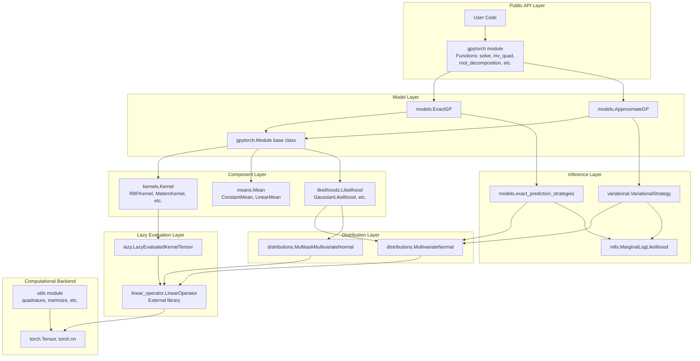
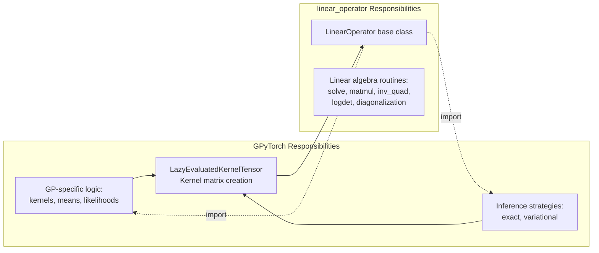
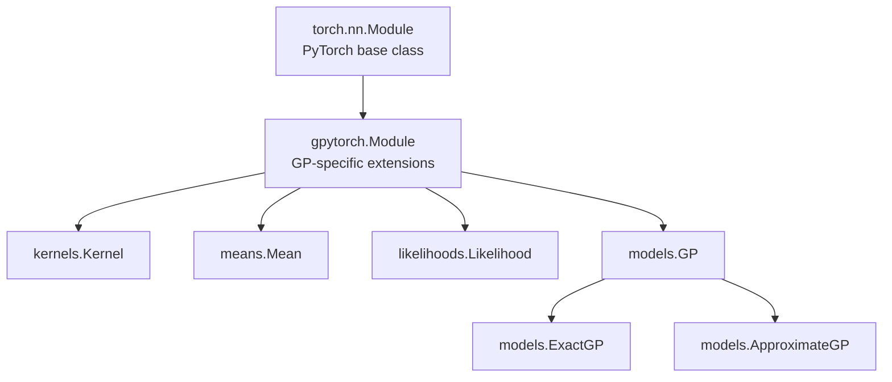

<!-- source: DeepWiki mcp.deepwiki.com · repo cornellius-gp/gpytorch · page 1 Overview · fetched 2026-10-21 -->

# Overview

Relevant source files

The following files were used as context for generating this wiki page:

- [.conda/meta.yaml](.conda/meta.yaml)
- [.github/ISSUE_TEMPLATE/---other.md](.github/ISSUE_TEMPLATE/---other.md)
- [.github/workflows/deploy.yml](.github/workflows/deploy.yml)
- [.github/workflows/run_test_suite.yml](.github/workflows/run_test_suite.yml)
- [.readthedocs.yml](.readthedocs.yml)
- [CONTRIBUTING.md](CONTRIBUTING.md)
- [README.md](README.md)
- [docs/source/conf.py](docs/source/conf.py)
- [gpytorch/__init__.py](gpytorch/__init__.py)
- [gpytorch/beta_features.py](gpytorch/beta_features.py)
- [gpytorch/functions/__init__.py](gpytorch/functions/__init__.py)
- [gpytorch/lazy/__init__.py](gpytorch/lazy/__init__.py)
- [setup.py](setup.py)

This document provides a high-level introduction to GPyTorch: its purpose, design philosophy, architectural organization, and the relationship with the external `linear_operator` library. This overview establishes the foundational concepts needed to understand the more detailed subsystem documentation in subsequent pages.

For installation instructions and environment setup, see [Installation and Setup](#1.1). For detailed documentation of specific components, see the relevant subsystem pages: [Core Components](#2), [Models](#3), [Kernels](#4), [Likelihoods](#5), [Inference Methods](#6), and [Scalability Techniques](#7).

---

## Purpose and Design Philosophy

GPyTorch is a Gaussian process (GP) library implemented in PyTorch, designed to enable scalable, flexible, and modular GP models [README.md:1-12](). The library distinguishes itself from traditional GP implementations through three core design principles:

1. **Matrix-Vector Multiplication (MVM) Based Inference**: Instead of relying on Cholesky decomposition for GP inference, GPyTorch performs most operations using iterative numerical linear algebra techniques like preconditioned conjugate gradients (CG) [README.md:14-18](). This approach provides better GPU utilization and enables scaling to larger datasets.

2. **Lazy Evaluation**: Kernel matrices and other structured matrices are represented as `LinearOperator` objects (from the external `linear_operator` library) that defer computation until necessary [README.md:15-16](). This allows the system to exploit structure (Toeplitz, Kronecker, etc.) and avoid materializing large matrices.

3. **Modular Composition**: GPs are built by composing kernels, mean functions, likelihoods, and inference strategies [gpytorch/__init__.py:10-26](). This compositional design makes it easy to implement new scalable GP methods by providing matrix multiplication routines through the `LinearOperator` interface.

**Key Library Features** [README.md:20-22]():
- Significant GPU acceleration through MVM-based inference.
- State-of-the-art implementations of algorithmic advances (SKI/KISS-GP, stochastic Lanczos expansions, LOVE, SKIP, stochastic variational deep kernel learning).
- Easy integration with deep learning frameworks via PyTorch.

Sources: [README.md:1-133](), [gpytorch/__init__.py:1-327]()

---

## System Architecture

GPyTorch is organized into distinct architectural layers, each with specific responsibilities. The following diagram illustrates the core layers and their primary components using actual class and module names from the codebase:

### High-Level Architecture

**Layer Responsibilities:**

| Layer | Purpose | Key Classes/Modules |
|-------|---------|---------------------|
| **Public API** | User-facing functions for linear algebra operations | `gpytorch.solve()`, `gpytorch.inv_quad()`, `gpytorch.add_jitter()` [gpytorch/__init__.py:46-115]() |
| **Model** | GP model abstractions for exact and approximate inference | `ExactGP`, `ApproximateGP`, `Module` [gpytorch/__init__.py:20-29]() |
| **Component** | Mathematical building blocks for GP specification | `Kernel`, `Mean`, `Likelihood` subclasses [gpytorch/__init__.py:14-17]() |
| **Distribution** | Probabilistic representations of GP outputs | `MultivariateNormal`, `MultitaskMultivariateNormal` [gpytorch/__init__.py:13]() |
| **Inference** | Strategies for computing posteriors and marginal likelihoods | `VariationalStrategy`, `MarginalLogLikelihood` [gpytorch/__init__.py:19-25]() |
| **Lazy Evaluation** | Deferred computation and structure exploitation | `LazyEvaluatedKernelTensor`, `LinearOperator` [gpytorch/lazy/__init__.py:5](), [gpytorch/__init__.py:7]() |
| **Backend** | Core numerical operations and utilities | PyTorch tensors, quadrature, caching [gpytorch/__init__.py:24]() |

Sources: [gpytorch/__init__.py:1-29](), [README.md:12-22](), [gpytorch/lazy/__init__.py:1-9]()

---

## Relationship with linear_operator Library

GPyTorch has a critical dependency on the external `linear_operator` library [setup.py:44](). This relationship is fundamental to GPyTorch's design and performance characteristics.

### Division of Responsibilities

**GPyTorch delegates to linear_operator for:**
- All fundamental linear algebra operations including `solve`, `inv_quad`, `logdet`, and `diagonalization` [gpytorch/__init__.py:34-143]().
- Efficient implementations exploiting matrix structure via the `LinearOperator` interface [README.md:15-16]().

**GPyTorch retains responsibility for:**
- GP-specific concepts: kernel functions, mean functions, likelihoods.
- Model abstractions: `ExactGP`, `ApproximateGP`, variational strategies.
- Creating lazy kernel tensors from kernel evaluations via `LazyEvaluatedKernelTensor` [gpytorch/lazy/lazy_evaluated_kernel_tensor.py]().

### API Integration

GPyTorch's public API functions are often wrappers around `linear_operator` functions to maintain a consistent interface [gpytorch/__init__.py:34-143]().

**Example wrapper implementations**:
- `gpytorch.add_diagonal()` → `linear_operator.add_diagonal()` [gpytorch/__init__.py:34-43]()
- `gpytorch.inv_quad()` → `linear_operator.inv_quad()` [gpytorch/__init__.py:91-115]()
- `gpytorch.diagonalization()` → `linear_operator.diagonalization()` [gpytorch/__init__.py:61-73]()

Sources: [gpytorch/__init__.py:1-143](), [setup.py:44](), [README.md:14-18]()

---

## Core Module Hierarchy

All parameterized GPyTorch components inherit from `gpytorch.Module`, which extends `torch.nn.Module` [gpytorch/__init__.py:29](). This hierarchy establishes the foundation for parameter management, constraints, and priors.

**Key Features Provided by `gpytorch.Module`** (see [Module System](#2.1) for details):
- **Parameter Registration**: Store learnable parameters with constraints.
- **Constraint Transforms**: Enforce parameter domains (e.g., positive values) [gpytorch/__init__.py:12]().
- **Prior Specification**: Define priors over hyperparameters [gpytorch/__init__.py:22]().

Sources: [gpytorch/__init__.py:10-29](), [gpytorch/module.py]()

---

## Computational Backend and Dependencies

### Primary Dependencies
[setup.py:39-45](), [.conda/meta.yaml:23-29]()

| Dependency | Version | Purpose |
|------------|---------|---------|
| **PyTorch** | ≥ 2.0 | Core tensor operations, autograd, and GPU support. |
| **linear_operator** | ≥ 0.6.1 | Structured linear algebra and lazy evaluation. |
| **scikit-learn** | Latest | General machine learning utilities. |
| **scipy** | ≥ 1.6.0 | Numerical utilities and special functions. |
| **mpmath** | ≥ 0.19, ≤ 1.3 | Precision arithmetic for specific operations. |

### Optional Dependencies
[setup.py:91-94](), [.github/workflows/run_test_suite.yml:57-62]()

| Dependency | Purpose |
|------------|---------|
| **pyro-ppl** | Integration for probabilistic programming and Bayesian inference. |
| **pykeops** | GPU-accelerated kernel operations for very large datasets. |
| **matplotlib** | Visualization for example notebooks. |

Sources: [setup.py:1-97](), [.conda/meta.yaml:1-51](), [.github/workflows/run_test_suite.yml:1-86]()

---

## File and Module Organization

GPyTorch's codebase is organized into functional modules [gpytorch/__init__.py:10-26]():

- `models/`: Base classes for `ExactGP` and `ApproximateGP`.
- `kernels/`: Standard and compositional kernel implementations.
- `likelihoods/`: Observation models (Gaussian, Bernoulli, etc.).
- `means/`: Mean function implementations.
- `distributions/`: `MultivariateNormal` and multitask variants.
- `variational/`: Variational strategies and distributions.
- `mlls/`: Marginal Log Likelihood objectives.
- `lazy/`: `LazyEvaluatedKernelTensor` for deferred evaluation [gpytorch/lazy/__init__.py:5]().
- `settings/`: Global context managers for numerical precision and behavior [gpytorch/beta_features.py:7]().

Sources: [gpytorch/__init__.py:1-327](), [gpytorch/lazy/__init__.py:1-9]()

---

