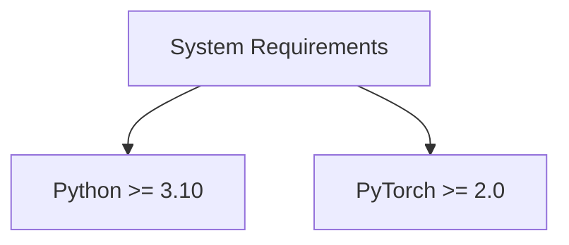
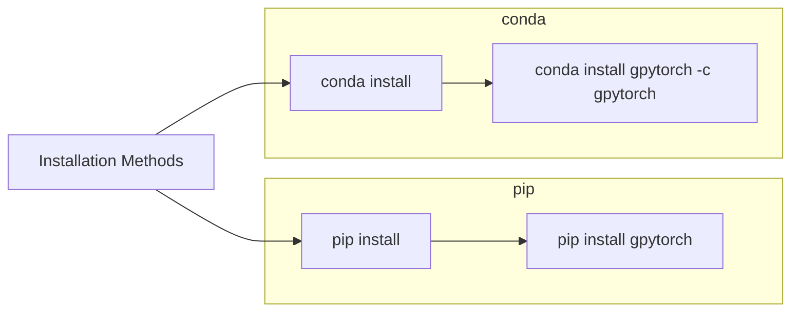
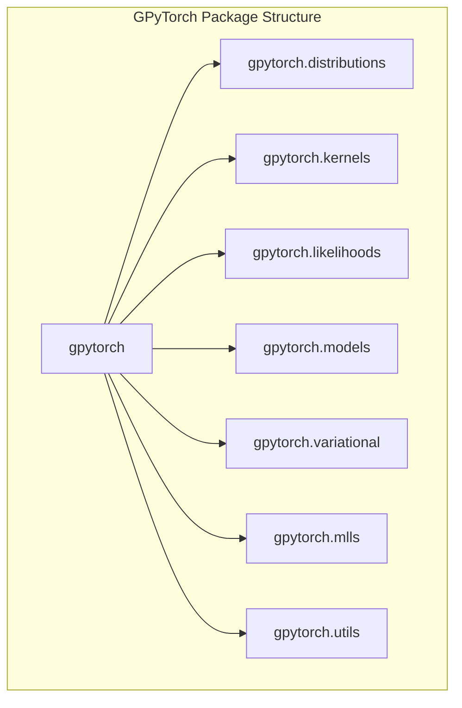

<!-- source: DeepWiki mcp.deepwiki.com · repo cornellius-gp/gpytorch · page 1.1 Installation and Setup · fetched 2026-10-21 -->

# Installation and Setup

<details>
<summary>Relevant source files</summary>

The following files were used as context for generating this wiki page:

- [.conda/meta.yaml](.conda/meta.yaml)
- [.github/ISSUE_TEMPLATE/---other.md](.github/ISSUE_TEMPLATE/---other.md)
- [.github/workflows/deploy.yml](.github/workflows/deploy.yml)
- [.github/workflows/run_test_suite.yml](.github/workflows/run_test_suite.yml)
- [.gitignore](.gitignore)
- [.readthedocs.yml](.readthedocs.yml)
- [CONTRIBUTING.md](CONTRIBUTING.md)
- [LICENSE](LICENSE)
- [README.md](README.md)
- [docs/source/conf.py](docs/source/conf.py)
- [docs/source/linear_operator_objects.inv](docs/source/linear_operator_objects.inv)
- [examples/08_Advanced_Usage/TorchScript_Exact_Models.ipynb](examples/08_Advanced_Usage/TorchScript_Exact_Models.ipynb)
- [examples/LBFGS.py](examples/LBFGS.py)
- [setup.cfg](setup.cfg)
- [setup.py](setup.py)

</details>


This page provides a comprehensive guide for installing GPyTorch and setting up your environment. It covers standard installation methods, dependencies, verification steps, and development environment setup options.

## Introduction

GPyTorch is a Gaussian process library implemented using PyTorch, designed for creating scalable, flexible, and modular Gaussian Process models [README.md:1-12](). The library leverages numerical linear algebra techniques, specifically preconditioned conjugate gradients, to make GPs more computationally efficient, with significant GPU acceleration through matrix-vector multiplication (MVM) based inference [README.md:14-22]().

Before proceeding with installation, ensure that your system meets the minimum requirements.

Sources: [README.md:1-22]()

## System Requirements

GPyTorch requires a modern Python environment with PyTorch.

- **Python**: Version 3.10 or higher [README.md:32](), [setup.py:9-10]()
- **PyTorch**: Version 2.0 or higher [README.md:33](), [setup.py:39]()



Sources: [README.md:31-33](), [setup.py:9-10, 39]()

## Installation Methods

GPyTorch can be installed using several methods, depending on your needs.

### Standard Installation

The recommended way to install GPyTorch is via pip or conda [README.md:35]().



#### Using pip
```bash
pip install gpytorch
```
To install as a user-only package: `pip install --user gpytorch` [README.md:38, 42]().

#### Using conda
```bash
conda install gpytorch -c gpytorch
```
The conda package is managed via a `meta.yaml` configuration that ensures all runtime requirements like `linear_operator` and `mpmath` are satisfied [.conda/meta.yaml:18-28]().

Sources: [README.md:35-42](), [.conda/meta.yaml:7-29]()

### Latest (Unstable) Version

To use the latest development features, you must install the development versions of both `gpytorch` and its core dependency `linear_operator` [README.md:44-51]().

```bash
pip install --upgrade git+https://github.com/cornellius-gp/linear_operator.git
pip install --upgrade git+https://github.com/cornellius-gp/gpytorch.git
```

Sources: [README.md:44-51]()

### Development Installation

If you are contributing to the codebase, perform an editable installation with all extra dependency groups [README.md:53-61](), [CONTRIBUTING.md:5-14]().

```bash
git clone https://github.com/cornellius-gp/gpytorch.git
cd gpytorch
pip install -e .[dev,docs,examples,keops,pyro,test]
```

Sources: [README.md:53-61](), [CONTRIBUTING.md:5-14]()

## Dependencies

GPyTorch relies on a set of core libraries for its linear algebra and optimization routines.

### Core Dependencies

| Package | Version | Purpose |
|---------|---------|---------|
| `torch` | >= 2.0 | Primary tensor and autograd engine [setup.py:39]() |
| `linear_operator` | >= 0.6.1 | Abstracted lazy matrix operations [setup.py:44]() |
| `scipy` | >= 1.6.0 | Scientific computing utilities [setup.py:43]() |
| `scikit-learn` | * | General machine learning utilities [setup.py:42]() |
| `mpmath` | >= 0.19, <= 1.3 | Arbitrary-precision floating-point arithmetic [setup.py:41]() |

Sources: [setup.py:39-45](), [.conda/meta.yaml:23-28]()

### Optional Extra Dependencies

The `setup.py` defines several `extras_require` groups for specialized functionality [setup.py:75-95]():

- **`keops`**: Enables `pykeops` for memory-efficient kernel operations on large datasets [setup.py:92]().
- **`pyro`**: Integration with the `pyro-ppl` probabilistic programming library [setup.py:93]().
- **`docs`**: Tools for building documentation, including `sphinx`, `nbsphinx`, and `m2r2` [setup.py:77-90]().
- **`test`**: Testing infrastructure including `pytest`, `flake8`, and `nbval` [setup.py:94]().

Sources: [setup.py:75-95]()

## Verifying Installation

Verification can be performed by checking that all sub-packages are importable. The conda test suite validates the following hierarchy [.conda/meta.yaml:30-43]():



Sources: [.conda/meta.yaml:30-43]()

## CI/CD Pipeline

GPyTorch uses GitHub Actions for continuous integration and deployment.

### Test Suite (`run_test_suite.yml`)
The pipeline runs on every push and pull request to `main` and `develop` [.github/workflows/run_test_suite.yml:6-10](). It consists of three primary jobs:
1. **`run_linter`**: Executes `flake8` and `pre-commit` checks to enforce code style [.github/workflows/run_test_suite.yml:14-32]().
2. **`run_unit_tests`**: Runs the `unittest` suite across a matrix of PyTorch versions (stable and nightly) [.github/workflows/run_test_suite.yml:36-65]().
3. **`run_examples`**: Validates example notebooks using `pytest --nbval-lax` [.github/workflows/run_test_suite.yml:67-86]().

### Deployment (`deploy.yml`)
Upon a new release creation, the deployment workflow triggers [.github/workflows/deploy.yml:6-8]():
- **PyPI**: Builds source and wheel distributions using `setuptools_scm` and uploads via `twine` [.github/workflows/deploy.yml:14-34]().
- **Anaconda**: Builds the conda package using the `.conda/meta.yaml` recipe and uploads to the `gpytorch` channel [.github/workflows/deploy.yml:36-59]().

Sources: [.github/workflows/run_test_suite.yml:1-86](), [.github/workflows/deploy.yml:1-59]()

## Initial Configuration & Advanced Setup

### TorchScript Integration
GPyTorch supports TorchScript for model deployment, but requires specific settings. Tracing must be performed with `gpytorch.settings.fast_pred_var()` and `gpytorch.settings.trace_mode()` enabled [examples/08_Advanced_Usage/TorchScript_Exact_Models.ipynb:118-122]().

### Documentation Build
The documentation is built using Sphinx. To build locally [CONTRIBUTING.md:60-85]():
```bash
cd docs
SKIP_EXAMPLES=true make html
```
The build process in `docs/source/conf.py` automatically copies notebooks from the `examples/` directory to the documentation source to ensure they are rendered correctly [docs/source/conf.py:43-74]().

Sources: [examples/08_Advanced_Usage/TorchScript_Exact_Models.ipynb:9-13, 118-122](), [CONTRIBUTING.md:60-85](), [docs/source/conf.py:43-74]()

---

