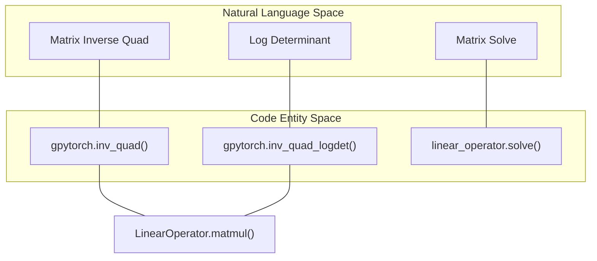

<!-- source: DeepWiki mcp.deepwiki.com · repo cornellius-gp/gpytorch · page 2 Core Components · fetched 2026-10-21 -->

# Core Components

<details>
<summary>Relevant source files</summary>

The following files were used as context for generating this wiki page:

- [docs/source/distributions.rst](docs/source/distributions.rst)
- [gpytorch/__init__.py](gpytorch/__init__.py)
- [gpytorch/beta_features.py](gpytorch/beta_features.py)
- [gpytorch/constraints/constraints.py](gpytorch/constraints/constraints.py)
- [gpytorch/distributions/__init__.py](gpytorch/distributions/__init__.py)
- [gpytorch/distributions/delta.py](gpytorch/distributions/delta.py)
- [gpytorch/distributions/distribution.py](gpytorch/distributions/distribution.py)
- [gpytorch/functions/__init__.py](gpytorch/functions/__init__.py)
- [gpytorch/lazy/__init__.py](gpytorch/lazy/__init__.py)
- [gpytorch/module.py](gpytorch/module.py)
- [gpytorch/test/base_test_case.py](gpytorch/test/base_test_case.py)
- [test/distributions/test_delta.py](test/distributions/test_delta.py)

</details>


This page provides an overview of the fundamental building blocks that make up GPyTorch models. These components form the foundation upon which all Gaussian Process functionality is built in the framework.

## Core Architecture Overview

GPyTorch is structured around several key components that work together to provide a flexible, scalable framework for Gaussian Process modeling. The main components are:

```mermaid
classDiagram
    class "Module" {
        +forward()
        +__call__()
        +register_parameter()
        +register_prior()
        +register_constraint()
        +train()/eval()
    }
    
    class "LinearOperator" {
        +matmul()
        +solve()
        +inv_quad_logdet()
        +root_decomposition()
    }
    
    class "Distributions" {
        +MultivariateNormal
        +MultitaskMultivariateNormal
    }
    
    class "Kernels" {
        +forward()
        +__call__()
    }
    
    class "Likelihoods" {
        +forward()
        +__call__()
    }
    
    class "MLL Functions" {
        +forward()
    }
    
    "Module" <|-- "Kernels"
    "Module" <|-- "Likelihoods"
    "Module" <|-- "MLL Functions"
    "Module" --> "LinearOperator": uses
    "Module" --> "Distributions": returns
```

Sources: [gpytorch/__init__.py:10-25](), [gpytorch/module.py:70-86]()

## Module System

The foundation of GPyTorch is the `Module` class, which extends PyTorch's `nn.Module` with additional functionality specific to Gaussian Processes. It handles the management of parameters, constraints, and priors.

For details, see [Module System](#2.1).

```mermaid
classDiagram
    class "torch.nn.Module" {
        +parameters()
        +buffers()
    }
    
    class "gpytorch.module.Module" {
        +forward()
        +initialize()
        +register_prior()
        +register_constraint()
        +named_priors()
        +named_constraints()
    }
    
    class "gpytorch.module.RandomModuleMixin" {
        +initialize()
    }
    
    "torch.nn.Module" <|-- "gpytorch.module.Module"
    "gpytorch.module.RandomModuleMixin" <|-- "gpytorch.module.Module"
```

The `Module` class has several key features:

1.  **Parameter Management**: Extends PyTorch's parameter system with constraints and priors [gpytorch/module.py:70-75]().
2.  **Prior Registration**: Allows attaching probabilistic priors to parameters via `_priors` [gpytorch/module.py:74-74]().
3.  **Constraint System**: Enforces bounds and transformations on parameters using `Interval` objects [gpytorch/module.py:75-75](), [gpytorch/constraints/constraints.py:17-51]().
4.  **Initialization Helpers**: Specialized `initialize()` methods for setting parameter values by name or full path [gpytorch/module.py:122-137]().

Sources: [gpytorch/module.py:70-170](), [gpytorch/constraints/constraints.py:17-51]()

## Distributions

GPyTorch uses specialized probability distributions to represent the outputs of Gaussian Process models. Unlike standard PyTorch distributions, these are designed to work with structured covariance matrices.

For details, see [Distributions](#2.2).

- **`MultivariateNormal`**: The core distribution for standard GPs, accepting `LinearOperator` objects for efficient covariance representation [gpytorch/distributions/multivariate_normal.py:18-25]().
- **`MultitaskMultivariateNormal`**: Extends to multiple output dimensions for multitask GPs [gpytorch/distributions/multitask_multivariate_normal.py:17-25]().
- **Integration**: If Pyro is installed, these distributions inherit from `TorchDistributionMixin` to support probabilistic programming [gpytorch/distributions/distribution.py:28-33]().

Sources: [gpytorch/distributions/distribution.py:8-38](), [docs/source/distributions.rst:7-17]()

## Linear Operators

Linear operators are the primary abstraction for matrix operations in GPyTorch. Instead of storing dense `N x N` matrices, GPyTorch uses the `LinearOperator` class (from the `linear_operator` library) to represent structured matrices (e.g., Toeplitz, Kronecker, Low-Rank).

For details, see [Linear Operators](#2.3).



Key operations exposed via GPyTorch:
- `inv_quad`: Computes $tr(R^\top A^{-1} R)$ [gpytorch/__init__.py:91-115]().
- `inv_quad_logdet`: Jointly computes the inverse quadratic form and log determinant [gpytorch/__init__.py:118-143]().
- `pivoted_cholesky`: Performs partial pivoted Cholesky factorization for low-rank approximations [gpytorch/__init__.py:146-173]().

Sources: [gpytorch/__init__.py:34-173](), [gpytorch/functions/__init__.py:26-38]()

## Summary

The core components work in unison: `Module` provides the structure for parameters, `LinearOperator` provides the efficient linear algebra engine, and `Distributions` provide the probabilistic interface for model outputs. These foundations allow GPyTorch to scale to millions of data points while maintaining a familiar PyTorch-like API.

---

