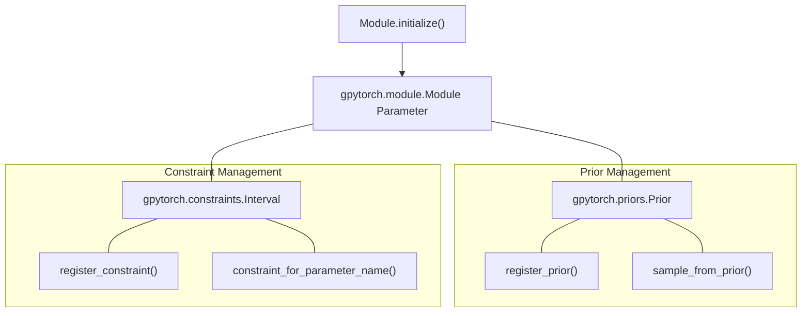
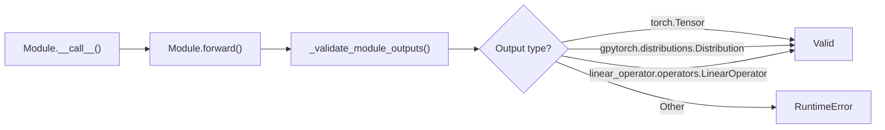
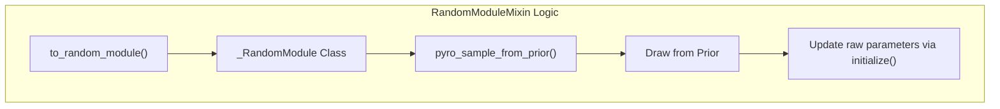

<!-- source: DeepWiki mcp.deepwiki.com · repo cornellius-gp/gpytorch · page 2.1 Module System · fetched 2026-10-21 -->

# Module System

<details>
<summary>Relevant source files</summary>

The following files were used as context for generating this wiki page:

- [docs/source/distributions.rst](docs/source/distributions.rst)
- [gpytorch/constraints/constraints.py](gpytorch/constraints/constraints.py)
- [gpytorch/distributions/__init__.py](gpytorch/distributions/__init__.py)
- [gpytorch/distributions/delta.py](gpytorch/distributions/delta.py)
- [gpytorch/distributions/distribution.py](gpytorch/distributions/distribution.py)
- [gpytorch/module.py](gpytorch/module.py)
- [gpytorch/test/base_test_case.py](gpytorch/test/base_test_case.py)
- [gpytorch/utils/transforms.py](gpytorch/utils/transforms.py)
- [test/constraints/test_constraints.py](test/constraints/test_constraints.py)
- [test/distributions/test_delta.py](test/distributions/test_delta.py)

</details>


## Purpose and Scope

This page documents the Module system in GPyTorch, which forms the foundation for all model components. The Module system extends PyTorch's `nn.Module` base class with Gaussian Process-specific functionality, providing a unified interface for parameter management, prior specifications, constraints, and model composition. This system is essential for building structured, flexible, and modular Gaussian Process models.

For information about specific models built with this module system, see **Models (Section 3)**. For details on how the Linear Operators system interfaces with modules, see **Linear Operators (Section 2.3)**.

## Module Architecture

The GPyTorch Module system enhances PyTorch's `nn.Module` with additional capabilities for Gaussian Process modeling, including parameter priors, constraints, and caching mechanisms.

### Class Hierarchy and Entity Mapping

The following diagram bridges the "Natural Language Space" of GP components to the "Code Entity Space" of the `gpytorch` library.

```mermaid
classDiagram
    class "torch.nn.Module" {
        +parameters()
        +named_parameters()
        +buffers()
        +named_buffers()
        +train()
        +eval()
        +forward()
    }
    
    class "gpytorch.module.Module" {
        <<Entity>>
        -_priors: dict
        -_constraints: dict
        -_added_loss_terms: dict
        -_strict_init: bool
        +forward()
        +initialize()
        +register_prior()
        +register_constraint()
        +constraint_for_parameter_name()
        +sample_from_prior()
        +named_priors()
        +named_constraints()
        +_clear_cache()
    }
    
    class "gpytorch.module.RandomModuleMixin" {
        <<Mixin>>
        +initialize()
    }
    
    class "gpytorch.models.ExactGP" {
        <<Model>>
    }
    
    class "gpytorch.kernels.Kernel" {
        <<Component>>
    }
    
    class "gpytorch.likelihoods.Likelihood" {
        <<Component>>
    }
    
    "torch.nn.Module" <|-- "gpytorch.module.Module"
    "gpytorch.module.Module" <|-- "gpytorch.models.ExactGP"
    "gpytorch.module.Module" <|-- "gpytorch.kernels.Kernel" 
    "gpytorch.module.Module" <|-- "gpytorch.likelihoods.Likelihood"
    "gpytorch.module.RandomModuleMixin" <.. "gpytorch.module.Module" : mixin logic
```

Sources: [gpytorch/module.py:30-67](), [gpytorch/module.py:70-490]()

## Core Module Features

The `gpytorch.module.Module` class provides several key features that distinguish it from the standard PyTorch `nn.Module`:

### 1. Parameter Management with Priors and Constraints

GPyTorch modules associate raw parameters with prior distributions and constraints. Constraints typically transform a "raw" unconstrained parameter (used by optimizers) into a "constrained" parameter (used by the GP logic).



Sources: [gpytorch/module.py:122-191](), [gpytorch/module.py:252-329](), [gpytorch/module.py:359-375]()

### 2. Return Type Validation

The `__call__` method in `gpytorch.module.Module` ensures that outputs are valid GPyTorch objects using `_validate_module_outputs`.



Sources: [gpytorch/module.py:82-86](), [gpytorch/module.py:492-507]()

### 3. Cache Management

Modules implement a `_clear_cache` mechanism. This is automatically triggered when switching between `train()` and `eval()` modes to ensure that stale computations from training do not affect test-time predictions.

Sources: [gpytorch/module.py:88-92](), [gpytorch/module.py:353-357]()

## Constraints System

Constraints ensure parameters maintain valid values, such as ensuring noise variances are positive or lengthscales fall within a specific range.

### Implementation Details
Constraints are implemented in `gpytorch/constraints/constraints.py`. The base class `Interval` handles the transformation between raw and constrained spaces using a `transform` (e.g., `sigmoid` or `softplus`) and its inverse.

| Constraint Class | Domain | Default Transform |
| :--- | :--- | :--- |
| `Interval(low, high)` | `[low, high]` | `torch.sigmoid` |
| `GreaterThan(lower)` | `(lower, inf)` | `torch.nn.functional.softplus` |
| `LessThan(upper)` | `(-inf, upper)` | `torch.nn.functional.softplus` (negative) |
| `Positive()` | `(0, inf)` | `torch.nn.functional.softplus` |

Sources: [gpytorch/constraints/constraints.py:17-83](), [gpytorch/constraints/constraints.py:135-158](), [gpytorch/utils/transforms.py:27]()

### Constraint Naming and Lookup
Constraints are stored in the `_constraints` dictionary. The method `constraint_for_parameter_name(name)` allows retrieving a constraint using the full dot-separated parameter path (e.g., `covar_module.base_kernel.raw_lengthscale`).

Sources: [gpytorch/module.py:359-375](), [test/constraints/test_constraints.py:207-220]()

## Working with Priors

Priors allow specifying Bayesian beliefs about parameter values.

- **Registration**: `register_prior` takes a `Prior` object and a `Closure` that defines how to retrieve the parameter.
- **Sampling**: `sample_from_prior` draws a new value from the distribution and updates the parameter via `initialize`.
- **Pyro Integration**: If Pyro is installed, `gpytorch.distributions.Distribution` inherits from `TorchDistributionMixin`, enabling seamless integration with Pyro's `sample` statements.

Sources: [gpytorch/module.py:252-301](), [gpytorch/distributions/distribution.py:28-38]()

## RandomModuleMixin

The `RandomModuleMixin` (and the `to_random_module` method) allows converting a standard module into one that can sample its own parameters. This is useful for Monte Carlo methods or integration with Pyro's effect handlers.



Sources: [gpytorch/module.py:30-67](), [gpytorch/module.py:420-445]()

## State Dictionary and Loading

GPyTorch modules provide specialized hooks for loading state dicts:
- **Shape Flexibility**: `self._load_strict_shapes` can be toggled to allow loading parameters even if the shapes in the state dict differ from the current module (useful for transfer learning).
- **Constraint Buffers**: The `Interval` class registers `lower_bound` and `upper_bound` as buffers, ensuring they are saved and loaded with the model.

Sources: [gpytorch/module.py:78-80](), [gpytorch/module.py:377-402](), [gpytorch/constraints/constraints.py:70-71]()

## Key Methods Reference

| Method | Purpose |
| :--- | :--- |
| `forward(*inputs)` | Defines the computation logic (must be implemented by subclasses). |
| `initialize(**kwargs)` | Sets parameter values while respecting constraints. |
| `register_prior(name, prior, ...)` | Associates a `gpytorch.priors.Prior` with a parameter. |
| `register_constraint(name, constraint)` | Associates a `gpytorch.constraints.Interval` with a parameter. |
| `sample_from_prior(name)` | Samples from a registered prior and updates the raw parameter. |
| `pyro_sample_from_prior()` | Samples all registered priors using Pyro's `sample` mechanism. |
| `_clear_cache()` | Clears precomputed values (e.g., training-time covariance caches). |

Sources: [gpytorch/module.py:111-112](), [gpytorch/module.py:122-191](), [gpytorch/module.py:252-301](), [gpytorch/module.py:331-352](), [gpytorch/module.py:408-445](), [gpytorch/module.py:87-92]()

---

