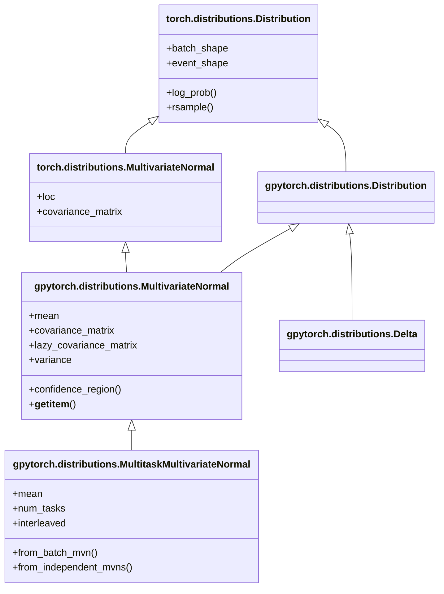
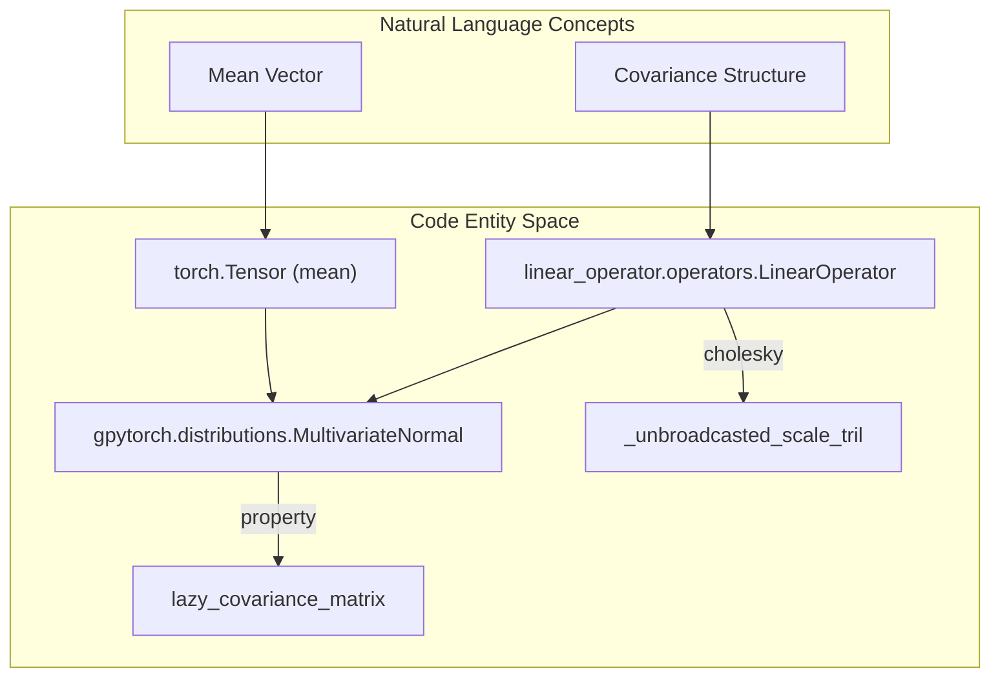
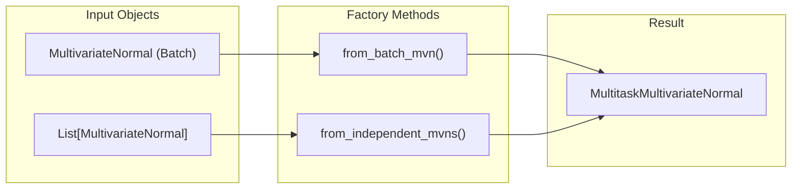

<!-- source: DeepWiki mcp.deepwiki.com · repo cornellius-gp/gpytorch · page 2.2 Distributions · fetched 2026-10-21 -->

# Distributions

<details>
<summary>Relevant source files</summary>

The following files were used as context for generating this wiki page:

- [docs/source/distributions.rst](docs/source/distributions.rst)
- [gpytorch/constraints/constraints.py](gpytorch/constraints/constraints.py)
- [gpytorch/distributions/__init__.py](gpytorch/distributions/__init__.py)
- [gpytorch/distributions/delta.py](gpytorch/distributions/delta.py)
- [gpytorch/distributions/distribution.py](gpytorch/distributions/distribution.py)
- [gpytorch/distributions/multitask_multivariate_normal.py](gpytorch/distributions/multitask_multivariate_normal.py)
- [gpytorch/distributions/multivariate_normal.py](gpytorch/distributions/multivariate_normal.py)
- [gpytorch/module.py](gpytorch/module.py)
- [gpytorch/test/base_test_case.py](gpytorch/test/base_test_case.py)
- [test/distributions/test_delta.py](test/distributions/test_delta.py)
- [test/distributions/test_multitask_multivariate_normal.py](test/distributions/test_multitask_multivariate_normal.py)
- [test/distributions/test_multivariate_normal.py](test/distributions/test_multivariate_normal.py)

</details>


The Distributions module in GPyTorch provides specialized probability distributions for representing the outputs of Gaussian Processes. While GPyTorch largely leverages PyTorch's distribution library, it implements custom multivariate normal distributions that efficiently work with the `LinearOperator` system and support operations specifically needed for Gaussian Process models.

## Distribution Classes Overview

GPyTorch implements three primary distribution classes:

1.  **MultivariateNormal**: Used for standard single-output Gaussian Processes [gpytorch/distributions/multivariate_normal.py:22-42]().
2.  **MultitaskMultivariateNormal**: Used for multi-output/multitask Gaussian Processes [gpytorch/distributions/multitask_multivariate_normal.py:17-32]().
3.  **Delta**: Represents a degenerate discrete distribution (a single point), often used for deterministic components or borrowed from Pyro [gpytorch/distributions/delta.py:19-32]().

## Distribution Hierarchy

GPyTorch distributions are designed to be compatible with both PyTorch and Pyro. If Pyro is installed, GPyTorch distributions inherit from `TorchDistributionMixin` [gpytorch/distributions/distribution.py:29-38]().


Sources: [gpytorch/distributions/distribution.py:32-38](), [gpytorch/distributions/multivariate_normal.py:22-42](), [gpytorch/distributions/multitask_multivariate_normal.py:17-32](), [gpytorch/distributions/delta.py:19-32]()

## MultivariateNormal

The `MultivariateNormal` class represents a multivariate normal distribution. It extends PyTorch's `MultivariateNormal` but allows for lazy evaluation of operations on the covariance matrix using `LinearOperator` objects [gpytorch/distributions/multivariate_normal.py:22-42]().

### Structure and Data Flow

The following diagram shows how data flows from `LinearOperator` components into the `MultivariateNormal` entity.


Sources: [gpytorch/distributions/multivariate_normal.py:44-65](), [gpytorch/distributions/multivariate_normal.py:84-89](), [gpytorch/distributions/multivariate_normal.py:115-120]()

### Initialization
```python
mvn = MultivariateNormal(mean, covariance_matrix, validate_args=False)
```
The constructor detects if the inputs are "lazy" (i.e., instances of `LinearOperator`) and sets the `_islazy` flag accordingly [gpytorch/distributions/multivariate_normal.py:45-46]().

### Key Methods and Operations
*   **Confidence Region**: Returns 2 standard deviations above and below the mean [gpytorch/distributions/multivariate_normal.py:121-131]().
*   **Jitter**: `add_jitter(noise=1e-4)` adds a small constant diagonal to the covariance for numerical stability [gpytorch/distributions/multivariate_normal.py:98-104]().
*   **Arithmetic**: Supports `__add__`, `__mul__`, and `__truediv__`. Adding two `MultivariateNormal` distributions sums their means and covariances [gpytorch/distributions/multivariate_normal.py:385-420]().
*   **Indexing**: `__getitem__` allows slicing into batch and event dimensions, returning a new `MultivariateNormal` [gpytorch/distributions/multivariate_normal.py:427-450]().

Sources: [gpytorch/distributions/multivariate_normal.py:98-131](), [gpytorch/distributions/multivariate_normal.py:385-450]()

## MultitaskMultivariateNormal

The `MultitaskMultivariateNormal` class handles multi-output distributions where the mean is an `n x t` matrix (data points by tasks) [gpytorch/distributions/multitask_multivariate_normal.py:17-32]().

### Interleaving
The `interleaved` parameter (default `True`) defines how the flattened covariance matrix `NT x NT` is interpreted:
*   **Interleaved**: Task indices vary faster than observation indices [gpytorch/distributions/multitask_multivariate_normal.py:67-68]().
*   **Non-interleaved**: Observation indices vary faster than task indices [gpytorch/distributions/multitask_multivariate_normal.py:70-71]().

### Creation Utilities
*   **`from_batch_mvn`**: Reinterprets a batch of MVNs as a multitask distribution using `BlockInterleavedLinearOperator` [gpytorch/distributions/multitask_multivariate_normal.py:87-124]().
*   **`from_independent_mvns`**: Combines an iterable of MVNs into a single multitask distribution where tasks are independent [gpytorch/distributions/multitask_multivariate_normal.py:127-160]().


Sources: [gpytorch/distributions/multitask_multivariate_normal.py:87-160]()

## Distribution Operations

GPyTorch distributions integrate with `linear_operator` to perform efficient linear algebra.

| Operation | Implementation Detail | Source |
| :--- | :--- | :--- |
| **Log Probability** | Uses `lazy_covariance_matrix.inv_quad_logdet` for efficient computation. | [gpytorch/distributions/multivariate_normal.py:222-253]() |
| **Sampling** | `rsample` uses `root_decomposition` or `cholesky` for reparameterized samples. | [gpytorch/distributions/multivariate_normal.py:255-321]() |
| **Entropy** | Computed via the log-determinant of the covariance. | [gpytorch/distributions/multivariate_normal.py:216-220]() |
| **KL Divergence** | Registered via `register_kl` for MVN pairs. | [gpytorch/distributions/multivariate_normal.py:453-478]() |

### KL Divergence Registry
GPyTorch registers specific KL divergence implementations for its custom types, such as `kl_mvn_mvn` for two `MultivariateNormal` objects [gpytorch/distributions/multivariate_normal.py:453-478]() and `kl_mvn_mvn` for a `Delta` and `MultivariateNormal` [gpytorch/distributions/delta.py:80-82]().

Sources: [gpytorch/distributions/multivariate_normal.py:453-478](), [gpytorch/distributions/delta.py:80-82]()

---

