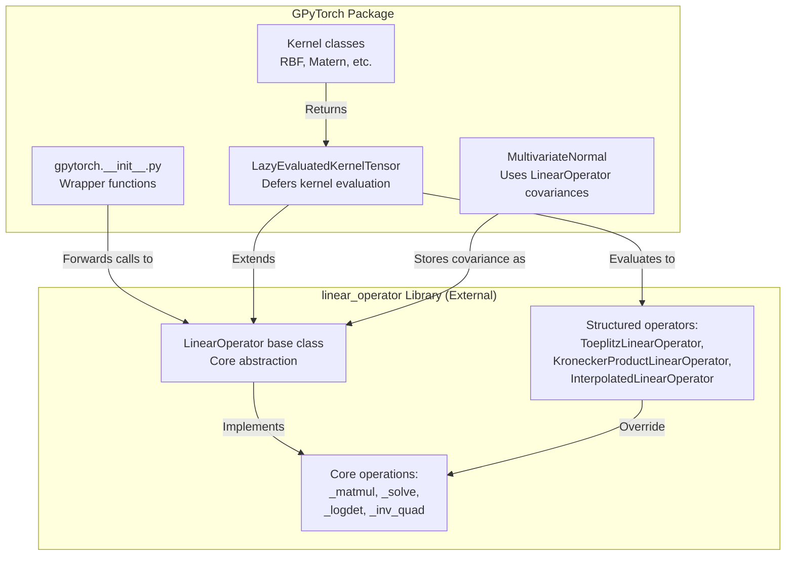
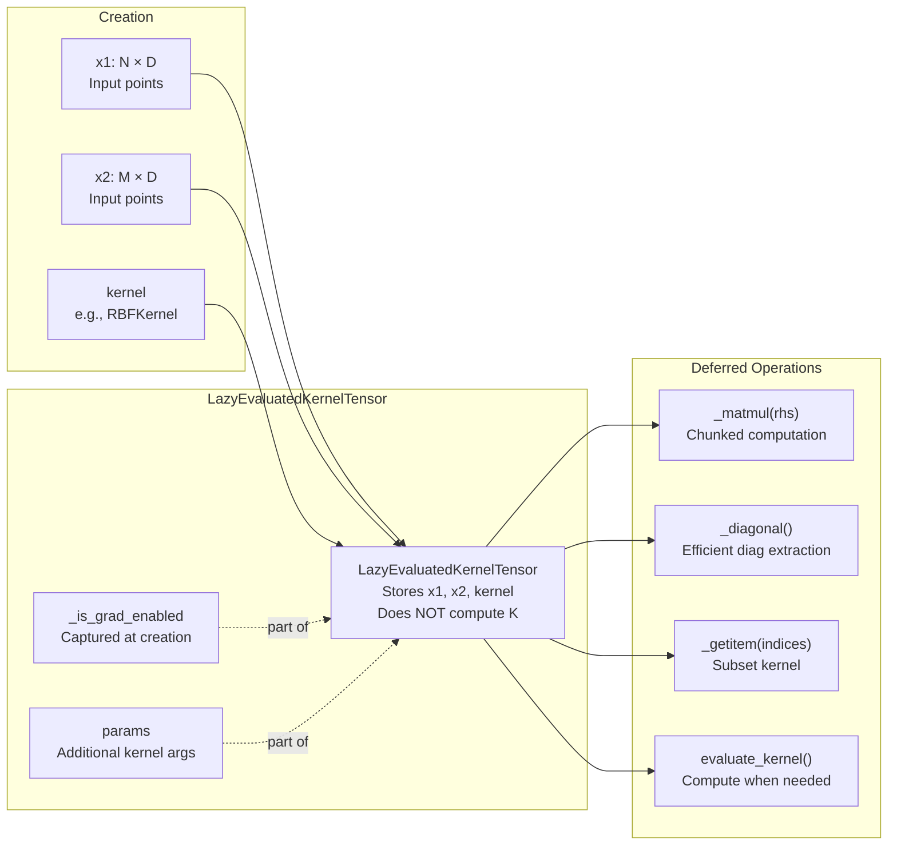
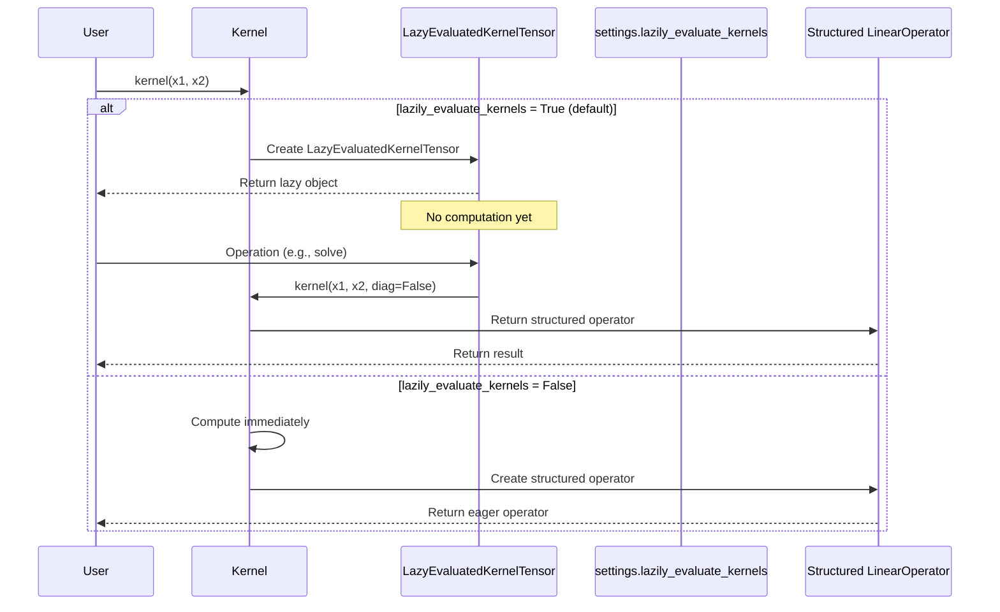

<!-- source: DeepWiki mcp.deepwiki.com · repo cornellius-gp/gpytorch · page 2.3 Linear Operators · fetched 2026-10-21 -->

# Linear Operators

<details>
<summary>Relevant source files</summary>

The following files were used as context for generating this wiki page:

- [gpytorch/__init__.py](gpytorch/__init__.py)
- [gpytorch/beta_features.py](gpytorch/beta_features.py)
- [gpytorch/functions/__init__.py](gpytorch/functions/__init__.py)
- [gpytorch/lazy/__init__.py](gpytorch/lazy/__init__.py)
- [gpytorch/lazy/lazy_evaluated_kernel_tensor.py](gpytorch/lazy/lazy_evaluated_kernel_tensor.py)
- [gpytorch/models/approximate_gp.py](gpytorch/models/approximate_gp.py)
- [gpytorch/models/pyro/_pyro_mixin.py](gpytorch/models/pyro/_pyro_mixin.py)
- [gpytorch/models/pyro/pyro_gp.py](gpytorch/models/pyro/pyro_gp.py)
- [test/examples/test_pyro_integration.py](test/examples/test_pyro_integration.py)
- [test/lazy/test_lazy_evaluated_kernel_tensor.py](test/lazy/test_lazy_evaluated_kernel_tensor.py)

</details>


## Purpose and Scope

This page explains the `LinearOperator` abstraction and its role in GPyTorch's computational backend. Linear operators provide lazy evaluation and structured matrix representations that enable efficient Gaussian Process computations at scale.

For information about how kernels produce linear operators, see [Kernels](#4). For details on how distributions use linear operators for covariance matrices, see [Distributions](#2.2). For lazy evaluation and caching mechanisms specific to inference, see [Efficient Linear Algebra](#7.3).

---

## Overview

GPyTorch relies heavily on the external `linear_operator` library to represent and manipulate matrices that arise in GP computations. Rather than forming and storing dense $N \times N$ covariance matrices explicitly, GPyTorch uses `LinearOperator` objects that:

1.  **Defer computation** until results are actually needed (lazy evaluation).
2.  **Exploit structure** in matrices (Toeplitz, Kronecker, etc.) for efficient operations.
3.  **Provide a consistent interface** for matrix operations like solves, matrix-vector products, and log determinants.

The key insight is that for many GP operations, we never need the full covariance matrix—we only need operations like solves ($\mathbf{K}^{-1}\mathbf{v}$) or log determinants ($\log|\mathbf{K}|$). Linear operators implement these operations directly, often with significant computational savings.

**Sources:** [gpytorch/__init__.py:5-7](), [gpytorch/__init__.py:31-31]()

---

## Architecture: GPyTorch and linear_operator Library



**Diagram: Relationship between GPyTorch and the linear_operator library**

The `linear_operator` library provides the foundation, while GPyTorch adds GP-specific functionality through `LazyEvaluatedKernelTensor` and wraps common operations for convenience in the top-level `gpytorch` namespace.

**Sources:** [gpytorch/__init__.py:5-7](), [gpytorch/lazy/lazy_evaluated_kernel_tensor.py:33-49]()

---

## The LinearOperator Base Class

The `LinearOperator` class from the external library provides a PyTorch-like interface for matrix operations without requiring explicit matrix storage. All linear operators in GPyTorch inherit from this base class.

### Core Properties

| Property | Description | Source |
|----------|-------------|--------|
| `dtype` | Data type of elements (e.g., `torch.float32`) | [gpytorch/lazy/lazy_evaluated_kernel_tensor.py:51-53]() |
| `device` | Device location (CPU/GPU) | [gpytorch/lazy/lazy_evaluated_kernel_tensor.py:55-57]() |
| `requires_grad` | Whether the operator tracks gradients | [gpytorch/lazy/lazy_evaluated_kernel_tensor.py:59-61]() |

### Core Operations

GPyTorch exposes the following key operations through wrapper functions in `gpytorch/__init__.py`:

| Function | Mathematical Operation | Purpose | Source |
|----------|----------------------|---------|--------|
| `solve` | $\mathbf{K}^{-1}\mathbf{R}$ or $\mathbf{L}\mathbf{K}^{-1}\mathbf{R}$ | Linear solve for posterior mean | [gpytorch/functions/__init__.py:36-38]() |
| `inv_quad` | $\text{tr}(\mathbf{R}^\top \mathbf{A}^{-1} \mathbf{R})$ | Inverse quadratic form for MLL | [gpytorch/__init__.py:91-115]() |
| `inv_quad_logdet` | Combined $\text{tr}(\mathbf{R}^\top \mathbf{A}^{-1} \mathbf{R})$ and $\log|\mathbf{A}|$ | Efficient MLL evaluation | [gpytorch/__init__.py:118-143]() |
| `pivoted_cholesky` | $\mathbf{L} \mathbf{L}^\top \approx \mathbf{A}$ | Low-rank approximation | [gpytorch/__init__.py:146-172]() |
| `diagonalization` | Partial Eigendecomposition | Lanczos or Symeig | [gpytorch/__init__.py:61-73]() |
| `add_diagonal` | $\mathbf{A} + \text{diag}(\mathbf{d})$ | Add observation noise | [gpytorch/__init__.py:34-43]() |
| `add_jitter` | $\mathbf{A} + \alpha \mathbf{I}$ | Numerical stability | [gpytorch/__init__.py:46-58]() |

**Sources:** [gpytorch/__init__.py:34-173](), [gpytorch/functions/__init__.py:36-38]()

---

## LazyEvaluatedKernelTensor: Deferred Kernel Computation

`LazyEvaluatedKernelTensor` is GPyTorch's primary `LinearOperator` subclass. It represents a kernel matrix $\mathbf{K}(\mathbf{X}_1, \mathbf{X}_2)$ without actually computing it until necessary.



**Diagram: LazyEvaluatedKernelTensor structure and operations**

### Key Features

**Deferred Computation:** The kernel matrix is not computed during initialization. Instead, the tensors `x1`, `x2`, and the `kernel` object are stored. Computation happens only when an operation cannot be performed lazily.

**Gradient State Preservation:** The `recall_grad_state` decorator ensures operations execute with the same gradient tracking state as when the object was created, making lazy tensors behave like regular tensors regarding `torch.is_grad_enabled()`.
**Sources:** [gpytorch/lazy/lazy_evaluated_kernel_tensor.py:17-30](), [gpytorch/lazy/lazy_evaluated_kernel_tensor.py:42-50]()

**Efficient Operations:**
- `_diagonal()`: Computes only diagonal elements by calling the kernel with `diag=True`, which is significantly faster for prediction variances.
- `_getitem()`: Slices the input tensors `x1` and `x2` rather than the computed matrix, maintaining laziness after indexing.
- `_bilinear_derivative()`: Used when kernel checkpointing is enabled to compute gradients in chunks to save memory.

**Sources:** [gpytorch/lazy/lazy_evaluated_kernel_tensor.py:69-104](), [gpytorch/lazy/lazy_evaluated_kernel_tensor.py:106-133](), [gpytorch/lazy/lazy_evaluated_kernel_tensor.py:136-166]()

---

## Memory-Efficient Operations with Checkpointing

For very large kernels that cannot fit in GPU memory, GPyTorch provides kernel checkpointing to trade compute for memory. This is controlled via the `gpytorch.beta_features.checkpoint_kernel` context manager.

```python
import gpytorch

# Enable kernel checkpointing with a specific split size
with gpytorch.beta_features.checkpoint_kernel(split_size=512):
    # Kernel operations are now computed in segments
    output = model(train_x)
```

When `split_size > 0`:
- The kernel is never fully computed or stored in memory.
- `_bilinear_derivative` breaks `x1` into chunks and computes gradients sequentially to reduce the peak memory footprint.
- This is functionally similar to KeOps but implemented within GPyTorch's lazy framework.

**Sources:** [gpytorch/beta_features.py:26-42](), [gpytorch/lazy/lazy_evaluated_kernel_tensor.py:69-104]()

---

## Kernel Evaluation Pipeline

The `settings.lazily_evaluate_kernels()` context manager controls whether kernels return lazy or eager operators.



**Diagram: Kernel evaluation decision flow**

**Sources:** [gpytorch/lazy/lazy_evaluated_kernel_tensor.py:89-98](), [test/lazy/test_lazy_evaluated_kernel_tensor.py:25-26]()

---

## Numerical Stability Features

### Adding Jitter
Small diagonal elements (jitter) are added to ensure positive definiteness, which is critical for Cholesky decompositions and CG stability.

```python
# Add small diagonal for stability
stable_covar = gpytorch.add_jitter(covar_matrix, jitter_val=1e-3)
```
**Sources:** [gpytorch/__init__.py:46-58]()

### Adding Diagonal Elements
Used for adding observation noise to a latent covariance matrix:

```python
# K + diag(d)
noisy_covar = gpytorch.add_diagonal(covar_matrix, noise_tensor)
```
**Sources:** [gpytorch/__init__.py:34-43]()

---

## Deprecated Utilities

Several functions in `gpytorch.functions` and `gpytorch.lazy` have been deprecated in favor of the `linear_operator` library to unify the ecosystem.

| Deprecated | Replacement |
|------------|-------------|
| `gpytorch.logdet` | `torch.logdet` |
| `gpytorch.matmul` | `torch.matmul` |
| `gpytorch.inv_matmul` | `linear_operator.solve` |
| `gpytorch.functions.<name>` | `linear_operator.functions.<name>` |

**Sources:** [gpytorch/functions/__init__.py:26-38](), [gpytorch/functions/__init__.py:51-58]()

---

