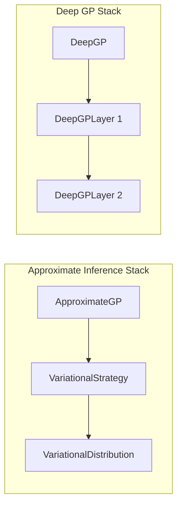
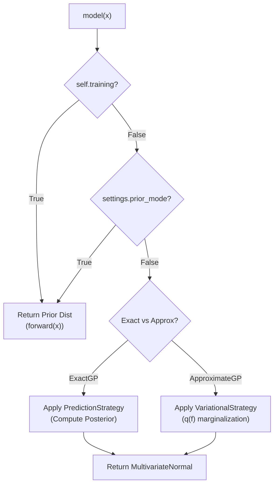

<!-- source: DeepWiki mcp.deepwiki.com · repo cornellius-gp/gpytorch · page 3 Models · fetched 2026-10-21 -->

# Models

<details>
<summary>Relevant source files</summary>

The following files were used as context for generating this wiki page:

- [docs/source/index.rst](docs/source/index.rst)
- [docs/source/models.rst](docs/source/models.rst)
- [gpytorch/lazy/lazy_evaluated_kernel_tensor.py](gpytorch/lazy/lazy_evaluated_kernel_tensor.py)
- [gpytorch/mlls/deep_approximate_mll.py](gpytorch/mlls/deep_approximate_mll.py)
- [gpytorch/models/approximate_gp.py](gpytorch/models/approximate_gp.py)
- [gpytorch/models/deep_gps/__init__.py](gpytorch/models/deep_gps/__init__.py)
- [gpytorch/models/deep_gps/deep_gp.py](gpytorch/models/deep_gps/deep_gp.py)
- [gpytorch/models/exact_gp.py](gpytorch/models/exact_gp.py)
- [gpytorch/models/exact_prediction_strategies.py](gpytorch/models/exact_prediction_strategies.py)
- [gpytorch/models/pyro/_pyro_mixin.py](gpytorch/models/pyro/_pyro_mixin.py)
- [gpytorch/models/pyro/pyro_gp.py](gpytorch/models/pyro/pyro_gp.py)
- [gpytorch/settings.py](gpytorch/settings.py)
- [gpytorch/utils/memoize.py](gpytorch/utils/memoize.py)
- [test/examples/test_pyro_integration.py](test/examples/test_pyro_integration.py)
- [test/lazy/test_lazy_evaluated_kernel_tensor.py](test/lazy/test_lazy_evaluated_kernel_tensor.py)

</details>


This page documents the model classes in GPyTorch that represent Gaussian process (GP) models. Models define the structure of GP implementations, specifying how predictions are made and how inference is performed. For information about kernels (covariance functions), see [Kernels](#4), and for information about likelihoods, see [Likelihoods](#5).

## Model Architecture Overview

GPyTorch models are built around two primary model classes: `ExactGP` and `ApproximateGP`, both inheriting from a base `GP` class [gpytorch/models/gp.py:9]().

- **ExactGP**: Implements exact GP inference, suitable for datasets with up to a few thousand points. It requires a Gaussian likelihood [gpytorch/models/exact_gp.py:71-72]().
- **ApproximateGP**: Implements approximate/variational GP inference, scaling to much larger datasets using inducing points [gpytorch/models/approximate_gp.py:16-52]().

### Class Hierarchy and Entity Mapping

The following diagram maps high-level model concepts to their specific implementation classes in the codebase.

```mermaid
classDiagram
    class "gpytorch.Module" as Module {
        +parameters()
        +named_priors()
    }
    
    class "gpytorch.models.GP" as GP {
        +forward(x)
    }
    
    class "gpytorch.models.ExactGP" as ExactGP {
        +train_inputs
        +train_targets
        +prediction_strategy
        +get_fantasy_model()
    }
    
    class "gpytorch.models.ApproximateGP" as ApproximateGP {
        +variational_strategy
        +get_fantasy_model()
    }

    class "gpytorch.models.PyroGP" as PyroGP {
        +guide()
        +model()
    }
    
    Module <|-- GP
    GP <|-- ExactGP
    GP <|-- ApproximateGP
    ApproximateGP <|-- PyroGP
```

Sources: 
- [gpytorch/models/gp.py:9]()
- [gpytorch/models/exact_gp.py:23-23]()
- [gpytorch/models/approximate_gp.py:16-16]()
- [gpytorch/models/pyro/pyro_gp.py:11-11]()

## Exact GP Models

The `ExactGP` class implements exact GP inference by computing the analytic posterior distribution. It stores `train_inputs` and `train_targets` [gpytorch/models/exact_gp.py:76-77]() and requires a `_GaussianLikelihoodBase` [gpytorch/models/exact_gp.py:65-65]().

### Prediction Strategies

`ExactGP` delegates the heavy lifting of posterior computation to a `prediction_strategy` [gpytorch/models/exact_gp.py:83-83](). The strategy is selected based on the input type and kernel properties [gpytorch/models/exact_prediction_strategies.py:30-44]().

| Strategy Class | Role |
| :--- | :--- |
| `DefaultPredictionStrategy` | Standard exact inference using Cholesky or CG [gpytorch/models/exact_prediction_strategies.py:46-46](). |
| `LinearPredictionStrategy` | Optimized for cases where number of features is less than number of points [gpytorch/models/exact_prediction_strategies.py:43-43](). |

For details on caching, fantasy models, and specific strategies, see [Exact GP Models](#3.1).

Sources:
- [gpytorch/models/exact_gp.py:23-59]()
- [gpytorch/models/exact_prediction_strategies.py:30-46]()

## Approximate GP Models

The `ApproximateGP` class is the base for models where inference is performed via variational methods [gpytorch/models/approximate_gp.py:18-21](). Unlike `ExactGP`, it does not store training data directly but relies on a `variational_strategy` to marginalize over inducing points [gpytorch/models/approximate_gp.py:57-57]().

### Deep GPs and Composition

GPyTorch supports Deep Gaussian Processes via the `DeepGP` container and `DeepGPLayer` modules [gpytorch/models/deep_gps/deep_gp.py:33-128](). These layers are composable, allowing the output of one GP to serve as the input to another [gpytorch/models/deep_gps/deep_gp.py:61-66]().



For details on variational strategies and SVI, see [Approximate GP Models](#3.2).

Sources:
- [gpytorch/models/approximate_gp.py:16-52]()
- [gpytorch/models/deep_gps/deep_gp.py:33-128]()

## Pyro Integration

Models can be integrated with the Pyro probabilistic programming library via `PyroGP` [gpytorch/models/pyro/pyro_gp.py:11-11](). This mixin provides `pyro_model` and `pyro_guide` methods to allow GPs to be part of larger stochastic programs [gpytorch/models/pyro/_pyro_mixin.py:9-48]().

Sources:
- [gpytorch/models/pyro/pyro_gp.py:11-59]()
- [gpytorch/models/pyro/_pyro_mixin.py:9-48]()

## Common Model Settings

GPyTorch uses a global `settings` module to toggle performance and numerical behaviors [gpytorch/settings.py:1-368]().

| Setting | Description | File Reference |
| :--- | :--- | :--- |
| `debug` | Performs safety checks on input data shapes and modes. | [gpytorch/settings.py:147-158]() |
| `fast_pred_var` | Enables Lanczos Variance Estimates (LOVE) for $O(1)$ variances. | [gpytorch/settings.py:183-224]() |
| `fast_pred_samples` | Enables fast posterior sampling using LOVE. | [gpytorch/settings.py:225-241]() |
| `detach_test_caches` | Detaches caches to speed up derivatives w.r.t. test inputs. | [gpytorch/settings.py:160-171]() |

Sources:
- [gpytorch/settings.py:145-368]()

## Model Execution Flow

When a model is called (`__call__`), the behavior depends on the `self.training` state and specific settings like `prior_mode`.



Sources:
- [gpytorch/models/exact_gp.py:264-349]()
- [gpytorch/models/approximate_gp.py:113-116]()
- [gpytorch/settings.py:341-356]()

---

