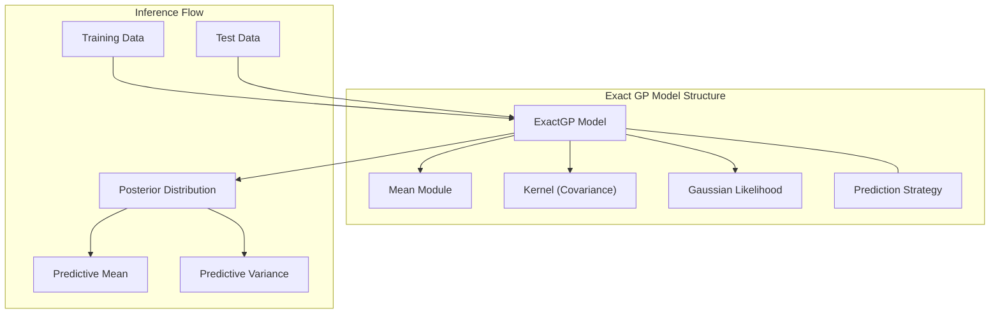
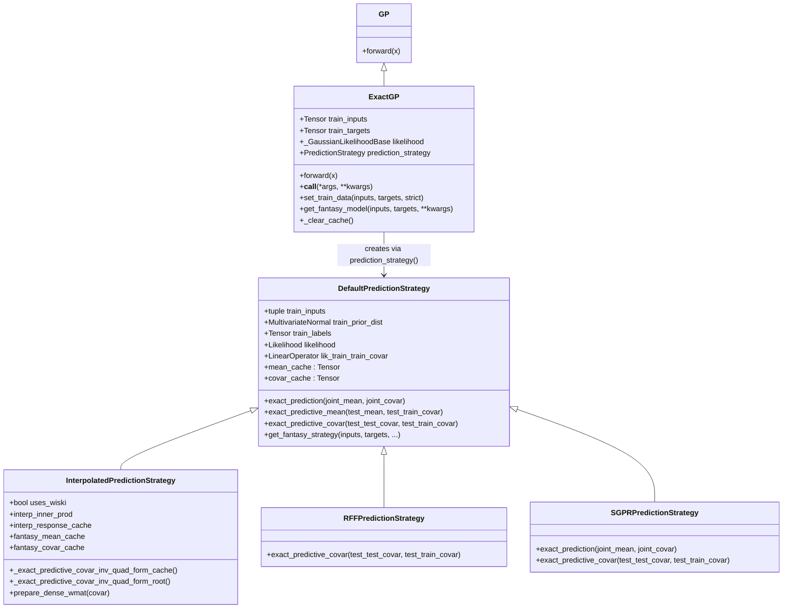
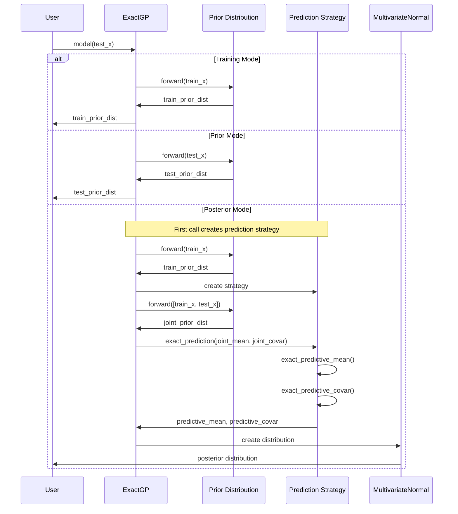
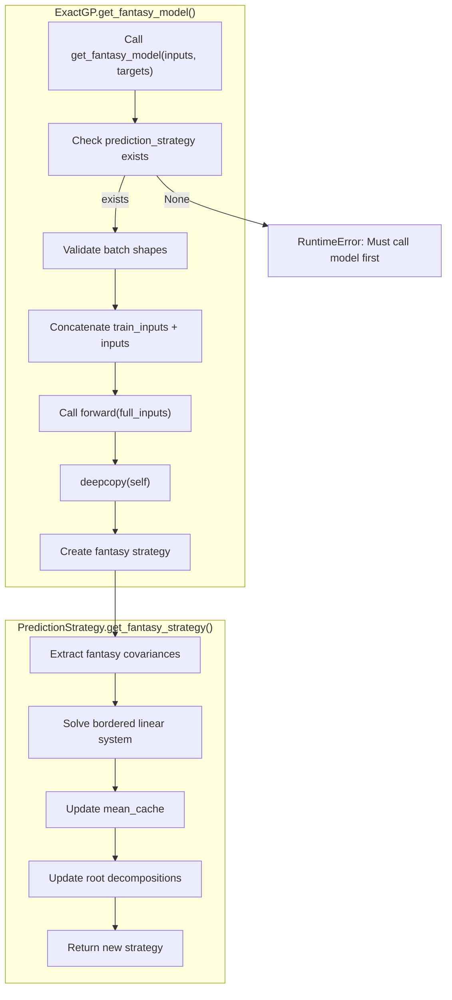

<!-- source: DeepWiki mcp.deepwiki.com · repo cornellius-gp/gpytorch · page 3.1 Exact GP Models · fetched 2026-10-21 -->

# Exact GP Models

<details>
<summary>Relevant source files</summary>

The following files were used as context for generating this wiki page:

- [gpytorch/models/exact_gp.py](gpytorch/models/exact_gp.py)
- [gpytorch/models/exact_prediction_strategies.py](gpytorch/models/exact_prediction_strategies.py)
- [gpytorch/settings.py](gpytorch/settings.py)
- [gpytorch/utils/memoize.py](gpytorch/utils/memoize.py)
- [test/examples/test_fixed_noise_fanatasy_updates.py](test/examples/test_fixed_noise_fanatasy_updates.py)
- [test/examples/test_kissgp_white_noise_regression.py](test/examples/test_kissgp_white_noise_regression.py)
- [test/examples/test_sgpr_regression.py](test/examples/test_sgpr_regression.py)
- [test/examples/test_simple_gp_regression.py](test/examples/test_simple_gp_regression.py)
- [test/examples/test_white_noise_regression.py](test/examples/test_white_noise_regression.py)

</details>


## Purpose and Scope

This document describes GPyTorch's `ExactGP` models, which provide exact inference for Gaussian processes using analytic solutions. This page covers the implementation of exact GP inference, prediction strategies, and features like efficient caching and fantasy observations. For information about approximate GP models using variational inference, see [Approximate GP Models](#3.2).

## Introduction to Exact GP Models

Exact Gaussian Process models in GPyTorch implement closed-form solutions for GP inference when using Gaussian likelihoods. These models provide exact posterior predictions by directly computing the conditional distribution of test points given training points, without resorting to approximations.



Sources: [gpytorch/models/exact_gp.py:23-59](), [gpytorch/models/exact_prediction_strategies.py:30-36]()

## Key Class Structure

The `ExactGP` class serves as the foundation for all exact GP models in GPyTorch. It inherits from the base `GP` class and requires three essential components: training inputs, training targets, and a Gaussian likelihood.

**Class Hierarchy Diagram: ExactGP and Prediction Strategies**



Sources: [gpytorch/models/exact_gp.py:23-83](), [gpytorch/models/exact_prediction_strategies.py:30-36](), [gpytorch/models/exact_prediction_strategies.py:46-422](), [gpytorch/models/exact_prediction_strategies.py:424-733](), [gpytorch/models/exact_prediction_strategies.py:735-788](), [gpytorch/models/exact_prediction_strategies.py:790-873]()

### Initialization and Requirements

When creating an ExactGP model, you must provide:

1. Training inputs (features) - `Tensor` or tuple of `Tensor` [gpytorch/models/exact_gp.py:63-68]()
2. Training targets (labels) - `Tensor` [gpytorch/models/exact_gp.py:64]()
3. A Gaussian likelihood - must inherit from `_GaussianLikelihoodBase` [gpytorch/models/exact_gp.py:71-72]()

The constructor performs validation to ensure the likelihood is Gaussian (required for exact inference) and properly formats the inputs.

```python
class ExactGPModel(gpytorch.models.ExactGP):
    def __init__(self, train_inputs, train_targets, likelihood):
        super(ExactGPModel, self).__init__(train_inputs, train_targets, likelihood)
        self.mean_module = gpytorch.means.ZeroMean()
        self.covar_module = gpytorch.kernels.ScaleKernel(gpytorch.kernels.RBFKernel())
    
    def forward(self, x):
        mean = self.mean_module(x)
        covar = self.covar_module(x)
        return gpytorch.distributions.MultivariateNormal(mean, covar)
```

Sources: [gpytorch/models/exact_gp.py:61-83](), [test/examples/test_simple_gp_regression.py:22-30]()

## Prediction Process

The ExactGP prediction process involves several key steps, from computing priors to delivering posterior predictions. This process is handled through a specialized prediction strategy system.



Sources: [gpytorch/models/exact_gp.py:264-349](), [gpytorch/models/exact_prediction_strategies.py:311-421]()

### Prediction Strategy

The prediction strategy system is central to how ExactGP makes predictions. The strategy:

1. Computes and caches quantities needed for faster inference [gpytorch/models/exact_prediction_strategies.py:246-301]()
2. Provides implementations for exact predictive mean and covariance [gpytorch/models/exact_prediction_strategies.py:328-421]()
3. Handles specialized cases like structured kernels or fantasy observations [gpytorch/models/exact_prediction_strategies.py:137-244]()

The strategy is automatically created and cached on the first posterior prediction call [gpytorch/models/exact_gp.py:302-311]().

Sources: [gpytorch/models/exact_gp.py:302-311](), [gpytorch/models/exact_prediction_strategies.py:30-36]()

### Computing Posterior Distributions

The exact predictive mean and covariance are computed using standard Gaussian process equations:

**Predictive Mean**:
μ(x*) = μ(x*) + K(x*, X)[K(X, X) + σ²I]⁻¹(y - μ(X))

**Predictive Covariance**:
Σ(x*, x*') = K(x*, x*') - K(x*, X)[K(X, X) + σ²I]⁻¹K(X, x*')

These computations are implemented in the `exact_predictive_mean` and `exact_predictive_covar` methods of the prediction strategy classes.

Sources: [gpytorch/models/exact_prediction_strategies.py:328-365](), [gpytorch/models/exact_prediction_strategies.py:368-421]()

## Memory and Computational Efficiency

ExactGP models can be computationally expensive due to the O(n³) matrix operations required for exact inference. GPyTorch implements several techniques to improve efficiency:

### Caching System

The prediction strategy maintains two key caches to avoid redundant computation during prediction. These caches are computed on the first prediction call and reused for subsequent predictions.

**Cache Computation Flow**

```mermaid
flowchart TD
    subgraph "Cached Quantities"
        Model["ExactGP"] --> |creates| PredStrat["DefaultPredictionStrategy"]
        PredStrat --> |@cached property| MeanCache["mean_cache"]
        PredStrat --> |@cached property| CovarCache["covar_cache"]
        
        MeanCache --> |stores| AlphaTerm["(K_XX + σ²I)⁻¹(y - μ)"]
        CovarCache --> |stores| InvRootTerm["(K_XX + σ²I)⁻¹/² or similar"]
    end
    
    subgraph "Prediction Usage"
        TestInput["test_x"] --> PredMean["exact_predictive_mean()"]
        TestInput --> PredCovar["exact_predictive_covar()"]
        
        AlphaTerm --> PredMean
        InvRootTerm --> PredCovar
        
        PredMean --> |"K(x*, X) @ mean_cache"| PostMean["μ_posterior"]
        PredCovar --> |"K(x*, x*) - ..."| PostCovar["Σ_posterior"]
    end
```

**Cache Details:**

1. **`mean_cache`** (`@cached(name="mean_cache")` property) [gpytorch/models/exact_prediction_strategies.py:246-252]()
   - Stores: `(K_XX + σ²I)⁻¹(y - μ(X))` 
   - Computed via: `train_train_covar.solve(train_labels_offset)` [gpytorch/models/exact_prediction_strategies.py:298-301]()
   - Used in: `exact_predictive_mean()` via matrix-vector product [gpytorch/models/exact_prediction_strategies.py:365]()

2. **`covar_cache`** (`@cached(name="covar_cache")` property) [gpytorch/models/exact_prediction_strategies.py:254-255]()
   - Stores: Root inverse decomposition `(K_XX + σ²I)⁻¹/²` or precomputed terms
   - Computed via: `train_train_covar.root_inv_decomposition()` [gpytorch/models/exact_prediction_strategies.py:307-309]()
   - Used in: `exact_predictive_covar()` for efficient posterior covariance [gpytorch/models/exact_prediction_strategies.py:379-421]()

The caches use the `@cached` decorator from `gpytorch.utils.memoize` [gpytorch/utils/memoize.py:12-17]() and are invalidated when `prediction_strategy` is set to `None` or when `_clear_cache()` is called [gpytorch/models/exact_gp.py:99-101]().

Sources: [gpytorch/models/exact_prediction_strategies.py:246-309](), [gpytorch/utils/memoize.py:12-100](), [gpytorch/models/exact_gp.py:99-101]()

### Settings for Efficient Prediction

GPyTorch provides several settings to adjust the prediction behavior and efficiency.

| Setting | Purpose | Default | Location |
|---------|---------|---------|----------|
| `fast_pred_var` | Use LOVE (Lanczos Variance Estimates) for O(1) predictive variance | `False` | [gpytorch/settings.py:183-199]() |
| `fast_pred_samples` | Use LOVE for efficient sampling from posterior | `False` | [gpytorch/settings.py:225-242]() |
| `skip_posterior_variances` | Return `ZeroLinearOperator` for covariance (mean-only prediction) | `False` | [gpytorch/settings.py:358-368]() |
| `detach_test_caches` | Detach caches from autograd graph for faster test derivatives | `True` | [gpytorch/settings.py:160-170]() |
| `eval_cg_tolerance` | Conjugate gradient tolerance for prediction solve operations | `0.01` | [gpytorch/settings.py:173-181]() |
| `max_eager_kernel_size` | Threshold for eager evaluation vs lazy evaluation | `512` | [gpytorch/settings.py:259-267]() |
| `debug` | Enable safety checks on training data during prediction | `True` | [gpytorch/settings.py:147-158]() |

Sources: [gpytorch/settings.py:145-368](), [gpytorch/models/exact_prediction_strategies.py:379-421](), [gpytorch/models/exact_prediction_strategies.py:615-680]()

## Advanced Features

### Fantasy Observations

Fantasy observations allow efficient conditioning on new data points without full model retraining by updating the `mean_cache` and `covar_cache` in linear time [gpytorch/models/exact_gp.py:155-157]().

**Fantasy Model Creation Flow**



**Implementation Details:**

- `DefaultPredictionStrategy.get_fantasy_strategy()` ([gpytorch/models/exact_prediction_strategies.py:137-244]())
  - Updates both `mean_cache` and `covar_cache` via bordered system.
  - Uses `psd_safe_cholesky()` for Schur complement [gpytorch/models/exact_prediction_strategies.py:20]().
- `InterpolatedPredictionStrategy.get_fantasy_strategy()` ([gpytorch/models/exact_prediction_strategies.py:456-491]())
  - Implements WISKI (Warp-Induced Structured Kernel Interpolation) fantasy updates.
  - Updates `interp_inner_prod` via low-rank update [gpytorch/models/exact_prediction_strategies.py:539-555]().

Sources: [gpytorch/models/exact_gp.py:151-262](), [gpytorch/models/exact_prediction_strategies.py:137-244](), [gpytorch/models/exact_prediction_strategies.py:456-491]()

### Different Prediction Strategies

GPyTorch automatically selects prediction strategies based on kernel type [gpytorch/models/exact_prediction_strategies.py:30-36]().

**Strategy Comparison:**

| Strategy | Use Case | Location |
|----------|----------|-------------|
| `DefaultPredictionStrategy` | General kernels, dense covariance | [gpytorch/models/exact_prediction_strategies.py:46-422]() |
| `InterpolatedPredictionStrategy` | `GridInterpolationKernel`, KISS-GP | [gpytorch/models/exact_prediction_strategies.py:424-733]() |
| `RFFPredictionStrategy` | `RFFKernel` | [gpytorch/models/exact_prediction_strategies.py:735-788]() |
| `SGPRPredictionStrategy` | `InducingPointKernel`, SGPR | [gpytorch/models/exact_prediction_strategies.py:790-873]() |

Sources: [gpytorch/models/exact_prediction_strategies.py:30-873]()

### Handling Missing Observations

GPyTorch can handle missing observations (NaN values) in training data through the `observation_nan_policy` setting [gpytorch/settings.py:405-448]().

| Policy | Description |
|--------|-------------|
| `"ignore"` | Do not check for NaN values (default) |
| `"mask"` | Mask out NaN values during calculation |
| `"fill"` | Fill NaN values with a dummy value and filter later |

Sources: [gpytorch/settings.py:405-448](), [gpytorch/models/exact_prediction_strategies.py:257-292](), [gpytorch/models/exact_prediction_strategies.py:346-364]()

## Usage Example

```python
# Define the model
class ExactGPModel(gpytorch.models.ExactGP):
    def __init__(self, train_x, train_y, likelihood):
        super(ExactGPModel, self).__init__(train_x, train_y, likelihood)
        self.mean_module = gpytorch.means.ConstantMean()
        self.covar_module = gpytorch.kernels.ScaleKernel(gpytorch.kernels.RBFKernel())
    
    def forward(self, x):
        mean = self.mean_module(x)
        covar = self.covar_module(x)
        return gpytorch.distributions.MultivariateNormal(mean, covar)

# Create model and likelihood
likelihood = gpytorch.likelihoods.GaussianLikelihood()
model = ExactGPModel(train_x, train_y, likelihood)

# Prediction mode
model.eval()
likelihood.eval()
with torch.no_grad(), gpytorch.settings.fast_pred_var():
    predictions = likelihood(model(test_x))
    mean = predictions.mean
```

Sources: [test/examples/test_simple_gp_regression.py:22-132](), [test/examples/test_simple_gp_regression.py:217-257]()

---

