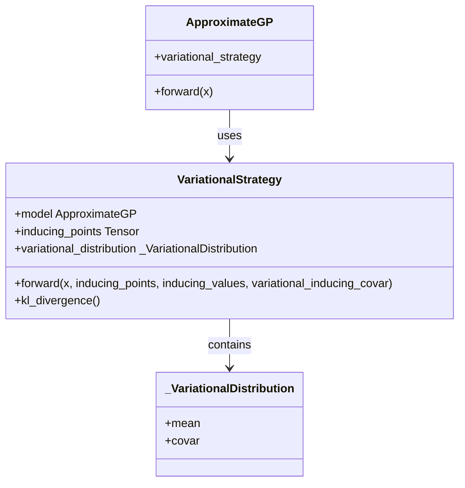

<!-- source: DeepWiki mcp.deepwiki.com · repo cornellius-gp/gpytorch · page 3.2 Approximate GP Models · fetched 2026-10-21 -->

# Approximate GP Models

<details>
<summary>Relevant source files</summary>

The following files were used as context for generating this wiki page:

- [gpytorch/lazy/lazy_evaluated_kernel_tensor.py](gpytorch/lazy/lazy_evaluated_kernel_tensor.py)
- [gpytorch/models/approximate_gp.py](gpytorch/models/approximate_gp.py)
- [gpytorch/models/pyro/_pyro_mixin.py](gpytorch/models/pyro/_pyro_mixin.py)
- [gpytorch/models/pyro/pyro_gp.py](gpytorch/models/pyro/pyro_gp.py)
- [gpytorch/variational/_variational_strategy.py](gpytorch/variational/_variational_strategy.py)
- [gpytorch/variational/grid_interpolation_variational_strategy.py](gpytorch/variational/grid_interpolation_variational_strategy.py)
- [gpytorch/variational/unwhitened_variational_strategy.py](gpytorch/variational/unwhitened_variational_strategy.py)
- [gpytorch/variational/variational_strategy.py](gpytorch/variational/variational_strategy.py)
- [test/examples/test_batch_svgp_gp_regression.py](test/examples/test_batch_svgp_gp_regression.py)
- [test/examples/test_pyro_integration.py](test/examples/test_pyro_integration.py)
- [test/examples/test_svgp_gp_regression.py](test/examples/test_svgp_gp_regression.py)
- [test/lazy/test_lazy_evaluated_kernel_tensor.py](test/lazy/test_lazy_evaluated_kernel_tensor.py)
- [test/models/test_exact_gp.py](test/models/test_exact_gp.py)
- [test/models/test_variational_gp.py](test/models/test_variational_gp.py)
- [test/variational/test_variational_strategy.py](test/variational/test_variational_strategy.py)

</details>


This page documents the approximate Gaussian Process (GP) models implemented in GPyTorch, which provide scalable alternatives to [Exact GP Models](#3.1) for scenarios involving large datasets or non-Gaussian likelihoods. Approximate GP models in GPyTorch primarily use variational inference techniques to achieve computational efficiency while providing flexible and accurate posterior approximations.

## Core Concepts

Approximate GP models in GPyTorch are built around the concept of variational inference, using inducing points to form a tractable approximation to the full GP posterior. The core idea is to define a set of inducing points $\mathbf{Z}$ (fewer than the training points) and approximate the GP posterior using these points.

```mermaid
flowchart TD
    subgraph "Approximate GP Framework"
        [ApproximateGP_Model] --> [VariationalStrategy]
        [VariationalStrategy] --> [VariationalDistribution_q_u]
        [VariationalStrategy] --> [Inducing_Points_Z]
        
        [VariationalStrategy] --> [PosteriorDistribution_q_f_x]
        
        [VariationalELBO] --> |"Optimization Target"| [ApproximateGP_Model]
        [VariationalELBO] --> |"KL[q(u)‖p(u)]"| [VariationalDistribution_q_u]
    end
```

Sources:
- [gpytorch/variational/variational_strategy.py:142-158]()
- [gpytorch/variational/_variational_strategy.py:48-82]()

### ApproximateGP Base Class

All approximate GP models in GPyTorch inherit from the `ApproximateGP` base class [gpytorch/models/approximate_gp.py](), which provides the framework for variational inference. This class works with a variational strategy to define how the posterior distribution is computed.

### Inducing Points

Inducing points (sometimes called "pseudo-inputs") are a small set of points (typically $m \ll n$ training points) that are used to approximate the full GP. The locations of these points can be fixed or learned during optimization by registering them as a `torch.nn.Parameter` [gpytorch/variational/_variational_strategy.py:75-77]().

### Variational Distribution

The variational distribution $q(\mathbf{u})$ is a probability distribution over the function values at the inducing points. GPyTorch provides several options:

- `CholeskyVariationalDistribution`: Full-covariance Gaussian [gpytorch/variational/cholesky_variational_distribution.py]().
- `MeanFieldVariationalDistribution`: Diagonal-covariance Gaussian.
- `DeltaVariationalDistribution`: Delta/point distribution.
- `NaturalVariationalDistribution`: For use with natural gradient descent [test/variational/test_variational_strategy.py:131]().

### Variational Strategy

The variational strategy defines how to transform the variational distribution $q(\mathbf{u})$ into a posterior distribution $q(f|\mathbf{x})$ by computing the integral:
$$q(f(\mathbf{X})) = \int p(f(\mathbf{X})|\mathbf{u}) q(\mathbf{u}) d\mathbf{u}$$

This is the key component that differentiates the various approximate GP models.

Sources:
- [gpytorch/variational/variational_strategy.py:142-156]()
- [gpytorch/variational/_variational_strategy.py:123-157]()

## Standard Variational GP

The standard variational GP implementation uses the `VariationalStrategy` class, which follows the formulation by Hensman et al. (2015). This strategy applies an approximate distribution $q(\mathbf{u})$ over the function values at inducing points $\mathbf{Z}$, and then derives the distribution for any input $\mathbf{X}$.



The standard variational strategy uses "whitening" to accelerate optimization by transforming the inducing variables to have a simpler prior distribution (identity covariance) [gpytorch/variational/variational_strategy.py:154-155]().

Sources:
- [gpytorch/variational/variational_strategy.py:142-272]()
- [test/examples/test_svgp_gp_regression.py:30-40]()

## Example Usage

Here's a simplified example of how to create an approximate GP model with the standard variational strategy:

```python
class SVGPRegressionModel(ApproximateGP):
    def __init__(self, inducing_points):
        # Define variational distribution
        variational_distribution = CholeskyVariationalDistribution(inducing_points.size(-2))
        
        # Define variational strategy
        variational_strategy = VariationalStrategy(
            self, inducing_points, variational_distribution, learn_inducing_locations=True
        )
        
        # Initialize with the variational strategy
        super().__init__(variational_strategy)
        
        self.mean_module = gpytorch.means.ConstantMean()
        self.covar_module = gpytorch.kernels.ScaleKernel(gpytorch.kernels.RBFKernel())
    
    def forward(self, x):
        mean_x = self.mean_module(x)
        covar_x = self.covar_module(x)
        return gpytorch.distributions.MultivariateNormal(mean_x, covar_x)
```

Sources:
- [test/examples/test_svgp_gp_regression.py:30-45]()
- [test/examples/test_batch_svgp_gp_regression.py:32-50]()

## Advanced Variational Strategies

GPyTorch provides several specialized variational strategies:

| Strategy | Class Name | Description |
| :--- | :--- | :--- |
| **Whitened** | `VariationalStrategy` | Standard SVGP with whitening transformation [gpytorch/variational/variational_strategy.py:142](). |
| **Unwhitened** | `UnwhitenedVariationalStrategy` | SVGP without whitening; faster if $\mathbf{Z}=\mathbf{X}$ [gpytorch/variational/unwhitened_variational_strategy.py:29](). |
| **Grid** | `GridInterpolationVariationalStrategy` | Constrains inducing points to a grid (KISS-GP style) [gpytorch/variational/grid_interpolation_variational_strategy.py:17](). |
| **Decoupled** | `BatchDecoupledVariationalStrategy` | Different inducing points for mean and covariance [gpytorch/variational/batch_decoupled_variational_strategy.py](). |
| **Multitask** | `LMCVariationalStrategy` | Linear Model of Coregionalization for multi-output GPs [gpytorch/variational/lmc_variational_strategy.py](). |

### Unwhitened Variational Strategy

The `UnwhitenedVariationalStrategy` is preferable when the number of inducing points is very large (>2000) as it can use Conjugate Gradients (CG) for faster computation [gpytorch/variational/unwhitened_variational_strategy.py:38-39]().

### Grid Interpolation Variational Strategy

This strategy constrains inducing points to a grid and applies a deterministic relationship between $f$ and $u$ using interpolation [gpytorch/variational/grid_interpolation_variational_strategy.py:19-21](). It is only compatible with Gaussian variational distributions [gpytorch/variational/grid_interpolation_variational_strategy.py:91-95]().

Sources:
- [gpytorch/variational/unwhitened_variational_strategy.py:29-52]()
- [gpytorch/variational/grid_interpolation_variational_strategy.py:17-37]()

## Predictive Performance Optimization

For training, GPyTorch provides a custom autograd function `ComputePredictiveUpdates` to optimize the backward pass when the number of data points $n$ is much larger than the number of inducing points $m$ ($m \ll n$) [gpytorch/variational/variational_strategy.py:59-93]().

### Caching System

The `@cached` decorator is used extensively to avoid redundant computations of the prior distribution, variational distribution, and Cholesky factors [gpytorch/variational/_variational_strategy.py:106, 119, 168]().

```mermaid
flowchart LR
    [Input_X] --> [VariationalStrategy_Call]
    [VariationalStrategy_Call] --> [Check_Cache]
    [Check_Cache] -- "Miss" --> [Compute_Predictive_Updates]
    [Compute_Predictive_Updates] --> [Store_in_Cache]
    [Check_Cache] -- "Hit" --> [Return_Cached_Dist]
```

Sources:
- [gpytorch/variational/variational_strategy.py:68-81]()
- [gpytorch/variational/_variational_strategy.py:20-21]()

## Integration with Pyro

GPyTorch includes a `PyroGP` mixin and base class to allow approximate GP models to be used within the Pyro probabilistic programming framework [gpytorch/models/pyro/pyro_gp.py:11](). This enables:
- Using GP models as components of larger hierarchical models.
- Leveraging Pyro's inference tools (e.g., SVI) [gpytorch/models/pyro/pyro_gp.py:47-53]().

The `pyro_guide` and `pyro_model` methods handle the sampling of inducing values $\mathbf{u}$ and latent function values $\mathbf{f}$ [gpytorch/models/pyro/_pyro_mixin.py:10-48]().

Sources:
- [gpytorch/models/pyro/pyro_gp.py:11-60]()
- [gpytorch/models/pyro/_pyro_mixin.py:9-48]()

---

