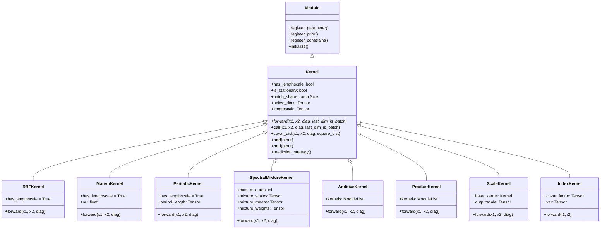
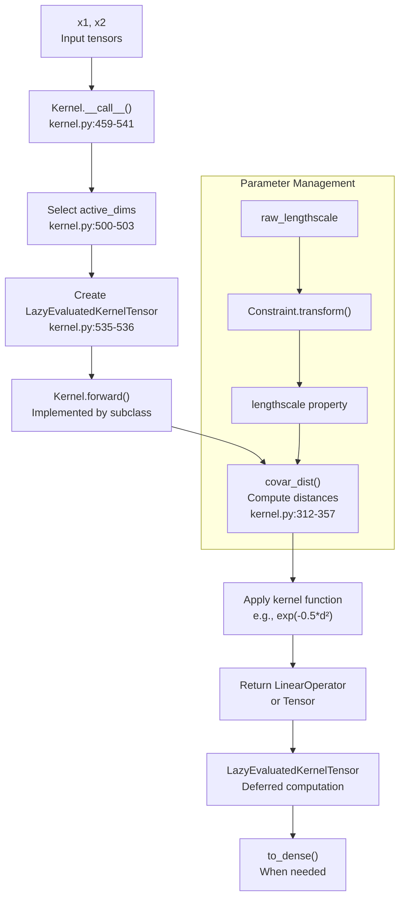
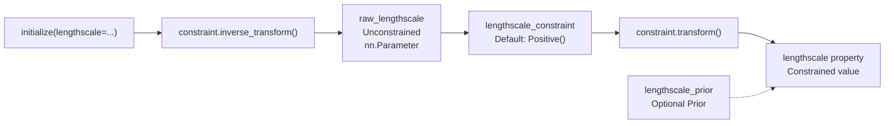

<!-- source: DeepWiki mcp.deepwiki.com · repo cornellius-gp/gpytorch · page 4 Kernels · fetched 2026-10-21 -->

# Kernels

<details>
<summary>Relevant source files</summary>

The following files were used as context for generating this wiki page:

- [docs/source/kernels.rst](docs/source/kernels.rst)
- [gpytorch/kernels/__init__.py](gpytorch/kernels/__init__.py)
- [gpytorch/kernels/cosine_kernel.py](gpytorch/kernels/cosine_kernel.py)
- [gpytorch/kernels/gibbs_kernel.py](gpytorch/kernels/gibbs_kernel.py)
- [gpytorch/kernels/index_kernel.py](gpytorch/kernels/index_kernel.py)
- [gpytorch/kernels/kernel.py](gpytorch/kernels/kernel.py)
- [gpytorch/kernels/matern_kernel.py](gpytorch/kernels/matern_kernel.py)
- [gpytorch/kernels/periodic_kernel.py](gpytorch/kernels/periodic_kernel.py)
- [gpytorch/kernels/rbf_kernel.py](gpytorch/kernels/rbf_kernel.py)
- [gpytorch/kernels/rbf_kernel_grad.py](gpytorch/kernels/rbf_kernel_grad.py)
- [gpytorch/kernels/scale_kernel.py](gpytorch/kernels/scale_kernel.py)
- [gpytorch/kernels/spectral_mixture_kernel.py](gpytorch/kernels/spectral_mixture_kernel.py)
- [gpytorch/kernels/spherical_linear_kernel.py](gpytorch/kernels/spherical_linear_kernel.py)
- [test/kernels/test_gibbs_kernel.py](test/kernels/test_gibbs_kernel.py)
- [test/kernels/test_spherical_linear_kernel.py](test/kernels/test_spherical_linear_kernel.py)

</details>


This page provides a comprehensive overview of the kernel system in GPyTorch. Kernels define covariance functions that encode assumptions about the similarity between data points in Gaussian Process models. The kernel system is built on a modular, composable architecture that supports both standard covariance functions and specialized implementations for scalability.

**Page structure:**
- [Standard Kernels](#4.1): RBF, Matern, Periodic, Spectral Mixture, Cosine, and Index kernels
- [Compositional Kernels](#4.2): ScaleKernel, AdditiveKernel, ProductKernel
- [Scalable Kernels](#4.3): GridKernel, GridInterpolationKernel, InducingPointKernel, MultitaskKernel

## Overview

The kernel system in GPyTorch is organized around the `Kernel` base class [[gpytorch/kernels/kernel.py:84-159]](), which extends `gpytorch.Module` [[gpytorch/module.py:69-490]](). All kernels:

1. Inherit from `Kernel` and implement the abstract `forward` method [[gpytorch/kernels/kernel.py:233-256]]()
2. Support parameter management (lengthscales, constraints, priors) through the `Module` system [[gpytorch/kernels/kernel.py:105-139]]()
3. Use lazy evaluation via `LazyEvaluatedKernelTensor` to defer matrix computation [[gpytorch/kernels/kernel.py:19]]()
4. Support algebraic composition through `__add__` and `__mul__` operators [[gpytorch/kernels/kernel.py:548-558]]()
5. Handle batch dimensions and active dimension selection [[gpytorch/kernels/kernel.py:119-134]]()
6. Integrate with prediction strategies for efficient inference [[gpytorch/kernels/kernel.py:438-447]]()

Sources: [[gpytorch/kernels/kernel.py:84-257]](), [[gpytorch/module.py:69-122]]()

## System Architecture

### Class Hierarchy

**Kernel Class Hierarchy and Key Methods**



Sources: [[gpytorch/kernels/kernel.py:84-257]](), [[gpytorch/kernels/rbf_kernel.py:14-86]](), [[gpytorch/kernels/matern_kernel.py:14-110]](), [[gpytorch/kernels/periodic_kernel.py:14-145]](), [[gpytorch/kernels/spectral_mixture_kernel.py:17-157]](), [[gpytorch/kernels/scale_kernel.py:13-125]](), [[gpytorch/kernels/index_kernel.py:18-112]]()

### Kernel Evaluation Pipeline

**Data Flow from Input to Covariance Matrix**



Sources: [[gpytorch/kernels/kernel.py:459-541]](), [[gpytorch/kernels/kernel.py:312-357]](), [[gpytorch/lazy/lazy_evaluated_kernel_tensor.py]]()

## Base Kernel Class

The `Kernel` base class [[gpytorch/kernels/kernel.py:84-597]]() extends `gpytorch.Module` and provides the foundation for all kernel implementations.

### Key Components

| Component | Description | Code Reference |
|-----------|-------------|----------------|
| **Abstract `forward` method** | Must be implemented by subclasses to compute covariance | [[gpytorch/kernels/kernel.py:233-256]]() |
| **`__call__` method** | Pre-processes inputs and creates lazy evaluation wrapper | [[gpytorch/kernels/kernel.py:459-541]]() |
| **Lengthscale parameter** | Optional distance scaling parameter with constraints | [[gpytorch/kernels/kernel.py:105-139]]() |
| **Batch shape** | Supports batched kernel parameters | [[gpytorch/kernels/kernel.py:259-268]]() |
| **Active dimensions** | Select which input dimensions to use | [[gpytorch/kernels/kernel.py:177-179]]() |
| **Distance computation** | `covar_dist()` efficiently computes pairwise distances | [[gpytorch/kernels/kernel.py:312-357]]() |

### Parameter Management

Kernels inherit parameter management from `gpytorch.Module`:

**Lengthscale Parameter Storage and Transformation**



The lengthscale is stored as `raw_lengthscale` (unconstrained) and transformed through a constraint when accessed via the `lengthscale` property [[gpytorch/kernels/kernel.py:293-297]]().

**Constructor Parameters:**

| Parameter | Type | Description | Default |
|-----------|------|-------------|---------|
| `ard_num_dims` | `int` | Number of dimensions for ARD (separate lengthscale per dimension) | `None` |
| `batch_shape` | `torch.Size` | Shape for batched parameters | `torch.Size([])` |
| `active_dims` | `Tuple[int]` | Which input dimensions to use | `None` |
| `lengthscale_prior` | `Prior` | Prior distribution over lengthscale | `None` |
| `lengthscale_constraint` | `Interval` | Constraint on lengthscale values | `Positive()` |
| `eps` | `float` | Minimum lengthscale value | `1e-6` |

Sources: [[gpytorch/kernels/kernel.py:165-210]](), [[gpytorch/kernels/kernel.py:293-301]](), [[gpytorch/module.py:122-191]]()

## Kernel Composition and Operations

GPyTorch supports flexible composition of kernels through addition and multiplication, allowing for the creation of complex covariance structures.

### ScaleKernel
To add an output scale to a kernel, use the `ScaleKernel` decorator [[gpytorch/kernels/scale_kernel.py:13-55]]():
```python
# k(x,y) = σ² * k_rbf(x,y)
scaled_kernel = ScaleKernel(RBFKernel())
```
The `outputscale` is constrained to be positive using a `Positive` constraint by default [[gpytorch/kernels/scale_kernel.py:75-87]]().

### Additive and Product Kernels
Adding two kernels creates an `AdditiveKernel` [[gpytorch/kernels/kernel.py:599-640]](), while multiplying them creates a `ProductKernel` [[gpytorch/kernels/kernel.py:641-695]](). These operations are handled by the `__add__` and `__mul__` methods in the base `Kernel` class [[gpytorch/kernels/kernel.py:548-558]]().

For details, see [Compositional Kernels](#4.2).

Sources: [[gpytorch/kernels/kernel.py:548-558]](), [[gpytorch/kernels/scale_kernel.py:13-125]]()

## Standard Kernels Overview

GPyTorch includes several standard kernel implementations. For details, see [Standard Kernels](#4.1).

| Kernel | Class | Key Parameters | Use Case |
|--------|-------|----------------|----------|
| RBF (Squared Exponential) | `RBFKernel` | `lengthscale` | Smooth functions [[gpytorch/kernels/rbf_kernel.py:14-26]]() |
| Matern | `MaternKernel` | `nu`, `lengthscale` | Controlling smoothness [[gpytorch/kernels/matern_kernel.py:14-32]]() |
| Periodic | `PeriodicKernel` | `period_length`, `lengthscale` | Periodic functions [[gpytorch/kernels/periodic_kernel.py:14-35]]() |
| Spectral Mixture | `SpectralMixtureKernel` | `mixture_scales`, `mixture_means`, `mixture_weights` | Pattern discovery [[gpytorch/kernels/spectral_mixture_kernel.py:17-72]]() |
| Cosine | `CosineKernel` | `period_length` | Periodic patterns [[gpytorch/kernels/cosine_kernel.py:14-27]]() |
| Index | `IndexKernel` | `covar_factor`, `var` | Discrete task covariance [[gpytorch/kernels/index_kernel.py:18-52]]() |

Sources: [[gpytorch/kernels/rbf_kernel.py]](), [[gpytorch/kernels/matern_kernel.py]](), [[gpytorch/kernels/periodic_kernel.py]](), [[gpytorch/kernels/spectral_mixture_kernel.py]](), [[gpytorch/kernels/index_kernel.py]]()

## Scalable Kernels Overview

For large datasets, GPyTorch provides kernels designed for efficiency and scalability. For details, see [Scalable Kernels](#4.3).

- **Grid Kernels:** `GridKernel` and `GridInterpolationKernel` (KISS-GP) exploit Toeplitz/Kronecker structure for fast matrix-vector multiplications [[gpytorch/kernels/grid_interpolation_kernel.py]]().
- **Inducing Point Kernels:** `InducingPointKernel` implements Nystrom-style approximations for variational inference [[gpytorch/kernels/inducing_point_kernel.py]]().
- **Multitask Kernels:** `MultitaskKernel` uses Kronecker products to scale to multiple outputs [[gpytorch/kernels/multitask_kernel.py]]().

## Implementation Details

### Lazy Evaluation System
Kernels use `LazyEvaluatedKernelTensor` [[gpytorch/kernels/kernel.py:19]]() to defer computation. When a kernel is called, it pre-processes inputs in `__call__` [[gpytorch/kernels/kernel.py:459]]() but only executes the `forward` logic when the matrix elements are actually required (e.g., during `to_dense()` or a matrix-vector product).

### Distance Computation
The `covar_dist()` method [[gpytorch/kernels/kernel.py:312-357]]() is the primary utility for computing pairwise distances. It leverages `sq_dist` [[gpytorch/kernels/kernel.py:26-50]]() and `dist` [[gpytorch/kernels/kernel.py:52-61]]() functions, which include optimizations for cases where `x1 == x2` [[gpytorch/kernels/kernel.py:45-47]]().

### Specialized Derivatives
GPyTorch provides specialized kernels for modeling derivatives of functions, such as `RBFKernelGrad` [[gpytorch/kernels/rbf_kernel_grad.py:11-52]](), which computes the covariance between function values and partial derivatives.

Sources: [[gpytorch/kernels/kernel.py:26-61]](), [[gpytorch/kernels/kernel.py:312-357]](), [[gpytorch/kernels/rbf_kernel_grad.py]]()

---

